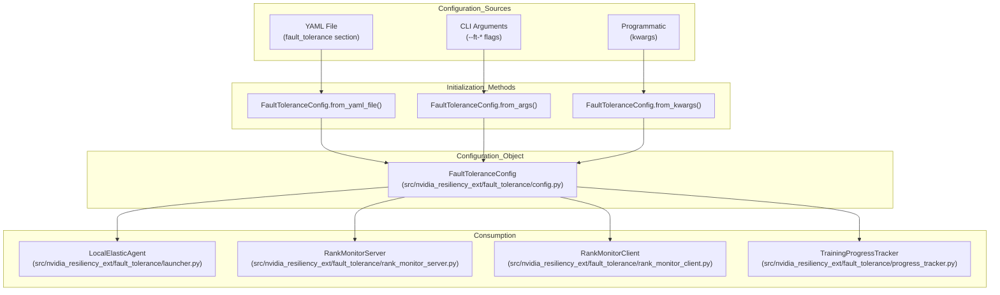
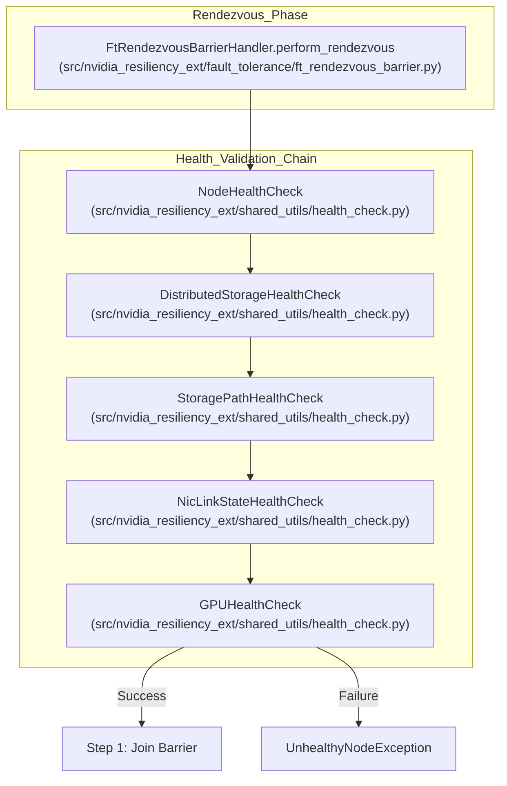

<!-- source: DeepWiki mcp.deepwiki.com · repo NVIDIA/nvidia-resiliency-ext · page 2.4 Configuration Guide · fetched 2026-10-26 -->

# Configuration Guide

<details>
<summary>Relevant source files</summary>

The following files were used as context for generating this wiki page:

- [build.py](build.py)
- [docs/source/fault_tolerance/usage_guide.rst](docs/source/fault_tolerance/usage_guide.rst)
- [examples/fault_tolerance/fault_tol_cfg_heartbeats.yaml](examples/fault_tolerance/fault_tol_cfg_heartbeats.yaml)
- [examples/fault_tolerance/fault_tol_cfg_sections.yaml](examples/fault_tolerance/fault_tol_cfg_sections.yaml)
- [src/nvidia_resiliency_ext/fault_tolerance/attribution_manager.py](src/nvidia_resiliency_ext/fault_tolerance/attribution_manager.py)
- [src/nvidia_resiliency_ext/fault_tolerance/config.py](src/nvidia_resiliency_ext/fault_tolerance/config.py)
- [src/nvidia_resiliency_ext/fault_tolerance/ft_rendezvous_barrier.py](src/nvidia_resiliency_ext/fault_tolerance/ft_rendezvous_barrier.py)
- [src/nvidia_resiliency_ext/fault_tolerance/launcher.py](src/nvidia_resiliency_ext/fault_tolerance/launcher.py)
- [src/nvidia_resiliency_ext/services/smonsvc/slurm.py](src/nvidia_resiliency_ext/services/smonsvc/slurm.py)
- [src/nvidia_resiliency_ext/shared_utils/health_check.py](src/nvidia_resiliency_ext/shared_utils/health_check.py)
- [tests/fault_tolerance/unit/test_attribution_manager.py](tests/fault_tolerance/unit/test_attribution_manager.py)
- [tests/fault_tolerance/unit/test_barrier_rendezvous.py](tests/fault_tolerance/unit/test_barrier_rendezvous.py)
- [tests/fault_tolerance/unit/test_config.py](tests/fault_tolerance/unit/test_config.py)
- [tests/fault_tolerance/unit/test_launcher.py](tests/fault_tolerance/unit/test_launcher.py)
- [tests/shared_utils/test_health_check.py](tests/shared_utils/test_health_check.py)

</details>


## Purpose and Scope

This page provides comprehensive documentation for configuring the Fault Tolerance system through the `FaultToleranceConfig` dataclass and `ft_launcher` CLI arguments. It covers available configuration parameters, multiple configuration methods (YAML, CLI, programmatic), health check options, GPU memory reclaim, and SLURM integration.

For information about the launcher's architecture and lifecycle management, see [ft_launcher and LocalElasticAgent](). For details on how monitoring works, see [Rank Monitoring and Progress Tracking]().

---

## FaultToleranceConfig Overview

The `FaultToleranceConfig` dataclass centralizes all fault tolerance settings and provides multiple initialization methods. The configuration flows through the system as shown below:

**Configuration Flow**



Sources: [src/nvidia_resiliency_ext/fault_tolerance/config.py:28-109](), [src/nvidia_resiliency_ext/fault_tolerance/launcher.py:72-91]()

---

## Configuration Parameters

### Core Monitoring Parameters

| Parameter | Type | Default | Description |
|-----------|------|---------|-------------|
| `workload_check_interval` | `float` | `5.0` | Periodic rank check interval (seconds) in rank monitors [src/nvidia_resiliency_ext/fault_tolerance/config.py:32-32]() |
| `initial_rank_heartbeat_timeout` | `Optional[float]` | `None` | Timeout (seconds) for first heartbeat from a rank [src/nvidia_resiliency_ext/fault_tolerance/config.py:33-33]() |
| `rank_heartbeat_timeout` | `Optional[float]` | `None` | Timeout (seconds) for subsequent heartbeats [src/nvidia_resiliency_ext/fault_tolerance/config.py:38-38]() |
| `rank_section_timeouts` | `Mapping[str, Optional[float]]` | `{}` | Per-section timeouts for user code [src/nvidia_resiliency_ext/fault_tolerance/config.py:46-48]() |
| `rank_out_of_section_timeout` | `Optional[float]` | `None` | Timeout for implicit/default section [src/nvidia_resiliency_ext/fault_tolerance/config.py:49-50]() |
| `safety_factor` | `float` | `5.0` | Multiplier for deduced timeouts [src/nvidia_resiliency_ext/fault_tolerance/config.py:42-43]() |

**Important**: Setting any timeout to `None` disables it (treated as +∞). All timeouts can be auto-deduced at runtime [src/nvidia_resiliency_ext/fault_tolerance/config.py:109-110]().

Sources: [src/nvidia_resiliency_ext/fault_tolerance/config.py:32-51](), [src/nvidia_resiliency_ext/fault_tolerance/config.py:111-119]()

### Health Check and Storage Parameters

| Parameter | Type | Default | Description |
|-----------|------|---------|-------------|
| `enable_nic_healthcheck` | `bool` | `True` | Enable NIC link state health check before rendezvous [src/nvidia_resiliency_ext/fault_tolerance/config.py:53-56]() |
| `enable_nic_monitor` | `bool` | `False` | Enable periodic NIC link down monitoring [src/nvidia_resiliency_ext/fault_tolerance/config.py:52-52]() |
| `enable_dist_storage_healthcheck` | `bool` | `False` | Enable Lustre + NFS health checks [src/nvidia_resiliency_ext/fault_tolerance/config.py:62-63]() |
| `storage_healthcheck_path` | `Optional[str]` | `None` | Comma-separated absolute paths to validate [src/nvidia_resiliency_ext/fault_tolerance/config.py:64-65]() |
| `attribution_endpoint` | `str` | `None` | Endpoint of the attribution service [src/nvidia_resiliency_ext/fault_tolerance/config.py:99-99]() |

Sources: [src/nvidia_resiliency_ext/fault_tolerance/config.py:52-65](), [src/nvidia_resiliency_ext/fault_tolerance/config.py:121-128]()

### GPU Memory Management Parameters

| Parameter | Type | Default | Description |
|-----------|------|---------|-------------|
| `gpu_memory_reclaim_timeout` | `float` | `50.0` | Timeout (seconds) to wait for GPU memory reclaim [src/nvidia_resiliency_ext/fault_tolerance/config.py:83-85]() |
| `gpu_memory_tolerance_mb` | `float` | `512.0` | Max allowed GPU memory usage (MB) [src/nvidia_resiliency_ext/fault_tolerance/config.py:86-87]() |
| `gpu_memory_poll_interval` | `float` | `2.0` | Poll interval (seconds) for memory check [src/nvidia_resiliency_ext/fault_tolerance/config.py:88-89]() |

The launcher waits for GPU memory to drop below `gpu_memory_tolerance_mb` before starting new workers after a failure. This prevents memory-related failures on restart [src/nvidia_resiliency_ext/fault_tolerance/config.py:83-85]().

Sources: [src/nvidia_resiliency_ext/fault_tolerance/config.py:83-88](), [src/nvidia_resiliency_ext/fault_tolerance/config.py:138-140]()

### Segment and SLURM Integration

| Parameter | Type | Default | Description |
|-----------|------|---------|-------------|
| `segment` | `Optional[int]` | `None` | Segment-aware mode for NVSwitch systems (DGX H200, B200) [src/nvidia_resiliency_ext/fault_tolerance/config.py:70-77]() |
| `numa_bind_strict` | `bool` | `True` | Strict NUMA binding for CPU and memory [src/nvidia_resiliency_ext/fault_tolerance/config.py:80-82]() |
| `cycle_info_dir` | `Optional[str]` | `None` | Path to NVRx cycle info directory [src/nvidia_resiliency_ext/fault_tolerance/config.py:103-107]() |

**Segment Awareness**: Setting `segment=N` enables domain-aware rank assignment. The system identifies NVLink domains via GPU ClusterUUID. It selects complete segments from valid domains (domains with at least `segment` nodes) [src/nvidia_resiliency_ext/fault_tolerance/config.py:70-79]().

Sources: [src/nvidia_resiliency_ext/fault_tolerance/config.py:70-82](), [src/nvidia_resiliency_ext/fault_tolerance/config.py:133-151]()

---

## Configuration Methods

### YAML Configuration

The `fault_tolerance` section can appear at any level in the YAML file. The loader searches for the first instance of this key [src/nvidia_resiliency_ext/fault_tolerance/config.py:181-193]().

**Example YAML Configuration**

```yaml
# fault_tol_cfg_sections.yaml
fault_tolerance:
    initial_rank_heartbeat_timeout: null
    rank_heartbeat_timeout: null
    rank_section_timeouts:
        init: 20
        step: 10
        checkpoint: 30
    rank_out_of_section_timeout: 30
    log_level: "DEBUG"
```

Sources: [examples/fault_tolerance/fault_tol_cfg_sections.yaml:1-9](), [src/nvidia_resiliency_ext/fault_tolerance/config.py:166-180]()

### CLI Arguments with ft_launcher

Configuration parameters can be overridden via CLI arguments prefixed with `--ft-`.

**CLI Configuration Syntax**

```bash
ft_launcher \
    --ft-cfg-path config.yaml \
    --ft-workload-check-interval 5.0 \
    --ft-enable-dist-storage-healthcheck true \
    --ft-storage-healthcheck-path "/data/checkpoints,/mnt/dataset" \
    --ft-attribution-endpoint localhost \
    --nnodes 2 \
    --nproc-per-node 8 \
    training_script.py
```

Sources: [docs/source/fault_tolerance/usage_guide.rst:86-97](), [docs/source/fault_tolerance/usage_guide.rst:125-130]()

### Programmatic Configuration

Configuration objects can be created directly using `from_kwargs` or `from_args` [src/nvidia_resiliency_ext/fault_tolerance/config.py:106-127]().

```python
from nvidia_resiliency_ext.fault_tolerance.config import FaultToleranceConfig

# Create config with specific overrides
ft_cfg = FaultToleranceConfig.from_kwargs(
    rank_heartbeat_timeout=123.0,
    ignore_not_recognized=True
)
```

Sources: [tests/fault_tolerance/unit/test_config.py:27-50]()

---

## Health Check Implementation

The system performs several health checks before rendezvous to ensure node readiness.

**Health Check Data Flow**



Sources: [src/nvidia_resiliency_ext/fault_tolerance/ft_rendezvous_barrier.py:57-72](), [src/nvidia_resiliency_ext/fault_tolerance/launcher.py:123-131]()

### Node Health Check Service
The launcher can query an external `nvhcd`-compatible service via the `--ft-node-health-check-endpoint` flag [docs/source/fault_tolerance/usage_guide.rst:57-59](). This service typically wraps BCM Slurm prolog/epilog checks to ensure node sanity before workers join the rendezvous [docs/source/fault_tolerance/usage_guide.rst:68-73]().

---

## SLURM Integration and Rank Assignment

The system integrates with SLURM to determine infrastructure ranks and topology.

**Rank Assignment Logic**

| Scenario | Logic |
|----------|-------|
| **SLURM Job** | Uses `SLURM_PROCID` or `GROUP_RANK` to determine infrastructure rank [src/nvidia_resiliency_ext/fault_tolerance/utils.py:79-79](). |
| **Segment Aware** | Uses `nvidia-smi` to query GPU `ClusterUUID`. Groups nodes by domain and selects segments [src/nvidia_resiliency_ext/fault_tolerance/config.py:70-79](). |
| **Hot Spare** | If `min_nodes < actual_nodes`, extra nodes become hot spares and do not join the initial training group [src/nvidia_resiliency_ext/fault_tolerance/ft_rendezvous_barrier.py:118-122](). |

Sources: [src/nvidia_resiliency_ext/fault_tolerance/ft_rendezvous_barrier.py:77-84](), [src/nvidia_resiliency_ext/fault_tolerance/config.py:70-79]()

---

## Best Practices

### Performance Optimization
- **`skip_section_response=True`**: Recommended for production. It makes IPC communication unidirectional (Rank -> Monitor), significantly reducing latency for high-frequency operations [src/nvidia_resiliency_ext/fault_tolerance/config.py:66-69]().
- **Warmup Iterations**: Use `num_warmup_iterations` (default: 5) to exclude initial slow iterations from timeout monitoring [src/nvidia_resiliency_ext/fault_tolerance/config.py:94-97]().

### Logging and Debugging
- **Deprecation**: `FT_LAUNCHER_LOGLEVEL` is deprecated. Use `NVRX_LOG_DEBUG=1` for debug logging [src/nvidia_resiliency_ext/fault_tolerance/launcher.py:110-116]().
- **Exception Hook**: Enable `install_exception_hook=True` to reliably capture and log tracebacks from training worker processes [src/nvidia_resiliency_ext/fault_tolerance/config.py:89-93]().

Sources: [src/nvidia_resiliency_ext/fault_tolerance/config.py:66-97](), [src/nvidia_resiliency_ext/fault_tolerance/launcher.py:110-116]()

---

