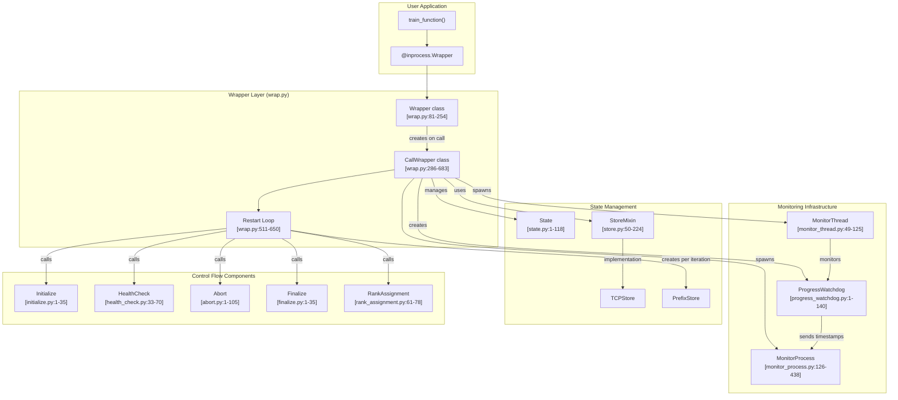
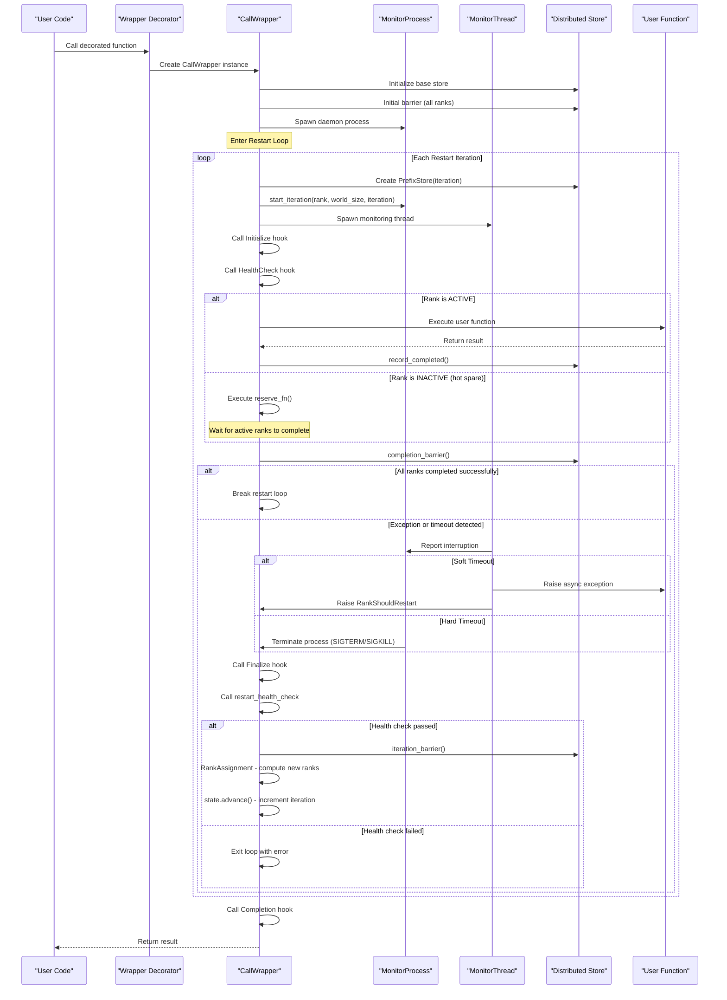

<!-- source: DeepWiki mcp.deepwiki.com · repo NVIDIA/nvidia-resiliency-ext · page 3 In-Process Restart System · fetched 2026-10-26 -->

# In-Process Restart System

<details>
<summary>Relevant source files</summary>

The following files were used as context for generating this wiki page:

- [docs/source/fault_tolerance/examples.rst](docs/source/fault_tolerance/examples.rst)
- [docs/source/fault_tolerance/integration/inprocess.rst](docs/source/fault_tolerance/integration/inprocess.rst)
- [docs/source/inprocess/api/health_check.rst](docs/source/inprocess/api/health_check.rst)
- [docs/source/inprocess/usage_guide.rst](docs/source/inprocess/usage_guide.rst)
- [src/nvidia_resiliency_ext/inprocess/__init__.py](src/nvidia_resiliency_ext/inprocess/__init__.py)
- [src/nvidia_resiliency_ext/inprocess/completion.py](src/nvidia_resiliency_ext/inprocess/completion.py)
- [src/nvidia_resiliency_ext/inprocess/health_check.py](src/nvidia_resiliency_ext/inprocess/health_check.py)
- [src/nvidia_resiliency_ext/inprocess/monitor_process.py](src/nvidia_resiliency_ext/inprocess/monitor_process.py)
- [src/nvidia_resiliency_ext/inprocess/nested_restarter.py](src/nvidia_resiliency_ext/inprocess/nested_restarter.py)
- [src/nvidia_resiliency_ext/inprocess/terminate.py](src/nvidia_resiliency_ext/inprocess/terminate.py)
- [src/nvidia_resiliency_ext/inprocess/wrap.py](src/nvidia_resiliency_ext/inprocess/wrap.py)
- [src/nvidia_resiliency_ext/shared_utils/wait_daemon.py](src/nvidia_resiliency_ext/shared_utils/wait_daemon.py)
- [tests/fault_tolerance/func/run_launcher_any_failed_mode_test.sh](tests/fault_tolerance/func/run_launcher_any_failed_mode_test.sh)
- [tests/inprocess/test_hang_protection_disabler.py](tests/inprocess/test_hang_protection_disabler.py)
- [tests/inprocess/test_nested_restarter.py](tests/inprocess/test_nested_restarter.py)
- [tests/inprocess/test_wrap.py](tests/inprocess/test_wrap.py)

</details>


## Purpose and Scope

The In-Process Restart System provides function-level automatic restart capabilities for distributed PyTorch workloads. Unlike the `ft_launcher` system (see [Fault Tolerance System](#2)) which operates at the job level by spawning and managing worker processes, the in-process system enables restart within the same operating system process using the `@inprocess.Wrapper` decorator [src/nvidia_resiliency_ext/inprocess/wrap.py:81-94]().

This document provides an overview of the in-process restart architecture and its core components. For detailed documentation on specific aspects:
- **Wrapper Architecture**: Document the Wrapper decorator and CallWrapper execution manager, explaining the restart loop, iteration management, state lifecycle, and integration with user functions. See [Wrapper Architecture](#3.1).
- **Monitoring and Timeouts**: Explain the dual monitoring architecture (MonitorProcess daemon + MonitorThread), ProgressWatchdog timestamp tracking, and timeout enforcement. See [Monitoring and Timeouts](#3.2).
- **Rank Assignment Strategies**: Document RankAssignment and RankFilter abstractions, concrete implementations (Tree, FillGaps, ShiftRanks), and topology-aware rank reassignment. See [Rank Assignment Strategies](#3.3).
- **Distributed State Management**: Explain the StoreMixin interface, barrier synchronization mechanisms, heartbeat tracking, and iteration-scoped namespacing. See [Distributed State Management](#3.4).
- **Abort Mechanisms**: Document the Abort abstract base class and concrete implementations (AbortTorchDistributed, AbortTransformerEngine), and asynchronous exception raising. See [Abort Mechanisms](#3.5).
- **Health Checks**: Detail the health check chain (GPUHealthCheck, NVLHealthCheck, NicHealthCheck) and pre-restart health validation. See [Health Checks](#3.6).

Sources: [src/nvidia_resiliency_ext/inprocess/wrap.py:82-138]()

## System Overview

The in-process restart system wraps a user-provided training function with restart capabilities. When any rank encounters a fault (exception, timeout, hang), the system automatically restarts the function across all healthy ranks, reassigns rank IDs to exclude terminated workers, and continues execution until all ranks complete successfully or a termination condition is met [src/nvidia_resiliency_ext/inprocess/wrap.py:86-92]().

### Core Components

| Component | Implementation | Purpose |
|-----------|----------------|---------|
| `Wrapper` | [src/nvidia_resiliency_ext/inprocess/wrap.py:81-254]() | Decorator that wraps user functions with restart capabilities |
| `CallWrapper` | [src/nvidia_resiliency_ext/inprocess/wrap.py:286-683]() | Manages execution state and restart loop for a single function invocation |
| `MonitorProcess` | [src/nvidia_resiliency_ext/inprocess/monitor_process.py:126-438]() | Independent daemon process that monitors the main process for hangs and timeouts |
| `MonitorThread` | [src/nvidia_resiliency_ext/inprocess/monitor_thread.py:49-125]() | In-process thread for faster fault detection and asynchronous abort |
| `ProgressWatchdog` | [src/nvidia_resiliency_ext/inprocess/progress_watchdog.py:1-140]() | Tracks progress timestamps and communicates with MonitorProcess |
| `State` | [src/nvidia_resiliency_ext/inprocess/state.py:1-118]() | Tracks current rank, world size, iteration, and execution mode |

### Key Characteristics

- **Single Process Context**: All restarts occur within the same OS process, preserving SLURM job allocation [docs/source/inprocess/usage_guide.rst:22-27]().
- **Automatic Coordination**: Distributed ranks automatically synchronize restart decisions via distributed store [src/nvidia_resiliency_ext/inprocess/store.py:186-224]().
- **Dual Monitoring**: Both in-process thread (fast) and external daemon process (survives hangs) [src/nvidia_resiliency_ext/inprocess/wrap.py:441-488]().
- **Rank Reassignment**: Dynamic world size adjustment excludes terminated/unhealthy ranks [src/nvidia_resiliency_ext/inprocess/rank_assignment.py:61-78]().
- **Iteration Management**: Each restart attempt increments iteration counter for isolated state [src/nvidia_resiliency_ext/inprocess/state.py:75-84]().

Sources: [src/nvidia_resiliency_ext/inprocess/wrap.py:82-138](), [src/nvidia_resiliency_ext/inprocess/wrap.py:286-303](), [docs/source/inprocess/usage_guide.rst:22-27]()

## Architecture and Component Relationships



Sources: [src/nvidia_resiliency_ext/inprocess/wrap.py:81-683](), [src/nvidia_resiliency_ext/inprocess/monitor_process.py:126-438](), [src/nvidia_resiliency_ext/inprocess/rank_assignment.py:61-78]()

## Execution Flow

The following diagram illustrates the complete lifecycle of a wrapped function call, from initialization through restart iterations to completion:



Sources: [src/nvidia_resiliency_ext/inprocess/wrap.py:490-683]()

## Basic Usage Pattern

The `Wrapper` is used as a decorator on the training function. It requires a `store_factory` to coordinate across distributed ranks [src/nvidia_resiliency_ext/inprocess/wrap.py:140-169]().

```python
import torch.distributed
from nvidia_resiliency_ext import inprocess
from datetime import timedelta

# Configure wrapper with desired parameters
wrapper = inprocess.Wrapper(
    store_factory=inprocess.TCPStore,
    store_kwargs={'port': 29500},
    soft_timeout=timedelta(seconds=60),
    hard_timeout=timedelta(seconds=90),
    rank_assignment=inprocess.Compose(
        inprocess.ActivateAllRanks(),
        inprocess.ShiftRanks(),
    ),
)

# Apply decorator to training function
@wrapper
def train_model():
    # Initialize distributed backend
    torch.distributed.init_process_group(backend='nccl')
    
    # Training loop
    for epoch in range(10):
        # ... training logic ...
        pass
        
    torch.distributed.destroy_process_group()
```

### Accessing CallWrapper State

The active `CallWrapper` instance is automatically injected into function arguments annotated with the `CallWrapper` type [src/nvidia_resiliency_ext/inprocess/wrap.py:244-253]():

```python
from typing import Optional
from nvidia_resiliency_ext.inprocess import CallWrapper

@wrapper
def train_model(call_wrapper: Optional[CallWrapper] = None):
    # Access restart iteration number
    print(f"Restart iteration: {call_wrapper.iteration}")
    
    # Manual progress indication
    call_wrapper.ping()  # Report progress to watchdog
    
    # Protect critical sections from interruption
    with call_wrapper.atomic():
        # save_checkpoint()
        pass
```

Sources: [src/nvidia_resiliency_ext/inprocess/wrap.py:244-253](), [src/nvidia_resiliency_ext/inprocess/wrap.py:286-303]()

## Monitoring and Fault Detection

The system employs a dual monitoring architecture for robust fault detection [src/nvidia_resiliency_ext/inprocess/wrap.py:441-488]():

### Timeout Detection Tiers

| Timeout Type | Detection | Action | Recovery |
|-------------|-----------|--------|----------|
| **Soft Timeout** | `MonitorThread` reads `ProgressWatchdog` timestamp [src/nvidia_resiliency_ext/inprocess/monitor_thread.py:84-110]() | Async exception raised in main thread via `Abort` mechanism | Rank participates in restart if healthy |
| **Hard Timeout** | `MonitorProcess` reads timestamp via IPC queue [src/nvidia_resiliency_ext/inprocess/monitor_process.py:321-346]() | Process terminated with `SIGTERM`, then `SIGKILL` if needed | Rank excluded from next iteration |
| **Heartbeat Timeout** | `SiblingMonitor` detects missing peer heartbeats [src/nvidia_resiliency_ext/inprocess/sibling_monitor.py:112-135]() | Records interruption for unresponsive rank | Other ranks continue, exclude missing rank |

The `ProgressWatchdog` provides two modes:
- **Automatic**: Background thread updates timestamp at `progress_watchdog_interval` [src/nvidia_resiliency_ext/inprocess/progress_watchdog.py:123-138]().
- **Manual**: User calls `call_wrapper.ping()` to report progress [src/nvidia_resiliency_ext/inprocess/wrap.py:433-439]().

Sources: [src/nvidia_resiliency_ext/inprocess/wrap.py:153-163](), [src/nvidia_resiliency_ext/inprocess/monitor_process.py:126-346]()

## Integration with Other Subsystems

### Asynchronous Checkpointing
The `AbortPersistentCheckpointProcesses` abort handler integrates with the checkpointing subsystem to terminate background checkpoint workers during fault scenarios [src/nvidia_resiliency_ext/inprocess/abort.py:101-105]().

### Health Monitoring
The wrapper automatically augments user-provided health checks with GPU, NVLink, and NIC validation [src/nvidia_resiliency_ext/inprocess/wrap.py:255-284](). Concrete implementations like `ChainedGPUHealthCheck` use `shared_utils` to verify hardware state [src/nvidia_resiliency_ext/inprocess/health_check.py:155-177]().

### Nested Restarter Logging
For complex integrations, `NestedRestarterCallback` and its variants (e.g., `NestedRestarterHandlingStarting`, `NestedRestarterHandlingCompleted`) provide standardized logging of the restarter state to the attribution service [src/nvidia_resiliency_ext/inprocess/nested_restarter.py:36-108]().

Sources: [src/nvidia_resiliency_ext/inprocess/wrap.py:255-284](), [src/nvidia_resiliency_ext/inprocess/abort.py:101-105](), [src/nvidia_resiliency_ext/inprocess/nested_restarter.py:36-108]()

## SLURM Integration

The `MonitorProcess` is a double-forked daemon that survives the main process [src/nvidia_resiliency_ext/inprocess/monitor_process.py:83-124](). In SLURM environments, a helper script prevents premature job termination:

```bash
# Example SLURM launch
srun --kill-on-bad-exit=0 python train.py &
python -m nvidia_resiliency_ext.shared_utils.wait_daemon /tmp/monitor_{SLURM_PROCID}.pid
```

The `wait_daemon` utility reads monitor process PIDs from the specified file and waits for them to complete before allowing SLURM to terminate the job [src/nvidia_resiliency_ext/shared_utils/wait_daemon.py:60-75](). This ensures the `MonitorProcess` can finalize distributed store operations [docs/source/inprocess/usage_guide.rst:105-113]().

Sources: [src/nvidia_resiliency_ext/shared_utils/wait_daemon.py:1-91](), [src/nvidia_resiliency_ext/inprocess/monitor_process.py:83-124](), [docs/source/inprocess/usage_guide.rst:105-113]()

---

