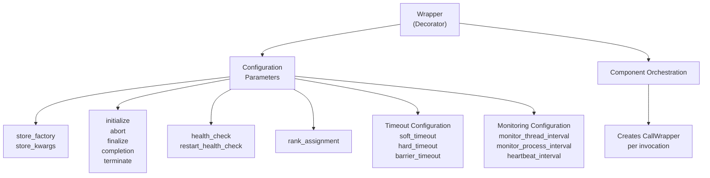
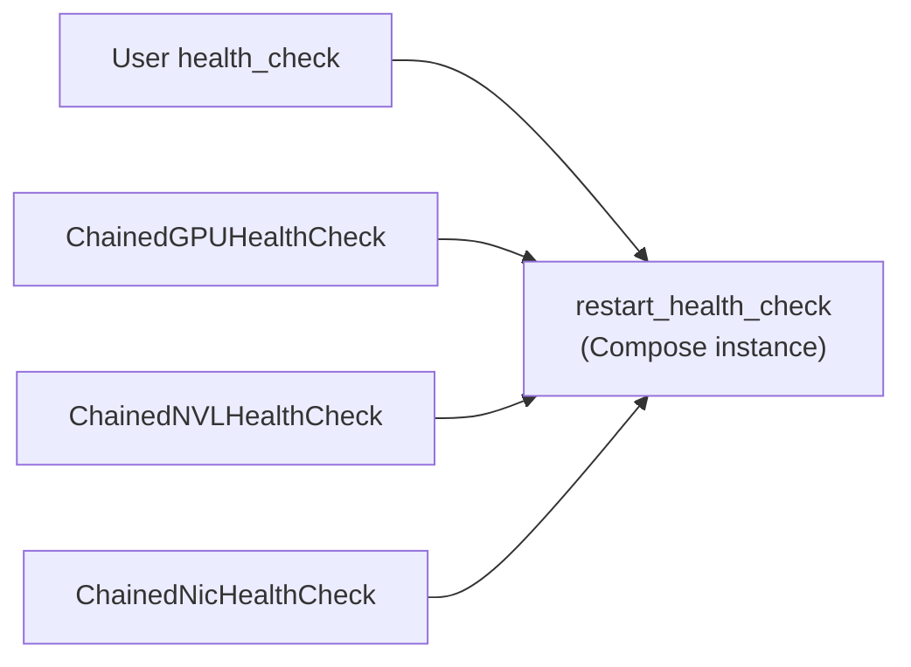
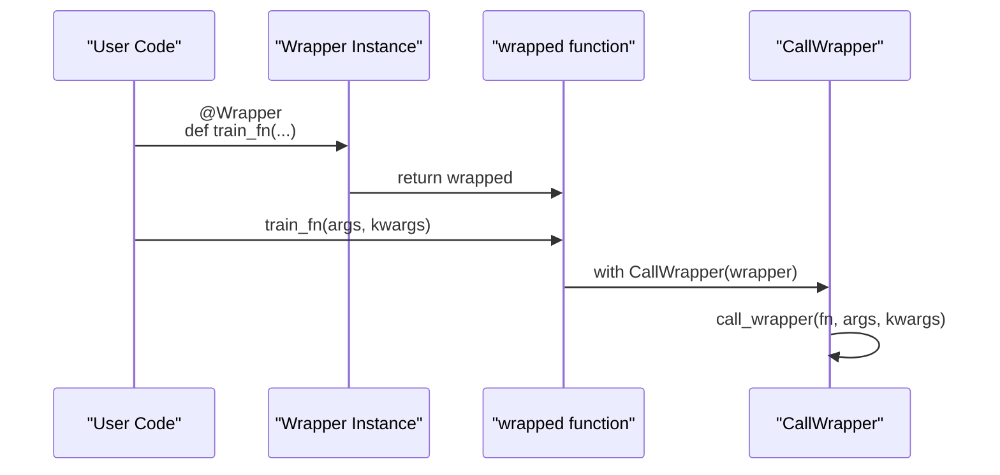
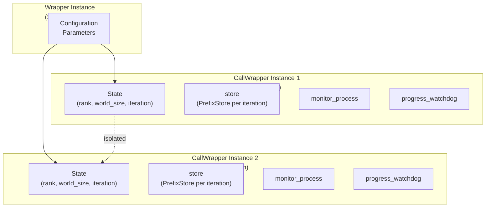
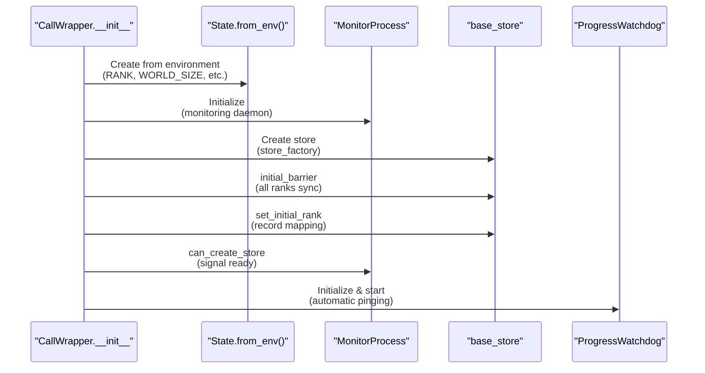
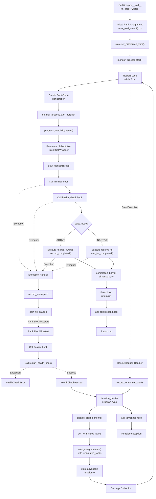

<!-- source: DeepWiki mcp.deepwiki.com · repo NVIDIA/nvidia-resiliency-ext · page 3.1 Wrapper Architecture · fetched 2026-10-26 -->

# Wrapper Architecture

<details>
<summary>Relevant source files</summary>

The following files were used as context for generating this wiki page:

- [docs/source/fault_tolerance/examples.rst](docs/source/fault_tolerance/examples.rst)
- [docs/source/fault_tolerance/integration/inprocess.rst](docs/source/fault_tolerance/integration/inprocess.rst)
- [docs/source/inprocess/api/health_check.rst](docs/source/inprocess/api/health_check.rst)
- [docs/source/inprocess/examples.rst](docs/source/inprocess/examples.rst)
- [docs/source/inprocess/examples/optimal_example.rst](docs/source/inprocess/examples/optimal_example.rst)
- [docs/source/inprocess/usage_guide.rst](docs/source/inprocess/usage_guide.rst)
- [examples/inprocess/advanced_example.py](examples/inprocess/advanced_example.py)
- [src/nvidia_resiliency_ext/inprocess/__init__.py](src/nvidia_resiliency_ext/inprocess/__init__.py)
- [src/nvidia_resiliency_ext/inprocess/completion.py](src/nvidia_resiliency_ext/inprocess/completion.py)
- [src/nvidia_resiliency_ext/inprocess/health_check.py](src/nvidia_resiliency_ext/inprocess/health_check.py)
- [src/nvidia_resiliency_ext/inprocess/monitor_process.py](src/nvidia_resiliency_ext/inprocess/monitor_process.py)
- [src/nvidia_resiliency_ext/inprocess/nested_restarter.py](src/nvidia_resiliency_ext/inprocess/nested_restarter.py)
- [src/nvidia_resiliency_ext/inprocess/terminate.py](src/nvidia_resiliency_ext/inprocess/terminate.py)
- [src/nvidia_resiliency_ext/inprocess/wrap.py](src/nvidia_resiliency_ext/inprocess/wrap.py)
- [src/nvidia_resiliency_ext/shared_utils/wait_daemon.py](src/nvidia_resiliency_ext/shared_utils/wait_daemon.py)
- [tests/fault_tolerance/func/run_launcher_any_failed_mode_test.sh](tests/fault_tolerance/func/run_launcher_any_failed_mode_test.sh)
- [tests/inprocess/test_hang_protection_disabler.py](tests/inprocess/test_hang_protection_disabler.py)
- [tests/inprocess/test_nested_restarter.py](tests/inprocess/test_nested_restarter.py)
- [tests/inprocess/test_wrap.py](tests/inprocess/test_wrap.py)

</details>


## Purpose and Scope

The `Wrapper` and `CallWrapper` classes provide the core interface and execution engine for in-process restart capabilities in distributed PyTorch workloads. The `Wrapper` class is a Python decorator that wraps user training functions, while `CallWrapper` manages the state and restart loop for each function invocation. Together, they enable automatic recovery from faults without terminating the Python process, offering significantly faster recovery than process-level restarts.

For detailed information about the monitoring architecture used by these classes, see [3.2 Monitoring and Timeouts](). For rank reassignment during restarts, see [3.3 Rank Assignment Strategies](). For cleanup mechanisms, see [3.5 Abort Mechanisms]().

Sources: [src/nvidia_resiliency_ext/inprocess/wrap.py:81-138](), [src/nvidia_resiliency_ext/inprocess/wrap.py:286-302]()

---

## Wrapper Class

The `Wrapper` class is a configurable decorator that adds restart capabilities to Python functions implementing distributed PyTorch workloads. It orchestrates multiple subsystems including monitoring, health checking, state management, and distributed coordination.

### Core Responsibilities



Sources: [src/nvidia_resiliency_ext/inprocess/wrap.py:81-243]()

### Configuration Parameters

The `Wrapper` class accepts numerous configuration parameters organized into several categories:

| Category | Parameters | Purpose |
|----------|-----------|---------|
| **Store** | `store_factory`, `store_kwargs` | Distributed communication infrastructure |
| **Lifecycle Hooks** | `initialize`, `abort`, `finalize`, `completion`, `terminate` | User-defined callbacks at key lifecycle points |
| **Health Validation** | `health_check` | Rank-local health checks before restart |
| **Rank Management** | `rank_assignment` | Policy for reassigning ranks after failures |
| **Timeouts** | `soft_timeout`, `hard_timeout`, `heartbeat_timeout`, `barrier_timeout`, `completion_timeout`, `last_call_wait` | Various timeout thresholds |
| **Monitoring Intervals** | `monitor_thread_interval`, `monitor_process_interval`, `heartbeat_interval`, `progress_watchdog_interval` | Polling and heartbeat frequencies |
| **Process Control** | `termination_grace_time`, `monitor_process_logfile`, `monitor_process_pidfile` | Hard timeout enforcement configuration |
| **Control** | `enabled` | Global enable/disable flag |

Sources: [src/nvidia_resiliency_ext/inprocess/wrap.py:140-169]()

### Timeout Hierarchy and Constraints

The `Wrapper` enforces a strict hierarchy of timeout values with validation at initialization:

```
monitor_*_interval < progress_watchdog_interval < soft_timeout < hard_timeout < barrier_timeout
                                                                                    ^
                                                                                    |
                                                                     heartbeat_timeout also < barrier_timeout
```

These constraints ensure that monitoring mechanisms can detect issues before harder timeout mechanisms are triggered.

Sources: [src/nvidia_resiliency_ext/inprocess/wrap.py:195-202]()

### Health Check Enhancement

The `Wrapper` automatically enhances user-provided health checks with GPU, NVL, and NIC validation. The `_construct_restart_health_check` method builds a composed health check chain using `ChainedGPUHealthCheck`, `ChainedNVLHealthCheck`, and `ChainedNicHealthCheck`.



The enhanced `restart_health_check` is executed before each restart iteration to ensure comprehensive system health validation.

Sources: [src/nvidia_resiliency_ext/inprocess/wrap.py:255-283](), [src/nvidia_resiliency_ext/inprocess/health_check.py:155-212]()

### Decorator Invocation

When `Wrapper` is used as a decorator, it implements the `__call__` method to return a wrapped function. When the wrapped function is called, it instantiates a `CallWrapper`.



Sources: [src/nvidia_resiliency_ext/inprocess/wrap.py:244-253]()

---

## CallWrapper Class

The `CallWrapper` class encapsulates the state and execution flow for a single invocation of the wrapped function. Each call to the wrapped function creates a new `CallWrapper` instance, ensuring that restart state is tied to the specific invocation rather than the function definition.

### Lifecycle and Ownership



Each `CallWrapper` manages its own `MonitorProcess`, `ProgressWatchdog`, `StoreMixin`, and `State` instances, providing complete isolation between invocations.

Sources: [src/nvidia_resiliency_ext/inprocess/wrap.py:286-302](), [src/nvidia_resiliency_ext/inprocess/wrap.py:304-362]()

### Key Attributes

| Attribute | Type | Purpose |
|-----------|------|---------|
| `monitor_process` | `MonitorProcess` | Double-forked daemon for hard timeout enforcement |
| `progress_watchdog` | `ProgressWatchdog` | Tracks progress and sends timestamps to monitor_process |
| `base_store` | `StoreMixin` | Distributed store for cross-rank coordination |
| `store` | `PrefixStore` | Iteration-scoped store wrapper |
| `state` | `State` | Current rank, world_size, iteration, and mode |
| `atomic_lock` | `threading.RLock` | Reentrant lock for atomic sections |
| `wrapper` | `Wrapper` | Reference to parent Wrapper configuration |

Sources: [src/nvidia_resiliency_ext/inprocess/wrap.py:304-362]()

### Initialization Sequence

The `CallWrapper.__init__` method performs several critical initialization steps:



The initialization sequence ensures that all distributed components are synchronized before the restart loop begins.

Sources: [src/nvidia_resiliency_ext/inprocess/wrap.py:304-362]()

### Context Manager Protocol

`CallWrapper` implements the context manager protocol to ensure proper cleanup. The `__exit__` method invokes `shutdown()`, which:
1. Waits on `termination_barrier` for critical ranks (or times out immediately for non-critical ranks).
2. Shuts down `ProgressWatchdog`.
3. Shuts down `MonitorProcess`.

Sources: [src/nvidia_resiliency_ext/inprocess/wrap.py:364-386]()

---

## Public API Methods

### ping()

Sends a heartbeat to indicate that the workload is making meaningful forward progress. This method activates the manual progress timeout mechanism.

```python
def ping(self) -> None:
    self.progress_watchdog.ping()
```

Once the first `ping()` is called in a restart iteration, all ranks must periodically invoke `ping()` within the `soft_timeout` and `hard_timeout` intervals.

Sources: [src/nvidia_resiliency_ext/inprocess/wrap.py:395-409]()

### atomic()

A context manager that prevents the termination procedure from executing while the main thread is within the atomic section. The implementation uses a reentrant lock (`threading.RLock`) shared between the termination procedure (in `MonitorThread`) and the atomic section in the wrapped function.

Sources: [src/nvidia_resiliency_ext/inprocess/wrap.py:411-430]()

### disable_hang_protection()

A context manager that temporarily disables soft and hard timeout mechanisms. This is useful for operations that may take arbitrarily long (e.g., data loading) but should not trigger hang detection.

The implementation:
1. Sends `Message.DISABLE_TIMEOUTS` to `MonitorProcess` [src/nvidia_resiliency_ext/inprocess/monitor_process.py:46]().
2. Resets `ProgressWatchdog` timestamp on re-enable [src/nvidia_resiliency_ext/inprocess/wrap.py:484]().
3. Sends `Message.ENABLE_TIMEOUTS` to `MonitorProcess` [src/nvidia_resiliency_ext/inprocess/monitor_process.py:47]().

Sources: [src/nvidia_resiliency_ext/inprocess/wrap.py:456-488](), [src/nvidia_resiliency_ext/inprocess/monitor_process.py:39-49]()

---

## Restart Loop Execution

The restart loop is implemented in `CallWrapper.__call__` and orchestrates the complete execution lifecycle including failure detection, cleanup, health checks, and rank reassignment.

### Main Execution Flow



Sources: [src/nvidia_resiliency_ext/inprocess/wrap.py:490-682]()

### Exception Handling Hierarchy

The restart loop implements a sophisticated exception handling hierarchy with three nested try-except blocks:

1. **Inner block**: Catches `Exception`, records interruption via `record_interrupted`, and spins until `MonitorThread` raises `RankShouldRestart` [src/nvidia_resiliency_ext/inprocess/wrap.py:581-602]().
2. **Middle block**: Catches `RankShouldRestart`, calls the `finalize` hook, and executes the `restart_health_check`. If successful, it raises `HealthCheckPassed` [src/nvidia_resiliency_ext/inprocess/wrap.py:604-627]().
3. **Outer block**: Catches `BaseException` or terminal `HealthCheckError`, records terminated ranks, and re-raises the exception to terminate the process [src/nvidia_resiliency_ext/inprocess/wrap.py:648-682]().

Sources: [src/nvidia_resiliency_ext/inprocess/wrap.py:530-643]()

---

## Component Integration

### MonitorProcess Integration

The `CallWrapper` creates and manages a `MonitorProcess` instance, which is a double-forked daemon that enforces hard timeouts.

Key interactions:
- `can_create_store()`: Signals that the main store is initialized [src/nvidia_resiliency_ext/inprocess/wrap.py:344]().
- `start()`: Allows the daemon to begin processing [src/nvidia_resiliency_ext/inprocess/wrap.py:507]().
- `start_iteration()`: Initializes per-iteration state [src/nvidia_resiliency_ext/inprocess/wrap.py:514-518]().
- `disable_sibling_monitor()`: Stops heartbeat monitoring [src/nvidia_resiliency_ext/inprocess/wrap.py:634]().

Sources: [src/nvidia_resiliency_ext/inprocess/wrap.py:318-362](), [src/nvidia_resiliency_ext/inprocess/monitor_process.py:126-346]()

### Active vs. Inactive Modes

The `CallWrapper` supports two execution modes determined by the rank assignment policy:

- **ACTIVE Mode**: Ranks execute the user function normally and record completion in the store [src/nvidia_resiliency_ext/inprocess/wrap.py:560-562]().
- **INACTIVE Mode**: Ranks execute `reserve_fn`, which pings the watchdog and waits for active ranks to complete [src/nvidia_resiliency_ext/inprocess/wrap.py:63-79]().

Sources: [src/nvidia_resiliency_ext/inprocess/wrap.py:563-569]()

---

## Integration with wait_daemon.py

In SLURM environments, the `MonitorProcess` daemon may outlive the main process. The `wait_daemon.py` utility script ensures SLURM jobs wait for all monitor processes to complete.

The workflow:
1. `MonitorProcess` writes its PID to `monitor_process_pidfile` [src/nvidia_resiliency_ext/inprocess/monitor_process.py:184-190]().
2. Main process completes and exits.
3. `wait_daemon.py` reads PIDs from the file and polls each PID until it exits [src/nvidia_resiliency_ext/shared_utils/wait_daemon.py:20-57]().

Sources: [src/nvidia_resiliency_ext/inprocess/monitor_process.py:126-190](), [src/nvidia_resiliency_ext/shared_utils/wait_daemon.py:20-90]()

---

