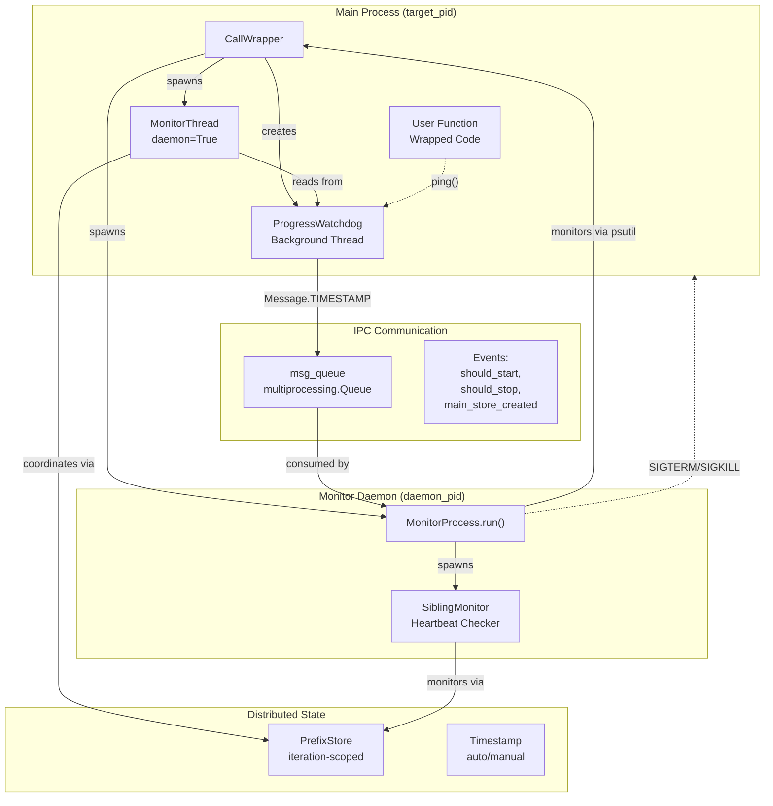
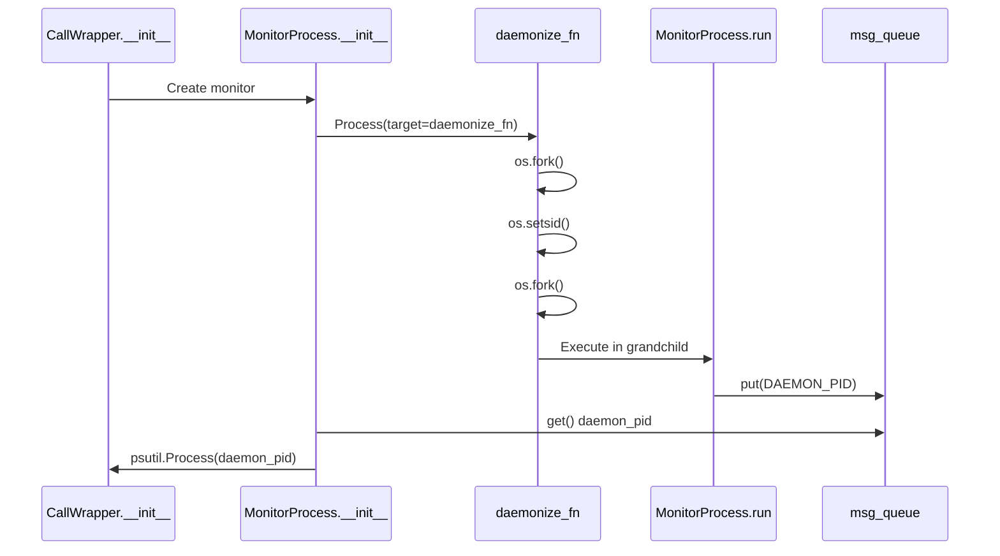
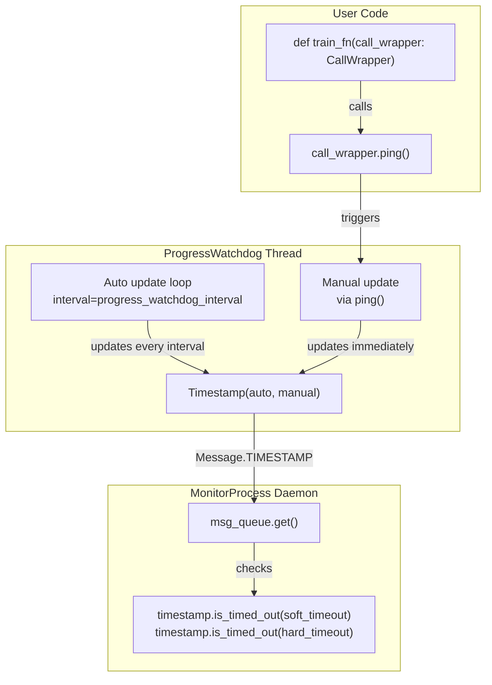
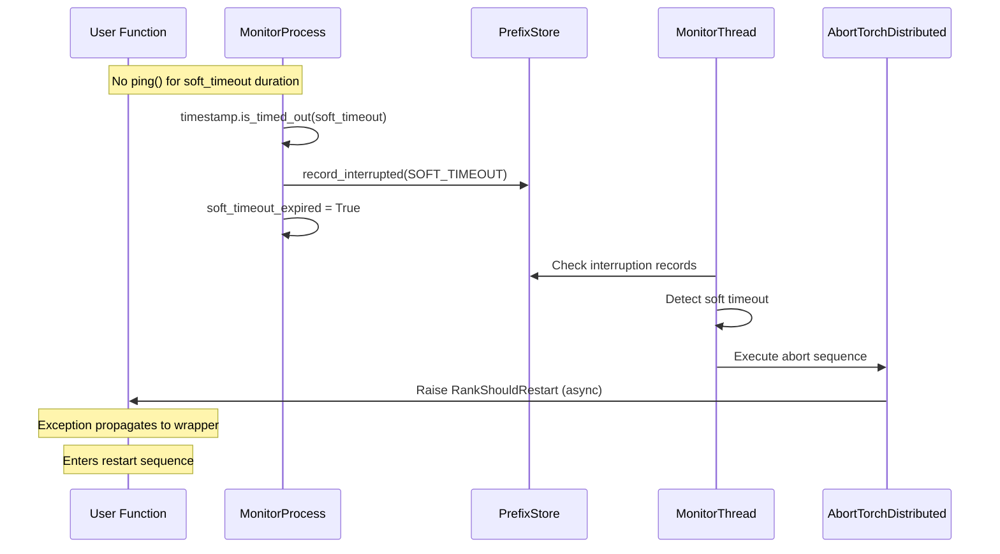
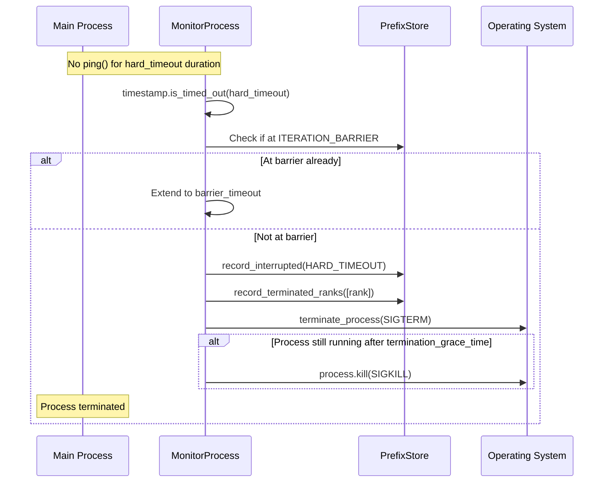
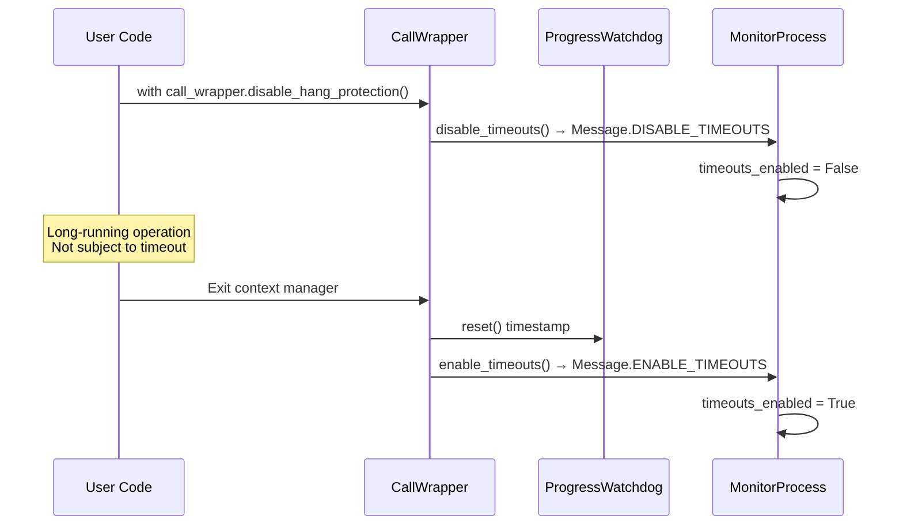
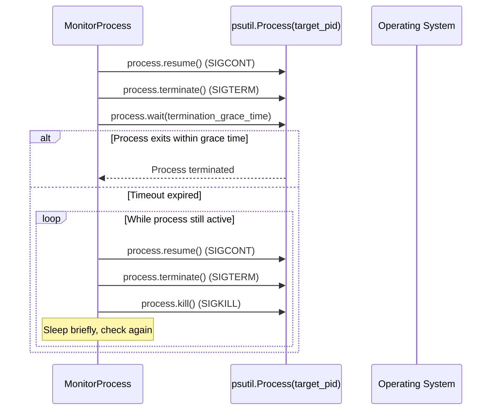

<!-- source: DeepWiki mcp.deepwiki.com · repo NVIDIA/nvidia-resiliency-ext · page 3.2 Monitoring and Timeouts · fetched 2026-10-26 -->

# Monitoring and Timeouts

Relevant source files

The following files were used as context for generating this wiki page:

- [docs/source/fault_tolerance/examples.rst](docs/source/fault_tolerance/examples.rst)
- [docs/source/fault_tolerance/integration/inprocess.rst](docs/source/fault_tolerance/integration/inprocess.rst)
- [docs/source/inprocess/api/health_check.rst](docs/source/inprocess/api/health_check.rst)
- [docs/source/inprocess/usage_guide.rst](docs/source/inprocess/usage_guide.rst)
- [src/nvidia_resiliency_ext/inprocess/finalize.py](src/nvidia_resiliency_ext/inprocess/finalize.py)
- [src/nvidia_resiliency_ext/inprocess/health_check.py](src/nvidia_resiliency_ext/inprocess/health_check.py)
- [src/nvidia_resiliency_ext/inprocess/monitor_process.py](src/nvidia_resiliency_ext/inprocess/monitor_process.py)
- [src/nvidia_resiliency_ext/inprocess/monitor_thread.py](src/nvidia_resiliency_ext/inprocess/monitor_thread.py)
- [src/nvidia_resiliency_ext/inprocess/progress_watchdog.py](src/nvidia_resiliency_ext/inprocess/progress_watchdog.py)
- [src/nvidia_resiliency_ext/inprocess/wrap.py](src/nvidia_resiliency_ext/inprocess/wrap.py)
- [src/nvidia_resiliency_ext/shared_utils/wait_daemon.py](src/nvidia_resiliency_ext/shared_utils/wait_daemon.py)
- [tests/fault_tolerance/func/run_launcher_any_failed_mode_test.sh](tests/fault_tolerance/func/run_launcher_any_failed_mode_test.sh)
- [tests/inprocess/test_hang_protection_disabler.py](tests/inprocess/test_hang_protection_disabler.py)
- [tests/inprocess/test_wrap.py](tests/inprocess/test_wrap.py)

This page documents the monitoring and timeout mechanisms in the in-process restart system. The system employs a dual monitoring architecture combining an external daemon process (`MonitorProcess`) with an in-process thread (`MonitorThread`) to provide comprehensive hang detection and timeout enforcement.

The monitoring architecture tracks execution progress through `ProgressWatchdog` timestamp updates and enforces configurable timeout policies using soft and hard timeout mechanisms. For the overall wrapper architecture, see page 3.1. For health checks integrated with monitoring, see page 3.6.

## Dual Monitoring Architecture

The monitoring system employs a dual-process architecture where both an external daemon process (`MonitorProcess`) and an in-process thread (`MonitorThread`) work together to detect hangs and enforce timeouts.

### Architecture Overview

**Key Components:**

| Component | Scope | Purpose | Survives Main Process Hang |
|-----------|-------|---------|---------------------------|
| `MonitorProcess` | External daemon | Enforces hard timeout, terminates hung processes | Yes |
| `MonitorThread` | In-process thread | Coordinates abort operations, detects soft timeout | No |
| `ProgressWatchdog` | In-process thread | Tracks timestamps, auto-updates progress | No |
| `SiblingMonitor` | Within MonitorProcess | Monitors peer ranks via heartbeats | Yes |

The dual architecture ensures that even if the main process hangs completely (blocking all Python threads), the external `MonitorProcess` daemon can still detect the hang and forcefully terminate the process using OS signals.

**Sources:** [src/nvidia_resiliency_ext/inprocess/wrap.py:304-332](), [src/nvidia_resiliency_ext/inprocess/monitor_process.py:126-148]()

## MonitorProcess: External Daemon Supervision

The `MonitorProcess` creates an independent daemon process that monitors the main training process from outside. This external supervision is critical for detecting complete hangs where the main process becomes unresponsive.

### Daemon Process Creation

The daemon is created using a double-fork pattern via `daemonize_fn()` to ensure complete independence from the parent process.

#### Daemon Creation Flow

The double-fork ensures:
1. **First fork**: Creates child process that becomes session leader [src/nvidia_resiliency_ext/inprocess/monitor_process.py:89-92]()
2. **Second fork**: Prevents daemon from acquiring controlling terminal [src/nvidia_resiliency_ext/inprocess/monitor_process.py:103-107]()
3. **Grandchild process**: Fully independent daemon with `/` as working directory [src/nvidia_resiliency_ext/inprocess/monitor_process.py:98-100]()

**Sources:** [src/nvidia_resiliency_ext/inprocess/monitor_process.py:83-123](), [src/nvidia_resiliency_ext/inprocess/monitor_process.py:368-429]()

### Message Protocol

The daemon communicates with the main process via `multiprocessing.Queue` using typed messages defined in the `Message` enum [src/nvidia_resiliency_ext/inprocess/monitor_process.py:39-47]().

| Message | Direction | Purpose | Payload Type |
|---------|-----------|---------|--------------|
| `DAEMON_PID` | Daemon → Main | Report daemon PID | `int` |
| `TIMESTAMP` | Main → Daemon | Progress update | `Timestamp` |
| `ITERATION_START` | Main → Daemon | Begin new iteration | `(rank, world_size, iteration)` |
| `DISABLE_SIBLING_MONITOR` | Main → Daemon | Stop peer monitoring | `None` |
| `DISABLE_TIMEOUTS` | Main → Daemon | Disable hang protection | `None` |
| `ENABLE_TIMEOUTS` | Main → Daemon | Re-enable hang protection | `None` |
| `RECORD_INTERRUPTED` | Main → Daemon | Record interruption | `InterruptionRecord` |
| `TERMINATE` | Main → Daemon | Shutdown daemon | `None` |

**Sources:** [src/nvidia_resiliency_ext/inprocess/monitor_process.py:39-47](), [src/nvidia_resiliency_ext/inprocess/monitor_process.py:347-366]()

### Daemon Lifecycle and PID Management

The daemon writes its PID to a file specified by `monitor_process_pidfile` parameter (with `{rank}` placeholder) [src/nvidia_resiliency_ext/inprocess/monitor_process.py:184-190](). This PID file enables external tools like `wait_daemon.py` to track monitor processes [src/nvidia_resiliency_ext/shared_utils/wait_daemon.py:60-75]().

**Sources:** [src/nvidia_resiliency_ext/inprocess/monitor_process.py:184-190](), [src/nvidia_resiliency_ext/shared_utils/wait_daemon.py:60-75]()

## ProgressWatchdog: Timestamp Tracking

The `ProgressWatchdog` class tracks execution progress through timestamp updates and communicates progress state to the external `MonitorProcess`. It operates as a background thread within the main process.

### Timestamp Structure

The `Timestamp` object tracks both automatic and manual updates [src/nvidia_resiliency_ext/inprocess/progress_watchdog.py:34-36]():
- **`auto`**: Automatically updated timestamp at `progress_watchdog_interval`
- **`manual`**: Manually updated via `CallWrapper.ping()` calls

#### Timestamp Update Flow

### Automatic vs Manual Progress Updates

**Automatic Updates**: Background thread updates `timestamp.auto` at `progress_watchdog_interval` frequency using `Py_AddPendingCall` to ensure the update occurs in the main Python thread [src/nvidia_resiliency_ext/inprocess/progress_watchdog.py:97-148]().

**Manual Updates**: User code calls `CallWrapper.ping()` [src/nvidia_resiliency_ext/inprocess/wrap.py:395-409]() to update `timestamp.manual` [src/nvidia_resiliency_ext/inprocess/progress_watchdog.py:90-92](), indicating meaningful progress.

**Sources:** [src/nvidia_resiliency_ext/inprocess/wrap.py:346-351](), [src/nvidia_resiliency_ext/inprocess/wrap.py:395-409](), [src/nvidia_resiliency_ext/inprocess/progress_watchdog.py:97-148]()

### Timestamp Reset

The watchdog resets timestamps at specific points:
- **Start of iteration**: `progress_watchdog.reset()` called in `CallWrapper.__call__()` [src/nvidia_resiliency_ext/inprocess/wrap.py:519]().
- **After function completion**: Reset before completion barrier [src/nvidia_resiliency_ext/inprocess/wrap.py:573]().
- **Before re-enabling timeouts**: Reset when calling `_enable_hang_protection()` [src/nvidia_resiliency_ext/inprocess/wrap.py:453]().

**Sources:** [src/nvidia_resiliency_ext/inprocess/wrap.py:519](), [src/nvidia_resiliency_ext/inprocess/wrap.py:573](), [src/nvidia_resiliency_ext/inprocess/wrap.py:453]()

## Timeout Mechanisms: Soft vs Hard

The system implements two-tier timeout enforcement with distinct behavior and consequences.

### Soft Timeout: Asynchronous Abort

When `timestamp.is_timed_out(soft_timeout)` returns `True` [src/nvidia_resiliency_ext/inprocess/progress_watchdog.py:38-46](), the daemon records an interruption but does not terminate the process. Instead, the `MonitorThread` detects the soft timeout and initiates an asynchronous abort.

#### Soft Timeout Flow

**Soft Timeout Characteristics:**
- Records `Interruption.SOFT_TIMEOUT` in store [src/nvidia_resiliency_ext/inprocess/monitor_process.py:271-274]().
- Does not terminate process.
- Triggers asynchronous abort via `MonitorThread` [src/nvidia_resiliency_ext/inprocess/wrap.py:532-543]().

**Sources:** [src/nvidia_resiliency_ext/inprocess/monitor_process.py:269-274](), [src/nvidia_resiliency_ext/inprocess/wrap.py:532-543]()

### Hard Timeout: Process Termination

When `timestamp.is_timed_out(hard_timeout)` returns `True`, the daemon forcefully terminates the main process using OS signals.

#### Hard Timeout Flow

**Hard Timeout Characteristics:**
- Records `Interruption.HARD_TIMEOUT` [src/nvidia_resiliency_ext/inprocess/monitor_process.py:285-286]().
- Marks rank as terminated in store [src/nvidia_resiliency_ext/inprocess/monitor_process.py:287]().
- Executes `terminate_process()` which sends `SIGTERM`, then `SIGKILL` after `termination_grace_time` [src/nvidia_resiliency_ext/inprocess/monitor_process.py:55-81]().

**Sources:** [src/nvidia_resiliency_ext/inprocess/monitor_process.py:276-288](), [src/nvidia_resiliency_ext/inprocess/monitor_process.py:55-81]()

## Hang Protection Controls

The system provides methods to temporarily disable and re-enable timeout enforcement for operations that may take unpredictable time.

### Disabling Hang Protection

The `CallWrapper.disable_hang_protection()` context manager temporarily disables both soft and hard timeouts [src/nvidia_resiliency_ext/inprocess/wrap.py:456-488](). This is useful for long-running operations like loading massive checkpoints or specialized hardware initializations.

#### Disable/Enable Flow

**Implementation Details:**

1. **`_disable_hang_protection()`** [src/nvidia_resiliency_ext/inprocess/wrap.py:432-444]():
   - Sends `Message.DISABLE_TIMEOUTS` to monitor process.
   - Monitor sets `timeouts_enabled = False` [src/nvidia_resiliency_ext/inprocess/monitor_process.py:248]().

2. **`_enable_hang_protection()`** [src/nvidia_resiliency_ext/inprocess/wrap.py:446-454]():
   - Resets watchdog timestamp via `progress_watchdog.reset()` [src/nvidia_resiliency_ext/inprocess/wrap.py:453]().
   - Sends `Message.ENABLE_TIMEOUTS` to monitor process.
   - Monitor sets `timeouts_enabled = True` [src/nvidia_resiliency_ext/inprocess/monitor_process.py:251]().

**Sources:** [src/nvidia_resiliency_ext/inprocess/wrap.py:432-488](), [src/nvidia_resiliency_ext/inprocess/monitor_process.py:247-252](), [tests/inprocess/test_hang_protection_disabler.py:39-82]()

## Process Termination Sequence

When hard timeout expires, the `MonitorProcess` executes `terminate_process()` to forcefully stop the hung main process.

### Termination Implementation

**Termination Steps:**

1. **SIGCONT**: Resume process if suspended [src/nvidia_resiliency_ext/inprocess/monitor_process.py:59-60]().
2. **SIGTERM**: Request graceful termination [src/nvidia_resiliency_ext/inprocess/monitor_process.py:62]().
3. **Wait**: Allow `termination_grace_time` for process exit [src/nvidia_resiliency_ext/inprocess/monitor_process.py:67]().
4. **SIGKILL**: Force immediate termination if grace time expires [src/nvidia_resiliency_ext/inprocess/monitor_process.py:76]().

**Sources:** [src/nvidia_resiliency_ext/inprocess/monitor_process.py:55-81]()

## Timeout Configuration and Control

The monitoring system provides extensive timeout configuration to control different aspects of failure detection and recovery timing.

| Timeout Parameter | Purpose | Default |
|------------------|---------|---------|
| `soft_timeout` | Progress timeout for soft failure | 60s [src/nvidia_resiliency_ext/inprocess/wrap.py:157]() |
| `hard_timeout` | Process termination timeout | 90s [src/nvidia_resiliency_ext/inprocess/wrap.py:158]() |
| `heartbeat_timeout` | Rank availability timeout | 30s [src/nvidia_resiliency_ext/inprocess/wrap.py:159]() |
| `barrier_timeout` | Distributed barrier timeout | 120s [src/nvidia_resiliency_ext/inprocess/wrap.py:160]() |
| `monitor_process_interval` | Monitor check frequency | 1s [src/nvidia_resiliency_ext/inprocess/wrap.py:154]() |
| `progress_watchdog_interval` | Progress check frequency | 1s [src/nvidia_resiliency_ext/inprocess/wrap.py:156]() |

**Sources:** [src/nvidia_resiliency_ext/inprocess/wrap.py:147-160]()

---

