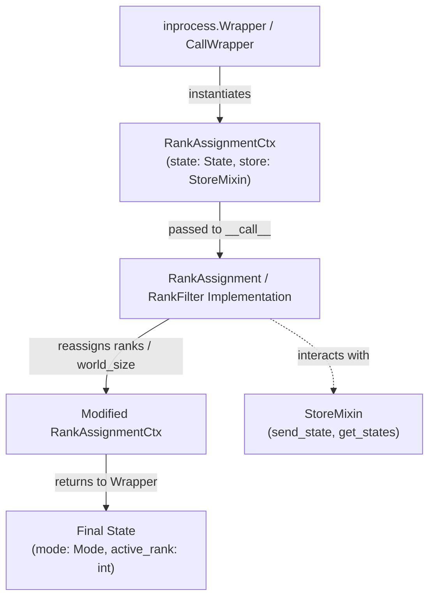
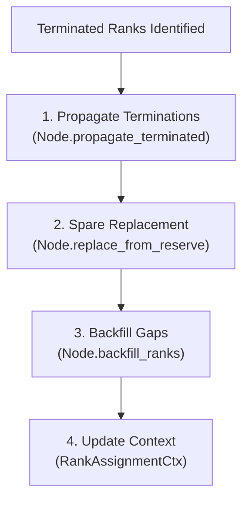

<!-- source: DeepWiki mcp.deepwiki.com · repo NVIDIA/nvidia-resiliency-ext · page 3.3 Rank Assignment Strategies · fetched 2026-10-26 -->

# Rank Assignment Strategies

<details>
<summary>Relevant source files</summary>

The following files were used as context for generating this wiki page:

- [src/nvidia_resiliency_ext/fault_tolerance/rank_monitor_state_machine.py](src/nvidia_resiliency_ext/fault_tolerance/rank_monitor_state_machine.py)
- [src/nvidia_resiliency_ext/fault_tolerance/utils.py](src/nvidia_resiliency_ext/fault_tolerance/utils.py)
- [src/nvidia_resiliency_ext/inprocess/attribution.py](src/nvidia_resiliency_ext/inprocess/attribution.py)
- [src/nvidia_resiliency_ext/inprocess/rank_assignment.py](src/nvidia_resiliency_ext/inprocess/rank_assignment.py)
- [src/nvidia_resiliency_ext/inprocess/sibling_monitor.py](src/nvidia_resiliency_ext/inprocess/sibling_monitor.py)
- [src/nvidia_resiliency_ext/inprocess/store.py](src/nvidia_resiliency_ext/inprocess/store.py)
- [src/nvidia_resiliency_ext/inprocess/utils.py](src/nvidia_resiliency_ext/inprocess/utils.py)
- [src/nvidia_resiliency_ext/shared_utils/profiling.py](src/nvidia_resiliency_ext/shared_utils/profiling.py)
- [src/nvidia_resiliency_ext/testing_utils/__init__.py](src/nvidia_resiliency_ext/testing_utils/__init__.py)
- [src/nvidia_resiliency_ext/testing_utils/health_check_injector.py](src/nvidia_resiliency_ext/testing_utils/health_check_injector.py)
- [tests/fault_tolerance/unit/test_layered_restart_v1.py](tests/fault_tolerance/unit/test_layered_restart_v1.py)

</details>


This page documents the rank assignment abstraction and concrete implementations in the in-process resiliency subsystem. Rank assignment strategies determine how distributed ranks are reassigned when failures occur, which ranks are active (executing the wrapped function) versus inactive (waiting as reserves), and how infrastructure-level rank information (from SLURM or other job schedulers) maps to application-visible group ranks.

For information about the overall in-process restart system, see [In-Process Restart System](). For distributed state management that rank assignment relies on, see [Distributed State Management]().

## Core Abstractions

The rank assignment system is built around three key abstractions: `RankAssignment` (the strategy interface), `RankAssignmentCtx` (the execution context), and `RankFilter` (a specialization for rank activation).

### RankAssignment Abstract Base Class

`RankAssignment` is the abstract base class for the `rank_assignment` argument in `inprocess.Wrapper` [src/nvidia_resiliency_ext/inprocess/rank_assignment.py:61-64](). It is responsible for reassigning distributed ranks, computing the new world size, and selecting which ranks are active in the next iteration of the wrapped function [src/nvidia_resiliency_ext/inprocess/rank_assignment.py:66-68]().

[src/nvidia_resiliency_ext/inprocess/rank_assignment.py:61-92]()

```python
class RankAssignment(abc.ABC):
    @abc.abstractmethod
    def __call__(self, ctx: RankAssignmentCtx) -> RankAssignmentCtx:
        raise NotImplementedError
```

Sources: [src/nvidia_resiliency_ext/inprocess/rank_assignment.py:61-92]()

### RankAssignmentCtx Dataclass

`RankAssignmentCtx` encapsulates the inputs and outputs of rank assignment operations [src/nvidia_resiliency_ext/inprocess/rank_assignment.py:46-49]().

[src/nvidia_resiliency_ext/inprocess/rank_assignment.py:45-59]()

| Field | Type | Purpose |
|-------|------|---------|
| `state` | `State` | Current `Wrapper` state containing rank, world_size, mode, etc. [src/nvidia_resiliency_ext/inprocess/rank_assignment.py:51-51]() |
| `store` | `StoreMixin` | Distributed store for coordination and state exchange [src/nvidia_resiliency_ext/inprocess/rank_assignment.py:52-52]() |
| `terminated_ranks` | `set[int]` | Set containing indices of terminated ranks [src/nvidia_resiliency_ext/inprocess/rank_assignment.py:53-53]() |

Sources: [src/nvidia_resiliency_ext/inprocess/rank_assignment.py:45-59]()

### RankFilter Abstract Base Class

`RankFilter` is a subclass of `RankAssignment` which specifically selects which ranks are active in the current restart iteration [src/nvidia_resiliency_ext/inprocess/rank_assignment.py:94-98](). Active ranks call the wrapped function, while inactive ranks wait idle as reserve ranks [src/nvidia_resiliency_ext/inprocess/rank_assignment.py:100-101]().

[src/nvidia_resiliency_ext/inprocess/rank_assignment.py:94-124]()

Sources: [src/nvidia_resiliency_ext/inprocess/rank_assignment.py:94-124]()

### Rank Assignment Flow

The following diagram bridges the logical concept of rank reassignment to the code entities involved in the process.

**Title: Rank Reassignment Data Flow**


Sources: [src/nvidia_resiliency_ext/inprocess/rank_assignment.py:45-124](), [src/nvidia_resiliency_ext/inprocess/store.py:107-122]()

## Infrastructure Rank Resolution

Infrastructure ranks identify node positions in the physical deployment topology. The `get_infrastructure_rank()` utility resolves these from environment variables with specific SLURM validation [src/nvidia_resiliency_ext/fault_tolerance/utils.py:42-43]().

### Resolution Precedence

The utility follows a strict precedence to ensure unique ranks across all nodes, especially in multi-job or array scenarios [src/nvidia_resiliency_ext/fault_tolerance/utils.py:44-67]().

[src/nvidia_resiliency_ext/fault_tolerance/utils.py:42-221]()

| Priority | Environment Variable(s) | Logic |
|----------|------------------------|-------|
| 1 | `NVRX_INFRA_RANK_FROM_NODENAME` + `SLURMD_NODENAME` | Extracts all digits from nodename (e.g., "nvl72134-T01" -> 7213401) [src/nvidia_resiliency_ext/fault_tolerance/utils.py:85-99]() |
| 2 | `CROSS_SLURM_PROCID` | Direct integer from env for multi-job coordination [src/nvidia_resiliency_ext/fault_tolerance/utils.py:102-106]() |
| 3 | `SLURM_TOPOLOGY_ADDR` | Block-aware rank: `block_num * multiplier + node_num` [src/nvidia_resiliency_ext/fault_tolerance/utils.py:109-117]() |
| 4 | `SLURM_PROCID` + Array IDs | `array_task_id * nnodes_per_array_task + slurm_procid` [src/nvidia_resiliency_ext/fault_tolerance/utils.py:63-65]() |
| 5 | `GROUP_RANK` | Fallback set by launcher [src/nvidia_resiliency_ext/fault_tolerance/utils.py:61-61]() |

Sources: [src/nvidia_resiliency_ext/fault_tolerance/utils.py:42-221]()

### Block-Aware Topology Calculation

When `SLURM_TOPOLOGY_ADDR_PATTERN="block.node"`, the infrastructure rank is calculated to keep block indices in the most significant bits for proper ordering [src/nvidia_resiliency_ext/fault_tolerance/utils.py:113-120]().

[src/nvidia_resiliency_ext/fault_tolerance/utils.py:109-166]()

**Formula**: `rank = block_number × multiplier + node_number` [src/nvidia_resiliency_ext/fault_tolerance/utils.py:119-120]()
**Default multiplier**: `10,000,000,000` (reserves 10 digits for node numbers) [src/nvidia_resiliency_ext/fault_tolerance/utils.py:151-151]().

Sources: [src/nvidia_resiliency_ext/fault_tolerance/utils.py:109-166]()

## Concrete Rank Assignment Strategies

### FillGaps
`FillGaps` minimizes rank reassignment by filling gaps left by terminated ranks using a swapping mechanism. It identifies the highest-ranked active ranks and uses them to fill the lowest-ranked gaps [src/nvidia_resiliency_ext/inprocess/rank_assignment.py:699-705]().

Sources: [src/nvidia_resiliency_ext/inprocess/rank_assignment.py:699-802]()

### ShiftRanks
`ShiftRanks` maintains the relative order of ranks by shifting all ranks to the left to close gaps [src/nvidia_resiliency_ext/inprocess/rank_assignment.py:805-809](). This ensures contiguous rank indices but may result in more reassignments than `FillGaps`.

Sources: [src/nvidia_resiliency_ext/inprocess/rank_assignment.py:805-889]()

### FilterCountGroupedByKey
This strategy groups ranks by a key (e.g., hostname via `get_infrastructure_rank`) and enforces a minimum healthy rank count per group. If a group falls below `min_count`, all ranks in that group are terminated [src/nvidia_resiliency_ext/inprocess/rank_assignment.py:892-902]().

Sources: [src/nvidia_resiliency_ext/inprocess/rank_assignment.py:892-1034]()

## Tree Strategy

The `Tree` strategy implements topology-aware rank assignment by constructing a hierarchical tree where each layer corresponds to a constraint or physical boundary [src/nvidia_resiliency_ext/inprocess/rank_assignment.py:252-258]().

### Layer Configuration

[src/nvidia_resiliency_ext/inprocess/rank_assignment.py:261-282]()

| Parameter | Purpose |
|-----------|---------|
| `min_ranks` | Minimum healthy ranks required in a subtree to keep the branch active [src/nvidia_resiliency_ext/inprocess/rank_assignment.py:265-266]() |
| `max_ranks` | Maximum active ranks permitted in a subtree [src/nvidia_resiliency_ext/inprocess/rank_assignment.py:268-269]() |
| `flag` | Policy modifier: `RESERVE` (spares) or `BACKFILL` (local gap filling) [src/nvidia_resiliency_ext/inprocess/rank_assignment.py:271-274]() |

### Tree Algorithm Logic

The `Tree` strategy follows a multi-step process to resolve failures and reassign ranks while respecting topology constraints.

**Title: Tree Strategy Resolution Logic**


Sources: [src/nvidia_resiliency_ext/inprocess/rank_assignment.py:430-481]()

### Node Class and Tree Structure

The internal `Node` class represents levels in the topology tree, tracking active counts and backfill domains [src/nvidia_resiliency_ext/inprocess/rank_assignment.py:284-300]().

[src/nvidia_resiliency_ext/inprocess/rank_assignment.py:284-353]()

| Attribute | Description |
|-----------|-------------|
| `children` | Sub-groups or leaf ranks [src/nvidia_resiliency_ext/inprocess/rank_assignment.py:291-291]() |
| `active_count` | Number of active ranks currently in this branch [src/nvidia_resiliency_ext/inprocess/rank_assignment.py:293-293]() |
| `backfill_domain` | Nearest ancestor allowing backfilling [src/nvidia_resiliency_ext/inprocess/rank_assignment.py:297-297]() |

Sources: [src/nvidia_resiliency_ext/inprocess/rank_assignment.py:284-353]()

## Utility and Support Functions

### Rank Set Formatting

Utilities are provided to format sets of ranks for logging, supporting both verbose ranges and brief summaries based on the `NVRX_LOG_RANK_FORMAT_VERBOSE` environment variable [src/nvidia_resiliency_ext/inprocess/utils.py:100-125]().

[src/nvidia_resiliency_ext/inprocess/utils.py:39-131]()

- `format_rank_set_verbose`: Compresses consecutive ranks into ranges (e.g., "1-3, 5, 7-9") [src/nvidia_resiliency_ext/inprocess/utils.py:39-70]().
- `format_rank_set_brief`: Shows a subset of ranks and a total count for large sets [src/nvidia_resiliency_ext/inprocess/utils.py:73-97]().

Sources: [src/nvidia_resiliency_ext/inprocess/utils.py:39-131]()

### Profiling Integration

Rank assignment events and failures are recorded via the `FaultToleranceProfiler`. It tracks the `current_cycle` and logs events like `FAILURE_DETECTED`, which increments the cycle count [src/nvidia_resiliency_ext/shared_utils/profiling.py:28-94]().

Sources: [src/nvidia_resiliency_ext/shared_utils/profiling.py:28-94]()

---

