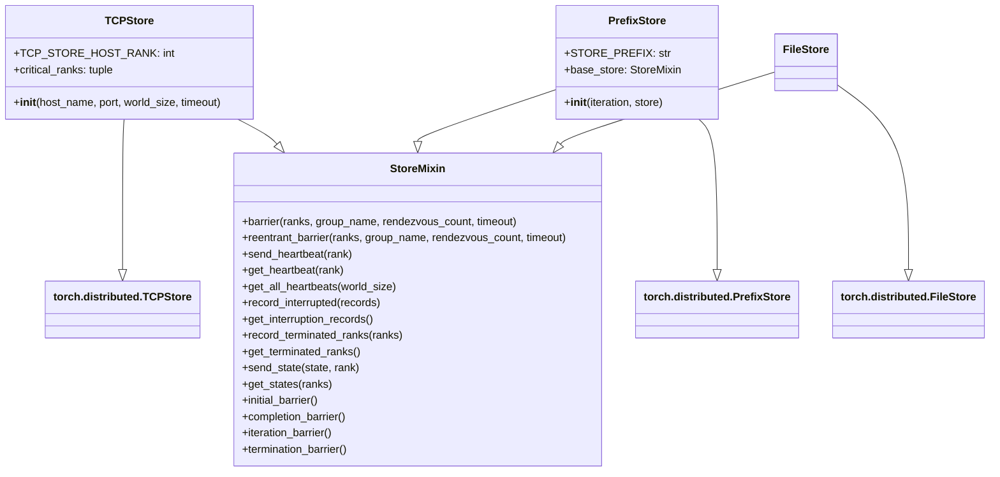
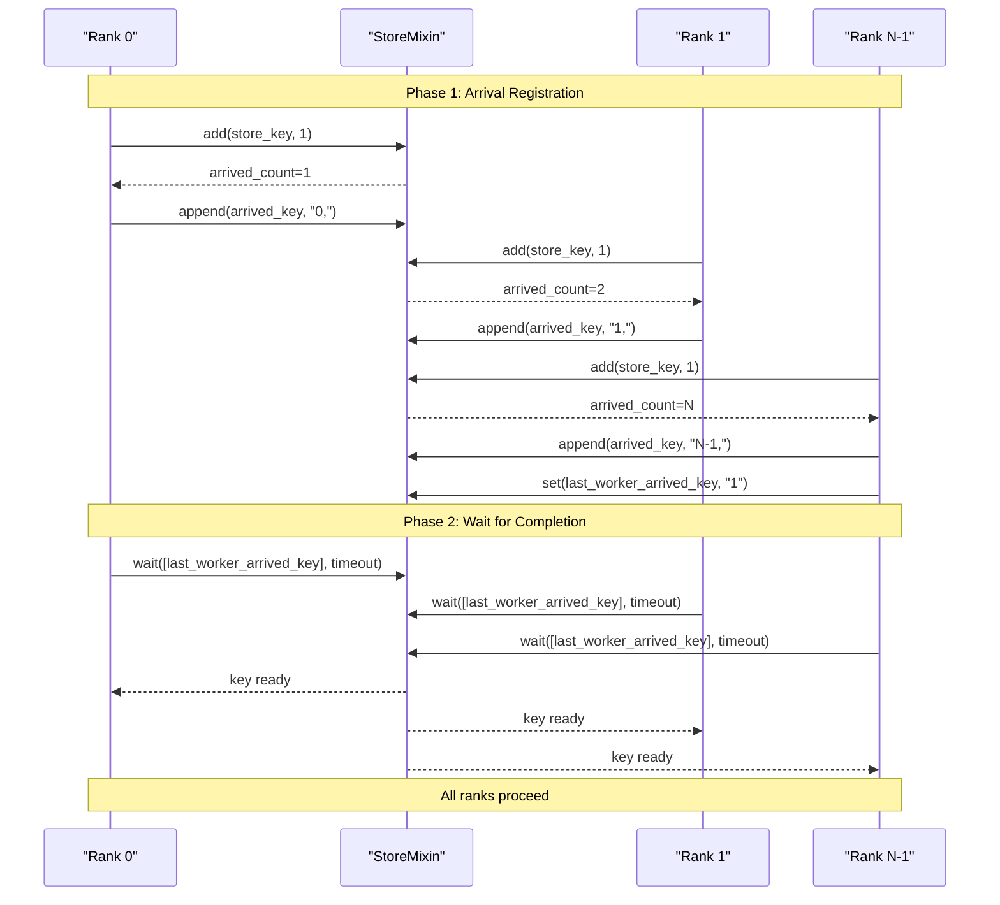
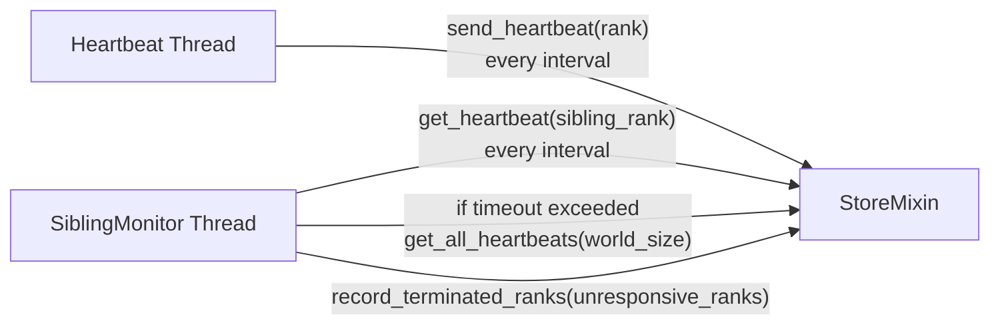
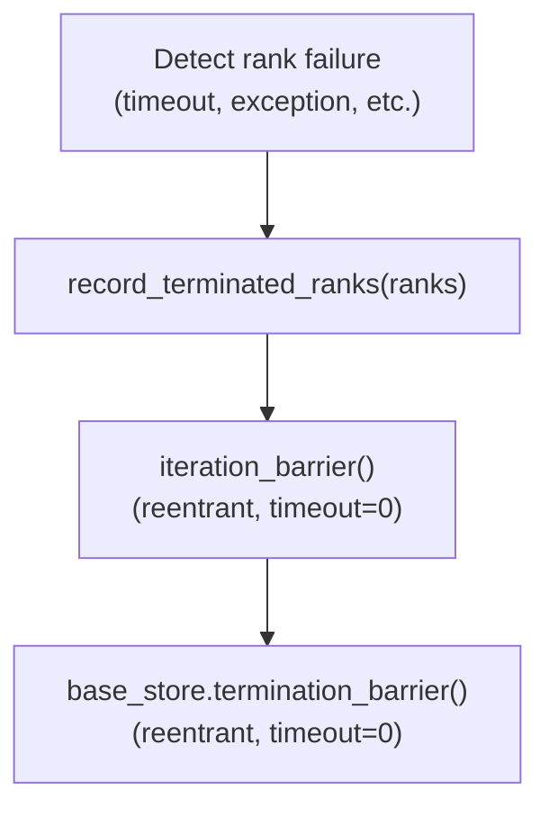

<!-- source: DeepWiki mcp.deepwiki.com · repo NVIDIA/nvidia-resiliency-ext · page 3.4 Distributed State Management · fetched 2026-10-26 -->

# Distributed State Management

Relevant source files

The following files were used as context for generating this wiki page:

- [docs/source/inprocess/api/health_check.rst](docs/source/inprocess/api/health_check.rst)
- [src/nvidia_resiliency_ext/inprocess/attribution.py](src/nvidia_resiliency_ext/inprocess/attribution.py)
- [src/nvidia_resiliency_ext/inprocess/health_check.py](src/nvidia_resiliency_ext/inprocess/health_check.py)
- [src/nvidia_resiliency_ext/inprocess/monitor_process.py](src/nvidia_resiliency_ext/inprocess/monitor_process.py)
- [src/nvidia_resiliency_ext/inprocess/rank_assignment.py](src/nvidia_resiliency_ext/inprocess/rank_assignment.py)
- [src/nvidia_resiliency_ext/inprocess/sibling_monitor.py](src/nvidia_resiliency_ext/inprocess/sibling_monitor.py)
- [src/nvidia_resiliency_ext/inprocess/store.py](src/nvidia_resiliency_ext/inprocess/store.py)
- [src/nvidia_resiliency_ext/inprocess/utils.py](src/nvidia_resiliency_ext/inprocess/utils.py)
- [src/nvidia_resiliency_ext/inprocess/wrap.py](src/nvidia_resiliency_ext/inprocess/wrap.py)
- [src/nvidia_resiliency_ext/shared_utils/wait_daemon.py](src/nvidia_resiliency_ext/shared_utils/wait_daemon.py)
- [tests/inprocess/test_wrap.py](tests/inprocess/test_wrap.py)

## Purpose and Scope

The distributed state management subsystem provides a key-value store abstraction for coordinating distributed processes in the in-process restart system. It implements barrier synchronization, heartbeat tracking, interruption recording, and terminated rank management across all ranks participating in a training job. This infrastructure enables distributed coordination without relying on external orchestrators.

For information about how state management integrates with monitoring, see [Monitoring and Timeouts](3.2). For rank assignment coordination patterns, see [Rank Assignment Strategies](3.3).

Sources: [src/nvidia_resiliency_ext/inprocess/store.py:1-390]()

---

## Store Architecture

### StoreMixin Interface

The `StoreMixin` class [src/nvidia_resiliency_ext/inprocess/store.py:50-330]() defines the core abstraction for distributed state management. It provides methods for:

- **Barrier synchronization**: Coordinating rank arrival at synchronization points [src/nvidia_resiliency_ext/inprocess/store.py:186-242]().
- **Heartbeat tracking**: Monitoring rank liveness through periodic timestamps [src/nvidia_resiliency_ext/inprocess/store.py:104-105]().
- **State serialization**: Exchanging `State` objects between ranks [src/nvidia_resiliency_ext/inprocess/store.py:107-111]().
- **Interruption recording**: Tracking failure and timeout events [src/nvidia_resiliency_ext/inprocess/store.py:142-152]().
- **Terminated rank management**: Maintaining sets of failed ranks [src/nvidia_resiliency_ext/inprocess/store.py:174-184]().

`StoreMixin` is designed as a mixin class that extends concrete store implementations from `torch.distributed`.

**Diagram: Store Class Hierarchy**

Sources: [src/nvidia_resiliency_ext/inprocess/store.py:50-390]()

---

### Store Implementations

#### TCPStore

`TCPStore` [src/nvidia_resiliency_ext/inprocess/store.py:332-379]() wraps `torch.distributed.TCPStore` with `StoreMixin` functionality. Rank 0 (`TCP_STORE_HOST_RANK`) acts as the store master node, hosting the TCP server that other ranks connect to [src/nvidia_resiliency_ext/inprocess/store.py:333-334]().

**Initialization parameters:**
- `host_name`: Master node hostname (defaults to `MASTER_ADDR` environment variable) [src/nvidia_resiliency_ext/inprocess/store.py:343]().
- `port`: Master node port (defaults to `MASTER_PORT` environment variable) [src/nvidia_resiliency_ext/inprocess/store.py:344]().
- `world_size`: Total number of ranks (defaults to `WORLD_SIZE` environment variable) [src/nvidia_resiliency_ext/inprocess/store.py:345]().
- `timeout`: Store operation timeout (default: 300 seconds) [src/nvidia_resiliency_ext/inprocess/store.py:346]().

The `critical_ranks` property [src/nvidia_resiliency_ext/inprocess/store.py:377-378]() returns `(0,)`, indicating that rank 0 must remain alive for the store to function.

#### PrefixStore

`PrefixStore` [src/nvidia_resiliency_ext/inprocess/store.py:381-386]() wraps a base store with iteration-scoped key prefixes. This enables namespace isolation between restart iterations, preventing key collisions when the same code runs multiple times.

The prefix format is `_inprocess_{iteration}`, defined by `STORE_PREFIX` [src/nvidia_resiliency_ext/inprocess/store.py:66]().

#### FileStore

`FileStore` [src/nvidia_resiliency_ext/inprocess/store.py:388-390]() wraps `torch.distributed.FileStore` with `StoreMixin` functionality. It persists store data to the filesystem, useful for debugging and post-mortem analysis.

Sources: [src/nvidia_resiliency_ext/inprocess/store.py:332-390]()

---

## Store Keys and Data Organization

The `StoreMixin` class defines string constants for all store keys [src/nvidia_resiliency_ext/inprocess/store.py:51-71](). Keys use template syntax with placeholders (e.g., `{rank}`) that are formatted at runtime.

| Key Constant | Template | Purpose |
|--------------|----------|---------|
| `STATE` | `state_{rank}` | Serialized `State` object for rank coordination [src/nvidia_resiliency_ext/inprocess/store.py:62, 107-111]() |
| `KEY` | `key_{rank}` | Grouping key for topology-aware rank assignment [src/nvidia_resiliency_ext/inprocess/store.py:63, 113-115]() |
| `HEARTBEAT` | `heartbeat_{rank}` | Timestamp of last heartbeat from rank [src/nvidia_resiliency_ext/inprocess/store.py:60, 104-105]() |
| `INITIAL_RANK` | `initial_rank_{rank}` | Maps current rank to initial rank [src/nvidia_resiliency_ext/inprocess/store.py:58, 98-99]() |
| `ACTIVE_RANK` | `active_rank_{rank}` | Indicates if rank is active (Mode.ACTIVE/INACTIVE) [src/nvidia_resiliency_ext/inprocess/store.py:59, 80-88]() |
| `TERMINATED_RANKS` | `terminated_ranks` | Comma-separated list of terminated rank indices [src/nvidia_resiliency_ext/inprocess/store.py:57, 174-177]() |
| `INTERRUPTION_RECORDS` | `interruption_records` | Semicolon-separated list of InterruptionRecord strings [src/nvidia_resiliency_ext/inprocess/store.py:54, 142-150]() |
| `ANY_RANK_INTERRUPTED` | `any_rank_interrupted` | Signal that at least one rank was interrupted [src/nvidia_resiliency_ext/inprocess/store.py:51, 151]() |
| `ANY_RANK_COMPLETED` | `any_rank_completed` | Signal that at least one rank completed successfully [src/nvidia_resiliency_ext/inprocess/store.py:52, 171-172]() |
| `BARRIER_PREFIX` | `inprocess_barrier_prefix` | Prefix for all barrier-related keys [src/nvidia_resiliency_ext/inprocess/store.py:65]() |

### Barrier Keys

Barrier synchronization uses derived keys with the pattern: `{BARRIER_PREFIX}:{method_name}:{group_name}:{suffix}` [src/nvidia_resiliency_ext/inprocess/store.py:198-201]().

Named barrier groups [src/nvidia_resiliency_ext/inprocess/store.py:68-71]():
- `INITIAL_BARRIER`: Synchronization before first iteration.
- `COMPLETION_BARRIER`: Synchronization after successful completion.
- `ITERATION_BARRIER`: Synchronization between restart iterations.
- `TERMINATION_BARRIER`: Synchronization for terminated rank cleanup.

Sources: [src/nvidia_resiliency_ext/inprocess/store.py:51-71]()

---

## Barrier Synchronization

### Barrier Protocol

The `barrier()` method [src/nvidia_resiliency_ext/inprocess/store.py:186-242]() implements a two-phase synchronization protocol:

**Diagram: Barrier Synchronization Protocol**

**Phase 1 - Arrival Registration:**
1. Each rank atomically increments `store_key` using `add()` [src/nvidia_resiliency_ext/inprocess/store.py:202]().
2. Each rank appends its rank index to `arrived_key` [src/nvidia_resiliency_ext/inprocess/store.py:204]().
3. If `arrived_count == rendezvous_count`, the last rank sets `last_worker_arrived_key` [src/nvidia_resiliency_ext/inprocess/store.py:221-222]().
4. If `arrived_count > rendezvous_count`, a `BarrierOverflow` is raised [src/nvidia_resiliency_ext/inprocess/store.py:206-209]().

**Phase 2 - Wait for Completion:**
All ranks wait for `last_worker_arrived_key` with chunked timeout polling [src/nvidia_resiliency_ext/inprocess/store.py:229-240]().

Sources: [src/nvidia_resiliency_ext/inprocess/store.py:186-242]()

---

### Reentrant Barriers

The `reentrant_barrier()` method [src/nvidia_resiliency_ext/inprocess/store.py:262-312]() allows ranks to arrive multiple times at the same barrier without raising `BarrierOverflow`. This is used when ranks re-enter a barrier after handling failures.

**Key difference:** Instead of using atomic `add()`, `reentrant_barrier()` appends ranks to `arrived_key` and computes `arrived_count` from the unique set of ranks found in the packed string [src/nvidia_resiliency_ext/inprocess/store.py:278-282]().

### Convenience Methods

Four barrier convenience methods are defined using `functools.partialmethod` [src/nvidia_resiliency_ext/inprocess/store.py:314-329]():

- `initial_barrier()`: Synchronization before iteration 0.
- `completion_barrier()`: Synchronization after successful completion.
- `iteration_barrier()`: Synchronization between restart iterations (reentrant).
- `termination_barrier()`: Synchronization for terminated rank cleanup (reentrant).

Sources: [src/nvidia_resiliency_ext/inprocess/store.py:244-329]()

---

## Heartbeat Tracking

### Sending Heartbeats

The `send_heartbeat()` method [src/nvidia_resiliency_ext/inprocess/store.py:104-105]() stores the current timestamp for a given rank. Heartbeats are typically sent by the `Heartbeat` thread [src/nvidia_resiliency_ext/inprocess/sibling_monitor.py:28-60]() at a specified interval [src/nvidia_resiliency_ext/inprocess/sibling_monitor.py:43-45]().

### Retrieving Heartbeats

Two methods retrieve heartbeat timestamps:
- **Single rank:** `get_heartbeat()` [src/nvidia_resiliency_ext/inprocess/store.py:131-132]().
- **All ranks:** `get_all_heartbeats()` [src/nvidia_resiliency_ext/inprocess/store.py:134-140]() uses `multi_get()` to efficiently retrieve timestamps for all ranks in the world size.

**Diagram: Heartbeat Tracking Flow**

### Integration with SiblingMonitor

`SiblingMonitor` [src/nvidia_resiliency_ext/inprocess/sibling_monitor.py:62-155]() uses heartbeats to detect unresponsive ranks. Each rank monitors its "sibling" rank: `(rank + 1) % world_size` [src/nvidia_resiliency_ext/inprocess/sibling_monitor.py:82](). If a sibling's heartbeat exceeds the timeout [src/nvidia_resiliency_ext/inprocess/sibling_monitor.py:118](), the monitor records the rank as unresponsive and terminated [src/nvidia_resiliency_ext/inprocess/sibling_monitor.py:136-141]().

Sources: [src/nvidia_resiliency_ext/inprocess/store.py:104-140](), [src/nvidia_resiliency_ext/inprocess/sibling_monitor.py:28-155]()

---

## Interruption Recording

### InterruptionRecord Structure

`InterruptionRecord` [src/nvidia_resiliency_ext/inprocess/attribution.py:35-52]() is a frozen dataclass capturing failure events. The `Interruption` enum [src/nvidia_resiliency_ext/inprocess/attribution.py:25-32]() defines types such as `EXCEPTION`, `SOFT_TIMEOUT`, `HARD_TIMEOUT`, and `UNRESPONSIVE`.

### Recording Interruptions

The `record_interrupted()` method [src/nvidia_resiliency_ext/inprocess/store.py:142-152]() stores interruption records with locking [src/nvidia_resiliency_ext/inprocess/store.py:146-150]() to prevent races during simultaneous record updates. It also sets the `ANY_RANK_INTERRUPTED` flag [src/nvidia_resiliency_ext/inprocess/store.py:151]().

### Retrieving Interruption Records

The `get_interruption_records()` method [src/nvidia_resiliency_ext/inprocess/store.py:156-163]() parses the stored packed string into `InterruptionRecord` objects. Ranks can block until an interruption occurs using `wait_for_interrupted()` [src/nvidia_resiliency_ext/inprocess/store.py:165-166]().

Sources: [src/nvidia_resiliency_ext/inprocess/store.py:142-166](), [src/nvidia_resiliency_ext/inprocess/attribution.py:25-52]()

---

## Terminated Ranks Management

### Recording Terminated Ranks

The `record_terminated_ranks()` method [src/nvidia_resiliency_ext/inprocess/store.py:174-177]() appends rank indices to a comma-separated list. This allows multiple ranks to report failures without overwriting each other's data.

### Retrieving Terminated Ranks

The `get_terminated_ranks()` method [src/nvidia_resiliency_ext/inprocess/store.py:179-184]() parses the comma-separated list into a set of unique integers.

### Termination Propagation

Terminated ranks must synchronize at multiple barriers to ensure clean shutdown across the cluster:

**Diagram: Terminated Rank Synchronization Flow**

The `SiblingMonitor.terminate_unresponsive_ranks()` method [src/nvidia_resiliency_ext/inprocess/sibling_monitor.py:136-155]() demonstrates this pattern by recording the termination and then triggering the barriers with zero timeout [src/nvidia_resiliency_ext/inprocess/sibling_monitor.py:143-154]() to prevent blocking the monitoring thread.

Sources: [src/nvidia_resiliency_ext/inprocess/store.py:171-184](), [src/nvidia_resiliency_ext/inprocess/sibling_monitor.py:136-155]()

---

## State Serialization and Exchange

### Sending and Retrieving State

The `send_state()` method [src/nvidia_resiliency_ext/inprocess/store.py:107-111]() serializes a `State` object to JSON and stores it. Ranks retrieve these states using `get_states()` [src/nvidia_resiliency_ext/inprocess/store.py:116-122](). Similarly, `send_key()` and `get_keys()` [src/nvidia_resiliency_ext/inprocess/store.py:113-129]() are used to exchange grouping keys for topology-aware rank assignment.

### Usage in Rank Assignment

Rank assignment strategies, such as `MaxActiveWorldSize` [src/nvidia_resiliency_ext/inprocess/rank_assignment.py:149-195](), use the store to determine the active status of ranks. For example, `set_active_rank()` [src/nvidia_resiliency_ext/inprocess/store.py:80-88]() stores whether a rank is `Mode.ACTIVE` or `Mode.INACTIVE`.

Sources: [src/nvidia_resiliency_ext/inprocess/store.py:80-129](), [src/nvidia_resiliency_ext/inprocess/rank_assignment.py:149-195]()

---

## Error Handling

### BarrierError Exceptions

Three exception types handle barrier failures [src/nvidia_resiliency_ext/inprocess/store.py:38-48]():
- `BarrierTimeout`: Raised when `wait()` exceeded the specified timeout [src/nvidia_resiliency_ext/inprocess/store.py:42-43]().
- `BarrierOverflow`: Raised when more ranks arrived at a non-reentrant barrier than expected [src/nvidia_resiliency_ext/inprocess/store.py:46-47]().
- `BarrierError`: Base class for barrier-related failures [src/nvidia_resiliency_ext/inprocess/store.py:38-39]().

### Timeout Chunking

Both `barrier()` and `reentrant_barrier()` support `timeout_chunk` for periodic checks [src/nvidia_resiliency_ext/inprocess/store.py:192, 268](). This prevents indefinite blocking and allows ranks to perform other background tasks (like progress watchdog pings) while waiting [src/nvidia_resiliency_ext/inprocess/wrap.py:70-76]().

Sources: [src/nvidia_resiliency_ext/inprocess/store.py:38-48, 224-240](), [src/nvidia_resiliency_ext/inprocess/wrap.py:63-78]()

---

