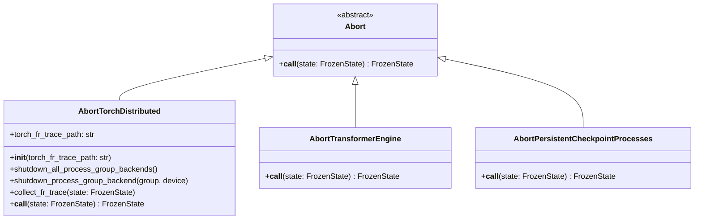
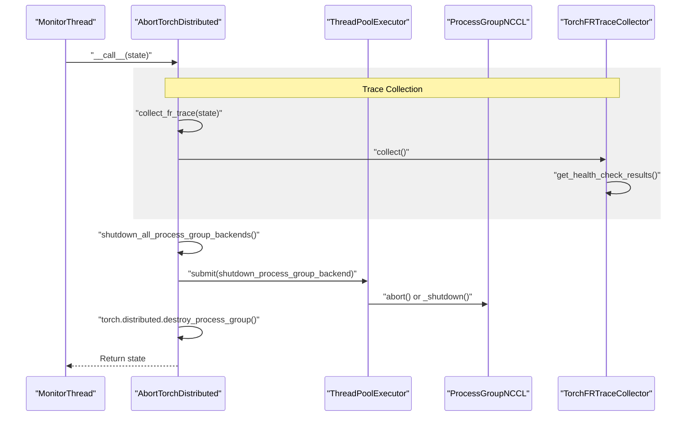
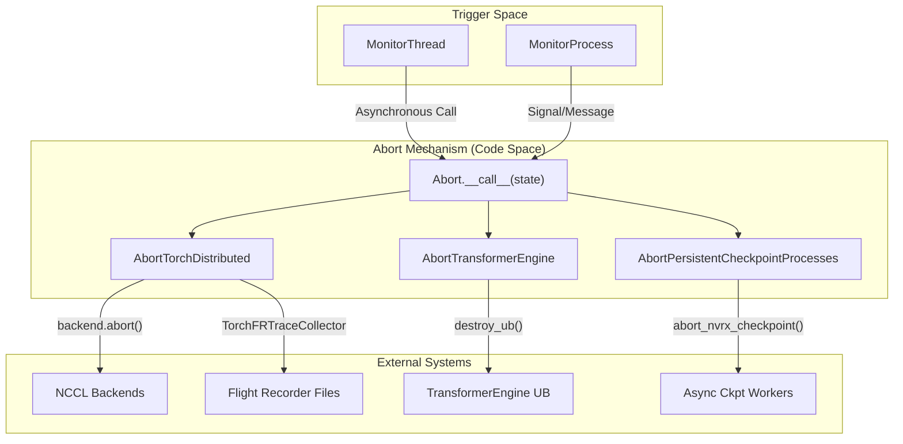

<!-- source: DeepWiki mcp.deepwiki.com · repo NVIDIA/nvidia-resiliency-ext · page 3.5 Abort Mechanisms · fetched 2026-10-26 -->

# Abort Mechanisms

Relevant source files

The following files were used as context for generating this wiki page:

- [docs/source/inprocess/api/health_check.rst](docs/source/inprocess/api/health_check.rst)
- [src/nvidia_resiliency_ext/attribution/trace_analyzer/__init__.py](src/nvidia_resiliency_ext/attribution/trace_analyzer/__init__.py)
- [src/nvidia_resiliency_ext/attribution/trace_analyzer/trace_collector.py](src/nvidia_resiliency_ext/attribution/trace_analyzer/trace_collector.py)
- [src/nvidia_resiliency_ext/inprocess/abort.py](src/nvidia_resiliency_ext/inprocess/abort.py)
- [src/nvidia_resiliency_ext/inprocess/health_check.py](src/nvidia_resiliency_ext/inprocess/health_check.py)
- [src/nvidia_resiliency_ext/inprocess/monitor_process.py](src/nvidia_resiliency_ext/inprocess/monitor_process.py)
- [src/nvidia_resiliency_ext/inprocess/wrap.py](src/nvidia_resiliency_ext/inprocess/wrap.py)
- [src/nvidia_resiliency_ext/shared_utils/wait_daemon.py](src/nvidia_resiliency_ext/shared_utils/wait_daemon.py)
- [tests/inprocess/test_wrap.py](tests/inprocess/test_wrap.py)

## Purpose and Scope

This page documents the abort mechanism subsystem within the In-Process Restart System. Abort mechanisms are responsible for forcefully terminating distributed operations and cleaning up framework-specific resources when timeouts or failures are detected. These mechanisms unblock the main thread from hanging distributed collectives and prepare the process for restart.

For information about the monitoring infrastructure that triggers abort mechanisms, see [3.2 Monitoring and Timeouts](). For details on the overall in-process restart architecture, see [3.1 Wrapper Architecture]().

---

## Overview

When a fault is detected in the in-process restart system, the main thread may be blocked waiting for results from other distributed ranks that are either terminated or unresponsive. This commonly occurs during collective operations (e.g., `all_reduce`, `barrier`) where one rank has failed but others are still waiting. Abort mechanisms provide a way to forcefully terminate these operations and clean up framework-specific state. [src/nvidia_resiliency_ext/inprocess/abort.py:32-42]()

The abort subsystem consists of:
- An abstract `Abort` base class defining the interface. [src/nvidia_resiliency_ext/inprocess/abort.py:31-60]()
- Concrete implementations targeting specific frameworks: PyTorch Distributed, TransformerEngine, and asynchronous checkpointing processes. [src/nvidia_resiliency_ext/inprocess/abort.py:62-202]()
- Trace collection infrastructure for post-mortem analysis of NCCL collectives. [src/nvidia_resiliency_ext/attribution/trace_analyzer/trace_collector.py:39-140]()
- Support for composing multiple abort mechanisms using `inprocess.Compose`. [src/nvidia_resiliency_ext/inprocess/abort.py:44-46]()

Abort mechanisms are typically triggered by the `MonitorThread` within the `inprocess.Wrapper` as part of the termination/restart sequence. [src/nvidia_resiliency_ext/inprocess/abort.py:36-38]()

**Sources:** [src/nvidia_resiliency_ext/inprocess/abort.py:31-60]()

---

## Abort Base Class

### Class Hierarchy

The `Abort` abstract base class defines a single method `__call__(state: FrozenState) -> FrozenState` that implementations must override. [src/nvidia_resiliency_ext/inprocess/abort.py:48-59](). The `state` parameter provides read-only access to the current `Wrapper` state, including the current iteration number and other context. [src/nvidia_resiliency_ext/inprocess/abort.py:53-54]()

**Sources:** [src/nvidia_resiliency_ext/inprocess/abort.py:31-60]()

---

## AbortTorchDistributed

### Overview

`AbortTorchDistributed` terminates PyTorch distributed collectives by shutting down all NCCL backend process groups. This is the default abort mechanism used by the `Wrapper`. [src/nvidia_resiliency_ext/inprocess/wrap.py:146](). It also manages the collection of PyTorch Flight Recorder (FR) traces for diagnostics. [src/nvidia_resiliency_ext/inprocess/abort.py:72-80]()

### Shutdown Process

The shutdown process operates in three stages:

1. **Trace Collection**: If environment variables like `TORCH_NCCL_TRACE_BUFFER_SIZE` are set, it dumps NCCL traces to the specified path. [src/nvidia_resiliency_ext/inprocess/abort.py:127-160]()
2. **Parallel Backend Shutdown**: It iterates through all active process groups in `torch.distributed.distributed_c10d._world.pg_names` and shuts down their backends using a `ThreadPoolExecutor`. [src/nvidia_resiliency_ext/inprocess/abort.py:95-111]()
3. **Process Group Destruction**: Finally, it calls `torch.distributed.destroy_process_group()` to clean up the distributed state. [src/nvidia_resiliency_ext/inprocess/abort.py:165]()

### Version-Specific Logic

The backend shutdown method varies by PyTorch version:
- **PyTorch < 2.6.0**: Uses `backend._shutdown()`. [src/nvidia_resiliency_ext/inprocess/abort.py:122-123]()
- **PyTorch >= 2.6.0**: Uses `backend.abort()`. [src/nvidia_resiliency_ext/inprocess/abort.py:124-125]()

**Sources:** [src/nvidia_resiliency_ext/inprocess/abort.py:62-167]()

---

## Flight Recorder Trace Collection

### TorchFRTraceCollector Integration

The `TorchFRTraceCollector` class handles the actual dumping of NCCL traces. [src/nvidia_resiliency_ext/attribution/trace_analyzer/trace_collector.py:39-41](). It is specifically designed to avoid deadlocks by disabling stack trace collection, which would otherwise require the Python GIL. [src/nvidia_resiliency_ext/inprocess/abort.py:80-83]()

### Trace and Health Correlation

The collector doesn't just dump communication traces; it also embeds local hardware health status into the trace file:
1. **GPU Health**: Runs `GPUHealthCheck` for the local rank. [src/nvidia_resiliency_ext/attribution/trace_analyzer/trace_collector.py:122-123]()
2. **NIC Health**: Runs `NicHealthCheck` for the local rank. [src/nvidia_resiliency_ext/attribution/trace_analyzer/trace_collector.py:124-127]()

The combined data is written as a JSON or pickle file named `_dump_{rank}.json` in a directory corresponding to the current iteration. [src/nvidia_resiliency_ext/attribution/trace_analyzer/trace_collector.py:83-108]()

**Sources:** [src/nvidia_resiliency_ext/attribution/trace_analyzer/trace_collector.py:39-140]()

---

## AbortTransformerEngine

### Implementation

`AbortTransformerEngine` targets TransformerEngine (TE) specific communication buffers. [src/nvidia_resiliency_ext/inprocess/abort.py:169-172](). It performs two primary actions:
1. **Userbuffer Cleanup**: Calls `te.module.base.destroy_ub()` to destroy TE Userbuffers. [src/nvidia_resiliency_ext/inprocess/abort.py:181]()
2. **FP8 State Reset**: Calls `te_fp8.FP8GlobalStateManager.reset()` to clear global FP8 state that might hold references to stale process groups. [src/nvidia_resiliency_ext/inprocess/abort.py:189]()

The implementation uses defensive imports to ensure it doesn't fail if `transformer_engine` is not present in the environment. [src/nvidia_resiliency_ext/inprocess/abort.py:176-191]()

**Sources:** [src/nvidia_resiliency_ext/inprocess/abort.py:169-191]()

---

## AbortPersistentCheckpointProcesses

### Implementation

This implementation manages the cleanup of background processes used for asynchronous checkpointing. [src/nvidia_resiliency_ext/inprocess/abort.py:194-197](). It calls `abort_nvrx_checkpoint()`, which terminates persistent checkpointing workers to prevent resource leakage during a restart. [src/nvidia_resiliency_ext/inprocess/abort.py:199-202]()

**Sources:** [src/nvidia_resiliency_ext/inprocess/abort.py:194-202](), [src/nvidia_resiliency_ext/checkpointing/async_ckpt/core.py:25]()

---

## Summary of Abort Data Flow

**Sources:** [src/nvidia_resiliency_ext/inprocess/abort.py:31-202](), [src/nvidia_resiliency_ext/inprocess/wrap.py:146-169]()

---

