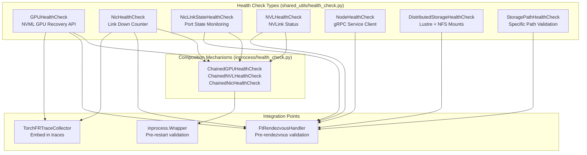
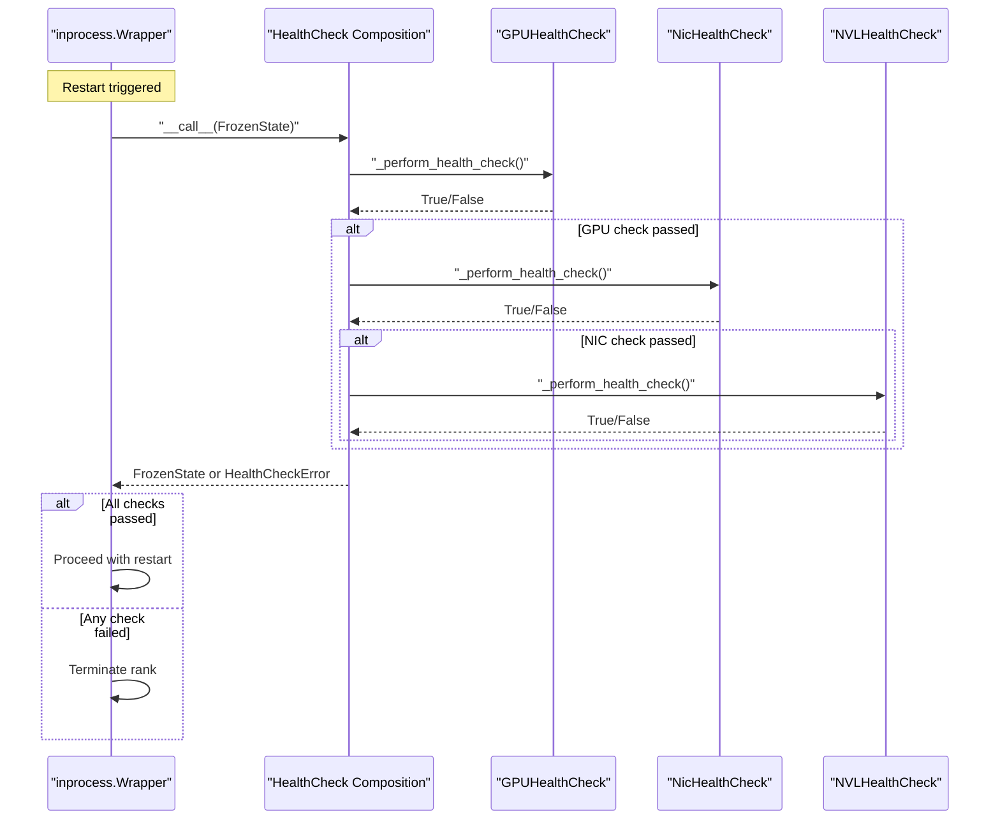

<!-- source: DeepWiki mcp.deepwiki.com · repo NVIDIA/nvidia-resiliency-ext · page 3.6 Health Checks · fetched 2026-10-26 -->

# Health Checks

Relevant source files

The following files were used as context for generating this wiki page:

- [build.py](build.py)
- [docs/source/fault_tolerance/usage_guide.rst](docs/source/fault_tolerance/usage_guide.rst)
- [docs/source/inprocess/api/health_check.rst](docs/source/inprocess/api/health_check.rst)
- [src/nvidia_resiliency_ext/fault_tolerance/_ft_rendezvous.py](src/nvidia_resiliency_ext/fault_tolerance/_ft_rendezvous.py)
- [src/nvidia_resiliency_ext/fault_tolerance/attribution_manager.py](src/nvidia_resiliency_ext/fault_tolerance/attribution_manager.py)
- [src/nvidia_resiliency_ext/inprocess/health_check.py](src/nvidia_resiliency_ext/inprocess/health_check.py)
- [src/nvidia_resiliency_ext/inprocess/monitor_process.py](src/nvidia_resiliency_ext/inprocess/monitor_process.py)
- [src/nvidia_resiliency_ext/inprocess/wrap.py](src/nvidia_resiliency_ext/inprocess/wrap.py)
- [src/nvidia_resiliency_ext/services/smonsvc/slurm.py](src/nvidia_resiliency_ext/services/smonsvc/slurm.py)
- [src/nvidia_resiliency_ext/shared_utils/health_check.py](src/nvidia_resiliency_ext/shared_utils/health_check.py)
- [src/nvidia_resiliency_ext/shared_utils/wait_daemon.py](src/nvidia_resiliency_ext/shared_utils/wait_daemon.py)
- [tests/fault_tolerance/unit/test_attribution_manager.py](tests/fault_tolerance/unit/test_attribution_manager.py)
- [tests/fault_tolerance/unit/test_dynamic_rendezvous.py](tests/fault_tolerance/unit/test_dynamic_rendezvous.py)
- [tests/fault_tolerance/unit/test_utils.py](tests/fault_tolerance/unit/test_utils.py)
- [tests/inprocess/test_wrap.py](tests/inprocess/test_wrap.py)
- [tests/shared_utils/test_health_check.py](tests/shared_utils/test_health_check.py)
- [tests/straggler/unit/test_cupti_ext.py](tests/straggler/unit/test_cupti_ext.py)

This page documents the health check subsystem used to validate hardware and infrastructure state before training restarts. Health checks validate GPU functionality, network interface status, NVLink connectivity, and storage accessibility. These checks integrate with both the in-process restart system (see [3.1]()) and the fault tolerance system (see [2.1]()) to detect non-recoverable failures early and prevent wasteful restart attempts on unhealthy nodes.

For hardware health monitoring telemetry and diagnostics, see [6.3](). For abort mechanisms that trigger health checks, see [3.5]().

---

## Architecture Overview

The health check subsystem provides a modular suite of validators that can be composed together and executed at critical points in the restart lifecycle. Each health check implements a callable interface that returns `True` if healthy or `False` if a failure is detected.

### Health Check System Structure

**Health Check Execution Flow:**

Sources: [src/nvidia_resiliency_ext/shared_utils/health_check.py:44-1335](), [src/nvidia_resiliency_ext/inprocess/wrap.py:41-46](), [src/nvidia_resiliency_ext/inprocess/wrap.py:148]()

---

## GPU Health Check

`GPUHealthCheck` validates GPU hardware state using the NVIDIA Management Library (NVML) GPU Recovery API. This check queries the recovery action needed for each GPU and fails if any GPU requires intervention beyond normal operation.

### Implementation Details

| Component | Description |
|-----------|-------------|
| **Class** | `GPUHealthCheck` [src/nvidia_resiliency_ext/shared_utils/health_check.py:223]() |
| **API** | `nvmlDeviceGetFieldValues()` with `NVML_FI_DEV_GET_GPU_RECOVERY_ACTION` [src/nvidia_resiliency_ext/shared_utils/health_check.py:372]() |
| **Driver Requirement** | NVIDIA driver r570 or newer |
| **Check Frequency** | Synchronous (on-demand) or asynchronous (periodic with configurable interval) [src/nvidia_resiliency_ext/shared_utils/health_check.py:233-241]() |
| **Thread Safety** | Uses `_nvml_lock` (threading.RLock) for NVML access [src/nvidia_resiliency_ext/shared_utils/health_check.py:72-81]() |

### Recovery Actions

The check interprets the following NVML recovery actions:

- `NVML_GPU_RECOVERY_ACTION_NONE`: GPU is healthy (check passes) [src/nvidia_resiliency_ext/shared_utils/health_check.py:382]()
- `NVML_GPU_RECOVERY_ACTION_GPU_RESET`: GPU requires reset (check fails) [src/nvidia_resiliency_ext/shared_utils/health_check.py:385]()
- `NVML_GPU_RECOVERY_ACTION_NODE_REBOOT`: Node requires reboot (check fails) [src/nvidia_resiliency_ext/shared_utils/health_check.py:388]()
- `NVML_GPU_RECOVERY_ACTION_DRAIN_P2P`: P2P traffic must be drained (check fails) [src/nvidia_resiliency_ext/shared_utils/health_check.py:391]()
- `NVML_GPU_RECOVERY_ACTION_DRAIN_AND_RESET`: Reduced capacity, requires drain and reset (check fails) [src/nvidia_resiliency_ext/shared_utils/health_check.py:394]()

**Key Methods:**

- `__call__()`: Synchronous health check entry point [src/nvidia_resiliency_ext/shared_utils/health_check.py:307-319]()
- `_perform_health_check()`: Core validation logic [src/nvidia_resiliency_ext/shared_utils/health_check.py:322-359]()
- `_check_gpu_health(device_id)`: Per-GPU validation [src/nvidia_resiliency_ext/shared_utils/health_check.py:360-416]()

Sources: [src/nvidia_resiliency_ext/shared_utils/health_check.py:223-416]()

---

## NIC Health Check

`NicHealthCheck` monitors network interface health by tracking the InfiniBand link down counter. The check establishes a baseline counter value during initialization and fails if the counter increments, indicating a link flap event.

### GPU-to-NIC Mapping

The check derives NIC assignments using PCI topology analysis or static platform rules:

- **GB200 Platform**: Detects "GB200" or "B200" via NVML and applies a static mapping (e.g., Rank 0 -> `mlx5_0`) [src/nvidia_resiliency_ext/shared_utils/health_check.py:107-147]().
- **Automatic Detection**: Walks the PCI hierarchy using `PciMixin` to find the closest NIC ancestor for a given GPU [src/nvidia_resiliency_ext/shared_utils/health_check.py:188-215]().

### Link Down Counter Monitoring

| Aspect | Detail |
|--------|--------|
| **Counter Path** | `/sys/class/infiniband/{nic}/ports/1/counters/link_downed` [src/nvidia_resiliency_ext/shared_utils/health_check.py:433]() |
| **Baseline** | Captured during `set_nic_device(local_rank)` call [src/nvidia_resiliency_ext/shared_utils/health_check.py:591-618]() |
| **Failure Condition** | Counter increments from baseline [src/nvidia_resiliency_ext/shared_utils/health_check.py:672]() |

Sources: [src/nvidia_resiliency_ext/shared_utils/health_check.py:419-689]()

---

## NIC Link State Health Check

`NicLinkStateHealthCheck` monitors port state transitions for all network interfaces. It takes a system-wide snapshot of all port states and detects when any port transitions from `ACTIVE` to a non-ACTIVE state.

- **Baseline Snapshot**: Scans all devices in `/sys/class/infiniband/` during `_initialize_baseline()` [src/nvidia_resiliency_ext/shared_utils/health_check.py:727-768]().
- **Failure Condition**: Any port initially marked as `ACTIVE` changes state [src/nvidia_resiliency_ext/shared_utils/health_check.py:814]().

Sources: [src/nvidia_resiliency_ext/shared_utils/health_check.py:692-823]()

---

## NVLink Health Check

`NVLHealthCheck` validates NVLink connectivity between GPUs by parsing `nvidia-smi nvlink --status` output. This check ensures that NVLink peer-to-peer communication channels remain operational.

- **Execution**: Runs `nvidia-smi nvlink --status -x` to get XML output [src/nvidia_resiliency_ext/shared_utils/health_check.py:878]().
- **Validation**: Fails if any link has a `<status>` other than `active` [src/nvidia_resiliency_ext/shared_utils/health_check.py:917]().

Sources: [src/nvidia_resiliency_ext/shared_utils/health_check.py:826-934]()

---

## Node Health Check

`NodeHealthCheck` connects to an external node health monitoring service via gRPC or Unix Domain Socket (UDS). This enables integration with cluster-level health monitoring systems like NVIDIA Base Command Manager (BCM).

- **Protocol**: Uses standard gRPC Health Checking Protocol [src/nvidia_resiliency_ext/shared_utils/health_check.py:942]().
- **Connectivity**: Connectivity errors (socket not found) are treated as **non-fatal** (health passes). Only explicit RPC failures mark the node unhealthy [src/nvidia_resiliency_ext/shared_utils/health_check.py:1071]().
- **Launcher Integration**: `ft_launcher` supports an external service via `--ft-node-health-check-endpoint` [docs/source/fault_tolerance/usage_guide.rst:57-89]().

Sources: [src/nvidia_resiliency_ext/shared_utils/health_check.py:937-1084](), [docs/source/fault_tolerance/usage_guide.rst:65-89]()

---

## Distributed Storage Health Check

`DistributedStorageHealthCheck` validates distributed filesystem health, specifically targeting Lustre and NFS mounts.

- **Lustre Check**: Reads `/sys/fs/lustre/health_check` and fails if output is not "healthy" [src/nvidia_resiliency_ext/shared_utils/health_check.py:1139-1151]().
- **Mount Probe**: Discovers Lustre/NFS mounts via `/proc/mounts` and performs an `os.stat()` in a subprocess with a timeout [src/nvidia_resiliency_ext/shared_utils/health_check.py:1159-1230]().

Sources: [src/nvidia_resiliency_ext/shared_utils/health_check.py:1087-1230]()

---

## Storage Path Health Check

`StoragePathHealthCheck` validates specific absolute paths for existence and basic accessibility using a storage probe mechanism.

- **Isolation**: Spawns a subprocess to prevent filesystem hangs from blocking the main process [src/nvidia_resiliency_ext/shared_utils/health_check.py:1283]().
- **Validation**: Performs checks on provided paths to ensure they are responsive and accessible [src/nvidia_resiliency_ext/shared_utils/health_check.py:1233-1335]().

Sources: [src/nvidia_resiliency_ext/shared_utils/health_check.py:1233-1335]()

---

## Integration with In-Process Restart

The `inprocess.Wrapper` utilizes specialized `HealthCheck` classes that wrap the `shared_utils` implementations to fit the in-process execution model.

### Chained Health Checks
The system provides composition classes to ensure comprehensive validation:
- `ChainedGPUHealthCheck`: Wraps `GPUHealthCheck` [src/nvidia_resiliency_ext/inprocess/wrap.py:42]().
- `ChainedNVLHealthCheck`: Wraps `NVLHealthCheck` [src/nvidia_resiliency_ext/inprocess/wrap.py:44]().
- `ChainedNicHealthCheck`: Wraps `NicHealthCheck` [src/nvidia_resiliency_ext/inprocess/wrap.py:43]().

### Automatic Augmentation
When the `Wrapper` is initialized, it automatically enhances the user-provided `health_check` with GPU and NVL validation to ensure system health before restart [src/nvidia_resiliency_ext/inprocess/wrap.py:104-106](). If any check fails, it raises a `HealthCheckError` which leads to rank termination [src/nvidia_resiliency_ext/inprocess/wrap.py:39]().

Sources: [src/nvidia_resiliency_ext/inprocess/wrap.py:39-169]()

---

## Integration with Fault Tolerance

The `ft_launcher` integrates health checks into the rendezvous process to ensure only healthy nodes participate in training.

- **Pre-Rendezvous Validation**: Before joining a rendezvous, the agent can query node health [src/nvidia_resiliency_ext/fault_tolerance/_ft_rendezvous.py:65-75]().
- **Unhealthy Node Exclusion**: If checks fail, an `UnhealthyNodeException` is raised [src/nvidia_resiliency_ext/fault_tolerance/_ft_rendezvous.py:74](), preventing the node from participating in the next training segment.

### CLI Configuration
The launcher supports the following flags for health check configuration:
- `--ft-node-health-check-endpoint`: Sets the UDS/gRPC endpoint for `NodeHealthCheck` [docs/source/fault_tolerance/usage_guide.rst:57]().
- `--ft-enable-dist-storage-healthcheck`: Enables the `DistributedStorageHealthCheck` [docs/source/fault_tolerance/usage_guide.rst:167]().

Sources: [src/nvidia_resiliency_ext/fault_tolerance/_ft_rendezvous.py:65-76](), [docs/source/fault_tolerance/usage_guide.rst:50-168]()

---

