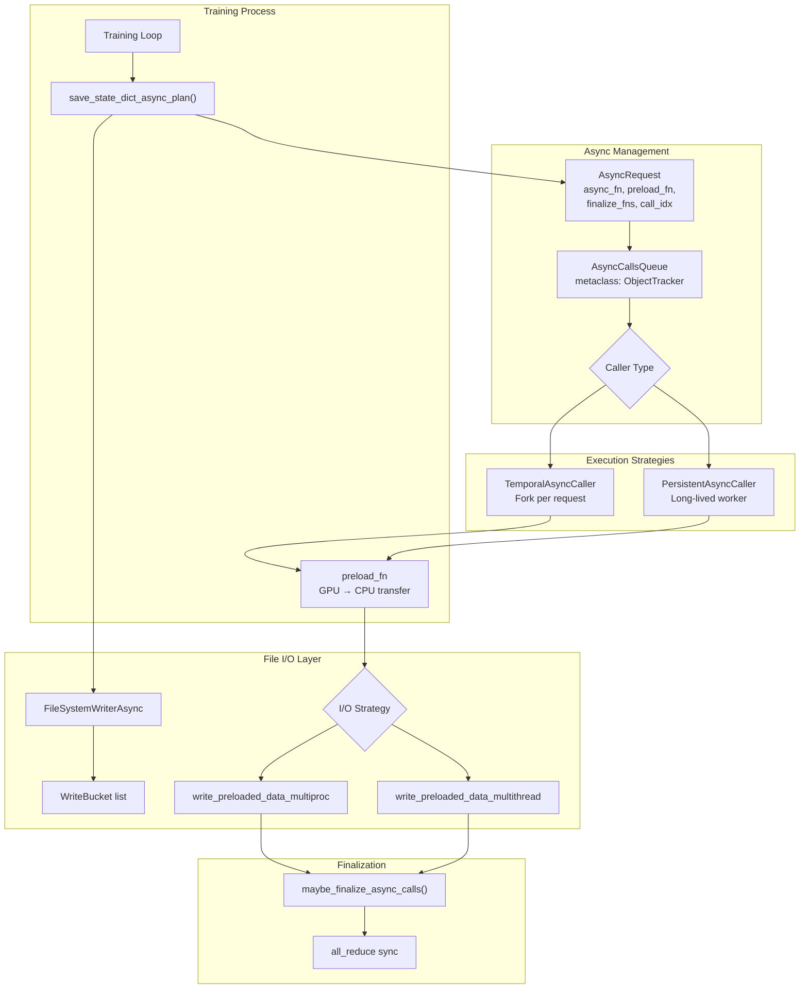
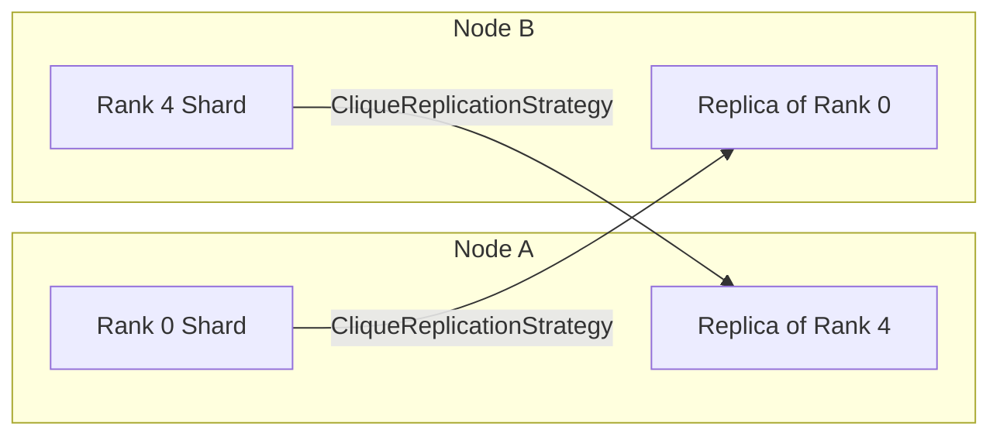

<!-- source: DeepWiki mcp.deepwiki.com · repo NVIDIA/nvidia-resiliency-ext · page 4 Checkpointing System · fetched 2026-10-26 -->

# Checkpointing System

Relevant source files

The following files were used as context for generating this wiki page:

- [docs/source/checkpointing/local/api.rst](docs/source/checkpointing/local/api.rst)
- [docs/source/checkpointing/local/api/basic_state_dict.rst](docs/source/checkpointing/local/api/basic_state_dict.rst)
- [docs/source/checkpointing/local/usage_guide.rst](docs/source/checkpointing/local/usage_guide.rst)
- [src/nvidia_resiliency_ext/checkpointing/async_ckpt/core.py](src/nvidia_resiliency_ext/checkpointing/async_ckpt/core.py)
- [src/nvidia_resiliency_ext/checkpointing/async_ckpt/filesystem_async.py](src/nvidia_resiliency_ext/checkpointing/async_ckpt/filesystem_async.py)
- [src/nvidia_resiliency_ext/checkpointing/local/ckpt_managers/base_manager.py](src/nvidia_resiliency_ext/checkpointing/local/ckpt_managers/base_manager.py)
- [src/nvidia_resiliency_ext/checkpointing/local/ckpt_managers/local_manager.py](src/nvidia_resiliency_ext/checkpointing/local/ckpt_managers/local_manager.py)
- [src/nvidia_resiliency_ext/checkpointing/local/replication/strategies.py](src/nvidia_resiliency_ext/checkpointing/local/replication/strategies.py)
- [src/nvidia_resiliency_ext/ptl_resiliency/local_checkpoint_callback.py](src/nvidia_resiliency_ext/ptl_resiliency/local_checkpoint_callback.py)
- [tests/checkpointing/unit/__init__.py](tests/checkpointing/unit/__init__.py)
- [tests/checkpointing/unit/conftest.py](tests/checkpointing/unit/conftest.py)
- [tests/checkpointing/unit/test_async_save.py](tests/checkpointing/unit/test_async_save.py)
- [tests/checkpointing/unit/test_async_writer.py](tests/checkpointing/unit/test_async_writer.py)
- [tests/checkpointing/unit/test_async_writer_msc.py](tests/checkpointing/unit/test_async_writer_msc.py)
- [tests/checkpointing/unit/test_utilities.py](tests/checkpointing/unit/test_utilities.py)

## Purpose and Scope

This page documents the asynchronous and local checkpointing subsystems that offload checkpoint I/O operations to background workers, enabling distributed training to continue with minimal interruption. The system extends PyTorch Distributed Checkpoint with non-blocking save capabilities, allowing GPU-to-CPU tensor staging and file writing to occur in parallel with training.

For information about integrating async checkpointing with the fault tolerance launcher, see [Fault Tolerance System](#2). For detailed implementation of core async primitives, see [Async Checkpointing Core](#4.1). For file I/O parallelization strategies, see [File I/O Parallelization](#4.2). For local machine redundancy and replication, see [Local Checkpointing](#4.3).

## Overview

The checkpointing subsystem provides asynchronous checkpoint saving by decomposing the operation into distinct phases:

**Phase 1: Preload (Synchronous)** - Stages tensors from GPU memory to CPU memory with `torch.cuda.synchronize()`. This blocks training but is significantly faster than file I/O. [src/nvidia_resiliency_ext/checkpointing/async_ckpt/core.py:165-169]()

**Phase 2: Save (Asynchronous)** - Writes checkpoint data to storage using background processes or threads. Training resumes while this phase executes. [src/nvidia_resiliency_ext/checkpointing/async_ckpt/core.py:170-173]()

**Phase 3: Finalize (Synchronous)** - Executes finalization callbacks after all ranks complete saving, coordinated via distributed synchronization. [src/nvidia_resiliency_ext/checkpointing/async_ckpt/core.py:125-128]()

Sources: [src/nvidia_resiliency_ext/checkpointing/async_ckpt/core.py:16-19](), [src/nvidia_resiliency_ext/checkpointing/async_ckpt/core.py:120-136](), [src/nvidia_resiliency_ext/checkpointing/async_ckpt/torch_ckpt.py:44-50]()

## Key Components and Data Flow

**Component Roles:**

| Component | Purpose | Key File/Lines |
|-----------|---------|----------------|
| `AsyncRequest` | Encapsulates async save operation with preload and finalize functions | [src/nvidia_resiliency_ext/checkpointing/async_ckpt/core.py:120-145]() |
| `AsyncCallsQueue` | Manages queue of active requests with ordering guarantees | [src/nvidia_resiliency_ext/checkpointing/async_ckpt/core.py:612-641]() |
| `PersistentAsyncCaller` | Long-lived background process for multiple checkpoints | [src/nvidia_resiliency_ext/checkpointing/async_ckpt/core.py:342-365]() |
| `FileSystemWriterAsync` | PyTorch-compatible writer with bucketed parallel I/O | [src/nvidia_resiliency_ext/checkpointing/async_ckpt/filesystem_async.py:140-193]() |
| `LocalCheckpointManager` | Manages local storage and cross-rank replication | [src/nvidia_resiliency_ext/checkpointing/local/ckpt_managers/local_manager.py:64-73]() |

Sources: [src/nvidia_resiliency_ext/checkpointing/async_ckpt/core.py:120-641](), [src/nvidia_resiliency_ext/checkpointing/async_ckpt/filesystem_async.py:140-193]()

## Async Execution Strategies

The system supports two primary strategies for background execution, configured via the `is_daemon` or `persistent` flags.

- **PersistentAsyncCaller (Recommended)**: Spawns a long-lived process that communicates via `mp.JoinableQueue`. This reduces process creation overhead and is safer for frequent checkpointing. It supports optional child workers for intra-node parallelism. [src/nvidia_resiliency_ext/checkpointing/async_ckpt/core.py:342-365]()
- **TemporalAsyncCaller**: Forks a new process for each checkpoint save. This is simpler but incurs higher overhead. [src/nvidia_resiliency_ext/checkpointing/async_ckpt/core.py:225-235]()

The `_set_process_qos` utility ensures that background writer processes do not interfere with training by setting CPU nice values and Linux `ionice` priorities (typically `class 3` for idle). [src/nvidia_resiliency_ext/checkpointing/async_ckpt/core.py:41-59]()

For details on these strategies and the `ObjectTracker` mechanism, see [Async Checkpointing Core](#4.1).

Sources: [src/nvidia_resiliency_ext/checkpointing/async_ckpt/core.py:41-119](), [src/nvidia_resiliency_ext/checkpointing/async_ckpt/core.py:225-365]()

## File I/O Parallelization

`FileSystemWriterAsync` optimizes storage operations by splitting the checkpoint into `WriteBucket` objects. Each bucket represents a single file and a set of tensors or byte data. [src/nvidia_resiliency_ext/checkpointing/async_ckpt/filesystem_async.py:65]()

- **Staging**: Tensors are staged from GPU to CPU. The system supports `use_cpu_shm_for_gpu_tensors` to reuse Shared Memory allocations across checkpoints, reducing allocation overhead. [src/nvidia_resiliency_ext/checkpointing/async_ckpt/filesystem_async.py:165-172]()
- **Parallel Writing**: Buckets are written in parallel using either `write_preloaded_data_multiproc` (forked processes) or `write_preloaded_data_multithread` (thread pool). [src/nvidia_resiliency_ext/checkpointing/async_ckpt/filesystem_async.py:150-153]()
- **MSC Integration**: Supports NVIDIA Multi-Storage Client (`use_msc=True`) for direct high-performance writes. [src/nvidia_resiliency_ext/checkpointing/async_ckpt/filesystem_async.py:179]()

For details on bucket preparation and CPU-shm staging, see [File I/O Parallelization](#4.2).

Sources: [src/nvidia_resiliency_ext/checkpointing/async_ckpt/filesystem_async.py:65-193]()

## Local Checkpointing and Replication

The `LocalCheckpointManager` provides a mechanism for saving checkpoints to local node storage (e.g., NVMe) rather than global shared storage. [src/nvidia_resiliency_ext/checkpointing/local/ckpt_managers/local_manager.py:30-45]()

- **Replication Strategies**: Uses `ReplicationStrategy` (e.g., `CliqueReplicationStrategy`) to store copies of shards on different machines, protecting against node failure. [src/nvidia_resiliency_ext/checkpointing/local/ckpt_managers/base_manager.py:64-73]()
- **TensorAwareStateDict**: An interface that allows state dicts to manage their own device placement during save/load, enabling efficient GPU-CPU-GPU transfers. [src/nvidia_resiliency_ext/checkpointing/local/base_state_dict.py:37]()
- **PTL Integration**: `LocalCheckpointCallback` and `HierarchicalCheckpointIO` provide a way to use local checkpointing within PyTorch Lightning by routing `trainer.save_checkpoint` calls. [src/nvidia_resiliency_ext/ptl_resiliency/local_checkpoint_callback.py:53-106]()

For details on replication parameters and the PTL callback, see [Local Checkpointing](#4.3).

Sources: [src/nvidia_resiliency_ext/checkpointing/local/ckpt_managers/base_manager.py:64-137](), [src/nvidia_resiliency_ext/ptl_resiliency/local_checkpoint_callback.py:53-158]()

## Coordination and Synchronization

Distributed consistency is maintained through explicit synchronization points:

1. **Completion Check**: `maybe_finalize_async_calls` uses `all_reduce` to check if all ranks have finished writing. [src/nvidia_resiliency_ext/checkpointing/async_ckpt/core.py:724-730]()
2. **Call Index Validation**: Ranks verify they are finalizing the same checkpoint ID via synchronization of the `call_idx`. [src/nvidia_resiliency_ext/checkpointing/async_ckpt/core.py:133-136]()
3. **Abort Mechanism**: `abort_nvrx_checkpoint` can be called globally to terminate all tracked background workers in the event of a training failure. [src/nvidia_resiliency_ext/checkpointing/async_ckpt/core.py:196-208]()

Sources: [src/nvidia_resiliency_ext/checkpointing/async_ckpt/core.py:120-208](), [src/nvidia_resiliency_ext/checkpointing/async_ckpt/core.py:724-730]()

---

