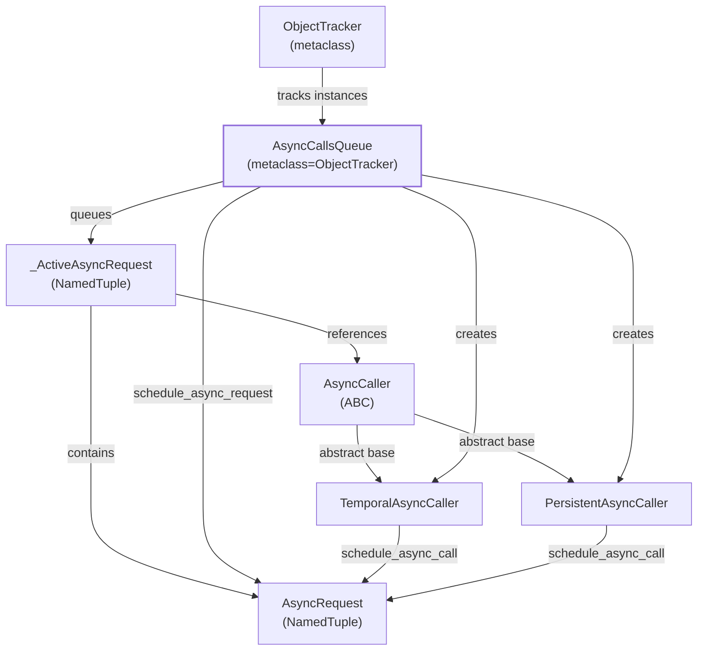
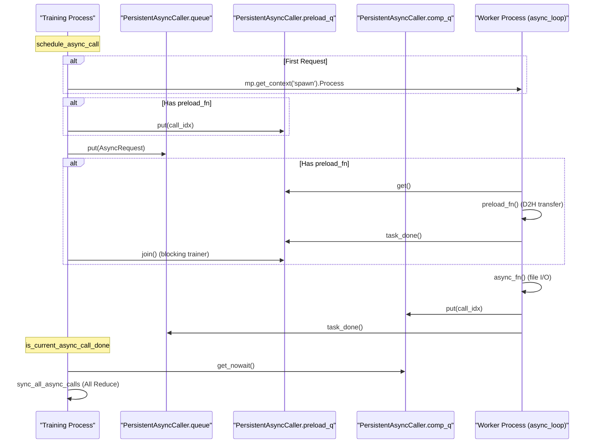

<!-- source: DeepWiki mcp.deepwiki.com · repo NVIDIA/nvidia-resiliency-ext · page 4.1 Async Checkpointing Core · fetched 2026-10-26 -->

# Async Checkpointing Core

Relevant source files

The following files were used as context for generating this wiki page:

- [docs/source/checkpointing/async/usage_guide.rst](docs/source/checkpointing/async/usage_guide.rst)
- [examples/checkpointing/async_ckpt.py](examples/checkpointing/async_ckpt.py)
- [examples/checkpointing/async_writer.py](examples/checkpointing/async_writer.py)
- [examples/checkpointing/local_ckpt.py](examples/checkpointing/local_ckpt.py)
- [src/nvidia_resiliency_ext/checkpointing/async_ckpt/cached_metadata_filesystem_reader.py](src/nvidia_resiliency_ext/checkpointing/async_ckpt/cached_metadata_filesystem_reader.py)
- [src/nvidia_resiliency_ext/checkpointing/async_ckpt/core.py](src/nvidia_resiliency_ext/checkpointing/async_ckpt/core.py)
- [src/nvidia_resiliency_ext/checkpointing/async_ckpt/filesystem_async.py](src/nvidia_resiliency_ext/checkpointing/async_ckpt/filesystem_async.py)
- [src/nvidia_resiliency_ext/checkpointing/async_ckpt/state_dict_saver.py](src/nvidia_resiliency_ext/checkpointing/async_ckpt/state_dict_saver.py)
- [src/nvidia_resiliency_ext/checkpointing/async_ckpt/torch_ckpt.py](src/nvidia_resiliency_ext/checkpointing/async_ckpt/torch_ckpt.py)
- [src/nvidia_resiliency_ext/checkpointing/utils.py](src/nvidia_resiliency_ext/checkpointing/utils.py)
- [tests/checkpointing/unit/__init__.py](tests/checkpointing/unit/__init__.py)
- [tests/checkpointing/unit/conftest.py](tests/checkpointing/unit/conftest.py)
- [tests/checkpointing/unit/test_async_save.py](tests/checkpointing/unit/test_async_save.py)
- [tests/checkpointing/unit/test_async_writer.py](tests/checkpointing/unit/test_async_writer.py)
- [tests/checkpointing/unit/test_async_writer_msc.py](tests/checkpointing/unit/test_async_writer_msc.py)
- [tests/checkpointing/unit/test_utilities.py](tests/checkpointing/unit/test_utilities.py)

## Purpose and Scope

This page documents the core asynchronous checkpointing infrastructure provided by the `nvidia_resiliency_ext.checkpointing.async_ckpt.core` module. It covers the fundamental abstractions and mechanisms that enable non-blocking checkpoint saves by offloading I/O operations to background workers. This includes the `AsyncRequest` data structure, the `AsyncCaller` execution strategies (temporal vs persistent), the `AsyncCallsQueue` management layer, distributed coordination protocols, and the abort mechanism.

For file I/O parallelization and the `FileSystemWriterAsync` implementation, see [File I/O Parallelization](4.2).

---

## System Overview

The async checkpointing core provides a framework for executing checkpoint save operations asynchronously. The key design principle is to minimize blocking time in the training loop by moving expensive operations (GPU-to-CPU data transfer and file I/O) to background processes or threads.

**Key Components:**

| Component | Purpose | File Location |
|-----------|---------|---------------|
| `AsyncRequest` | Data structure representing a checkpoint save request | [src/nvidia_resiliency_ext/checkpointing/async_ckpt/core.py:120-145]() |
| `AsyncCaller` | Abstract base class for async execution strategies | [src/nvidia_resiliency_ext/checkpointing/async_ckpt/core.py:180-223]() |
| `TemporalAsyncCaller` | Forks a new process per checkpoint request | [src/nvidia_resiliency_ext/checkpointing/async_ckpt/core.py:225-340]() |
| `PersistentAsyncCaller` | Maintains a long-lived worker process | [src/nvidia_resiliency_ext/checkpointing/async_ckpt/core.py:342-601]() |
| `AsyncCallsQueue` | Queue manager for active async requests | [src/nvidia_resiliency_ext/checkpointing/async_ckpt/core.py:618-722]() |
| `ObjectTracker` | Metaclass for tracking all `AsyncCallsQueue` instances | [src/nvidia_resiliency_ext/checkpointing/async_ckpt/core.py:135-147]() |
| `abort_nvrx_checkpoint` | Global abort utility | [src/nvidia_resiliency_ext/checkpointing/async_ckpt/core.py:724-730]() |

Sources: [src/nvidia_resiliency_ext/checkpointing/async_ckpt/core.py:1-730]()

---

## Class Hierarchy and Relationships

**Key Relationships:**
- `AsyncCallsQueue` is the primary interface for users, managing a queue of active checkpoint requests [src/nvidia_resiliency_ext/checkpointing/async_ckpt/core.py:618-622]().
- `AsyncRequest` is a frozen NamedTuple containing the async function, arguments, and finalization callbacks [src/nvidia_resiliency_ext/checkpointing/async_ckpt/core.py:120-145]().
- `AsyncCaller` implementations (`TemporalAsyncCaller`, `PersistentAsyncCaller`) handle process management [src/nvidia_resiliency_ext/checkpointing/async_ckpt/core.py:180-182]().
- `_ActiveAsyncRequest` wraps an `AsyncRequest` with its associated `AsyncCaller` and index [src/nvidia_resiliency_ext/checkpointing/async_ckpt/core.py:604-615]().
- `ObjectTracker` metaclass maintains a weak reference set of all `AsyncCallsQueue` instances for abort operations [src/nvidia_resiliency_ext/checkpointing/async_ckpt/core.py:135-147]().

Sources: [src/nvidia_resiliency_ext/checkpointing/async_ckpt/core.py:135-722]()

---

## AsyncRequest Structure

The `AsyncRequest` is a `NamedTuple` that encapsulates all information needed to execute and finalize a checkpoint save asynchronously.

**Fields:**

| Field | Type | Purpose |
|-------|------|---------|
| `async_fn` | `Optional[Callable]` | Function to execute asynchronously (e.g., file I/O). `None` represents a no-op. |
| `async_fn_args` | `Tuple` | Arguments for `async_fn` |
| `finalize_fns` | `List[Callable]` | Functions called synchronously after `async_fn` completes on all ranks |
| `async_fn_kwargs` | `Optional[Dict]` | Keyword arguments for `async_fn` |
| `preload_fn` | `Callable` | Function to stage tensors from GPU to Host. Must be self-contained. |
| `is_frozen` | `bool` | Flag indicating whether the request can be modified |
| `call_idx` | `int` | Index for ordering and synchronizing async requests |

**Key Methods:**

- **`add_finalize_fn(fn: Callable)`** - Adds a finalization function to be executed after the async operation completes. Raises `RuntimeError` if the request is frozen [src/nvidia_resiliency_ext/checkpointing/async_ckpt/core.py:146-159]().
  
- **`freeze() -> AsyncRequest`** - Returns a new `AsyncRequest` with `is_frozen=True`, preventing further modifications [src/nvidia_resiliency_ext/checkpointing/async_ckpt/core.py:179-181]().

- **`execute_sync()`** - Executes the request synchronously (for testing or fallback). Calls `preload_fn`, `async_fn`, and then triggers finalization [src/nvidia_resiliency_ext/checkpointing/async_ckpt/core.py:160-177]().

- **`execute_finalize_fns(validate_matching_call_idx: bool = True) -> int`** - Executes all finalization functions and optionally validates that all ranks are finalizing the same `call_idx` using an `all_reduce` [src/nvidia_resiliency_ext/checkpointing/async_ckpt/core.py:105-132]().

Sources: [src/nvidia_resiliency_ext/checkpointing/async_ckpt/core.py:120-177]()

---

## AsyncCaller Strategies

The `AsyncCaller` abstract base class defines the interface for executing async requests.

### Abstract Base Class

The `AsyncCaller` interface requires implementations to provide:

- **`schedule_async_call(async_req: AsyncRequest)`** - Start async execution [src/nvidia_resiliency_ext/checkpointing/async_ckpt/core.py:183-184]().
- **`is_current_async_call_done(blocking: bool, no_dist: bool) -> bool`** - Check completion status [src/nvidia_resiliency_ext/checkpointing/async_ckpt/core.py:186-187]().
- **`close(abort: bool)`** - Terminate the async worker [src/nvidia_resiliency_ext/checkpointing/async_ckpt/core.py:189-190]().
- **`sync_all_async_calls(is_alive: int) -> bool`** - Helper for distributed synchronization using `torch.distributed.all_reduce` to ensure all ranks agree on the completion status [src/nvidia_resiliency_ext/checkpointing/async_ckpt/core.py:196-208]().

Sources: [src/nvidia_resiliency_ext/checkpointing/async_ckpt/core.py:180-223]()

### TemporalAsyncCaller

Forks a new process for each checkpoint request using `multiprocessing.Process` with the `fork` context.

**Characteristics:**
- **Process lifetime:** One process per `AsyncRequest`, terminated after completion.
- **Overhead:** Higher process creation overhead compared to persistent workers.
- **Execution Flow:**
  1. `schedule_async_call` is invoked with an `AsyncRequest`.
  2. If `preload_fn` exists, it's called to stage GPU tensors to CPU (blocking) [src/nvidia_resiliency_ext/checkpointing/async_ckpt/core.py:250-254]().
  3. `torch.cuda.synchronize()` ensures D2H transfer completes [src/nvidia_resiliency_ext/checkpointing/async_ckpt/core.py:259-262]().
  4. A new `mp.Process` is forked with `async_fn` as target [src/nvidia_resiliency_ext/checkpointing/async_ckpt/core.py:264-270]().
  5. `is_current_async_call_done` checks `process.is_alive()` and performs distributed sync [src/nvidia_resiliency_ext/checkpointing/async_ckpt/core.py:276-306]().

Sources: [src/nvidia_resiliency_ext/checkpointing/async_ckpt/core.py:225-340]()

### PersistentAsyncCaller

Maintains a long-lived worker process that handles multiple checkpoint requests sequentially via IPC queues. This is now the default strategy for `AsyncCallsQueue` [docs/source/checkpointing/async/usage_guide.rst:21-22]().

**IPC Queues:**

| Queue | Type | Purpose |
|-------|------|---------|
| `self.queue` | `mp.JoinableQueue` | Main queue to send `AsyncRequest` from trainer to worker [src/nvidia_resiliency_ext/checkpointing/async_ckpt/core.py:352]() |
| `self.preload_q` | `mp.JoinableQueue` | Synchronizes preload completion between trainer and worker [src/nvidia_resiliency_ext/checkpointing/async_ckpt/core.py:353]() |
| `self.comp_q` | `mp.Queue` | Worker notifies trainer of save completion [src/nvidia_resiliency_ext/checkpointing/async_ckpt/core.py:354]() |

**Execution Flow:**

Sources: [src/nvidia_resiliency_ext/checkpointing/async_ckpt/core.py:342-601]()

---

## AsyncCallsQueue Management

The `AsyncCallsQueue` class manages a queue of active async checkpoint requests and provides the primary user-facing API. It uses the `ObjectTracker` metaclass to enable global tracking for abort operations [src/nvidia_resiliency_ext/checkpointing/async_ckpt/core.py:618-622]().

**Key Methods:**

### schedule_async_request

Starts a new async call and adds it to the internal `self.async_calls` deque [src/nvidia_resiliency_ext/checkpointing/async_ckpt/core.py:640-662]().
1. Increments `self.call_idx` [src/nvidia_resiliency_ext/checkpointing/async_ckpt/core.py:652]().
2. Initializes the `AsyncCaller` (Temporal or Persistent) [src/nvidia_resiliency_ext/checkpointing/async_ckpt/core.py:653]().
3. Schedules the call and tracks it in `self.async_calls` [src/nvidia_resiliency_ext/checkpointing/async_ckpt/core.py:657-662]().

### maybe_finalize_async_calls

Finalizes completed async calls in FIFO order [src/nvidia_resiliency_ext/checkpointing/async_ckpt/core.py:664-695]().
- If `blocking=True`, it waits for the current head of the queue to finish [src/nvidia_resiliency_ext/checkpointing/async_ckpt/core.py:687]().
- Invokes `execute_finalize_fns` on the request upon completion to trigger distributed synchronization and metadata finalization [src/nvidia_resiliency_ext/checkpointing/async_ckpt/core.py:690]().

### close

Shuts down the queue and its associated `AsyncCaller` [src/nvidia_resiliency_ext/checkpointing/async_ckpt/core.py:701-722]().
- If `abort=True`, it forcefully kills the worker process [src/nvidia_resiliency_ext/checkpointing/async_ckpt/core.py:493]().

Sources: [src/nvidia_resiliency_ext/checkpointing/async_ckpt/core.py:618-722]()

---

## Execution Phases

### Preload Phase

The preload phase stages tensors from GPU memory to Host (CPU) memory. This phase ensures data consistency before the training loop modifies tensors in the next iteration.

- **Temporal:** Executed in the training process before forking the writer [src/nvidia_resiliency_ext/checkpointing/async_ckpt/core.py:250-254]().
- **Persistent:** Executed in the worker process using IPC synchronization (`preload_q`) to block the trainer until D2H transfer is finished, ensuring the trainer doesn't overwrite GPU buffers prematurely [src/nvidia_resiliency_ext/checkpointing/async_ckpt/core.py:413-424]().
- **Implementation:** Typically involves `FileSystemWriterAsync.prepare_write_data` which handles staging to CPU [src/nvidia_resiliency_ext/checkpointing/async_ckpt/filesystem_async.py:242-260]().

### Save Phase

The save phase performs the actual file I/O operations asynchronously.
- **Worker Priority:** `_set_process_qos` is used to set CPU (nice) and I/O (ionice) priorities to prevent interfering with training I/O and compute [src/nvidia_resiliency_ext/checkpointing/async_ckpt/core.py:41-119]().
- **Parallel I/O:** `FileSystemWriterAsync` can further parallelize this phase using multiple child processes or threads [src/nvidia_resiliency_ext/checkpointing/async_ckpt/filesystem_async.py:334-438]().

---

## Abort Mechanism

The abort mechanism allows forceful termination of all async checkpoint workers, typically used during fault recovery or in-process restarts.

### ObjectTracker and Global Abort

The `ObjectTracker` metaclass tracks all `AsyncCallsQueue` instances via a `WeakSet` [src/nvidia_resiliency_ext/checkpointing/async_ckpt/core.py:135-147]().

**`abort_nvrx_checkpoint()`**
This global utility finds all living `AsyncCallsQueue` instances and calls `close(abort=True)` on them [src/nvidia_resiliency_ext/checkpointing/async_ckpt/core.py:724-730](). This effectively kills any background worker processes (`process.kill()`) and resets the queue state for a clean restart after a failure [src/nvidia_resiliency_ext/checkpointing/async_ckpt/core.py:491-493]().

Sources: [src/nvidia_resiliency_ext/checkpointing/async_ckpt/core.py:135-147](), [src/nvidia_resiliency_ext/checkpointing/async_ckpt/core.py:724-730]()

---

## Performance and Quality of Service (QoS)

To ensure that background checkpointing does not degrade training performance, the system implements several QoS measures:

1. **CPU Scheduling:** Background processes are "niced" (default value 10) to give training processes priority [src/nvidia_resiliency_ext/checkpointing/async_ckpt/core.py:65-88]().
2. **I/O Scheduling:** On Linux, `ionice` is used to set the I/O class to `idle` (class 3), ensuring checkpoint I/O only occurs when the system is otherwise idle [src/nvidia_resiliency_ext/checkpointing/async_ckpt/core.py:89-119]().
3. **Memory Management:** The persistent worker explicitly calls `gc.collect()` after each checkpoint to reclaim memory promptly [src/nvidia_resiliency_ext/checkpointing/async_ckpt/core.py:570]().
4. **Daemon Restrictions:** If `is_daemon=True` is used for the persistent caller, multiprocess I/O is disabled to avoid complex process trees that might leak during crashes [src/nvidia_resiliency_ext/checkpointing/async_ckpt/filesystem_async.py:373-377]().

Sources: [src/nvidia_resiliency_ext/checkpointing/async_ckpt/core.py:41-119](), [src/nvidia_resiliency_ext/checkpointing/async_ckpt/filesystem_async.py:373-377]()

---

