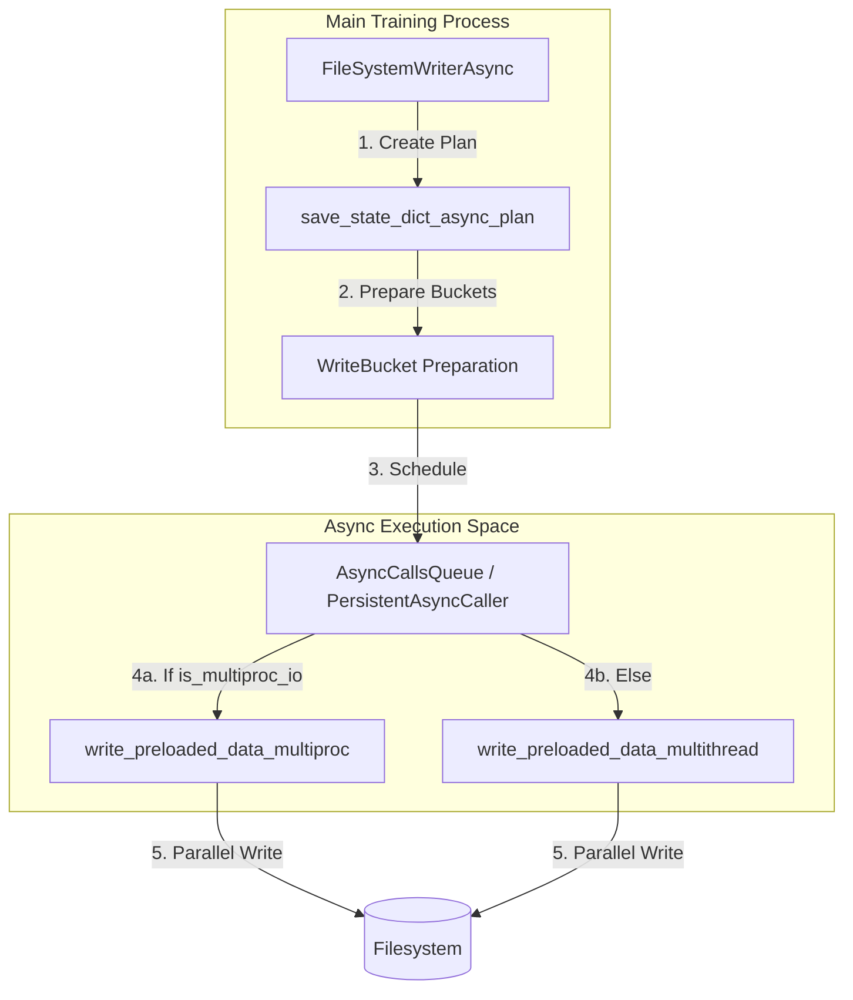
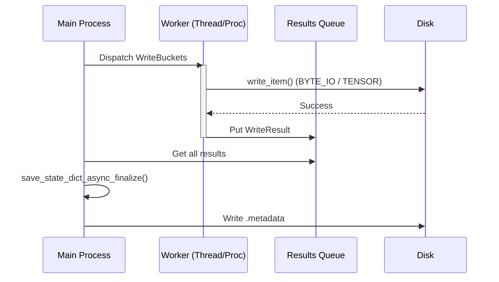

<!-- source: DeepWiki mcp.deepwiki.com · repo NVIDIA/nvidia-resiliency-ext · page 4.2 File I/O Parallelization · fetched 2026-10-26 -->

# File I/O Parallelization

Relevant source files

The following files were used as context for generating this wiki page:

- [examples/checkpointing/async_writer.py](examples/checkpointing/async_writer.py)
- [src/nvidia_resiliency_ext/checkpointing/async_ckpt/cached_metadata_filesystem_reader.py](src/nvidia_resiliency_ext/checkpointing/async_ckpt/cached_metadata_filesystem_reader.py)
- [src/nvidia_resiliency_ext/checkpointing/async_ckpt/core.py](src/nvidia_resiliency_ext/checkpointing/async_ckpt/core.py)
- [src/nvidia_resiliency_ext/checkpointing/async_ckpt/filesystem_async.py](src/nvidia_resiliency_ext/checkpointing/async_ckpt/filesystem_async.py)
- [src/nvidia_resiliency_ext/checkpointing/async_ckpt/state_dict_saver.py](src/nvidia_resiliency_ext/checkpointing/async_ckpt/state_dict_saver.py)
- [src/nvidia_resiliency_ext/checkpointing/utils.py](src/nvidia_resiliency_ext/checkpointing/utils.py)
- [tests/checkpointing/unit/__init__.py](tests/checkpointing/unit/__init__.py)
- [tests/checkpointing/unit/conftest.py](tests/checkpointing/unit/conftest.py)
- [tests/checkpointing/unit/test_async_save.py](tests/checkpointing/unit/test_async_save.py)
- [tests/checkpointing/unit/test_async_writer.py](tests/checkpointing/unit/test_async_writer.py)
- [tests/checkpointing/unit/test_async_writer_msc.py](tests/checkpointing/unit/test_async_writer_msc.py)
- [tests/checkpointing/unit/test_utilities.py](tests/checkpointing/unit/test_utilities.py)

This page details the implementation of parallelized and asynchronous file I/O within the NVRx checkpointing system. It focuses on `FileSystemWriterAsync`, which enables non-blocking checkpoint saves by offloading I/O to background threads or processes, staging GPU tensors to CPU memory, and managing parallel write buckets.

## Overview of FileSystemWriterAsync

`FileSystemWriterAsync` extends the standard PyTorch `FileSystemWriter` to support asynchronous operations [src/nvidia_resiliency_ext/checkpointing/async_ckpt/filesystem_async.py:140-143](). It decouples the planning of a checkpoint from the actual writing to disk, allowing the training process to resume computation as soon as data is staged in host memory.

### Data Flow and Staging

The system uses a multi-stage approach to minimize GPU blocking time:
1.  **Planning**: `save_state_dict_async_plan` determines what needs to be saved and handles metadata caching to optimize subsequent iterations [src/nvidia_resiliency_ext/checkpointing/async_ckpt/state_dict_saver.py:230-245]().
2.  **Preloading (Staging)**: Tensors are moved from GPU to CPU (host) memory. This is often done using pinned memory or shared memory (SHM) to maximize throughput [src/nvidia_resiliency_ext/checkpointing/async_ckpt/filesystem_async.py:164-167]().
3.  **Parallel Writing**: Background workers (threads or processes) consume "Write Buckets" to write data to the filesystem in parallel [src/nvidia_resiliency_ext/checkpointing/async_ckpt/filesystem_async.py:140-153]().

### Code Entity Relationship: I/O Parallelization

Sources: [src/nvidia_resiliency_ext/checkpointing/async_ckpt/filesystem_async.py:140-158](), [src/nvidia_resiliency_ext/checkpointing/async_ckpt/core.py:120-143](), [src/nvidia_resiliency_ext/checkpointing/async_ckpt/state_dict_saver.py:230-245]()

## WriteBucket Preparation

A `WriteBucket` is a logical grouping of write operations targeted at a single file. By grouping multiple `WriteItem` objects into buckets, the system reduces filesystem metadata overhead and enables efficient parallelization across files.

-   **Structure**: A `WriteBucket` is defined as `Tuple[str, str, Tuple[list, list]]`, representing the directory, filename, and the items to be written [src/nvidia_resiliency_ext/checkpointing/async_ckpt/filesystem_async.py:65]().
-   **Parallelism Level**: The number of files created per rank is determined by the `thread_count` parameter. Each thread or process handles a subset of the total `WriteBuckets` [src/nvidia_resiliency_ext/checkpointing/async_ckpt/filesystem_async.py:186-193]().
-   **Data Identification**: `ConsistentDataIdentifier` and `_compute_data_structure_key_from_plan` are used to track and reuse data structures across checkpoints without re-pickling large metadata [src/nvidia_resiliency_ext/checkpointing/async_ckpt/filesystem_async.py:70-116]().

Sources: [src/nvidia_resiliency_ext/checkpointing/async_ckpt/filesystem_async.py:65-153](), [src/nvidia_resiliency_ext/checkpointing/async_ckpt/filesystem_async.py:70-116]()

## GPU-to-CPU Tensor Staging

To free up GPU memory quickly, `FileSystemWriterAsync` implements several staging strategies:

1.  **Standard CPU Copy**: Tensors are detached and moved to CPU memory [src/nvidia_resiliency_ext/checkpointing/utils.py:92-99]().
2.  **Shared Memory (SHM) Caching**: When `use_cpu_shm_for_gpu_tensors` is enabled, the system reuses pre-allocated CPU shared memory buffers. This avoids repeated allocations and reduces the overhead of passing data to background processes [src/nvidia_resiliency_ext/checkpointing/async_ckpt/filesystem_async.py:164-167]().
3.  **SHM Drain Callback**: To prevent race conditions where the main process overwrites an SHM buffer while a background worker is still reading it, a `_shm_drain_callback` is used to ensure prior writes are complete [src/nvidia_resiliency_ext/checkpointing/async_ckpt/filesystem_async.py:171-172]().

Sources: [src/nvidia_resiliency_ext/checkpointing/async_ckpt/filesystem_async.py:164-172](), [src/nvidia_resiliency_ext/checkpointing/utils.py:85-99]()

## I/O Strategies: Multiprocess vs. Multithread

The system supports two primary modes for parallel I/O, controlled by the `is_multiproc_io` flag in `FileSystemWriterAsync` [src/nvidia_resiliency_ext/checkpointing/async_ckpt/filesystem_async.py:180]().

| Strategy | Function | Description |
| :--- | :--- | :--- |
| **Multithreaded** | `write_preloaded_data_multithread` | Uses a `ThreadPoolExecutor`. Best for standard filesystems where Python's GIL is not a major bottleneck for I/O [src/nvidia_resiliency_ext/checkpointing/async_ckpt/filesystem_async.py:734](). |
| **Multiprocess** | `write_preloaded_data_multiproc` | Uses `torch.multiprocessing`. Bypasses the GIL and provides better isolation. Highly recommended when using SHM staging [src/nvidia_resiliency_ext/checkpointing/async_ckpt/filesystem_async.py:653](). |

### Process Quality of Service (QoS)
For background writer processes, the system can set CPU and I/O priorities using `_set_process_qos`. It supports setting `nice` values for CPU and `ionice` (idle class 3) for I/O to ensure checkpointing does not interfere with training performance [src/nvidia_resiliency_ext/checkpointing/async_ckpt/core.py:41-59]().

Sources: [src/nvidia_resiliency_ext/checkpointing/async_ckpt/filesystem_async.py:653-750](), [src/nvidia_resiliency_ext/checkpointing/async_ckpt/core.py:41-118]()

## Results Collection and Finalization

After parallel writing completes, results must be collected to update the checkpoint metadata.

-   **Queue-based Collection**: A multiprocessing queue (`_results_queue`) collects `WriteResult` objects from all background workers [src/nvidia_resiliency_ext/checkpointing/async_ckpt/filesystem_async.py:120-133]().
-   **Finalization**: The `save_state_dict_async_finalize` function gathers these results across all ranks, ensures consistency, and triggers the final metadata write [src/nvidia_resiliency_ext/checkpointing/async_ckpt/state_dict_saver.py:21-24]().

### Sequence: Parallel Write and Collection

Sources: [src/nvidia_resiliency_ext/checkpointing/async_ckpt/filesystem_async.py:680-710](), [src/nvidia_resiliency_ext/checkpointing/async_ckpt/state_dict_saver.py:220-240]()

## Optimization: Metadata Caching

To further reduce I/O overhead, NVRx provides `CachedMetadataFileSystemReader` and `CheckpointMetadataCache`. 

- **Reader Cache**: `CachedMetadataFileSystemReader` caches the `.metadata` content at a class level, keyed by the checkpoint path. This prevents redundant reads from shared filesystems [src/nvidia_resiliency_ext/checkpointing/async_ckpt/cached_metadata_filesystem_reader.py:24-35]().
- **Plan Cache**: `CheckpointMetadataCache` stores global and local `SavePlan` objects to skip expensive planning steps when the model structure is consistent across iterations [src/nvidia_resiliency_ext/checkpointing/async_ckpt/state_dict_saver.py:52-92]().

Sources: [src/nvidia_resiliency_ext/checkpointing/async_ckpt/cached_metadata_filesystem_reader.py:18-57](), [src/nvidia_resiliency_ext/checkpointing/async_ckpt/state_dict_saver.py:52-134]()

---

