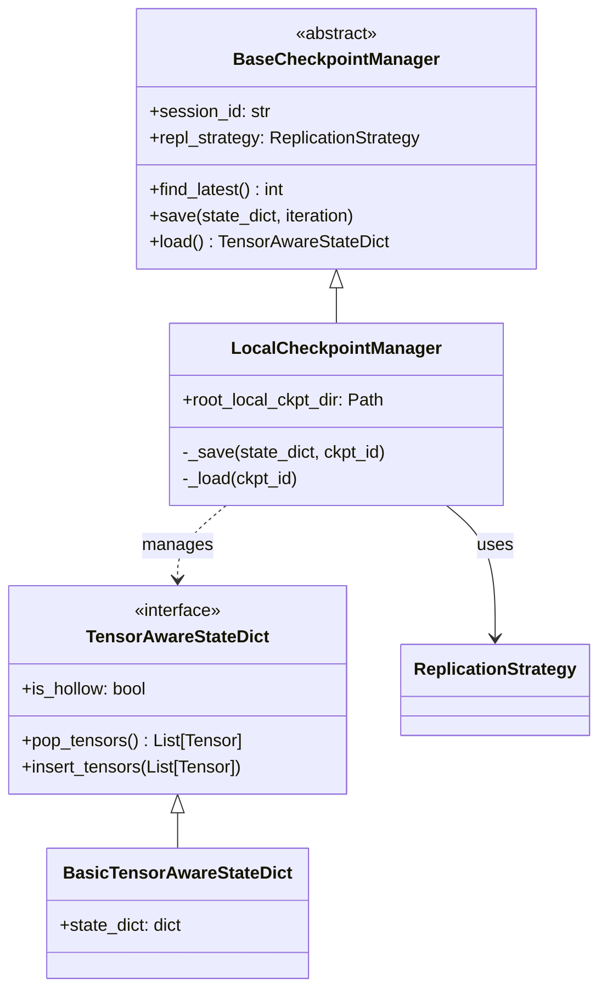
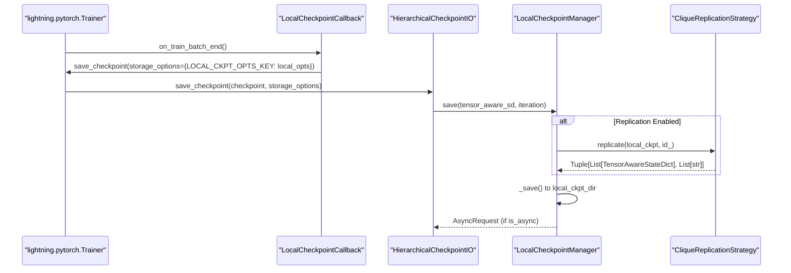

<!-- source: DeepWiki mcp.deepwiki.com · repo NVIDIA/nvidia-resiliency-ext · page 4.3 Local Checkpointing · fetched 2026-10-26 -->

# Local Checkpointing

Relevant source files

The following files were used as context for generating this wiki page:

- [docs/source/checkpointing/async/usage_guide.rst](docs/source/checkpointing/async/usage_guide.rst)
- [docs/source/checkpointing/local/api.rst](docs/source/checkpointing/local/api.rst)
- [docs/source/checkpointing/local/api/basic_state_dict.rst](docs/source/checkpointing/local/api/basic_state_dict.rst)
- [docs/source/checkpointing/local/usage_guide.rst](docs/source/checkpointing/local/usage_guide.rst)
- [examples/checkpointing/async_ckpt.py](examples/checkpointing/async_ckpt.py)
- [examples/checkpointing/local_ckpt.py](examples/checkpointing/local_ckpt.py)
- [src/nvidia_resiliency_ext/checkpointing/async_ckpt/torch_ckpt.py](src/nvidia_resiliency_ext/checkpointing/async_ckpt/torch_ckpt.py)
- [src/nvidia_resiliency_ext/checkpointing/local/ckpt_managers/base_manager.py](src/nvidia_resiliency_ext/checkpointing/local/ckpt_managers/base_manager.py)
- [src/nvidia_resiliency_ext/checkpointing/local/ckpt_managers/local_manager.py](src/nvidia_resiliency_ext/checkpointing/local/ckpt_managers/local_manager.py)
- [src/nvidia_resiliency_ext/checkpointing/local/replication/strategies.py](src/nvidia_resiliency_ext/checkpointing/local/replication/strategies.py)
- [src/nvidia_resiliency_ext/ptl_resiliency/local_checkpoint_callback.py](src/nvidia_resiliency_ext/ptl_resiliency/local_checkpoint_callback.py)

Local checkpointing provides a mechanism for saving training state to local storage devices (e.g., SSDs, RAM disks) rather than a remote distributed file system. This offloads I/O pressure from the global storage and enables faster recovery from transient failures. The system supports same-machine replication to protect against single-rank failures and integrates with PyTorch Lightning via specialized callbacks.

## Core Architecture

The local checkpointing system is built on a hierarchy of managers that handle the lifecycle of checkpoint files, including generation of unique IDs, cleanup of stale iterations, and coordination across distributed ranks.

### BaseCheckpointManager
The `BaseCheckpointManager` is an abstract base class that defines the interface for all local checkpointing implementations. It abstracts the replication mechanisms from the underlying storage logic [src/nvidia_resiliency_ext/checkpointing/local/ckpt_managers/base_manager.py:64-68]().

Key responsibilities include:
*   **Checkpoint ID Generation**: Uses `(iteration, rank, session_id)` to uniquely identify shards [src/nvidia_resiliency_ext/checkpointing/local/ckpt_managers/base_manager.py:86-101]().
*   **Latest Checkpoint Discovery**: The `find_latest` method performs an `all_gather` across all ranks to determine the most recent iteration that has a complete set of shards available globally [src/nvidia_resiliency_ext/checkpointing/local/ckpt_managers/base_manager.py:157-188]().
*   **State Management**: Tracks `latest_iteration` and manages the `repl_strategy` [src/nvidia_resiliency_ext/checkpointing/local/ckpt_managers/base_manager.py:70-73]().

### LocalCheckpointManager
The concrete implementation `LocalCheckpointManager` handles I/O for local storage. It organizes files into a directory structure based on `root_local_ckpt_dir`, `session_id`, and `rank` [src/nvidia_resiliency_ext/checkpointing/local/ckpt_managers/local_manager.py:39-71]().

**Local Checkpoint Flow**
1.  **Save**: Tensors are saved to a `.dirty` file first using `torch.save`, then renamed to the final path to ensure atomicity [src/nvidia_resiliency_ext/checkpointing/local/ckpt_managers/local_manager.py:108-125]().
2.  **Cleanup**: After a successful save, it removes checkpoints from older iterations to conserve local disk space [src/nvidia_resiliency_ext/checkpointing/local/ckpt_managers/local_manager.py:132-144]().
3.  **Load**: Retrieves the `TensorAwareStateDict` from the local path. If the file is missing but replication is enabled, the manager can trigger a retrieval from another rank in the same machine/clique [src/nvidia_resiliency_ext/checkpointing/local/ckpt_managers/local_manager.py:91-105]().

### Class Relationship Diagram
This diagram shows the association between the management classes and the state dictionary interfaces.

**Sources:** [src/nvidia_resiliency_ext/checkpointing/local/ckpt_managers/base_manager.py:64-137](), [src/nvidia_resiliency_ext/checkpointing/local/ckpt_managers/local_manager.py:39-65](), [docs/source/checkpointing/local/usage_guide.rst:3-11]().

---

## Replication Strategies

To survive the loss of a local disk or a specific process, checkpoints can be replicated across ranks within the same machine or "clique".

### CliqueReplicationStrategy
The `CliqueReplicationStrategy` groups ranks (e.g., all GPUs on one node) to share their checkpoint shards [src/nvidia_resiliency_ext/checkpointing/local/replication/strategies.py:76-85](). Users can configure `replication_factor` (clique size) and `replication_jump` (spacing between ranks in a clique) [docs/source/checkpointing/local/usage_guide.rst:86-97]().

**Replication Data Flow (`replicate`):**
1.  **Hollowing**: The local `TensorAwareStateDict` is split into a "hollow" dictionary (metadata) and a list of raw tensors via `pop_tensors()` [src/nvidia_resiliency_ext/checkpointing/local/replication/strategies.py:110]().
2.  **Metadata Exchange**: Hollow dictionaries are shared via `all_gather_object` [src/nvidia_resiliency_ext/checkpointing/local/replication/strategies.py:113]().
3.  **Tensor Exchange**: Raw tensors are shared via `all_gather_batch`, potentially staging them to CPU to save GPU memory [src/nvidia_resiliency_ext/checkpointing/local/replication/strategies.py:119-122]().
4.  **Reconstruction**: Each rank reconstructs the state dicts of its peers by inserting the received tensors into the gathered hollow metadata via `insert_tensors()` [src/nvidia_resiliency_ext/checkpointing/local/replication/strategies.py:129-131]().

### Retrieval Execution
When a rank needs to load a checkpoint that is not present on its local storage, it uses an `ExchangePlan` to request the shard from a peer that holds a replica [src/nvidia_resiliency_ext/checkpointing/local/replication/strategies.py:143-162]().

**Sources:** [src/nvidia_resiliency_ext/checkpointing/local/replication/strategies.py:37-141](), [docs/source/checkpointing/local/usage_guide.rst:81-97]().

---

## TensorAwareStateDict Interface

The `TensorAwareStateDict` is a critical abstraction that allows the replication strategy to handle state dictionaries without knowing their internal structure. It requires that all tensors are CUDA tensors and accessible within nested lists or dictionaries [docs/source/checkpointing/local/usage_guide.rst:30-38]().

*   **Hollow State**: A state dict where tensors have been removed (replaced by placeholders) to minimize pickling overhead during metadata exchange [src/nvidia_resiliency_ext/checkpointing/local/replication/strategies.py:108-115]().
*   **Device Restoration**: After loading or receiving a checkpoint, `restore_tensor_device` ensures tensors are moved to the correct GPU [src/nvidia_resiliency_ext/checkpointing/local/ckpt_managers/base_manager.py:141]().

**Sources:** [src/nvidia_resiliency_ext/checkpointing/local/base_state_dict.py:37](), [docs/source/checkpointing/local/usage_guide.rst:30-38]().

---

## PyTorch Lightning Integration

Integration is provided through a specialized callback and a `CheckpointIO` wrapper.

### LocalCheckpointCallback
This callback initiates local saves during the `on_train_batch_end` hook. It passes `local_checkpoint_options` to the trainer, which are then intercepted by the IO layer [src/nvidia_resiliency_ext/ptl_resiliency/local_checkpoint_callback.py:53-103]().

### HierarchicalCheckpointIO
A wrapper around a standard `CheckpointIO` (e.g., `TorchCheckpointIO`). It routes save/load requests:
*   **Routing**: If `LOCAL_CKPT_OPTS_KEY` is present in `storage_options`, it redirects the operation to the `local_ckpt_manager` [src/nvidia_resiliency_ext/ptl_resiliency/local_checkpoint_callback.py:140-148]().
*   **Hybrid Loading**: During `load_checkpoint`, it compares the iteration of the latest local checkpoint against the global one and loads the most recent version [src/nvidia_resiliency_ext/ptl_resiliency/local_checkpoint_callback.py:160-164]().

### Sequence Diagram: Local Save in PTL
This diagram illustrates the flow from a Lightning training step to the local disk.

**Sources:** [src/nvidia_resiliency_ext/ptl_resiliency/local_checkpoint_callback.py:53-158](), [src/nvidia_resiliency_ext/checkpointing/local/ckpt_managers/local_manager.py:108-125](), [src/nvidia_resiliency_ext/checkpointing/local/replication/strategies.py:88-104]().

---

## Usage Requirements and Restrictions

| Feature | Requirement / Restriction |
| :--- | :--- |
| **Storage** | `root_local_ckpt_dir` must fit 2 shards (clean/dirty) per rank $\times$ replication factor [docs/source/checkpointing/local/usage_guide.rst:19-21](). |
| **Collective Calls** | All ranks must call `save`, `load`, and `find_latest` simultaneously to avoid NCCL hangs [docs/source/checkpointing/local/usage_guide.rst:27-28](). |
| **Asynchrony** | `AsyncCallsQueue` must use `persistent=False` as some local routines are not pickleable [docs/source/checkpointing/local/usage_guide.rst:38-41](), [examples/checkpointing/local_ckpt.py:149-150](). |
| **Replication** | `world_size` and replication parameters must match between save and load for successful recovery [docs/source/checkpointing/local/usage_guide.rst:22-26](). |

**Sources:** [docs/source/checkpointing/local/usage_guide.rst:14-41](), [examples/checkpointing/local_ckpt.py:149-150]().

---

