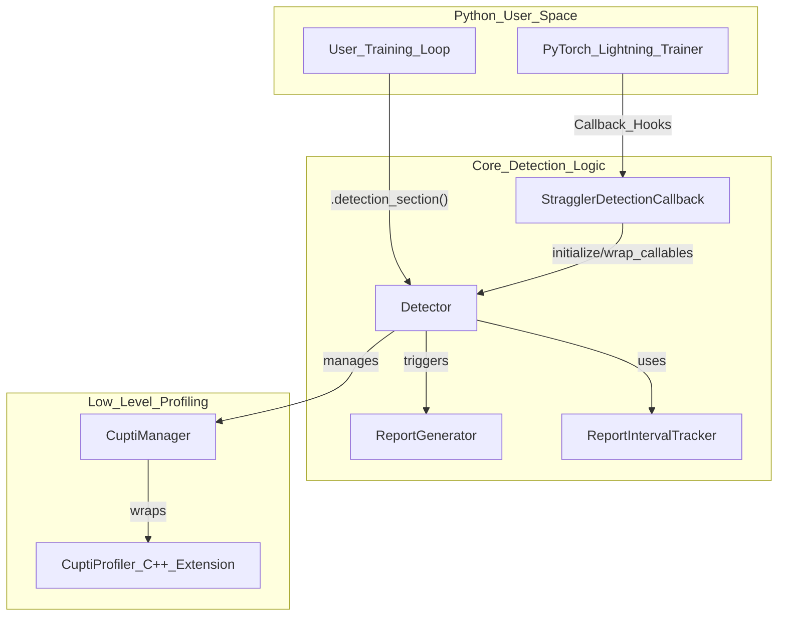
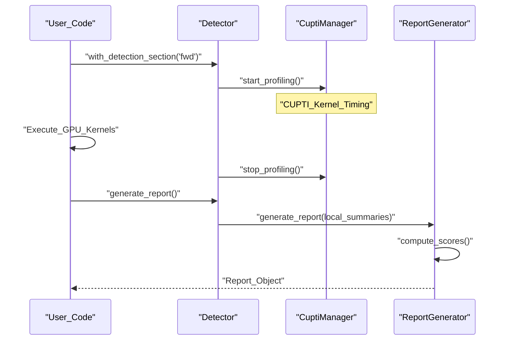

<!-- source: DeepWiki mcp.deepwiki.com · repo NVIDIA/nvidia-resiliency-ext · page 5 Straggler Detection · fetched 2026-10-26 -->

# Straggler Detection

Relevant source files

The following files were used as context for generating this wiki page:

- [docs/source/fault_tolerance/integration/ptl.rst](docs/source/fault_tolerance/integration/ptl.rst)
- [docs/source/straggler_det/usage_guide.rst](docs/source/straggler_det/usage_guide.rst)
- [examples/straggler/example.py](examples/straggler/example.py)
- [src/nvidia_resiliency_ext/ptl_resiliency/__init__.py](src/nvidia_resiliency_ext/ptl_resiliency/__init__.py)
- [src/nvidia_resiliency_ext/ptl_resiliency/_utils.py](src/nvidia_resiliency_ext/ptl_resiliency/_utils.py)
- [src/nvidia_resiliency_ext/ptl_resiliency/fault_tolerance_callback.py](src/nvidia_resiliency_ext/ptl_resiliency/fault_tolerance_callback.py)
- [src/nvidia_resiliency_ext/ptl_resiliency/fault_tolerance_sections_callback.py](src/nvidia_resiliency_ext/ptl_resiliency/fault_tolerance_sections_callback.py)
- [src/nvidia_resiliency_ext/ptl_resiliency/straggler_det_callback.py](src/nvidia_resiliency_ext/ptl_resiliency/straggler_det_callback.py)
- [tests/fault_tolerance/unit/conftest.py](tests/fault_tolerance/unit/conftest.py)
- [tests/ptl_resiliency/unit/test_straggler_det_callback.py](tests/ptl_resiliency/unit/test_straggler_det_callback.py)
- [tests/straggler/func/ddp_test.py](tests/straggler/func/ddp_test.py)
- [tests/straggler/unit/test_data_shared.py](tests/straggler/unit/test_data_shared.py)
- [tests/straggler/unit/test_det_section_api.py](tests/straggler/unit/test_det_section_api.py)
- [tests/straggler/unit/test_individual_gpu_scores.py](tests/straggler/unit/test_individual_gpu_scores.py)
- [tests/straggler/unit/test_name_mapper.py](tests/straggler/unit/test_name_mapper.py)
- [tests/straggler/unit/test_relative_gpu_scores.py](tests/straggler/unit/test_relative_gpu_scores.py)
- [tests/straggler/unit/test_reporting.py](tests/straggler/unit/test_reporting.py)
- [tests/straggler/unit/test_reporting_elapsed.py](tests/straggler/unit/test_reporting_elapsed.py)
- [tests/straggler/unit/test_sections.py](tests/straggler/unit/test_sections.py)
- [tests/straggler/unit/test_wrap_callables.py](tests/straggler/unit/test_wrap_callables.py)

The Straggler Detection subsystem is designed to identify underperforming ranks (stragglers) in distributed training environments. It achieves this by monitoring both CPU wall-clock time in specific code regions and GPU kernel execution times via CUPTI. By comparing performance across ranks (relative) or against a rank's own history (individual), the system can pinpoint hardware degradation or software inefficiencies that slow down the global training loop.

### Purpose and Scope
The subsystem provides a structured way to:
1.  **Instrument Code**: Define "detection sections" to monitor specific parts of the training loop (e.g., data loading, forward pass) [docs/source/straggler_det/usage_guide.rst:53-57]().
2.  **Profile GPU Kernels**: Use a high-performance C++ extension to track the duration of CUDA kernels without significant overhead [docs/source/straggler_det/usage_guide.rst:8-10]().
3.  **Score Performance**: Calculate scalar scores (0.0 to 1.0) representing rank health [docs/source/straggler_det/usage_guide.rst:16-17]().
4.  **Integrate with Frameworks**: Provide PyTorch Lightning callbacks for seamless adoption [src/nvidia_resiliency_ext/ptl_resiliency/straggler_det_callback.py:37-43]().

### System Architecture

The architecture bridges Python-level context management with low-level GPU profiling. The `Detector` acts as the primary orchestrator, managing `CuptiManager` for hardware metrics and `ReportGenerator` for distributed data aggregation.

#### Straggler Detection Entity Map
This diagram shows how high-level detection concepts map to specific classes and modules in the codebase.

**Sources:** [src/nvidia_resiliency_ext/ptl_resiliency/straggler_det_callback.py:37-115](), [docs/source/straggler_det/usage_guide.rst:53-132](), [tests/straggler/unit/test_reporting_elapsed.py:100-116]()

---

### Detector API and Performance Scoring

The `Detector` is the central interface for users to mark sections of code for monitoring. It supports two primary methods for instrumentation: the `detection_section` context manager and the `wrap_callables` utility [docs/source/straggler_det/usage_guide.rst:53-57](). Performance is evaluated using two scoring metrics:
*   **Relative Score**: The best-performing rank in the workload is used as a reference [docs/source/straggler_det/usage_guide.rst:20]().
*   **Individual Score**: The best historical performance of the specific rank is used as a reference [docs/source/straggler_det/usage_guide.rst:21]().

A score of 0.5 indicates a rank is twice as slow as its reference [docs/source/straggler_det/usage_guide.rst:24-25](). The system can aggregate these scores across ranks using `torch.distributed` to provide a global view of cluster health [tests/straggler/unit/test_relative_gpu_scores.py:123-128]().

For details, see [Detector API and Performance Scoring](#5.1).

**Sources:** [docs/source/straggler_det/usage_guide.rst:12-25](), [tests/straggler/unit/test_det_section_api.py:83-101](), [tests/straggler/unit/test_wrap_callables.py:57-64]()

---

### CUPTI Profiling and PTL Integration

To provide granular insights into GPU performance, the subsystem includes a C++ extension that utilizes the NVIDIA CUPTI (CUDA Profiling Tools Interface). This allows the system to measure the duration of CUDA kernels within a `detection_section` [docs/source/straggler_det/usage_guide.rst:8-10]().

For PyTorch Lightning users, the `StragglerDetectionCallback` automates the initialization of the detector and wraps the `training_step` of the Lightning strategy [src/nvidia_resiliency_ext/ptl_resiliency/straggler_det_callback.py:98-104](). It can also be configured to terminate training automatically if stragglers are detected [src/nvidia_resiliency_ext/ptl_resiliency/straggler_det_callback.py:68](). Additionally, the `FaultToleranceCallback` manages the training state machine to determine when FT timeouts can be safely updated based on training progress [src/nvidia_resiliency_ext/ptl_resiliency/fault_tolerance_callback.py:45-167]().

For details, see [CUPTI Profiling and PTL Integration](#5.2).

#### Data Flow: Profiling to Reporting

**Sources:** [docs/source/straggler_det/usage_guide.rst:67-91](), [tests/straggler/unit/test_relative_gpu_scores.py:49-56](), [tests/straggler/unit/test_reporting_elapsed.py:116-126]()

---

### Key Components Reference

| Component | Source Path | Role |
| :--- | :--- | :--- |
| `Detector` | `nvidia_resiliency_ext/attribution/straggler` | Primary API for section management and report triggers [docs/source/straggler_det/usage_guide.rst:65-74](). |
| `StragglerDetectionCallback` | `src/nvidia_resiliency_ext/ptl_resiliency/straggler_det_callback.py` | PTL integration for automatic instrumentation and logging [src/nvidia_resiliency_ext/ptl_resiliency/straggler_det_callback.py:37-57](). |
| `FaultToleranceCallback` | `src/nvidia_resiliency_ext/ptl_resiliency/fault_tolerance_callback.py` | Manages PTL training lifecycle and FT timeout updates [src/nvidia_resiliency_ext/ptl_resiliency/fault_tolerance_callback.py:169-183](). |
| `ReportGenerator` | `nvidia_resiliency_ext/attribution/straggler` | Logic for calculating relative and individual performance scores [tests/straggler/unit/test_relative_gpu_scores.py:49-51](). |
| `Statistic` | `nvidia_resiliency_ext/attribution/straggler` | Enum defining aggregation types (MIN, MAX, AVG, NUM) [tests/straggler/unit/test_det_section_api.py:96-100](). |

**Sources:** [src/nvidia_resiliency_ext/ptl_resiliency/straggler_det_callback.py:37-57](), [src/nvidia_resiliency_ext/ptl_resiliency/fault_tolerance_callback.py:45-167](), [tests/straggler/unit/test_relative_gpu_scores.py:49-56]()

---

