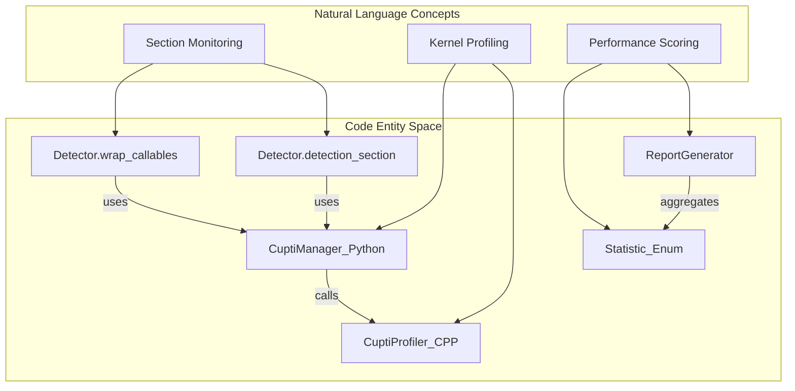
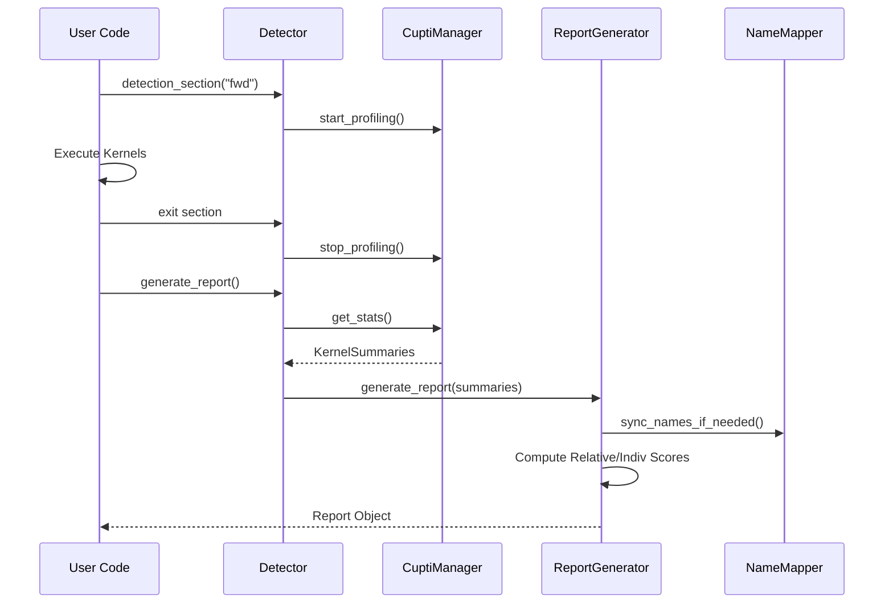

<!-- source: DeepWiki mcp.deepwiki.com · repo NVIDIA/nvidia-resiliency-ext · page 5.1 Detector API and Performance Scoring · fetched 2026-10-26 -->

# Detector API and Performance Scoring

Relevant source files

The following files were used as context for generating this wiki page:

- [docs/source/fault_tolerance/api/callback.rst](docs/source/fault_tolerance/api/callback.rst)
- [docs/source/fault_tolerance/api/client.rst](docs/source/fault_tolerance/api/client.rst)
- [docs/source/fault_tolerance/api/config.rst](docs/source/fault_tolerance/api/config.rst)
- [docs/source/fault_tolerance/api/server.rst](docs/source/fault_tolerance/api/server.rst)
- [docs/source/straggler_det/api/callback.rst](docs/source/straggler_det/api/callback.rst)
- [docs/source/straggler_det/api/reporting.rst](docs/source/straggler_det/api/reporting.rst)
- [docs/source/straggler_det/api/statistics.rst](docs/source/straggler_det/api/statistics.rst)
- [examples/straggler/example.py](examples/straggler/example.py)
- [tests/straggler/func/ddp_test.py](tests/straggler/func/ddp_test.py)
- [tests/straggler/unit/test_data_shared.py](tests/straggler/unit/test_data_shared.py)
- [tests/straggler/unit/test_det_section_api.py](tests/straggler/unit/test_det_section_api.py)
- [tests/straggler/unit/test_individual_gpu_scores.py](tests/straggler/unit/test_individual_gpu_scores.py)
- [tests/straggler/unit/test_name_mapper.py](tests/straggler/unit/test_name_mapper.py)
- [tests/straggler/unit/test_relative_gpu_scores.py](tests/straggler/unit/test_relative_gpu_scores.py)
- [tests/straggler/unit/test_reporting.py](tests/straggler/unit/test_reporting.py)
- [tests/straggler/unit/test_reporting_elapsed.py](tests/straggler/unit/test_reporting_elapsed.py)
- [tests/straggler/unit/test_sections.py](tests/straggler/unit/test_sections.py)
- [tests/straggler/unit/test_wrap_callables.py](tests/straggler/unit/test_wrap_callables.py)

The Straggler Detection subsystem provides a high-level API for identifying underperforming ranks (stragglers) in distributed training. It combines CPU-side section timing with CUPTI-based GPU kernel profiling to compute performance scores and identify hardware or software bottlenecks.

## Detector Class

The `Detector` class is the primary interface for users to interact with the straggler detection system. It is designed as a singleton-like interface where most operations are performed through class methods.

### Lifecycle Management
The detector must be initialized before any profiling or reporting can occur.
*   **`initialize()`**: Sets up the global state, including the `CuptiManager` and `ReportGenerator`. It accepts configuration for `profiling_interval`, `report_time_interval`, `scores_to_compute`, and `gather_on_rank0` `[tests/straggler/unit/test_det_section_api.py:26-26]()`, `[tests/straggler/unit/test_reporting.py:114-116]()`, `[tests/straggler/unit/test_reporting_elapsed.py:100-103]()`.
*   **`shutdown()`**: Cleans up resources, stops the CUPTI profiler, and resets internal counters `[tests/straggler/unit/test_det_section_api.py:30-30]()`, `[tests/straggler/unit/test_reporting.py:182-182]()`.

### Detection Sections
The system allows users to define logical "sections" of code to measure. This is achieved through two primary mechanisms:
1.  **`detection_section(name, profile_cuda=True)`**: A context manager used to wrap specific blocks of code (e.g., forward pass, backward pass). It tracks CPU elapsed time and optionally enables CUDA kernel capture via CUPTI for that specific block `[tests/straggler/unit/test_det_section_api.py:43-44]()`, `[tests/straggler/unit/test_det_section_api.py:110-111]()`, `[tests/straggler/unit/test_reporting_elapsed.py:186-187]()`.
2.  **`wrap_callables(callable_ids)`**: Automatically wraps class or instance methods (e.g., `model.forward`) to record timings every time they are called. It can also ignore specific arguments like `self` `[tests/straggler/unit/test_reporting.py:118-118]()`, `[tests/straggler/unit/test_wrap_callables.py:57-64]()`.

### System Relationship: API to Code Entities
The following diagram illustrates how the natural language concept of "Detection" maps to specific code entities within the `straggler` module.

**Straggler Detection Mapping**

*Sources: [tests/straggler/unit/test_det_section_api.py:43-111](), [tests/straggler/unit/test_relative_gpu_scores.py:49-51](), [tests/straggler/unit/test_wrap_callables.py:57-64]()*

## Performance Scoring

The system computes two types of performance scores to distinguish between transient stragglers and persistent hardware issues.

### Relative Performance Scores
Relative scores compare the performance of a rank/section against the best-performing peer in the current training session.
*   **Calculation**: `Score = Min_Peer_Time / Local_Time`.
*   A score of `1.0` indicates the rank is among the fastest. A score of `0.5` indicates the rank is twice as slow as the fastest peer `[tests/straggler/unit/test_relative_gpu_scores.py:125-128]()`, `[tests/straggler/unit/test_name_mapper.py:186-186]()`.
*   **GPU Relative**: Based on the sum of all profiled GPU kernels. Note that NCCL kernels (e.g., `ncclDevKernel*`) are typically ignored to avoid skewing hardware performance metrics with communication wait times `[tests/straggler/unit/test_relative_gpu_scores.py:78-86]()`.
*   **Section Relative**: Based on the CPU elapsed time for a specific named section `[tests/straggler/unit/test_sections.py:183-188]()`.

### Individual Performance Scores
Individual scores compare the current performance of a rank against its own historical "best" (the minimum observed time for that rank).
*   **Calculation**: `Score = Local_Historical_Min / Local_Current_Time`.
*   This identifies if a specific GPU has slowed down relative to its own baseline, regardless of how other GPUs are performing `[tests/straggler/unit/test_individual_gpu_scores.py:58-65]()`.
*   The reference "best" time is updated if a new, faster measurement is observed `[tests/straggler/unit/test_individual_gpu_scores.py:108-114]()`.

## Report Generation and Aggregation

The `ReportGenerator` and `Report` classes handle the collection and analysis of timing data.

### Data Flow and Aggregation
1.  **Local Summarization**: Each rank calculates local statistics (Min, Max, Median, Avg, StdDev, Count) for its sections and kernels using the `Statistic` enum `[tests/straggler/unit/test_relative_gpu_scores.py:35-43]()`.
2.  **Distributed Gathering**: If `gather_on_rank0=True`, rank 0 performs an `all_gather_object` to collect summaries from all ranks `[tests/straggler/unit/test_reporting.py:128-130]()`, `[tests/straggler/unit/test_data_shared.py:47-71]()`.
3.  **Name Mapping**: To reduce communication overhead, a `NameMapper` assigns integer IDs to kernel and section strings. Only new names are synchronized across ranks to minimize `all_gather_object` calls `[tests/straggler/unit/test_name_mapper.py:67-98]()`, `[tests/straggler/unit/test_data_shared.py:78-91]()`.
4.  **Straggler Identification**: The `report.identify_stragglers()` method applies thresholds to the computed scores to return a dictionary containing `StragglerId` objects (rank and node name) for both GPU and section-level stragglers `[tests/straggler/unit/test_sections.py:175-180]()`, `[tests/straggler/func/ddp_test.py:146-157]()`.

### Statistic Enum
The `Statistic` enum defines the keys used in the summary dictionaries:
| Enum Value | Description |
| :--- | :--- |
| `NUM` | Number of occurrences/calls `[tests/straggler/unit/test_det_section_api.py:96]()` |
| `MIN` | Minimum duration `[tests/straggler/unit/test_relative_gpu_scores.py:36]()` |
| `MAX` | Maximum duration `[tests/straggler/unit/test_relative_gpu_scores.py:37]()` |
| `AVG` | Average duration `[tests/straggler/unit/test_relative_gpu_scores.py:39]()` |
| `MED` | Median duration `[tests/straggler/unit/test_relative_gpu_scores.py:38]()` |
| `STD` | Standard deviation `[tests/straggler/unit/test_relative_gpu_scores.py:40]()` |

*Sources: [tests/straggler/unit/test_det_section_api.py:96-100](), [tests/straggler/unit/test_relative_gpu_scores.py:35-43](), [tests/straggler/unit/test_name_mapper.py:67-98]()*

## Implementation Details

### Profiling Control
The `Detector` supports periodic capture through `profiling_interval`. If set to a value greater than 1, only a fraction of section entries are monitored to reduce overhead `[tests/straggler/unit/test_det_section_api.py:83-100]()`. Users can also explicitly disable CUDA profiling for specific sections using `profile_cuda=False` `[tests/straggler/unit/test_det_section_api.py:110-111]()`.

### Report Interval Tracker
The `Detector` uses a `report_interval_tracker` to determine when to generate reports based on time rather than just iteration counts. It estimates the number of iterations required to satisfy the `report_time_interval` `[tests/straggler/unit/test_reporting_elapsed.py:100-103]()`, `[tests/straggler/unit/test_reporting_elapsed.py:116-126]()`.

**Report Generation Data Flow**

*Sources: [tests/straggler/unit/test_det_section_api.py:89-92](), [examples/straggler/example.py:98-112](), [tests/straggler/unit/test_data_shared.py:47-101]()*

Sources:
- `tests/straggler/unit/test_det_section_api.py:26-111`
- `tests/straggler/unit/test_reporting.py:114-182`
- `tests/straggler/unit/test_sections.py:175-188`
- `tests/straggler/unit/test_relative_gpu_scores.py:35-128`
- `tests/straggler/unit/test_individual_gpu_scores.py:58-114`
- `tests/straggler/unit/test_name_mapper.py:67-194`
- `tests/straggler/unit/test_reporting_elapsed.py:100-126`
- `tests/straggler/unit/test_wrap_callables.py:57-64`
- `tests/straggler/unit/test_data_shared.py:47-101`
- `examples/straggler/example.py:98-112`
- `tests/straggler/func/ddp_test.py:146-157`

---

