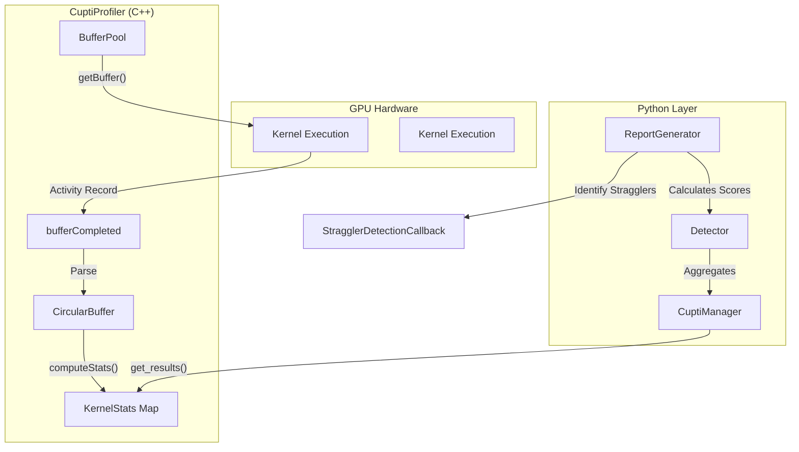
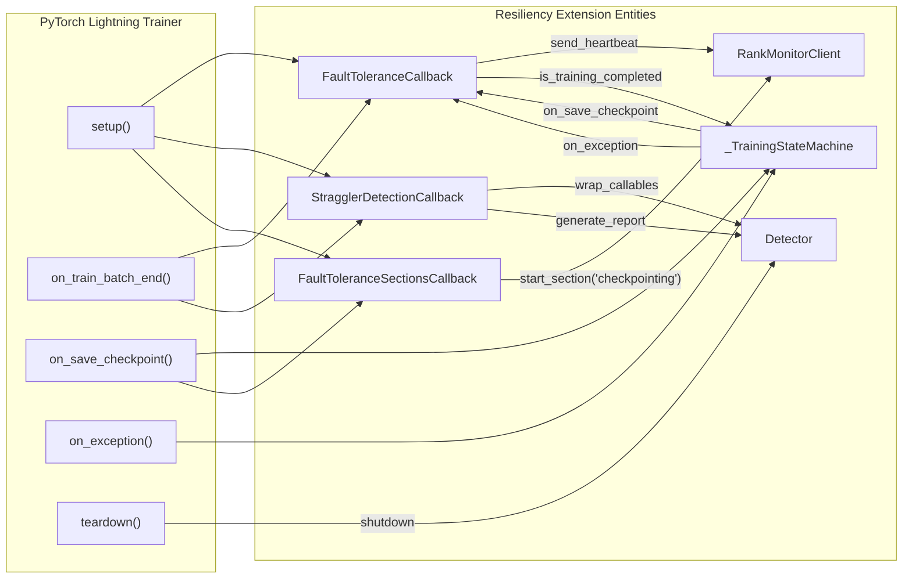

<!-- source: DeepWiki mcp.deepwiki.com · repo NVIDIA/nvidia-resiliency-ext · page 5.2 CUPTI Profiling and PTL Integration · fetched 2026-10-26 -->

# CUPTI Profiling and PTL Integration

Relevant source files

The following files were used as context for generating this wiki page:

- [docs/source/fault_tolerance/integration/ptl.rst](docs/source/fault_tolerance/integration/ptl.rst)
- [docs/source/straggler_det/usage_guide.rst](docs/source/straggler_det/usage_guide.rst)
- [src/nvidia_resiliency_ext/attribution/straggler/__init__.py](src/nvidia_resiliency_ext/attribution/straggler/__init__.py)
- [src/nvidia_resiliency_ext/attribution/straggler/cupti.py](src/nvidia_resiliency_ext/attribution/straggler/cupti.py)
- [src/nvidia_resiliency_ext/attribution/straggler/cupti_src/BufferPool.cpp](src/nvidia_resiliency_ext/attribution/straggler/cupti_src/BufferPool.cpp)
- [src/nvidia_resiliency_ext/attribution/straggler/cupti_src/BufferPool.h](src/nvidia_resiliency_ext/attribution/straggler/cupti_src/BufferPool.h)
- [src/nvidia_resiliency_ext/attribution/straggler/cupti_src/CircularBuffer.h](src/nvidia_resiliency_ext/attribution/straggler/cupti_src/CircularBuffer.h)
- [src/nvidia_resiliency_ext/attribution/straggler/cupti_src/CuptiProfiler.cpp](src/nvidia_resiliency_ext/attribution/straggler/cupti_src/CuptiProfiler.cpp)
- [src/nvidia_resiliency_ext/attribution/straggler/cupti_src/CuptiProfiler.h](src/nvidia_resiliency_ext/attribution/straggler/cupti_src/CuptiProfiler.h)
- [src/nvidia_resiliency_ext/attribution/straggler/cupti_src/cupti_module_py.cpp](src/nvidia_resiliency_ext/attribution/straggler/cupti_src/cupti_module_py.cpp)
- [src/nvidia_resiliency_ext/attribution/straggler/dist_utils.py](src/nvidia_resiliency_ext/attribution/straggler/dist_utils.py)
- [src/nvidia_resiliency_ext/attribution/straggler/interval_tracker.py](src/nvidia_resiliency_ext/attribution/straggler/interval_tracker.py)
- [src/nvidia_resiliency_ext/ptl_resiliency/__init__.py](src/nvidia_resiliency_ext/ptl_resiliency/__init__.py)
- [src/nvidia_resiliency_ext/ptl_resiliency/_utils.py](src/nvidia_resiliency_ext/ptl_resiliency/_utils.py)
- [src/nvidia_resiliency_ext/ptl_resiliency/fault_tolerance_callback.py](src/nvidia_resiliency_ext/ptl_resiliency/fault_tolerance_callback.py)
- [src/nvidia_resiliency_ext/ptl_resiliency/fault_tolerance_sections_callback.py](src/nvidia_resiliency_ext/ptl_resiliency/fault_tolerance_sections_callback.py)
- [src/nvidia_resiliency_ext/ptl_resiliency/straggler_det_callback.py](src/nvidia_resiliency_ext/ptl_resiliency/straggler_det_callback.py)
- [tests/fault_tolerance/unit/conftest.py](tests/fault_tolerance/unit/conftest.py)
- [tests/ptl_resiliency/func/nemo20/straggler_test_llama3.py](tests/ptl_resiliency/func/nemo20/straggler_test_llama3.py)
- [tests/ptl_resiliency/unit/test_straggler_det_callback.py](tests/ptl_resiliency/unit/test_straggler_det_callback.py)

This page details the technical implementation of GPU-level profiling using the NVIDIA Management Library (CUPTI) and the integration of resiliency features into the PyTorch Lightning (PTL) ecosystem. These components enable fine-grained straggler detection and seamless fault tolerance for high-level training frameworks.

## CUPTI Profiling System

The CUPTI profiling subsystem provides low-level GPU kernel timing data to identify "GPU stragglers"—ranks where kernel execution is significantly slower than others, often due to hardware degradation or thermal throttling.

### CuptiProfiler C++ Extension
The core of the profiling is implemented in C++ for minimal overhead. The `CuptiProfiler` class manages the CUPTI activity API to capture concurrent kernel execution times.

- **Buffer Management**: Uses a `BufferPool` to provide memory for CUPTI activity records [src/nvidia_resiliency_ext/attribution/straggler/cupti_src/CuptiProfiler.cpp:83-85]().
- **Activity Tracking**: Enables `CUPTI_ACTIVITY_KIND_CONCURRENT_KERNEL` to monitor GPU tasks [src/nvidia_resiliency_ext/attribution/straggler/cupti_src/CuptiProfiler.cpp:118]().
- **Kernel Attribution**: It aggregates durations by kernel name and grid/block dimensions to ensure like-for-like comparisons across ranks [src/nvidia_resiliency_ext/attribution/straggler/cupti_src/CuptiProfiler.cpp:186-191]().
- **Statistics**: Computes min, max, median, average, and standard deviation for each unique kernel signature [src/nvidia_resiliency_ext/attribution/straggler/cupti_src/CuptiProfiler.cpp:44-74]().

### CuptiManager
The `CuptiManager` is the Python-side interface that manages the lifecycle of the C++ profiler. It supports nested profiling calls using an internal counter to ensure profiling remains active if multiple sections overlap [src/nvidia_resiliency_ext/attribution/straggler/cupti.py:19-82]().

### Data Flow: GPU Kernel Timing to Straggler Report

The following diagram illustrates how raw GPU activity is transformed into actionable performance scores.

**CUPTI Data Aggregation Flow**

Sources: [src/nvidia_resiliency_ext/attribution/straggler/cupti_src/CuptiProfiler.cpp:154-200](), [src/nvidia_resiliency_ext/attribution/straggler/cupti.py:19-82](), [docs/source/straggler_det/usage_guide.rst:12-25](), [src/nvidia_resiliency_ext/attribution/straggler/cupti_src/BufferPool.cpp:44-52]()

---

## PyTorch Lightning Integration

The library provides primary callbacks for PTL-based training: `StragglerDetectionCallback`, `FaultToleranceCallback`, and `FaultToleranceSectionsCallback`.

### StragglerDetectionCallback
This callback integrates the `Detector` API into the PTL `Trainer` loop. It automatically wraps the `training_step` to monitor performance [src/nvidia_resiliency_ext/ptl_resiliency/straggler_det_callback.py:98-104]().

- **Initialization**: Configures the `Detector` with thresholds for relative and individual performance [src/nvidia_resiliency_ext/ptl_resiliency/straggler_det_callback.py:107-115]().
- **Interval Tracking**: Uses `ReportIntervalTracker` to estimate iteration time and trigger reports at specific time intervals (e.g., every 5 minutes) rather than fixed step counts [src/nvidia_resiliency_ext/attribution/straggler/interval_tracker.py:23-46]().
- **Reporting**: Collects scores across all ranks and logs the worst-performing ranks and nodes [src/nvidia_resiliency_ext/ptl_resiliency/straggler_det_callback.py:151-170]().

### FaultToleranceCallback
The `FaultToleranceCallback` bridges the PTL training loop with the `ft_launcher` (InJob) system. It manages heartbeats and dynamic timeout calculation.

- **Heartbeat Management**: Sends heartbeats to the `RankMonitorServer` during `on_train_batch_end` and `on_validation_batch_end` [src/nvidia_resiliency_ext/ptl_resiliency/fault_tolerance_callback.py:270-285]().
- **State Machine**: Uses an internal `_TrainingStateMachine` to track training progress, checkpoint loading, and exceptions [src/nvidia_resiliency_ext/ptl_resiliency/fault_tolerance_callback.py:45-167]().
- **Dynamic Timeouts**: If `calculate_timeouts` is enabled, it measures the actual time taken for steps and checkpoints to update the FT system's hang detection thresholds [src/nvidia_resiliency_ext/ptl_resiliency/fault_tolerance_callback.py:187-190]().
- **Auto-Resume**: Creates a marker file (defined by `FAULT_TOL_FINISHED_FLAG_FILE`) upon successful training completion to signal the launcher script to stop the restart loop [src/nvidia_resiliency_ext/ptl_resiliency/fault_tolerance_callback.py:238-255]().

### FaultToleranceSectionsCallback
An alternative callback using the section-based FT API. It explicitly defines three monitored sections:
1. **'setup'**: Covers rank initialization [src/nvidia_resiliency_ext/ptl_resiliency/fault_tolerance_sections_callback.py:58]().
2. **'step'**: Covers training and evaluation iterations [src/nvidia_resiliency_ext/ptl_resiliency/fault_tolerance_sections_callback.py:59]().
3. **'checkpointing'**: Covers checkpoint-related operations [src/nvidia_resiliency_ext/ptl_resiliency/fault_tolerance_sections_callback.py:60]().

It utilizes `_wrap_into_section` to patch methods like `save_checkpoint` and `load_checkpoint` with `start_section` and `end_section` calls [src/nvidia_resiliency_ext/ptl_resiliency/fault_tolerance_sections_callback.py:148-163]().

### Code Entity Mapping: PTL to Resiliency Components

This diagram maps PTL lifecycle hooks to the specific resiliency classes and functions they trigger.

**PTL Callback Integration Map**

Sources: [src/nvidia_resiliency_ext/ptl_resiliency/fault_tolerance_callback.py:45-167](), [src/nvidia_resiliency_ext/ptl_resiliency/straggler_det_callback.py:98-121](), [docs/source/fault_tolerance/integration/ptl.rst:39-50](), [src/nvidia_resiliency_ext/ptl_resiliency/fault_tolerance_sections_callback.py:148-163]()

---

## Technical Details and Data Structures

### Kernel Statistics Table
The `CuptiProfiler` returns a map of kernel signatures to `KernelStats`.

| Field | Description | Source |
| :--- | :--- | :--- |
| `num_calls` | Number of times the kernel was invoked in the window | [src/nvidia_resiliency_ext/attribution/straggler/cupti_src/CuptiProfiler.cpp:71]() |
| `avg` | Average execution time in microseconds | [src/nvidia_resiliency_ext/attribution/straggler/cupti_src/CuptiProfiler.cpp:63]() |
| `stddev` | Standard deviation of execution time | [src/nvidia_resiliency_ext/attribution/straggler/cupti_src/CuptiProfiler.cpp:69]() |
| `min` / `max` | Range of execution times | [src/nvidia_resiliency_ext/attribution/straggler/cupti_src/CuptiProfiler.cpp:53-54]() |
| `median` | Median execution time | [src/nvidia_resiliency_ext/attribution/straggler/cupti_src/CuptiProfiler.cpp:58-60]() |

### Training State Logic
The `_TrainingStateMachine` determines if a run finished successfully based on several criteria:
1. **Step/Epoch Limits**: Checks `trainer.global_step` against `trainer.max_steps` [src/nvidia_resiliency_ext/ptl_resiliency/fault_tolerance_callback.py:131-145]().
2. **Graceful Exits**: Distinguishes between `SystemExit(0)` (clean stop) and actual crashes [src/nvidia_resiliency_ext/ptl_resiliency/fault_tolerance_callback.py:100-105]().
3. **Timeout Updates**: Only allows timeout recalculation after `MIN_ITERS_FOR_TIMEOUT_UPDATE` (default 2) and after at least one checkpoint has been saved/loaded [src/nvidia_resiliency_ext/ptl_resiliency/fault_tolerance_callback.py:150-167]().

### Deprecation Notice
Note that the `ptl_resiliency` package (integrating with `ft_launcher`) is currently **deprecated**. Users are encouraged to transition to the in-process `Wrapper` and `LocalCheckpointCallback` architectures for future-proof resiliency [src/nvidia_resiliency_ext/ptl_resiliency/_utils.py:32-43](), [src/nvidia_resiliency_ext/ptl_resiliency/straggler_det_callback.py:41-43]().

Sources:
- `src/nvidia_resiliency_ext/attribution/straggler/cupti_src/CuptiProfiler.cpp`
- `src/nvidia_resiliency_ext/attribution/straggler/cupti.py`
- `src/nvidia_resiliency_ext/ptl_resiliency/straggler_det_callback.py`
- `src/nvidia_resiliency_ext/ptl_resiliency/fault_tolerance_callback.py`
- `src/nvidia_resiliency_ext/ptl_resiliency/fault_tolerance_sections_callback.py`
- `src/nvidia_resiliency_ext/attribution/straggler/interval_tracker.py`
- `docs/source/straggler_det/usage_guide.rst`
- `docs/source/fault_tolerance/integration/ptl.rst`

---

