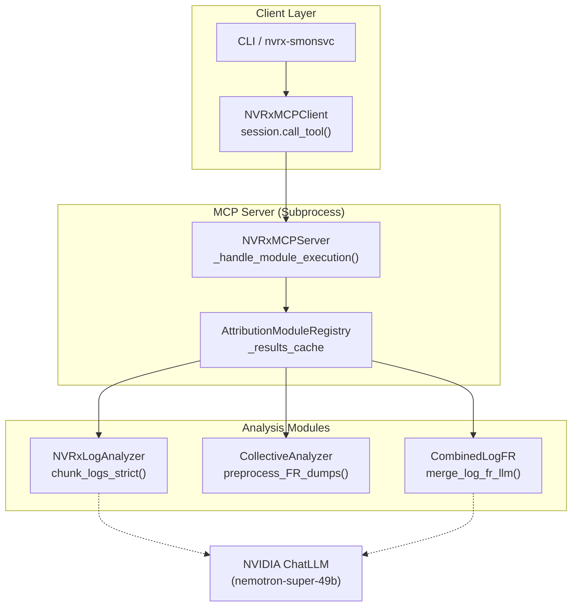

<!-- source: DeepWiki mcp.deepwiki.com · repo NVIDIA/nvidia-resiliency-ext · page 6 Attribution and Diagnostics · fetched 2026-10-26 -->

# Attribution and Diagnostics

Relevant source files

The following files were used as context for generating this wiki page:

- [examples/attribution/single_server_example.py](examples/attribution/single_server_example.py)
- [src/nvidia_resiliency_ext/attribution/ARCHITECTURE.md](src/nvidia_resiliency_ext/attribution/ARCHITECTURE.md)
- [src/nvidia_resiliency_ext/attribution/README.md](src/nvidia_resiliency_ext/attribution/README.md)
- [src/nvidia_resiliency_ext/attribution/__init__.py](src/nvidia_resiliency_ext/attribution/__init__.py)
- [src/nvidia_resiliency_ext/attribution/base.py](src/nvidia_resiliency_ext/attribution/base.py)
- [src/nvidia_resiliency_ext/attribution/combined_log_fr/combined_log_fr.py](src/nvidia_resiliency_ext/attribution/combined_log_fr/combined_log_fr.py)
- [src/nvidia_resiliency_ext/attribution/combined_log_fr/combined_log_fr_mcp.py](src/nvidia_resiliency_ext/attribution/combined_log_fr/combined_log_fr_mcp.py)
- [src/nvidia_resiliency_ext/attribution/log_analyzer/nvrx_logsage.py](src/nvidia_resiliency_ext/attribution/log_analyzer/nvrx_logsage.py)
- [src/nvidia_resiliency_ext/attribution/mcp_integration/README.md](src/nvidia_resiliency_ext/attribution/mcp_integration/README.md)
- [src/nvidia_resiliency_ext/attribution/mcp_integration/__init__.py](src/nvidia_resiliency_ext/attribution/mcp_integration/__init__.py)
- [src/nvidia_resiliency_ext/attribution/mcp_integration/mcp_client.py](src/nvidia_resiliency_ext/attribution/mcp_integration/mcp_client.py)
- [src/nvidia_resiliency_ext/attribution/mcp_integration/mcp_server.py](src/nvidia_resiliency_ext/attribution/mcp_integration/mcp_server.py)
- [src/nvidia_resiliency_ext/attribution/mcp_integration/module_definitions.py](src/nvidia_resiliency_ext/attribution/mcp_integration/module_definitions.py)
- [src/nvidia_resiliency_ext/attribution/mcp_integration/registry.py](src/nvidia_resiliency_ext/attribution/mcp_integration/registry.py)
- [src/nvidia_resiliency_ext/attribution/mcp_integration/server_launcher.py](src/nvidia_resiliency_ext/attribution/mcp_integration/server_launcher.py)
- [src/nvidia_resiliency_ext/attribution/trace_analyzer/fr_attribution.py](src/nvidia_resiliency_ext/attribution/trace_analyzer/fr_attribution.py)
- [tests/attribution/unit/test_base.py](tests/attribution/unit/test_base.py)
- [tests/attribution/unit/test_combined_log_fr.py](tests/attribution/unit/test_combined_log_fr.py)
- [tests/attribution/unit/test_fr.py](tests/attribution/unit/test_fr.py)

The Attribution and Diagnostics subsystem provides post-mortem failure analysis, real-time telemetry collection, and automated decision-making for restart policies. It helps operators understand why distributed training jobs failed and determines whether automatic restart should proceed or stop using LLM-based reasoning.

This page is a high-level overview of the diagnostics subsystem. For detailed information on specific components, see:
- [Log Analysis Service](#6.1) — `nvrx-attrsvc` FastAPI service, `NVRxLogAnalyzer`, and `LogSage` integration.
- [Trace Collection and FR Analysis](#6.2) — PyTorch Flight Recorder analysis, NCCL trace dumping, and `CollectiveAnalyzer`.
- [Hardware Health Monitoring](#6.3) — Health check suite for GPUs, NICs, NVLink, and storage.
- [Profiling and Telemetry](#6.4) — `FaultToleranceProfiler`, event recording, and metrics export.
- [SLURM Monitor Service](#6.5) — `nvrx-smonsvc` for automated job log submission.

## Overview

The diagnostics subsystem operates by pipeline orchestration, where multiple specialized modules process raw telemetry into actionable attribution results. The core of this logic resides in the `NVRxAttribution` base class, which defines a three-step pipeline: input preprocessing, attribution computation, and output handling [src/nvidia_resiliency_ext/attribution/base.py:93-102]().

| Component | Purpose | Primary Code Entity |
|-----------|---------|---------------------|
| **Log Sage** | LLM-based error extraction and policy | `NVRxLogAnalyzer` [src/nvidia_resiliency_ext/attribution/log_analyzer/nvrx_logsage.py:16-17]() |
| **FR Analyzer** | NCCL hang and collective analysis | `CollectiveAnalyzer` [src/nvidia_resiliency_ext/attribution/trace_analyzer/fr_attribution.py:107-125]() |
| **Combined Analysis** | Merging logs and traces via LLM | `CombinedLogFR` [src/nvidia_resiliency_ext/attribution/combined_log_fr/combined_log_fr.py:46-56]() |
| **MCP Integration** | Model Context Protocol server/client | `NVRxMCPServer` [src/nvidia_resiliency_ext/attribution/mcp_integration/mcp_server.py:44-54]() |

Sources: [src/nvidia_resiliency_ext/attribution/base.py:93-102](), [src/nvidia_resiliency_ext/attribution/log_analyzer/nvrx_logsage.py:16-17](), [src/nvidia_resiliency_ext/attribution/trace_analyzer/fr_attribution.py:107-125]()

## System Architecture

The architecture utilizes the Model Context Protocol (MCP) to decouple the analysis engines from the service frontends, allowing for scalable, asynchronous analysis of large log sets.

**Data Flow:**
1. **Tool Discovery**: The `NVRxMCPServer` exposes registered modules as tools (e.g., `log_analyzer`, `fr_analyzer`) using the `AttributionModuleRegistry` [src/nvidia_resiliency_ext/attribution/mcp_integration/mcp_server.py:75-117]().
2. **Execution**: When a tool is called, the server creates an instance of the module and executes its `run()` method [src/nvidia_resiliency_ext/attribution/mcp_integration/mcp_server.py:119-132]().
3. **Caching**: Results are cached in the `AttributionModuleRegistry` using a stable ID derived from the input arguments [src/nvidia_resiliency_ext/attribution/mcp_integration/registry.py:192-200]().
4. **Pipelining**: Modules like `CombinedLogFR` can consume results from previous modules (Log and FR) to perform a higher-level "merged" attribution [src/nvidia_resiliency_ext/attribution/combined_log_fr/combined_log_fr.py:72-83]().

Sources: [src/nvidia_resiliency_ext/attribution/mcp_integration/mcp_server.py:44-132](), [src/nvidia_resiliency_ext/attribution/mcp_integration/registry.py:56-200](), [src/nvidia_resiliency_ext/attribution/combined_log_fr/combined_log_fr.py:46-83]()

## LLM-Based Log Analysis

The `NVRxLogAnalyzer` handles the parsing of application logs to extract errors and determine if a job should restart. It uses `chunk_logs_strict` to isolate logs between specific training cycles (identified by `profiling.py` markers) to ensure the LLM only analyzes the relevant failure window [src/nvidia_resiliency_ext/attribution/log_analyzer/nvrx_logsage.py:201-210](). The system classifies results into recommendations such as `RESTART IMMEDIATE` or `STOP` [src/nvidia_resiliency_ext/attribution/log_analyzer/nvrx_logsage.py:52-53]().

For details, see [Log Analysis Service](#6.1).

Sources: [src/nvidia_resiliency_ext/attribution/log_analyzer/nvrx_logsage.py:52-210]()

## Trace Collection and FR Analysis

The `CollectiveAnalyzer` is responsible for processing PyTorch Flight Recorder (FR) dumps. It reconstructs the state of distributed collectives across all ranks to identify which ranks were "missing" or "hanging" during a timeout [src/nvidia_resiliency_ext/attribution/trace_analyzer/fr_attribution.py:107-125](). It can also incorporate node health status to correlate software hangs with hardware issues [src/nvidia_resiliency_ext/attribution/trace_analyzer/fr_attribution.py:161-162]().

For details, see [Trace Collection and FR Analysis](#6.2).

Sources: [src/nvidia_resiliency_ext/attribution/trace_analyzer/fr_attribution.py:107-162]()

## Hardware Health Monitoring

Health monitoring is integrated directly into the attribution pipeline. Modules can trigger health checks or consume health check results (e.g., via the `health_check` flag in `CollectiveAnalyzer`) to provide a complete picture of the failure [src/nvidia_resiliency_ext/attribution/trace_analyzer/fr_attribution.py:161-162]().

For details, see [Hardware Health Monitoring](#6.3).

Sources: [src/nvidia_resiliency_ext/attribution/trace_analyzer/fr_attribution.py:161-162]()

## Profiling and Telemetry

The system supports real-time telemetry through various exporters. The `NVRxLogAnalyzer` specifically looks for markers generated by the `FaultToleranceProfiler` (like `Cycle` markers) to synchronize log analysis with the training timeline [src/nvidia_resiliency_ext/attribution/log_analyzer/nvrx_logsage.py:201-210]().

For details, see [Profiling and Telemetry](#6.4).

Sources: [src/nvidia_resiliency_ext/attribution/log_analyzer/nvrx_logsage.py:201-210]()

## SLURM Monitor Service

The `nvrx-smonsvc` provides an automated entry point for attribution in SLURM environments. It monitors job completion and uses the `NVRxMCPClient` to submit logs for analysis [src/nvidia_resiliency_ext/attribution/mcp_integration/mcp_client.py:104-113](). This enables hands-free failure attribution for large-scale clusters.

For details, see [SLURM Monitor Service](#6.5).

Sources: [src/nvidia_resiliency_ext/attribution/mcp_integration/mcp_client.py:104-113]()

---

