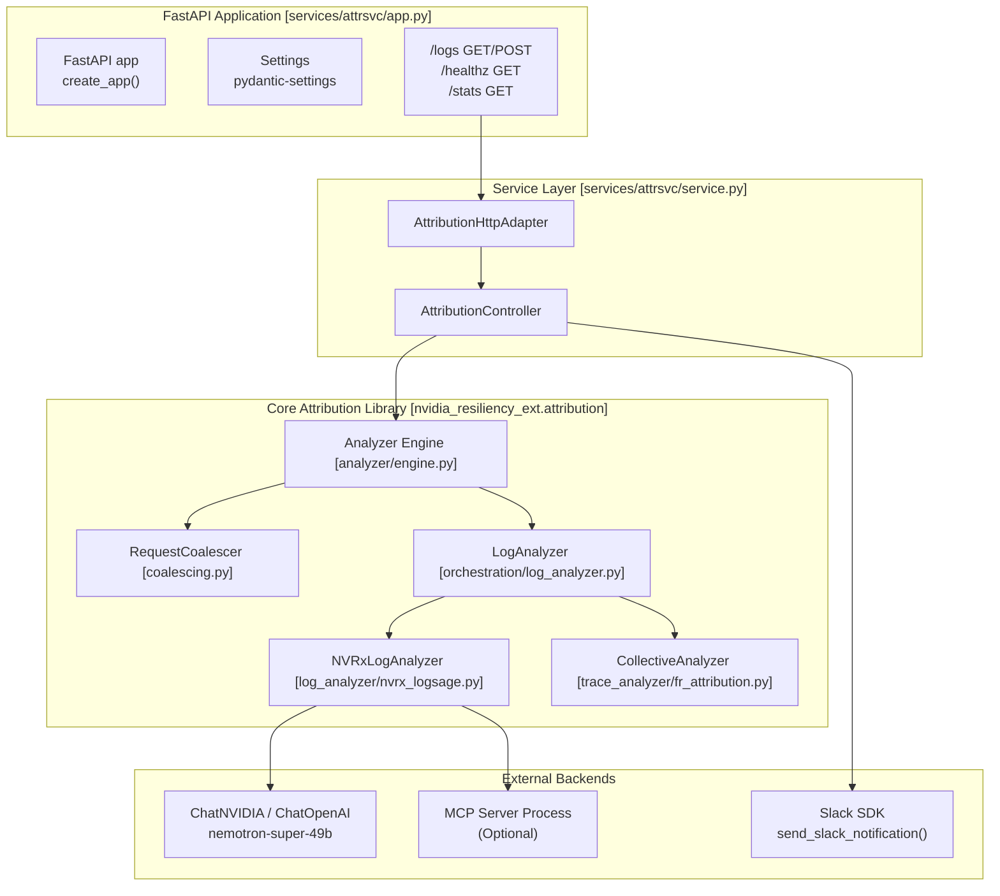
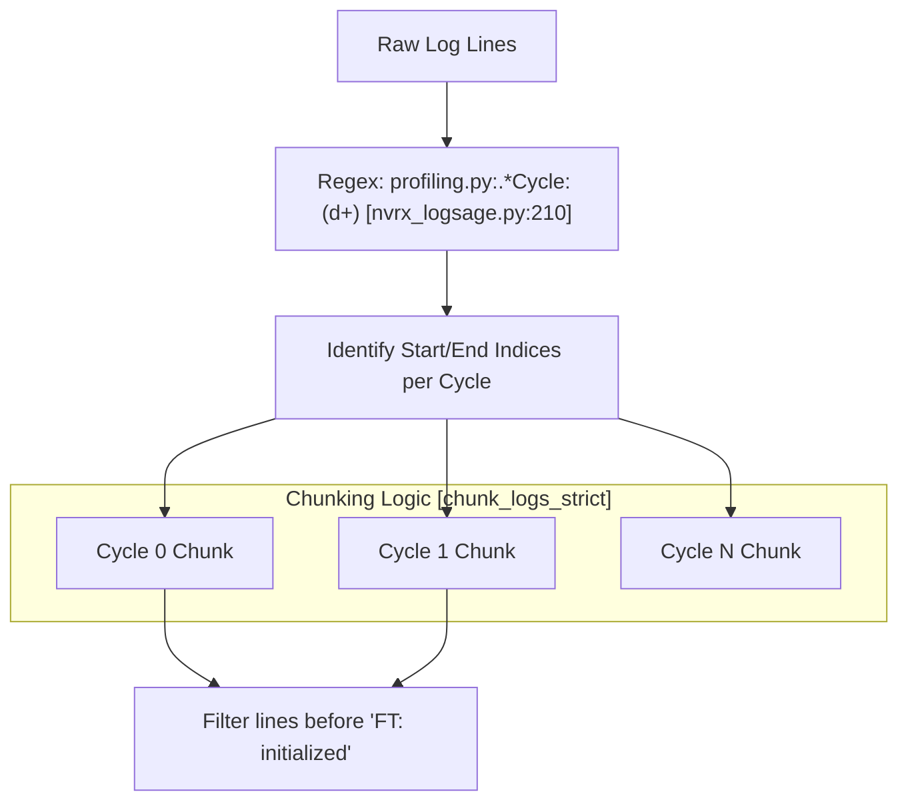

<!-- source: DeepWiki mcp.deepwiki.com · repo NVIDIA/nvidia-resiliency-ext · page 6.1 Log Analysis Service · fetched 2026-10-26 -->

# Log Analysis Service

Relevant source files

The following files were used as context for generating this wiki page:

- [examples/attribution/single_server_example.py](examples/attribution/single_server_example.py)
- [services/attrsvc/ATTRSVC_SPEC.md](services/attrsvc/ATTRSVC_SPEC.md)
- [services/attrsvc/README.md](services/attrsvc/README.md)
- [services/attrsvc/deploy/kubernetes.yaml](services/attrsvc/deploy/kubernetes.yaml)
- [services/tests/test_attrsvc_config.py](services/tests/test_attrsvc_config.py)
- [src/nvidia_resiliency_ext/attribution/analyzer/engine.py](src/nvidia_resiliency_ext/attribution/analyzer/engine.py)
- [src/nvidia_resiliency_ext/attribution/api_keys.py](src/nvidia_resiliency_ext/attribution/api_keys.py)
- [src/nvidia_resiliency_ext/attribution/combined_log_fr/combined_log_fr.py](src/nvidia_resiliency_ext/attribution/combined_log_fr/combined_log_fr.py)
- [src/nvidia_resiliency_ext/attribution/combined_log_fr/combined_log_fr_mcp.py](src/nvidia_resiliency_ext/attribution/combined_log_fr/combined_log_fr_mcp.py)
- [src/nvidia_resiliency_ext/attribution/combined_log_fr/llm_merge.py](src/nvidia_resiliency_ext/attribution/combined_log_fr/llm_merge.py)
- [src/nvidia_resiliency_ext/attribution/controller.py](src/nvidia_resiliency_ext/attribution/controller.py)
- [src/nvidia_resiliency_ext/attribution/log_analyzer/nvrx_logsage.py](src/nvidia_resiliency_ext/attribution/log_analyzer/nvrx_logsage.py)
- [src/nvidia_resiliency_ext/attribution/mcp_integration/module_definitions.py](src/nvidia_resiliency_ext/attribution/mcp_integration/module_definitions.py)
- [src/nvidia_resiliency_ext/attribution/orchestration/config.py](src/nvidia_resiliency_ext/attribution/orchestration/config.py)
- [src/nvidia_resiliency_ext/attribution/orchestration/log_analyzer.py](src/nvidia_resiliency_ext/attribution/orchestration/log_analyzer.py)
- [src/nvidia_resiliency_ext/attribution/orchestration/progressive.py](src/nvidia_resiliency_ext/attribution/orchestration/progressive.py)
- [src/nvidia_resiliency_ext/attribution/postprocessing/config.py](src/nvidia_resiliency_ext/attribution/postprocessing/config.py)
- [src/nvidia_resiliency_ext/attribution/postprocessing/pipeline.py](src/nvidia_resiliency_ext/attribution/postprocessing/pipeline.py)
- [src/nvidia_resiliency_ext/attribution/postprocessing/post_backend.py](src/nvidia_resiliency_ext/attribution/postprocessing/post_backend.py)
- [src/nvidia_resiliency_ext/attribution/postprocessing/slack.py](src/nvidia_resiliency_ext/attribution/postprocessing/slack.py)
- [src/nvidia_resiliency_ext/attribution/trace_analyzer/fr_attribution.py](src/nvidia_resiliency_ext/attribution/trace_analyzer/fr_attribution.py)
- [src/nvidia_resiliency_ext/services/attrsvc/app.py](src/nvidia_resiliency_ext/services/attrsvc/app.py)
- [src/nvidia_resiliency_ext/services/attrsvc/config.py](src/nvidia_resiliency_ext/services/attrsvc/config.py)
- [src/nvidia_resiliency_ext/services/attrsvc/service.py](src/nvidia_resiliency_ext/services/attrsvc/service.py)
- [tests/attribution/unit/test_api_keys.py](tests/attribution/unit/test_api_keys.py)
- [tests/attribution/unit/test_attrsvc_settings.py](tests/attribution/unit/test_attrsvc_settings.py)
- [tests/attribution/unit/test_combined_log_fr.py](tests/attribution/unit/test_combined_log_fr.py)
- [tests/attribution/unit/test_fr.py](tests/attribution/unit/test_fr.py)
- [tests/attribution/unit/test_http_api.py](tests/attribution/unit/test_http_api.py)
- [tests/attribution/unit/test_mcp_server_cache.py](tests/attribution/unit/test_mcp_server_cache.py)
- [tests/attribution/unit/test_post_backend.py](tests/attribution/unit/test_post_backend.py)
- [tests/attribution/unit/test_postprocessing_pipeline.py](tests/attribution/unit/test_postprocessing_pipeline.py)
- [tests/attribution/unit/test_progressive_plumbing.py](tests/attribution/unit/test_progressive_plumbing.py)
- [tests/attribution/unit/test_runner_job_id.py](tests/attribution/unit/test_runner_job_id.py)

## Purpose and Scope

The Log Analysis Service (`nvrx-attrsvc`) is a FastAPI-based microservice that provides automated failure attribution and auto-resume policy determination for distributed training jobs. The service accepts log file paths, performs LLM-based analysis (using `ChatNVIDIA` with `nemotron-super-49b`), and returns structured attribution results that indicate whether a job should automatically restart or stop.

The service acts as an HTTP adapter facade for the `AttributionController`, which owns attribution analysis, cache persistence, and side-effect statistics. It integrates with Slack for notifications and `nvdataflow` for telemetry.

**Sources:** [src/nvidia_resiliency_ext/services/attrsvc/app.py:4-9](), [src/nvidia_resiliency_ext/services/attrsvc/service.py:4-9](), [src/nvidia_resiliency_ext/attribution/controller.py:4-10]()

---

## Service Architecture

The service is structured as a thin HTTP wrapper around the `AttributionController`. It translates environment-based settings into controller configurations and exposes FastAPI routes for submission, analysis, and monitoring.

### Component Overview

**Diagram 1: Service Architecture and Code Entity Mapping**

The `AttributionHttpAdapter` owns `Settings` conversion and keeps public service method names stable for FastAPI routes [src/nvidia_resiliency_ext/services/attrsvc/service.py:166-167](). The `AttributionController` manages the lifecycle of analysis requests, including cache persistence to a ledger file [src/nvidia_resiliency_ext/attribution/controller.py:140-146](). The `Analyzer` orchestrates the `RequestCoalescer` for single-flight execution and the `LogAnalyzer` for the actual diagnostic logic [src/nvidia_resiliency_ext/attribution/analyzer/engine.py:95-102]().

**Sources:** [src/nvidia_resiliency_ext/services/attrsvc/app.py:130-167](), [src/nvidia_resiliency_ext/attribution/controller.py:140-180](), [src/nvidia_resiliency_ext/attribution/analyzer/engine.py:116-150]()

---

## Request Coalescing and Caching

The `RequestCoalescer` implements a single-flight pattern to prevent duplicate LLM analysis for the same file. It maintains an in-memory cache and tracks in-flight requests using `asyncio.Event` [src/nvidia_resiliency_ext/attribution/analyzer/engine.py:39-45]().

### Processed Files Ledger

The service supports a persistence layer via the `cache_file` configuration in `AttributionCacheConfig` [src/nvidia_resiliency_ext/attribution/controller.py:64-73]().
- **Grace Period:** The service can serve from cache without re-validation for a configurable `grace_period_seconds` [src/nvidia_resiliency_ext/attribution/controller.py:72]().
- **Validation:** After the grace period, it validates the file status. If the file changed, it re-analyzes.
- **Persistence:** The `AttributionController` handles restoring cached results from the ledger at startup [src/nvidia_resiliency_ext/services/attrsvc/app.py:141-144]().

**Sources:** [src/nvidia_resiliency_ext/attribution/controller.py:64-80](), [src/nvidia_resiliency_ext/services/attrsvc/app.py:137-148]()

---

## Log Analysis Pipeline

The analysis pipeline is orchestrated by `NVRxLogAnalyzer`, which uses `langchain_openai.ChatOpenAI` to interact with NVIDIA's LLM endpoints [src/nvidia_resiliency_ext/attribution/log_analyzer/nvrx_logsage.py:10-13]().

### Log Chunking by Cycle

The `chunk_logs_strict` function segments logs into training cycles to provide granular attribution [src/nvidia_resiliency_ext/attribution/log_analyzer/nvrx_logsage.py:201-208]().

**Diagram 2: Log Chunking Logic in nvrx_logsage.py**

1. **Cycle Detection:** Uses `cycle_pattern = re.compile(r"profiling\.py:.*Cycle:\s*(\d+)")` to find boundaries [src/nvidia_resiliency_ext/attribution/log_analyzer/nvrx_logsage.py:210]().
2. **Strict Boundaries:** Extracts lines between the last occurrence of Cycle N and the last occurrence of Cycle N+1 [src/nvidia_resiliency_ext/attribution/log_analyzer/nvrx_logsage.py:201-207]().
3. **Initialization Cleanup:** If no cycle markers are found, it defaults to treating the entire log as Cycle 0 [src/nvidia_resiliency_ext/attribution/log_analyzer/nvrx_logsage.py:208]().

**Sources:** [src/nvidia_resiliency_ext/attribution/log_analyzer/nvrx_logsage.py:201-210]()

### Auto-Resume Policy Determination

The `NVRxLogAnalyzer` and its associated utilities determine the resume policy based on LLM extraction and specific Slurm exit patterns [src/nvidia_resiliency_ext/attribution/log_analyzer/nvrx_logsage.py:44-53]().

| Condition | Auto-Resume Policy | Attribution Code |
|-----------|-------------------|------------------|
| Application Finished | `RECOMMENDATION_STOP` | `ATTR_APPLICATION_DONE` |
| Slurm Preemption | `RECOMMENDATION_RESTART` | `ATTR_SLURM_CANCELLED_DUE_TO_PREEMPTION` |
| Slurm Time Limit | `RECOMMENDATION_STOP` | `FINISHED_STATUS_SLURM_CANCELLED_TIME_LIMIT` |
| LLM Error Detection | `RECOMMENDATION_RESTART` or `STOP` | `_action_from_logsage_head` |

**Sources:** [src/nvidia_resiliency_ext/attribution/log_analyzer/nvrx_logsage.py:44-62](), [src/nvidia_resiliency_ext/attribution/log_analyzer/nvrx_logsage.py:68-80]()

---

## Trace Analysis Integration

The service integrates PyTorch Flight Recorder (FR) analysis via `CollectiveAnalyzer` [src/nvidia_resiliency_ext/attribution/trace_analyzer/fr_attribution.py:107-125]().

- **Collective Matching:** It matches collective operations across ranks to identify missing or hanging ranks [src/nvidia_resiliency_ext/attribution/trace_analyzer/fr_attribution.py:113-115]().
- **LLM Fusion:** The `CombinedLogFR` class fuses application logs and FR analysis results using a specialized prompt to provide a unified "Proposed Solution with Ranks" [src/nvidia_resiliency_ext/attribution/combined_log_fr/combined_log_fr.py:46-56](), [src/nvidia_resiliency_ext/attribution/combined_log_fr/llm_merge.py:72-90]().

**Sources:** [src/nvidia_resiliency_ext/attribution/trace_analyzer/fr_attribution.py:107-125](), [src/nvidia_resiliency_ext/attribution/combined_log_fr/combined_log_fr.py:72-83](), [src/nvidia_resiliency_ext/attribution/combined_log_fr/llm_merge.py:112-122]()

---

## Slack and Postprocessing Integrations

The service performs post-analysis side effects, including notifying operators of terminal failures.

### Slack Notifications
The `send_slack_notification` function triggers when a `RECOMMENDATION_STOP` action is determined [src/nvidia_resiliency_ext/attribution/postprocessing/slack.py:148-160](). It uses the `slack_sdk.WebClient` to post messages and attempts to look up NVIDIA email addresses to mention users [src/nvidia_resiliency_ext/attribution/postprocessing/slack.py:123-131]().

### Dataflow Records
The `build_dataflow_record` function composes a structured dictionary containing cluster info, user info, and attribution results for export to telemetry backends [src/nvidia_resiliency_ext/attribution/postprocessing/pipeline.py:128-141]().

**Sources:** [src/nvidia_resiliency_ext/attribution/postprocessing/slack.py:88-145](), [src/nvidia_resiliency_ext/attribution/postprocessing/pipeline.py:163-180]()

---

## API Endpoints

The service defines several routes in `nvidia_resiliency_ext.services.attrsvc.app`:

- **`GET /healthz`**: Returns health status and backend connectivity [src/nvidia_resiliency_ext/services/attrsvc/app.py:200-201]().
- **`GET /stats`**: Provides counters for attempts, successes, and Slack notifications [src/nvidia_resiliency_ext/services/attrsvc/app.py:208-212]().
- **`POST /logs`**: Submits a `SubmitRequest` containing `log_path`, `user`, and `analysis_intent` [src/nvidia_resiliency_ext/services/attrsvc/app.py:236-245]().
- **`GET /logs`**: The primary analysis endpoint. It retrieves the `log_path` from query parameters and returns the `LogAnalysisCycleResult` or `LogAnalysisSplitlogResult` [src/nvidia_resiliency_ext/services/attrsvc/app.py:260-270]().

**Sources:** [src/nvidia_resiliency_ext/services/attrsvc/app.py:200-336]()

---

