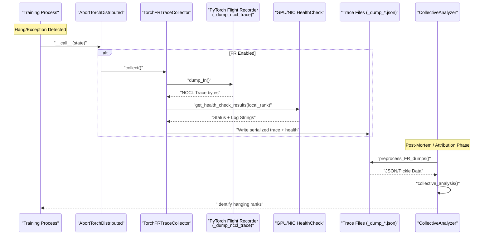
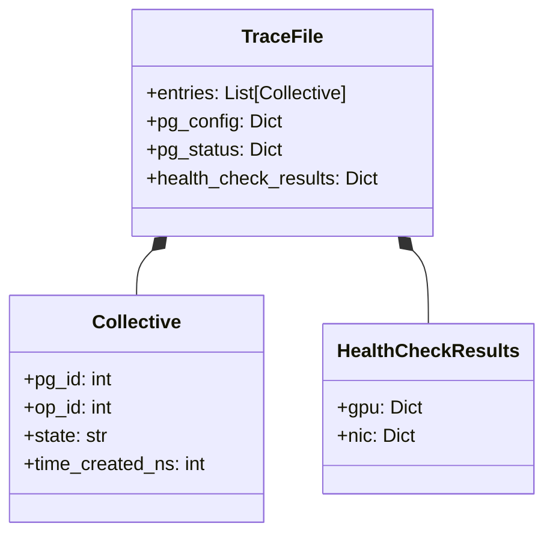

<!-- source: DeepWiki mcp.deepwiki.com · repo NVIDIA/nvidia-resiliency-ext · page 6.2 Trace Collection and FR Analysis · fetched 2026-10-26 -->

# Trace Collection and FR Analysis

<details>
<summary>Relevant source files</summary>

The following files were used as context for generating this wiki page:

- [examples/attribution/single_server_example.py](examples/attribution/single_server_example.py)
- [src/nvidia_resiliency_ext/attribution/base.py](src/nvidia_resiliency_ext/attribution/base.py)
- [src/nvidia_resiliency_ext/attribution/combined_log_fr/combined_log_fr.py](src/nvidia_resiliency_ext/attribution/combined_log_fr/combined_log_fr.py)
- [src/nvidia_resiliency_ext/attribution/combined_log_fr/combined_log_fr_mcp.py](src/nvidia_resiliency_ext/attribution/combined_log_fr/combined_log_fr_mcp.py)
- [src/nvidia_resiliency_ext/attribution/log_analyzer/nvrx_logsage.py](src/nvidia_resiliency_ext/attribution/log_analyzer/nvrx_logsage.py)
- [src/nvidia_resiliency_ext/attribution/mcp_integration/README.md](src/nvidia_resiliency_ext/attribution/mcp_integration/README.md)
- [src/nvidia_resiliency_ext/attribution/mcp_integration/__init__.py](src/nvidia_resiliency_ext/attribution/mcp_integration/__init__.py)
- [src/nvidia_resiliency_ext/attribution/mcp_integration/mcp_client.py](src/nvidia_resiliency_ext/attribution/mcp_integration/mcp_client.py)
- [src/nvidia_resiliency_ext/attribution/mcp_integration/mcp_server.py](src/nvidia_resiliency_ext/attribution/mcp_integration/mcp_server.py)
- [src/nvidia_resiliency_ext/attribution/mcp_integration/module_definitions.py](src/nvidia_resiliency_ext/attribution/mcp_integration/module_definitions.py)
- [src/nvidia_resiliency_ext/attribution/mcp_integration/registry.py](src/nvidia_resiliency_ext/attribution/mcp_integration/registry.py)
- [src/nvidia_resiliency_ext/attribution/mcp_integration/server_launcher.py](src/nvidia_resiliency_ext/attribution/mcp_integration/server_launcher.py)
- [src/nvidia_resiliency_ext/attribution/trace_analyzer/__init__.py](src/nvidia_resiliency_ext/attribution/trace_analyzer/__init__.py)
- [src/nvidia_resiliency_ext/attribution/trace_analyzer/fr_attribution.py](src/nvidia_resiliency_ext/attribution/trace_analyzer/fr_attribution.py)
- [src/nvidia_resiliency_ext/attribution/trace_analyzer/trace_collector.py](src/nvidia_resiliency_ext/attribution/trace_analyzer/trace_collector.py)
- [src/nvidia_resiliency_ext/inprocess/abort.py](src/nvidia_resiliency_ext/inprocess/abort.py)
- [tests/attribution/unit/test_base.py](tests/attribution/unit/test_base.py)
- [tests/attribution/unit/test_combined_log_fr.py](tests/attribution/unit/test_combined_log_fr.py)
- [tests/attribution/unit/test_fr.py](tests/attribution/unit/test_fr.py)

</details>


## Purpose and Scope

This page documents the trace collection and analysis subsystem, which captures runtime diagnostic data when failures occur during distributed training. The system specifically targets PyTorch Flight Recorder (FR) traces containing NCCL collective operation logs, along with hardware health check results. These artifacts are then processed by the `CollectiveAnalyzer` to detect hangs and identify specific ranks responsible for training interruptions.

**Key components:**
- **TorchFRTraceCollector**: Gathers NCCL traces and health check data.
- **CollectiveAnalyzer**: Analyzes distributed collective operations across ranks to find root causes of hangs.
- **AbortTorchDistributed**: Integrates trace collection into the failure handling loop.
- **CombinedLogFR**: Fuses FR analysis with application log analysis for comprehensive attribution.

Sources: [src/nvidia_resiliency_ext/attribution/trace_analyzer/trace_collector.py:22-57](), [src/nvidia_resiliency_ext/attribution/trace_analyzer/fr_attribution.py:107-125](), [src/nvidia_resiliency_ext/inprocess/abort.py:62-91]()

---

## Architecture Overview

The system bridges the gap between runtime execution (where traces are generated) and post-mortem analysis (where traces are analyzed for attribution).

### Trace Collection and Analysis Flow



Sources: [src/nvidia_resiliency_ext/inprocess/abort.py:127-166](), [src/nvidia_resiliency_ext/attribution/trace_analyzer/trace_collector.py:72-108](), [src/nvidia_resiliency_ext/attribution/trace_analyzer/fr_attribution.py:191-200]()

---

## TorchFRTraceCollector Implementation

The `TorchFRTraceCollector` is responsible for capturing the NCCL trace from the PyTorch C++ backend and augmenting it with local hardware health status.

### Trace Collection Logic
The collector invokes `torch._C._distributed_c10d._dump_nccl_trace` with `includeStackTraces=False` [src/nvidia_resiliency_ext/attribution/trace_analyzer/trace_collector.py:84-86](). This is a critical technical detail: collecting stack traces requires the Global Interpreter Lock (GIL), which can cause deadlocks if the main thread is hung in a way that prevents GIL acquisition.

### Health Check Result Embedding
Before writing to disk, the collector executes local health checks for the specific GPU and NIC associated with the rank:
1. **GPU Health**: Uses `GPUHealthCheck(device_index=local_rank)` [src/nvidia_resiliency_ext/attribution/trace_analyzer/trace_collector.py:122-123]().
2. **NIC Health**: Uses `NicHealthCheck()` [src/nvidia_resiliency_ext/attribution/trace_analyzer/trace_collector.py:125-127]().
3. **Log Capture**: Uses the `capture_logs` context manager to grab stderr output from these checks and embed them into the `health_check_results` field of the trace dictionary [src/nvidia_resiliency_ext/attribution/trace_analyzer/trace_collector.py:121-138]().

Sources: [src/nvidia_resiliency_ext/attribution/trace_analyzer/trace_collector.py:39-109](), [src/nvidia_resiliency_ext/attribution/trace_analyzer/capture.py:1-36]()

---

## Collective Analysis and Hang Detection

The `CollectiveAnalyzer` (part of the `NVRxAttribution` framework) processes the dumped traces to identify which ranks are lagging or missing from a collective wavefront.

### Data Model: The Collective Dataclass
Traces are parsed into `Collective` objects for structured analysis:

| Field | Description |
|-------|-------------|
| `record_id` | Unique ID for the record in the dump |
| `collective_seq_id` | Sequence number for collective ops |
| `pg_id` | Process Group ID |
| `state` | Operation state (e.g., `scheduled`, `started`, `completed`) |
| `input_sizes` | Tensor dimensions for validation |

Sources: [src/nvidia_resiliency_ext/attribution/trace_analyzer/fr_attribution.py:82-105]()

### Analysis Algorithm
The analyzer matches collectives across ranks per process group. It uses the following logic to find the root cause:
1. **Wavefront Identification**: Finds the last collective operation that failed to complete across the entire process group [src/nvidia_resiliency_ext/attribution/trace_analyzer/fr_attribution.py:113-115]().
2. **Scheduling Order**: If a `scheduling_order_file` (e.g., `TP->PP->DP`) is provided, it uses this global ordering to determine if a hang in one group (like DP) is actually caused by a preceding group (like TP) [src/nvidia_resiliency_ext/attribution/trace_analyzer/fr_attribution.py:115-119]().
3. **Missing Rank Extraction**: Identifies ranks that never started the collective or are stuck in the "started" state while others finished [src/nvidia_resiliency_ext/attribution/trace_analyzer/fr_attribution.py:120-122]().

Sources: [src/nvidia_resiliency_ext/attribution/trace_analyzer/fr_attribution.py:107-125]()

---

## Integration with Abort Mechanisms

Trace collection is integrated into the `AbortTorchDistributed` class, which is typically used as an `abort` handler in the `inprocess.Wrapper`.

### Triggering Workflow
1. **Environment Check**: `AbortTorchDistributed` checks if `TORCH_NCCL_TRACE_BUFFER_SIZE` or `TORCH_FR_BUFFER_SIZE` (for PyTorch ≥ 2.8.0) is set to a non-zero value [src/nvidia_resiliency_ext/inprocess/abort.py:128-151]().
2. **Path Organization**: Traces are stored in a directory sub-structured by iteration: `{torch_fr_trace_path}/iter_{state.iteration}/_dump_{rank}.json` [src/nvidia_resiliency_ext/inprocess/abort.py:156-158]().
3. **Shutdown**: After collection, the handler calls `shutdown_all_process_group_backends()` to unblock the rank and allow the restart process to proceed [src/nvidia_resiliency_ext/inprocess/abort.py:164-165]().

Sources: [src/nvidia_resiliency_ext/inprocess/abort.py:62-168]()

---

## Trace File Organization and Formats

The system supports both JSON and Pickle formats, though JSON is preferred for interoperability with the log analysis services.

### Directory Structure
```text
trace_root/
└── iter_42/
    ├── _dump_0.json
    ├── _dump_1.json
    ├── ...
    └── _dump_N.json
```

### Trace Data Entities



Sources: [src/nvidia_resiliency_ext/attribution/trace_analyzer/trace_collector.py:83-108](), [src/nvidia_resiliency_ext/attribution/trace_analyzer/fr_attribution.py:82-105]()

---

## Combined Analysis (Log + FR)

In complex failure scenarios, NCCL traces alone may not be sufficient. The `CombinedLogFR` orchestrator fuses the output of the `CollectiveAnalyzer` with the `NVRxLogAnalyzer` using an LLM.

### LLM Fusion
The `CombinedLogFR` class takes results from both `NVRxLogAnalyzer` and `CollectiveAnalyzer` [src/nvidia_resiliency_ext/attribution/combined_log_fr/combined_log_fr.py:46-56](). It uses `merge_log_fr_llm` to summarize the findings and determine if specific ranks should be excluded [src/nvidia_resiliency_ext/attribution/combined_log_fr/combined_log_fr.py:72-83]().

### MCP Orchestration
The `CombinedLogFRMCPOrchestrator` allows this combined analysis to be exposed as an MCP tool (`log_fr_analyzer`) [src/nvidia_resiliency_ext/attribution/combined_log_fr/combined_log_fr_mcp.py:169-181](). It can run in **Path mode** (running both analyzers in parallel) or **Input-data mode** (processing existing results) [src/nvidia_resiliency_ext/attribution/combined_log_fr/combined_log_fr_mcp.py:172-176]().

Sources: [src/nvidia_resiliency_ext/attribution/combined_log_fr/combined_log_fr.py:46-93](), [src/nvidia_resiliency_ext/attribution/combined_log_fr/combined_log_fr_mcp.py:112-168](), [src/nvidia_resiliency_ext/attribution/mcp_integration/module_definitions.py:31-32]()

---

