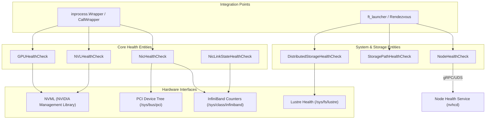
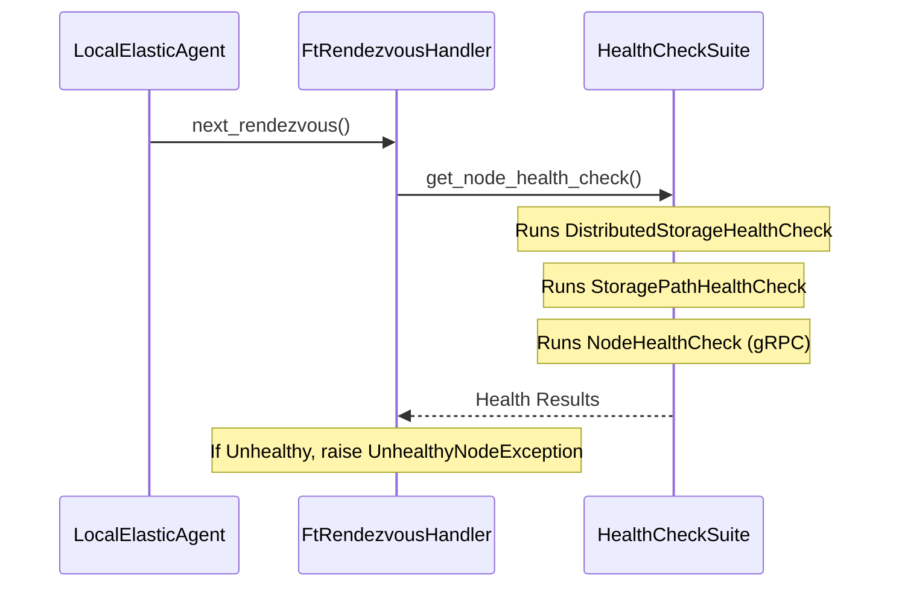

<!-- source: DeepWiki mcp.deepwiki.com · repo NVIDIA/nvidia-resiliency-ext · page 6.3 Hardware Health Monitoring · fetched 2026-10-26 -->

# Hardware Health Monitoring

Relevant source files

The following files were used as context for generating this wiki page:

- [build.py](build.py)
- [docs/source/fault_tolerance/usage_guide.rst](docs/source/fault_tolerance/usage_guide.rst)
- [examples/utils/node_health_check_example.py](examples/utils/node_health_check_example.py)
- [src/nvidia_resiliency_ext/fault_tolerance/_ft_rendezvous.py](src/nvidia_resiliency_ext/fault_tolerance/_ft_rendezvous.py)
- [src/nvidia_resiliency_ext/fault_tolerance/attribution_manager.py](src/nvidia_resiliency_ext/fault_tolerance/attribution_manager.py)
- [src/nvidia_resiliency_ext/services/smonsvc/slurm.py](src/nvidia_resiliency_ext/services/smonsvc/slurm.py)
- [src/nvidia_resiliency_ext/shared_utils/health_check.py](src/nvidia_resiliency_ext/shared_utils/health_check.py)
- [tests/fault_tolerance/unit/test_attribution_manager.py](tests/fault_tolerance/unit/test_attribution_manager.py)
- [tests/fault_tolerance/unit/test_dynamic_rendezvous.py](tests/fault_tolerance/unit/test_dynamic_rendezvous.py)
- [tests/fault_tolerance/unit/test_utils.py](tests/fault_tolerance/unit/test_utils.py)
- [tests/shared_utils/test_health_check.py](tests/shared_utils/test_health_check.py)
- [tests/straggler/unit/test_cupti_ext.py](tests/straggler/unit/test_cupti_ext.py)

This document details the hardware health monitoring system within `nvidia-resiliency-ext`. The system performs diagnostic checks on GPUs, NVLinks, network interface cards (NICs), storage paths, and node-level services to detect hardware issues that could impact distributed training reliability. These checks are integrated into both the `ft_launcher` (Fault Tolerance) and `inprocess.Wrapper` subsystems.

## System Architecture

The health monitoring system provides a suite of specialized checkers that interact with low-level system interfaces (NVML, PCI bus, `/sys` filesystem) and remote diagnostic services.

### Health Check Suite Overview

Sources: [src/nvidia_resiliency_ext/shared_utils/health_check.py:17-1050](), [src/nvidia_resiliency_ext/fault_tolerance/_ft_rendezvous.py:65-75]()

## Core Hardware Health Checks

### GPU and NVLink Monitoring
`GPUHealthCheck` and `NVLHealthCheck` utilize the NVIDIA Management Library (NVML) via `PynvmlMixin` to query device health.

*   **`GPUHealthCheck`**: Uses the GPU Recovery API (requires driver r570+) to detect if a GPU requires a reset, node reboot, or draining. It calls `nvmlDeviceGetFieldValues` to retrieve `NVML_FI_DEV_RECOVERY_ACTION`. [src/nvidia_resiliency_ext/shared_utils/health_check.py:270-368]()
*   **`NVLHealthCheck`**: Monitors the status of NVLinks. It checks for link errors and connectivity status using `nvmlDeviceGetNvLinkState`. [src/nvidia_resiliency_ext/shared_utils/health_check.py:626-713]()
*   **`CudaHealthCheck`**: A specialized check for the in-process system that performs a `torch.cuda.synchronize()` to ensure the CUDA context is not corrupted. [src/nvidia_resiliency_ext/inprocess/health_check.py:73-116]()

### Network Health Monitoring
Network monitoring focuses on InfiniBand (IB) connectivity and hardware counters.

*   **`NicHealthCheck`**: Tracks the `link_downed` counter in `/sys/class/infiniband/{nic}/ports/1/counters/link_downed`. It maintains a baseline and fails if the counter increments, indicating a link flap. [src/nvidia_resiliency_ext/shared_utils/health_check.py:370-624]()
*   **`NicLinkStateHealthCheck`**: A simpler check that validates if the physical link state is `ACTIVE` (typically value `4`) and the physical state is `LinkUp` (typically value `5`). [src/nvidia_resiliency_ext/shared_utils/health_check.py:716-800]()

### GPU-to-NIC Topology Mapping
The `NicHealthCheck` includes logic to automatically associate a GPU with its topologically nearest NIC by walking the PCI tree.

| Method | Description |
| :--- | :--- |
| `get_gpu_pci_mapping` | Uses NVML to get PCI Bus IDs for local GPUs. [src/nvidia_resiliency_ext/shared_utils/health_check.py:150-182]() |
| `get_ib_pci_mapping` | Scans `/sys/class/infiniband` to map IB devices to PCI addresses. [src/nvidia_resiliency_ext/shared_utils/health_check.py:218-240]() |
| `_get_gpu_ib_assignments_from_system` | Walks the PCI tree using `get_pci_ancestor` to find the NIC with the closest common ancestor to a specific GPU. [src/nvidia_resiliency_ext/shared_utils/health_check.py:476-503]() |
| `get_gb200_static_mapping` | Provides a hardcoded mapping for GB200 platforms (e.g., GPU 0 to `mlx5_0`). [src/nvidia_resiliency_ext/shared_utils/health_check.py:140-147]() |

## Storage and Node Health

### Storage Health Checks
These checks are primarily used by the `ft_launcher` before starting a job or during rendezvous to ensure the environment is ready.

*   **`DistributedStorageHealthCheck`**: 
    1.  Checks `/sys/fs/lustre/health_check` (must contain "summary: healthy"). [src/nvidia_resiliency_ext/shared_utils/health_check.py:863-958]()
    2.  Uses `findmnt` to discover distributed mounts (Lustre/NFS) and attempts to access them. [src/nvidia_resiliency_ext/shared_utils/health_check.py:898-905]()
*   **`StoragePathHealthCheck`**: Validates a list of user-provided absolute paths. It spawns a subprocess running `nvidia_resiliency_ext.shared_utils.storage_probe` to avoid hanging the main process if a network mount is unresponsive. [src/nvidia_resiliency_ext/shared_utils/health_check.py:803-860]()

### Node Health Check Service
`NodeHealthCheck` integrates with an external node health monitoring daemon (like `nvhcd`) via a Unix Domain Socket (UDS) and gRPC.

*   **Endpoint**: Configured via `--ft-node-health-check-endpoint`. [docs/source/fault_tolerance/usage_guide.rst:57-60]()
*   **Mechanism**: It performs a gRPC `RunHealthCheck` call. If the service reports a non-zero `fail_count`, the node is marked unhealthy. [src/nvidia_resiliency_ext/shared_utils/health_check.py:961-1049]()
*   **Failure Policy**: Connectivity errors to the socket are treated as "healthy" (fail-open) to prevent monitoring outages from blocking training. [src/nvidia_resiliency_ext/shared_utils/health_check.py:1026-1030]()

## Integration and Failure Detection

### Integration with `ft_launcher`
The `ft_launcher` executes health checks during the rendezvous process via `get_node_health_check` to ensure only healthy nodes join the training group.

Sources: [src/nvidia_resiliency_ext/fault_tolerance/_ft_rendezvous.py:633-678](), [docs/source/fault_tolerance/usage_guide.rst:80-111](), [src/nvidia_resiliency_ext/fault_tolerance/launcher.py:112-140]()

### Integration with `inprocess.Wrapper`
The in-process system automatically chains hardware health checks when `LOCAL_RANK` is detected. These checks run after a failure is detected but before the process attempts to restart.

*   **`ChainedGPUHealthCheck`**: Wraps `GPUHealthCheck` for the in-process pipeline. [src/nvidia_resiliency_ext/inprocess/health_check.py:155-176]()
*   **`ChainedNVLHealthCheck`**: Wraps `NVLHealthCheck`. [src/nvidia_resiliency_ext/inprocess/health_check.py:179-200]()
*   **`ChainedNicHealthCheck`**: Wraps `NicHealthCheck`. [src/nvidia_resiliency_ext/inprocess/health_check.py:203-224]()

### Failure Detection Logic
Most health checks follow a boolean "Healthy/Unhealthy" pattern. However, the system also tracks local fault counts via `FaultCounter` to terminate processes that repeatedly fail even if hardware appears healthy. [src/nvidia_resiliency_ext/inprocess/health_check.py:128-153]()

Sources: [src/nvidia_resiliency_ext/inprocess/health_check.py:33-70](), [docs/source/inprocess/api/health_check.rst:11-28]()

---

