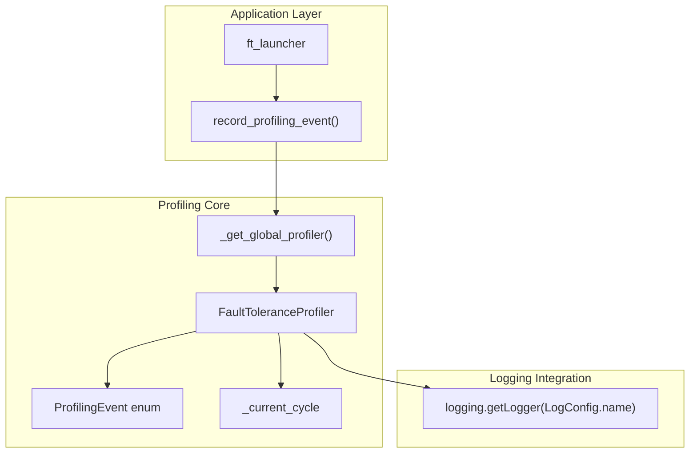
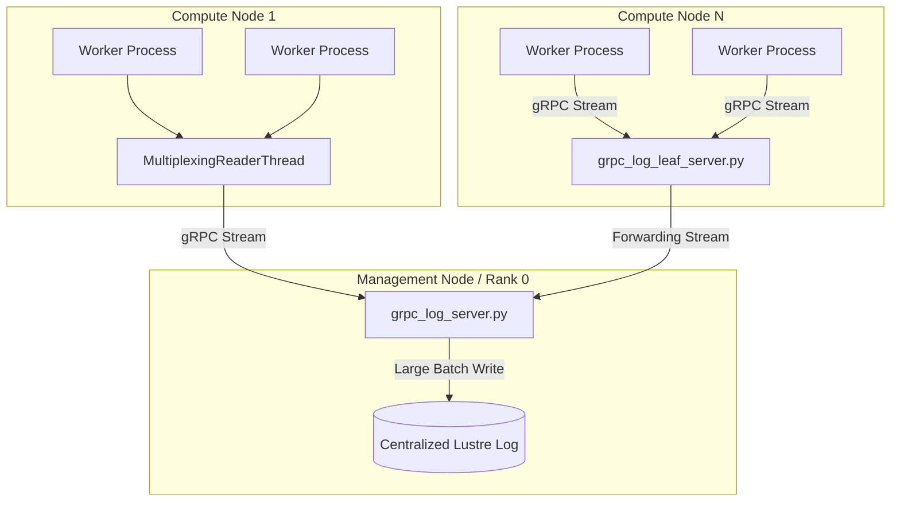
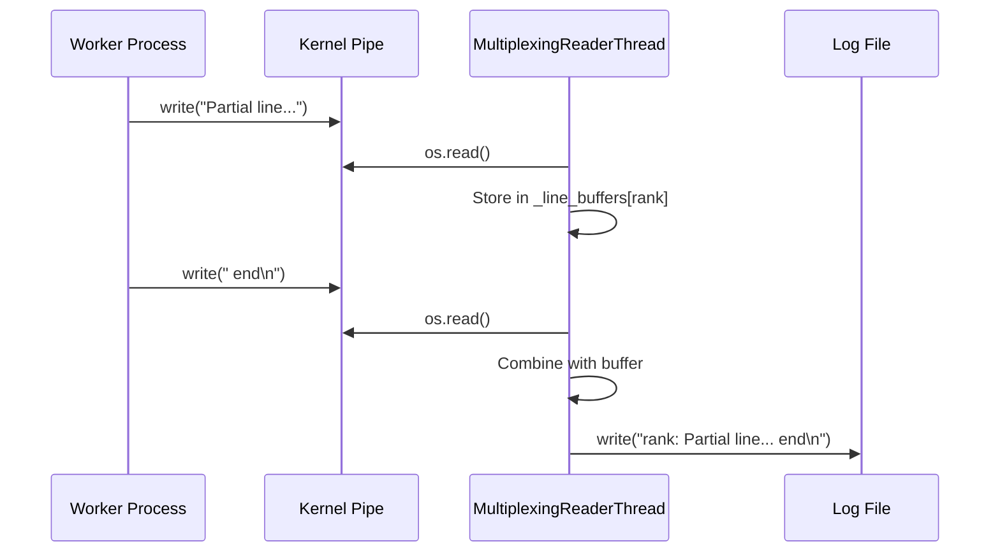

<!-- source: DeepWiki mcp.deepwiki.com · repo NVIDIA/nvidia-resiliency-ext · page 6.4 Profiling and Telemetry · fetched 2026-10-26 -->

# Profiling and Telemetry

Relevant source files

The following files were used as context for generating this wiki page:

- [src/nvidia_resiliency_ext/fault_tolerance/per_cycle_logs.py](src/nvidia_resiliency_ext/fault_tolerance/per_cycle_logs.py)
- [src/nvidia_resiliency_ext/fault_tolerance/rank_monitor_state_machine.py](src/nvidia_resiliency_ext/fault_tolerance/rank_monitor_state_machine.py)
- [src/nvidia_resiliency_ext/fault_tolerance/utils.py](src/nvidia_resiliency_ext/fault_tolerance/utils.py)
- [src/nvidia_resiliency_ext/shared_utils/grpc_log_leaf_server.py](src/nvidia_resiliency_ext/shared_utils/grpc_log_leaf_server.py)
- [src/nvidia_resiliency_ext/shared_utils/grpc_log_server.py](src/nvidia_resiliency_ext/shared_utils/grpc_log_server.py)
- [src/nvidia_resiliency_ext/shared_utils/log_aggregator.py](src/nvidia_resiliency_ext/shared_utils/log_aggregator.py)
- [src/nvidia_resiliency_ext/shared_utils/log_manager.py](src/nvidia_resiliency_ext/shared_utils/log_manager.py)
- [src/nvidia_resiliency_ext/shared_utils/log_node_local_tmp.py](src/nvidia_resiliency_ext/shared_utils/log_node_local_tmp.py)
- [src/nvidia_resiliency_ext/shared_utils/os_utils.py](src/nvidia_resiliency_ext/shared_utils/os_utils.py)
- [src/nvidia_resiliency_ext/shared_utils/profiling.py](src/nvidia_resiliency_ext/shared_utils/profiling.py)
- [src/nvidia_resiliency_ext/testing_utils/__init__.py](src/nvidia_resiliency_ext/testing_utils/__init__.py)
- [src/nvidia_resiliency_ext/testing_utils/health_check_injector.py](src/nvidia_resiliency_ext/testing_utils/health_check_injector.py)
- [tests/fault_tolerance/unit/test_grpc_log_client.py](tests/fault_tolerance/unit/test_grpc_log_client.py)
- [tests/fault_tolerance/unit/test_launcher_grpc_integration.py](tests/fault_tolerance/unit/test_launcher_grpc_integration.py)
- [tests/fault_tolerance/unit/test_layered_restart_v1.py](tests/fault_tolerance/unit/test_layered_restart_v1.py)
- [tests/fault_tolerance/unit/test_per_cycle_logs.py](tests/fault_tolerance/unit/test_per_cycle_logs.py)
- [tests/fault_tolerance/unit/test_per_cycle_logs_launcher.py](tests/fault_tolerance/unit/test_per_cycle_logs_launcher.py)
- [tests/shared_utils/test_logger.py](tests/shared_utils/test_logger.py)

This page documents the profiling and telemetry subsystem that records fault tolerance events, manages distributed log collection, and exports metrics for observability. This system provides timing metrics for rendezvous operations, worker lifecycle events, and failure detection, while also consolidating multi-rank logs into per-cycle files for attribution analysis.

---

## Overview

The profiling and telemetry subsystem consists of three primary components:

1.  **FaultToleranceProfiler**: Records timing events (failures, rendezvous completion) for measuring fault tolerance timing metrics. It manages a global `_current_cycle` counter that increments upon failure detection. [src/nvidia_resiliency_ext/shared_utils/profiling.py:39-94]()
2.  **Log Aggregation Infrastructure**: Provides both node-local and cluster-wide log collection. This includes the `NodeLogAggregator` for local file-based aggregation [src/nvidia_resiliency_ext/shared_utils/log_node_local_tmp.py:185-212]() and the gRPC-based `LogAggregationServicer` for multi-node centralized logging. [src/nvidia_resiliency_ext/shared_utils/grpc_log_server.py:107-164]()
3.  **PipeBasedLogsSpecs**: Implements pipe-based per-cycle log consolidation in the launcher to capture worker output, add rank prefixes, and solve stack trace loss problems during process termination. [src/nvidia_resiliency_ext/fault_tolerance/per_cycle_logs.py:18-35]()

**Sources**: [src/nvidia_resiliency_ext/shared_utils/profiling.py:1-94](), [src/nvidia_resiliency_ext/fault_tolerance/per_cycle_logs.py:1-58](), [src/nvidia_resiliency_ext/shared_utils/grpc_log_server.py:17-63]()

---

## FaultToleranceProfiler Architecture

### Core Components

**Diagram 1: FaultToleranceProfiler Component Relationships**

The `FaultToleranceProfiler` provides a thread-safe singleton instance via `_get_global_profiler()`. [src/nvidia_resiliency_ext/shared_utils/profiling.py:102-110]() It tracks the training cycle, which is synchronized across nodes during rendezvous to ensure newly joining nodes continue with the correct cycle number. [src/nvidia_resiliency_ext/shared_utils/profiling.py:53-70]()

**Sources**: [src/nvidia_resiliency_ext/shared_utils/profiling.py:39-147]()

### ProfilingEvent Types

The system tracks lifecycle events through the `ProfilingEvent` enum:

| Event | Value | Description |
| :--- | :--- | :--- |
| `FAILURE_DETECTED` | `"failure_detected"` | A failure was detected; increments `_current_cycle`. [src/nvidia_resiliency_ext/shared_utils/profiling.py:86-87]() |
| `WORKER_TERMINATED` | `"worker_terminated"` | Individual worker process has exited. [src/nvidia_resiliency_ext/shared_utils/profiling.py:32-32]() |
| `RENDEZVOUS_STARTED` | `"rendezvous_started"` | The node has entered the rendezvous phase. [src/nvidia_resiliency_ext/shared_utils/profiling.py:33-33]() |
| `RENDEZVOUS_COMPLETED`| `"rendezvous_completed"`| The node has successfully completed rendezvous. [src/nvidia_resiliency_ext/shared_utils/profiling.py:35-35]() |
| `WORKER_START_STARTED`| `"worker_start_started"`| Beginning the worker spawn process. [src/nvidia_resiliency_ext/shared_utils/profiling.py:36-36]() |
| `WORKER_START_COMPLETED`| `"worker_start_completed"`| Workers have been successfully spawned. [src/nvidia_resiliency_ext/shared_utils/profiling.py:37-37]() |

**Sources**: [src/nvidia_resiliency_ext/shared_utils/profiling.py:28-37](), [src/nvidia_resiliency_ext/shared_utils/profiling.py:85-87]()

---

## Log Aggregation Architecture

The system supports two levels of log aggregation to handle scale and optimize filesystem I/O (specifically for Lustre).

### Node-Local Aggregation (`log_aggregator.py`)
Training processes on a single node write log messages to a node-local temporary directory (e.g., `/tmp/nvrx`). The `NodeLogAggregator` service monitors this directory and merges messages into a per-node log file. [src/nvidia_resiliency_ext/shared_utils/log_aggregator.py:17-46]()

### Cluster-Wide Aggregation (`grpc_log_server.py`)
For cluster-wide centralization, a gRPC server (`LogAggregationServicer`) acts as a single writer to a centralized Lustre file. This eliminates `O_APPEND` contention across hundreds of nodes. [src/nvidia_resiliency_ext/shared_utils/grpc_log_server.py:17-63]()

**Diagram 2: Distributed Log Funnel Architecture**

**Sources**: [src/nvidia_resiliency_ext/shared_utils/grpc_log_server.py:107-164](), [src/nvidia_resiliency_ext/shared_utils/grpc_log_leaf_server.py:7-27](), [src/nvidia_resiliency_ext/fault_tolerance/per_cycle_logs.py:27-29]()

---

## Per-Cycle Log Consolidation

### PipeBasedLogsSpecs and MultiplexingReaderThread

The `PipeBasedLogsSpecs` implementation solves the "stack trace loss" problem. When workers are terminated via `SIGTERM`, standard file redirection may lose the final buffers. By using kernel-buffered pipes, the `MultiplexingReaderThread` in the parent launcher process can drain the pipes completely even after the worker has exited. [src/nvidia_resiliency_ext/fault_tolerance/per_cycle_logs.py:18-35]()

| Feature | Implementation |
| :--- | :--- |
| **Transport** | Uses `os.pipe()` to prevent buffer loss. [src/nvidia_resiliency_ext/fault_tolerance/per_cycle_logs.py:20-23]() |
| **Multiplexing** | `select.poll()` monitors multiple worker pipes in a single thread. [src/nvidia_resiliency_ext/fault_tolerance/per_cycle_logs.py:279-304]() |
| **Filtering** | `_should_filter_line()` removes noisy Nvidia driver dumps (e.g., `/proc/devices`). [src/nvidia_resiliency_ext/fault_tolerance/per_cycle_logs.py:101-151]() |
| **Prefixing** | Adds rank prefixes (e.g., `0: message`) to every line in the parent process. [src/nvidia_resiliency_ext/fault_tolerance/per_cycle_logs.py:24-25]() |

**Sources**: [src/nvidia_resiliency_ext/fault_tolerance/per_cycle_logs.py:18-58](), [src/nvidia_resiliency_ext/fault_tolerance/per_cycle_logs.py:279-378]()

### Reader Thread Logic

The `MultiplexingReaderThread` maintains per-rank `_line_buffers` to handle partial reads. It only writes to the log file when a full line (ending in `\n`) is received, ensuring log integrity. [src/nvidia_resiliency_ext/fault_tolerance/per_cycle_logs.py:337-360]()

**Diagram 3: Line Buffering Sequence**

**Sources**: [src/nvidia_resiliency_ext/fault_tolerance/per_cycle_logs.py:176-378]()

---

## Telemetry Exporters and Metadata

The system supports structured telemetry via `record_profiling_event`. While the provided code focuses on local logging, it provides a unique `event_id` for every record, incorporating the event type, timestamp, node ID, and rank. [src/nvidia_resiliency_ext/shared_utils/profiling.py:72-94]()

### Infrastructure Rank Detection
Telemetry and logging rely on `get_infrastructure_rank()` to uniquely identify nodes. This utility parses environment variables with the following precedence:
1.  `NVRX_INFRA_RANK_FROM_NODENAME`: Extracts digits from `SLURMD_NODENAME`. [src/nvidia_resiliency_ext/fault_tolerance/utils.py:85-99]()
2.  `CROSS_SLURM_PROCID`: For multi-job coordination. [src/nvidia_resiliency_ext/fault_tolerance/utils.py:102-106]()
3.  `SLURM_TOPOLOGY_ADDR`: Block-aware rank calculation (e.g., `block5.node3` -> `50000000003`). [src/nvidia_resiliency_ext/fault_tolerance/utils.py:109-157]()
4.  `SLURM_PROCID`: Standard Slurm task ID. [src/nvidia_resiliency_ext/fault_tolerance/utils.py:160-165]()

**Sources**: [src/nvidia_resiliency_ext/fault_tolerance/utils.py:42-174]()

### Fault Injection for Testing
The `HealthCheckInjector` allows developers to simulate node failures at specific profiling cycles using the `NVRX_INJECT_GPU_FAILURE` environment variable (format: `cycle:infra_rank`). This is used to validate that telemetry correctly captures failure events and that the system responds as expected. [src/nvidia_resiliency_ext/testing_utils/health_check_injector.py:29-41](), [src/nvidia_resiliency_ext/testing_utils/health_check_injector.py:78-147]()

**Sources**: [src/nvidia_resiliency_ext/testing_utils/health_check_injector.py:17-168]()

---

