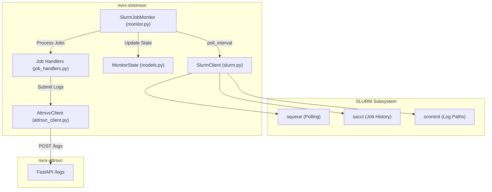
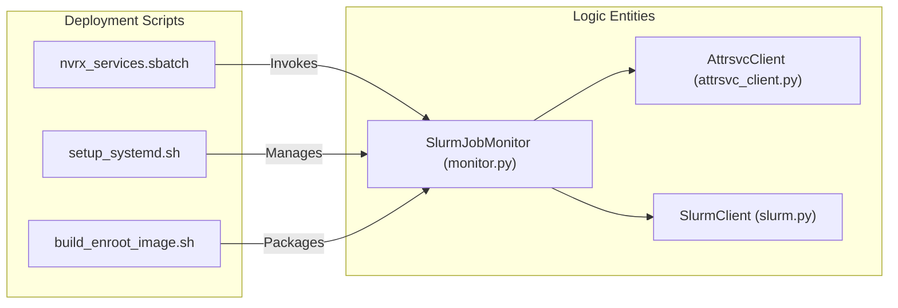

<!-- source: DeepWiki mcp.deepwiki.com · repo NVIDIA/nvidia-resiliency-ext · page 6.5 SLURM Monitor Service · fetched 2026-10-26 -->

# SLURM Monitor Service

Relevant source files

The following files were used as context for generating this wiki page:

- [build.py](build.py)
- [docs/source/fault_tolerance/usage_guide.rst](docs/source/fault_tolerance/usage_guide.rst)
- [services/scripts/README.md](services/scripts/README.md)
- [services/scripts/build_enroot_image.sh](services/scripts/build_enroot_image.sh)
- [services/scripts/common.sh](services/scripts/common.sh)
- [services/scripts/nvrx_services.sbatch](services/scripts/nvrx_services.sbatch)
- [services/scripts/run_services.sh](services/scripts/run_services.sh)
- [services/scripts/setup_systemd.sh](services/scripts/setup_systemd.sh)
- [services/smonsvc/README.md](services/smonsvc/README.md)
- [services/tests/test_smonsvc_attrsvc_client.py](services/tests/test_smonsvc_attrsvc_client.py)
- [services/tests/test_smonsvc_job_handlers.py](services/tests/test_smonsvc_job_handlers.py)
- [src/nvidia_resiliency_ext/attribution/orchestration/llm_output.py](src/nvidia_resiliency_ext/attribution/orchestration/llm_output.py)
- [src/nvidia_resiliency_ext/attribution/orchestration/runner.py](src/nvidia_resiliency_ext/attribution/orchestration/runner.py)
- [src/nvidia_resiliency_ext/attribution/orchestration/types.py](src/nvidia_resiliency_ext/attribution/orchestration/types.py)
- [src/nvidia_resiliency_ext/fault_tolerance/attribution_manager.py](src/nvidia_resiliency_ext/fault_tolerance/attribution_manager.py)
- [src/nvidia_resiliency_ext/services/smonsvc/attrsvc_client.py](src/nvidia_resiliency_ext/services/smonsvc/attrsvc_client.py)
- [src/nvidia_resiliency_ext/services/smonsvc/job_handlers.py](src/nvidia_resiliency_ext/services/smonsvc/job_handlers.py)
- [src/nvidia_resiliency_ext/services/smonsvc/models.py](src/nvidia_resiliency_ext/services/smonsvc/models.py)
- [src/nvidia_resiliency_ext/services/smonsvc/monitor.py](src/nvidia_resiliency_ext/services/smonsvc/monitor.py)
- [src/nvidia_resiliency_ext/services/smonsvc/slurm.py](src/nvidia_resiliency_ext/services/smonsvc/slurm.py)
- [src/nvidia_resiliency_ext/shared_utils/health_check.py](src/nvidia_resiliency_ext/shared_utils/health_check.py)
- [tests/fault_tolerance/unit/test_attribution_manager.py](tests/fault_tolerance/unit/test_attribution_manager.py)
- [tests/shared_utils/test_health_check.py](tests/shared_utils/test_health_check.py)

The SLURM Monitor Service (`nvrx-smonsvc`) is a background utility that automates the lifecycle of fault attribution by polling SLURM for completed or failed jobs and submitting their logs to the [Log Analysis Service (nvrx-attrsvc)](6.1.-Log-Analysis-Service). It acts as the bridge between the cluster scheduler and the diagnostics subsystem, ensuring that every terminal job is automatically analyzed without manual intervention.

## Overview and Scope

The service is designed to run as a persistent daemon (via systemd, background process, or a dedicated SLURM job) that monitors specific partitions for job state changes.

**Key Responsibilities:**
*   **Job Discovery:** Polls `squeue` and `sacct` to identify jobs that have reached a terminal state (COMPLETED, FAILED, TIMEOUT, NODE_FAIL) [src/nvidia_resiliency_ext/services/smonsvc/slurm.py:67-68]().
*   **Log Extraction:** Resolves the standard output log path for discovered jobs using `scontrol` and `sacct`, with specific support for heterogeneous (het) jobs and job arrays [src/nvidia_resiliency_ext/services/smonsvc/slurm.py:201-213]().
*   **Automated Submission:** Transmits log paths to `nvrx-attrsvc` via HTTP/UDS POST requests [src/nvidia_resiliency_ext/services/smonsvc/job_handlers.py:97-105]().
*   **State Tracking:** Maintains an in-memory ledger of tracked jobs to prevent duplicate submissions and manage terminal analysis signaling [src/nvidia_resiliency_ext/services/smonsvc/job_handlers.py:124-141]().

### System Architecture and Data Flow

The following diagram illustrates how `nvrx-smonsvc` interacts with the SLURM subsystem and the attribution service.

**SLURM Monitor Service Architecture**

Sources: [src/nvidia_resiliency_ext/services/smonsvc/slurm.py:52-70](), [src/nvidia_resiliency_ext/services/smonsvc/job_handlers.py:48-62]()

## Implementation Details

### SlurmJobMonitor
The `SlurmJobMonitor` class implements the main control loop. Every `NVRX_SMONSVC_INTERVAL` seconds, it executes a multi-step pipeline:
1.  **Job Querying:** Uses `SlurmClient` to fetch terminal jobs in the configured partitions [src/nvidia_resiliency_ext/services/smonsvc/slurm.py:165-188]().
2.  **State Synchronization:** Compares SLURM results with the local `MonitorState` to identify new terminal jobs [src/nvidia_resiliency_ext/services/smonsvc/models.py:25-45]().
3.  **Submission:** For each new job, it calls `submit_log()` which issues a `POST` to the attribution service [src/nvidia_resiliency_ext/services/smonsvc/job_handlers.py:48-62]().
4.  **Terminal Signaling:** Once a job is terminal, it sends a `POST` with `analysis_intent="terminal"` to ensure the attribution service performs a final, comprehensive analysis [src/nvidia_resiliency_ext/services/smonsvc/job_handlers.py:124-141]().

### SLURM Integration (SlurmClient)
The `SlurmClient` abstracts the complexities of SLURM CLI parsing. It handles:
*   **Regular Jobs:** Standard job IDs.
*   **Job Arrays:** Individual tasks are processed while array summaries are parsed to resolve specific log paths [src/nvidia_resiliency_ext/services/smonsvc/slurm.py:119-145]().
*   **Partition Validation:** Validates configured partitions against the cluster's available partitions using `sinfo` [src/nvidia_resiliency_ext/services/smonsvc/slurm.py:147-164]().

### Attribution Client (AttrsvcClient)
The `AttrsvcClient` provides a resilient interface to `nvrx-attrsvc`. It supports:
*   **UDS Support:** Communication over Unix Domain Sockets (`unix:///path.sock`) or standard TCP [src/nvidia_resiliency_ext/services/smonsvc/attrsvc_client.py:47-62]().
*   **Resiliency:** Implements exponential backoff for 429 (Rate Limited) and retry logic for server errors [src/nvidia_resiliency_ext/services/smonsvc/attrsvc_client.py:113-118]().
*   **Health Caching:** Maintains a cached health status of the attribution service to prevent blocking the monitor's main loop [src/nvidia_resiliency_ext/services/smonsvc/attrsvc_client.py:191-205]().

Sources: [src/nvidia_resiliency_ext/services/smonsvc/attrsvc_client.py:106-172](), [src/nvidia_resiliency_ext/services/smonsvc/job_handlers.py:108-166]()

## Configuration and Deployment

### Environment Variables
The service is configured primarily through environment variables.

| Variable | Default | Description |
| :--- | :--- | :--- |
| `NVRX_ATTRSVC_ENDPOINT` | `http://localhost:8000` | URL or UDS path for the attribution service [src/nvidia_resiliency_ext/services/smonsvc/attrsvc_client.py:137-140](). |
| `NVRX_SMONSVC_INTERVAL` | `180` | Polling interval in seconds [services/scripts/build_enroot_image.sh:127](). |
| `NVRX_SMONSVC_PARTITIONS`| `None` | List of SLURM partitions to monitor [src/nvidia_resiliency_ext/services/smonsvc/slurm.py:82-88](). |

Sources: [src/nvidia_resiliency_ext/services/smonsvc/slurm.py:70-92](), [services/scripts/build_enroot_image.sh:113-131]()

### Deployment Modes

The service can be deployed in three ways:

1.  **Combined SLURM Job:** Using `nvrx_services.sbatch`, both `nvrx-attrsvc` and `nvrx-smonsvc` run within a single SLURM allocation [services/scripts/nvrx_services.sbatch:1-20]().
2.  **Systemd Service:** Managed via `setup_systemd.sh`, supporting both root-level and user-local (`--user`) installations [services/scripts/setup_systemd.sh:42-68]().
3.  **Enroot Container:** An image built via `build_enroot_image.sh` can be launched using `srun --container-image` [services/scripts/build_enroot_image.sh:15-25]().

**Code-to-Service Mapping**

Sources: [services/scripts/setup_systemd.sh:40-41](), [services/scripts/build_enroot_image.sh:105-110]()

## API Integration

The monitor service uses the `AttrsvcClient` to communicate with `nvrx-attrsvc` endpoints:

| Route | Method | Purpose |
| :--- | :--- | :--- |
| `/healthz` | GET | Probed by `check_health_cached` to verify service availability [src/nvidia_resiliency_ext/services/smonsvc/attrsvc_client.py:19-22](). |
| `/logs` | POST | Used to submit log paths and signal terminal analysis [src/nvidia_resiliency_ext/services/smonsvc/job_handlers.py:97-105](). |
| `/logs` | GET | Used to fetch final attribution results for logging [src/nvidia_resiliency_ext/services/smonsvc/job_handlers.py:160-166](). |

Sources: [src/nvidia_resiliency_ext/services/smonsvc/attrsvc_client.py:18-23](), [src/nvidia_resiliency_ext/services/smonsvc/job_handlers.py:133-142]()

---

