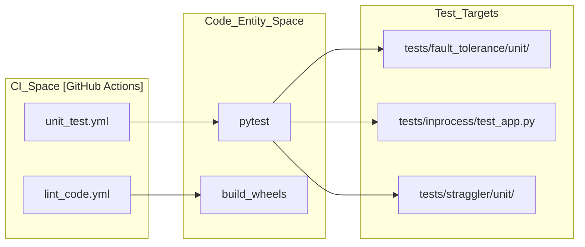
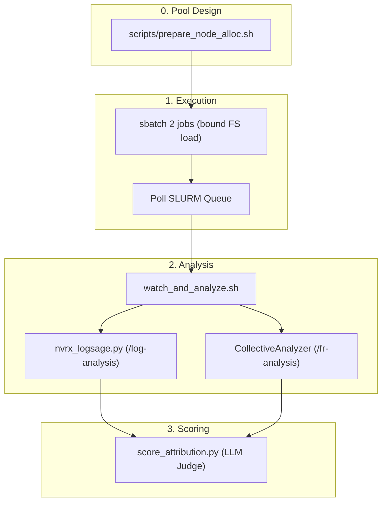
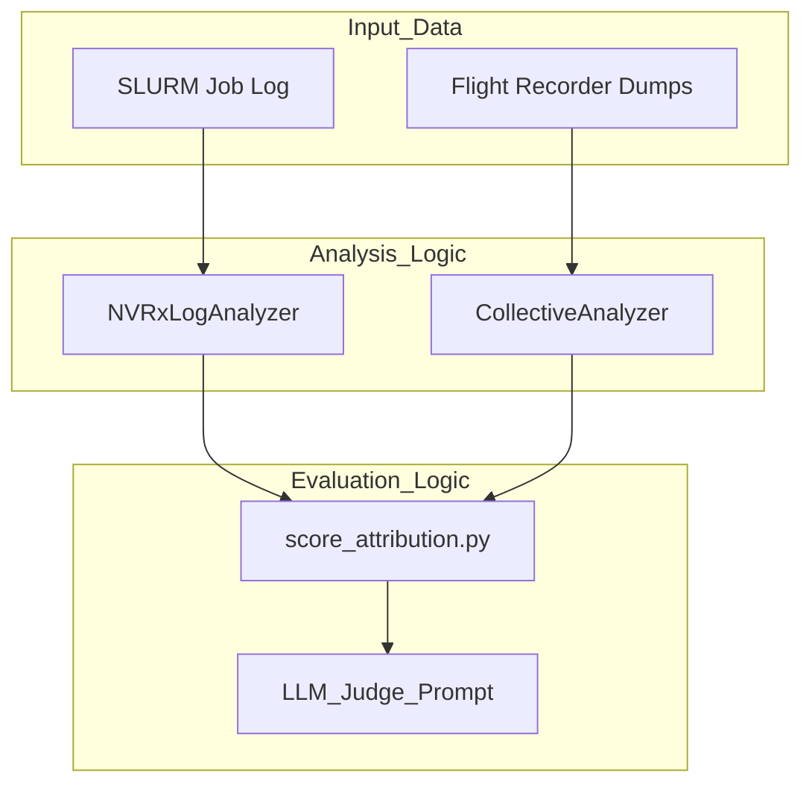

<!-- source: DeepWiki mcp.deepwiki.com · repo NVIDIA/nvidia-resiliency-ext · page 7 Testing and Development · fetched 2026-10-26 -->

# Testing and Development

<details>
<summary>Relevant source files</summary>

The following files were used as context for generating this wiki page:

- [.github/workflows/build_docs.yml](.github/workflows/build_docs.yml)
- [.github/workflows/lint_code.yml](.github/workflows/lint_code.yml)
- [.github/workflows/unit_test.yml](.github/workflows/unit_test.yml)
- [README.md](README.md)
- [docs/source/release-notes.md](docs/source/release-notes.md)
- [examples/attribution/README.md](examples/attribution/README.md)
- [src/nvidia_resiliency_ext/shared_utils/inject_fault.py](src/nvidia_resiliency_ext/shared_utils/inject_fault.py)
- [src/nvidia_resiliency_ext/skills/nvrx-attr/fault-injection-loop/SKILL.md](src/nvidia_resiliency_ext/skills/nvrx-attr/fault-injection-loop/SKILL.md)
- [src/nvidia_resiliency_ext/skills/nvrx-attr/fr-analysis/SKILL.md](src/nvidia_resiliency_ext/skills/nvrx-attr/fr-analysis/SKILL.md)
- [src/nvidia_resiliency_ext/skills/nvrx-attr/log-analysis/SKILL.md](src/nvidia_resiliency_ext/skills/nvrx-attr/log-analysis/SKILL.md)
- [src/nvidia_resiliency_ext/skills/nvrx-attr/scripts/score_attribution.py](src/nvidia_resiliency_ext/skills/nvrx-attr/scripts/score_attribution.py)
- [src/nvidia_resiliency_ext/skills/nvrx-attr/scripts/user.env.example](src/nvidia_resiliency_ext/skills/nvrx-attr/scripts/user.env.example)
- [tests/fault_tolerance/unit/test_timeouts_calc.py](tests/fault_tolerance/unit/test_timeouts_calc.py)
- [tests/fault_tolerance/unit/utils.py](tests/fault_tolerance/unit/utils.py)
- [tests/inprocess/app.py](tests/inprocess/app.py)
- [tests/inprocess/test_app.py](tests/inprocess/test_app.py)
- [tests/straggler/unit/_utils.py](tests/straggler/unit/_utils.py)

</details>


This document provides an overview of the testing infrastructure, example integration patterns, and the fault injection benchmarking framework in NVIDIA Resiliency Extensions. It covers unit test organization, practical usage patterns for resiliency decorators, and the closed-loop evaluation system used to validate attribution accuracy.

---

## 7.1 Testing Infrastructure

The test suite is organized into unit and integration tests that validate core fault tolerance mechanisms, rendezvous coordination, and utility functions. Continuous integration is managed via GitHub Actions, running tests across multiple PyTorch and CUDA versions.

### Test Directory Structure

```
tests/
├── fault_tolerance/
│   └── unit/
│       ├── test_barrier_rendezvous.py    # Barrier-based rendezvous tests
│       ├── test_dynamic_rendezvous.py    # Dynamic rendezvous handler tests
│       └── test_utils.py                 # Utility function tests
├── inprocess/
│   ├── app.py                         # Test application with fault injection [tests/inprocess/app.py:1-42]()
│   └── test_app.py                    # In-process wrapper integration tests [tests/inprocess/test_app.py:1-28]()
└── straggler/
    └── unit/                          # Straggler detection unit tests [.github/workflows/unit_test.yml:69-76]()
```

### CI/CD Pipelines

The codebase utilizes automated workflows for quality assurance:
- **Linting**: Uses `black`, `isort`, and `ruff` to maintain code style [.github/workflows/lint_code.yml:24-39]().
- **Unit Testing**: Executes tests in specialized containers (e.g., `pytorch:2.5.1-cuda12.4`). It separates CPU-only straggler tests from full fault tolerance suites [.github/workflows/unit_test.yml:39-82]().

### Code Entity Mapping: Test Infrastructure


Sources: [.github/workflows/unit_test.yml:1-83](), [.github/workflows/lint_code.yml:1-39]()

For details on test base classes, shared `TCPStore` patterns, and rendezvous state validation, see **[Testing Infrastructure](#7.1)**.

---

## 7.2 Examples and Integration Patterns

The `tests/inprocess` directory serves as a primary source of integration examples, demonstrating how to wrap training loops with the resiliency `Wrapper`.

### In-Process Wrapper Integration

The `Wrapper` provides a managed execution loop that handles initialization, iteration tracking, and automatic restarts.

```python
wrapped = inprocess.Wrapper(
    initialize=inprocess.initialize.RetryController(max_iterations=5),
    store_kwargs={'port': 29501},
    progress_watchdog_interval=timedelta(milliseconds=50),
)(app.train)
```
Sources: [tests/inprocess/test_app.py:102-106]()

### Fault Injection for Development

Developers can use `nvidia_resiliency_ext.shared_utils.inject_fault` to simulate hardware and software failures during development.

| Fault Type | Description | Code Entity |
|---|---|---|
| `GPU_SLEEP` | Simulates a transient GPU hang via `torch.cuda._sleep` | `Fault.GPU_SLEEP` [src/nvidia_resiliency_ext/shared_utils/inject_fault.py:212-216]() |
| `GPU_ERROR` | Triggers a hardware-like illegal memory access | `Fault.GPU_ERROR` [src/nvidia_resiliency_ext/shared_utils/inject_fault.py:191-197]() |
| `LOCK_GIL` | Simulates a Python-level hang by locking the GIL | `Fault.LOCK_GIL` [src/nvidia_resiliency_ext/shared_utils/inject_fault.py:229-234]() |
| `SEGFAULT` | Triggers a hard process crash via invalid memory access | `Fault.SEGFAULT` [src/nvidia_resiliency_ext/shared_utils/inject_fault.py:248-252]() |
| `WORKLOAD_EXC` | Raises a standard Python exception in the workload | `Fault.WORKLOAD_EXC` [src/nvidia_resiliency_ext/shared_utils/inject_fault.py:129-134]() |

Sources: [src/nvidia_resiliency_ext/shared_utils/inject_fault.py:34-47](), [tests/inprocess/test_app.py:156-165]()

For details on nested restarter callbacks and DDP integration patterns, see **[Examples and Integration Patterns](#7.2)**.

---

## 7.3 Fault Injection Benchmarking Framework

The `nvrx-attr` skills framework provides a "closed-loop" system for benchmarking the accuracy of the attribution service. It injects known faults into a cluster and uses an LLM judge to evaluate if the system correctly identified the root cause.

### The Attribution Evaluation Loop


Sources: [src/nvidia_resiliency_ext/skills/nvrx-attr/fault-injection-loop/SKILL.md:27-44]()

### Scoring Dimensions

The `score_attribution.py` script uses a high-parameter model (e.g., `qwen3.5-397b`) to compare system output against ground truth across several dimensions:
- `restart_correct`: Did the system make the right "RESTART" vs "STOP" decision based on the fault type? [src/nvidia_resiliency_ext/skills/nvrx-attr/scripts/score_attribution.py:46-69]()
- `rank_primary`: Did it identify the specific rank where the fault was injected? [src/nvidia_resiliency_ext/skills/nvrx-attr/scripts/score_attribution.py:18-19]()
- `fr_rank_correct`: For hangs, did the Flight Recorder analysis isolate the correct rank or segment? [src/nvidia_resiliency_ext/skills/nvrx-attr/scripts/score_attribution.py:116-154]()

### Code Entity Mapping: Attribution Framework


Sources: [src/nvidia_resiliency_ext/skills/nvrx-attr/log-analysis/SKILL.md:10-11](), [src/nvidia_resiliency_ext/skills/nvrx-attr/fr-analysis/SKILL.md:10-11](), [src/nvidia_resiliency_ext/skills/nvrx-attr/scripts/score_attribution.py:1-19]()

### Benchmarking Components

| Component | File Path | Role |
|---|---|---|
| **Orchestrator** | `scripts/prepare_node_alloc.sh` | Builds the experiment pool (GPU_SLEEP, SIGKILL, etc) [src/nvidia_resiliency_ext/skills/nvrx-attr/fault-injection-loop/SKILL.md:48-80]() |
| **Evaluator** | `scripts/watch_and_analyze.sh` | Streams logs to analysis services as jobs finish [src/nvidia_resiliency_ext/skills/nvrx-attr/fault-injection-loop/SKILL.md:37-38]() |
| **LLM Judge** | `scripts/score_attribution.py` | Assigns scores and generates the results table [src/nvidia_resiliency_ext/skills/nvrx-attr/scripts/score_attribution.py:1-19]() |
| **Workload** | `scripts/l4_gb200_reduced.sh` | Example Megatron-LM workload script for GB200 clusters [src/nvidia_resiliency_ext/skills/nvrx-attr/fault-injection-loop/SKILL.md:160]() |

For details on the scoring logic and the full experiment matrix, see **[Fault Injection Benchmarking Framework](#7.3)**.

Sources: [src/nvidia_resiliency_ext/skills/nvrx-attr/fault-injection-loop/SKILL.md:1-160](), [src/nvidia_resiliency_ext/skills/nvrx-attr/scripts/score_attribution.py:1-196](), [src/nvidia_resiliency_ext/skills/nvrx-attr/scripts/user.env.example:1-46]()

---

