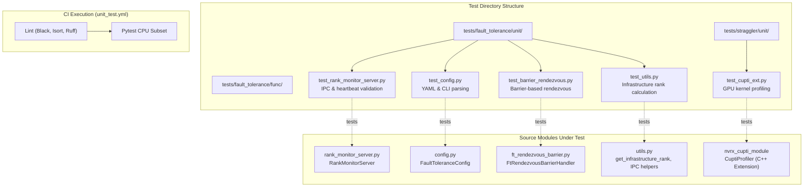
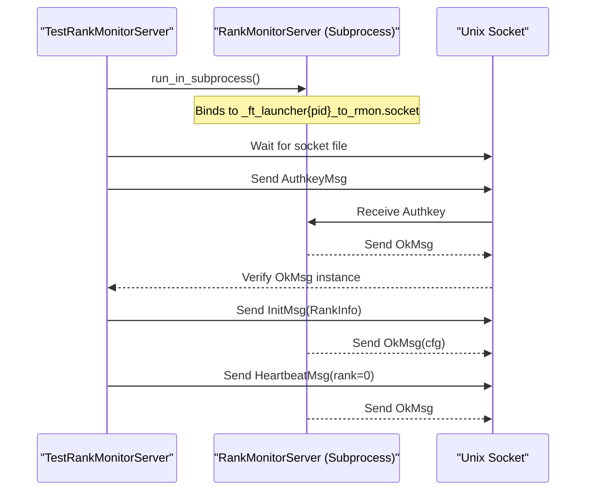

<!-- source: DeepWiki mcp.deepwiki.com · repo NVIDIA/nvidia-resiliency-ext · page 7.1 Testing Infrastructure · fetched 2026-10-26 -->

# Testing Infrastructure

Relevant source files

The following files were used as context for generating this wiki page:

- [.github/workflows/build_docs.yml](.github/workflows/build_docs.yml)
- [.github/workflows/cherry_pick_release.yml](.github/workflows/cherry_pick_release.yml)
- [.github/workflows/lint_code.yml](.github/workflows/lint_code.yml)
- [.github/workflows/unit_test.yml](.github/workflows/unit_test.yml)
- [README.md](README.md)
- [docs/source/release-notes.md](docs/source/release-notes.md)
- [examples/attribution/README.md](examples/attribution/README.md)
- [src/nvidia_resiliency_ext/fault_tolerance/_ft_rendezvous.py](src/nvidia_resiliency_ext/fault_tolerance/_ft_rendezvous.py)
- [tests/fault_tolerance/unit/test_dynamic_rendezvous.py](tests/fault_tolerance/unit/test_dynamic_rendezvous.py)
- [tests/fault_tolerance/unit/test_rank_monitor_server.py](tests/fault_tolerance/unit/test_rank_monitor_server.py)
- [tests/fault_tolerance/unit/test_timeouts_calc.py](tests/fault_tolerance/unit/test_timeouts_calc.py)
- [tests/fault_tolerance/unit/test_utils.py](tests/fault_tolerance/unit/test_utils.py)
- [tests/fault_tolerance/unit/utils.py](tests/fault_tolerance/unit/utils.py)
- [tests/inprocess/test_torch.py](tests/inprocess/test_torch.py)
- [tests/straggler/unit/_utils.py](tests/straggler/unit/_utils.py)
- [tests/straggler/unit/test_cupti_ext.py](tests/straggler/unit/test_cupti_ext.py)

This document describes the testing infrastructure for NVIDIA Resiliency Extensions, focusing on how tests validate the correctness of fault tolerance mechanisms, rendezvous protocols, rank monitor servers, and utility functions. The tests serve both as validation and as executable examples demonstrating proper usage of the system's components.

For information about the systems being tested, see:
- Fault Tolerance System: [2]()
- Rendezvous and Coordination: [2.2]()
- In-Process Restart System: [3]()

---

## Test Suite Organization

The test suite is organized by subsystem, with unit tests focusing on individual components and functional tests validating multi-process scenarios and end-to-end restart loops.

**Test File Purposes:**

| Test File | Primary Focus | Key Classes/Functions Tested |
|-----------|---------------|------------------------------|
| `test_rank_monitor_server.py` | IPC communication & heartbeats | `RankMonitorServer`, `AuthkeyMsg`, `HeartbeatMsg` |
| `test_config.py` | Configuration parsing precedence | `FaultToleranceConfig.from_args`, `from_yaml_file` |
| `test_barrier_rendezvous.py` | Barrier-based rendezvous protocol | `FtRendezvousBarrierHandler`, `_RendezvousBarrierState` |
| `test_utils.py` | Infrastructure rank calculation | `get_infrastructure_rank` |
| `test_cupti_ext.py` | GPU kernel timing & profiling | `nvrx_cupti_module.CuptiProfiler` |
| `test_dynamic_rendezvous.py` | Legacy rendezvous logic | `FtRendezvousHandler` (Deprecated) |

Sources: [.github/workflows/unit_test.yml:39-82](), [tests/fault_tolerance/unit/test_rank_monitor_server.py:30-150](), [tests/straggler/unit/test_cupti_ext.py:22-48]()

---

## CI and Automation

The project uses GitHub Actions for continuous integration, covering linting, building, and cross-version testing.

- **Linting:** Validates code style using `black`, `isort`, and `ruff` [.github/workflows/lint_code.yml:24-39]().
- **Matrix Testing:** Runs unit tests across multiple PyTorch versions (2.3.1, 2.4.1, 2.5.1) to ensure backward compatibility [.github/workflows/unit_test.yml:42-47]().
- **Environment Handling:** Sets `MKL_SERVICE_FORCE_INTEL=1` to prevent library conflicts in containerized environments [.github/workflows/unit_test.yml:51-52]().
- **Documentation Deployment:** Automatically builds Sphinx documentation and deploys to GitHub Pages [.github/workflows/build_docs.yml:26-34]().

---

## Infrastructure Rank Calculation Tests

The `test_utils.py` suite validates the `get_infrastructure_rank` utility, which is critical for topology-aware rank assignment in environments like SLURM.

**Validation Scenarios:**
- **SLURM Topology:** Validates parsing of `SLURM_TOPOLOGY_ADDR` (e.g., `block5.node10`) using `SLURM_TOPOLOGY_ADDR_PATTERN` [tests/fault_tolerance/unit/test_utils.py:51-68]().
- **Node Name Parsing:** Extracts numeric IDs from `SLURMD_NODENAME` when `NVRX_INFRA_RANK_FROM_NODENAME` is enabled [tests/fault_tolerance/unit/test_utils.py:103-109]().
- **Job Arrays:** Calculates rank based on `SLURM_ARRAY_TASK_ID`, `SLURM_NNODES`, and `SLURM_PROCID` [tests/fault_tolerance/unit/test_utils.py:150-158]().
- **Precedence:** Ensures `CROSS_SLURM_PROCID` takes precedence over standard `SLURM_PROCID` [tests/fault_tolerance/unit/test_utils.py:142-149]().

Sources: [tests/fault_tolerance/unit/test_utils.py:18-179]()

---

## Rank Monitor Server Testing

Testing the `RankMonitorServer` involves complex asynchronous IPC (Inter-Process Communication) validation. The test suite spawns the server in a subprocess and connects to it via Unix domain sockets.

**Key Implementation Details:**
- **Subprocess Management:** The server is launched via `RankMonitorServer.run_in_subprocess` and terminated in `tearDown` [tests/fault_tolerance/unit/test_rank_monitor_server.py:48-75]().
- **IPC Helpers:** Tests use `read_obj_from_ipc_stream` and `write_obj_to_ipc_stream` to simulate worker behavior [tests/fault_tolerance/unit/test_rank_monitor_server.py:92-111]().
- **Socket Discovery:** The test dynamically constructs the socket path using the server's PID: `_ft_launcher{server_pid}_to_rmon.socket` [tests/fault_tolerance/unit/test_rank_monitor_server.py:56-60]().

Sources: [tests/fault_tolerance/unit/test_rank_monitor_server.py:30-202]()

---

## Straggler Detection & CUPTI Testing

The straggler detection system relies on a C++ extension (`nvrx_cupti_module`) to profile GPU kernels. The `test_cupti_ext.py` file validates the accuracy and lifecycle of this profiler.

**Core Validations:**
- **Kernel Tracking:** Ensures that `torch.matmul` calls are correctly captured and counted in the profiler stats [tests/straggler/unit/test_cupti_ext.py:22-37]().
- **Singleton Pattern:** Verifies that multiple instances of `CuptiProfiler` cannot be created simultaneously [tests/straggler/unit/test_cupti_ext.py:119-122]().
- **CUDA Graphs:** Validates that kernels replayed within a `torch.cuda.CUDAGraph` are captured identically to sequential execution [tests/straggler/unit/test_cupti_ext.py:125-175]().
- **Buffer Management:** Tests the `reset()` and `stop()` functions to ensure stats are cleared or preserved as expected [tests/straggler/unit/test_cupti_ext.py:79-95]().

Sources: [tests/straggler/unit/test_cupti_ext.py:16-175]()

---

## Distributed Rendezvous Testing

While `FtRendezvousBarrierHandler` is the current default, the test suite maintains tests for the legacy dynamic rendezvous to ensure backward compatibility and document logic.

**Rank Assignment Logic:**
Tests for `_DistributedRendezvousOpExecutor._assign_ranks` validate that:
- Participants are sorted by their infrastructure ranks (SLURM-aware) rather than alphabetical node names [tests/fault_tolerance/unit/test_dynamic_rendezvous.py:106-123]().
- Gaps in infrastructure ranks (e.g., from missing nodes) are mapped to contiguous group ranks [tests/fault_tolerance/unit/test_dynamic_rendezvous.py:144-162]().

**Store Behavior:**
The `test_torch.py` suite validates the behavior of `TCPStore` and `FileStore` under restart conditions, ensuring that re-initialization correctly clears keys and handles process group destruction [tests/inprocess/test_torch.py:40-104]().

Sources: [tests/fault_tolerance/unit/test_dynamic_rendezvous.py:103-188](), [tests/inprocess/test_torch.py:40-157]()

---

