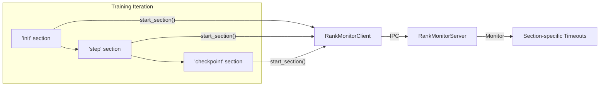
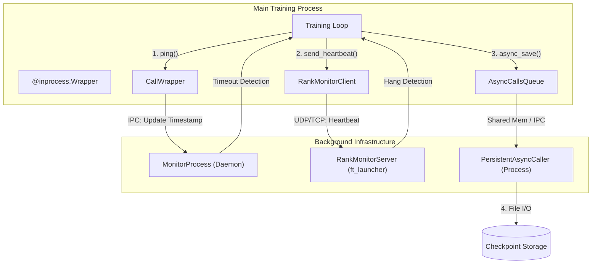
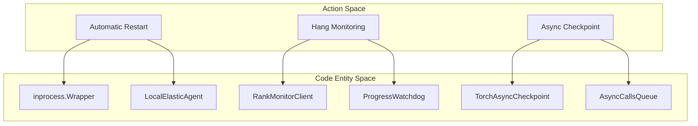

<!-- source: DeepWiki mcp.deepwiki.com · repo NVIDIA/nvidia-resiliency-ext · page 7.2 Examples and Integration Patterns · fetched 2026-10-26 -->

# Examples and Integration Patterns

<details>
<summary>Relevant source files</summary>

The following files were used as context for generating this wiki page:

- [docs/source/checkpointing/async/usage_guide.rst](docs/source/checkpointing/async/usage_guide.rst)
- [docs/source/fault_tolerance/README-pci-topo-file.md](docs/source/fault_tolerance/README-pci-topo-file.md)
- [docs/source/fault_tolerance/examples/train_ddp_heartbeats.rst](docs/source/fault_tolerance/examples/train_ddp_heartbeats.rst)
- [docs/source/fault_tolerance/examples/train_ddp_sections.rst](docs/source/fault_tolerance/examples/train_ddp_sections.rst)
- [docs/source/fault_tolerance/integration/heartbeats.rst](docs/source/fault_tolerance/integration/heartbeats.rst)
- [docs/source/inprocess/examples.rst](docs/source/inprocess/examples.rst)
- [docs/source/inprocess/examples/optimal_example.rst](docs/source/inprocess/examples/optimal_example.rst)
- [examples/checkpointing/async_ckpt.py](examples/checkpointing/async_ckpt.py)
- [examples/checkpointing/local_ckpt.py](examples/checkpointing/local_ckpt.py)
- [examples/fault_tolerance/basic_ft_example.py](examples/fault_tolerance/basic_ft_example.py)
- [examples/fault_tolerance/train_ddp_heartbeats_api.py](examples/fault_tolerance/train_ddp_heartbeats_api.py)
- [examples/fault_tolerance/train_ddp_sections_api.py](examples/fault_tolerance/train_ddp_sections_api.py)
- [examples/inprocess/advanced_example.py](examples/inprocess/advanced_example.py)
- [examples/inprocess/basic_example.py](examples/inprocess/basic_example.py)
- [src/nvidia_resiliency_ext/checkpointing/async_ckpt/torch_ckpt.py](src/nvidia_resiliency_ext/checkpointing/async_ckpt/torch_ckpt.py)

</details>


This page demonstrates practical examples and integration patterns for the resiliency subsystems, including the fault tolerance launcher, in-process wrapper, and asynchronous checkpointing. These examples show real-world usage of nested restarter callbacks, auto-restart patterns, fault tolerance with DDP, and high-performance checkpointing.

---

## Fault Tolerance with DDP (ft_launcher)

The `ft_launcher` manages the lifecycle of distributed training processes, providing automatic restarts and coordination. Integration typically involves initializing a `RankMonitorClient` within the training script to communicate with the launcher's monitoring server.

### Basic Heartbeat Integration
In the simplest pattern, ranks send periodic heartbeats to the `RankMonitorServer` during the training loop. If a rank fails to send a heartbeat within the configured timeout, the launcher triggers a restart of all workers.

```python
import nvidia_resiliency_ext.fault_tolerance as ft

def main(rank, world_size):
    # Initialize FT client
    ft_client = ft.RankMonitorClient()
    ft_client.init_workload_monitoring()
    
    # Load previous FT state (timeouts) if available
    if os.path.exists("ft_state.json"):
        with open("ft_state.json", "r") as f:
            ft_client.load_state_dict(json.load(f))

    for epoch in range(NUM_EPOCHS):
        for batch_idx, (data, target) in enumerate(dataloader):
            # Training logic...
            optimizer.step()
            
            # FT: Signal progress to the launcher
            ft_client.send_heartbeat()
            
        # FT: Recalculate timeouts based on actual epoch performance
        ft_client.calculate_and_set_hb_timeouts()
        # Persist FT state to survive restarts
        with open("ft_state.json", "w") as f:
            json.dump(ft_client.state_dict(), f)

    ft_client.shutdown_workload_monitoring()
```
**Sources:** [examples/fault_tolerance/train_ddp_heartbeats_api.py:202-230](), [examples/fault_tolerance/train_ddp_heartbeats_api.py:255-274]()

### Sections API for Fine-Grained Monitoring
The Sections API allows developers to define different timeouts for distinct phases of training (e.g., initialization, step, checkpointing). This prevents a slow checkpointing operation from being misidentified as a training hang.


**Sources:** [examples/fault_tolerance/train_ddp_sections_api.py:151-168](), [examples/fault_tolerance/train_ddp_sections_api.py:192-201]()

---

## In-Process Restart Patterns

The `@inprocess.Wrapper` decorator provides function-level automatic restarts. This is more efficient than full process restarts when faults are transient and the process remains healthy.

### Advanced Integration: Resource Reuse
In advanced patterns, process-group-independent objects (like Models or Optimizers) are created outside the wrapped function to minimize restart latency. Only the training loop and distributed groups are recreated.

```python
import nvidia_resiliency_ext.inprocess as inprocess

# 1. Create resources once (outside wrapper)
base_store = torch.distributed.TCPStore(...)
model = MyModel().to(device)
optimizer = torch.optim.Adam(model.parameters())

@inprocess.Wrapper(health_check=inprocess.health_check.CudaHealthCheck())
def train_loop(call_wrapper: inprocess.CallWrapper):
    # 2. Use iteration-specific PrefixStore for process group
    store = torch.distributed.PrefixStore(str(call_wrapper.iteration), base_store)
    torch.distributed.init_process_group(..., store=store)
    
    # 3. Resume from latest checkpoint
    iteration = load_checkpoint(model, optimizer)
    
    for i in range(iteration, total_iters):
        # Training step...
        # 4. Use atomic() for safe checkpointing
        if i % save_interval == 0:
            with call_wrapper.atomic():
                save_checkpoint(model, optimizer, i)
```
**Sources:** [examples/inprocess/advanced_example.py:35-57](), [examples/inprocess/advanced_example.py:158-208]()

### Comparison of Restart Patterns

| Feature | Basic In-Process | Advanced In-Process |
| :--- | :--- | :--- |
| **Wrapped Target** | Entire `main()` function | Training loop only |
| **Object Lifecycle** | Model/Opt recreated every restart | Model/Opt reused across restarts |
| **Process Group** | Re-initialized with new `TCPStore` | Re-initialized with `PrefixStore` |
| **Efficiency** | Lower (full initialization overhead) | Higher (minimal restart latency) |

**Sources:** [examples/inprocess/basic_example.py:18-31](), [examples/inprocess/advanced_example.py:42-57]()

---

## Asynchronous Checkpointing Integration

Asynchronous checkpointing offloads I/O to background processes, allowing training to resume as soon as GPU tensors are staged to host memory.

### Basic Torch Async Save
The `TorchAsyncCheckpoint` class provides a drop-in replacement for `torch.save`.

```python
from nvidia_resiliency_ext.checkpointing.async_ckpt.torch_ckpt import TorchAsyncCheckpoint

# Initialize (defaults to persistent background process)
ckpt_impl = TorchAsyncCheckpoint(persistent_queue=True)

# 1. Non-blocking save
# Stages tensors to CPU and schedules background I/O
ckpt_impl.async_save(model.state_dict(), "path/to/ckpt.pt")

# 2. Optional: Check status in loop
ckpt_impl.finalize_async_save(blocking=False)

# 3. Finalize: Ensure all writes complete at end of training
ckpt_impl.finalize_async_save(blocking=True, terminate=True)
```
**Sources:** [examples/checkpointing/async_ckpt.py:95-113](), [src/nvidia_resiliency_ext/checkpointing/async_ckpt/torch_ckpt.py:43-67]()

### Local Checkpointing with Replication
For maximum resiliency, `LocalCheckpointManager` can store checkpoints on local node storage with optional replication to other nodes (cliques).

```python
from nvidia_resiliency_ext.checkpointing.local.ckpt_managers.local_manager import LocalCheckpointManager
from nvidia_resiliency_ext.checkpointing.local.replication.strategies import CliqueReplicationStrategy

# Define replication: factor 2 means 2 other nodes store copies
repl_strategy = CliqueReplicationStrategy.from_replication_params(jump=4, factor=2)
ckpt_manager = LocalCheckpointManager("/local/ssd/ckpt", repl_strategy=repl_strategy)

# Save with local redundancy
ta_state_dict = BasicTensorAwareStateDict(model.state_dict())
ckpt_manager.save(ta_state_dict, iteration)
```
**Sources:** [examples/checkpointing/local_ckpt.py:98-124]()

---

## System Integration Data Flow

This diagram illustrates how the `CallWrapper`, `AsyncCallsQueue`, and `RankMonitorClient` interact during a training iteration to provide comprehensive resiliency.


**Sources:** [docs/source/checkpointing/async/usage_guide.rst:21-36](), [examples/fault_tolerance/train_ddp_heartbeats_api.py:202-230](), [examples/inprocess/basic_example.py:127-131]()

### Code Entity Mapping
This diagram maps logical resiliency actions to the specific classes and methods used in the codebase.


**Sources:** [src/nvidia_resiliency_ext/checkpointing/async_ckpt/torch_ckpt.py:32-37](), [examples/fault_tolerance/train_ddp_heartbeats_api.py:53-54](), [examples/inprocess/basic_example.py:127-131]()

---

