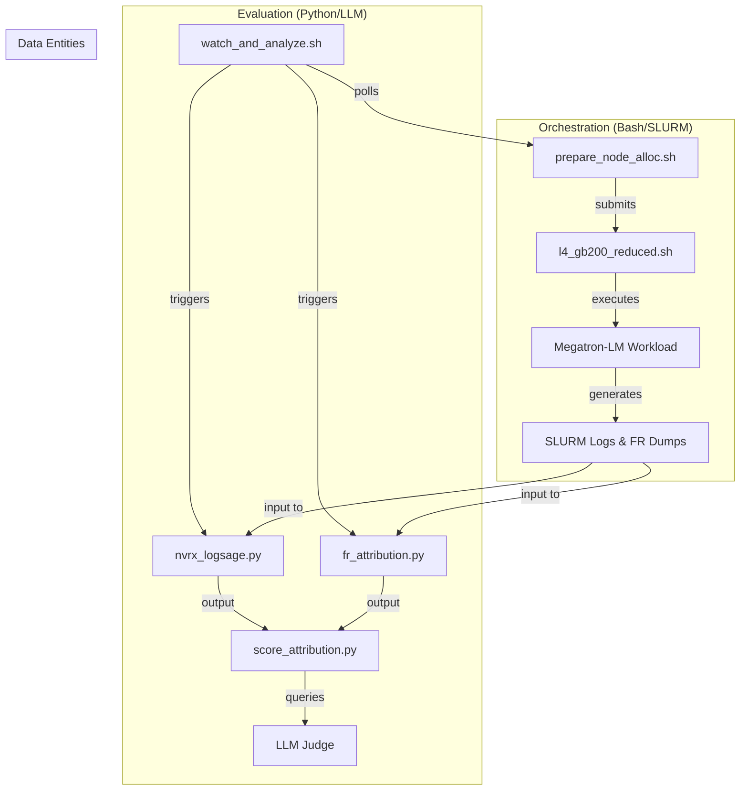
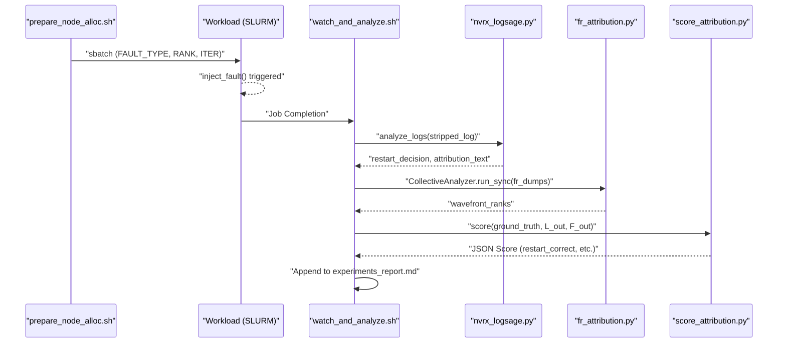

<!-- source: DeepWiki mcp.deepwiki.com · repo NVIDIA/nvidia-resiliency-ext · page 7.3 Fault Injection Benchmarking Framework · fetched 2026-10-26 -->

# Fault Injection Benchmarking Framework

Relevant source files

The following files were used as context for generating this wiki page:

- [src/nvidia_resiliency_ext/skills/__init__.py](src/nvidia_resiliency_ext/skills/__init__.py)
- [src/nvidia_resiliency_ext/skills/nvrx-attr/SKILL.md](src/nvidia_resiliency_ext/skills/nvrx-attr/SKILL.md)
- [src/nvidia_resiliency_ext/skills/nvrx-attr/fault-injection-loop/SKILL.md](src/nvidia_resiliency_ext/skills/nvrx-attr/fault-injection-loop/SKILL.md)
- [src/nvidia_resiliency_ext/skills/nvrx-attr/fr-analysis/SKILL.md](src/nvidia_resiliency_ext/skills/nvrx-attr/fr-analysis/SKILL.md)
- [src/nvidia_resiliency_ext/skills/nvrx-attr/fr-analysis/scripts/fr_attribution.py](src/nvidia_resiliency_ext/skills/nvrx-attr/fr-analysis/scripts/fr_attribution.py)
- [src/nvidia_resiliency_ext/skills/nvrx-attr/log-analysis/SKILL.md](src/nvidia_resiliency_ext/skills/nvrx-attr/log-analysis/SKILL.md)
- [src/nvidia_resiliency_ext/skills/nvrx-attr/log-analysis/scripts/nvrx_logsage.py](src/nvidia_resiliency_ext/skills/nvrx-attr/log-analysis/scripts/nvrx_logsage.py)
- [src/nvidia_resiliency_ext/skills/nvrx-attr/scripts/l4_gb200_reduced.sh](src/nvidia_resiliency_ext/skills/nvrx-attr/scripts/l4_gb200_reduced.sh)
- [src/nvidia_resiliency_ext/skills/nvrx-attr/scripts/n3_super_gb200_fi.sh](src/nvidia_resiliency_ext/skills/nvrx-attr/scripts/n3_super_gb200_fi.sh)
- [src/nvidia_resiliency_ext/skills/nvrx-attr/scripts/pools/n3_super_8node.txt](src/nvidia_resiliency_ext/skills/nvrx-attr/scripts/pools/n3_super_8node.txt)
- [src/nvidia_resiliency_ext/skills/nvrx-attr/scripts/prepare_node_alloc.sh](src/nvidia_resiliency_ext/skills/nvrx-attr/scripts/prepare_node_alloc.sh)
- [src/nvidia_resiliency_ext/skills/nvrx-attr/scripts/run_session.sh](src/nvidia_resiliency_ext/skills/nvrx-attr/scripts/run_session.sh)
- [src/nvidia_resiliency_ext/skills/nvrx-attr/scripts/score_attribution.py](src/nvidia_resiliency_ext/skills/nvrx-attr/scripts/score_attribution.py)
- [src/nvidia_resiliency_ext/skills/nvrx-attr/scripts/user.env.example](src/nvidia_resiliency_ext/skills/nvrx-attr/scripts/user.env.example)
- [src/nvidia_resiliency_ext/skills/nvrx-attr/scripts/watch_and_analyze.sh](src/nvidia_resiliency_ext/skills/nvrx-attr/scripts/watch_and_analyze.sh)
- [src/nvidia_resiliency_ext/skills/nvrx-attr/scripts/workloads.conf](src/nvidia_resiliency_ext/skills/nvrx-attr/scripts/workloads.conf)

The Fault Injection Benchmarking Framework (part of the `nvrx-attr` skills bundle) provides a closed-loop environment for evaluating and improving the accuracy of failure attribution modules. It automates the process of injecting controlled faults into distributed training workloads (primarily Megatron-LM), collecting logs and traces, and using an LLM-based judge to score the attribution system's performance against ground truth.

### Framework Architecture

The framework operates as an iterative loop consisting of workload orchestration, real-time analysis, and automated scoring.

#### System Component Overview
"Natural Language Space to Code Entity Space"

**Sources:** [src/nvidia_resiliency_ext/skills/nvrx-attr/fault-injection-loop/SKILL.md:25-44](), [src/nvidia_resiliency_ext/skills/nvrx-attr/scripts/watch_and_analyze.sh:1-9]()

---

### Workload Orchestration

The orchestration layer manages the execution of a prioritized "fault pool" across a SLURM cluster.

#### 1. Fault Pool Design
The framework uses a prioritized list of experiments defined by the string format `FAULT_TYPE:RANK:ITER:NODES`. GPU-related faults are prioritized to ensure high coverage of complex attribution scenarios.

| Fault Category | Examples | Priority |
| :--- | :--- | :--- |
| **GPU Hangs** | `GPU_SLEEP` | Highest |
| **GPU Errors** | `GPU_ERROR` | High |
| **Crashes** | `SIGKILL`, `SEGFAULT`, `OS_ABORT` | Medium |
| **Python Hangs** | `LOCK_GIL` | Medium |
| **Signals** | `SIGTERM`, `SIGINT`, `SIGSTOP` | Low |

**Sources:** [src/nvidia_resiliency_ext/skills/nvrx-attr/fault-injection-loop/SKILL.md:48-80](), [src/nvidia_resiliency_ext/skills/nvrx-attr/scripts/prepare_node_alloc.sh:115-142]()

#### 2. Orchestrator: `prepare_node_alloc.sh`
This script implements a throttled submission logic to bound filesystem load on shared storage (e.g., Lustre).
*   **Batching:** It submits jobs in small batches (default `BATCH_SIZE=2`) and polls `squeue` until the batch clears before submitting the next pair [src/nvidia_resiliency_ext/skills/nvrx-attr/scripts/prepare_node_alloc.sh:111-112]().
*   **Workload Registry:** It resolves job parameters (script paths, time limits) from `workloads.conf` [src/nvidia_resiliency_ext/skills/nvrx-attr/scripts/prepare_node_alloc.sh:69-105]().
*   **Tracking:** It generates an `experiments.tsv` file used by the evaluator to track `JOB_ID` and ground truth [src/nvidia_resiliency_ext/skills/nvrx-attr/scripts/prepare_node_alloc.sh:150-153]().

**Sources:** [src/nvidia_resiliency_ext/skills/nvrx-attr/scripts/prepare_node_alloc.sh:1-23](), [src/nvidia_resiliency_ext/skills/nvrx-attr/scripts/workloads.conf:1-25]()

---

### Evaluator: `watch_and_analyze.sh`

The evaluator runs as a background process that monitors the `experiments.tsv` file and processes jobs as they complete.

#### Analysis Pipeline
For every completed `JOB_ID`, the evaluator performs three steps:
1.  **Log Analysis:** Calls `nvrx_logsage.py` to determine the `restart_decision` and `attribution_text` based on SLURM logs [src/nvidia_resiliency_ext/skills/nvrx-attr/scripts/watch_and_analyze.sh:125-131]().
2.  **Trace Analysis:** Calls `fr_attribution.py` (CollectiveAnalyzer) to analyze NCCL Flight Recorder dumps if a hang occurred [src/nvidia_resiliency_ext/skills/nvrx-attr/scripts/watch_and_analyze.sh:146-149]().
3.  **Fairness Stripping:** Crucially, it strips fault-injection markers (e.g., `FAULT INJECTION`) from logs before analysis to ensure the attribution modules and the judge do not see the ground truth [src/nvidia_resiliency_ext/skills/nvrx-attr/scripts/watch_and_analyze.sh:39-44](), [src/nvidia_resiliency_ext/skills/nvrx-attr/scripts/watch_and_analyze.sh:116-117]().

**Sources:** [src/nvidia_resiliency_ext/skills/nvrx-attr/scripts/watch_and_analyze.sh:94-170]()

---

### LLM Judge: `score_attribution.py`

The final stage uses a high-parameter LLM (e.g., Qwen 2.5 72B+) to act as a "judge." It compares the ground truth fault against the findings of the attribution modules.

#### Scoring Dimensions
The judge evaluates the following dimensions, returning a structured JSON object:

| Dimension | Description |
| :--- | :--- |
| `restart_correct` | Whether the suggested restart action matches the expected policy for that fault type [src/nvidia_resiliency_ext/skills/nvrx-attr/scripts/score_attribution.py:182](). |
| `rank_primary` | Whether the attribution correctly identified the specific injected rank as the primary cause [src/nvidia_resiliency_ext/skills/nvrx-attr/scripts/score_attribution.py:182](). |
| `fr_rank_correct` | Accuracy of the Flight Recorder analysis in isolating the wavefront ranks [src/nvidia_resiliency_ext/skills/nvrx-attr/scripts/score_attribution.py:184](). |
| `fault_described` | Whether the text explanation accurately describes the nature of the failure [src/nvidia_resiliency_ext/skills/nvrx-attr/scripts/score_attribution.py:183](). |

#### Ground Truth Mapping
The judge uses a hardcoded `_RESTART_TABLE` to determine if the attribution module's recommendation was correct. For example, a `GPU_SLEEP` should result in `RESTART IMMEDIATE`, while a `SEGFAULT` should result in `STOP - DONT RESTART IMMEDIATE` [src/nvidia_resiliency_ext/skills/nvrx-attr/scripts/score_attribution.py:47-69]().

**Sources:** [src/nvidia_resiliency_ext/skills/nvrx-attr/scripts/score_attribution.py:1-19](), [src/nvidia_resiliency_ext/skills/nvrx-attr/scripts/score_attribution.py:157-187]()

---

### Data Flow and Implementation

The following diagram illustrates the data flow from fault injection to scoring.

**Sources:** [src/nvidia_resiliency_ext/skills/nvrx-attr/scripts/run_session.sh:24-48](), [src/nvidia_resiliency_ext/skills/nvrx-attr/scripts/watch_and_analyze.sh:94-170](), [src/nvidia_resiliency_ext/skills/nvrx-attr/scripts/score_attribution.py:157-187]()

### Configuration
The framework requires a `user.env` file (copied from `user.env.example`) to define cluster-specific paths and API keys.

Key variables in `user.env`:
*   `BASE_EXPERIMENTS_DIR`: Root for all output [src/nvidia_resiliency_ext/skills/nvrx-attr/scripts/user.env.example:17]().
*   `LLM_API_KEY_FILE`: Path to the API key for log analysis [src/nvidia_resiliency_ext/skills/nvrx-attr/scripts/user.env.example:38]().
*   `JUDGE_API_KEY_FILE`: Path to the API key for the LLM judge [src/nvidia_resiliency_ext/skills/nvrx-attr/scripts/user.env.example:39]().
*   `FR_SEGMENT_SIZE`: Ranks per segment for coarse Flight Recorder scoring (e.g., 32 for GB200 NVLink domains) [src/nvidia_resiliency_ext/skills/nvrx-attr/scripts/user.env.example:44]().

**Sources:** [src/nvidia_resiliency_ext/skills/nvrx-attr/scripts/user.env.example:1-46]()

---

