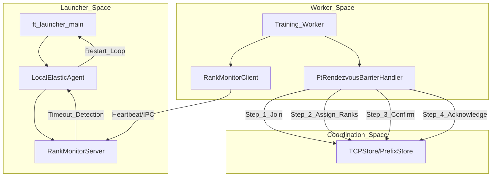
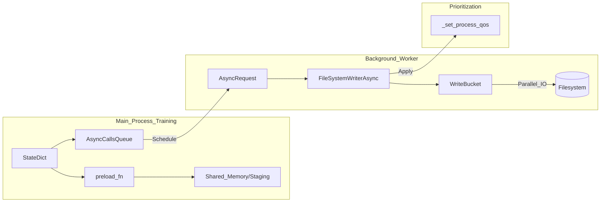

<!-- source: DeepWiki mcp.deepwiki.com · repo NVIDIA/nvidia-resiliency-ext · page 8 Glossary · fetched 2026-10-26 -->

# Glossary

Relevant source files

The following files were used as context for generating this wiki page:

- [.github/workflows/build_docs.yml](.github/workflows/build_docs.yml)
- [.github/workflows/lint_code.yml](.github/workflows/lint_code.yml)
- [.github/workflows/unit_test.yml](.github/workflows/unit_test.yml)
- [README.md](README.md)
- [build.py](build.py)
- [docs/source/fault_tolerance/usage_guide.rst](docs/source/fault_tolerance/usage_guide.rst)
- [docs/source/inprocess/api/health_check.rst](docs/source/inprocess/api/health_check.rst)
- [docs/source/release-notes.md](docs/source/release-notes.md)
- [examples/attribution/README.md](examples/attribution/README.md)
- [examples/attribution/single_server_example.py](examples/attribution/single_server_example.py)
- [pyproject.toml](pyproject.toml)
- [src/nvidia_resiliency_ext/attribution/combined_log_fr/combined_log_fr.py](src/nvidia_resiliency_ext/attribution/combined_log_fr/combined_log_fr.py)
- [src/nvidia_resiliency_ext/attribution/combined_log_fr/combined_log_fr_mcp.py](src/nvidia_resiliency_ext/attribution/combined_log_fr/combined_log_fr_mcp.py)
- [src/nvidia_resiliency_ext/attribution/log_analyzer/nvrx_logsage.py](src/nvidia_resiliency_ext/attribution/log_analyzer/nvrx_logsage.py)
- [src/nvidia_resiliency_ext/attribution/mcp_integration/module_definitions.py](src/nvidia_resiliency_ext/attribution/mcp_integration/module_definitions.py)
- [src/nvidia_resiliency_ext/attribution/trace_analyzer/fr_attribution.py](src/nvidia_resiliency_ext/attribution/trace_analyzer/fr_attribution.py)
- [src/nvidia_resiliency_ext/checkpointing/async_ckpt/core.py](src/nvidia_resiliency_ext/checkpointing/async_ckpt/core.py)
- [src/nvidia_resiliency_ext/checkpointing/async_ckpt/filesystem_async.py](src/nvidia_resiliency_ext/checkpointing/async_ckpt/filesystem_async.py)
- [src/nvidia_resiliency_ext/fault_tolerance/attribution_manager.py](src/nvidia_resiliency_ext/fault_tolerance/attribution_manager.py)
- [src/nvidia_resiliency_ext/fault_tolerance/config.py](src/nvidia_resiliency_ext/fault_tolerance/config.py)
- [src/nvidia_resiliency_ext/fault_tolerance/cycle_info_writer.py](src/nvidia_resiliency_ext/fault_tolerance/cycle_info_writer.py)
- [src/nvidia_resiliency_ext/fault_tolerance/ft_rendezvous_barrier.py](src/nvidia_resiliency_ext/fault_tolerance/ft_rendezvous_barrier.py)
- [src/nvidia_resiliency_ext/fault_tolerance/launcher.py](src/nvidia_resiliency_ext/fault_tolerance/launcher.py)
- [src/nvidia_resiliency_ext/inprocess/health_check.py](src/nvidia_resiliency_ext/inprocess/health_check.py)
- [src/nvidia_resiliency_ext/inprocess/monitor_process.py](src/nvidia_resiliency_ext/inprocess/monitor_process.py)
- [src/nvidia_resiliency_ext/inprocess/wrap.py](src/nvidia_resiliency_ext/inprocess/wrap.py)
- [src/nvidia_resiliency_ext/services/smonsvc/slurm.py](src/nvidia_resiliency_ext/services/smonsvc/slurm.py)
- [src/nvidia_resiliency_ext/shared_utils/health_check.py](src/nvidia_resiliency_ext/shared_utils/health_check.py)
- [src/nvidia_resiliency_ext/shared_utils/proto/nvrx_interface.proto](src/nvidia_resiliency_ext/shared_utils/proto/nvrx_interface.proto)
- [src/nvidia_resiliency_ext/shared_utils/wait_daemon.py](src/nvidia_resiliency_ext/shared_utils/wait_daemon.py)
- [tests/attribution/unit/test_combined_log_fr.py](tests/attribution/unit/test_combined_log_fr.py)
- [tests/attribution/unit/test_fr.py](tests/attribution/unit/test_fr.py)
- [tests/checkpointing/unit/__init__.py](tests/checkpointing/unit/__init__.py)
- [tests/checkpointing/unit/conftest.py](tests/checkpointing/unit/conftest.py)
- [tests/checkpointing/unit/test_async_save.py](tests/checkpointing/unit/test_async_save.py)
- [tests/checkpointing/unit/test_async_writer.py](tests/checkpointing/unit/test_async_writer.py)
- [tests/checkpointing/unit/test_async_writer_msc.py](tests/checkpointing/unit/test_async_writer_msc.py)
- [tests/checkpointing/unit/test_utilities.py](tests/checkpointing/unit/test_utilities.py)
- [tests/fault_tolerance/unit/test_attribution_manager.py](tests/fault_tolerance/unit/test_attribution_manager.py)
- [tests/fault_tolerance/unit/test_barrier_rendezvous.py](tests/fault_tolerance/unit/test_barrier_rendezvous.py)
- [tests/fault_tolerance/unit/test_cycle_info_writer.py](tests/fault_tolerance/unit/test_cycle_info_writer.py)
- [tests/fault_tolerance/unit/test_launcher.py](tests/fault_tolerance/unit/test_launcher.py)
- [tests/fault_tolerance/unit/test_timeouts_calc.py](tests/fault_tolerance/unit/test_timeouts_calc.py)
- [tests/fault_tolerance/unit/utils.py](tests/fault_tolerance/unit/utils.py)
- [tests/inprocess/test_wrap.py](tests/inprocess/test_wrap.py)
- [tests/shared_utils/test_health_check.py](tests/shared_utils/test_health_check.py)
- [tests/straggler/unit/_utils.py](tests/straggler/unit/_utils.py)

This glossary defines codebase-specific terms, jargon, and domain concepts used throughout the NVIDIA Resiliency Extension (NVRx) codebase. It serves as a technical reference for onboarding engineers to understand how high-level distributed training concepts map to specific implementation details in the code.

## Distributed Training & Fault Tolerance

### Fault Tolerance (FT)
The ability of a distributed training job to continue or resume execution despite the failure of one or more components (e.g., GPU failure, network timeout, or rank hang). In NVRx, this is primarily managed by the `ft_launcher` entry point which invokes `launcher.py` [src/nvidia_resiliency_ext/fault_tolerance/launcher.py:68]().

### Rendezvous
The coordination process where all distributed workers (ranks) synchronize to agree on a common job state, world size, and rank assignments before starting or resuming training.
*   **Implementation**: `FtRendezvousBarrierHandler` [src/nvidia_resiliency_ext/fault_tolerance/ft_rendezvous_barrier.py:50]().
*   **Mechanism**: A 4-step barrier-based protocol using atomic increments for slot allocation and `compare_set` for round-fenced writes to a distributed `Store` [src/nvidia_resiliency_ext/fault_tolerance/ft_rendezvous_barrier.py:9-12]().

### Rank Assignment & Reassignment
The logic that maps infrastructure nodes (e.g., SLURM nodes) to logical training ranks. NVRx supports dynamic reassignment where failed ranks are excluded, and healthy ranks are shifted or re-mapped.
*   **Implementation**: `RankAssignment` abstractions and concrete strategies like `ShiftRanks` or `ActivateAllRanks` [src/nvidia_resiliency_ext/inprocess/wrap.py:149-152]().

### Segment Awareness
A configuration for NVSwitch-based systems (e.g., DGX H200) where nodes are grouped into NVLink domains. The system ensures that training only proceeds if complete segments of nodes are healthy within a domain.
*   **Implementation**: `FaultToleranceConfig.segment` [src/nvidia_resiliency_ext/fault_tolerance/config.py:70-79]().

### Hot Spare
Extra nodes allocated to a job that remain idle until a failure occurs in the active set. During rendezvous, the system replaces a failed node with a hot spare to maintain the target world size.
*   **Implementation**: Managed via `min_nodes` vs `max_nodes` in `RendezvousSettings` [src/nvidia_resiliency_ext/fault_tolerance/ft_rendezvous_barrier.py:187-196]().

---

## Code Entity Mapping: Fault Tolerance Lifecycle

The following diagram maps the natural language "Restart Lifecycle" to the specific classes and functions in the codebase.

**Fault Tolerance Execution Flow**

*Sources: [src/nvidia_resiliency_ext/fault_tolerance/launcher.py:44-93](), [src/nvidia_resiliency_ext/fault_tolerance/ft_rendezvous_barrier.py:50-72]()*

---

## Checkpointing Concepts

### Async Checkpointing
A mechanism to offload the I/O-heavy process of saving model weights to a background process or thread, allowing the training loop to continue immediately after tensors are staged to CPU memory.
*   **Implementation**: `FileSystemWriterAsync` [src/nvidia_resiliency_ext/checkpointing/async_ckpt/filesystem_async.py:140-158]().

### Preload Phase
The synchronous part of an async checkpoint where tensors are copied from GPU memory to a staged area (usually CPU SHM or pinned memory) before the background writer takes over.
*   **Implementation**: `AsyncRequest.preload_fn` [src/nvidia_resiliency_ext/checkpointing/async_ckpt/core.py:130-144]().

### Write Bucket
A logical grouping of write operations directed to a single physical file on disk. This is used to parallelize I/O across multiple threads or processes.
*   **Implementation**: `WriteBucket` type alias [src/nvidia_resiliency_ext/checkpointing/async_ckpt/filesystem_async.py:65]().

### QoS (Quality of Service)
The deprioritization of background checkpointing processes (using `nice` and `ionice`) to ensure they do not steal CPU or I/O cycles from the primary training process.
*   **Implementation**: `_set_process_qos` [src/nvidia_resiliency_ext/checkpointing/async_ckpt/core.py:41-59]().

---

## Code Entity Mapping: Async Checkpointing Data Flow

This diagram illustrates how data moves from the training loop to the filesystem through various code abstractions.

**Checkpoint Data Pipeline**

*Sources: [src/nvidia_resiliency_ext/checkpointing/async_ckpt/core.py:120-164](), [src/nvidia_resiliency_ext/checkpointing/async_ckpt/filesystem_async.py:140-183]()*

---

## In-Process & Monitoring Jargon

### In-Process Restart
A recovery mechanism that catches exceptions or timeouts within the same OS process and re-runs a decorated function, avoiding the overhead of full process re-spawning.
*   **Implementation**: `Wrapper` class [src/nvidia_resiliency_ext/inprocess/wrap.py:81-138]().

### Progress Watchdog
A component that tracks "pings" from the training loop. If a ping is not received within a configured interval, it triggers a timeout.
*   **Implementation**: `ProgressWatchdog` [src/nvidia_resiliency_ext/inprocess/wrap.py:51]().

### Soft vs. Hard Timeout
*   **Soft Timeout**: Triggers an asynchronous abort (e.g., `AbortTorchDistributed`) to attempt a clean recovery within the job.
*   **Hard Timeout**: Triggers process termination (`SIGTERM`/`SIGKILL`) when a rank is completely unresponsive.

### Flight Recorder (FR)
A PyTorch feature that maintains a circular buffer of recent collective operations (e.g., `all_reduce`). NVRx analyzes these traces to identify which rank caused a hang.
*   **Implementation**: `CollectiveAnalyzer` [src/nvidia_resiliency_ext/attribution/trace_analyzer/fr_attribution.py:107-125]().

---

## Hardware & Health Check Terms

| Term | Definition | Code Reference |
| :--- | :--- | :--- |
| **NVL Health** | Checks the health of NVLink connections and NVSwitch fabric. | `NVLHealthCheck` [src/nvidia_resiliency_ext/shared_utils/health_check.py:534]() |
| **NIC Monitor** | Monitors Network Interface Cards for link-down events or throughput drops. | `FaultToleranceConfig.enable_nic_monitor` [src/nvidia_resiliency_ext/fault_tolerance/config.py:52]() |
| **Lustre/NFS Check** | Validates that distributed storage mounts are responsive and writable. | `DistributedStorageHealthCheck` [src/nvidia_resiliency_ext/shared_utils/health_check.py:465]() |
| **GPU Reclaim** | The process of ensuring GPU memory is fully freed after a process crash before restarting. | `gpu_memory_reclaim_timeout` [src/nvidia_resiliency_ext/fault_tolerance/config.py:83-84]() |

---

## Attribution Service Terms

### Attribution
The process of diagnosing the root cause of a failure (e.g., "GPU 3 XID 61" or "Rank 12 NCCL Timeout").
*   **Implementation**: `NVRxAttribution` base class [src/nvidia_resiliency_ext/attribution/base.py:112]() (cited in [src/nvidia_resiliency_ext/attribution/trace_analyzer/fr_attribution.py:107]()).

### LogSage
An LLM-based log analysis component that parses application logs to identify error patterns and propose solutions.
*   **Implementation**: `NVRxLogAnalyzer` [src/nvidia_resiliency_ext/attribution/log_analyzer/nvrx_logsage.py:17]().

### MCP (Model Context Protocol)
A protocol used to integrate various attribution modules (Log Analysis, FR Analysis) into a unified service.
*   **Implementation**: `global_registry` in `mcp_integration` [src/nvidia_resiliency_ext/attribution/mcp_integration/module_definitions.py:13]().

*Sources: [src/nvidia_resiliency_ext/attribution/trace_analyzer/fr_attribution.py:107-164](), [src/nvidia_resiliency_ext/attribution/mcp_integration/module_definitions.py:1-140]()*