# Page: Overview

# Overview

<details>
<summary>Relevant source files</summary>

The following files were used as context for generating this wiki page:

- [.github/workflows/build_docs.yml](.github/workflows/build_docs.yml)
- [.github/workflows/lint_code.yml](.github/workflows/lint_code.yml)
- [.github/workflows/unit_test.yml](.github/workflows/unit_test.yml)
- [CONTRIBUTING.md](CONTRIBUTING.md)
- [README.md](README.md)
- [docs/source/attribution/features/index.rst](docs/source/attribution/features/index.rst)
- [docs/source/attribution/features/progressive-ft-launcher-attribution.rst](docs/source/attribution/features/progressive-ft-launcher-attribution.rst)
- [docs/source/attribution/features/requirements-template.rst](docs/source/attribution/features/requirements-template.rst)
- [docs/source/attribution/index.rst](docs/source/attribution/index.rst)
- [docs/source/index.rst](docs/source/index.rst)
- [docs/source/release-notes.md](docs/source/release-notes.md)
- [examples/attribution/README.md](examples/attribution/README.md)
- [pyproject.toml](pyproject.toml)
- [src/nvidia_resiliency_ext/__init__.py](src/nvidia_resiliency_ext/__init__.py)
- [src/nvidia_resiliency_ext/attribution/orchestration/http_api.py](src/nvidia_resiliency_ext/attribution/orchestration/http_api.py)
- [src/nvidia_resiliency_ext/fault_tolerance/cycle_info_writer.py](src/nvidia_resiliency_ext/fault_tolerance/cycle_info_writer.py)
- [src/nvidia_resiliency_ext/services/attrsvc/routes.py](src/nvidia_resiliency_ext/services/attrsvc/routes.py)
- [src/nvidia_resiliency_ext/shared_utils/proto/nvrx_interface.proto](src/nvidia_resiliency_ext/shared_utils/proto/nvrx_interface.proto)
- [tests/fault_tolerance/unit/test_cycle_info_writer.py](tests/fault_tolerance/unit/test_cycle_info_writer.py)
- [tests/fault_tolerance/unit/test_timeouts_calc.py](tests/fault_tolerance/unit/test_timeouts_calc.py)
- [tests/fault_tolerance/unit/utils.py](tests/fault_tolerance/unit/utils.py)
- [tests/straggler/unit/_utils.py](tests/straggler/unit/_utils.py)

</details>


NVIDIA Resiliency Extensions (NVRx) is a Python library that provides comprehensive fault tolerance, diagnostics, and checkpointing capabilities for PyTorch-based distributed training workloads. The system enables automatic detection and recovery from hardware failures, software hangs, and performance anomalies while minimizing checkpoint overhead and training disruption.

## Purpose and Scope

NVRx addresses critical challenges in large-scale distributed training:

| Challenge | Impact | NVRx Solution |
|-----------|--------|---------------|
| **Hardware Failures** | GPU/NIC/NVLink failures halt entire jobs | Health checks (`GPUHealthCheck`, `NicHealthCheck`, `NVLHealthCheck`) detect failures; automatic restart via `ft_launcher` or `inprocess.Wrapper` |
| **Hung Training** | Deadlocked collectives or stalled ranks freeze progress | `RankMonitorServer` detects hangs via heartbeat protocol; `TrainingProgressTracker` detects stagnation; automatic abort and restart |
| **Recovery Overhead** | Process restart takes minutes (container init, Python imports, CUDA context) | In-process restart via `inprocess.Wrapper` bypasses process lifecycle; sub-second recovery for function-level faults |
| **Checkpoint I/O** | Synchronous saves block training for minutes | `AsyncCallsQueue` with `FileSystemWriterAsync` offloads I/O to background workers; training continues during save |
| **Failure Attribution** | Opaque errors make debugging difficult | `nvrx-attrsvc` LLM-based log analysis; `TorchFRTraceCollector` captures NCCL traces; post-mortem diagnostics |

NVRx integrates with PyTorch's distributed primitives (`torch.distributed`, `TCPStore`) and extends torchrun's elastic agent architecture with fault tolerance capabilities.

**Sources:** [README.md:1-33](), [pyproject.toml:41-65](), [docs/source/index.rst:1-19]()

## System Architecture

NVRx consists of four primary subsystems that can operate independently or in combination. The architecture builds on PyTorch's distributed primitives while adding comprehensive fault tolerance and diagnostics capabilities.

### High-Level Architecture

**Diagram: NVRx Complete System Architecture**

```mermaid
graph TB
    subgraph "User_Application_Layer"
        App["Distributed Training Application<br/>Megatron-LM, NeMo, PTL"]
    end
    
    subgraph "Fault_Tolerance_Subsystem"
        FTLauncher["ft_launcher CLI<br/>LocalElasticAgent"]
        Rendezvous["FtRendezvousBarrierHandler<br/>Barrier-based Rendezvous"]
        RankMonitor["RankMonitorServer<br/>RankMonitorClient"]
        HealthChecks["Health Check Suite<br/>GPU, NVL, NIC, Node"]
        ProgressTracker["TrainingProgressTracker"]
    end
    
    subgraph "Attribution_Diagnostics_Subsystem"
        AttrService["nvrx-attrsvc<br/>FastAPI Service"]
        TraceCollector["TorchFRTraceCollector<br/>NCCL Trace Capture"]
        Profiler["FaultToleranceProfiler"]
        LogSystem["NVRxLogAnalyzer<br/>LLM Attribution"]
    end
    
    subgraph "Checkpointing_Subsystem"
        AsyncCkpt["AsyncCallsQueue<br/>Persistent Worker"]
        FileWriter["FileSystemWriterAsync<br/>Multithread File IO"]
        LocalCkpt["LocalCheckpointManager<br/>Replication Strategy"]
    end
    
    subgraph "In-Process_Resiliency_Subsystem"
        Wrapper["Wrapper Decorator<br/>CallWrapper"]
        MonitorProc["MonitorProcess<br/>ProgressWatchdog"]
        RankAssign["RankAssignment<br/>Tree, ShiftRanks"]
        Store["StoreMixin<br/>TCPStore/PrefixStore"]
    end
    
    subgraph "External_Integrations"
        Slurm["nvrx-smonsvc<br/>SLURM Job Monitor"]
        WandB["WandBExporterAsync"]
        Slack["Slack Notifications"]
    end
    
    App -->|"launches via"| FTLauncher
    App -->|"decorated by"| Wrapper
    App -->|"saves checkpoints"| AsyncCkpt
    
    FTLauncher -->|"coordinates"| Rendezvous
    FTLauncher -->|"spawns"| RankMonitor
    FTLauncher -->|"checks"| HealthChecks
    
    Wrapper -->|"spawns"| MonitorProc
    Wrapper -->|"reassigns ranks via"| RankAssign
    Wrapper -->|"coordinates via"| Store
    
    FTLauncher -->|"analyzes logs"| AttrService
    AttrService -->|"notifies via"| Slack
    Slurm -->|"polls logs for"| AttrService
```

The architecture provides two integration methods:
1. **Process-level integration** via `ft_launcher` CLI (wraps torchrun) [pyproject.toml:68-68]()
2. **Function-level integration** via `@inprocess.Wrapper` decorator

Both approaches share health checks, distributed coordination, and checkpointing subsystems.

**Sources:** [README.md:12-33](), [docs/source/index.rst:10-18](), [docs/source/release-notes.md:9-38]()

## Key Subsystems

### Fault Tolerance Subsystem

Provides job-level restart capabilities with automatic failure detection and recovery. It uses `NVRxCycleInfo` to track metadata across training cycles.

| Component | Function |
|-----------|----------|
| `LocalElasticAgent` | Manages worker processes, implements restart policies, coordinates rendezvous |
| `FtRendezvousBarrierHandler` | Barrier-based rendezvous protocol with segment-aware rank assignment for NVSwitch systems |
| `RankMonitorServer` | Per-rank daemon that detects hangs via heartbeat protocol and section timeouts |
| `CycleInfoWriter` | Atomic JSON writer for cycle metadata (job_id, ranks, logs) [src/nvidia_resiliency_ext/fault_tolerance/cycle_info_writer.py:100-119]() |

**Key Features:**
- Automatic worker restart on failures without SLURM job reallocation [README.md:15-16]()
- Barrier-based rendezvous (v2) for improved stability and scalability [docs/source/release-notes.md:10-18]()
- Heartbeat-based hang detection with configurable section timeouts
- Stagnation detection to avoid infinite restart cycles

**Sources:** [src/nvidia_resiliency_ext/fault_tolerance/cycle_info_writer.py:17-58](), [src/nvidia_resiliency_ext/shared_utils/proto/nvrx_interface.proto:23-58]()

### In-Process Resiliency Subsystem

Enables function-level automatic restart without process termination.

| Component | Function |
|-----------|----------|
| `Wrapper` | Decorator that wraps training functions with restart capabilities |
| `CallWrapper` | Manages single function invocation, implements restart loop, handles state lifecycle |
| `MonitorProcess` | Daemon process that survives main process hangs, enforces soft/hard timeouts |
| `RankAssignment` | Policies for reassigning ranks after failures (`Tree`, `FillGaps`, `ShiftRanks`) |

**Key Features:**
- Sub-second restart for function-level faults [README.md:18-19]()
- Automatic health check chaining (`ChainedGPUHealthCheck`, `ChainedNVLHealthCheck`) [docs/source/release-notes.md:20-26]()
- Flexible rank reassignment strategies including infrastructure-aligned rank assignment [docs/source/release-notes.md:15-16]()
- NCCL < v2.28.3 or >= 2.28.9 support to avoid segmentation faults [docs/source/release-notes.md:52]()

### Checkpointing Subsystem

Asynchronous and local checkpointing with background I/O workers.

| Component | Function |
|-----------|----------|
| `AsyncCallsQueue` | Queue for async requests with persistent worker strategies |
| `FileSystemWriterAsync` | PyTorch-compatible writer with multithread File IO option [docs/source/release-notes.md:33-35]() |
| `LocalCheckpointManager` | Manages node-local checkpoints with replication for redundancy |

**Key Features:**
- Non-blocking checkpoint saves (training continues during I/O) [README.md:21-25]()
- Transition from `fork` to `spawn` for improved stability [docs/source/release-notes.md:34-34]()
- Persistent async checkpoint workers now default to simplify error propagation [docs/source/release-notes.md:36-36]()
- Ability to abort async checkpoint processes during failures [docs/source/release-notes.md:37-37]()

### Attribution & Diagnostics Subsystem

Post-mortem analysis and real-time telemetry using LLMs.

| Component | Function |
|-----------|----------|
| `nvrx-attrsvc` | FastAPI service for LLM-based log analysis [pyproject.toml:71-71]() |
| `nvrx-smonsvc` | SLURM job monitor that polls for completed jobs and submits logs for analysis [pyproject.toml:72-72]() |
| `TorchFRTraceCollector` | Captures PyTorch Flight Recorder traces for NCCL collective analysis [docs/source/release-notes.md:41-43]() |

**Key Features:**
- LLM-powered attribution using `nemotron-super-49b` via `ChatNVIDIA` [pyproject.toml:51-52]()
- Log analysis and failure policy determination (RESTART vs STOP) [docs/source/release-notes.md:39-44]()
- NCCL trace capture via Flight Recorder for collective analysis on hangs [docs/source/release-notes.md:41-43]()

**Sources:** [docs/source/release-notes.md:5-44](), [pyproject.toml:67-88]()

## Integration Methods

### Method 1: ft_launcher (Process-Level)

Used for SLURM-based multi-node training. Wraps torchrun with automatic restart capabilities.

**Example:**
```bash
ft_launcher \
  --nnodes=8 \
  --nproc-per-node=8 \
  --ft-use-infra-group-rank \
  training_script.py
```
The `--ft-use-infra-group-rank` flag allows in-job scaling to follow infrastructure scheduler rank assignments [docs/source/release-notes.md:15-16]().

### Method 2: inprocess.Wrapper (Function-Level)

Used for programmatic control and single-process recovery.

**Example:**
```python
from nvidia_resiliency_ext.inprocess import Wrapper

@Wrapper(soft_timeout=300)
def train_function():
    # Training code here
    pass
```

**Sources:** [pyproject.toml:68-68](), [docs/source/release-notes.md:9-18](), [README.md:12-33]()

## Installation

### From PyPI

```bash
pip install nvidia-resiliency-ext
pip install 'nvidia-resiliency-ext[attribution]'  # For LLM attribution services
```

### From Source

```bash
git clone https://github.com/NVIDIA/nvidia-resiliency-ext
cd nvidia-resiliency-ext
pip install .
```

**Sources:** [README.md:35-47](), [pyproject.toml:4-65]()

For details on specific features, see:
- [Core Features](#1.1)
- [System Architecture](#1.2)
- [Getting Started](#1.3)

---

# Page: Core Features

# Core Features

<details>
<summary>Relevant source files</summary>

The following files were used as context for generating this wiki page:

- [.github/workflows/build_docs.yml](.github/workflows/build_docs.yml)
- [.github/workflows/lint_code.yml](.github/workflows/lint_code.yml)
- [.github/workflows/unit_test.yml](.github/workflows/unit_test.yml)
- [README.md](README.md)
- [docs/source/release-notes.md](docs/source/release-notes.md)
- [examples/attribution/README.md](examples/attribution/README.md)
- [src/nvidia_resiliency_ext/__init__.py](src/nvidia_resiliency_ext/__init__.py)
- [tests/fault_tolerance/unit/test_timeouts_calc.py](tests/fault_tolerance/unit/test_timeouts_calc.py)
- [tests/fault_tolerance/unit/utils.py](tests/fault_tolerance/unit/utils.py)
- [tests/straggler/unit/_utils.py](tests/straggler/unit/_utils.py)

</details>


This page enumerates the key capabilities provided by NVIDIA Resiliency Extensions (NVRx) across all subsystems. Each feature is described with references to its implementation components and data flow.

For detailed architecture and component relationships, see [System Architecture](1.2). For subsystem-specific documentation, see [Fault Tolerance System](2), [In-Process Restart System](3), [Checkpointing System](4), and [Attribution and Diagnostics](6).

---

## Feature Overview by Subsystem

The following table summarizes the primary features organized by subsystem:

| Subsystem | Key Features |
|-----------|-------------|
| **Fault Tolerance** | Worker lifecycle management, barrier-based rendezvous, rank monitoring, health checks, progress tracking, segment-aware assignment, hot spare support |
| **In-Process Resiliency** | Function-level restart decorator, dual monitoring, timeout enforcement, dynamic rank reassignment, distributed state management |
| **Checkpointing** | Asynchronous I/O offloading, GPU-to-CPU staging, parallel file writing, distributed coordination, abort mechanisms |
| **Attribution & Diagnostics** | LLM-based log analysis, auto-resume policy, trace collection, telemetry export, fault attribution |
| **Straggler Detection** | CUPTI-based GPU kernel timing, relative performance scoring, PTL integration |

Sources: [README.md:12-33](), [docs/source/release-notes.md:5-44]()

---

## Fault Tolerance Features

### Automatic Worker Restart
The `ft_launcher` manages worker processes via the `LocalElasticAgent`. It monitors for failures and coordinates restarts across the distributed job.

**Key Implementation Entities:**
- `LocalElasticAgent`: Orchestrates the worker lifecycle.
- `_invoke_run_with_any_failed_policy`: Restarts all workers if any fail.
- `_invoke_run_with_min_healthy_policy`: Allows training to continue if a minimum number of healthy nodes remain.

Sources: [README.md:14-16](), [docs/source/release-notes.md:9-14]()

### Barrier-Based Rendezvous Coordination
The `FtRendezvousBarrierHandler` implements a 4-step atomic barrier protocol for node coordination. This redesign (v2) provides more predictable and scalable behavior compared to earlier dynamic rendezvous.

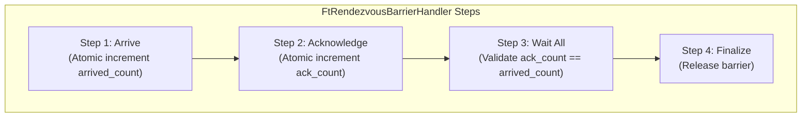

**Features:**
- **Atomic State Management**: Uses a distributed store to track participant counts.
- **Hot Spare Support**: Future-planned alignment for barrier-based rendezvous to allow spare nodes to join when primary nodes fail.
- **Infra-Aligned Rank Assignment**: Uses `--ft-use-infra-group-rank` to preserve topology-aware placement from the infrastructure scheduler.

Sources: [docs/source/release-notes.md:10-18](), [docs/source/release-notes.md:47-50]()

### Rank Monitoring and Progress Tracking
The `RankMonitorServer` provides per-worker hang detection via heartbeat and section timeouts.

**Features:**
- **Heartbeat-based Hang Detection**: Workers must periodically check in with the monitor.
- **Section Timeouts**: Supports specific timeouts for different phases of training (e.g., initialization, training loop).
- **Stagnation Detection**: The `TrainingProgressTracker` monitors progress to detect if the model has stopped converging or moving through iterations.

Sources: [README.md:15-16](), [tests/fault_tolerance/unit/test_timeouts_calc.py:25-30]()

### Segment-Aware Rank Assignment
Optimized for NVSwitch systems (e.g., DGX/HGX), this feature ensures that rank assignment respects physical NVLink boundaries (segments). It groups nodes into segments to maximize inter-GPU bandwidth.

Sources: [docs/source/release-notes.md:15-16]()

---

## In-Process Resiliency Features

### Function-Level Restart Decorator
The `@inprocess.Wrapper` decorator provides automatic restart at the function level, enabling "in-process" recovery without terminating the entire application process.

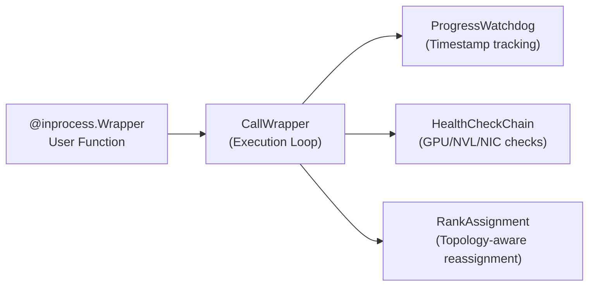

**Features:**
- **Dual Monitoring**: Utilizes both a `MonitorProcess` daemon and a `MonitorThread` for robust failure detection.
- **Health Check Chaining**: Automatically chains `GPUHealthCheck`, `NVLHealthCheck`, and `NicHealthCheck` before attempting a restart.
- **Distributed State**: Synchronizes restart state using `StoreMixin` (TCPStore, PrefixStore).

Sources: [README.md:18-19](), [docs/source/release-notes.md:21-26](), [docs/source/release-notes.md:52-52]()

---

## Checkpointing Features

### Asynchronous and Local Checkpointing
The checkpointing subsystem offloads heavy I/O operations to background workers, minimizing training "downtime" during saves.

**Features:**
- **AsyncCallsQueue**: Manages the lifecycle of background save requests.
- **Multithread File I/O**: A stable alternative to multiprocessing for file operations to simplify error propagation.
- **GPU-to-CPU Staging**: Tensors are staged to CPU memory before being written to disk in the background.
- **Local Checkpointing**: Provides replication strategies for same-machine redundancy to recover from local disk failures.

Sources: [README.md:21-25](), [docs/source/release-notes.md:33-38](), [docs/source/release-notes.md:61-66]()

---

## Straggler Detection Features

### Performance Scoring and Profiling
Identifies slow or underperforming ranks that impede overall training efficiency.

**Features:**
- **CUPTI Profiling**: Uses `CuptiProfiler` C++ extensions for precise GPU kernel timing.
- **Relative Scoring**: Compares individual GPU performance scores against the cluster average to identify outliers.
- **PTL Integration**: `StragglerDetectionCallback` for seamless use with PyTorch Lightning.

Sources: [README.md:27-29](), [tests/straggler/unit/_utils.py:88-118]()

---

## Attribution and Diagnostics Features

### LLM-Based Log Analysis
The `nvrx-attrsvc` service provides automated fault attribution by analyzing logs with Large Language Models.

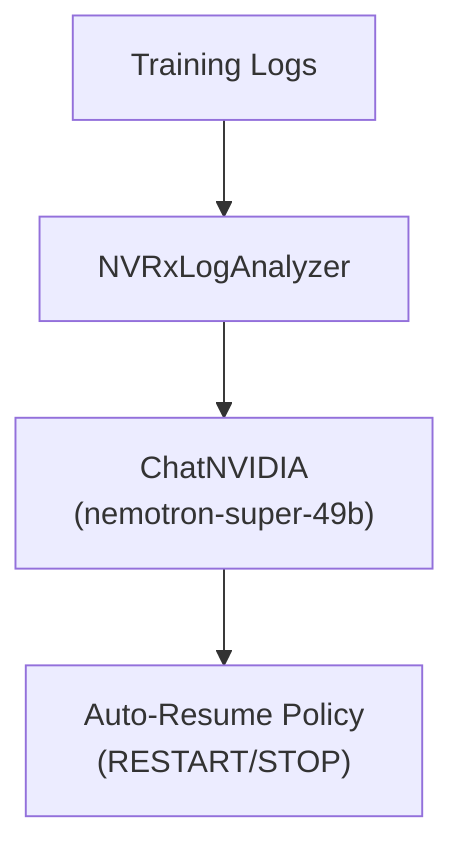

**Features:**
- **Log Chunking**: Analyzes logs by training cycle.
- **NCCL Trace Analysis**: `TorchFRTraceCollector` dumps PyTorch Flight Recorder traces for collective analysis during hangs.
- **Hardware Health Suite**: Integrated checks for GPU, NIC link state, NVLink, and storage path health.

Sources: [README.md:41-41](), [docs/source/release-notes.md:39-44](), [examples/attribution/README.md:1-16]()

---
**Sources:**
- [README.md:1-60]()
- [docs/source/release-notes.md:1-53]()
- [tests/fault_tolerance/unit/test_timeouts_calc.py:25-30]()
- [tests/straggler/unit/_utils.py:88-118]()
- [examples/attribution/README.md:1-16]()

---

# Page: System Architecture

# System Architecture

<details>
<summary>Relevant source files</summary>

The following files were used as context for generating this wiki page:

- [.github/workflows/build_docs.yml](.github/workflows/build_docs.yml)
- [.github/workflows/lint_code.yml](.github/workflows/lint_code.yml)
- [.github/workflows/unit_test.yml](.github/workflows/unit_test.yml)
- [README.md](README.md)
- [docs/source/release-notes.md](docs/source/release-notes.md)
- [examples/attribution/README.md](examples/attribution/README.md)
- [pyproject.toml](pyproject.toml)
- [src/nvidia_resiliency_ext/fault_tolerance/cycle_info_writer.py](src/nvidia_resiliency_ext/fault_tolerance/cycle_info_writer.py)
- [src/nvidia_resiliency_ext/fault_tolerance/rank_monitor_state_machine.py](src/nvidia_resiliency_ext/fault_tolerance/rank_monitor_state_machine.py)
- [src/nvidia_resiliency_ext/fault_tolerance/utils.py](src/nvidia_resiliency_ext/fault_tolerance/utils.py)
- [src/nvidia_resiliency_ext/shared_utils/profiling.py](src/nvidia_resiliency_ext/shared_utils/profiling.py)
- [src/nvidia_resiliency_ext/shared_utils/proto/nvrx_interface.proto](src/nvidia_resiliency_ext/shared_utils/proto/nvrx_interface.proto)
- [src/nvidia_resiliency_ext/testing_utils/__init__.py](src/nvidia_resiliency_ext/testing_utils/__init__.py)
- [src/nvidia_resiliency_ext/testing_utils/health_check_injector.py](src/nvidia_resiliency_ext/testing_utils/health_check_injector.py)
- [tests/fault_tolerance/unit/test_cycle_info_writer.py](tests/fault_tolerance/unit/test_cycle_info_writer.py)
- [tests/fault_tolerance/unit/test_layered_restart_v1.py](tests/fault_tolerance/unit/test_layered_restart_v1.py)
- [tests/fault_tolerance/unit/test_timeouts_calc.py](tests/fault_tolerance/unit/test_timeouts_calc.py)
- [tests/fault_tolerance/unit/utils.py](tests/fault_tolerance/unit/utils.py)
- [tests/straggler/unit/_utils.py](tests/straggler/unit/_utils.py)

</details>


This page explains the high-level architecture of NVIDIA Resiliency Extensions (NVRx), describing how the major subsystems integrate to provide fault-tolerant distributed training. It covers component relationships, integration patterns, and data flow between subsystems.

## Architectural Overview

NVIDIA Resiliency Extensions is organized into four major subsystems that can be used independently or in combination. The architecture supports two primary deployment models: process-level fault tolerance via `ft_launcher` and function-level restart via the `@inprocess.Wrapper` decorator.

### Core Subsystems

```mermaid
graph TB
    subgraph "1. Fault Tolerance Subsystem"
        FT["ft_launcher (CLI)"]
        Agent["LocalElasticAgent"]
        Rdzv["FtRendezvousBarrierHandler"]
        RankMon["RankMonitorServer/Client"]
        Progress["TrainingProgressTracker"]
    end
    
    subgraph "2. Attribution & Diagnostics Subsystem"
        AttrSvc["nvrx-attrsvc (FastAPI)"]
        Trace["TorchFRTraceCollector"]
        Profiler["FaultToleranceProfiler"]
        Logs["PipeBasedLogsSpecs"]
        CycleInfo["CycleInfoWriter"]
    end
    
    subgraph "3. Checkpointing Subsystem"
        AsyncQ["AsyncCallsQueue"]
        Writer["FileSystemWriterAsync"]
        StateSaver["save_state_dict_async_plan"]
    end
    
    subgraph "4. In-Process Resiliency Subsystem"
        Wrapper["@inprocess.Wrapper"]
        CallWrap["CallWrapper"]
        MonProc["MonitorProcess"]
        RankAssign["RankAssignment"]
    end
    
    subgraph "Shared Components"
        Store["StoreMixin / TCPStore"]
        Health["HealthCheck Suite"]
        Config["FaultToleranceConfig"]
    end
    
    FT -->|uses| Store
    FT -->|uses| Health
    FT -->|configured by| Config
    
    Wrapper -->|uses| Store
    Wrapper -->|uses| Health
    
    FT -->|logs to| Logs
    FT -->|analyzes via| AttrSvc
    FT -->|records events| Profiler
    FT -->|writes metadata| CycleInfo
    
    Wrapper -->|records events| Profiler
    Wrapper -->|collects traces| Trace
    
    Agent -->|coordinates| Rdzv
    Agent -->|spawns| RankMon
    Agent -->|tracks| Progress
    
    CallWrap -->|spawns| MonProc
    CallWrap -->|uses| RankAssign
```

**Sources:** [src/nvidia_resiliency_ext/fault_tolerance/launcher.py:116-177](), [src/nvidia_resiliency_ext/inprocess/wrap.py:81-169](), [src/nvidia_resiliency_ext/checkpointing/async_ckpt/core.py:187-215](), [src/nvidia_resiliency_ext/fault_tolerance/cycle_info_writer.py:100-121]()

### Deployment Models

The system supports two integration patterns:

| **Integration Method** | **Entry Point** | **Scope** | **Primary Use Case** |
|------------------------|-----------------|-----------|---------------------|
| **Process-level** | `ft_launcher` CLI | Multi-node job | SLURM-based distributed training with worker processes managed by an elastic agent. |
| **Function-level** | `@inprocess.Wrapper` | Python function | Programmatic control within a single process; allows restarting training loops without process exit. |

**Sources:** [src/nvidia_resiliency_ext/fault_tolerance/launcher.py:324-376](), [src/nvidia_resiliency_ext/inprocess/wrap.py:81-138]()

---

## Component Architecture

### Fault Tolerance Subsystem

The `ft_launcher` is the primary entry point for managing distributed training. It extends PyTorch Elastic with custom rendezvous and monitoring logic.

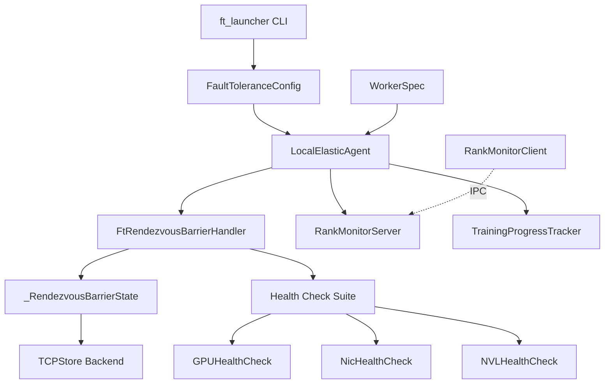

**Sources:** [src/nvidia_resiliency_ext/fault_tolerance/launcher.py:461-550](), [src/nvidia_resiliency_ext/fault_tolerance/ft_rendezvous_barrier.py:364-449](), [src/nvidia_resiliency_ext/fault_tolerance/config.py:28-109](), [docs/source/release-notes.md:20-26]()

The `LocalElasticAgent` serves as the central orchestrator, managing:
- **Worker Lifecycle**: Spawning and monitoring worker processes via `WorkerSpec`.
- **Rendezvous Coordination**: Synchronizing nodes through `FtRendezvousBarrierHandler`, which implements a 4-step barrier protocol [src/nvidia_resiliency_ext/fault_tolerance/ft_rendezvous_barrier.py:722-1047]().
- **Rank Monitoring**: Launching `RankMonitorServer` subprocesses that communicate with `RankMonitorClient` in workers via IPC sockets [src/nvidia_resiliency_ext/fault_tolerance/launcher.py:75-81]().
- **Progress Tracking**: Using `TrainingProgressTracker` to detect training stagnation [src/nvidia_resiliency_ext/fault_tolerance/launcher.py:80]().
- **Infrastructure Alignment**: Using `get_infrastructure_rank` to derive ranks from SLURM topology or node names [src/nvidia_resiliency_ext/fault_tolerance/utils.py:42-83]().

### In-Process Resiliency Subsystem

The In-Process system allows a training function to restart internally without the OS process exiting. This is managed by the `Wrapper` class.

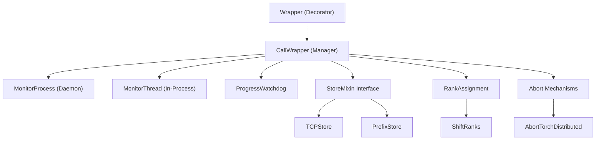

**Sources:** [src/nvidia_resiliency_ext/inprocess/wrap.py:81-169](), [src/nvidia_resiliency_ext/inprocess/monitor_process.py:126-148](), [src/nvidia_resiliency_ext/inprocess/monitor_thread.py:49-50]()

The `Wrapper` manages:
- **Dual Monitoring**: A `MonitorThread` for low-latency detection within the process and a `MonitorProcess` (daemon) that survives main process hangs [src/nvidia_resiliency_ext/inprocess/wrap.py:153-158]().
- **Progress Tracking**: `ProgressWatchdog` tracks timestamps to detect stalls [src/nvidia_resiliency_ext/inprocess/wrap.py:156]().
- **Distributed State**: Uses `PrefixStore` to namespace iteration-specific data in the `TCPStore` [src/nvidia_resiliency_ext/inprocess/store.py:353-389]().
- **Abort Mechanisms**: `AbortTorchDistributed` ensures NCCL and distributed backends are safely shut down before restart [src/nvidia_resiliency_ext/inprocess/abort.py:35-36]().

---

## Checkpointing Architecture

The checkpointing system offloads I/O to background processes to minimize training downtime.

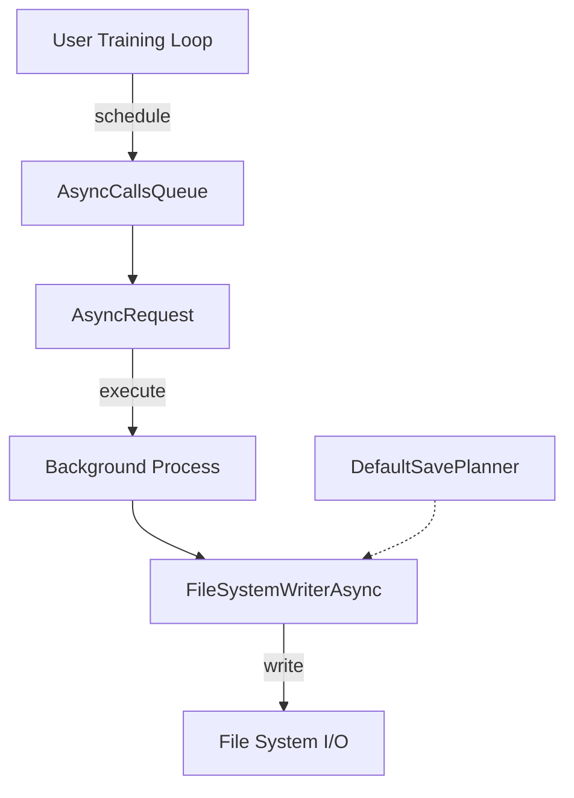

**Sources:** [src/nvidia_resiliency_ext/checkpointing/async_ckpt/core.py:120-144](), [src/nvidia_resiliency_ext/checkpointing/async_ckpt/filesystem_async.py:140-184]()

- **`AsyncCallsQueue`**: Manages the lifecycle of background workers. In recent versions, persistent workers using `spawn` are preferred over `fork` for stability [src/nvidia_resiliency_ext/checkpointing/async_ckpt/core.py:187-215](), [docs/source/release-notes.md:34-38]().
- **`FileSystemWriterAsync`**: Extends PyTorch's `FileSystemWriter` to support non-blocking writes and shared memory (SHM) staging of GPU tensors [src/nvidia_resiliency_ext/checkpointing/async_ckpt/filesystem_async.py:140-184]().
- **`AsyncRequest`**: Encapsulates the save function, preloading logic (GPU-to-CPU transfer), and finalization hooks [src/nvidia_resiliency_ext/checkpointing/async_ckpt/core.py:120-144]().

---

## Shared Infrastructure

### Health Check Suite

Health checks are modular and used by both the Fault Tolerance and In-Process subsystems.

| Component | Purpose | Source |
|-----------|---------|--------|
| `GPUHealthCheck` | Checks for CUDA errors and GPU liveness. | [src/nvidia_resiliency_ext/shared_utils/health_check.py:60]() |
| `NicHealthCheck` | Monitors InfiniBand/Ethernet link status and counters. | [src/nvidia_resiliency_ext/shared_utils/health_check.py:61]() |
| `NVLHealthCheck` | Validates NVLink connectivity and health. | [src/nvidia_resiliency_ext/shared_utils/health_check.py:63]() |
| `NodeHealthCheck` | General node-level health check via gRPC (e.g., `nvhcd`). | [docs/source/release-notes.md:27-32]() |

### Profiling and Metadata

NVRx includes dedicated systems for tracking the history of restarts and failures.
- **`FaultToleranceProfiler`**: Records high-level events like `FAILURE_DETECTED` and `RENDEZVOUS_COMPLETED` with cycle-level granularity [src/nvidia_resiliency_ext/shared_utils/profiling.py:28-40]().
- **`CycleInfoWriter`**: Writes atomic JSON metadata for each training cycle to a shared filesystem (e.g., Lustre), enabling post-mortem attribution [src/nvidia_resiliency_ext/fault_tolerance/cycle_info_writer.py:100-121]().

---

## Data Flow Patterns

### Fault Tolerance Lifecycle
1. **Launch**: `ft_launcher` parses `FaultToleranceConfig` [src/nvidia_resiliency_ext/fault_tolerance/launcher.py:222-323]().
2. **Rendezvous**: Nodes coordinate via `FtRendezvousBarrierHandler`. Health checks are performed here [src/nvidia_resiliency_ext/fault_tolerance/ft_rendezvous_barrier.py:722-1047]().
3. **Execution**: `LocalElasticAgent` spawns worker processes and `RankMonitorServer` [src/nvidia_resiliency_ext/fault_tolerance/launcher.py:461-550]().
4. **Monitoring**: Workers send heartbeats via IPC to the monitor server [src/nvidia_resiliency_ext/fault_tolerance/launcher.py:75-81]().
5. **Restart**: On failure, the agent terminates workers, waits for GPU memory reclaim, and triggers a new rendezvous [src/nvidia_resiliency_ext/fault_tolerance/launcher.py:1000-1103]().

### In-Process Restart Lifecycle
1. **Decoration**: `@inprocess.Wrapper` wraps the training function [src/nvidia_resiliency_ext/inprocess/wrap.py:81-138]().
2. **Monitoring**: `MonitorProcess` starts and watches the main training process [src/nvidia_resiliency_ext/inprocess/monitor_process.py:126-148]().
3. **Failure**: A timeout or exception triggers `AbortTorchDistributed` [src/nvidia_resiliency_ext/inprocess/abort.py:35-36]().
4. **Reassignment**: `RankAssignment` logic (e.g., `ShiftRanks`) determines the new configuration [src/nvidia_resiliency_ext/inprocess/rank_assignment.py:101-124]().
5. **Recovery**: The wrapper calls the training function again with the updated rank/world size [src/nvidia_resiliency_ext/inprocess/wrap.py:490-715]().

**Sources:** [src/nvidia_resiliency_ext/fault_tolerance/launcher.py:1-1103](), [src/nvidia_resiliency_ext/inprocess/wrap.py:1-715](), [src/nvidia_resiliency_ext/checkpointing/async_ckpt/core.py:1-215](), [src/nvidia_resiliency_ext/shared_utils/profiling.py:1-148]()

---

# Page: Getting Started

# Getting Started

<details>
<summary>Relevant source files</summary>

The following files were used as context for generating this wiki page:

- [.github/workflows/build_docs.yml](.github/workflows/build_docs.yml)
- [.github/workflows/lint_code.yml](.github/workflows/lint_code.yml)
- [.github/workflows/unit_test.yml](.github/workflows/unit_test.yml)
- [README.md](README.md)
- [docs/source/fault_tolerance/README-pci-topo-file.md](docs/source/fault_tolerance/README-pci-topo-file.md)
- [docs/source/fault_tolerance/examples/train_ddp_heartbeats.rst](docs/source/fault_tolerance/examples/train_ddp_heartbeats.rst)
- [docs/source/fault_tolerance/examples/train_ddp_sections.rst](docs/source/fault_tolerance/examples/train_ddp_sections.rst)
- [docs/source/fault_tolerance/integration/heartbeats.rst](docs/source/fault_tolerance/integration/heartbeats.rst)
- [docs/source/release-notes.md](docs/source/release-notes.md)
- [examples/attribution/README.md](examples/attribution/README.md)
- [examples/fault_tolerance/basic_ft_example.py](examples/fault_tolerance/basic_ft_example.py)
- [examples/fault_tolerance/train_ddp_heartbeats_api.py](examples/fault_tolerance/train_ddp_heartbeats_api.py)
- [examples/fault_tolerance/train_ddp_sections_api.py](examples/fault_tolerance/train_ddp_sections_api.py)
- [examples/inprocess/basic_example.py](examples/inprocess/basic_example.py)
- [pyproject.toml](pyproject.toml)
- [src/nvidia_resiliency_ext/fault_tolerance/cycle_info_writer.py](src/nvidia_resiliency_ext/fault_tolerance/cycle_info_writer.py)
- [src/nvidia_resiliency_ext/shared_utils/proto/nvrx_interface.proto](src/nvidia_resiliency_ext/shared_utils/proto/nvrx_interface.proto)
- [tests/fault_tolerance/unit/test_cycle_info_writer.py](tests/fault_tolerance/unit/test_cycle_info_writer.py)
- [tests/fault_tolerance/unit/test_timeouts_calc.py](tests/fault_tolerance/unit/test_timeouts_calc.py)
- [tests/fault_tolerance/unit/utils.py](tests/fault_tolerance/unit/utils.py)
- [tests/straggler/unit/_utils.py](tests/straggler/unit/_utils.py)

</details>


This page provides installation instructions, basic configuration examples, and simple usage patterns to help you quickly start using NVIDIA Resiliency Extensions (NVRx). It covers the two primary entry points: the `ft_launcher` for job-level fault tolerance and the `inprocess.Wrapper` for function-level recovery.

---

## Installation

### Package Installation

NVRx can be installed directly from source or via PyPI.

**From source:**
```bash
git clone https://github.com/NVIDIA/nvidia-resiliency-ext
cd nvidia-resiliency-ext
pip install .
```
[README.md:37-40]()

**From PyPI:**
```bash
pip install nvidia-resiliency-ext
```
[README.md:44-45]()

### Optional Dependencies
For LLM-based log analysis and automated fault attribution, install the `attribution` extras:
```bash
pip install 'nvidia-resiliency-ext[attribution]'
```
[README.md:41-46](), [pyproject.toml:74-88]()

### Platform Requirements
| Component | Requirement |
| :--- | :--- |
| **Python** | >= 3.10, < 3.13 |
| **PyTorch** | >= 2.5.1 (Fault Attribution requires >= 2.8.0) |
| **CUDA** | >= 12.8 |
| **NVML Driver** | >= 535 (570+ required for GPU health checks) |
| **NCCL** | < 2.28.3 OR >= 2.28.9 (Avoids specific in-process segment faults) |

Sources: [README.md:50-60](), [docs/source/release-notes.md:52]()

---

## Configuration Overview

NVRx configuration is primarily managed through the `FaultToleranceConfig` object. It supports a hierarchical precedence model to allow flexible overrides.

### Configuration Precedence
1. **Python API parameters**: Arguments passed directly to constructors (e.g., `LocalElasticAgent`).
2. **CLI arguments / Environment variables**: Flags like `--ft-rank-heartbeat-timeout`.
3. **YAML configuration**: Defined via `--ft-cfg-path`.
4. **Default values**: Hardcoded system defaults.

Sources: [docs/source/release-notes.md:28-30](), [examples/fault_tolerance/train_ddp_sections_api.py:19-20]()

---

## Quick Start: ft_launcher

The `ft_launcher` is a CLI tool that replaces `torchrun`. It manages the training lifecycle, detects hung ranks via a `RankMonitorServer`, and performs in-job restarts without reallocating SLURM nodes.

### Basic CLI Usage
```bash
# Standard launch with 8 processes per node
ft_launcher --nproc-per-node=8 train.py --args...

# Launch with section-based timeout configuration
ft_launcher \
    --nproc-per-node=2 \
    --ft-cfg-path=./fault_tol_cfg.yaml \
    train.py
```
[pyproject.toml:68](), [examples/fault_tolerance/train_ddp_sections_api.py:20]()

### Launch Flow Architecture

The following diagram maps the natural language "Launch" concept to specific code entities within the `fault_tolerance` subsystem.

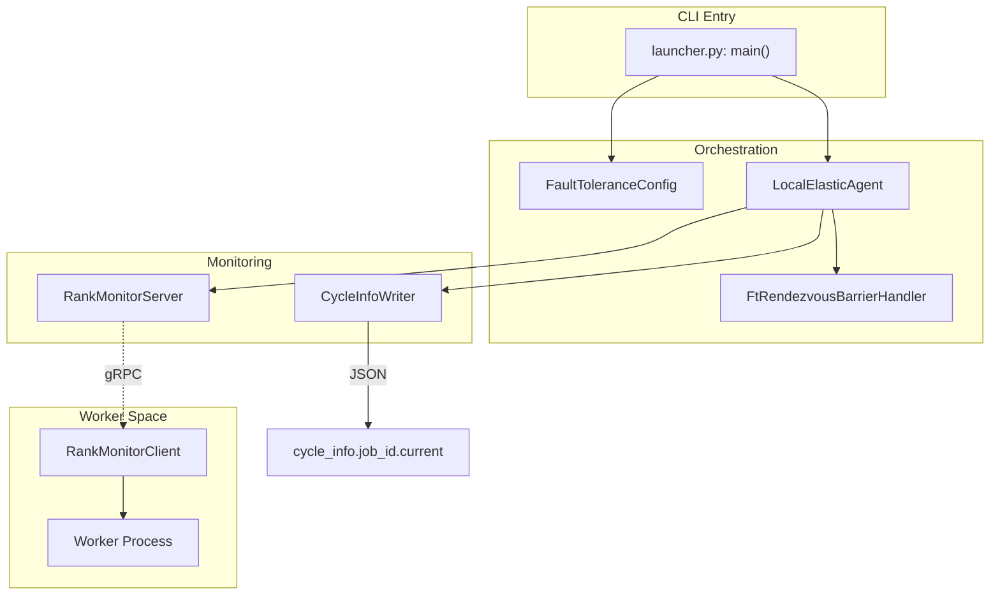
Sources: [src/nvidia_resiliency_ext/fault_tolerance/launcher.py:68](), [src/nvidia_resiliency_ext/fault_tolerance/cycle_info_writer.py:100-120](), [src/nvidia_resiliency_ext/shared_utils/proto/nvrx_interface.proto:23-58]()

---

## Quick Start: In-Process Wrapper

The `@inprocess.Wrapper` provides a decorator-based approach to resiliency. It allows a function to restart internally if a failure or timeout is detected, maintaining the same OS process.

### Basic Usage Pattern
```python
from nvidia_resiliency_ext.inprocess import Wrapper

@Wrapper(
    max_restarts=3,
    initial_world_size=8,
    heartbeat_timeout=30.0
)
def train_loop():
    # Your training code here
    pass
```
[docs/source/release-notes.md:24](), [examples/inprocess/basic_example.py:1-10]()

### In-Process Monitoring Architecture

This diagram illustrates how the `Wrapper` manages execution and monitoring via sidecar threads and processes.

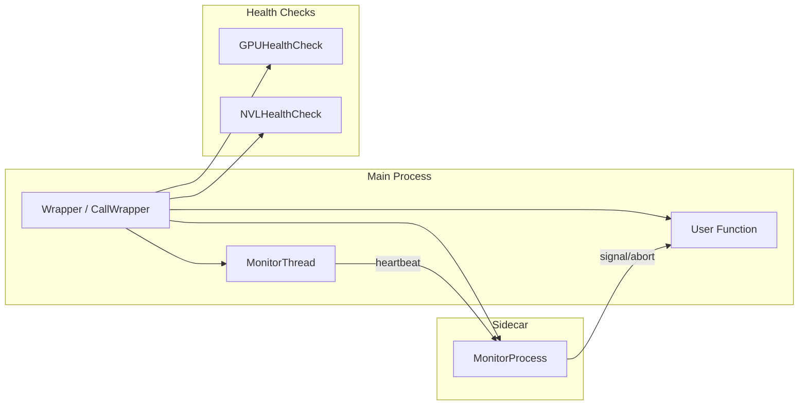
Sources: [docs/source/release-notes.md:21-25](), [src/nvidia_resiliency_ext/fault_tolerance/cycle_info_writer.py:27-30]()

---

## Cycle Tracking and Logging

NVRx introduces the concept of a **Cycle**. A cycle represents one attempt of a training run within a single job allocation.

### Cycle Info Writing
The `CycleInfoWriter` records metadata about each restart cycle to a JSON file (typically on a shared filesystem like Lustre). This is critical for the Attribution Service to analyze logs.
* **File Pattern**: `cycle_info.<job_id>.<attempt>.<cycle_number>`
* **Symlink**: `cycle_info.<job_id>.current` always points to the active cycle.

[src/nvidia_resiliency_ext/fault_tolerance/cycle_info_writer.py:43-50](), [src/nvidia_resiliency_ext/shared_utils/proto/nvrx_interface.proto:19-23]()

---

## Essential Configuration Flags

| Flag | Description | Default |
| :--- | :--- | :--- |
| `--ft-cfg-path` | Path to the YAML configuration file. | `None` |
| `--ft-use-infra-group-rank` | Align ranks with the infrastructure scheduler's topology. | `False` |
| `--ft-node-health-check-endpoint` | UDS endpoint for external node health services (e.g., `unix:///var/run/nvhcd.sock`). | `None` |
| `--ft-rank-heartbeat-timeout` | Seconds to wait for a rank heartbeat before declaring a hang. | `2700.0` |

Sources: [docs/source/release-notes.md:15-31](), [examples/fault_tolerance/train_ddp_sections_api.py:20]()

---

## Next Steps
* **Fault Tolerance System**: Deep dive into `LocalElasticAgent` and rendezvous protocols in [Fault Tolerance System](#2).
* **In-Process Restart**: Learn about `RankAssignment` and `ProgressWatchdog` in [In-Process Restart System](#3).
* **Checkpointing**: Explore `AsyncCallsQueue` for non-blocking saves in [Checkpointing System](#4).

---

# Page: Fault Tolerance System

# Fault Tolerance System

<details>
<summary>Relevant source files</summary>

The following files were used as context for generating this wiki page:

- [src/nvidia_resiliency_ext/fault_tolerance/_ft_rendezvous.py](src/nvidia_resiliency_ext/fault_tolerance/_ft_rendezvous.py)
- [src/nvidia_resiliency_ext/fault_tolerance/config.py](src/nvidia_resiliency_ext/fault_tolerance/config.py)
- [src/nvidia_resiliency_ext/fault_tolerance/data.py](src/nvidia_resiliency_ext/fault_tolerance/data.py)
- [src/nvidia_resiliency_ext/fault_tolerance/ft_rendezvous_barrier.py](src/nvidia_resiliency_ext/fault_tolerance/ft_rendezvous_barrier.py)
- [src/nvidia_resiliency_ext/fault_tolerance/launcher.py](src/nvidia_resiliency_ext/fault_tolerance/launcher.py)
- [src/nvidia_resiliency_ext/fault_tolerance/progress_tracker.py](src/nvidia_resiliency_ext/fault_tolerance/progress_tracker.py)
- [src/nvidia_resiliency_ext/fault_tolerance/rank_monitor_client.py](src/nvidia_resiliency_ext/fault_tolerance/rank_monitor_client.py)
- [src/nvidia_resiliency_ext/fault_tolerance/rank_monitor_server.py](src/nvidia_resiliency_ext/fault_tolerance/rank_monitor_server.py)
- [tests/fault_tolerance/unit/test_barrier_rendezvous.py](tests/fault_tolerance/unit/test_barrier_rendezvous.py)
- [tests/fault_tolerance/unit/test_dynamic_rendezvous.py](tests/fault_tolerance/unit/test_dynamic_rendezvous.py)
- [tests/fault_tolerance/unit/test_launcher.py](tests/fault_tolerance/unit/test_launcher.py)
- [tests/fault_tolerance/unit/test_progress_tracker.py](tests/fault_tolerance/unit/test_progress_tracker.py)
- [tests/fault_tolerance/unit/test_rank_monitor_client.py](tests/fault_tolerance/unit/test_rank_monitor_client.py)
- [tests/fault_tolerance/unit/test_utils.py](tests/fault_tolerance/unit/test_utils.py)
- [tests/straggler/unit/test_cupti_ext.py](tests/straggler/unit/test_cupti_ext.py)

</details>


## Purpose and Scope

This document provides an overview of the fault tolerance subsystem, which manages distributed training across multiple nodes with automatic worker restart and coordination. The system is built around the `ft_launcher` command-line tool and the `LocalElasticAgent` class, which orchestrates worker processes, detects failures, performs health validation, and coordinates cluster-wide restarts.

For detailed information on specific components:
- Launcher implementation and worker lifecycle: see [ft_launcher and LocalElasticAgent](#2.1)
- Rendezvous protocol and coordination: see [Rendezvous and Coordination](#2.2)
- Health monitoring and progress tracking: see [Rank Monitoring and Progress Tracking](#2.3)
- Configuration options: see [Configuration Guide](#2.4)

For the complementary in-process restart mechanism that operates within a single process: see [In-Process Restart System](#3).

## System Overview

The fault tolerance system orchestrates distributed training by launching and monitoring worker processes across a cluster, detecting failures, performing health checks, and automatically restarting training when failures occur. The system ensures training can continue despite hardware faults, software errors, or transient issues.

Key capabilities:
- **Automatic worker restart**: Detects failures and restarts all workers across the cluster.
- **Dynamic node coordination**: Manages node participation through a barrier-based rendezvous protocol.
- **Health validation**: Validates GPU, NIC, storage, and node health before each training cycle.
- **Hot spare support**: Allows standby nodes to wait and replace failed nodes when needed.
- **Progress tracking**: Detects training stagnation via iteration monitoring to prevent infinite restart loops.
- **Segment-aware scheduling**: Groups nodes by NVLink domain for optimal resource utilization on NVSwitch systems.

The system operates at the job level, managing entire distributed training jobs with multiple nodes and workers per node. It integrates with PyTorch's Elastic framework while providing enhanced fault tolerance capabilities.

Sources: [src/nvidia_resiliency_ext/fault_tolerance/launcher.py:222-323](), [src/nvidia_resiliency_ext/fault_tolerance/ft_rendezvous_barrier.py:364-401](), [src/nvidia_resiliency_ext/fault_tolerance/progress_tracker.py:19-30]()

## Architecture Overview

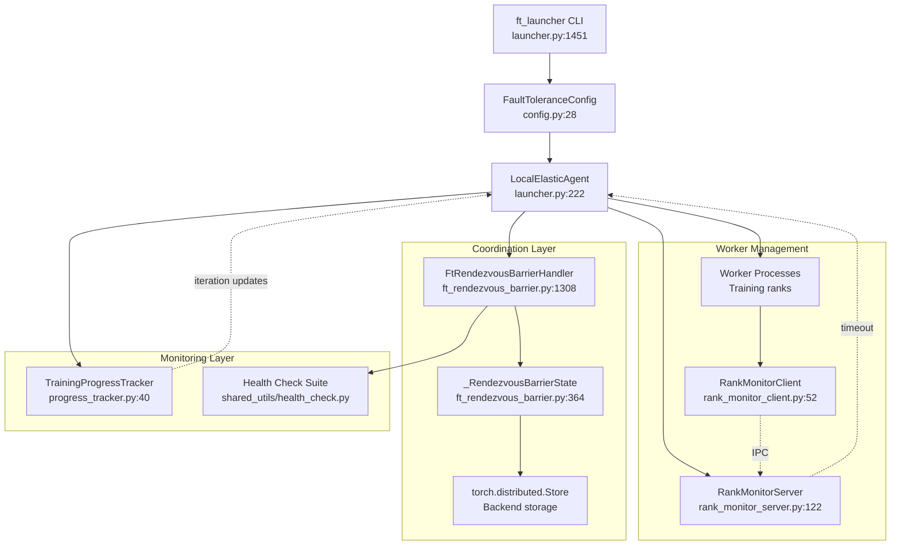

**Architecture Diagram**: Core components of the fault tolerance system showing class names and file locations

The system is organized into three layers:
1. **Launcher Layer**: `ft_launcher` CLI and `FaultToleranceConfig` provide entry points and configuration.
2. **Orchestration Layer**: `LocalElasticAgent` manages worker lifecycle and coordinates restarts.
3. **Coordination Layer**: `FtRendezvousBarrierHandler` synchronizes nodes and assigns ranks.

Sources: [src/nvidia_resiliency_ext/fault_tolerance/launcher.py:222-376](), [src/nvidia_resiliency_ext/fault_tolerance/ft_rendezvous_barrier.py:1308-1401](), [src/nvidia_resiliency_ext/fault_tolerance/rank_monitor_server.py:122-181](), [src/nvidia_resiliency_ext/fault_tolerance/rank_monitor_client.py:52-118]()

## Key Components

### LocalElasticAgent

The `LocalElasticAgent` is the central orchestrator that manages worker processes on each node. It extends PyTorch's `SimpleElasticAgent` with fault-tolerant capabilities.

**Location**: [src/nvidia_resiliency_ext/fault_tolerance/launcher.py:222-356]()

**Responsibilities**:
- Spawn and monitor worker processes on the local node.
- Coordinate with `FtRendezvousBarrierHandler` for cluster-wide synchronization.
- Manage rank monitor servers for per-worker health tracking.
- Execute restart policies when failures occur.
- Track training progress to detect stagnation.

**Key Methods**:
- `run()` - Main execution loop [src/nvidia_resiliency_ext/fault_tolerance/launcher.py:461-482]().
- `_invoke_run()` - Dispatches to restart policy implementation [src/nvidia_resiliency_ext/fault_tolerance/launcher.py:548-557]().
- `_start_workers()` - Spawns worker processes with environment setup [src/nvidia_resiliency_ext/fault_tolerance/launcher.py:1006-1156]().
- `_monitor_workers()` - Checks worker status [src/nvidia_resiliency_ext/fault_tolerance/launcher.py:1260-1319]().
- `_stop_workers()` - Terminates workers and waits for GPU memory reclaim [src/nvidia_resiliency_ext/fault_tolerance/launcher.py:954-1001]().
- `_handle_restart_decision()` - Determines whether to restart or terminate [src/nvidia_resiliency_ext/fault_tolerance/launcher.py:503-546]().

Sources: [src/nvidia_resiliency_ext/fault_tolerance/launcher.py:222-376]()

### FtRendezvousBarrierHandler

The `FtRendezvousBarrierHandler` implements a barrier-based protocol for coordinating node participation in training. It replaces PyTorch's default C10d rendezvous with a design optimized for fault tolerance and flexible node participation.

**Location**: [src/nvidia_resiliency_ext/fault_tolerance/ft_rendezvous_barrier.py:1308-1401]()

**Key Features**:
- **Barrier-based coordination**: Uses atomic increments instead of compare-and-swap operations [src/nvidia_resiliency_ext/fault_tolerance/ft_rendezvous_barrier.py:9-11]().
- **Segment-aware rank assignment**: Groups nodes by NVLink domain (ClusterUUID) for NVSwitch systems [src/nvidia_resiliency_ext/fault_tolerance/ft_rendezvous_barrier.py:501-644]().
- **Health validation**: Executes GPU, NIC, storage checks before each rendezvous [src/nvidia_resiliency_ext/fault_tolerance/ft_rendezvous_barrier.py:1597-1646]().
- **Hot spare management**: Allows standby nodes to wait without disrupting training [src/nvidia_resiliency_ext/fault_tolerance/ft_rendezvous_barrier.py:821-1095]().
- **Stale round detection**: Enables nodes to sync with newer rendezvous rounds via `_StaleRendezvousRoundError` [src/nvidia_resiliency_ext/fault_tolerance/ft_rendezvous_barrier.py:1078-1089]().

**Core State Machine** ([src/nvidia_resiliency_ext/fault_tolerance/ft_rendezvous_barrier.py:364-441]()):
- Managed by `_RendezvousBarrierState` class.
- Tracks rendezvous round number, participant counts, and health status.
- Coordinates through distributed store keys: `arrived_count_key`, `ack_count_key`, and `last_participant_arrived_key`.

Sources: [src/nvidia_resiliency_ext/fault_tolerance/ft_rendezvous_barrier.py:1308-1527](), [src/nvidia_resiliency_ext/fault_tolerance/ft_rendezvous_barrier.py:364-441]()

### Rank Monitor System

The rank monitor system provides per-worker health tracking using a client-server architecture with bidirectional IPC.

**Components**:
- `RankMonitorServer`: Dedicated process per local worker, monitors heartbeats and section timeouts [src/nvidia_resiliency_ext/fault_tolerance/rank_monitor_server.py:122-181]().
- `RankMonitorClient`: Embedded in worker, sends heartbeats and section entry/exit messages [src/nvidia_resiliency_ext/fault_tolerance/rank_monitor_client.py:52-118]().
- `RankMonitorStateMachine`: Tracks restart cycles and iteration progress [src/nvidia_resiliency_ext/fault_tolerance/rank_monitor_server.py:168]().

**Communication**: Bidirectional IPC via Unix domain sockets [src/nvidia_resiliency_ext/fault_tolerance/launcher.py:754-883]().
- Worker → Monitor: Heartbeats, section boundaries, iteration updates via `HeartbeatMsg` and `SectionMsg` [src/nvidia_resiliency_ext/fault_tolerance/rank_monitor_server.py:40-44]().
- Monitor → Launcher: Timeout detection and iteration progress tracking [src/nvidia_resiliency_ext/fault_tolerance/launcher.py:840-883]().

**Timeout Types** ([src/nvidia_resiliency_ext/fault_tolerance/config.py:32-51]()):
- `initial_rank_heartbeat_timeout`: First heartbeat from worker.
- `rank_heartbeat_timeout`: Subsequent heartbeat interval.
- `rank_section_timeouts`: Per-section timeouts (e.g., "step", "forward", "backward").
- `rank_out_of_section_timeout`: Default timeout for unmarked code sections.

Sources: [src/nvidia_resiliency_ext/fault_tolerance/launcher.py:754-883](), [src/nvidia_resiliency_ext/fault_tolerance/config.py:32-51](), [src/nvidia_resiliency_ext/fault_tolerance/rank_monitor_server.py:122-181]()

### Health Validation

The system validates multiple aspects of node health before each rendezvous through `ensure_node_is_healthy()` [src/nvidia_resiliency_ext/fault_tolerance/ft_rendezvous_barrier.py:1597-1646]().

| Health Check | Class | Purpose | Configuration |
|--------------|-------|---------|---------------|
| GPU | `GPUHealthCheck` | Validates GPU accessibility | Always enabled |
| NIC Link State | `NicLinkStateHealthCheck` | Checks network interface ports are ACTIVE | `--ft-enable-nic-healthcheck` |
| NVLink | `NVLHealthCheck` | Validates NVLink fabric connectivity | Always enabled |
| Storage (Distributed) | `DistributedStorageHealthCheck` | Checks Lustre/NFS mount health | `--ft-enable-dist-storage-healthcheck` |
| Storage (Path) | `StoragePathHealthCheck` | Validates specific paths are readable | `--ft-storage-healthcheck-path` |
| Node Service | `NodeHealthCheck` | Queries external health service (gRPC/UDS) | `--ft-node-health-check-endpoint` |

If any check fails, the node increments `unhealthy_count_key` in the store and raises `UnhealthyNodeException`, causing the node to exit.

Sources: [src/nvidia_resiliency_ext/fault_tolerance/ft_rendezvous_barrier.py:1597-1646](), [src/nvidia_resiliency_ext/fault_tolerance/config.py:52-69]()

### Progress Tracking

The `TrainingProgressTracker` detects training stagnation to prevent infinite restart loops when training is stuck.

**How It Works**:
1. Rank monitors send iteration updates to the launcher via IPC [src/nvidia_resiliency_ext/fault_tolerance/launcher.py:829-838]().
2. The launcher tracks progress across cycles (including cycle 0) [src/nvidia_resiliency_ext/fault_tolerance/progress_tracker.py:43-48]().
3. If iteration progress is less than `min_progress_iterations` for `max_no_progress_cycles` consecutive restarts, the tracker recommends early termination [src/nvidia_resiliency_ext/fault_tolerance/progress_tracker.py:150-165]().

**Configuration** ([src/nvidia_resiliency_ext/fault_tolerance/config.py:130-137]()):
- `min_progress_iterations`: Minimum iteration delta required (default 1).
- `max_no_progress_cycles`: Max consecutive stagnant cycles before termination (default 2).
- `checkpoint_iteration_file`: Optional path to read the latest iteration baseline [src/nvidia_resiliency_ext/fault_tolerance/progress_tracker.py:116-134]().

Sources: [src/nvidia_resiliency_ext/fault_tolerance/launcher.py:829-838](), [src/nvidia_resiliency_ext/fault_tolerance/progress_tracker.py:40-93](), [src/nvidia_resiliency_ext/fault_tolerance/config.py:130-137]()

## Worker Lifecycle

```mermaid
sequenceDiagram
    participant CLI as "ft_launcher CLI"
    participant Agent as "LocalElasticAgent"
    participant Rdzv as "FtRendezvousBarrierHandler"
    participant Health as "Health Checks"
    participant Worker as "Worker Process"
    participant RMon as "RankMonitorServer"
    
    CLI->>Agent: "run()"
    
    loop Training Cycle
        Agent->>Rdzv: "_rendezvous()"
        Rdzv->>Rdzv: "perform_rendezvous()<br/>Step 0: _wait_for_rendezvous_open()"
        Rdzv->>Rdzv: "Step 1: Join barrier (atomic add)"
        Rdzv->>Health: "ensure_node_is_healthy()"
        Health-->>Rdzv: "Pass/Fail"
        
        alt Health check failed
            Rdzv->>Rdzv: "_maybe_increment_unhealthy_count()"
            Rdzv-->>Agent: "UnhealthyNodeException"
            Agent->>Agent: "Exit process"
        end
        
        Rdzv->>Rdzv: "Step 2: Wait for completion"
        Rdzv->>Rdzv: "Step 3: Acknowledge + assign ranks"
        Rdzv-->>Agent: "group_rank, world_size"
        
        Agent->>RMon: "setup_rank_monitors()"
        Agent->>Worker: "_start_workers()"
        
        loop Monitor Loop
            Worker->>RMon: "Heartbeat + section messages"
            RMon->>Agent: "Iteration updates"
            Agent->>Agent: "_monitor_workers()"
            
            alt Worker failed
                Agent->>Agent: "_handle_restart_decision()"
                Agent->>Rdzv: "open_rendezvous()"
                Agent->>Worker: "_stop_workers()"
                break Restart
            end
            
            alt Cluster changes detected
                Agent->>Agent: "_handle_restart_decision()"
                Agent->>Worker: "_stop_workers()"
                break Restart
            end
        end
        
        Worker-->>Agent: "SUCCESS"
        Agent->>Agent: "_exit_barrier()"
    end
    
    Agent-->>CLI: "RunResult"
```

**Worker Lifecycle Diagram**: Sequence showing method calls from launch to completion

**Phases**:

1. **Rendezvous** ([src/nvidia_resiliency_ext/fault_tolerance/launcher.py:1345-1355]()): All nodes synchronize using `perform_rendezvous()` [src/nvidia_resiliency_ext/fault_tolerance/ft_rendezvous_barrier.py:821-1095]().
2. **Health Validation** ([src/nvidia_resiliency_ext/fault_tolerance/ft_rendezvous_barrier.py:1597-1646]()): Each node validates GPU, NIC, and storage health.
3. **Rank Assignment** ([src/nvidia_resiliency_ext/fault_tolerance/ft_rendezvous_barrier.py:1199-1252]()): Store host assigns group ranks based on infrastructure topology and segment configuration.
4. **Worker Spawn** ([src/nvidia_resiliency_ext/fault_tolerance/launcher.py:1006-1156]()): Each node spawns local workers with environment variables (`RANK`, `WORLD_SIZE`, etc.).
5. **Monitoring** ([src/nvidia_resiliency_ext/fault_tolerance/launcher.py:1260-1319]()): Agent polls worker status via `_monitor_workers()`, rank monitors track health.
6. **Restart or Complete**: On failure, `_handle_restart_decision()` determines whether to restart; on success, `_exit_barrier()` synchronizes and returns.

Sources: [src/nvidia_resiliency_ext/fault_tolerance/launcher.py:461-614](), [src/nvidia_resiliency_ext/fault_tolerance/ft_rendezvous_barrier.py:821-1095]()

## Restart Policies

The system supports two restart policies configured via `--restart-policy`:

### any-failed Policy

**Implementation**: `_invoke_run_with_any_failed_policy()` [src/nvidia_resiliency_ext/fault_tolerance/launcher.py:559-648]().

**Behavior**:
- Any worker failure triggers cluster-wide restart.
- All nodes detect failure through worker state monitoring or peer abortion notification.
- The node detecting failure calls `open_rendezvous()` to allow a new round.
- All nodes synchronize to restart together.

### min-healthy Policy

**Implementation**: `_invoke_run_with_min_healthy_policy()` [src/nvidia_resiliency_ext/fault_tolerance/launcher.py:650-752]().

**Behavior**:
- Training continues as long as `min_nodes` workers can succeed.
- Cluster restarts only if the maximum possible successful nodes drop below `min_nodes`.
- Supports partial failure tolerance with reduced world size.

Sources: [src/nvidia_resiliency_ext/fault_tolerance/launcher.py:559-752]()

## Restart Decision Logic

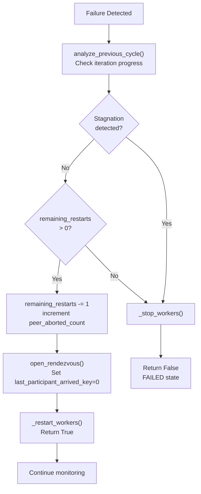

**Restart Decision Flow**: Logic implemented in `_handle_restart_decision()` [src/nvidia_resiliency_ext/fault_tolerance/launcher.py:503-546]()

**Decision Criteria**:

1. **Progress Check**: `analyze_previous_cycle()` examines iteration history via `TrainingProgressTracker`.
   - If training stagnates across multiple restarts → terminate early [src/nvidia_resiliency_ext/fault_tolerance/progress_tracker.py:164-165]().
2. **Restart Budget**: `_remaining_restarts` counter.
   - Initialized from `spec.max_restarts` minus global restart count.
   - Accounts for previous restarts in job array deployments via `_get_global_restart_count()` [src/nvidia_resiliency_ext/fault_tolerance/launcher.py:437-456]().
3. **Rendezvous Open**: For barrier-based rendezvous.
   - Call `open_rendezvous()` to set `last_participant_arrived_key=0`.
   - Enables hot spares and restarting nodes to join a new round.

Sources: [src/nvidia_resiliency_ext/fault_tolerance/launcher.py:503-546](), [src/nvidia_resiliency_ext/fault_tolerance/progress_tracker.py:135-174]()

## Segment-Aware Rank Assignment

For systems with multiple NVLink domains (e.g., DGX H200, HGX B200), the system supports segment-aware rank assignment.

**Configuration**: `--ft-segment N` where N is the minimum number of nodes required per NVLink domain [src/nvidia_resiliency_ext/fault_tolerance/config.py:70-79]().

**Domain Detection**: Queries GPU ClusterUUID via `nvidia-smi` [src/nvidia_resiliency_ext/fault_tolerance/ft_rendezvous_barrier.py:300-361]().

**Assignment Algorithm** ([src/nvidia_resiliency_ext/fault_tolerance/ft_rendezvous_barrier.py:501-644]()):
1. Group participants by domain (ClusterUUID).
2. Sort domains by SLURM topology (smallest `infra_rank`).
3. Select complete segments from each domain.
4. Assign active ranks [0..world_size) from selected segments.
5. Assign standby ranks to remaining nodes.

Sources: [src/nvidia_resiliency_ext/fault_tolerance/ft_rendezvous_barrier.py:501-644](), [src/nvidia_resiliency_ext/fault_tolerance/config.py:70-79]()

## Configuration

The system is configured through `FaultToleranceConfig` which supports multiple loading methods:

**Loading Methods**:
- YAML file: `FaultToleranceConfig.from_yaml_file(path)` [src/nvidia_resiliency_ext/fault_tolerance/config.py:170-196]().
- CLI arguments: `FaultToleranceConfig.from_args(args)` [src/nvidia_resiliency_ext/fault_tolerance/config.py:242-297]().

**Key Categories**:
- **Timeouts**: Heartbeat and section timeouts [src/nvidia_resiliency_ext/fault_tolerance/config.py:32-51]().
- **Health Checks**: NIC, storage, and node health settings [src/nvidia_resiliency_ext/fault_tolerance/config.py:52-69]().
- **Resource Management**: GPU memory reclaim parameters [src/nvidia_resiliency_ext/fault_tolerance/config.py:83-88]().

For comprehensive configuration options and CLI flags, see [Configuration Guide](#2.4).

Sources: [src/nvidia_resiliency_ext/fault_tolerance/config.py:27-141](), [src/nvidia_resiliency_ext/fault_tolerance/config.py:242-297]()

---

# Page: ft_launcher and LocalElasticAgent

# ft_launcher and LocalElasticAgent

<details>
<summary>Relevant source files</summary>

The following files were used as context for generating this wiki page:

- [src/nvidia_resiliency_ext/fault_tolerance/c10d_monkey_patch.py](src/nvidia_resiliency_ext/fault_tolerance/c10d_monkey_patch.py)
- [src/nvidia_resiliency_ext/fault_tolerance/cli_args.py](src/nvidia_resiliency_ext/fault_tolerance/cli_args.py)
- [src/nvidia_resiliency_ext/fault_tolerance/config.py](src/nvidia_resiliency_ext/fault_tolerance/config.py)
- [src/nvidia_resiliency_ext/fault_tolerance/control_plane.py](src/nvidia_resiliency_ext/fault_tolerance/control_plane.py)
- [src/nvidia_resiliency_ext/fault_tolerance/ft_rendezvous_barrier.py](src/nvidia_resiliency_ext/fault_tolerance/ft_rendezvous_barrier.py)
- [src/nvidia_resiliency_ext/fault_tolerance/launcher.py](src/nvidia_resiliency_ext/fault_tolerance/launcher.py)
- [src/nvidia_resiliency_ext/fault_tolerance/rdzv_utils.py](src/nvidia_resiliency_ext/fault_tolerance/rdzv_utils.py)
- [tests/fault_tolerance/unit/test_barrier_rendezvous.py](tests/fault_tolerance/unit/test_barrier_rendezvous.py)
- [tests/fault_tolerance/unit/test_c10d_monkey_patch.py](tests/fault_tolerance/unit/test_c10d_monkey_patch.py)
- [tests/fault_tolerance/unit/test_control_plane.py](tests/fault_tolerance/unit/test_control_plane.py)
- [tests/fault_tolerance/unit/test_launcher.py](tests/fault_tolerance/unit/test_launcher.py)

</details>


## Purpose and Scope

This document covers the **ft_launcher** CLI tool and the **LocalElasticAgent** class, which form the core of the fault tolerance subsystem. These components manage distributed training job lifecycle across multiple nodes, handling worker process spawning, monitoring, and coordinated restarts on failures.

`ft_launcher` is a command-line wrapper around PyTorch's `torchrun` that adds fault-tolerant capabilities. `LocalElasticAgent` extends PyTorch Elastic's `SimpleElasticAgent` to implement worker lifecycle management with automatic restart logic.

For information about the rendezvous and coordination mechanism, see [Rendezvous and Coordination](2.2). For rank-level monitoring details, see [Rank Monitoring and Progress Tracking](2.3). For configuration details, see [Configuration Guide](2.4).

---

## System Architecture Overview

The following diagram shows how `ft_launcher` and `LocalElasticAgent` fit into the overall fault tolerance system:

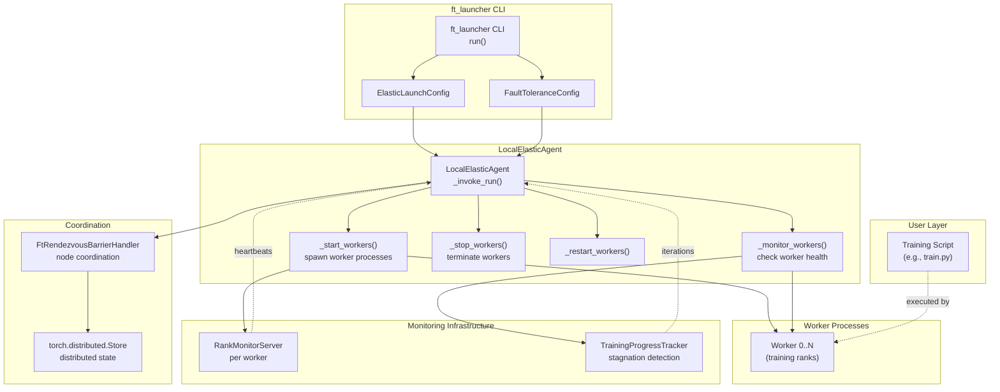

**Sources:** [src/nvidia_resiliency_ext/fault_tolerance/launcher.py:15-102](), [src/nvidia_resiliency_ext/fault_tolerance/launcher.py:222-356]()

---

## ft_launcher CLI Tool

### Overview

`ft_launcher` is the primary entry point for launching fault-tolerant distributed training jobs. It wraps PyTorch's `torchrun` launcher with additional capabilities:

- Health checks before rendezvous (NIC, Storage, GPU) [src/nvidia_resiliency_ext/fault_tolerance/launcher.py:136-144]().
- Rank-level hang detection via `RankMonitorServer` [src/nvidia_resiliency_ext/fault_tolerance/launcher.py:93-93]().
- Progress tracking with stagnation detection [src/nvidia_resiliency_ext/fault_tolerance/launcher.py:92-92]().
- Per-cycle log aggregation via `PipeBasedLogsSpecs` [src/nvidia_resiliency_ext/fault_tolerance/launcher.py:91-91]().
- GPU memory reclaim on restarts [src/nvidia_resiliency_ext/fault_tolerance/launcher.py:1158-1244]().
- Segment-aware rank assignment for NVSwitch systems [src/nvidia_resiliency_ext/fault_tolerance/config.py:70-79]().

### Command-Line Interface

The launcher accepts all standard `torchrun` arguments plus fault-tolerance-specific flags defined in `FaultToleranceConfig`:

| Flag | Type | Description |
|------|------|-------------|
| `--ft-cfg-path` | str | Path to YAML configuration file [src/nvidia_resiliency_ext/fault_tolerance/cli_args.py:93-93]() |
| `--ft-workload-check-interval` | float | Interval (seconds) for rank monitoring checks [src/nvidia_resiliency_ext/fault_tolerance/config.py:32-32]() |
| `--ft-initial-rank-heartbeat-timeout` | float | Timeout for first heartbeat from rank [src/nvidia_resiliency_ext/fault_tolerance/config.py:33-37]() |
| `--ft-rank-heartbeat-timeout` | float | Timeout for subsequent heartbeats [src/nvidia_resiliency_ext/fault_tolerance/config.py:38-41]() |
| `--ft-segment` | int | Segment-aware mode for NVSwitch systems [src/nvidia_resiliency_ext/fault_tolerance/cli_args.py:126-140]() |
| `--ft-enable-nic-healthcheck` | bool | Enable NIC link state health check [src/nvidia_resiliency_ext/fault_tolerance/config.py:53-56]() |
| `--ft-enable-dist-storage-healthcheck` | bool | Enable storage health check [src/nvidia_resiliency_ext/fault_tolerance/config.py:62-63]() |
| `--ft-gpu-memory-reclaim-timeout` | float | Timeout for GPU memory reclaim [src/nvidia_resiliency_ext/fault_tolerance/config.py:83-84]() |

**Sources:** [src/nvidia_resiliency_ext/fault_tolerance/config.py:27-109](), [src/nvidia_resiliency_ext/fault_tolerance/cli_args.py:126-140]()

### Configuration Resolution

Configuration is resolved in this order (later sources override earlier):

1. **Default values** in `FaultToleranceConfig` [src/nvidia_resiliency_ext/fault_tolerance/config.py:27-109]().
2. **YAML file** specified via `--ft-cfg-path` [src/nvidia_resiliency_ext/fault_tolerance/config.py:242-262]().
3. **CLI arguments** prefixed with `--ft-` which are parsed and converted to `FaultToleranceConfig` fields [src/nvidia_resiliency_ext/fault_tolerance/launcher.py:1418-1529]().

---

## LocalElasticAgent Core Lifecycle

### Class Hierarchy

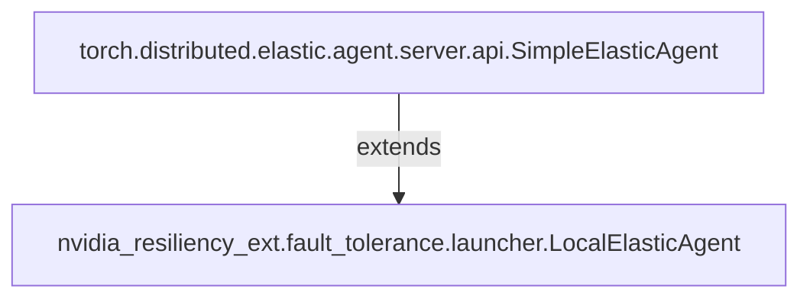

`LocalElasticAgent` extends PyTorch Elastic's `SimpleElasticAgent` to add rank monitoring via `RankMonitorServer`, progress tracking, and GPU memory reclaim [src/nvidia_resiliency_ext/fault_tolerance/launcher.py:222-225]().

### Main Control Loop

The `run()` method implements the top-level lifecycle, dispatching to policy-specific implementations like `_invoke_run_with_any_failed_policy()` [src/nvidia_resiliency_ext/fault_tolerance/launcher.py:461-482]().

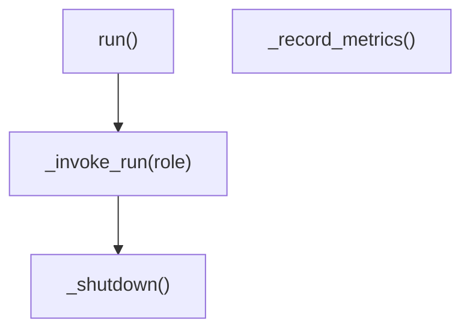

**Sources:** [src/nvidia_resiliency_ext/fault_tolerance/launcher.py:461-482](), [src/nvidia_resiliency_ext/fault_tolerance/launcher.py:548-557]()

---

## Worker Lifecycle Methods

### _start_workers

Spawns worker processes for the current rendezvous round [src/nvidia_resiliency_ext/fault_tolerance/launcher.py:1006-1156]().

**Key Steps:**
1. Retrieve cycle number and rendezvous info from rendezvous handler [src/nvidia_resiliency_ext/fault_tolerance/launcher.py:1016-1025]().
2. Construct environment variables including `FT_LAUNCHER_IPC_SOCKET` and `FT_RANK_MONITOR_IPC_SOCKET` [src/nvidia_resiliency_ext/fault_tolerance/launcher.py:1056-1100]().
3. Apply `numactl` for NUMA binding if configured [src/nvidia_resiliency_ext/fault_tolerance/launcher.py:1108-1121]().
4. Setup rank monitors via `setup_rank_monitors()` [src/nvidia_resiliency_ext/fault_tolerance/launcher.py:1134-1134]().
5. Start processes using `start_processes()` [src/nvidia_resiliency_ext/fault_tolerance/launcher.py:1140-1151]().

### _monitor_workers

Checks worker status without blocking using `self._pcontext.wait(0)` [src/nvidia_resiliency_ext/fault_tolerance/launcher.py:1260-1319](). It returns `WorkerState.HEALTHY` if all processes are running, or `WorkerState.FAILED` / `WorkerState.SUCCEEDED` based on return codes [src/nvidia_resiliency_ext/fault_tolerance/launcher.py:1290-1318]().

### _stop_workers

Gracefully terminates workers and ensures GPU memory is reclaimed [src/nvidia_resiliency_ext/fault_tolerance/launcher.py:954-1001]().

**GPU Memory Reclaim:**
The agent polls GPU memory usage using `GPUMemoryLogger` until usage drops below `gpu_memory_tolerance_mb` or `gpu_memory_reclaim_timeout` is reached [src/nvidia_resiliency_ext/fault_tolerance/launcher.py:1158-1244]().

---

## Restart Policies

### any-failed Policy

The `_invoke_run_with_any_failed_policy()` method implements the standard policy where any worker failure triggers a full cluster restart [src/nvidia_resiliency_ext/fault_tolerance/launcher.py:559-648]().

**Decision Logic:**
- If a local worker fails, trigger `_handle_restart_decision()` [src/nvidia_resiliency_ext/fault_tolerance/launcher.py:596-602]().
- If rendezvous handler indicates `num_nodes_waiting()` > 0 or peers have aborted, a restart is initiated [src/nvidia_resiliency_ext/fault_tolerance/launcher.py:615-635]().

### min-healthy Policy

A partial failure tolerance policy where training continues as long as a minimum number of workers succeed [src/nvidia_resiliency_ext/fault_tolerance/launcher.py:650-752](). Ranks report state to the rendezvous store, and the agent aggregates these to decide if the overall job has succeeded [src/nvidia_resiliency_ext/fault_tolerance/launcher.py:716-745]().

---

## Restart Decision and Progress Tracking

### _handle_restart_decision

Centralizes the logic for whether to attempt a restart [src/nvidia_resiliency_ext/fault_tolerance/launcher.py:503-546]().

**Progress Tracking Integration:**
It calls `_progress_tracker.analyze_previous_cycle()` to evaluate if training is actually progressing [src/nvidia_resiliency_ext/fault_tolerance/launcher.py:512-512](). If `should_terminate_early()` is true (e.g., `max_no_progress_restarts` reached), it stops workers and exits [src/nvidia_resiliency_ext/fault_tolerance/launcher.py:513-520]().

**Sources:** [src/nvidia_resiliency_ext/fault_tolerance/launcher.py:503-546](), [src/nvidia_resiliency_ext/fault_tolerance/progress_tracker.py:1-92]()

---

## Rank Monitoring and IPC

Each worker process is monitored by a `RankMonitorServer` [src/nvidia_resiliency_ext/fault_tolerance/launcher.py:93-93]().

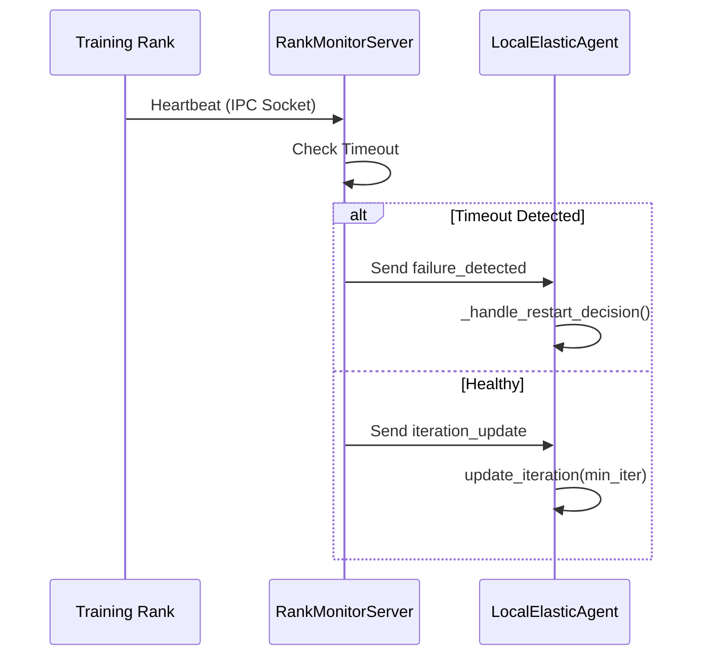

**Sources:** [src/nvidia_resiliency_ext/fault_tolerance/launcher.py:757-883](), [src/nvidia_resiliency_ext/fault_tolerance/rank_monitor_server.py:1-93]()

### setup_rank_monitors

Spawns monitor processes and establishes Unix domain socket connections [src/nvidia_resiliency_ext/fault_tolerance/launcher.py:757-785](). It assigns the monitor for local rank 0 on the store host as the "restarter logger" to centralize logging [src/nvidia_resiliency_ext/fault_tolerance/launcher.py:771-775]().

**Sources:** [src/nvidia_resiliency_ext/fault_tolerance/launcher.py:757-806]()

---

# Page: Rendezvous and Coordination

# Rendezvous and Coordination

<details>
<summary>Relevant source files</summary>

The following files were used as context for generating this wiki page:

- [pyproject.toml](pyproject.toml)
- [src/nvidia_resiliency_ext/fault_tolerance/_ft_rendezvous.py](src/nvidia_resiliency_ext/fault_tolerance/_ft_rendezvous.py)
- [src/nvidia_resiliency_ext/fault_tolerance/config.py](src/nvidia_resiliency_ext/fault_tolerance/config.py)
- [src/nvidia_resiliency_ext/fault_tolerance/cycle_info_writer.py](src/nvidia_resiliency_ext/fault_tolerance/cycle_info_writer.py)
- [src/nvidia_resiliency_ext/fault_tolerance/ft_rendezvous_barrier.py](src/nvidia_resiliency_ext/fault_tolerance/ft_rendezvous_barrier.py)
- [src/nvidia_resiliency_ext/fault_tolerance/launcher.py](src/nvidia_resiliency_ext/fault_tolerance/launcher.py)
- [src/nvidia_resiliency_ext/shared_utils/proto/nvrx_interface.proto](src/nvidia_resiliency_ext/shared_utils/proto/nvrx_interface.proto)
- [tests/fault_tolerance/unit/test_barrier_rendezvous.py](tests/fault_tolerance/unit/test_barrier_rendezvous.py)
- [tests/fault_tolerance/unit/test_cycle_info_writer.py](tests/fault_tolerance/unit/test_cycle_info_writer.py)
- [tests/fault_tolerance/unit/test_dynamic_rendezvous.py](tests/fault_tolerance/unit/test_dynamic_rendezvous.py)
- [tests/fault_tolerance/unit/test_launcher.py](tests/fault_tolerance/unit/test_launcher.py)
- [tests/fault_tolerance/unit/test_rdzv_utils.py](tests/fault_tolerance/unit/test_rdzv_utils.py)
- [tests/fault_tolerance/unit/test_utils.py](tests/fault_tolerance/unit/test_utils.py)
- [tests/straggler/unit/test_cupti_ext.py](tests/straggler/unit/test_cupti_ext.py)

</details>


The fault tolerance system provides two rendezvous mechanisms for distributed node coordination during training. **Dynamic Rendezvous v1** (legacy) uses compare-and-swap operations for state synchronization, while **Barrier-based Rendezvous v2** (recommended) uses atomic increments and simpler key-based coordination for improved stability and scalability.

Both mechanisms coordinate nodes via a shared `TCPStore` to establish training groups, assign ranks, and handle failures. The barrier-based approach is recommended for production deployments due to better performance, segment-awareness for NVSwitch systems, and simplified failure handling.

## Architecture Comparison

Both rendezvous mechanisms share common components but differ in their state synchronization approach.

### High-Level Architecture Comparison

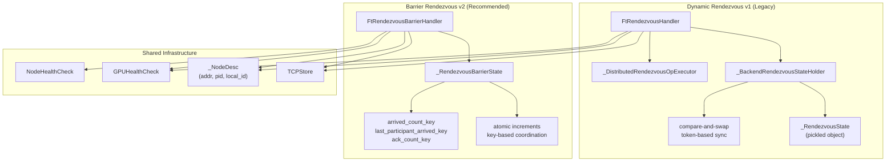

**Sources:** [src/nvidia_resiliency_ext/fault_tolerance/_ft_rendezvous.py:31-48](), [src/nvidia_resiliency_ext/fault_tolerance/ft_rendezvous_barrier.py:49-81]()

## Dynamic Rendezvous v1 (Legacy)

Dynamic Rendezvous v1 is based on PyTorch's elastic rendezvous with NVRx extensions for health checking and worker state tracking. It uses compare-and-swap operations with pickle-serialized state objects.

### State Machine and Operations

Dynamic rendezvous operates as a distributed state machine where nodes execute operations (`_Action` enum) to transition between states.

#### Dynamic Rendezvous State Machine

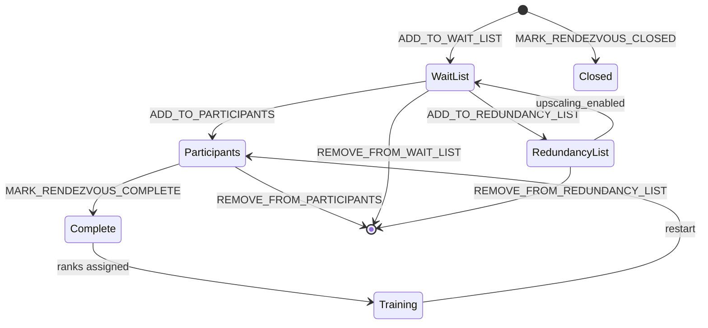

**Sources:** [src/nvidia_resiliency_ext/fault_tolerance/_ft_rendezvous.py:567-583]()

### _RendezvousState Structure

The `_RendezvousState` class holds all rendezvous coordination data, serialized and synchronized via pickle.

| Field | Type | Purpose |
|-------|------|---------|
| `round` | `int` | Current rendezvous round number |
| `complete` | `bool` | Whether current round is complete |
| `deadline` | `Optional[datetime]` | Last call timeout deadline |
| `closed` | `bool` | Whether rendezvous is permanently closed |
| `participants` | `Dict[_NodeDesc, int]` | Active training nodes and their ranks |
| `wait_list` | `Set[_NodeDesc]` | Nodes waiting for next round |
| `redundancy_list` | `Set[_NodeDesc]` | Hot spare nodes ready to join |
| `last_heartbeats` | `Dict[_NodeDesc, datetime]` | Node liveness tracking |
| `worker_states` | `Dict[_NodeDesc, WorkerState]` | Worker group health status |

**Sources:** [src/nvidia_resiliency_ext/fault_tolerance/_ft_rendezvous.py:292-348]()

### Operation Executor

The `_DistributedRendezvousOpExecutor` implements the state machine loop with compare-and-swap synchronization.

#### Executor State Machine Loop

```mermaid
graph TB
    START["run(state_handler, deadline)"]
    SYNC["state_holder.sync()<br/>(read from backend)"]
    HANDLER["state_handler(ctx, deadline)"]
    ACTION{"_Action type"}
    
    EXECUTE_KEEP["_keep_alive()"]
    EXECUTE_ADD_P["_add_to_participants()"]
    EXECUTE_ADD_W["_add_to_wait_list()"]
    EXECUTE_REM["_remove_from_*()"]
    EXECUTE_COMPLETE["_mark_rendezvous_complete()"]
    
    MARK["state_holder.mark_dirty()"]
    FINISH{"FINISH?"}
    ERROR{"ERROR?"}
    
    START --> SYNC
    SYNC --> HANDLER
    HANDLER --> ACTION
    
    ACTION -->|KEEP_ALIVE| EXECUTE_KEEP
    ACTION -->|ADD_TO_PARTICIPANTS| EXECUTE_ADD_P
    ACTION -->|ADD_TO_WAIT_LIST| EXECUTE_ADD_W
    ACTION -->|REMOVE_FROM_*| EXECUTE_REM
    ACTION -->|MARK_RENDEZVOUS_COMPLETE| EXECUTE_COMPLETE
    
    EXECUTE_KEEP --> MARK
    EXECUTE_ADD_P --> MARK
    EXECUTE_ADD_W --> MARK
    EXECUTE_REM --> MARK
    EXECUTE_COMPLETE --> MARK
    
    MARK --> SYNC
    ACTION -->|SYNC| SYNC
    ACTION -->|FINISH| FINISH
    ACTION -->|ERROR_*| ERROR
    
    FINISH -->|false| SYNC
    FINISH -->|true| [*]
    ERROR --> [*]
```

**Sources:** [src/nvidia_resiliency_ext/fault_tolerance/_ft_rendezvous.py:638-768]()

### Rank Assignment Algorithm

Dynamic rendezvous supports two rank assignment modes controlled by `use_infra_group_rank` setting.

#### Dynamic Rendezvous Rank Assignment Logic

```python
@staticmethod
def _assign_ranks(
    participants: Dict[_NodeDesc, int],
    prev: Dict[_NodeDesc, int],
    use_infra_group_rank: bool = False,
) -> Dict[_NodeDesc, int]:
```

**Mode 1: Infrastructure Rank (use_infra_group_rank=True)**
- Uses ranks from `SLURM_PROCID` or `GROUP_RANK` environment variables [src/nvidia_resiliency_ext/fault_tolerance/_ft_rendezvous.py:798-812]()
- Direct mapping: `group_rank = infra_rank`
- Previous assignments are ignored
- Validates all ranks are unique and in range `[0, world_size)`
- **Note:** Hot spare/redundancy not supported due to inability to guarantee lower ranks join first

**Mode 2: Arrival-based Assignment (use_infra_group_rank=False)**
- Preserves previous rank assignments when possible
- Fills gaps left by failed nodes with new participants
- Two-pass algorithm:
  1. Existing nodes reclaim their previous ranks if available
  2. New nodes fill remaining gaps

**Sources:** [src/nvidia_resiliency_ext/fault_tolerance/_ft_rendezvous.py:894-962]()

### Backend State Synchronization

The `_BackendRendezvousStateHolder` manages optimistic concurrency control with token-based validation.

#### Synchronization Flow

```mermaid
sequenceDiagram
    participant Executor
    participant Holder as _BackendRendezvousStateHolder
    participant Backend as RendezvousBackend
    
    Executor->>Holder: sync() [dirty=False]
    Holder->>Backend: get_state()
    Backend-->>Holder: (state_bytes, token)
    Holder->>Holder: pickle.loads(state_bytes)
    Holder-->>Executor: None (read-only)
    
    Note over Executor: Modify local state
    
    Executor->>Holder: mark_dirty()
    Executor->>Holder: sync() [dirty=True]
    Holder->>Holder: pickle.dumps(state)
    Holder->>Backend: set_state(state_bytes, token)
    
    alt Token matches
        Backend-->>Holder: (state_bytes, new_token, True)
        Holder-->>Executor: True (success)
    else Token mismatch
        Backend-->>Holder: (current_state, current_token, False)
        Holder->>Holder: pickle.loads(current_state)
        Holder-->>Executor: False (stale)
    end
```

**Sources:** [src/nvidia_resiliency_ext/fault_tolerance/_ft_rendezvous.py:396-565]()

## Barrier-based Rendezvous v2 (Recommended)

Barrier-based rendezvous (`FtRendezvousBarrierHandler`) eliminates compare-and-swap operations in favor of atomic increments and simple key-based coordination. This design improves scalability and reduces coordination overhead.

### Design Philosophy

The barrier implementation prioritizes flexibility and fault tolerance over strict synchronization:

1. **Atomic Barrier:** Uses atomic increments (`store.add()`) instead of compare-and-swap [src/nvidia_resiliency_ext/fault_tolerance/ft_rendezvous_barrier.py:10-11]()
2. **Graceful Completion:** Completes on `join_timeout` rather than waiting for `max_nodes` [src/nvidia_resiliency_ext/fault_tolerance/ft_rendezvous_barrier.py:124-144]()
3. **Segment Awareness:** Supports NVSwitch systems by enforcing complete segments (e.g., full NVLink domains) [src/nvidia_resiliency_ext/fault_tolerance/ft_rendezvous_barrier.py:203-204]()
4. **Race Tolerance:** Uses an acknowledgment phase to ensure all nodes have reached Step 2 before the store host assigns ranks [src/nvidia_resiliency_ext/fault_tolerance/ft_rendezvous_barrier.py:780-800]()

**Sources:** [src/nvidia_resiliency_ext/fault_tolerance/ft_rendezvous_barrier.py:263-287]()

### Barrier State Machine

The barrier rendezvous uses a 4-step coordination protocol with key-based synchronization.

#### Barrier Rendezvous Protocol Steps

```mermaid
stateDiagram-v2
    [*] --> Step0: arrive
    Step0: Step 0: Wait if CLOSED
    Step1: Step 1: Join (increment arrived_count)
    Step2: Step 2: Wait for completion signal
    Step3a: Step 3a: Acknowledge (non-store-host)
    Step3b: Step 3b: Assign ranks (store host only)
    Step4: Step 4: Read assigned rank
    
    Step0 --> Step1: rendezvous OPEN
    Step1 --> Step2: arrived_count incremented
    Step2 --> Step3a: last_participant_arrived=1
    Step2 --> Step3b: last_participant_arrived=1 (store host)
    Step3a --> Step4: ack_count incremented
    Step3b --> Step4: ranks assigned
    Step4 --> [*]: (rank, world_size)
```

**Sources:** [src/nvidia_resiliency_ext/fault_tolerance/ft_rendezvous_barrier.py:624-756]()

### Key-Based Coordination

The barrier state uses specific keys in the `TCPStore` for coordination.

| Key | Purpose | Value |
|-----|---------|-------|
| `arrived_count_key` | Atomic counter for joined nodes | Integer (atomic increment) |
| `last_participant_arrived_key` | Completion signal | 0=OPEN, 1=CLOSED |
| `ack_count_key` | Acknowledgment counter | Integer (atomic increment) |
| `arrived_<N>` | Participant information | JSON-encoded `RendezvousParticipantInfo` |
| `arrived_<N>_group_rank` | Assigned rank | "rank,round" format |
| `closed_key` | Permanent shutdown flag | "1" if closed |
| `unhealthy_count_key` | Failed node counter | Integer |
| `peer_aborted_count_key` | Restart signal counter | Integer |

**Sources:** [src/nvidia_resiliency_ext/fault_tolerance/ft_rendezvous_barrier.py:288-313]()

### Segment-Aware Rank Assignment

For NVSwitch-based systems (e.g., DGX H200, HGX B200), the rendezvous can enforce segment constraints. This ensures that only nodes belonging to complete NVLink domains are selected for training.

1. **Domain Identification:** Nodes query their GPU ClusterUUID via `nvidia-smi` to identify their NVLink domain [src/nvidia_resiliency_ext/fault_tolerance/config.py:74-77]().
2. **Segment Filtering:** The store host validates that each domain has at least `segment` nodes. Domains with fewer nodes are excluded [src/nvidia_resiliency_ext/fault_tolerance/ft_rendezvous_barrier.py:203-204]().
3. **Hot Spare Management:** Extra nodes within a domain or nodes in incomplete domains become hot spares, waiting in Step 0 [src/nvidia_resiliency_ext/fault_tolerance/ft_rendezvous_barrier.py:546-622]().

**Sources:** [src/nvidia_resiliency_ext/fault_tolerance/config.py:70-79](), [src/nvidia_resiliency_ext/fault_tolerance/ft_rendezvous_barrier.py:315-380]()

### Rank Assignment Algorithm

Barrier rendezvous uses infrastructure ranks with gap-filling for hardware failures.

#### Barrier Rendezvous Rank Assignment with Gap Filling

```python
def _assign_group_ranks_with_infra_rank(
    self,
    participants: List[Tuple[_NodeDesc, int]],
    min_nodes: int,
) -> Dict[_NodeDesc, int]:
```

**Core Principle:** `group_rank = infra_rank` (direct deterministic mapping).

**Exception:** Fill gaps in `[0, min_nodes)` caused by hardware failures using spare nodes.

**Example with Hardware Failure:**
```
min_nodes=5, arrivals: infra_ranks [0, 1, 3, 4, 10, 11]  (rank 2 missing)

Assignments:
- Node(infra=0)  → group_rank=0  (primary active)
- Node(infra=1)  → group_rank=1  (primary active)
- Node(infra=3)  → group_rank=3  (primary active)
- Node(infra=4)  → group_rank=4  (primary active)
- Node(infra=10) → group_rank=2  (promoted to fill gap)
- Node(infra=11) → group_rank=11 (unpromoted spare)
```

**Sources:** [src/nvidia_resiliency_ext/fault_tolerance/ft_rendezvous_barrier.py:382-478]()

### Distributed State Synchronization (Cycle Info)

The TCPStore host is responsible for writing distributed state synchronization files to Lustre or local storage. This is managed by the `CycleInfoWriter`.

1. **Cycle Info Generation:** After a successful rendezvous, rank 0 writes a `NVRxCycleInfo` JSON file containing active nodes, standby nodes, and the cycle start time [src/nvidia_resiliency_ext/fault_tolerance/cycle_info_writer.py:122-149]().
2. **Atomic Updates:** Updates (like recording the cycle end time) are performed atomically using temp files and `os.replace` [src/nvidia_resiliency_ext/fault_tolerance/cycle_info_writer.py:151-175]().
3. **Current Symlink:** A symlink `cycle_info.<job_id>.current` always points to the latest cycle info, allowing workers to discover their context [src/nvidia_resiliency_ext/fault_tolerance/cycle_info_writer.py:47-48]().

**Sources:** [src/nvidia_resiliency_ext/fault_tolerance/cycle_info_writer.py:100-181](), [src/nvidia_resiliency_ext/shared_utils/proto/nvrx_interface.proto:23-58]()

## Comparison: Dynamic v1 vs Barrier v2

The two mechanisms have different performance and operational characteristics.

### Feature Comparison

| Feature | Dynamic v1 | Barrier v2 |
|---------|------------|------------|
| **State Synchronization** | Compare-and-swap with tokens | Atomic increments |
| **State Serialization** | Pickle entire `_RendezvousState` | Individual keys (JSON) |
| **Coordination Overhead** | Higher (retry loops on conflicts) | Lower (atomic ops always succeed) |
| **Scalability** | Limited by pickle size | Better (per-participant keys) |
| **Hot Spare Support** | Via `redundancy_list` | Via Step 0 wait mechanism |
| **Segment Awareness** | No | Yes (NVSwitch/NVLink domains) |
| **Production Status** | Legacy | **Recommended** |

**Sources:** [src/nvidia_resiliency_ext/fault_tolerance/_ft_rendezvous.py:16-18](), [src/nvidia_resiliency_ext/fault_tolerance/ft_rendezvous_barrier.py:9-11]()

## Node Identity and Health Checking

Both rendezvous mechanisms share common node identification and health checking infrastructure.

### Node Descriptor Generation

Each node is uniquely identified by `_NodeDesc` combining FQDN, process ID, and local ID.

#### Node Identity Components

```mermaid
graph LR
    subgraph "_NodeDescGenerator"
        GEN["generate()"]
        LOCK["threading.Lock"]
        COUNTER["_local_id counter"]
    end
    
    subgraph "Node Descriptor Fields"
        ND["_NodeDesc(addr, pid, local_id)"]
        FQDN["socket.getfqdn()"]
        PID["os.getpid()"]
        LID["atomic increment"]
    end
    
    GEN --> LOCK
    LOCK --> COUNTER
    GEN --> FQDN
    GEN --> PID
    GEN --> LID
    
    FQDN --> ND
    PID --> ND
    LID --> ND
```

**Sources:** [src/nvidia_resiliency_ext/fault_tolerance/_ft_rendezvous.py:264-290](), [src/nvidia_resiliency_ext/fault_tolerance/ft_rendezvous_barrier.py:191-214]()

### Health Check Integration

Both handlers call `ensure_node_is_healthy()` before joining rendezvous, raising `UnhealthyNodeException` if GPU health checks fail. The system also supports `NodeHealthCheck` which connects to an external service (e.g., InJob) via UDS [src/nvidia_resiliency_ext/fault_tolerance/launcher.py:136-144]().

**Dynamic v1:** [src/nvidia_resiliency_ext/fault_tolerance/_ft_rendezvous.py:1270-1289]()

**Barrier v2:** [src/nvidia_resiliency_ext/fault_tolerance/ft_rendezvous_barrier.py:1161-1179]()

## Configuration Parameters

### RendezvousTimeout Configuration

| Parameter | Default | Purpose |
|-----------|---------|---------|
| `join` | 600s | Maximum time to complete rendezvous |
| `close` | 30s | Time to close rendezvous cleanly |
| `heartbeat` | 5s | Keep-alive heartbeat interval |

**Sources:** [src/nvidia_resiliency_ext/fault_tolerance/_ft_rendezvous.py:151-210](), [src/nvidia_resiliency_ext/fault_tolerance/ft_rendezvous_barrier.py:112-184]()

### Selecting Rendezvous Mechanism

The mechanism is selected via the `--ft-rdzv-impl` CLI flag or the `rendezvous_backend` parameter:

- `barrier` (default): Uses `FtRendezvousBarrierHandler` [src/nvidia_resiliency_ext/fault_tolerance/launcher.py:167-172]().
- `legacy`: Uses `_ft_rendezvous` compare-and-set [src/nvidia_resiliency_ext/fault_tolerance/launcher.py:174-186]().

**Sources:** [src/nvidia_resiliency_ext/fault_tolerance/launcher.py:146-190](), [src/nvidia_resiliency_ext/fault_tolerance/config.py:70-79]()

---

# Page: Rank Monitoring and Progress Tracking

# Rank Monitoring and Progress Tracking

<details>
<summary>Relevant source files</summary>

The following files were used as context for generating this wiki page:

- [src/nvidia_resiliency_ext/fault_tolerance/data.py](src/nvidia_resiliency_ext/fault_tolerance/data.py)
- [src/nvidia_resiliency_ext/fault_tolerance/progress_tracker.py](src/nvidia_resiliency_ext/fault_tolerance/progress_tracker.py)
- [src/nvidia_resiliency_ext/fault_tolerance/rank_monitor_client.py](src/nvidia_resiliency_ext/fault_tolerance/rank_monitor_client.py)
- [src/nvidia_resiliency_ext/fault_tolerance/rank_monitor_server.py](src/nvidia_resiliency_ext/fault_tolerance/rank_monitor_server.py)
- [src/nvidia_resiliency_ext/fault_tolerance/rank_monitor_state_machine.py](src/nvidia_resiliency_ext/fault_tolerance/rank_monitor_state_machine.py)
- [src/nvidia_resiliency_ext/fault_tolerance/utils.py](src/nvidia_resiliency_ext/fault_tolerance/utils.py)
- [src/nvidia_resiliency_ext/shared_utils/profiling.py](src/nvidia_resiliency_ext/shared_utils/profiling.py)
- [src/nvidia_resiliency_ext/testing_utils/__init__.py](src/nvidia_resiliency_ext/testing_utils/__init__.py)
- [src/nvidia_resiliency_ext/testing_utils/health_check_injector.py](src/nvidia_resiliency_ext/testing_utils/health_check_injector.py)
- [tests/fault_tolerance/unit/test_layered_restart_v1.py](tests/fault_tolerance/unit/test_layered_restart_v1.py)
- [tests/fault_tolerance/unit/test_progress_tracker.py](tests/fault_tolerance/unit/test_progress_tracker.py)
- [tests/fault_tolerance/unit/test_rank_monitor_client.py](tests/fault_tolerance/unit/test_rank_monitor_client.py)
- [tests/fault_tolerance/unit/test_rank_monitor_server.py](tests/fault_tolerance/unit/test_rank_monitor_server.py)

</details>


## Purpose and Scope

This page documents the rank monitoring and training progress tracking subsystems that enable fault detection and intelligent restart decisions in the Fault Tolerance system. Rank monitoring detects hung or failed worker processes through heartbeats and section timeouts, while progress tracking prevents infinite restart loops by monitoring training iteration progress. For information about the launcher that orchestrates these components, see [ft_launcher and LocalElasticAgent](2.1). For rendezvous coordination after failures are detected, see [Rendezvous and Coordination](2.2).

## Overview

The rank monitoring system implements a 1:1 mapping between worker processes and monitor subprocesses. Each worker embeds a `RankMonitorClient` that communicates via Unix domain sockets with its dedicated `RankMonitorServer` subprocess. The monitors detect hangs through two independent mechanisms: **heartbeats** (periodic liveness signals) and **sections** (instrumented code regions with timeouts). When a hang is detected, the monitor terminates the worker and notifies the launcher. The `TrainingProgressTracker` then analyzes whether meaningful progress was made before the failure to determine if restarting is worthwhile.

Title: Rank Monitoring Architecture
```mermaid
graph TB
    subgraph "Worker Process"
        Worker["Training Code"]
        Client["RankMonitorClient"]
    end
    
    subgraph "Monitor Subprocess (forked from launcher)"
        Server["RankMonitorServer"]
        StateMachine["RankMonitorStateMachine"]
        HealthCheck["GPUHealthCheck"]
    end
    
    subgraph "Launcher Process"
        Launcher["ft_launcher / LocalElasticAgent"]
        ProgressTracker["TrainingProgressTracker"]
    end
    
    Worker --> Client
    Client -->|"Unix Socket IPC<br/>(HeartbeatMsg, SectionMsg)"| Server
    Server --> StateMachine
    Server --> HealthCheck
    
    Server -->|"Iteration Updates<br/>via launcher_writer"| ProgressTracker
    ProgressTracker --> Launcher
    
    Server -->|"SIGTERM on timeout"| Worker
    Launcher -->|"close_worker_ipc_connection<br/>shutdown"| Server
    
    StateMachine -->|"State tracking:<br/>INITIALIZE, HANDLING_START, etc."| Server
```

**Key Components:**
- `RankMonitorClient`: Embedded in worker, sends heartbeats and section updates [src/nvidia_resiliency_ext/fault_tolerance/rank_monitor_client.py:52-87]()
- `RankMonitorServer`: Subprocess that monitors timeouts and enforces termination [src/nvidia_resiliency_ext/fault_tolerance/rank_monitor_server.py:122-181]()
- `TrainingProgressTracker`: Analyzes iteration progress across restarts [src/nvidia_resiliency_ext/fault_tolerance/progress_tracker.py:40-51]()
- `RankMonitorStateMachine`: Tracks monitor state transitions for the `InJob` restarter [src/nvidia_resiliency_ext/fault_tolerance/rank_monitor_state_machine.py:35-129]()

Sources: [src/nvidia_resiliency_ext/fault_tolerance/rank_monitor_server.py:122-181](), [src/nvidia_resiliency_ext/fault_tolerance/rank_monitor_client.py:52-87](), [src/nvidia_resiliency_ext/fault_tolerance/progress_tracker.py:40-51]()

## RankMonitorServer Architecture

### Subprocess Lifecycle

The `RankMonitorServer` runs as a daemon subprocess forked by the launcher. Each server monitors exactly one worker process for its entire lifecycle. The server is initialized with an IPC socket path and runs an asyncio event loop that handles multiple concurrent tasks.

Title: RankMonitorServer Internal Tasks
```mermaid
graph LR
    subgraph "Launcher (ft_launcher)"
        Launch["LocalElasticAgent.start_processes"]
    end
    
    subgraph "RankMonitorServer Subprocess"
        Init["RankMonitorServer.__init__"]
        RunLoop["_rank_monitor_loop"]
        
        subgraph "Async Tasks"
            RankCheck["_periodic_rank_check<br/>(check timeouts)"]
            HealthTask["_periodic_node_health_check"]
            ProgressTask["_periodic_progress_update"]
            RestartCheck["_periodic_restart_check"]
        end
        
        IPC["IPC Server<br/>Unix Socket"]
        LauncherIPC["Launcher IPC Server<br/>Bidirectional"]
    end
    
    Launch -->|"run_in_subprocess"| Init
    Init --> RunLoop
    RunLoop --> IPC
    RunLoop --> LauncherIPC
    RunLoop --> RankCheck
    RunLoop --> HealthTask
```

The server maintains two IPC socket servers:
1. **Worker IPC** (`ipc_socket_path`): Receives messages from the monitored worker [src/nvidia_resiliency_ext/fault_tolerance/rank_monitor_server.py:154-162]()
2. **Launcher IPC** (`launcher_ipc_socket_path`): Bidirectional communication with launcher for iteration updates and control commands [src/nvidia_resiliency_ext/fault_tolerance/rank_monitor_server.py:175-180]()

Sources: [src/nvidia_resiliency_ext/fault_tolerance/rank_monitor_server.py:122-181](), [src/nvidia_resiliency_ext/fault_tolerance/rank_monitor_server.py:154-180]()

### Message Handling and State Management

The server handles incoming messages via `_handle_ipc_connection`, which dispatches to specialized handlers based on message type. State is tracked using `RankMonitorStateMachine` for logging and restart coordination.

| Message Type | Handler | Purpose |
|--------------|---------|---------|
| `AuthkeyMsg` | `_handle_authkey_msg` | Set multiprocessing authkey for pickled objects [src/nvidia_resiliency_ext/fault_tolerance/rank_monitor_server.py:245-246]() |
| `InitMsg` | `_handle_init_msg` | Initialize session, receive rank info and iteration [src/nvidia_resiliency_ext/fault_tolerance/rank_monitor_server.py:248-305]() |
| `HeartbeatMsg` | `_handle_heartbeat_msg` | Update last heartbeat time [src/nvidia_resiliency_ext/fault_tolerance/rank_monitor_server.py:307-317]() |
| `SectionMsg` | `_handle_section_msg` | Track section open/close, record iteration [src/nvidia_resiliency_ext/fault_tolerance/rank_monitor_server.py:319-365]() |
| `UpdateConfigMsg` | `_handle_update_config_msg` | Update timeouts dynamically [src/nvidia_resiliency_ext/fault_tolerance/rank_monitor_server.py:367-381]() |

Sources: [src/nvidia_resiliency_ext/fault_tolerance/rank_monitor_server.py:245-381](), [src/nvidia_resiliency_ext/fault_tolerance/data.py:142-213]()

### Timeout Detection and Termination

The `_periodic_rank_check` task evaluates timeout conditions based on heartbeat and section timestamps.

Title: Timeout Detection Logic
```mermaid
graph TD
    Check["_is_hb_timeout_elapsed"]
    NoHB{"last_hb_time == None?"}
    Initial["initial_rank_heartbeat_timeout"]
    Subsequent["rank_heartbeat_timeout"]
    
    Check --> NoHB
    NoHB -->|Yes| Initial
    NoHB -->|No| Subsequent
    
    Initial -->|"time_since_start > timeout"| Timeout
    Subsequent -->|"time_since_last_hb > timeout"| Timeout
    
    Timeout["Return True"]
```

**Section Timeout:**
- If sections are open: check `rank_section_timeouts[section_name]` for each open section [src/nvidia_resiliency_ext/fault_tolerance/rank_monitor_server.py:491-504]()
- If no sections open: check `rank_out_of_section_timeout` [src/nvidia_resiliency_ext/fault_tolerance/rank_monitor_server.py:506-509]()

When timeout is detected, `_handle_timeout` is called, which invokes `_shutdown_rank`:
1. Send `SIGCONT` to wake up potentially sleeping process [src/nvidia_resiliency_ext/fault_tolerance/rank_monitor_server.py:217-218]()
2. Send `rank_termination_signal` (default: `SIGTERM`) [src/nvidia_resiliency_ext/fault_tolerance/rank_monitor_server.py:219-220]()

Sources: [src/nvidia_resiliency_ext/fault_tolerance/rank_monitor_server.py:466-509](), [src/nvidia_resiliency_ext/fault_tolerance/rank_monitor_server.py:209-223]()

### Health Check Integration

The server integrates with hardware health checks that run in parallel:

```python
# GPU health check (always enabled)
self.health_checker = GPUHealthCheck(
    interval=self.cfg.node_health_check_interval,
    on_failure=self._handle_unhealthy_node
)
```

When health checks detect failures, the callbacks terminate the worker via `_shutdown_rank_if_alive` [src/nvidia_resiliency_ext/fault_tolerance/rank_monitor_server.py:225-243]().

Sources: [src/nvidia_resiliency_ext/fault_tolerance/rank_monitor_server.py:171-174](), [src/nvidia_resiliency_ext/fault_tolerance/rank_monitor_server.py:225-243]()

## RankMonitorClient Interface

### Initialization and Connection

The client is embedded in the worker process and connects to its monitor during `init_workload_monitoring`. The connection sequence follows a handshake protocol:

Title: Client Handshake Protocol
```mermaid
sequenceDiagram
    participant Worker as RankMonitorClient
    participant Server as RankMonitorServer
    
    Worker->>Server: Connect to Unix socket (ipc_socket_path)
    Worker->>Server: AuthkeyMsg(authkey)
    Server->>Server: mp.current_process().authkey = msg.authkey
    Server->>Worker: OkMsg()
    
    Worker->>Server: InitMsg(rank_info, iteration)
    Server->>Server: Set rank_info, start_time, out_of_section_time
    Server->>Worker: OkMsg(cfg=self.cfg)
    Worker->>Worker: Store cfg from server
```

The `InitMsg` includes an optional `iteration` parameter for progress tracking:
- If workload framework (e.g., Megatron-LM) is detected, initial iteration is sent to "arm" progress tracking [src/nvidia_resiliency_ext/fault_tolerance/rank_monitor_client.py:125-133]()
- If no framework detected, `iteration=None` disables progress tracking [src/nvidia_resiliency_ext/fault_tolerance/data.py:154-175]()

Sources: [src/nvidia_resiliency_ext/fault_tolerance/rank_monitor_client.py:91-133](), [src/nvidia_resiliency_ext/fault_tolerance/rank_monitor_server.py:248-305]()

### Heartbeat Mechanism

Heartbeats are signals sent periodically by the worker:

```python
# Send heartbeat
client.send_heartbeat()
```

**Optimization:** By default, `skip_section_response=True` enables unidirectional communication, reducing IPC latency [src/nvidia_resiliency_ext/fault_tolerance/rank_monitor_client.py:280-301]().

Sources: [src/nvidia_resiliency_ext/fault_tolerance/rank_monitor_client.py:280-301](), [src/nvidia_resiliency_ext/fault_tolerance/rank_monitor_server.py:307-317]()

### Section Mechanism

Sections instrument specific code regions with named timeouts:

```python
# Start a timed section
client.start_section("forward_pass")
# ... code ...
client.end_section("forward_pass")
```

Title: Section State Transitions
```mermaid
stateDiagram-v2
    [*] --> OutOfSection
    OutOfSection --> InSection: OPEN(section_name)
    InSection --> InSection: OPEN(another_section)
    InSection --> InSection: CLOSE(section_name)
    InSection --> OutOfSection: CLOSE_ALL or last CLOSE
    
    note right of InSection
        open_sections: Dict[str, float]
        Tracks start time for each section
    end note
```

Sources: [src/nvidia_resiliency_ext/fault_tolerance/rank_monitor_client.py:448-476](), [src/nvidia_resiliency_ext/fault_tolerance/rank_monitor_server.py:319-365]()

## Training Progress Tracking

### TrainingProgressTracker Architecture

The `TrainingProgressTracker` runs in the launcher process and analyzes training progress across restart cycles. It detects when restarts are stuck at the same iteration (indicating persistent failures) and triggers early termination.

Title: Progress Tracker Logic
```mermaid
graph TD
    subgraph "TrainingProgressTracker State"
        CurrentMax["current_max_iteration: int"]
        LastRestart["last_restart_iteration: int"]
        NoProgress["no_progress_count: int"]
        CycleNum["cycle_number: int"]
    end
    
    subgraph "Decision Logic"
        Update["update_iteration(iter)"]
        Analyze["analyze_previous_cycle()"]
    end
    
    Update -->|"Sets current_max_iteration"| CurrentMax
    Analyze -->|"Called on each restart"| Progress{Progress >= min?}
    Progress -->|Yes| Reset["no_progress_count = 0"]
    Progress -->|No| Increment["no_progress_count += 1"]
```

**Key Parameters:**
- `min_progress_iterations`: Minimum iterations to count as "making progress" [src/nvidia_resiliency_ext/fault_tolerance/progress_tracker.py:75-76]()
- `max_no_progress_cycles`: Max consecutive cycles without progress before termination [src/nvidia_resiliency_ext/fault_tolerance/progress_tracker.py:76-80]()

Sources: [src/nvidia_resiliency_ext/fault_tolerance/progress_tracker.py:40-71](), [src/nvidia_resiliency_ext/fault_tolerance/progress_tracker.py:135-185]()

### Progress Analysis and Early Termination

The `analyze_previous_cycle` method is called at the start of each restart to evaluate the previous cycle's progress. If the `no_progress_count` exceeds `max_no_progress_cycles`, it recommends termination [src/nvidia_resiliency_ext/fault_tolerance/progress_tracker.py:187-195]().

Sources: [src/nvidia_resiliency_ext/fault_tolerance/progress_tracker.py:135-185](), [src/nvidia_resiliency_ext/fault_tolerance/progress_tracker.py:187-195]()

---

# Page: Configuration Guide

# Configuration Guide

<details>
<summary>Relevant source files</summary>

The following files were used as context for generating this wiki page:

- [build.py](build.py)
- [docs/source/fault_tolerance/usage_guide.rst](docs/source/fault_tolerance/usage_guide.rst)
- [examples/fault_tolerance/fault_tol_cfg_heartbeats.yaml](examples/fault_tolerance/fault_tol_cfg_heartbeats.yaml)
- [examples/fault_tolerance/fault_tol_cfg_sections.yaml](examples/fault_tolerance/fault_tol_cfg_sections.yaml)
- [src/nvidia_resiliency_ext/fault_tolerance/attribution_manager.py](src/nvidia_resiliency_ext/fault_tolerance/attribution_manager.py)
- [src/nvidia_resiliency_ext/fault_tolerance/config.py](src/nvidia_resiliency_ext/fault_tolerance/config.py)
- [src/nvidia_resiliency_ext/fault_tolerance/ft_rendezvous_barrier.py](src/nvidia_resiliency_ext/fault_tolerance/ft_rendezvous_barrier.py)
- [src/nvidia_resiliency_ext/fault_tolerance/launcher.py](src/nvidia_resiliency_ext/fault_tolerance/launcher.py)
- [src/nvidia_resiliency_ext/services/smonsvc/slurm.py](src/nvidia_resiliency_ext/services/smonsvc/slurm.py)
- [src/nvidia_resiliency_ext/shared_utils/health_check.py](src/nvidia_resiliency_ext/shared_utils/health_check.py)
- [tests/fault_tolerance/unit/test_attribution_manager.py](tests/fault_tolerance/unit/test_attribution_manager.py)
- [tests/fault_tolerance/unit/test_barrier_rendezvous.py](tests/fault_tolerance/unit/test_barrier_rendezvous.py)
- [tests/fault_tolerance/unit/test_config.py](tests/fault_tolerance/unit/test_config.py)
- [tests/fault_tolerance/unit/test_launcher.py](tests/fault_tolerance/unit/test_launcher.py)
- [tests/shared_utils/test_health_check.py](tests/shared_utils/test_health_check.py)

</details>


## Purpose and Scope

This page provides comprehensive documentation for configuring the Fault Tolerance system through the `FaultToleranceConfig` dataclass and `ft_launcher` CLI arguments. It covers available configuration parameters, multiple configuration methods (YAML, CLI, programmatic), health check options, GPU memory reclaim, and SLURM integration.

For information about the launcher's architecture and lifecycle management, see [ft_launcher and LocalElasticAgent](). For details on how monitoring works, see [Rank Monitoring and Progress Tracking]().

---

## FaultToleranceConfig Overview

The `FaultToleranceConfig` dataclass centralizes all fault tolerance settings and provides multiple initialization methods. The configuration flows through the system as shown below:

**Configuration Flow**

```mermaid
graph TB
    subgraph "Configuration_Sources"
        YAML["YAML File<br/>(fault_tolerance section)"]
        CLI["CLI Arguments<br/>(--ft-* flags)"]
        Prog["Programmatic<br/>(kwargs)"]
    end
    
    subgraph "Initialization_Methods"
        FromYAML["FaultToleranceConfig.from_yaml_file()"]
        FromArgs["FaultToleranceConfig.from_args()"]
        FromKwargs["FaultToleranceConfig.from_kwargs()"]
    end
    
    subgraph "Configuration_Object"
        FTCfg["FaultToleranceConfig<br/>(src/nvidia_resiliency_ext/fault_tolerance/config.py)"]
    end
    
    subgraph "Consumption"
        Launcher["LocalElasticAgent<br/>(src/nvidia_resiliency_ext/fault_tolerance/launcher.py)"]
        RankMon["RankMonitorServer<br/>(src/nvidia_resiliency_ext/fault_tolerance/rank_monitor_server.py)"]
        Client["RankMonitorClient<br/>(src/nvidia_resiliency_ext/fault_tolerance/rank_monitor_client.py)"]
        ProgressTracker["TrainingProgressTracker<br/>(src/nvidia_resiliency_ext/fault_tolerance/progress_tracker.py)"]
    end
    
    YAML --> FromYAML
    CLI --> FromArgs
    Prog --> FromKwargs
    
    FromYAML --> FTCfg
    FromArgs --> FTCfg
    FromKwargs --> FTCfg
    
    FTCfg --> Launcher
    FTCfg --> RankMon
    FTCfg --> Client
    FTCfg --> ProgressTracker
```

Sources: [src/nvidia_resiliency_ext/fault_tolerance/config.py:28-109](), [src/nvidia_resiliency_ext/fault_tolerance/launcher.py:72-91]()

---

## Configuration Parameters

### Core Monitoring Parameters

| Parameter | Type | Default | Description |
|-----------|------|---------|-------------|
| `workload_check_interval` | `float` | `5.0` | Periodic rank check interval (seconds) in rank monitors [src/nvidia_resiliency_ext/fault_tolerance/config.py:32-32]() |
| `initial_rank_heartbeat_timeout` | `Optional[float]` | `None` | Timeout (seconds) for first heartbeat from a rank [src/nvidia_resiliency_ext/fault_tolerance/config.py:33-33]() |
| `rank_heartbeat_timeout` | `Optional[float]` | `None` | Timeout (seconds) for subsequent heartbeats [src/nvidia_resiliency_ext/fault_tolerance/config.py:38-38]() |
| `rank_section_timeouts` | `Mapping[str, Optional[float]]` | `{}` | Per-section timeouts for user code [src/nvidia_resiliency_ext/fault_tolerance/config.py:46-48]() |
| `rank_out_of_section_timeout` | `Optional[float]` | `None` | Timeout for implicit/default section [src/nvidia_resiliency_ext/fault_tolerance/config.py:49-50]() |
| `safety_factor` | `float` | `5.0` | Multiplier for deduced timeouts [src/nvidia_resiliency_ext/fault_tolerance/config.py:42-43]() |

**Important**: Setting any timeout to `None` disables it (treated as +∞). All timeouts can be auto-deduced at runtime [src/nvidia_resiliency_ext/fault_tolerance/config.py:109-110]().

Sources: [src/nvidia_resiliency_ext/fault_tolerance/config.py:32-51](), [src/nvidia_resiliency_ext/fault_tolerance/config.py:111-119]()

### Health Check and Storage Parameters

| Parameter | Type | Default | Description |
|-----------|------|---------|-------------|
| `enable_nic_healthcheck` | `bool` | `True` | Enable NIC link state health check before rendezvous [src/nvidia_resiliency_ext/fault_tolerance/config.py:53-56]() |
| `enable_nic_monitor` | `bool` | `False` | Enable periodic NIC link down monitoring [src/nvidia_resiliency_ext/fault_tolerance/config.py:52-52]() |
| `enable_dist_storage_healthcheck` | `bool` | `False` | Enable Lustre + NFS health checks [src/nvidia_resiliency_ext/fault_tolerance/config.py:62-63]() |
| `storage_healthcheck_path` | `Optional[str]` | `None` | Comma-separated absolute paths to validate [src/nvidia_resiliency_ext/fault_tolerance/config.py:64-65]() |
| `attribution_endpoint` | `str` | `None` | Endpoint of the attribution service [src/nvidia_resiliency_ext/fault_tolerance/config.py:99-99]() |

Sources: [src/nvidia_resiliency_ext/fault_tolerance/config.py:52-65](), [src/nvidia_resiliency_ext/fault_tolerance/config.py:121-128]()

### GPU Memory Management Parameters

| Parameter | Type | Default | Description |
|-----------|------|---------|-------------|
| `gpu_memory_reclaim_timeout` | `float` | `50.0` | Timeout (seconds) to wait for GPU memory reclaim [src/nvidia_resiliency_ext/fault_tolerance/config.py:83-85]() |
| `gpu_memory_tolerance_mb` | `float` | `512.0` | Max allowed GPU memory usage (MB) [src/nvidia_resiliency_ext/fault_tolerance/config.py:86-87]() |
| `gpu_memory_poll_interval` | `float` | `2.0` | Poll interval (seconds) for memory check [src/nvidia_resiliency_ext/fault_tolerance/config.py:88-89]() |

The launcher waits for GPU memory to drop below `gpu_memory_tolerance_mb` before starting new workers after a failure. This prevents memory-related failures on restart [src/nvidia_resiliency_ext/fault_tolerance/config.py:83-85]().

Sources: [src/nvidia_resiliency_ext/fault_tolerance/config.py:83-88](), [src/nvidia_resiliency_ext/fault_tolerance/config.py:138-140]()

### Segment and SLURM Integration

| Parameter | Type | Default | Description |
|-----------|------|---------|-------------|
| `segment` | `Optional[int]` | `None` | Segment-aware mode for NVSwitch systems (DGX H200, B200) [src/nvidia_resiliency_ext/fault_tolerance/config.py:70-77]() |
| `numa_bind_strict` | `bool` | `True` | Strict NUMA binding for CPU and memory [src/nvidia_resiliency_ext/fault_tolerance/config.py:80-82]() |
| `cycle_info_dir` | `Optional[str]` | `None` | Path to NVRx cycle info directory [src/nvidia_resiliency_ext/fault_tolerance/config.py:103-107]() |

**Segment Awareness**: Setting `segment=N` enables domain-aware rank assignment. The system identifies NVLink domains via GPU ClusterUUID. It selects complete segments from valid domains (domains with at least `segment` nodes) [src/nvidia_resiliency_ext/fault_tolerance/config.py:70-79]().

Sources: [src/nvidia_resiliency_ext/fault_tolerance/config.py:70-82](), [src/nvidia_resiliency_ext/fault_tolerance/config.py:133-151]()

---

## Configuration Methods

### YAML Configuration

The `fault_tolerance` section can appear at any level in the YAML file. The loader searches for the first instance of this key [src/nvidia_resiliency_ext/fault_tolerance/config.py:181-193]().

**Example YAML Configuration**

```yaml
# fault_tol_cfg_sections.yaml
fault_tolerance:
    initial_rank_heartbeat_timeout: null
    rank_heartbeat_timeout: null
    rank_section_timeouts:
        init: 20
        step: 10
        checkpoint: 30
    rank_out_of_section_timeout: 30
    log_level: "DEBUG"
```

Sources: [examples/fault_tolerance/fault_tol_cfg_sections.yaml:1-9](), [src/nvidia_resiliency_ext/fault_tolerance/config.py:166-180]()

### CLI Arguments with ft_launcher

Configuration parameters can be overridden via CLI arguments prefixed with `--ft-`.

**CLI Configuration Syntax**

```bash
ft_launcher \
    --ft-cfg-path config.yaml \
    --ft-workload-check-interval 5.0 \
    --ft-enable-dist-storage-healthcheck true \
    --ft-storage-healthcheck-path "/data/checkpoints,/mnt/dataset" \
    --ft-attribution-endpoint localhost \
    --nnodes 2 \
    --nproc-per-node 8 \
    training_script.py
```

Sources: [docs/source/fault_tolerance/usage_guide.rst:86-97](), [docs/source/fault_tolerance/usage_guide.rst:125-130]()

### Programmatic Configuration

Configuration objects can be created directly using `from_kwargs` or `from_args` [src/nvidia_resiliency_ext/fault_tolerance/config.py:106-127]().

```python
from nvidia_resiliency_ext.fault_tolerance.config import FaultToleranceConfig

# Create config with specific overrides
ft_cfg = FaultToleranceConfig.from_kwargs(
    rank_heartbeat_timeout=123.0,
    ignore_not_recognized=True
)
```

Sources: [tests/fault_tolerance/unit/test_config.py:27-50]()

---

## Health Check Implementation

The system performs several health checks before rendezvous to ensure node readiness.

**Health Check Data Flow**

```mermaid
graph TD
    subgraph "Rendezvous_Phase"
        Rdzv["FtRendezvousBarrierHandler.perform_rendezvous<br/>(src/nvidia_resiliency_ext/fault_tolerance/ft_rendezvous_barrier.py)"]
    end
    
    subgraph "Health_Validation_Chain"
        NHC["NodeHealthCheck<br/>(src/nvidia_resiliency_ext/shared_utils/health_check.py)"]
        DSHC["DistributedStorageHealthCheck<br/>(src/nvidia_resiliency_ext/shared_utils/health_check.py)"]
        SPHC["StoragePathHealthCheck<br/>(src/nvidia_resiliency_ext/shared_utils/health_check.py)"]
        NIC["NicLinkStateHealthCheck<br/>(src/nvidia_resiliency_ext/shared_utils/health_check.py)"]
        GPU["GPUHealthCheck<br/>(src/nvidia_resiliency_ext/shared_utils/health_check.py)"]
    end
    
    Rdzv --> NHC
    NHC --> DSHC
    DSHC --> SPHC
    SPHC --> NIC
    NIC --> GPU
    
    GPU -->|Success| Join["Step 1: Join Barrier"]
    GPU -->|Failure| Error["UnhealthyNodeException"]
```

Sources: [src/nvidia_resiliency_ext/fault_tolerance/ft_rendezvous_barrier.py:57-72](), [src/nvidia_resiliency_ext/fault_tolerance/launcher.py:123-131]()

### Node Health Check Service
The launcher can query an external `nvhcd`-compatible service via the `--ft-node-health-check-endpoint` flag [docs/source/fault_tolerance/usage_guide.rst:57-59](). This service typically wraps BCM Slurm prolog/epilog checks to ensure node sanity before workers join the rendezvous [docs/source/fault_tolerance/usage_guide.rst:68-73]().

---

## SLURM Integration and Rank Assignment

The system integrates with SLURM to determine infrastructure ranks and topology.

**Rank Assignment Logic**

| Scenario | Logic |
|----------|-------|
| **SLURM Job** | Uses `SLURM_PROCID` or `GROUP_RANK` to determine infrastructure rank [src/nvidia_resiliency_ext/fault_tolerance/utils.py:79-79](). |
| **Segment Aware** | Uses `nvidia-smi` to query GPU `ClusterUUID`. Groups nodes by domain and selects segments [src/nvidia_resiliency_ext/fault_tolerance/config.py:70-79](). |
| **Hot Spare** | If `min_nodes < actual_nodes`, extra nodes become hot spares and do not join the initial training group [src/nvidia_resiliency_ext/fault_tolerance/ft_rendezvous_barrier.py:118-122](). |

Sources: [src/nvidia_resiliency_ext/fault_tolerance/ft_rendezvous_barrier.py:77-84](), [src/nvidia_resiliency_ext/fault_tolerance/config.py:70-79]()

---

## Best Practices

### Performance Optimization
- **`skip_section_response=True`**: Recommended for production. It makes IPC communication unidirectional (Rank -> Monitor), significantly reducing latency for high-frequency operations [src/nvidia_resiliency_ext/fault_tolerance/config.py:66-69]().
- **Warmup Iterations**: Use `num_warmup_iterations` (default: 5) to exclude initial slow iterations from timeout monitoring [src/nvidia_resiliency_ext/fault_tolerance/config.py:94-97]().

### Logging and Debugging
- **Deprecation**: `FT_LAUNCHER_LOGLEVEL` is deprecated. Use `NVRX_LOG_DEBUG=1` for debug logging [src/nvidia_resiliency_ext/fault_tolerance/launcher.py:110-116]().
- **Exception Hook**: Enable `install_exception_hook=True` to reliably capture and log tracebacks from training worker processes [src/nvidia_resiliency_ext/fault_tolerance/config.py:89-93]().

Sources: [src/nvidia_resiliency_ext/fault_tolerance/config.py:66-97](), [src/nvidia_resiliency_ext/fault_tolerance/launcher.py:110-116]()

---

# Page: In-Process Restart System

# In-Process Restart System

<details>
<summary>Relevant source files</summary>

The following files were used as context for generating this wiki page:

- [docs/source/fault_tolerance/examples.rst](docs/source/fault_tolerance/examples.rst)
- [docs/source/fault_tolerance/integration/inprocess.rst](docs/source/fault_tolerance/integration/inprocess.rst)
- [docs/source/inprocess/api/health_check.rst](docs/source/inprocess/api/health_check.rst)
- [docs/source/inprocess/usage_guide.rst](docs/source/inprocess/usage_guide.rst)
- [src/nvidia_resiliency_ext/inprocess/__init__.py](src/nvidia_resiliency_ext/inprocess/__init__.py)
- [src/nvidia_resiliency_ext/inprocess/completion.py](src/nvidia_resiliency_ext/inprocess/completion.py)
- [src/nvidia_resiliency_ext/inprocess/health_check.py](src/nvidia_resiliency_ext/inprocess/health_check.py)
- [src/nvidia_resiliency_ext/inprocess/monitor_process.py](src/nvidia_resiliency_ext/inprocess/monitor_process.py)
- [src/nvidia_resiliency_ext/inprocess/nested_restarter.py](src/nvidia_resiliency_ext/inprocess/nested_restarter.py)
- [src/nvidia_resiliency_ext/inprocess/terminate.py](src/nvidia_resiliency_ext/inprocess/terminate.py)
- [src/nvidia_resiliency_ext/inprocess/wrap.py](src/nvidia_resiliency_ext/inprocess/wrap.py)
- [src/nvidia_resiliency_ext/shared_utils/wait_daemon.py](src/nvidia_resiliency_ext/shared_utils/wait_daemon.py)
- [tests/fault_tolerance/func/run_launcher_any_failed_mode_test.sh](tests/fault_tolerance/func/run_launcher_any_failed_mode_test.sh)
- [tests/inprocess/test_hang_protection_disabler.py](tests/inprocess/test_hang_protection_disabler.py)
- [tests/inprocess/test_nested_restarter.py](tests/inprocess/test_nested_restarter.py)
- [tests/inprocess/test_wrap.py](tests/inprocess/test_wrap.py)

</details>


## Purpose and Scope

The In-Process Restart System provides function-level automatic restart capabilities for distributed PyTorch workloads. Unlike the `ft_launcher` system (see [Fault Tolerance System](#2)) which operates at the job level by spawning and managing worker processes, the in-process system enables restart within the same operating system process using the `@inprocess.Wrapper` decorator [src/nvidia_resiliency_ext/inprocess/wrap.py:81-94]().

This document provides an overview of the in-process restart architecture and its core components. For detailed documentation on specific aspects:
- **Wrapper Architecture**: Document the Wrapper decorator and CallWrapper execution manager, explaining the restart loop, iteration management, state lifecycle, and integration with user functions. See [Wrapper Architecture](#3.1).
- **Monitoring and Timeouts**: Explain the dual monitoring architecture (MonitorProcess daemon + MonitorThread), ProgressWatchdog timestamp tracking, and timeout enforcement. See [Monitoring and Timeouts](#3.2).
- **Rank Assignment Strategies**: Document RankAssignment and RankFilter abstractions, concrete implementations (Tree, FillGaps, ShiftRanks), and topology-aware rank reassignment. See [Rank Assignment Strategies](#3.3).
- **Distributed State Management**: Explain the StoreMixin interface, barrier synchronization mechanisms, heartbeat tracking, and iteration-scoped namespacing. See [Distributed State Management](#3.4).
- **Abort Mechanisms**: Document the Abort abstract base class and concrete implementations (AbortTorchDistributed, AbortTransformerEngine), and asynchronous exception raising. See [Abort Mechanisms](#3.5).
- **Health Checks**: Detail the health check chain (GPUHealthCheck, NVLHealthCheck, NicHealthCheck) and pre-restart health validation. See [Health Checks](#3.6).

Sources: [src/nvidia_resiliency_ext/inprocess/wrap.py:82-138]()

## System Overview

The in-process restart system wraps a user-provided training function with restart capabilities. When any rank encounters a fault (exception, timeout, hang), the system automatically restarts the function across all healthy ranks, reassigns rank IDs to exclude terminated workers, and continues execution until all ranks complete successfully or a termination condition is met [src/nvidia_resiliency_ext/inprocess/wrap.py:86-92]().

### Core Components

| Component | Implementation | Purpose |
|-----------|----------------|---------|
| `Wrapper` | [src/nvidia_resiliency_ext/inprocess/wrap.py:81-254]() | Decorator that wraps user functions with restart capabilities |
| `CallWrapper` | [src/nvidia_resiliency_ext/inprocess/wrap.py:286-683]() | Manages execution state and restart loop for a single function invocation |
| `MonitorProcess` | [src/nvidia_resiliency_ext/inprocess/monitor_process.py:126-438]() | Independent daemon process that monitors the main process for hangs and timeouts |
| `MonitorThread` | [src/nvidia_resiliency_ext/inprocess/monitor_thread.py:49-125]() | In-process thread for faster fault detection and asynchronous abort |
| `ProgressWatchdog` | [src/nvidia_resiliency_ext/inprocess/progress_watchdog.py:1-140]() | Tracks progress timestamps and communicates with MonitorProcess |
| `State` | [src/nvidia_resiliency_ext/inprocess/state.py:1-118]() | Tracks current rank, world size, iteration, and execution mode |

### Key Characteristics

- **Single Process Context**: All restarts occur within the same OS process, preserving SLURM job allocation [docs/source/inprocess/usage_guide.rst:22-27]().
- **Automatic Coordination**: Distributed ranks automatically synchronize restart decisions via distributed store [src/nvidia_resiliency_ext/inprocess/store.py:186-224]().
- **Dual Monitoring**: Both in-process thread (fast) and external daemon process (survives hangs) [src/nvidia_resiliency_ext/inprocess/wrap.py:441-488]().
- **Rank Reassignment**: Dynamic world size adjustment excludes terminated/unhealthy ranks [src/nvidia_resiliency_ext/inprocess/rank_assignment.py:61-78]().
- **Iteration Management**: Each restart attempt increments iteration counter for isolated state [src/nvidia_resiliency_ext/inprocess/state.py:75-84]().

Sources: [src/nvidia_resiliency_ext/inprocess/wrap.py:82-138](), [src/nvidia_resiliency_ext/inprocess/wrap.py:286-303](), [docs/source/inprocess/usage_guide.rst:22-27]()

## Architecture and Component Relationships

```mermaid
graph TB
    subgraph UserCode["User Application"]
        TrainFn["train_function()"]
        Decorator["@inprocess.Wrapper"]
    end
    
    subgraph WrapperLayer["Wrapper Layer (wrap.py)"]
        WrapperClass["Wrapper class<br/>[wrap.py:81-254]"]
        CallWrapperClass["CallWrapper class<br/>[wrap.py:286-683]"]
        RestartLoop["Restart Loop<br/>[wrap.py:511-650]"]
    end
    
    subgraph MonitoringInfra["Monitoring Infrastructure"]
        MonProc["MonitorProcess<br/>[monitor_process.py:126-438]"]
        MonThread["MonitorThread<br/>[monitor_thread.py:49-125]"]
        ProgWatch["ProgressWatchdog<br/>[progress_watchdog.py:1-140]"]
    end
    
    subgraph StateManagement["State Management"]
        StateClass["State<br/>[state.py:1-118]"]
        StoreMixin["StoreMixin<br/>[store.py:50-224]"]
        TCPStoreImpl["TCPStore"]
        PrefixStoreImpl["PrefixStore"]
    end
    
    subgraph ControlFlow["Control Flow Components"]
        InitHook["Initialize<br/>[initialize.py:1-35]"]
        HealthHook["HealthCheck<br/>[health_check.py:33-70]"]
        AbortHook["Abort<br/>[abort.py:1-105]"]
        FinalizeHook["Finalize<br/>[finalize.py:1-35]"]
        RankAssignClass["RankAssignment<br/>[rank_assignment.py:61-78]"]
    end
    
    TrainFn --> Decorator
    Decorator --> WrapperClass
    WrapperClass -->|creates on call| CallWrapperClass
    CallWrapperClass --> RestartLoop
    
    CallWrapperClass -->|spawns| MonProc
    CallWrapperClass -->|spawns| MonThread
    CallWrapperClass -->|creates| ProgWatch
    
    ProgWatch -->|sends timestamps| MonProc
    MonThread -->|monitors| ProgWatch
    
    CallWrapperClass -->|manages| StateClass
    CallWrapperClass -->|uses| StoreMixin
    StoreMixin -->|implementation| TCPStoreImpl
    RestartLoop -->|creates per iteration| PrefixStoreImpl
    
    RestartLoop -->|calls| InitHook
    RestartLoop -->|calls| HealthHook
    RestartLoop -->|calls| AbortHook
    RestartLoop -->|calls| FinalizeHook
    RestartLoop -->|calls| RankAssignClass
```

Sources: [src/nvidia_resiliency_ext/inprocess/wrap.py:81-683](), [src/nvidia_resiliency_ext/inprocess/monitor_process.py:126-438](), [src/nvidia_resiliency_ext/inprocess/rank_assignment.py:61-78]()

## Execution Flow

The following diagram illustrates the complete lifecycle of a wrapped function call, from initialization through restart iterations to completion:

```mermaid
sequenceDiagram
    participant User as "User Code"
    participant Wrapper as "Wrapper Decorator"
    participant CallWrapper as "CallWrapper"
    participant MonProc as "MonitorProcess"
    participant MonThread as "MonitorThread"
    participant Store as "Distributed Store"
    participant Function as "User Function"
    
    User->>Wrapper: Call decorated function
    Wrapper->>CallWrapper: Create CallWrapper instance
    CallWrapper->>Store: Initialize base store
    CallWrapper->>Store: Initial barrier (all ranks)
    CallWrapper->>MonProc: Spawn daemon process
    
    Note over CallWrapper: Enter Restart Loop
    
    loop Each Restart Iteration
        CallWrapper->>Store: Create PrefixStore(iteration)
        CallWrapper->>MonProc: start_iteration(rank, world_size, iteration)
        CallWrapper->>MonThread: Spawn monitoring thread
        
        CallWrapper->>CallWrapper: Call Initialize hook
        CallWrapper->>CallWrapper: Call HealthCheck hook
        
        alt Rank is ACTIVE
            CallWrapper->>Function: Execute user function
            Function-->>CallWrapper: Return result
            CallWrapper->>Store: record_completed()
        else Rank is INACTIVE (hot spare)
            CallWrapper->>CallWrapper: Execute reserve_fn()
            Note over CallWrapper: Wait for active ranks to complete
        end
        
        CallWrapper->>Store: completion_barrier()
        
        alt All ranks completed successfully
            CallWrapper->>CallWrapper: Break restart loop
        else Exception or timeout detected
            MonThread->>MonProc: Report interruption
            
            alt Soft Timeout
                MonThread->>Function: Raise async exception
                MonThread->>CallWrapper: Raise RankShouldRestart
            else Hard Timeout
                MonProc->>CallWrapper: Terminate process (SIGTERM/SIGKILL)
            end
            
            CallWrapper->>CallWrapper: Call Finalize hook
            CallWrapper->>CallWrapper: Call restart_health_check
            
            alt Health check passed
                CallWrapper->>Store: iteration_barrier()
                CallWrapper->>CallWrapper: RankAssignment - compute new ranks
                CallWrapper->>CallWrapper: state.advance() - increment iteration
            else Health check failed
                CallWrapper->>CallWrapper: Exit loop with error
            end
        end
    end
    
    CallWrapper->>CallWrapper: Call Completion hook
    CallWrapper-->>User: Return result
```

Sources: [src/nvidia_resiliency_ext/inprocess/wrap.py:490-683]()

## Basic Usage Pattern

The `Wrapper` is used as a decorator on the training function. It requires a `store_factory` to coordinate across distributed ranks [src/nvidia_resiliency_ext/inprocess/wrap.py:140-169]().

```python
import torch.distributed
from nvidia_resiliency_ext import inprocess
from datetime import timedelta

# Configure wrapper with desired parameters
wrapper = inprocess.Wrapper(
    store_factory=inprocess.TCPStore,
    store_kwargs={'port': 29500},
    soft_timeout=timedelta(seconds=60),
    hard_timeout=timedelta(seconds=90),
    rank_assignment=inprocess.Compose(
        inprocess.ActivateAllRanks(),
        inprocess.ShiftRanks(),
    ),
)

# Apply decorator to training function
@wrapper
def train_model():
    # Initialize distributed backend
    torch.distributed.init_process_group(backend='nccl')
    
    # Training loop
    for epoch in range(10):
        # ... training logic ...
        pass
        
    torch.distributed.destroy_process_group()
```

### Accessing CallWrapper State

The active `CallWrapper` instance is automatically injected into function arguments annotated with the `CallWrapper` type [src/nvidia_resiliency_ext/inprocess/wrap.py:244-253]():

```python
from typing import Optional
from nvidia_resiliency_ext.inprocess import CallWrapper

@wrapper
def train_model(call_wrapper: Optional[CallWrapper] = None):
    # Access restart iteration number
    print(f"Restart iteration: {call_wrapper.iteration}")
    
    # Manual progress indication
    call_wrapper.ping()  # Report progress to watchdog
    
    # Protect critical sections from interruption
    with call_wrapper.atomic():
        # save_checkpoint()
        pass
```

Sources: [src/nvidia_resiliency_ext/inprocess/wrap.py:244-253](), [src/nvidia_resiliency_ext/inprocess/wrap.py:286-303]()

## Monitoring and Fault Detection

The system employs a dual monitoring architecture for robust fault detection [src/nvidia_resiliency_ext/inprocess/wrap.py:441-488]():

### Timeout Detection Tiers

| Timeout Type | Detection | Action | Recovery |
|-------------|-----------|--------|----------|
| **Soft Timeout** | `MonitorThread` reads `ProgressWatchdog` timestamp [src/nvidia_resiliency_ext/inprocess/monitor_thread.py:84-110]() | Async exception raised in main thread via `Abort` mechanism | Rank participates in restart if healthy |
| **Hard Timeout** | `MonitorProcess` reads timestamp via IPC queue [src/nvidia_resiliency_ext/inprocess/monitor_process.py:321-346]() | Process terminated with `SIGTERM`, then `SIGKILL` if needed | Rank excluded from next iteration |
| **Heartbeat Timeout** | `SiblingMonitor` detects missing peer heartbeats [src/nvidia_resiliency_ext/inprocess/sibling_monitor.py:112-135]() | Records interruption for unresponsive rank | Other ranks continue, exclude missing rank |

The `ProgressWatchdog` provides two modes:
- **Automatic**: Background thread updates timestamp at `progress_watchdog_interval` [src/nvidia_resiliency_ext/inprocess/progress_watchdog.py:123-138]().
- **Manual**: User calls `call_wrapper.ping()` to report progress [src/nvidia_resiliency_ext/inprocess/wrap.py:433-439]().

Sources: [src/nvidia_resiliency_ext/inprocess/wrap.py:153-163](), [src/nvidia_resiliency_ext/inprocess/monitor_process.py:126-346]()

## Integration with Other Subsystems

### Asynchronous Checkpointing
The `AbortPersistentCheckpointProcesses` abort handler integrates with the checkpointing subsystem to terminate background checkpoint workers during fault scenarios [src/nvidia_resiliency_ext/inprocess/abort.py:101-105]().

### Health Monitoring
The wrapper automatically augments user-provided health checks with GPU, NVLink, and NIC validation [src/nvidia_resiliency_ext/inprocess/wrap.py:255-284](). Concrete implementations like `ChainedGPUHealthCheck` use `shared_utils` to verify hardware state [src/nvidia_resiliency_ext/inprocess/health_check.py:155-177]().

### Nested Restarter Logging
For complex integrations, `NestedRestarterCallback` and its variants (e.g., `NestedRestarterHandlingStarting`, `NestedRestarterHandlingCompleted`) provide standardized logging of the restarter state to the attribution service [src/nvidia_resiliency_ext/inprocess/nested_restarter.py:36-108]().

Sources: [src/nvidia_resiliency_ext/inprocess/wrap.py:255-284](), [src/nvidia_resiliency_ext/inprocess/abort.py:101-105](), [src/nvidia_resiliency_ext/inprocess/nested_restarter.py:36-108]()

## SLURM Integration

The `MonitorProcess` is a double-forked daemon that survives the main process [src/nvidia_resiliency_ext/inprocess/monitor_process.py:83-124](). In SLURM environments, a helper script prevents premature job termination:

```bash
# Example SLURM launch
srun --kill-on-bad-exit=0 python train.py &
python -m nvidia_resiliency_ext.shared_utils.wait_daemon /tmp/monitor_{SLURM_PROCID}.pid
```

The `wait_daemon` utility reads monitor process PIDs from the specified file and waits for them to complete before allowing SLURM to terminate the job [src/nvidia_resiliency_ext/shared_utils/wait_daemon.py:60-75](). This ensures the `MonitorProcess` can finalize distributed store operations [docs/source/inprocess/usage_guide.rst:105-113]().

Sources: [src/nvidia_resiliency_ext/shared_utils/wait_daemon.py:1-91](), [src/nvidia_resiliency_ext/inprocess/monitor_process.py:83-124](), [docs/source/inprocess/usage_guide.rst:105-113]()

---

# Page: Wrapper Architecture

# Wrapper Architecture

<details>
<summary>Relevant source files</summary>

The following files were used as context for generating this wiki page:

- [docs/source/fault_tolerance/examples.rst](docs/source/fault_tolerance/examples.rst)
- [docs/source/fault_tolerance/integration/inprocess.rst](docs/source/fault_tolerance/integration/inprocess.rst)
- [docs/source/inprocess/api/health_check.rst](docs/source/inprocess/api/health_check.rst)
- [docs/source/inprocess/examples.rst](docs/source/inprocess/examples.rst)
- [docs/source/inprocess/examples/optimal_example.rst](docs/source/inprocess/examples/optimal_example.rst)
- [docs/source/inprocess/usage_guide.rst](docs/source/inprocess/usage_guide.rst)
- [examples/inprocess/advanced_example.py](examples/inprocess/advanced_example.py)
- [src/nvidia_resiliency_ext/inprocess/__init__.py](src/nvidia_resiliency_ext/inprocess/__init__.py)
- [src/nvidia_resiliency_ext/inprocess/completion.py](src/nvidia_resiliency_ext/inprocess/completion.py)
- [src/nvidia_resiliency_ext/inprocess/health_check.py](src/nvidia_resiliency_ext/inprocess/health_check.py)
- [src/nvidia_resiliency_ext/inprocess/monitor_process.py](src/nvidia_resiliency_ext/inprocess/monitor_process.py)
- [src/nvidia_resiliency_ext/inprocess/nested_restarter.py](src/nvidia_resiliency_ext/inprocess/nested_restarter.py)
- [src/nvidia_resiliency_ext/inprocess/terminate.py](src/nvidia_resiliency_ext/inprocess/terminate.py)
- [src/nvidia_resiliency_ext/inprocess/wrap.py](src/nvidia_resiliency_ext/inprocess/wrap.py)
- [src/nvidia_resiliency_ext/shared_utils/wait_daemon.py](src/nvidia_resiliency_ext/shared_utils/wait_daemon.py)
- [tests/fault_tolerance/func/run_launcher_any_failed_mode_test.sh](tests/fault_tolerance/func/run_launcher_any_failed_mode_test.sh)
- [tests/inprocess/test_hang_protection_disabler.py](tests/inprocess/test_hang_protection_disabler.py)
- [tests/inprocess/test_nested_restarter.py](tests/inprocess/test_nested_restarter.py)
- [tests/inprocess/test_wrap.py](tests/inprocess/test_wrap.py)

</details>


## Purpose and Scope

The `Wrapper` and `CallWrapper` classes provide the core interface and execution engine for in-process restart capabilities in distributed PyTorch workloads. The `Wrapper` class is a Python decorator that wraps user training functions, while `CallWrapper` manages the state and restart loop for each function invocation. Together, they enable automatic recovery from faults without terminating the Python process, offering significantly faster recovery than process-level restarts.

For detailed information about the monitoring architecture used by these classes, see [3.2 Monitoring and Timeouts](). For rank reassignment during restarts, see [3.3 Rank Assignment Strategies](). For cleanup mechanisms, see [3.5 Abort Mechanisms]().

Sources: [src/nvidia_resiliency_ext/inprocess/wrap.py:81-138](), [src/nvidia_resiliency_ext/inprocess/wrap.py:286-302]()

---

## Wrapper Class

The `Wrapper` class is a configurable decorator that adds restart capabilities to Python functions implementing distributed PyTorch workloads. It orchestrates multiple subsystems including monitoring, health checking, state management, and distributed coordination.

### Core Responsibilities

```mermaid
graph TB
    Wrapper["Wrapper<br/>(Decorator)"]
    Config["Configuration<br/>Parameters"]
    Components["Component Orchestration"]
    
    Store["store_factory<br/>store_kwargs"]
    Hooks["initialize<br/>abort<br/>finalize<br/>completion<br/>terminate"]
    Health["health_check<br/>restart_health_check"]
    RankAssign["rank_assignment"]
    Timeouts["Timeout Configuration<br/>soft_timeout<br/>hard_timeout<br/>barrier_timeout"]
    Monitoring["Monitoring Configuration<br/>monitor_thread_interval<br/>monitor_process_interval<br/>heartbeat_interval"]
    
    Wrapper --> Config
    Wrapper --> Components
    
    Config --> Store
    Config --> Hooks
    Config --> Health
    Config --> RankAssign
    Config --> Timeouts
    Config --> Monitoring
    
    Components --> CallWrapper["Creates CallWrapper<br/>per invocation"]
```

Sources: [src/nvidia_resiliency_ext/inprocess/wrap.py:81-243]()

### Configuration Parameters

The `Wrapper` class accepts numerous configuration parameters organized into several categories:

| Category | Parameters | Purpose |
|----------|-----------|---------|
| **Store** | `store_factory`, `store_kwargs` | Distributed communication infrastructure |
| **Lifecycle Hooks** | `initialize`, `abort`, `finalize`, `completion`, `terminate` | User-defined callbacks at key lifecycle points |
| **Health Validation** | `health_check` | Rank-local health checks before restart |
| **Rank Management** | `rank_assignment` | Policy for reassigning ranks after failures |
| **Timeouts** | `soft_timeout`, `hard_timeout`, `heartbeat_timeout`, `barrier_timeout`, `completion_timeout`, `last_call_wait` | Various timeout thresholds |
| **Monitoring Intervals** | `monitor_thread_interval`, `monitor_process_interval`, `heartbeat_interval`, `progress_watchdog_interval` | Polling and heartbeat frequencies |
| **Process Control** | `termination_grace_time`, `monitor_process_logfile`, `monitor_process_pidfile` | Hard timeout enforcement configuration |
| **Control** | `enabled` | Global enable/disable flag |

Sources: [src/nvidia_resiliency_ext/inprocess/wrap.py:140-169]()

### Timeout Hierarchy and Constraints

The `Wrapper` enforces a strict hierarchy of timeout values with validation at initialization:

```
monitor_*_interval < progress_watchdog_interval < soft_timeout < hard_timeout < barrier_timeout
                                                                                    ^
                                                                                    |
                                                                     heartbeat_timeout also < barrier_timeout
```

These constraints ensure that monitoring mechanisms can detect issues before harder timeout mechanisms are triggered.

Sources: [src/nvidia_resiliency_ext/inprocess/wrap.py:195-202]()

### Health Check Enhancement

The `Wrapper` automatically enhances user-provided health checks with GPU, NVL, and NIC validation. The `_construct_restart_health_check` method builds a composed health check chain using `ChainedGPUHealthCheck`, `ChainedNVLHealthCheck`, and `ChainedNicHealthCheck`.

```mermaid
graph LR
    UserCheck["User health_check"]
    GPU["ChainedGPUHealthCheck"]
    NVL["ChainedNVLHealthCheck"]
    NIC["ChainedNicHealthCheck"]
    Composed["restart_health_check<br/>(Compose instance)"]
    
    UserCheck --> Composed
    GPU --> Composed
    NVL --> Composed
    NIC --> Composed
```

The enhanced `restart_health_check` is executed before each restart iteration to ensure comprehensive system health validation.

Sources: [src/nvidia_resiliency_ext/inprocess/wrap.py:255-283](), [src/nvidia_resiliency_ext/inprocess/health_check.py:155-212]()

### Decorator Invocation

When `Wrapper` is used as a decorator, it implements the `__call__` method to return a wrapped function. When the wrapped function is called, it instantiates a `CallWrapper`.

```mermaid
sequenceDiagram
    participant User as "User Code"
    participant Wrapper as "Wrapper Instance"
    participant Wrapped as "wrapped function"
    participant CW as "CallWrapper"
    
    User->>Wrapper: @Wrapper<br/>def train_fn(...)
    Wrapper->>Wrapped: return wrapped
    User->>Wrapped: train_fn(args, kwargs)
    Wrapped->>CW: with CallWrapper(wrapper)
    CW->>CW: call_wrapper(fn, args, kwargs)
```

Sources: [src/nvidia_resiliency_ext/inprocess/wrap.py:244-253]()

---

## CallWrapper Class

The `CallWrapper` class encapsulates the state and execution flow for a single invocation of the wrapped function. Each call to the wrapped function creates a new `CallWrapper` instance, ensuring that restart state is tied to the specific invocation rather than the function definition.

### Lifecycle and Ownership

```mermaid
graph TB
    subgraph "Wrapper Instance<br/>(Shared Configuration)"
        Config["Configuration<br/>Parameters"]
    end
    
    subgraph "CallWrapper Instance 1<br/>(First Invocation)"
        State1["State<br/>(rank, world_size, iteration)"]
        Store1["store<br/>(PrefixStore per iteration)"]
        MonProc1["monitor_process"]
        ProgWatch1["progress_watchdog"]
    end
    
    subgraph "CallWrapper Instance 2<br/>(Second Invocation)"
        State2["State<br/>(rank, world_size, iteration)"]
        Store2["store<br/>(PrefixStore per iteration)"]
        MonProc2["monitor_process"]
        ProgWatch2["progress_watchdog"]
    end
    
    Config --> State1
    Config --> State2
    
    State1 -.->|"isolated"| State2
```

Each `CallWrapper` manages its own `MonitorProcess`, `ProgressWatchdog`, `StoreMixin`, and `State` instances, providing complete isolation between invocations.

Sources: [src/nvidia_resiliency_ext/inprocess/wrap.py:286-302](), [src/nvidia_resiliency_ext/inprocess/wrap.py:304-362]()

### Key Attributes

| Attribute | Type | Purpose |
|-----------|------|---------|
| `monitor_process` | `MonitorProcess` | Double-forked daemon for hard timeout enforcement |
| `progress_watchdog` | `ProgressWatchdog` | Tracks progress and sends timestamps to monitor_process |
| `base_store` | `StoreMixin` | Distributed store for cross-rank coordination |
| `store` | `PrefixStore` | Iteration-scoped store wrapper |
| `state` | `State` | Current rank, world_size, iteration, and mode |
| `atomic_lock` | `threading.RLock` | Reentrant lock for atomic sections |
| `wrapper` | `Wrapper` | Reference to parent Wrapper configuration |

Sources: [src/nvidia_resiliency_ext/inprocess/wrap.py:304-362]()

### Initialization Sequence

The `CallWrapper.__init__` method performs several critical initialization steps:

```mermaid
sequenceDiagram
    participant CW as "CallWrapper.__init__"
    participant State as "State.from_env()"
    participant MP as "MonitorProcess"
    participant Store as "base_store"
    participant PW as "ProgressWatchdog"
    
    CW->>State: Create from environment<br/>(RANK, WORLD_SIZE, etc.)
    CW->>MP: Initialize<br/>(monitoring daemon)
    CW->>Store: Create store<br/>(store_factory)
    CW->>Store: initial_barrier<br/>(all ranks sync)
    CW->>Store: set_initial_rank<br/>(record mapping)
    CW->>MP: can_create_store<br/>(signal ready)
    CW->>PW: Initialize & start<br/>(automatic pinging)
```

The initialization sequence ensures that all distributed components are synchronized before the restart loop begins.

Sources: [src/nvidia_resiliency_ext/inprocess/wrap.py:304-362]()

### Context Manager Protocol

`CallWrapper` implements the context manager protocol to ensure proper cleanup. The `__exit__` method invokes `shutdown()`, which:
1. Waits on `termination_barrier` for critical ranks (or times out immediately for non-critical ranks).
2. Shuts down `ProgressWatchdog`.
3. Shuts down `MonitorProcess`.

Sources: [src/nvidia_resiliency_ext/inprocess/wrap.py:364-386]()

---

## Public API Methods

### ping()

Sends a heartbeat to indicate that the workload is making meaningful forward progress. This method activates the manual progress timeout mechanism.

```python
def ping(self) -> None:
    self.progress_watchdog.ping()
```

Once the first `ping()` is called in a restart iteration, all ranks must periodically invoke `ping()` within the `soft_timeout` and `hard_timeout` intervals.

Sources: [src/nvidia_resiliency_ext/inprocess/wrap.py:395-409]()

### atomic()

A context manager that prevents the termination procedure from executing while the main thread is within the atomic section. The implementation uses a reentrant lock (`threading.RLock`) shared between the termination procedure (in `MonitorThread`) and the atomic section in the wrapped function.

Sources: [src/nvidia_resiliency_ext/inprocess/wrap.py:411-430]()

### disable_hang_protection()

A context manager that temporarily disables soft and hard timeout mechanisms. This is useful for operations that may take arbitrarily long (e.g., data loading) but should not trigger hang detection.

The implementation:
1. Sends `Message.DISABLE_TIMEOUTS` to `MonitorProcess` [src/nvidia_resiliency_ext/inprocess/monitor_process.py:46]().
2. Resets `ProgressWatchdog` timestamp on re-enable [src/nvidia_resiliency_ext/inprocess/wrap.py:484]().
3. Sends `Message.ENABLE_TIMEOUTS` to `MonitorProcess` [src/nvidia_resiliency_ext/inprocess/monitor_process.py:47]().

Sources: [src/nvidia_resiliency_ext/inprocess/wrap.py:456-488](), [src/nvidia_resiliency_ext/inprocess/monitor_process.py:39-49]()

---

## Restart Loop Execution

The restart loop is implemented in `CallWrapper.__call__` and orchestrates the complete execution lifecycle including failure detection, cleanup, health checks, and rank reassignment.

### Main Execution Flow

```mermaid
flowchart TB
    Start["CallWrapper.__call__<br/>(fn, args, kwargs)"]
    InitRA["Initial Rank Assignment<br/>rank_assignment(ctx)"]
    SetVars["state.set_distributed_vars()"]
    StartMP["monitor_process.start()"]
    
    LoopStart["Restart Loop<br/>while True"]
    CreateStore["Create PrefixStore<br/>per iteration"]
    StartIter["monitor_process.start_iteration"]
    ResetPW["progress_watchdog.reset()"]
    
    SubstParams["Parameter Substitution<br/>inject CallWrapper"]
    StartMT["Start MonitorThread"]
    Initialize["Call initialize hook"]
    HealthCheck["Call health_check hook"]
    
    CheckMode{"state.mode?"}
    ActiveFn["Execute fn(args, kwargs)<br/>record_completed()"]
    InactiveFn["Execute reserve_fn<br/>wait_for_completed()"]
    
    CompBarrier["completion_barrier<br/>all ranks sync"]
    Success["Break loop<br/>return ret"]
    
    Exception["Exception Handler"]
    RecordInt["record_interrupted"]
    SpinTillPause["spin_till_paused"]
    
    RankRestart["RankShouldRestart"]
    Finalize["Call finalize hook"]
    RestartHealth["Call restart_health_check"]
    HealthFail["HealthCheckError"]
    HealthPass["HealthCheckPassed"]
    
    IterBarrier["iteration_barrier<br/>all ranks sync"]
    DisableSib["disable_sibling_monitor"]
    GetTerm["get_terminated_ranks"]
    Reassign["rank_assignment(ctx)<br/>with terminated_ranks"]
    Advance["state.advance()<br/>iteration++"]
    GC["Garbage Collection"]
    
    BaseException["BaseException Handler"]
    RecordTerm["record_terminated_ranks"]
    Terminate["Call terminate hook"]
    Reraise["Re-raise exception"]
    
    Completion["Call completion hook"]
    Return["Return ret"]
    
    Start --> InitRA
    InitRA --> SetVars
    SetVars --> StartMP
    StartMP --> LoopStart
    
    LoopStart --> CreateStore
    CreateStore --> StartIter
    StartIter --> ResetPW
    ResetPW --> SubstParams
    SubstParams --> StartMT
    StartMT --> Initialize
    Initialize --> HealthCheck
    
    HealthCheck --> CheckMode
    CheckMode -->|ACTIVE| ActiveFn
    CheckMode -->|INACTIVE| InactiveFn
    
    ActiveFn --> CompBarrier
    InactiveFn --> CompBarrier
    CompBarrier --> Success
    
    Initialize -.->|Exception| Exception
    HealthCheck -.->|Exception| Exception
    ActiveFn -.->|Exception| Exception
    InactiveFn -.->|Exception| Exception
    
    Exception --> RecordInt
    RecordInt --> SpinTillPause
    SpinTillPause -.->|RankShouldRestart| RankRestart
    
    RankRestart --> Finalize
    Finalize --> RestartHealth
    RestartHealth -.->|Exception| HealthFail
    RestartHealth -.->|Success| HealthPass
    
    HealthPass --> IterBarrier
    IterBarrier --> DisableSib
    DisableSib --> GetTerm
    GetTerm --> Reassign
    Reassign --> Advance
    Advance --> GC
    GC --> LoopStart
    
    LoopStart -.->|BaseException| BaseException
    BaseException --> RecordTerm
    RecordTerm --> IterBarrier
    IterBarrier --> Terminate
    Terminate --> Reraise
    
    Success --> Completion
    Completion --> Return
```

Sources: [src/nvidia_resiliency_ext/inprocess/wrap.py:490-682]()

### Exception Handling Hierarchy

The restart loop implements a sophisticated exception handling hierarchy with three nested try-except blocks:

1. **Inner block**: Catches `Exception`, records interruption via `record_interrupted`, and spins until `MonitorThread` raises `RankShouldRestart` [src/nvidia_resiliency_ext/inprocess/wrap.py:581-602]().
2. **Middle block**: Catches `RankShouldRestart`, calls the `finalize` hook, and executes the `restart_health_check`. If successful, it raises `HealthCheckPassed` [src/nvidia_resiliency_ext/inprocess/wrap.py:604-627]().
3. **Outer block**: Catches `BaseException` or terminal `HealthCheckError`, records terminated ranks, and re-raises the exception to terminate the process [src/nvidia_resiliency_ext/inprocess/wrap.py:648-682]().

Sources: [src/nvidia_resiliency_ext/inprocess/wrap.py:530-643]()

---

## Component Integration

### MonitorProcess Integration

The `CallWrapper` creates and manages a `MonitorProcess` instance, which is a double-forked daemon that enforces hard timeouts.

Key interactions:
- `can_create_store()`: Signals that the main store is initialized [src/nvidia_resiliency_ext/inprocess/wrap.py:344]().
- `start()`: Allows the daemon to begin processing [src/nvidia_resiliency_ext/inprocess/wrap.py:507]().
- `start_iteration()`: Initializes per-iteration state [src/nvidia_resiliency_ext/inprocess/wrap.py:514-518]().
- `disable_sibling_monitor()`: Stops heartbeat monitoring [src/nvidia_resiliency_ext/inprocess/wrap.py:634]().

Sources: [src/nvidia_resiliency_ext/inprocess/wrap.py:318-362](), [src/nvidia_resiliency_ext/inprocess/monitor_process.py:126-346]()

### Active vs. Inactive Modes

The `CallWrapper` supports two execution modes determined by the rank assignment policy:

- **ACTIVE Mode**: Ranks execute the user function normally and record completion in the store [src/nvidia_resiliency_ext/inprocess/wrap.py:560-562]().
- **INACTIVE Mode**: Ranks execute `reserve_fn`, which pings the watchdog and waits for active ranks to complete [src/nvidia_resiliency_ext/inprocess/wrap.py:63-79]().

Sources: [src/nvidia_resiliency_ext/inprocess/wrap.py:563-569]()

---

## Integration with wait_daemon.py

In SLURM environments, the `MonitorProcess` daemon may outlive the main process. The `wait_daemon.py` utility script ensures SLURM jobs wait for all monitor processes to complete.

The workflow:
1. `MonitorProcess` writes its PID to `monitor_process_pidfile` [src/nvidia_resiliency_ext/inprocess/monitor_process.py:184-190]().
2. Main process completes and exits.
3. `wait_daemon.py` reads PIDs from the file and polls each PID until it exits [src/nvidia_resiliency_ext/shared_utils/wait_daemon.py:20-57]().

Sources: [src/nvidia_resiliency_ext/inprocess/monitor_process.py:126-190](), [src/nvidia_resiliency_ext/shared_utils/wait_daemon.py:20-90]()

---

# Page: Monitoring and Timeouts

# Monitoring and Timeouts

<details>
<summary>Relevant source files</summary>

The following files were used as context for generating this wiki page:

- [docs/source/fault_tolerance/examples.rst](docs/source/fault_tolerance/examples.rst)
- [docs/source/fault_tolerance/integration/inprocess.rst](docs/source/fault_tolerance/integration/inprocess.rst)
- [docs/source/inprocess/api/health_check.rst](docs/source/inprocess/api/health_check.rst)
- [docs/source/inprocess/usage_guide.rst](docs/source/inprocess/usage_guide.rst)
- [src/nvidia_resiliency_ext/inprocess/finalize.py](src/nvidia_resiliency_ext/inprocess/finalize.py)
- [src/nvidia_resiliency_ext/inprocess/health_check.py](src/nvidia_resiliency_ext/inprocess/health_check.py)
- [src/nvidia_resiliency_ext/inprocess/monitor_process.py](src/nvidia_resiliency_ext/inprocess/monitor_process.py)
- [src/nvidia_resiliency_ext/inprocess/monitor_thread.py](src/nvidia_resiliency_ext/inprocess/monitor_thread.py)
- [src/nvidia_resiliency_ext/inprocess/progress_watchdog.py](src/nvidia_resiliency_ext/inprocess/progress_watchdog.py)
- [src/nvidia_resiliency_ext/inprocess/wrap.py](src/nvidia_resiliency_ext/inprocess/wrap.py)
- [src/nvidia_resiliency_ext/shared_utils/wait_daemon.py](src/nvidia_resiliency_ext/shared_utils/wait_daemon.py)
- [tests/fault_tolerance/func/run_launcher_any_failed_mode_test.sh](tests/fault_tolerance/func/run_launcher_any_failed_mode_test.sh)
- [tests/inprocess/test_hang_protection_disabler.py](tests/inprocess/test_hang_protection_disabler.py)
- [tests/inprocess/test_wrap.py](tests/inprocess/test_wrap.py)

</details>


This page documents the monitoring and timeout mechanisms in the in-process restart system. The system employs a dual monitoring architecture combining an external daemon process (`MonitorProcess`) with an in-process thread (`MonitorThread`) to provide comprehensive hang detection and timeout enforcement.

The monitoring architecture tracks execution progress through `ProgressWatchdog` timestamp updates and enforces configurable timeout policies using soft and hard timeout mechanisms. For the overall wrapper architecture, see page 3.1. For health checks integrated with monitoring, see page 3.6.

## Dual Monitoring Architecture

The monitoring system employs a dual-process architecture where both an external daemon process (`MonitorProcess`) and an in-process thread (`MonitorThread`) work together to detect hangs and enforce timeouts.

### Architecture Overview

```mermaid
graph TB
    subgraph MainProcess["Main Process (target_pid)"]
        CallWrapper["CallWrapper"]
        UserFunction["User Function<br/>Wrapped Code"]
        MonitorThread["MonitorThread<br/>daemon=True"]
        ProgressWatchdog["ProgressWatchdog<br/>Background Thread"]
    end
    
    subgraph ExternalDaemon["Monitor Daemon (daemon_pid)"]
        MonitorProcessRun["MonitorProcess.run()"]
        SiblingMonitor["SiblingMonitor<br/>Heartbeat Checker"]
    end
    
    subgraph Communication["IPC Communication"]
        MsgQueue["msg_queue<br/>multiprocessing.Queue"]
        Events["Events:<br/>should_start,<br/>should_stop,<br/>main_store_created"]
    end
    
    subgraph DistributedState["Distributed State"]
        Store["PrefixStore<br/>iteration-scoped"]
        Timestamp["Timestamp<br/>auto/manual"]
    end
    
    CallWrapper -->|"spawns"| MonitorProcessRun
    CallWrapper -->|"spawns"| MonitorThread
    CallWrapper -->|"creates"| ProgressWatchdog
    
    ProgressWatchdog -->|"Message.TIMESTAMP"| MsgQueue
    MonitorThread -->|"reads from"| ProgressWatchdog
    
    MsgQueue -->|"consumed by"| MonitorProcessRun
    MonitorProcessRun -->|"monitors via psutil"| CallWrapper
    MonitorProcessRun -->|"spawns"| SiblingMonitor
    
    MonitorThread -->|"coordinates via"| Store
    SiblingMonitor -->|"monitors via"| Store
    
    UserFunction -.->|"ping()"| ProgressWatchdog
    MonitorProcessRun -.->|"SIGTERM/SIGKILL"| MainProcess
```

**Key Components:**

| Component | Scope | Purpose | Survives Main Process Hang |
|-----------|-------|---------|---------------------------|
| `MonitorProcess` | External daemon | Enforces hard timeout, terminates hung processes | Yes |
| `MonitorThread` | In-process thread | Coordinates abort operations, detects soft timeout | No |
| `ProgressWatchdog` | In-process thread | Tracks timestamps, auto-updates progress | No |
| `SiblingMonitor` | Within MonitorProcess | Monitors peer ranks via heartbeats | Yes |

The dual architecture ensures that even if the main process hangs completely (blocking all Python threads), the external `MonitorProcess` daemon can still detect the hang and forcefully terminate the process using OS signals.

**Sources:** [src/nvidia_resiliency_ext/inprocess/wrap.py:304-332](), [src/nvidia_resiliency_ext/inprocess/monitor_process.py:126-148]()

## MonitorProcess: External Daemon Supervision

The `MonitorProcess` creates an independent daemon process that monitors the main training process from outside. This external supervision is critical for detecting complete hangs where the main process becomes unresponsive.

### Daemon Process Creation

The daemon is created using a double-fork pattern via `daemonize_fn()` to ensure complete independence from the parent process.

#### Daemon Creation Flow

```mermaid
sequenceDiagram
    participant CW as CallWrapper.__init__
    participant MP as MonitorProcess.__init__
    participant Fork as daemonize_fn
    participant Daemon as MonitorProcess.run
    participant Queue as msg_queue
    
    CW->>MP: Create monitor
    MP->>Fork: Process(target=daemonize_fn)
    Fork->>Fork: os.fork() #1
    Fork->>Fork: os.setsid()
    Fork->>Fork: os.fork() #2
    Fork->>Daemon: Execute in grandchild
    Daemon->>Queue: put(DAEMON_PID)
    MP->>Queue: get() daemon_pid
    MP->>CW: psutil.Process(daemon_pid)
```

The double-fork ensures:
1. **First fork**: Creates child process that becomes session leader [src/nvidia_resiliency_ext/inprocess/monitor_process.py:89-92]()
2. **Second fork**: Prevents daemon from acquiring controlling terminal [src/nvidia_resiliency_ext/inprocess/monitor_process.py:103-107]()
3. **Grandchild process**: Fully independent daemon with `/` as working directory [src/nvidia_resiliency_ext/inprocess/monitor_process.py:98-100]()

**Sources:** [src/nvidia_resiliency_ext/inprocess/monitor_process.py:83-123](), [src/nvidia_resiliency_ext/inprocess/monitor_process.py:368-429]()

### Message Protocol

The daemon communicates with the main process via `multiprocessing.Queue` using typed messages defined in the `Message` enum [src/nvidia_resiliency_ext/inprocess/monitor_process.py:39-47]().

| Message | Direction | Purpose | Payload Type |
|---------|-----------|---------|--------------|
| `DAEMON_PID` | Daemon → Main | Report daemon PID | `int` |
| `TIMESTAMP` | Main → Daemon | Progress update | `Timestamp` |
| `ITERATION_START` | Main → Daemon | Begin new iteration | `(rank, world_size, iteration)` |
| `DISABLE_SIBLING_MONITOR` | Main → Daemon | Stop peer monitoring | `None` |
| `DISABLE_TIMEOUTS` | Main → Daemon | Disable hang protection | `None` |
| `ENABLE_TIMEOUTS` | Main → Daemon | Re-enable hang protection | `None` |
| `RECORD_INTERRUPTED` | Main → Daemon | Record interruption | `InterruptionRecord` |
| `TERMINATE` | Main → Daemon | Shutdown daemon | `None` |

**Sources:** [src/nvidia_resiliency_ext/inprocess/monitor_process.py:39-47](), [src/nvidia_resiliency_ext/inprocess/monitor_process.py:347-366]()

### Daemon Lifecycle and PID Management

The daemon writes its PID to a file specified by `monitor_process_pidfile` parameter (with `{rank}` placeholder) [src/nvidia_resiliency_ext/inprocess/monitor_process.py:184-190](). This PID file enables external tools like `wait_daemon.py` to track monitor processes [src/nvidia_resiliency_ext/shared_utils/wait_daemon.py:60-75]().

**Sources:** [src/nvidia_resiliency_ext/inprocess/monitor_process.py:184-190](), [src/nvidia_resiliency_ext/shared_utils/wait_daemon.py:60-75]()

## ProgressWatchdog: Timestamp Tracking

The `ProgressWatchdog` class tracks execution progress through timestamp updates and communicates progress state to the external `MonitorProcess`. It operates as a background thread within the main process.

### Timestamp Structure

The `Timestamp` object tracks both automatic and manual updates [src/nvidia_resiliency_ext/inprocess/progress_watchdog.py:34-36]():
- **`auto`**: Automatically updated timestamp at `progress_watchdog_interval`
- **`manual`**: Manually updated via `CallWrapper.ping()` calls

#### Timestamp Update Flow

```mermaid
graph TB
    subgraph UserCode["User Code"]
        Function["def train_fn(call_wrapper: CallWrapper)"]
        PingCall["call_wrapper.ping()"]
    end
    
    subgraph ProgressWatchdog["ProgressWatchdog Thread"]
        AutoUpdate["Auto update loop<br/>interval=progress_watchdog_interval"]
        ManualUpdate["Manual update<br/>via ping()"]
        Timestamp["Timestamp(auto, manual)"]
    end
    
    subgraph MonitorProcess["MonitorProcess Daemon"]
        MsgQueue["msg_queue.get()"]
        TimeoutCheck["timestamp.is_timed_out(soft_timeout)<br/>timestamp.is_timed_out(hard_timeout)"]
    end
    
    Function -->|"calls"| PingCall
    PingCall -->|"triggers"| ManualUpdate
    
    AutoUpdate -->|"updates every interval"| Timestamp
    ManualUpdate -->|"updates immediately"| Timestamp
    
    Timestamp -->|"Message.TIMESTAMP"| MsgQueue
    MsgQueue -->|"checks"| TimeoutCheck
```

### Automatic vs Manual Progress Updates

**Automatic Updates**: Background thread updates `timestamp.auto` at `progress_watchdog_interval` frequency using `Py_AddPendingCall` to ensure the update occurs in the main Python thread [src/nvidia_resiliency_ext/inprocess/progress_watchdog.py:97-148]().

**Manual Updates**: User code calls `CallWrapper.ping()` [src/nvidia_resiliency_ext/inprocess/wrap.py:395-409]() to update `timestamp.manual` [src/nvidia_resiliency_ext/inprocess/progress_watchdog.py:90-92](), indicating meaningful progress.

**Sources:** [src/nvidia_resiliency_ext/inprocess/wrap.py:346-351](), [src/nvidia_resiliency_ext/inprocess/wrap.py:395-409](), [src/nvidia_resiliency_ext/inprocess/progress_watchdog.py:97-148]()

### Timestamp Reset

The watchdog resets timestamps at specific points:
- **Start of iteration**: `progress_watchdog.reset()` called in `CallWrapper.__call__()` [src/nvidia_resiliency_ext/inprocess/wrap.py:519]().
- **After function completion**: Reset before completion barrier [src/nvidia_resiliency_ext/inprocess/wrap.py:573]().
- **Before re-enabling timeouts**: Reset when calling `_enable_hang_protection()` [src/nvidia_resiliency_ext/inprocess/wrap.py:453]().

**Sources:** [src/nvidia_resiliency_ext/inprocess/wrap.py:519](), [src/nvidia_resiliency_ext/inprocess/wrap.py:573](), [src/nvidia_resiliency_ext/inprocess/wrap.py:453]()

## Timeout Mechanisms: Soft vs Hard

The system implements two-tier timeout enforcement with distinct behavior and consequences.

### Soft Timeout: Asynchronous Abort

When `timestamp.is_timed_out(soft_timeout)` returns `True` [src/nvidia_resiliency_ext/inprocess/progress_watchdog.py:38-46](), the daemon records an interruption but does not terminate the process. Instead, the `MonitorThread` detects the soft timeout and initiates an asynchronous abort.

#### Soft Timeout Flow

```mermaid
sequenceDiagram
    participant User as User Function
    participant Monitor as MonitorProcess
    participant Store as PrefixStore
    participant Thread as MonitorThread
    participant Abort as AbortTorchDistributed
    
    Note over User,Monitor: No ping() for soft_timeout duration
    
    Monitor->>Monitor: timestamp.is_timed_out(soft_timeout)
    Monitor->>Store: record_interrupted(SOFT_TIMEOUT)
    Monitor->>Monitor: soft_timeout_expired = True
    
    Thread->>Store: Check interruption records
    Thread->>Thread: Detect soft timeout
    Thread->>Abort: Execute abort sequence
    Abort->>User: Raise RankShouldRestart (async)
    
    Note over User: Exception propagates to wrapper
    Note over User: Enters restart sequence
```

**Soft Timeout Characteristics:**
- Records `Interruption.SOFT_TIMEOUT` in store [src/nvidia_resiliency_ext/inprocess/monitor_process.py:271-274]().
- Does not terminate process.
- Triggers asynchronous abort via `MonitorThread` [src/nvidia_resiliency_ext/inprocess/wrap.py:532-543]().

**Sources:** [src/nvidia_resiliency_ext/inprocess/monitor_process.py:269-274](), [src/nvidia_resiliency_ext/inprocess/wrap.py:532-543]()

### Hard Timeout: Process Termination

When `timestamp.is_timed_out(hard_timeout)` returns `True`, the daemon forcefully terminates the main process using OS signals.

#### Hard Timeout Flow

```mermaid
sequenceDiagram
    participant User as Main Process
    participant Monitor as MonitorProcess
    participant Store as PrefixStore
    participant OS as Operating System
    
    Note over User,Monitor: No ping() for hard_timeout duration
    
    Monitor->>Monitor: timestamp.is_timed_out(hard_timeout)
    Monitor->>Store: Check if at ITERATION_BARRIER
    
    alt At barrier already
        Monitor->>Monitor: Extend to barrier_timeout
    else Not at barrier
        Monitor->>Store: record_interrupted(HARD_TIMEOUT)
        Monitor->>Store: record_terminated_ranks([rank])
        Monitor->>OS: terminate_process(SIGTERM)
        
        alt Process still running after termination_grace_time
            Monitor->>OS: process.kill(SIGKILL)
        end
        
        Note over User: Process terminated
    end
```

**Hard Timeout Characteristics:**
- Records `Interruption.HARD_TIMEOUT` [src/nvidia_resiliency_ext/inprocess/monitor_process.py:285-286]().
- Marks rank as terminated in store [src/nvidia_resiliency_ext/inprocess/monitor_process.py:287]().
- Executes `terminate_process()` which sends `SIGTERM`, then `SIGKILL` after `termination_grace_time` [src/nvidia_resiliency_ext/inprocess/monitor_process.py:55-81]().

**Sources:** [src/nvidia_resiliency_ext/inprocess/monitor_process.py:276-288](), [src/nvidia_resiliency_ext/inprocess/monitor_process.py:55-81]()

## Hang Protection Controls

The system provides methods to temporarily disable and re-enable timeout enforcement for operations that may take unpredictable time.

### Disabling Hang Protection

The `CallWrapper.disable_hang_protection()` context manager temporarily disables both soft and hard timeouts [src/nvidia_resiliency_ext/inprocess/wrap.py:456-488](). This is useful for long-running operations like loading massive checkpoints or specialized hardware initializations.

#### Disable/Enable Flow

```mermaid
sequenceDiagram
    participant User as User Code
    participant CW as CallWrapper
    participant PW as ProgressWatchdog
    participant MP as MonitorProcess
    
    User->>CW: with call_wrapper.disable_hang_protection()
    CW->>MP: disable_timeouts() → Message.DISABLE_TIMEOUTS
    MP->>MP: timeouts_enabled = False
    
    Note over User: Long-running operation<br/>Not subject to timeout
    
    User->>CW: Exit context manager
    CW->>PW: reset() timestamp
    CW->>MP: enable_timeouts() → Message.ENABLE_TIMEOUTS
    MP->>MP: timeouts_enabled = True
```

**Implementation Details:**

1. **`_disable_hang_protection()`** [src/nvidia_resiliency_ext/inprocess/wrap.py:432-444]():
   - Sends `Message.DISABLE_TIMEOUTS` to monitor process.
   - Monitor sets `timeouts_enabled = False` [src/nvidia_resiliency_ext/inprocess/monitor_process.py:248]().

2. **`_enable_hang_protection()`** [src/nvidia_resiliency_ext/inprocess/wrap.py:446-454]():
   - Resets watchdog timestamp via `progress_watchdog.reset()` [src/nvidia_resiliency_ext/inprocess/wrap.py:453]().
   - Sends `Message.ENABLE_TIMEOUTS` to monitor process.
   - Monitor sets `timeouts_enabled = True` [src/nvidia_resiliency_ext/inprocess/monitor_process.py:251]().

**Sources:** [src/nvidia_resiliency_ext/inprocess/wrap.py:432-488](), [src/nvidia_resiliency_ext/inprocess/monitor_process.py:247-252](), [tests/inprocess/test_hang_protection_disabler.py:39-82]()

## Process Termination Sequence

When hard timeout expires, the `MonitorProcess` executes `terminate_process()` to forcefully stop the hung main process.

### Termination Implementation

```mermaid
sequenceDiagram
    participant MP as MonitorProcess
    participant PS as psutil.Process(target_pid)
    participant OS as Operating System
    
    MP->>PS: process.resume() (SIGCONT)
    MP->>PS: process.terminate() (SIGTERM)
    MP->>PS: process.wait(termination_grace_time)
    
    alt Process exits within grace time
        PS-->>MP: Process terminated
    else Timeout expired
        loop While process still active
            MP->>PS: process.resume() (SIGCONT)
            MP->>PS: process.terminate() (SIGTERM)
            MP->>PS: process.kill() (SIGKILL)
            Note over MP: Sleep briefly, check again
        end
    end
```

**Termination Steps:**

1. **SIGCONT**: Resume process if suspended [src/nvidia_resiliency_ext/inprocess/monitor_process.py:59-60]().
2. **SIGTERM**: Request graceful termination [src/nvidia_resiliency_ext/inprocess/monitor_process.py:62]().
3. **Wait**: Allow `termination_grace_time` for process exit [src/nvidia_resiliency_ext/inprocess/monitor_process.py:67]().
4. **SIGKILL**: Force immediate termination if grace time expires [src/nvidia_resiliency_ext/inprocess/monitor_process.py:76]().

**Sources:** [src/nvidia_resiliency_ext/inprocess/monitor_process.py:55-81]()

## Timeout Configuration and Control

The monitoring system provides extensive timeout configuration to control different aspects of failure detection and recovery timing.

| Timeout Parameter | Purpose | Default |
|------------------|---------|---------|
| `soft_timeout` | Progress timeout for soft failure | 60s [src/nvidia_resiliency_ext/inprocess/wrap.py:157]() |
| `hard_timeout` | Process termination timeout | 90s [src/nvidia_resiliency_ext/inprocess/wrap.py:158]() |
| `heartbeat_timeout` | Rank availability timeout | 30s [src/nvidia_resiliency_ext/inprocess/wrap.py:159]() |
| `barrier_timeout` | Distributed barrier timeout | 120s [src/nvidia_resiliency_ext/inprocess/wrap.py:160]() |
| `monitor_process_interval` | Monitor check frequency | 1s [src/nvidia_resiliency_ext/inprocess/wrap.py:154]() |
| `progress_watchdog_interval` | Progress check frequency | 1s [src/nvidia_resiliency_ext/inprocess/wrap.py:156]() |

**Sources:** [src/nvidia_resiliency_ext/inprocess/wrap.py:147-160]()

---

# Page: Rank Assignment Strategies

# Rank Assignment Strategies

<details>
<summary>Relevant source files</summary>

The following files were used as context for generating this wiki page:

- [src/nvidia_resiliency_ext/fault_tolerance/rank_monitor_state_machine.py](src/nvidia_resiliency_ext/fault_tolerance/rank_monitor_state_machine.py)
- [src/nvidia_resiliency_ext/fault_tolerance/utils.py](src/nvidia_resiliency_ext/fault_tolerance/utils.py)
- [src/nvidia_resiliency_ext/inprocess/attribution.py](src/nvidia_resiliency_ext/inprocess/attribution.py)
- [src/nvidia_resiliency_ext/inprocess/rank_assignment.py](src/nvidia_resiliency_ext/inprocess/rank_assignment.py)
- [src/nvidia_resiliency_ext/inprocess/sibling_monitor.py](src/nvidia_resiliency_ext/inprocess/sibling_monitor.py)
- [src/nvidia_resiliency_ext/inprocess/store.py](src/nvidia_resiliency_ext/inprocess/store.py)
- [src/nvidia_resiliency_ext/inprocess/utils.py](src/nvidia_resiliency_ext/inprocess/utils.py)
- [src/nvidia_resiliency_ext/shared_utils/profiling.py](src/nvidia_resiliency_ext/shared_utils/profiling.py)
- [src/nvidia_resiliency_ext/testing_utils/__init__.py](src/nvidia_resiliency_ext/testing_utils/__init__.py)
- [src/nvidia_resiliency_ext/testing_utils/health_check_injector.py](src/nvidia_resiliency_ext/testing_utils/health_check_injector.py)
- [tests/fault_tolerance/unit/test_layered_restart_v1.py](tests/fault_tolerance/unit/test_layered_restart_v1.py)

</details>


This page documents the rank assignment abstraction and concrete implementations in the in-process resiliency subsystem. Rank assignment strategies determine how distributed ranks are reassigned when failures occur, which ranks are active (executing the wrapped function) versus inactive (waiting as reserves), and how infrastructure-level rank information (from SLURM or other job schedulers) maps to application-visible group ranks.

For information about the overall in-process restart system, see [In-Process Restart System](). For distributed state management that rank assignment relies on, see [Distributed State Management]().

## Core Abstractions

The rank assignment system is built around three key abstractions: `RankAssignment` (the strategy interface), `RankAssignmentCtx` (the execution context), and `RankFilter` (a specialization for rank activation).

### RankAssignment Abstract Base Class

`RankAssignment` is the abstract base class for the `rank_assignment` argument in `inprocess.Wrapper` [src/nvidia_resiliency_ext/inprocess/rank_assignment.py:61-64](). It is responsible for reassigning distributed ranks, computing the new world size, and selecting which ranks are active in the next iteration of the wrapped function [src/nvidia_resiliency_ext/inprocess/rank_assignment.py:66-68]().

[src/nvidia_resiliency_ext/inprocess/rank_assignment.py:61-92]()

```python
class RankAssignment(abc.ABC):
    @abc.abstractmethod
    def __call__(self, ctx: RankAssignmentCtx) -> RankAssignmentCtx:
        raise NotImplementedError
```

Sources: [src/nvidia_resiliency_ext/inprocess/rank_assignment.py:61-92]()

### RankAssignmentCtx Dataclass

`RankAssignmentCtx` encapsulates the inputs and outputs of rank assignment operations [src/nvidia_resiliency_ext/inprocess/rank_assignment.py:46-49]().

[src/nvidia_resiliency_ext/inprocess/rank_assignment.py:45-59]()

| Field | Type | Purpose |
|-------|------|---------|
| `state` | `State` | Current `Wrapper` state containing rank, world_size, mode, etc. [src/nvidia_resiliency_ext/inprocess/rank_assignment.py:51-51]() |
| `store` | `StoreMixin` | Distributed store for coordination and state exchange [src/nvidia_resiliency_ext/inprocess/rank_assignment.py:52-52]() |
| `terminated_ranks` | `set[int]` | Set containing indices of terminated ranks [src/nvidia_resiliency_ext/inprocess/rank_assignment.py:53-53]() |

Sources: [src/nvidia_resiliency_ext/inprocess/rank_assignment.py:45-59]()

### RankFilter Abstract Base Class

`RankFilter` is a subclass of `RankAssignment` which specifically selects which ranks are active in the current restart iteration [src/nvidia_resiliency_ext/inprocess/rank_assignment.py:94-98](). Active ranks call the wrapped function, while inactive ranks wait idle as reserve ranks [src/nvidia_resiliency_ext/inprocess/rank_assignment.py:100-101]().

[src/nvidia_resiliency_ext/inprocess/rank_assignment.py:94-124]()

Sources: [src/nvidia_resiliency_ext/inprocess/rank_assignment.py:94-124]()

### Rank Assignment Flow

The following diagram bridges the logical concept of rank reassignment to the code entities involved in the process.

**Title: Rank Reassignment Data Flow**
```mermaid
graph TD
    Wrapper["inprocess.Wrapper / CallWrapper"]
    RankAssignCtx["RankAssignmentCtx<br/>(state: State, store: StoreMixin)"]
    Strategy["RankAssignment / RankFilter Implementation"]
    UpdatedCtx["Modified RankAssignmentCtx"]
    FinalState["Final State<br/>(mode: Mode, active_rank: int)"]
    
    Wrapper -->|"instantiates"| RankAssignCtx
    RankAssignCtx -->|"passed to __call__"| Strategy
    Strategy -->|"reassigns ranks / world_size"| UpdatedCtx
    UpdatedCtx -->|"returns to Wrapper"| FinalState
    
    Strategy -.->|"interacts with"| Store["StoreMixin<br/>(send_state, get_states)"]
```

Sources: [src/nvidia_resiliency_ext/inprocess/rank_assignment.py:45-124](), [src/nvidia_resiliency_ext/inprocess/store.py:107-122]()

## Infrastructure Rank Resolution

Infrastructure ranks identify node positions in the physical deployment topology. The `get_infrastructure_rank()` utility resolves these from environment variables with specific SLURM validation [src/nvidia_resiliency_ext/fault_tolerance/utils.py:42-43]().

### Resolution Precedence

The utility follows a strict precedence to ensure unique ranks across all nodes, especially in multi-job or array scenarios [src/nvidia_resiliency_ext/fault_tolerance/utils.py:44-67]().

[src/nvidia_resiliency_ext/fault_tolerance/utils.py:42-221]()

| Priority | Environment Variable(s) | Logic |
|----------|------------------------|-------|
| 1 | `NVRX_INFRA_RANK_FROM_NODENAME` + `SLURMD_NODENAME` | Extracts all digits from nodename (e.g., "nvl72134-T01" -> 7213401) [src/nvidia_resiliency_ext/fault_tolerance/utils.py:85-99]() |
| 2 | `CROSS_SLURM_PROCID` | Direct integer from env for multi-job coordination [src/nvidia_resiliency_ext/fault_tolerance/utils.py:102-106]() |
| 3 | `SLURM_TOPOLOGY_ADDR` | Block-aware rank: `block_num * multiplier + node_num` [src/nvidia_resiliency_ext/fault_tolerance/utils.py:109-117]() |
| 4 | `SLURM_PROCID` + Array IDs | `array_task_id * nnodes_per_array_task + slurm_procid` [src/nvidia_resiliency_ext/fault_tolerance/utils.py:63-65]() |
| 5 | `GROUP_RANK` | Fallback set by launcher [src/nvidia_resiliency_ext/fault_tolerance/utils.py:61-61]() |

Sources: [src/nvidia_resiliency_ext/fault_tolerance/utils.py:42-221]()

### Block-Aware Topology Calculation

When `SLURM_TOPOLOGY_ADDR_PATTERN="block.node"`, the infrastructure rank is calculated to keep block indices in the most significant bits for proper ordering [src/nvidia_resiliency_ext/fault_tolerance/utils.py:113-120]().

[src/nvidia_resiliency_ext/fault_tolerance/utils.py:109-166]()

**Formula**: `rank = block_number × multiplier + node_number` [src/nvidia_resiliency_ext/fault_tolerance/utils.py:119-120]()
**Default multiplier**: `10,000,000,000` (reserves 10 digits for node numbers) [src/nvidia_resiliency_ext/fault_tolerance/utils.py:151-151]().

Sources: [src/nvidia_resiliency_ext/fault_tolerance/utils.py:109-166]()

## Concrete Rank Assignment Strategies

### FillGaps
`FillGaps` minimizes rank reassignment by filling gaps left by terminated ranks using a swapping mechanism. It identifies the highest-ranked active ranks and uses them to fill the lowest-ranked gaps [src/nvidia_resiliency_ext/inprocess/rank_assignment.py:699-705]().

Sources: [src/nvidia_resiliency_ext/inprocess/rank_assignment.py:699-802]()

### ShiftRanks
`ShiftRanks` maintains the relative order of ranks by shifting all ranks to the left to close gaps [src/nvidia_resiliency_ext/inprocess/rank_assignment.py:805-809](). This ensures contiguous rank indices but may result in more reassignments than `FillGaps`.

Sources: [src/nvidia_resiliency_ext/inprocess/rank_assignment.py:805-889]()

### FilterCountGroupedByKey
This strategy groups ranks by a key (e.g., hostname via `get_infrastructure_rank`) and enforces a minimum healthy rank count per group. If a group falls below `min_count`, all ranks in that group are terminated [src/nvidia_resiliency_ext/inprocess/rank_assignment.py:892-902]().

Sources: [src/nvidia_resiliency_ext/inprocess/rank_assignment.py:892-1034]()

## Tree Strategy

The `Tree` strategy implements topology-aware rank assignment by constructing a hierarchical tree where each layer corresponds to a constraint or physical boundary [src/nvidia_resiliency_ext/inprocess/rank_assignment.py:252-258]().

### Layer Configuration

[src/nvidia_resiliency_ext/inprocess/rank_assignment.py:261-282]()

| Parameter | Purpose |
|-----------|---------|
| `min_ranks` | Minimum healthy ranks required in a subtree to keep the branch active [src/nvidia_resiliency_ext/inprocess/rank_assignment.py:265-266]() |
| `max_ranks` | Maximum active ranks permitted in a subtree [src/nvidia_resiliency_ext/inprocess/rank_assignment.py:268-269]() |
| `flag` | Policy modifier: `RESERVE` (spares) or `BACKFILL` (local gap filling) [src/nvidia_resiliency_ext/inprocess/rank_assignment.py:271-274]() |

### Tree Algorithm Logic

The `Tree` strategy follows a multi-step process to resolve failures and reassign ranks while respecting topology constraints.

**Title: Tree Strategy Resolution Logic**
```mermaid
graph TD
    Failure["Terminated Ranks Identified"]
    PropTerm["1. Propagate Terminations<br/>(Node.propagate_terminated)"]
    Replace["2. Spare Replacement<br/>(Node.replace_from_reserve)"]
    Backfill["3. Backfill Gaps<br/>(Node.backfill_ranks)"]
    Finalize["4. Update Context<br/>(RankAssignmentCtx)"]
    
    Failure --> PropTerm
    PropTerm --> Replace
    Replace --> Backfill
    Backfill --> Finalize
```

Sources: [src/nvidia_resiliency_ext/inprocess/rank_assignment.py:430-481]()

### Node Class and Tree Structure

The internal `Node` class represents levels in the topology tree, tracking active counts and backfill domains [src/nvidia_resiliency_ext/inprocess/rank_assignment.py:284-300]().

[src/nvidia_resiliency_ext/inprocess/rank_assignment.py:284-353]()

| Attribute | Description |
|-----------|-------------|
| `children` | Sub-groups or leaf ranks [src/nvidia_resiliency_ext/inprocess/rank_assignment.py:291-291]() |
| `active_count` | Number of active ranks currently in this branch [src/nvidia_resiliency_ext/inprocess/rank_assignment.py:293-293]() |
| `backfill_domain` | Nearest ancestor allowing backfilling [src/nvidia_resiliency_ext/inprocess/rank_assignment.py:297-297]() |

Sources: [src/nvidia_resiliency_ext/inprocess/rank_assignment.py:284-353]()

## Utility and Support Functions

### Rank Set Formatting

Utilities are provided to format sets of ranks for logging, supporting both verbose ranges and brief summaries based on the `NVRX_LOG_RANK_FORMAT_VERBOSE` environment variable [src/nvidia_resiliency_ext/inprocess/utils.py:100-125]().

[src/nvidia_resiliency_ext/inprocess/utils.py:39-131]()

- `format_rank_set_verbose`: Compresses consecutive ranks into ranges (e.g., "1-3, 5, 7-9") [src/nvidia_resiliency_ext/inprocess/utils.py:39-70]().
- `format_rank_set_brief`: Shows a subset of ranks and a total count for large sets [src/nvidia_resiliency_ext/inprocess/utils.py:73-97]().

Sources: [src/nvidia_resiliency_ext/inprocess/utils.py:39-131]()

### Profiling Integration

Rank assignment events and failures are recorded via the `FaultToleranceProfiler`. It tracks the `current_cycle` and logs events like `FAILURE_DETECTED`, which increments the cycle count [src/nvidia_resiliency_ext/shared_utils/profiling.py:28-94]().

Sources: [src/nvidia_resiliency_ext/shared_utils/profiling.py:28-94]()

---

# Page: Distributed State Management

# Distributed State Management

<details>
<summary>Relevant source files</summary>

The following files were used as context for generating this wiki page:

- [docs/source/inprocess/api/health_check.rst](docs/source/inprocess/api/health_check.rst)
- [src/nvidia_resiliency_ext/inprocess/attribution.py](src/nvidia_resiliency_ext/inprocess/attribution.py)
- [src/nvidia_resiliency_ext/inprocess/health_check.py](src/nvidia_resiliency_ext/inprocess/health_check.py)
- [src/nvidia_resiliency_ext/inprocess/monitor_process.py](src/nvidia_resiliency_ext/inprocess/monitor_process.py)
- [src/nvidia_resiliency_ext/inprocess/rank_assignment.py](src/nvidia_resiliency_ext/inprocess/rank_assignment.py)
- [src/nvidia_resiliency_ext/inprocess/sibling_monitor.py](src/nvidia_resiliency_ext/inprocess/sibling_monitor.py)
- [src/nvidia_resiliency_ext/inprocess/store.py](src/nvidia_resiliency_ext/inprocess/store.py)
- [src/nvidia_resiliency_ext/inprocess/utils.py](src/nvidia_resiliency_ext/inprocess/utils.py)
- [src/nvidia_resiliency_ext/inprocess/wrap.py](src/nvidia_resiliency_ext/inprocess/wrap.py)
- [src/nvidia_resiliency_ext/shared_utils/wait_daemon.py](src/nvidia_resiliency_ext/shared_utils/wait_daemon.py)
- [tests/inprocess/test_wrap.py](tests/inprocess/test_wrap.py)

</details>


## Purpose and Scope

The distributed state management subsystem provides a key-value store abstraction for coordinating distributed processes in the in-process restart system. It implements barrier synchronization, heartbeat tracking, interruption recording, and terminated rank management across all ranks participating in a training job. This infrastructure enables distributed coordination without relying on external orchestrators.

For information about how state management integrates with monitoring, see [Monitoring and Timeouts](3.2). For rank assignment coordination patterns, see [Rank Assignment Strategies](3.3).

Sources: [src/nvidia_resiliency_ext/inprocess/store.py:1-390]()

---

## Store Architecture

### StoreMixin Interface

The `StoreMixin` class [src/nvidia_resiliency_ext/inprocess/store.py:50-330]() defines the core abstraction for distributed state management. It provides methods for:

- **Barrier synchronization**: Coordinating rank arrival at synchronization points [src/nvidia_resiliency_ext/inprocess/store.py:186-242]().
- **Heartbeat tracking**: Monitoring rank liveness through periodic timestamps [src/nvidia_resiliency_ext/inprocess/store.py:104-105]().
- **State serialization**: Exchanging `State` objects between ranks [src/nvidia_resiliency_ext/inprocess/store.py:107-111]().
- **Interruption recording**: Tracking failure and timeout events [src/nvidia_resiliency_ext/inprocess/store.py:142-152]().
- **Terminated rank management**: Maintaining sets of failed ranks [src/nvidia_resiliency_ext/inprocess/store.py:174-184]().

`StoreMixin` is designed as a mixin class that extends concrete store implementations from `torch.distributed`.

```mermaid
classDiagram
    class StoreMixin {
        +barrier(ranks, group_name, rendezvous_count, timeout)
        +reentrant_barrier(ranks, group_name, rendezvous_count, timeout)
        +send_heartbeat(rank)
        +get_heartbeat(rank)
        +get_all_heartbeats(world_size)
        +record_interrupted(records)
        +get_interruption_records()
        +record_terminated_ranks(ranks)
        +get_terminated_ranks()
        +send_state(state, rank)
        +get_states(ranks)
        +initial_barrier()
        +completion_barrier()
        +iteration_barrier()
        +termination_barrier()
    }
    
    class TCPStore {
        +TCP_STORE_HOST_RANK: int
        +critical_ranks: tuple
        +__init__(host_name, port, world_size, timeout)
    }
    
    class PrefixStore {
        +STORE_PREFIX: str
        +base_store: StoreMixin
        +__init__(iteration, store)
    }
    
    class FileStore {
    }
    
    class torch_distributed_TCPStore["torch.distributed.TCPStore"] {
    }
    
    class torch_distributed_PrefixStore["torch.distributed.PrefixStore"] {
    }
    
    class torch_distributed_FileStore["torch.distributed.FileStore"] {
    }
    
    TCPStore --|> torch_distributed_TCPStore
    TCPStore --|> StoreMixin
    PrefixStore --|> torch_distributed_PrefixStore
    PrefixStore --|> StoreMixin
    FileStore --|> torch_distributed_FileStore
    FileStore --|> StoreMixin
```

**Diagram: Store Class Hierarchy**

Sources: [src/nvidia_resiliency_ext/inprocess/store.py:50-390]()

---

### Store Implementations

#### TCPStore

`TCPStore` [src/nvidia_resiliency_ext/inprocess/store.py:332-379]() wraps `torch.distributed.TCPStore` with `StoreMixin` functionality. Rank 0 (`TCP_STORE_HOST_RANK`) acts as the store master node, hosting the TCP server that other ranks connect to [src/nvidia_resiliency_ext/inprocess/store.py:333-334]().

**Initialization parameters:**
- `host_name`: Master node hostname (defaults to `MASTER_ADDR` environment variable) [src/nvidia_resiliency_ext/inprocess/store.py:343]().
- `port`: Master node port (defaults to `MASTER_PORT` environment variable) [src/nvidia_resiliency_ext/inprocess/store.py:344]().
- `world_size`: Total number of ranks (defaults to `WORLD_SIZE` environment variable) [src/nvidia_resiliency_ext/inprocess/store.py:345]().
- `timeout`: Store operation timeout (default: 300 seconds) [src/nvidia_resiliency_ext/inprocess/store.py:346]().

The `critical_ranks` property [src/nvidia_resiliency_ext/inprocess/store.py:377-378]() returns `(0,)`, indicating that rank 0 must remain alive for the store to function.

#### PrefixStore

`PrefixStore` [src/nvidia_resiliency_ext/inprocess/store.py:381-386]() wraps a base store with iteration-scoped key prefixes. This enables namespace isolation between restart iterations, preventing key collisions when the same code runs multiple times.

The prefix format is `_inprocess_{iteration}`, defined by `STORE_PREFIX` [src/nvidia_resiliency_ext/inprocess/store.py:66]().

#### FileStore

`FileStore` [src/nvidia_resiliency_ext/inprocess/store.py:388-390]() wraps `torch.distributed.FileStore` with `StoreMixin` functionality. It persists store data to the filesystem, useful for debugging and post-mortem analysis.

Sources: [src/nvidia_resiliency_ext/inprocess/store.py:332-390]()

---

## Store Keys and Data Organization

The `StoreMixin` class defines string constants for all store keys [src/nvidia_resiliency_ext/inprocess/store.py:51-71](). Keys use template syntax with placeholders (e.g., `{rank}`) that are formatted at runtime.

| Key Constant | Template | Purpose |
|--------------|----------|---------|
| `STATE` | `state_{rank}` | Serialized `State` object for rank coordination [src/nvidia_resiliency_ext/inprocess/store.py:62, 107-111]() |
| `KEY` | `key_{rank}` | Grouping key for topology-aware rank assignment [src/nvidia_resiliency_ext/inprocess/store.py:63, 113-115]() |
| `HEARTBEAT` | `heartbeat_{rank}` | Timestamp of last heartbeat from rank [src/nvidia_resiliency_ext/inprocess/store.py:60, 104-105]() |
| `INITIAL_RANK` | `initial_rank_{rank}` | Maps current rank to initial rank [src/nvidia_resiliency_ext/inprocess/store.py:58, 98-99]() |
| `ACTIVE_RANK` | `active_rank_{rank}` | Indicates if rank is active (Mode.ACTIVE/INACTIVE) [src/nvidia_resiliency_ext/inprocess/store.py:59, 80-88]() |
| `TERMINATED_RANKS` | `terminated_ranks` | Comma-separated list of terminated rank indices [src/nvidia_resiliency_ext/inprocess/store.py:57, 174-177]() |
| `INTERRUPTION_RECORDS` | `interruption_records` | Semicolon-separated list of InterruptionRecord strings [src/nvidia_resiliency_ext/inprocess/store.py:54, 142-150]() |
| `ANY_RANK_INTERRUPTED` | `any_rank_interrupted` | Signal that at least one rank was interrupted [src/nvidia_resiliency_ext/inprocess/store.py:51, 151]() |
| `ANY_RANK_COMPLETED` | `any_rank_completed` | Signal that at least one rank completed successfully [src/nvidia_resiliency_ext/inprocess/store.py:52, 171-172]() |
| `BARRIER_PREFIX` | `inprocess_barrier_prefix` | Prefix for all barrier-related keys [src/nvidia_resiliency_ext/inprocess/store.py:65]() |

### Barrier Keys

Barrier synchronization uses derived keys with the pattern: `{BARRIER_PREFIX}:{method_name}:{group_name}:{suffix}` [src/nvidia_resiliency_ext/inprocess/store.py:198-201]().

Named barrier groups [src/nvidia_resiliency_ext/inprocess/store.py:68-71]():
- `INITIAL_BARRIER`: Synchronization before first iteration.
- `COMPLETION_BARRIER`: Synchronization after successful completion.
- `ITERATION_BARRIER`: Synchronization between restart iterations.
- `TERMINATION_BARRIER`: Synchronization for terminated rank cleanup.

Sources: [src/nvidia_resiliency_ext/inprocess/store.py:51-71]()

---

## Barrier Synchronization

### Barrier Protocol

The `barrier()` method [src/nvidia_resiliency_ext/inprocess/store.py:186-242]() implements a two-phase synchronization protocol:

```mermaid
sequenceDiagram
    participant R0 as "Rank 0"
    participant Store as "StoreMixin"
    participant R1 as "Rank 1"
    participant RN as "Rank N-1"
    
    Note over R0,RN: Phase 1: Arrival Registration
    
    R0->>Store: add(store_key, 1)
    Store-->>R0: arrived_count=1
    R0->>Store: append(arrived_key, "0,")
    
    R1->>Store: add(store_key, 1)
    Store-->>R1: arrived_count=2
    R1->>Store: append(arrived_key, "1,")
    
    RN->>Store: add(store_key, 1)
    Store-->>RN: arrived_count=N
    RN->>Store: append(arrived_key, "N-1,")
    RN->>Store: set(last_worker_arrived_key, "1")
    
    Note over R0,RN: Phase 2: Wait for Completion
    
    R0->>Store: wait([last_worker_arrived_key], timeout)
    R1->>Store: wait([last_worker_arrived_key], timeout)
    RN->>Store: wait([last_worker_arrived_key], timeout)
    
    Store-->>R0: key ready
    Store-->>R1: key ready
    Store-->>RN: key ready
    
    Note over R0,RN: All ranks proceed
```

**Diagram: Barrier Synchronization Protocol**

**Phase 1 - Arrival Registration:**
1. Each rank atomically increments `store_key` using `add()` [src/nvidia_resiliency_ext/inprocess/store.py:202]().
2. Each rank appends its rank index to `arrived_key` [src/nvidia_resiliency_ext/inprocess/store.py:204]().
3. If `arrived_count == rendezvous_count`, the last rank sets `last_worker_arrived_key` [src/nvidia_resiliency_ext/inprocess/store.py:221-222]().
4. If `arrived_count > rendezvous_count`, a `BarrierOverflow` is raised [src/nvidia_resiliency_ext/inprocess/store.py:206-209]().

**Phase 2 - Wait for Completion:**
All ranks wait for `last_worker_arrived_key` with chunked timeout polling [src/nvidia_resiliency_ext/inprocess/store.py:229-240]().

Sources: [src/nvidia_resiliency_ext/inprocess/store.py:186-242]()

---

### Reentrant Barriers

The `reentrant_barrier()` method [src/nvidia_resiliency_ext/inprocess/store.py:262-312]() allows ranks to arrive multiple times at the same barrier without raising `BarrierOverflow`. This is used when ranks re-enter a barrier after handling failures.

**Key difference:** Instead of using atomic `add()`, `reentrant_barrier()` appends ranks to `arrived_key` and computes `arrived_count` from the unique set of ranks found in the packed string [src/nvidia_resiliency_ext/inprocess/store.py:278-282]().

### Convenience Methods

Four barrier convenience methods are defined using `functools.partialmethod` [src/nvidia_resiliency_ext/inprocess/store.py:314-329]():

- `initial_barrier()`: Synchronization before iteration 0.
- `completion_barrier()`: Synchronization after successful completion.
- `iteration_barrier()`: Synchronization between restart iterations (reentrant).
- `termination_barrier()`: Synchronization for terminated rank cleanup (reentrant).

Sources: [src/nvidia_resiliency_ext/inprocess/store.py:244-329]()

---

## Heartbeat Tracking

### Sending Heartbeats

The `send_heartbeat()` method [src/nvidia_resiliency_ext/inprocess/store.py:104-105]() stores the current timestamp for a given rank. Heartbeats are typically sent by the `Heartbeat` thread [src/nvidia_resiliency_ext/inprocess/sibling_monitor.py:28-60]() at a specified interval [src/nvidia_resiliency_ext/inprocess/sibling_monitor.py:43-45]().

### Retrieving Heartbeats

Two methods retrieve heartbeat timestamps:
- **Single rank:** `get_heartbeat()` [src/nvidia_resiliency_ext/inprocess/store.py:131-132]().
- **All ranks:** `get_all_heartbeats()` [src/nvidia_resiliency_ext/inprocess/store.py:134-140]() uses `multi_get()` to efficiently retrieve timestamps for all ranks in the world size.

```mermaid
graph LR
    HeartbeatThread["Heartbeat Thread"]
    SiblingMonitor["SiblingMonitor Thread"]
    Store["StoreMixin"]
    
    HeartbeatThread -->|"send_heartbeat(rank)<br/>every interval"| Store
    SiblingMonitor -->|"get_heartbeat(sibling_rank)<br/>every interval"| Store
    SiblingMonitor -->|"if timeout exceeded<br/>get_all_heartbeats(world_size)"| Store
    SiblingMonitor -->|"record_terminated_ranks(unresponsive_ranks)"| Store
```

**Diagram: Heartbeat Tracking Flow**

### Integration with SiblingMonitor

`SiblingMonitor` [src/nvidia_resiliency_ext/inprocess/sibling_monitor.py:62-155]() uses heartbeats to detect unresponsive ranks. Each rank monitors its "sibling" rank: `(rank + 1) % world_size` [src/nvidia_resiliency_ext/inprocess/sibling_monitor.py:82](). If a sibling's heartbeat exceeds the timeout [src/nvidia_resiliency_ext/inprocess/sibling_monitor.py:118](), the monitor records the rank as unresponsive and terminated [src/nvidia_resiliency_ext/inprocess/sibling_monitor.py:136-141]().

Sources: [src/nvidia_resiliency_ext/inprocess/store.py:104-140](), [src/nvidia_resiliency_ext/inprocess/sibling_monitor.py:28-155]()

---

## Interruption Recording

### InterruptionRecord Structure

`InterruptionRecord` [src/nvidia_resiliency_ext/inprocess/attribution.py:35-52]() is a frozen dataclass capturing failure events. The `Interruption` enum [src/nvidia_resiliency_ext/inprocess/attribution.py:25-32]() defines types such as `EXCEPTION`, `SOFT_TIMEOUT`, `HARD_TIMEOUT`, and `UNRESPONSIVE`.

### Recording Interruptions

The `record_interrupted()` method [src/nvidia_resiliency_ext/inprocess/store.py:142-152]() stores interruption records with locking [src/nvidia_resiliency_ext/inprocess/store.py:146-150]() to prevent races during simultaneous record updates. It also sets the `ANY_RANK_INTERRUPTED` flag [src/nvidia_resiliency_ext/inprocess/store.py:151]().

### Retrieving Interruption Records

The `get_interruption_records()` method [src/nvidia_resiliency_ext/inprocess/store.py:156-163]() parses the stored packed string into `InterruptionRecord` objects. Ranks can block until an interruption occurs using `wait_for_interrupted()` [src/nvidia_resiliency_ext/inprocess/store.py:165-166]().

Sources: [src/nvidia_resiliency_ext/inprocess/store.py:142-166](), [src/nvidia_resiliency_ext/inprocess/attribution.py:25-52]()

---

## Terminated Ranks Management

### Recording Terminated Ranks

The `record_terminated_ranks()` method [src/nvidia_resiliency_ext/inprocess/store.py:174-177]() appends rank indices to a comma-separated list. This allows multiple ranks to report failures without overwriting each other's data.

### Retrieving Terminated Ranks

The `get_terminated_ranks()` method [src/nvidia_resiliency_ext/inprocess/store.py:179-184]() parses the comma-separated list into a set of unique integers.

### Termination Propagation

Terminated ranks must synchronize at multiple barriers to ensure clean shutdown across the cluster:

```mermaid
graph TB
    DetectFailure["Detect rank failure<br/>(timeout, exception, etc.)"]
    RecordTerminated["record_terminated_ranks(ranks)"]
    IterationBarrier["iteration_barrier()<br/>(reentrant, timeout=0)"]
    TerminationBarrier["base_store.termination_barrier()<br/>(reentrant, timeout=0)"]
    
    DetectFailure --> RecordTerminated
    RecordTerminated --> IterationBarrier
    IterationBarrier --> TerminationBarrier
```

**Diagram: Terminated Rank Synchronization Flow**

The `SiblingMonitor.terminate_unresponsive_ranks()` method [src/nvidia_resiliency_ext/inprocess/sibling_monitor.py:136-155]() demonstrates this pattern by recording the termination and then triggering the barriers with zero timeout [src/nvidia_resiliency_ext/inprocess/sibling_monitor.py:143-154]() to prevent blocking the monitoring thread.

Sources: [src/nvidia_resiliency_ext/inprocess/store.py:171-184](), [src/nvidia_resiliency_ext/inprocess/sibling_monitor.py:136-155]()

---

## State Serialization and Exchange

### Sending and Retrieving State

The `send_state()` method [src/nvidia_resiliency_ext/inprocess/store.py:107-111]() serializes a `State` object to JSON and stores it. Ranks retrieve these states using `get_states()` [src/nvidia_resiliency_ext/inprocess/store.py:116-122](). Similarly, `send_key()` and `get_keys()` [src/nvidia_resiliency_ext/inprocess/store.py:113-129]() are used to exchange grouping keys for topology-aware rank assignment.

### Usage in Rank Assignment

Rank assignment strategies, such as `MaxActiveWorldSize` [src/nvidia_resiliency_ext/inprocess/rank_assignment.py:149-195](), use the store to determine the active status of ranks. For example, `set_active_rank()` [src/nvidia_resiliency_ext/inprocess/store.py:80-88]() stores whether a rank is `Mode.ACTIVE` or `Mode.INACTIVE`.

Sources: [src/nvidia_resiliency_ext/inprocess/store.py:80-129](), [src/nvidia_resiliency_ext/inprocess/rank_assignment.py:149-195]()

---

## Error Handling

### BarrierError Exceptions

Three exception types handle barrier failures [src/nvidia_resiliency_ext/inprocess/store.py:38-48]():
- `BarrierTimeout`: Raised when `wait()` exceeded the specified timeout [src/nvidia_resiliency_ext/inprocess/store.py:42-43]().
- `BarrierOverflow`: Raised when more ranks arrived at a non-reentrant barrier than expected [src/nvidia_resiliency_ext/inprocess/store.py:46-47]().
- `BarrierError`: Base class for barrier-related failures [src/nvidia_resiliency_ext/inprocess/store.py:38-39]().

### Timeout Chunking

Both `barrier()` and `reentrant_barrier()` support `timeout_chunk` for periodic checks [src/nvidia_resiliency_ext/inprocess/store.py:192, 268](). This prevents indefinite blocking and allows ranks to perform other background tasks (like progress watchdog pings) while waiting [src/nvidia_resiliency_ext/inprocess/wrap.py:70-76]().

Sources: [src/nvidia_resiliency_ext/inprocess/store.py:38-48, 224-240](), [src/nvidia_resiliency_ext/inprocess/wrap.py:63-78]()

---

# Page: Abort Mechanisms

# Abort Mechanisms

<details>
<summary>Relevant source files</summary>

The following files were used as context for generating this wiki page:

- [docs/source/inprocess/api/health_check.rst](docs/source/inprocess/api/health_check.rst)
- [src/nvidia_resiliency_ext/attribution/trace_analyzer/__init__.py](src/nvidia_resiliency_ext/attribution/trace_analyzer/__init__.py)
- [src/nvidia_resiliency_ext/attribution/trace_analyzer/trace_collector.py](src/nvidia_resiliency_ext/attribution/trace_analyzer/trace_collector.py)
- [src/nvidia_resiliency_ext/inprocess/abort.py](src/nvidia_resiliency_ext/inprocess/abort.py)
- [src/nvidia_resiliency_ext/inprocess/health_check.py](src/nvidia_resiliency_ext/inprocess/health_check.py)
- [src/nvidia_resiliency_ext/inprocess/monitor_process.py](src/nvidia_resiliency_ext/inprocess/monitor_process.py)
- [src/nvidia_resiliency_ext/inprocess/wrap.py](src/nvidia_resiliency_ext/inprocess/wrap.py)
- [src/nvidia_resiliency_ext/shared_utils/wait_daemon.py](src/nvidia_resiliency_ext/shared_utils/wait_daemon.py)
- [tests/inprocess/test_wrap.py](tests/inprocess/test_wrap.py)

</details>


## Purpose and Scope

This page documents the abort mechanism subsystem within the In-Process Restart System. Abort mechanisms are responsible for forcefully terminating distributed operations and cleaning up framework-specific resources when timeouts or failures are detected. These mechanisms unblock the main thread from hanging distributed collectives and prepare the process for restart.

For information about the monitoring infrastructure that triggers abort mechanisms, see [3.2 Monitoring and Timeouts](). For details on the overall in-process restart architecture, see [3.1 Wrapper Architecture]().

---

## Overview

When a fault is detected in the in-process restart system, the main thread may be blocked waiting for results from other distributed ranks that are either terminated or unresponsive. This commonly occurs during collective operations (e.g., `all_reduce`, `barrier`) where one rank has failed but others are still waiting. Abort mechanisms provide a way to forcefully terminate these operations and clean up framework-specific state. [src/nvidia_resiliency_ext/inprocess/abort.py:32-42]()

The abort subsystem consists of:
- An abstract `Abort` base class defining the interface. [src/nvidia_resiliency_ext/inprocess/abort.py:31-60]()
- Concrete implementations targeting specific frameworks: PyTorch Distributed, TransformerEngine, and asynchronous checkpointing processes. [src/nvidia_resiliency_ext/inprocess/abort.py:62-202]()
- Trace collection infrastructure for post-mortem analysis of NCCL collectives. [src/nvidia_resiliency_ext/attribution/trace_analyzer/trace_collector.py:39-140]()
- Support for composing multiple abort mechanisms using `inprocess.Compose`. [src/nvidia_resiliency_ext/inprocess/abort.py:44-46]()

Abort mechanisms are typically triggered by the `MonitorThread` within the `inprocess.Wrapper` as part of the termination/restart sequence. [src/nvidia_resiliency_ext/inprocess/abort.py:36-38]()

**Sources:** [src/nvidia_resiliency_ext/inprocess/abort.py:31-60]()

---

## Abort Base Class

### Class Hierarchy

```mermaid
classDiagram
    class Abort {
        <<abstract>>
        +__call__(state: FrozenState) FrozenState
    }
    
    class AbortTorchDistributed {
        +torch_fr_trace_path: str
        +__init__(torch_fr_trace_path: str)
        +shutdown_all_process_group_backends()
        +shutdown_process_group_backend(group, device)
        +collect_fr_trace(state: FrozenState)
        +__call__(state: FrozenState) FrozenState
    }
    
    class AbortTransformerEngine {
        +__call__(state: FrozenState) FrozenState
    }
    
    class AbortPersistentCheckpointProcesses {
        +__call__(state: FrozenState) FrozenState
    }
    
    Abort <|-- AbortTorchDistributed
    Abort <|-- AbortTransformerEngine
    Abort <|-- AbortPersistentCheckpointProcesses
```

The `Abort` abstract base class defines a single method `__call__(state: FrozenState) -> FrozenState` that implementations must override. [src/nvidia_resiliency_ext/inprocess/abort.py:48-59](). The `state` parameter provides read-only access to the current `Wrapper` state, including the current iteration number and other context. [src/nvidia_resiliency_ext/inprocess/abort.py:53-54]()

**Sources:** [src/nvidia_resiliency_ext/inprocess/abort.py:31-60]()

---

## AbortTorchDistributed

### Overview

`AbortTorchDistributed` terminates PyTorch distributed collectives by shutting down all NCCL backend process groups. This is the default abort mechanism used by the `Wrapper`. [src/nvidia_resiliency_ext/inprocess/wrap.py:146](). It also manages the collection of PyTorch Flight Recorder (FR) traces for diagnostics. [src/nvidia_resiliency_ext/inprocess/abort.py:72-80]()

### Shutdown Process

```mermaid
sequenceDiagram
    participant Monitor as "MonitorThread"
    participant Abort as "AbortTorchDistributed"
    participant Executor as "ThreadPoolExecutor"
    participant Backend as "ProcessGroupNCCL"
    participant Collector as "TorchFRTraceCollector"
    
    Monitor->>Abort: "__call__(state)"
    
    rect rgb(240, 240, 240)
    Note over Abort, Collector: Trace Collection
    Abort->>Abort: "collect_fr_trace(state)"
    Abort->>Collector: "collect()"
    Collector->>Collector: "get_health_check_results()"
    end
    
    Abort->>Abort: "shutdown_all_process_group_backends()"
    Abort->>Executor: "submit(shutdown_process_group_backend)"
    Executor->>Backend: "abort() or _shutdown()"
    
    Abort->>Abort: "torch.distributed.destroy_process_group()"
    Abort-->>Monitor: Return state
```

The shutdown process operates in three stages:

1. **Trace Collection**: If environment variables like `TORCH_NCCL_TRACE_BUFFER_SIZE` are set, it dumps NCCL traces to the specified path. [src/nvidia_resiliency_ext/inprocess/abort.py:127-160]()
2. **Parallel Backend Shutdown**: It iterates through all active process groups in `torch.distributed.distributed_c10d._world.pg_names` and shuts down their backends using a `ThreadPoolExecutor`. [src/nvidia_resiliency_ext/inprocess/abort.py:95-111]()
3. **Process Group Destruction**: Finally, it calls `torch.distributed.destroy_process_group()` to clean up the distributed state. [src/nvidia_resiliency_ext/inprocess/abort.py:165]()

### Version-Specific Logic

The backend shutdown method varies by PyTorch version:
- **PyTorch < 2.6.0**: Uses `backend._shutdown()`. [src/nvidia_resiliency_ext/inprocess/abort.py:122-123]()
- **PyTorch >= 2.6.0**: Uses `backend.abort()`. [src/nvidia_resiliency_ext/inprocess/abort.py:124-125]()

**Sources:** [src/nvidia_resiliency_ext/inprocess/abort.py:62-167]()

---

## Flight Recorder Trace Collection

### TorchFRTraceCollector Integration

The `TorchFRTraceCollector` class handles the actual dumping of NCCL traces. [src/nvidia_resiliency_ext/attribution/trace_analyzer/trace_collector.py:39-41](). It is specifically designed to avoid deadlocks by disabling stack trace collection, which would otherwise require the Python GIL. [src/nvidia_resiliency_ext/inprocess/abort.py:80-83]()

### Trace and Health Correlation

The collector doesn't just dump communication traces; it also embeds local hardware health status into the trace file:
1. **GPU Health**: Runs `GPUHealthCheck` for the local rank. [src/nvidia_resiliency_ext/attribution/trace_analyzer/trace_collector.py:122-123]()
2. **NIC Health**: Runs `NicHealthCheck` for the local rank. [src/nvidia_resiliency_ext/attribution/trace_analyzer/trace_collector.py:124-127]()

The combined data is written as a JSON or pickle file named `_dump_{rank}.json` in a directory corresponding to the current iteration. [src/nvidia_resiliency_ext/attribution/trace_analyzer/trace_collector.py:83-108]()

**Sources:** [src/nvidia_resiliency_ext/attribution/trace_analyzer/trace_collector.py:39-140]()

---

## AbortTransformerEngine

### Implementation

`AbortTransformerEngine` targets TransformerEngine (TE) specific communication buffers. [src/nvidia_resiliency_ext/inprocess/abort.py:169-172](). It performs two primary actions:
1. **Userbuffer Cleanup**: Calls `te.module.base.destroy_ub()` to destroy TE Userbuffers. [src/nvidia_resiliency_ext/inprocess/abort.py:181]()
2. **FP8 State Reset**: Calls `te_fp8.FP8GlobalStateManager.reset()` to clear global FP8 state that might hold references to stale process groups. [src/nvidia_resiliency_ext/inprocess/abort.py:189]()

The implementation uses defensive imports to ensure it doesn't fail if `transformer_engine` is not present in the environment. [src/nvidia_resiliency_ext/inprocess/abort.py:176-191]()

**Sources:** [src/nvidia_resiliency_ext/inprocess/abort.py:169-191]()

---

## AbortPersistentCheckpointProcesses

### Implementation

This implementation manages the cleanup of background processes used for asynchronous checkpointing. [src/nvidia_resiliency_ext/inprocess/abort.py:194-197](). It calls `abort_nvrx_checkpoint()`, which terminates persistent checkpointing workers to prevent resource leakage during a restart. [src/nvidia_resiliency_ext/inprocess/abort.py:199-202]()

**Sources:** [src/nvidia_resiliency_ext/inprocess/abort.py:194-202](), [src/nvidia_resiliency_ext/checkpointing/async_ckpt/core.py:25]()

---

## Summary of Abort Data Flow

```mermaid
graph TD
    subgraph "Trigger Space"
        MT["MonitorThread"]
        MP["MonitorProcess"]
    end

    subgraph "Abort Mechanism (Code Space)"
        A["Abort.__call__(state)"]
        ATD["AbortTorchDistributed"]
        ATE["AbortTransformerEngine"]
        ACP["AbortPersistentCheckpointProcesses"]
    end

    subgraph "External Systems"
        NCCL["NCCL Backends"]
        TE["TransformerEngine UB"]
        CKPT["Async Ckpt Workers"]
        FR["Flight Recorder Files"]
    end

    MT -- "Asynchronous Call" --> A
    MP -- "Signal/Message" --> A
    
    A --> ATD
    A --> ATE
    A --> ACP
    
    ATD -- "backend.abort()" --> NCCL
    ATD -- "TorchFRTraceCollector" --> FR
    ATE -- "destroy_ub()" --> TE
    ACP -- "abort_nvrx_checkpoint()" --> CKPT
```

**Sources:** [src/nvidia_resiliency_ext/inprocess/abort.py:31-202](), [src/nvidia_resiliency_ext/inprocess/wrap.py:146-169]()

---

# Page: Health Checks

# Health Checks

<details>
<summary>Relevant source files</summary>

The following files were used as context for generating this wiki page:

- [build.py](build.py)
- [docs/source/fault_tolerance/usage_guide.rst](docs/source/fault_tolerance/usage_guide.rst)
- [docs/source/inprocess/api/health_check.rst](docs/source/inprocess/api/health_check.rst)
- [src/nvidia_resiliency_ext/fault_tolerance/_ft_rendezvous.py](src/nvidia_resiliency_ext/fault_tolerance/_ft_rendezvous.py)
- [src/nvidia_resiliency_ext/fault_tolerance/attribution_manager.py](src/nvidia_resiliency_ext/fault_tolerance/attribution_manager.py)
- [src/nvidia_resiliency_ext/inprocess/health_check.py](src/nvidia_resiliency_ext/inprocess/health_check.py)
- [src/nvidia_resiliency_ext/inprocess/monitor_process.py](src/nvidia_resiliency_ext/inprocess/monitor_process.py)
- [src/nvidia_resiliency_ext/inprocess/wrap.py](src/nvidia_resiliency_ext/inprocess/wrap.py)
- [src/nvidia_resiliency_ext/services/smonsvc/slurm.py](src/nvidia_resiliency_ext/services/smonsvc/slurm.py)
- [src/nvidia_resiliency_ext/shared_utils/health_check.py](src/nvidia_resiliency_ext/shared_utils/health_check.py)
- [src/nvidia_resiliency_ext/shared_utils/wait_daemon.py](src/nvidia_resiliency_ext/shared_utils/wait_daemon.py)
- [tests/fault_tolerance/unit/test_attribution_manager.py](tests/fault_tolerance/unit/test_attribution_manager.py)
- [tests/fault_tolerance/unit/test_dynamic_rendezvous.py](tests/fault_tolerance/unit/test_dynamic_rendezvous.py)
- [tests/fault_tolerance/unit/test_utils.py](tests/fault_tolerance/unit/test_utils.py)
- [tests/inprocess/test_wrap.py](tests/inprocess/test_wrap.py)
- [tests/shared_utils/test_health_check.py](tests/shared_utils/test_health_check.py)
- [tests/straggler/unit/test_cupti_ext.py](tests/straggler/unit/test_cupti_ext.py)

</details>


This page documents the health check subsystem used to validate hardware and infrastructure state before training restarts. Health checks validate GPU functionality, network interface status, NVLink connectivity, and storage accessibility. These checks integrate with both the in-process restart system (see [3.1]()) and the fault tolerance system (see [2.1]()) to detect non-recoverable failures early and prevent wasteful restart attempts on unhealthy nodes.

For hardware health monitoring telemetry and diagnostics, see [6.3](). For abort mechanisms that trigger health checks, see [3.5]().

---

## Architecture Overview

The health check subsystem provides a modular suite of validators that can be composed together and executed at critical points in the restart lifecycle. Each health check implements a callable interface that returns `True` if healthy or `False` if a failure is detected.

### Health Check System Structure
```mermaid
graph TB
    subgraph "Health Check Types (shared_utils/health_check.py)"
        GPU["GPUHealthCheck<br/>NVML GPU Recovery API"]
        NIC["NicHealthCheck<br/>Link Down Counter"]
        NICState["NicLinkStateHealthCheck<br/>Port State Monitoring"]
        NVL["NVLHealthCheck<br/>NVLink Status"]
        Node["NodeHealthCheck<br/>gRPC Service Client"]
        DistStorage["DistributedStorageHealthCheck<br/>Lustre + NFS Mounts"]
        PathStorage["StoragePathHealthCheck<br/>Specific Path Validation"]
    end
    
    subgraph "Integration Points"
        IPWrapper["inprocess.Wrapper<br/>Pre-restart validation"]
        FTRdzv["FtRendezvousHandler<br/>Pre-rendezvous validation"]
        TraceCollector["TorchFRTraceCollector<br/>Embed in traces"]
    end
    
    subgraph "Composition Mechanisms (inprocess/health_check.py)"
        Chained["ChainedGPUHealthCheck<br/>ChainedNVLHealthCheck<br/>ChainedNicHealthCheck"]
    end
    
    GPU --> Chained
    NIC --> Chained
    NICState --> Chained
    NVL --> Chained
    
    Chained --> IPWrapper
    GPU --> FTRdzv
    NIC --> FTRdzv
    NICState --> FTRdzv
    NVL --> FTRdzv
    Node --> FTRdzv
    DistStorage --> FTRdzv
    PathStorage --> FTRdzv
    
    GPU --> TraceCollector
    NIC --> TraceCollector
```

**Health Check Execution Flow:**

```mermaid
sequenceDiagram
    participant Wrapper as "inprocess.Wrapper"
    participant Chain as "HealthCheck Composition"
    participant GPU as "GPUHealthCheck"
    participant NIC as "NicHealthCheck"
    participant NVL as "NVLHealthCheck"
    
    Note over Wrapper: Restart triggered
    Wrapper->>Chain: "__call__(FrozenState)"
    Chain->>GPU: "_perform_health_check()"
    GPU-->>Chain: True/False
    
    alt GPU check passed
        Chain->>NIC: "_perform_health_check()"
        NIC-->>Chain: True/False
        
        alt NIC check passed
            Chain->>NVL: "_perform_health_check()"
            NVL-->>Chain: True/False
        end
    end
    
    Chain-->>Wrapper: FrozenState or HealthCheckError
    
    alt All checks passed
        Wrapper->>Wrapper: Proceed with restart
    else Any check failed
        Wrapper->>Wrapper: Terminate rank
    end
```

Sources: [src/nvidia_resiliency_ext/shared_utils/health_check.py:44-1335](), [src/nvidia_resiliency_ext/inprocess/wrap.py:41-46](), [src/nvidia_resiliency_ext/inprocess/wrap.py:148]()

---

## GPU Health Check

`GPUHealthCheck` validates GPU hardware state using the NVIDIA Management Library (NVML) GPU Recovery API. This check queries the recovery action needed for each GPU and fails if any GPU requires intervention beyond normal operation.

### Implementation Details

| Component | Description |
|-----------|-------------|
| **Class** | `GPUHealthCheck` [src/nvidia_resiliency_ext/shared_utils/health_check.py:223]() |
| **API** | `nvmlDeviceGetFieldValues()` with `NVML_FI_DEV_GET_GPU_RECOVERY_ACTION` [src/nvidia_resiliency_ext/shared_utils/health_check.py:372]() |
| **Driver Requirement** | NVIDIA driver r570 or newer |
| **Check Frequency** | Synchronous (on-demand) or asynchronous (periodic with configurable interval) [src/nvidia_resiliency_ext/shared_utils/health_check.py:233-241]() |
| **Thread Safety** | Uses `_nvml_lock` (threading.RLock) for NVML access [src/nvidia_resiliency_ext/shared_utils/health_check.py:72-81]() |

### Recovery Actions

The check interprets the following NVML recovery actions:

- `NVML_GPU_RECOVERY_ACTION_NONE`: GPU is healthy (check passes) [src/nvidia_resiliency_ext/shared_utils/health_check.py:382]()
- `NVML_GPU_RECOVERY_ACTION_GPU_RESET`: GPU requires reset (check fails) [src/nvidia_resiliency_ext/shared_utils/health_check.py:385]()
- `NVML_GPU_RECOVERY_ACTION_NODE_REBOOT`: Node requires reboot (check fails) [src/nvidia_resiliency_ext/shared_utils/health_check.py:388]()
- `NVML_GPU_RECOVERY_ACTION_DRAIN_P2P`: P2P traffic must be drained (check fails) [src/nvidia_resiliency_ext/shared_utils/health_check.py:391]()
- `NVML_GPU_RECOVERY_ACTION_DRAIN_AND_RESET`: Reduced capacity, requires drain and reset (check fails) [src/nvidia_resiliency_ext/shared_utils/health_check.py:394]()

**Key Methods:**

- `__call__()`: Synchronous health check entry point [src/nvidia_resiliency_ext/shared_utils/health_check.py:307-319]()
- `_perform_health_check()`: Core validation logic [src/nvidia_resiliency_ext/shared_utils/health_check.py:322-359]()
- `_check_gpu_health(device_id)`: Per-GPU validation [src/nvidia_resiliency_ext/shared_utils/health_check.py:360-416]()

Sources: [src/nvidia_resiliency_ext/shared_utils/health_check.py:223-416]()

---

## NIC Health Check

`NicHealthCheck` monitors network interface health by tracking the InfiniBand link down counter. The check establishes a baseline counter value during initialization and fails if the counter increments, indicating a link flap event.

### GPU-to-NIC Mapping

The check derives NIC assignments using PCI topology analysis or static platform rules:

- **GB200 Platform**: Detects "GB200" or "B200" via NVML and applies a static mapping (e.g., Rank 0 -> `mlx5_0`) [src/nvidia_resiliency_ext/shared_utils/health_check.py:107-147]().
- **Automatic Detection**: Walks the PCI hierarchy using `PciMixin` to find the closest NIC ancestor for a given GPU [src/nvidia_resiliency_ext/shared_utils/health_check.py:188-215]().

### Link Down Counter Monitoring

| Aspect | Detail |
|--------|--------|
| **Counter Path** | `/sys/class/infiniband/{nic}/ports/1/counters/link_downed` [src/nvidia_resiliency_ext/shared_utils/health_check.py:433]() |
| **Baseline** | Captured during `set_nic_device(local_rank)` call [src/nvidia_resiliency_ext/shared_utils/health_check.py:591-618]() |
| **Failure Condition** | Counter increments from baseline [src/nvidia_resiliency_ext/shared_utils/health_check.py:672]() |

Sources: [src/nvidia_resiliency_ext/shared_utils/health_check.py:419-689]()

---

## NIC Link State Health Check

`NicLinkStateHealthCheck` monitors port state transitions for all network interfaces. It takes a system-wide snapshot of all port states and detects when any port transitions from `ACTIVE` to a non-ACTIVE state.

- **Baseline Snapshot**: Scans all devices in `/sys/class/infiniband/` during `_initialize_baseline()` [src/nvidia_resiliency_ext/shared_utils/health_check.py:727-768]().
- **Failure Condition**: Any port initially marked as `ACTIVE` changes state [src/nvidia_resiliency_ext/shared_utils/health_check.py:814]().

Sources: [src/nvidia_resiliency_ext/shared_utils/health_check.py:692-823]()

---

## NVLink Health Check

`NVLHealthCheck` validates NVLink connectivity between GPUs by parsing `nvidia-smi nvlink --status` output. This check ensures that NVLink peer-to-peer communication channels remain operational.

- **Execution**: Runs `nvidia-smi nvlink --status -x` to get XML output [src/nvidia_resiliency_ext/shared_utils/health_check.py:878]().
- **Validation**: Fails if any link has a `<status>` other than `active` [src/nvidia_resiliency_ext/shared_utils/health_check.py:917]().

Sources: [src/nvidia_resiliency_ext/shared_utils/health_check.py:826-934]()

---

## Node Health Check

`NodeHealthCheck` connects to an external node health monitoring service via gRPC or Unix Domain Socket (UDS). This enables integration with cluster-level health monitoring systems like NVIDIA Base Command Manager (BCM).

- **Protocol**: Uses standard gRPC Health Checking Protocol [src/nvidia_resiliency_ext/shared_utils/health_check.py:942]().
- **Connectivity**: Connectivity errors (socket not found) are treated as **non-fatal** (health passes). Only explicit RPC failures mark the node unhealthy [src/nvidia_resiliency_ext/shared_utils/health_check.py:1071]().
- **Launcher Integration**: `ft_launcher` supports an external service via `--ft-node-health-check-endpoint` [docs/source/fault_tolerance/usage_guide.rst:57-89]().

Sources: [src/nvidia_resiliency_ext/shared_utils/health_check.py:937-1084](), [docs/source/fault_tolerance/usage_guide.rst:65-89]()

---

## Distributed Storage Health Check

`DistributedStorageHealthCheck` validates distributed filesystem health, specifically targeting Lustre and NFS mounts.

- **Lustre Check**: Reads `/sys/fs/lustre/health_check` and fails if output is not "healthy" [src/nvidia_resiliency_ext/shared_utils/health_check.py:1139-1151]().
- **Mount Probe**: Discovers Lustre/NFS mounts via `/proc/mounts` and performs an `os.stat()` in a subprocess with a timeout [src/nvidia_resiliency_ext/shared_utils/health_check.py:1159-1230]().

Sources: [src/nvidia_resiliency_ext/shared_utils/health_check.py:1087-1230]()

---

## Storage Path Health Check

`StoragePathHealthCheck` validates specific absolute paths for existence and basic accessibility using a storage probe mechanism.

- **Isolation**: Spawns a subprocess to prevent filesystem hangs from blocking the main process [src/nvidia_resiliency_ext/shared_utils/health_check.py:1283]().
- **Validation**: Performs checks on provided paths to ensure they are responsive and accessible [src/nvidia_resiliency_ext/shared_utils/health_check.py:1233-1335]().

Sources: [src/nvidia_resiliency_ext/shared_utils/health_check.py:1233-1335]()

---

## Integration with In-Process Restart

The `inprocess.Wrapper` utilizes specialized `HealthCheck` classes that wrap the `shared_utils` implementations to fit the in-process execution model.

### Chained Health Checks
The system provides composition classes to ensure comprehensive validation:
- `ChainedGPUHealthCheck`: Wraps `GPUHealthCheck` [src/nvidia_resiliency_ext/inprocess/wrap.py:42]().
- `ChainedNVLHealthCheck`: Wraps `NVLHealthCheck` [src/nvidia_resiliency_ext/inprocess/wrap.py:44]().
- `ChainedNicHealthCheck`: Wraps `NicHealthCheck` [src/nvidia_resiliency_ext/inprocess/wrap.py:43]().

### Automatic Augmentation
When the `Wrapper` is initialized, it automatically enhances the user-provided `health_check` with GPU and NVL validation to ensure system health before restart [src/nvidia_resiliency_ext/inprocess/wrap.py:104-106](). If any check fails, it raises a `HealthCheckError` which leads to rank termination [src/nvidia_resiliency_ext/inprocess/wrap.py:39]().

Sources: [src/nvidia_resiliency_ext/inprocess/wrap.py:39-169]()

---

## Integration with Fault Tolerance

The `ft_launcher` integrates health checks into the rendezvous process to ensure only healthy nodes participate in training.

- **Pre-Rendezvous Validation**: Before joining a rendezvous, the agent can query node health [src/nvidia_resiliency_ext/fault_tolerance/_ft_rendezvous.py:65-75]().
- **Unhealthy Node Exclusion**: If checks fail, an `UnhealthyNodeException` is raised [src/nvidia_resiliency_ext/fault_tolerance/_ft_rendezvous.py:74](), preventing the node from participating in the next training segment.

### CLI Configuration
The launcher supports the following flags for health check configuration:
- `--ft-node-health-check-endpoint`: Sets the UDS/gRPC endpoint for `NodeHealthCheck` [docs/source/fault_tolerance/usage_guide.rst:57]().
- `--ft-enable-dist-storage-healthcheck`: Enables the `DistributedStorageHealthCheck` [docs/source/fault_tolerance/usage_guide.rst:167]().

Sources: [src/nvidia_resiliency_ext/fault_tolerance/_ft_rendezvous.py:65-76](), [docs/source/fault_tolerance/usage_guide.rst:50-168]()

---

# Page: Checkpointing System

# Checkpointing System

<details>
<summary>Relevant source files</summary>

The following files were used as context for generating this wiki page:

- [docs/source/checkpointing/local/api.rst](docs/source/checkpointing/local/api.rst)
- [docs/source/checkpointing/local/api/basic_state_dict.rst](docs/source/checkpointing/local/api/basic_state_dict.rst)
- [docs/source/checkpointing/local/usage_guide.rst](docs/source/checkpointing/local/usage_guide.rst)
- [src/nvidia_resiliency_ext/checkpointing/async_ckpt/core.py](src/nvidia_resiliency_ext/checkpointing/async_ckpt/core.py)
- [src/nvidia_resiliency_ext/checkpointing/async_ckpt/filesystem_async.py](src/nvidia_resiliency_ext/checkpointing/async_ckpt/filesystem_async.py)
- [src/nvidia_resiliency_ext/checkpointing/local/ckpt_managers/base_manager.py](src/nvidia_resiliency_ext/checkpointing/local/ckpt_managers/base_manager.py)
- [src/nvidia_resiliency_ext/checkpointing/local/ckpt_managers/local_manager.py](src/nvidia_resiliency_ext/checkpointing/local/ckpt_managers/local_manager.py)
- [src/nvidia_resiliency_ext/checkpointing/local/replication/strategies.py](src/nvidia_resiliency_ext/checkpointing/local/replication/strategies.py)
- [src/nvidia_resiliency_ext/ptl_resiliency/local_checkpoint_callback.py](src/nvidia_resiliency_ext/ptl_resiliency/local_checkpoint_callback.py)
- [tests/checkpointing/unit/__init__.py](tests/checkpointing/unit/__init__.py)
- [tests/checkpointing/unit/conftest.py](tests/checkpointing/unit/conftest.py)
- [tests/checkpointing/unit/test_async_save.py](tests/checkpointing/unit/test_async_save.py)
- [tests/checkpointing/unit/test_async_writer.py](tests/checkpointing/unit/test_async_writer.py)
- [tests/checkpointing/unit/test_async_writer_msc.py](tests/checkpointing/unit/test_async_writer_msc.py)
- [tests/checkpointing/unit/test_utilities.py](tests/checkpointing/unit/test_utilities.py)

</details>


## Purpose and Scope

This page documents the asynchronous and local checkpointing subsystems that offload checkpoint I/O operations to background workers, enabling distributed training to continue with minimal interruption. The system extends PyTorch Distributed Checkpoint with non-blocking save capabilities, allowing GPU-to-CPU tensor staging and file writing to occur in parallel with training.

For information about integrating async checkpointing with the fault tolerance launcher, see [Fault Tolerance System](#2). For detailed implementation of core async primitives, see [Async Checkpointing Core](#4.1). For file I/O parallelization strategies, see [File I/O Parallelization](#4.2). For local machine redundancy and replication, see [Local Checkpointing](#4.3).

## Overview

The checkpointing subsystem provides asynchronous checkpoint saving by decomposing the operation into distinct phases:

**Phase 1: Preload (Synchronous)** - Stages tensors from GPU memory to CPU memory with `torch.cuda.synchronize()`. This blocks training but is significantly faster than file I/O. [src/nvidia_resiliency_ext/checkpointing/async_ckpt/core.py:165-169]()

**Phase 2: Save (Asynchronous)** - Writes checkpoint data to storage using background processes or threads. Training resumes while this phase executes. [src/nvidia_resiliency_ext/checkpointing/async_ckpt/core.py:170-173]()

**Phase 3: Finalize (Synchronous)** - Executes finalization callbacks after all ranks complete saving, coordinated via distributed synchronization. [src/nvidia_resiliency_ext/checkpointing/async_ckpt/core.py:125-128]()

Sources: [src/nvidia_resiliency_ext/checkpointing/async_ckpt/core.py:16-19](), [src/nvidia_resiliency_ext/checkpointing/async_ckpt/core.py:120-136](), [src/nvidia_resiliency_ext/checkpointing/async_ckpt/torch_ckpt.py:44-50]()

## Key Components and Data Flow

```mermaid
graph TB
    subgraph "Training Process"
        Train["Training Loop"]
        SaveCall["save_state_dict_async_plan()"]
        Preload["preload_fn<br/>GPU → CPU transfer"]
    end
    
    subgraph "Async Management"
        Queue["AsyncCallsQueue<br/>metaclass: ObjectTracker"]
        Request["AsyncRequest<br/>async_fn, preload_fn,<br/>finalize_fns, call_idx"]
        CallerChoice{"Caller Type"}
    end
    
    subgraph "Execution Strategies"
        Temporal["TemporalAsyncCaller<br/>Fork per request"]
        Persistent["PersistentAsyncCaller<br/>Long-lived worker"]
    end
    
    subgraph "File I/O Layer"
        Writer["FileSystemWriterAsync"]
        Buckets["WriteBucket list"]
        IOStrategy{"I/O Strategy"}
        MultiProc["write_preloaded_data_multiproc"]
        MultiThread["write_preloaded_data_multithread"]
    end
    
    subgraph "Finalization"
        Check["maybe_finalize_async_calls()"]
        Sync["all_reduce sync"]
    end
    
    Train --> SaveCall
    SaveCall --> Writer
    Writer --> Buckets
    SaveCall --> Request
    Request --> Queue
    Queue --> CallerChoice
    
    CallerChoice --> Temporal
    CallerChoice --> Persistent
    
    Temporal --> Preload
    Persistent --> Preload
    Preload --> IOStrategy
    
    IOStrategy --> MultiProc
    IOStrategy --> MultiThread
    
    MultiProc --> Check
    MultiThread --> Check
    Check --> Sync
```

**Component Roles:**

| Component | Purpose | Key File/Lines |
|-----------|---------|----------------|
| `AsyncRequest` | Encapsulates async save operation with preload and finalize functions | [src/nvidia_resiliency_ext/checkpointing/async_ckpt/core.py:120-145]() |
| `AsyncCallsQueue` | Manages queue of active requests with ordering guarantees | [src/nvidia_resiliency_ext/checkpointing/async_ckpt/core.py:612-641]() |
| `PersistentAsyncCaller` | Long-lived background process for multiple checkpoints | [src/nvidia_resiliency_ext/checkpointing/async_ckpt/core.py:342-365]() |
| `FileSystemWriterAsync` | PyTorch-compatible writer with bucketed parallel I/O | [src/nvidia_resiliency_ext/checkpointing/async_ckpt/filesystem_async.py:140-193]() |
| `LocalCheckpointManager` | Manages local storage and cross-rank replication | [src/nvidia_resiliency_ext/checkpointing/local/ckpt_managers/local_manager.py:64-73]() |

Sources: [src/nvidia_resiliency_ext/checkpointing/async_ckpt/core.py:120-641](), [src/nvidia_resiliency_ext/checkpointing/async_ckpt/filesystem_async.py:140-193]()

## Async Execution Strategies

The system supports two primary strategies for background execution, configured via the `is_daemon` or `persistent` flags.

- **PersistentAsyncCaller (Recommended)**: Spawns a long-lived process that communicates via `mp.JoinableQueue`. This reduces process creation overhead and is safer for frequent checkpointing. It supports optional child workers for intra-node parallelism. [src/nvidia_resiliency_ext/checkpointing/async_ckpt/core.py:342-365]()
- **TemporalAsyncCaller**: Forks a new process for each checkpoint save. This is simpler but incurs higher overhead. [src/nvidia_resiliency_ext/checkpointing/async_ckpt/core.py:225-235]()

The `_set_process_qos` utility ensures that background writer processes do not interfere with training by setting CPU nice values and Linux `ionice` priorities (typically `class 3` for idle). [src/nvidia_resiliency_ext/checkpointing/async_ckpt/core.py:41-59]()

For details on these strategies and the `ObjectTracker` mechanism, see [Async Checkpointing Core](#4.1).

Sources: [src/nvidia_resiliency_ext/checkpointing/async_ckpt/core.py:41-119](), [src/nvidia_resiliency_ext/checkpointing/async_ckpt/core.py:225-365]()

## File I/O Parallelization

`FileSystemWriterAsync` optimizes storage operations by splitting the checkpoint into `WriteBucket` objects. Each bucket represents a single file and a set of tensors or byte data. [src/nvidia_resiliency_ext/checkpointing/async_ckpt/filesystem_async.py:65]()

- **Staging**: Tensors are staged from GPU to CPU. The system supports `use_cpu_shm_for_gpu_tensors` to reuse Shared Memory allocations across checkpoints, reducing allocation overhead. [src/nvidia_resiliency_ext/checkpointing/async_ckpt/filesystem_async.py:165-172]()
- **Parallel Writing**: Buckets are written in parallel using either `write_preloaded_data_multiproc` (forked processes) or `write_preloaded_data_multithread` (thread pool). [src/nvidia_resiliency_ext/checkpointing/async_ckpt/filesystem_async.py:150-153]()
- **MSC Integration**: Supports NVIDIA Multi-Storage Client (`use_msc=True`) for direct high-performance writes. [src/nvidia_resiliency_ext/checkpointing/async_ckpt/filesystem_async.py:179]()

For details on bucket preparation and CPU-shm staging, see [File I/O Parallelization](#4.2).

Sources: [src/nvidia_resiliency_ext/checkpointing/async_ckpt/filesystem_async.py:65-193]()

## Local Checkpointing and Replication

The `LocalCheckpointManager` provides a mechanism for saving checkpoints to local node storage (e.g., NVMe) rather than global shared storage. [src/nvidia_resiliency_ext/checkpointing/local/ckpt_managers/local_manager.py:30-45]()

```mermaid
graph LR
    subgraph "Node A"
        R0["Rank 0 Shard"]
        R0_Repl["Replica of Rank 4"]
    end
    subgraph "Node B"
        R4["Rank 4 Shard"]
        R4_Repl["Replica of Rank 0"]
    end
    R0 -- "CliqueReplicationStrategy" --> R4_Repl
    R4 -- "CliqueReplicationStrategy" --> R0_Repl
```

- **Replication Strategies**: Uses `ReplicationStrategy` (e.g., `CliqueReplicationStrategy`) to store copies of shards on different machines, protecting against node failure. [src/nvidia_resiliency_ext/checkpointing/local/ckpt_managers/base_manager.py:64-73]()
- **TensorAwareStateDict**: An interface that allows state dicts to manage their own device placement during save/load, enabling efficient GPU-CPU-GPU transfers. [src/nvidia_resiliency_ext/checkpointing/local/base_state_dict.py:37]()
- **PTL Integration**: `LocalCheckpointCallback` and `HierarchicalCheckpointIO` provide a way to use local checkpointing within PyTorch Lightning by routing `trainer.save_checkpoint` calls. [src/nvidia_resiliency_ext/ptl_resiliency/local_checkpoint_callback.py:53-106]()

For details on replication parameters and the PTL callback, see [Local Checkpointing](#4.3).

Sources: [src/nvidia_resiliency_ext/checkpointing/local/ckpt_managers/base_manager.py:64-137](), [src/nvidia_resiliency_ext/ptl_resiliency/local_checkpoint_callback.py:53-158]()

## Coordination and Synchronization

Distributed consistency is maintained through explicit synchronization points:

1. **Completion Check**: `maybe_finalize_async_calls` uses `all_reduce` to check if all ranks have finished writing. [src/nvidia_resiliency_ext/checkpointing/async_ckpt/core.py:724-730]()
2. **Call Index Validation**: Ranks verify they are finalizing the same checkpoint ID via synchronization of the `call_idx`. [src/nvidia_resiliency_ext/checkpointing/async_ckpt/core.py:133-136]()
3. **Abort Mechanism**: `abort_nvrx_checkpoint` can be called globally to terminate all tracked background workers in the event of a training failure. [src/nvidia_resiliency_ext/checkpointing/async_ckpt/core.py:196-208]()

Sources: [src/nvidia_resiliency_ext/checkpointing/async_ckpt/core.py:120-208](), [src/nvidia_resiliency_ext/checkpointing/async_ckpt/core.py:724-730]()

---

# Page: Async Checkpointing Core

# Async Checkpointing Core

<details>
<summary>Relevant source files</summary>

The following files were used as context for generating this wiki page:

- [docs/source/checkpointing/async/usage_guide.rst](docs/source/checkpointing/async/usage_guide.rst)
- [examples/checkpointing/async_ckpt.py](examples/checkpointing/async_ckpt.py)
- [examples/checkpointing/async_writer.py](examples/checkpointing/async_writer.py)
- [examples/checkpointing/local_ckpt.py](examples/checkpointing/local_ckpt.py)
- [src/nvidia_resiliency_ext/checkpointing/async_ckpt/cached_metadata_filesystem_reader.py](src/nvidia_resiliency_ext/checkpointing/async_ckpt/cached_metadata_filesystem_reader.py)
- [src/nvidia_resiliency_ext/checkpointing/async_ckpt/core.py](src/nvidia_resiliency_ext/checkpointing/async_ckpt/core.py)
- [src/nvidia_resiliency_ext/checkpointing/async_ckpt/filesystem_async.py](src/nvidia_resiliency_ext/checkpointing/async_ckpt/filesystem_async.py)
- [src/nvidia_resiliency_ext/checkpointing/async_ckpt/state_dict_saver.py](src/nvidia_resiliency_ext/checkpointing/async_ckpt/state_dict_saver.py)
- [src/nvidia_resiliency_ext/checkpointing/async_ckpt/torch_ckpt.py](src/nvidia_resiliency_ext/checkpointing/async_ckpt/torch_ckpt.py)
- [src/nvidia_resiliency_ext/checkpointing/utils.py](src/nvidia_resiliency_ext/checkpointing/utils.py)
- [tests/checkpointing/unit/__init__.py](tests/checkpointing/unit/__init__.py)
- [tests/checkpointing/unit/conftest.py](tests/checkpointing/unit/conftest.py)
- [tests/checkpointing/unit/test_async_save.py](tests/checkpointing/unit/test_async_save.py)
- [tests/checkpointing/unit/test_async_writer.py](tests/checkpointing/unit/test_async_writer.py)
- [tests/checkpointing/unit/test_async_writer_msc.py](tests/checkpointing/unit/test_async_writer_msc.py)
- [tests/checkpointing/unit/test_utilities.py](tests/checkpointing/unit/test_utilities.py)

</details>


## Purpose and Scope

This page documents the core asynchronous checkpointing infrastructure provided by the `nvidia_resiliency_ext.checkpointing.async_ckpt.core` module. It covers the fundamental abstractions and mechanisms that enable non-blocking checkpoint saves by offloading I/O operations to background workers. This includes the `AsyncRequest` data structure, the `AsyncCaller` execution strategies (temporal vs persistent), the `AsyncCallsQueue` management layer, distributed coordination protocols, and the abort mechanism.

For file I/O parallelization and the `FileSystemWriterAsync` implementation, see [File I/O Parallelization](4.2).

---

## System Overview

The async checkpointing core provides a framework for executing checkpoint save operations asynchronously. The key design principle is to minimize blocking time in the training loop by moving expensive operations (GPU-to-CPU data transfer and file I/O) to background processes or threads.

**Key Components:**

| Component | Purpose | File Location |
|-----------|---------|---------------|
| `AsyncRequest` | Data structure representing a checkpoint save request | [src/nvidia_resiliency_ext/checkpointing/async_ckpt/core.py:120-145]() |
| `AsyncCaller` | Abstract base class for async execution strategies | [src/nvidia_resiliency_ext/checkpointing/async_ckpt/core.py:180-223]() |
| `TemporalAsyncCaller` | Forks a new process per checkpoint request | [src/nvidia_resiliency_ext/checkpointing/async_ckpt/core.py:225-340]() |
| `PersistentAsyncCaller` | Maintains a long-lived worker process | [src/nvidia_resiliency_ext/checkpointing/async_ckpt/core.py:342-601]() |
| `AsyncCallsQueue` | Queue manager for active async requests | [src/nvidia_resiliency_ext/checkpointing/async_ckpt/core.py:618-722]() |
| `ObjectTracker` | Metaclass for tracking all `AsyncCallsQueue` instances | [src/nvidia_resiliency_ext/checkpointing/async_ckpt/core.py:135-147]() |
| `abort_nvrx_checkpoint` | Global abort utility | [src/nvidia_resiliency_ext/checkpointing/async_ckpt/core.py:724-730]() |

Sources: [src/nvidia_resiliency_ext/checkpointing/async_ckpt/core.py:1-730]()

---

## Class Hierarchy and Relationships

```mermaid
graph TB
    AsyncRequest["AsyncRequest<br/>(NamedTuple)"]
    AsyncCaller["AsyncCaller<br/>(ABC)"]
    TemporalAsyncCaller["TemporalAsyncCaller"]
    PersistentAsyncCaller["PersistentAsyncCaller"]
    AsyncCallsQueue["AsyncCallsQueue<br/>(metaclass=ObjectTracker)"]
    ObjectTracker["ObjectTracker<br/>(metaclass)"]
    ActiveAsyncRequest["_ActiveAsyncRequest<br/>(NamedTuple)"]
    
    AsyncCaller -->|"abstract base"| TemporalAsyncCaller
    AsyncCaller -->|"abstract base"| PersistentAsyncCaller
    
    AsyncCallsQueue -->|"creates"| TemporalAsyncCaller
    AsyncCallsQueue -->|"creates"| PersistentAsyncCaller
    AsyncCallsQueue -->|"queues"| ActiveAsyncRequest
    
    ActiveAsyncRequest -->|"contains"| AsyncRequest
    ActiveAsyncRequest -->|"references"| AsyncCaller
    
    ObjectTracker -->|"tracks instances"| AsyncCallsQueue
    
    AsyncCallsQueue -->|"schedule_async_request"| AsyncRequest
    TemporalAsyncCaller -->|"schedule_async_call"| AsyncRequest
    PersistentAsyncCaller -->|"schedule_async_call"| AsyncRequest
    
    style AsyncCallsQueue stroke-width:2px
```

**Key Relationships:**
- `AsyncCallsQueue` is the primary interface for users, managing a queue of active checkpoint requests [src/nvidia_resiliency_ext/checkpointing/async_ckpt/core.py:618-622]().
- `AsyncRequest` is a frozen NamedTuple containing the async function, arguments, and finalization callbacks [src/nvidia_resiliency_ext/checkpointing/async_ckpt/core.py:120-145]().
- `AsyncCaller` implementations (`TemporalAsyncCaller`, `PersistentAsyncCaller`) handle process management [src/nvidia_resiliency_ext/checkpointing/async_ckpt/core.py:180-182]().
- `_ActiveAsyncRequest` wraps an `AsyncRequest` with its associated `AsyncCaller` and index [src/nvidia_resiliency_ext/checkpointing/async_ckpt/core.py:604-615]().
- `ObjectTracker` metaclass maintains a weak reference set of all `AsyncCallsQueue` instances for abort operations [src/nvidia_resiliency_ext/checkpointing/async_ckpt/core.py:135-147]().

Sources: [src/nvidia_resiliency_ext/checkpointing/async_ckpt/core.py:135-722]()

---

## AsyncRequest Structure

The `AsyncRequest` is a `NamedTuple` that encapsulates all information needed to execute and finalize a checkpoint save asynchronously.

**Fields:**

| Field | Type | Purpose |
|-------|------|---------|
| `async_fn` | `Optional[Callable]` | Function to execute asynchronously (e.g., file I/O). `None` represents a no-op. |
| `async_fn_args` | `Tuple` | Arguments for `async_fn` |
| `finalize_fns` | `List[Callable]` | Functions called synchronously after `async_fn` completes on all ranks |
| `async_fn_kwargs` | `Optional[Dict]` | Keyword arguments for `async_fn` |
| `preload_fn` | `Callable` | Function to stage tensors from GPU to Host. Must be self-contained. |
| `is_frozen` | `bool` | Flag indicating whether the request can be modified |
| `call_idx` | `int` | Index for ordering and synchronizing async requests |

**Key Methods:**

- **`add_finalize_fn(fn: Callable)`** - Adds a finalization function to be executed after the async operation completes. Raises `RuntimeError` if the request is frozen [src/nvidia_resiliency_ext/checkpointing/async_ckpt/core.py:146-159]().
  
- **`freeze() -> AsyncRequest`** - Returns a new `AsyncRequest` with `is_frozen=True`, preventing further modifications [src/nvidia_resiliency_ext/checkpointing/async_ckpt/core.py:179-181]().

- **`execute_sync()`** - Executes the request synchronously (for testing or fallback). Calls `preload_fn`, `async_fn`, and then triggers finalization [src/nvidia_resiliency_ext/checkpointing/async_ckpt/core.py:160-177]().

- **`execute_finalize_fns(validate_matching_call_idx: bool = True) -> int`** - Executes all finalization functions and optionally validates that all ranks are finalizing the same `call_idx` using an `all_reduce` [src/nvidia_resiliency_ext/checkpointing/async_ckpt/core.py:105-132]().

Sources: [src/nvidia_resiliency_ext/checkpointing/async_ckpt/core.py:120-177]()

---

## AsyncCaller Strategies

The `AsyncCaller` abstract base class defines the interface for executing async requests.

### Abstract Base Class

The `AsyncCaller` interface requires implementations to provide:

- **`schedule_async_call(async_req: AsyncRequest)`** - Start async execution [src/nvidia_resiliency_ext/checkpointing/async_ckpt/core.py:183-184]().
- **`is_current_async_call_done(blocking: bool, no_dist: bool) -> bool`** - Check completion status [src/nvidia_resiliency_ext/checkpointing/async_ckpt/core.py:186-187]().
- **`close(abort: bool)`** - Terminate the async worker [src/nvidia_resiliency_ext/checkpointing/async_ckpt/core.py:189-190]().
- **`sync_all_async_calls(is_alive: int) -> bool`** - Helper for distributed synchronization using `torch.distributed.all_reduce` to ensure all ranks agree on the completion status [src/nvidia_resiliency_ext/checkpointing/async_ckpt/core.py:196-208]().

Sources: [src/nvidia_resiliency_ext/checkpointing/async_ckpt/core.py:180-223]()

### TemporalAsyncCaller

Forks a new process for each checkpoint request using `multiprocessing.Process` with the `fork` context.

**Characteristics:**
- **Process lifetime:** One process per `AsyncRequest`, terminated after completion.
- **Overhead:** Higher process creation overhead compared to persistent workers.
- **Execution Flow:**
  1. `schedule_async_call` is invoked with an `AsyncRequest`.
  2. If `preload_fn` exists, it's called to stage GPU tensors to CPU (blocking) [src/nvidia_resiliency_ext/checkpointing/async_ckpt/core.py:250-254]().
  3. `torch.cuda.synchronize()` ensures D2H transfer completes [src/nvidia_resiliency_ext/checkpointing/async_ckpt/core.py:259-262]().
  4. A new `mp.Process` is forked with `async_fn` as target [src/nvidia_resiliency_ext/checkpointing/async_ckpt/core.py:264-270]().
  5. `is_current_async_call_done` checks `process.is_alive()` and performs distributed sync [src/nvidia_resiliency_ext/checkpointing/async_ckpt/core.py:276-306]().

Sources: [src/nvidia_resiliency_ext/checkpointing/async_ckpt/core.py:225-340]()

### PersistentAsyncCaller

Maintains a long-lived worker process that handles multiple checkpoint requests sequentially via IPC queues. This is now the default strategy for `AsyncCallsQueue` [docs/source/checkpointing/async/usage_guide.rst:21-22]().

**IPC Queues:**

| Queue | Type | Purpose |
|-------|------|---------|
| `self.queue` | `mp.JoinableQueue` | Main queue to send `AsyncRequest` from trainer to worker [src/nvidia_resiliency_ext/checkpointing/async_ckpt/core.py:352]() |
| `self.preload_q` | `mp.JoinableQueue` | Synchronizes preload completion between trainer and worker [src/nvidia_resiliency_ext/checkpointing/async_ckpt/core.py:353]() |
| `self.comp_q` | `mp.Queue` | Worker notifies trainer of save completion [src/nvidia_resiliency_ext/checkpointing/async_ckpt/core.py:354]() |

**Execution Flow:**

```mermaid
sequenceDiagram
    participant T as "Training Process"
    participant Q as "PersistentAsyncCaller.queue"
    participant PQ as "PersistentAsyncCaller.preload_q"
    participant CQ as "PersistentAsyncCaller.comp_q"
    participant W as "Worker Process (async_loop)"
    
    Note over T: schedule_async_call
    
    alt First Request
        T->>W: mp.get_context('spawn').Process
    end
    
    alt Has preload_fn
        T->>PQ: put(call_idx)
    end
    
    T->>Q: put(AsyncRequest)
    
    alt Has preload_fn
        W->>PQ: get()
        W->>W: preload_fn() (D2H transfer)
        W->>PQ: task_done()
        T->>PQ: join() (blocking trainer)
    end
    
    W->>W: async_fn() (file I/O)
    W->>CQ: put(call_idx)
    W->>Q: task_done()
    
    Note over T: is_current_async_call_done
    T->>CQ: get_nowait()
    T->>T: sync_all_async_calls (All Reduce)
```

Sources: [src/nvidia_resiliency_ext/checkpointing/async_ckpt/core.py:342-601]()

---

## AsyncCallsQueue Management

The `AsyncCallsQueue` class manages a queue of active async checkpoint requests and provides the primary user-facing API. It uses the `ObjectTracker` metaclass to enable global tracking for abort operations [src/nvidia_resiliency_ext/checkpointing/async_ckpt/core.py:618-622]().

**Key Methods:**

### schedule_async_request

Starts a new async call and adds it to the internal `self.async_calls` deque [src/nvidia_resiliency_ext/checkpointing/async_ckpt/core.py:640-662]().
1. Increments `self.call_idx` [src/nvidia_resiliency_ext/checkpointing/async_ckpt/core.py:652]().
2. Initializes the `AsyncCaller` (Temporal or Persistent) [src/nvidia_resiliency_ext/checkpointing/async_ckpt/core.py:653]().
3. Schedules the call and tracks it in `self.async_calls` [src/nvidia_resiliency_ext/checkpointing/async_ckpt/core.py:657-662]().

### maybe_finalize_async_calls

Finalizes completed async calls in FIFO order [src/nvidia_resiliency_ext/checkpointing/async_ckpt/core.py:664-695]().
- If `blocking=True`, it waits for the current head of the queue to finish [src/nvidia_resiliency_ext/checkpointing/async_ckpt/core.py:687]().
- Invokes `execute_finalize_fns` on the request upon completion to trigger distributed synchronization and metadata finalization [src/nvidia_resiliency_ext/checkpointing/async_ckpt/core.py:690]().

### close

Shuts down the queue and its associated `AsyncCaller` [src/nvidia_resiliency_ext/checkpointing/async_ckpt/core.py:701-722]().
- If `abort=True`, it forcefully kills the worker process [src/nvidia_resiliency_ext/checkpointing/async_ckpt/core.py:493]().

Sources: [src/nvidia_resiliency_ext/checkpointing/async_ckpt/core.py:618-722]()

---

## Execution Phases

### Preload Phase

The preload phase stages tensors from GPU memory to Host (CPU) memory. This phase ensures data consistency before the training loop modifies tensors in the next iteration.

- **Temporal:** Executed in the training process before forking the writer [src/nvidia_resiliency_ext/checkpointing/async_ckpt/core.py:250-254]().
- **Persistent:** Executed in the worker process using IPC synchronization (`preload_q`) to block the trainer until D2H transfer is finished, ensuring the trainer doesn't overwrite GPU buffers prematurely [src/nvidia_resiliency_ext/checkpointing/async_ckpt/core.py:413-424]().
- **Implementation:** Typically involves `FileSystemWriterAsync.prepare_write_data` which handles staging to CPU [src/nvidia_resiliency_ext/checkpointing/async_ckpt/filesystem_async.py:242-260]().

### Save Phase

The save phase performs the actual file I/O operations asynchronously.
- **Worker Priority:** `_set_process_qos` is used to set CPU (nice) and I/O (ionice) priorities to prevent interfering with training I/O and compute [src/nvidia_resiliency_ext/checkpointing/async_ckpt/core.py:41-119]().
- **Parallel I/O:** `FileSystemWriterAsync` can further parallelize this phase using multiple child processes or threads [src/nvidia_resiliency_ext/checkpointing/async_ckpt/filesystem_async.py:334-438]().

---

## Abort Mechanism

The abort mechanism allows forceful termination of all async checkpoint workers, typically used during fault recovery or in-process restarts.

### ObjectTracker and Global Abort

The `ObjectTracker` metaclass tracks all `AsyncCallsQueue` instances via a `WeakSet` [src/nvidia_resiliency_ext/checkpointing/async_ckpt/core.py:135-147]().

**`abort_nvrx_checkpoint()`**
This global utility finds all living `AsyncCallsQueue` instances and calls `close(abort=True)` on them [src/nvidia_resiliency_ext/checkpointing/async_ckpt/core.py:724-730](). This effectively kills any background worker processes (`process.kill()`) and resets the queue state for a clean restart after a failure [src/nvidia_resiliency_ext/checkpointing/async_ckpt/core.py:491-493]().

Sources: [src/nvidia_resiliency_ext/checkpointing/async_ckpt/core.py:135-147](), [src/nvidia_resiliency_ext/checkpointing/async_ckpt/core.py:724-730]()

---

## Performance and Quality of Service (QoS)

To ensure that background checkpointing does not degrade training performance, the system implements several QoS measures:

1. **CPU Scheduling:** Background processes are "niced" (default value 10) to give training processes priority [src/nvidia_resiliency_ext/checkpointing/async_ckpt/core.py:65-88]().
2. **I/O Scheduling:** On Linux, `ionice` is used to set the I/O class to `idle` (class 3), ensuring checkpoint I/O only occurs when the system is otherwise idle [src/nvidia_resiliency_ext/checkpointing/async_ckpt/core.py:89-119]().
3. **Memory Management:** The persistent worker explicitly calls `gc.collect()` after each checkpoint to reclaim memory promptly [src/nvidia_resiliency_ext/checkpointing/async_ckpt/core.py:570]().
4. **Daemon Restrictions:** If `is_daemon=True` is used for the persistent caller, multiprocess I/O is disabled to avoid complex process trees that might leak during crashes [src/nvidia_resiliency_ext/checkpointing/async_ckpt/filesystem_async.py:373-377]().

Sources: [src/nvidia_resiliency_ext/checkpointing/async_ckpt/core.py:41-119](), [src/nvidia_resiliency_ext/checkpointing/async_ckpt/filesystem_async.py:373-377]()

---

# Page: File I/O Parallelization

# File I/O Parallelization

<details>
<summary>Relevant source files</summary>

The following files were used as context for generating this wiki page:

- [examples/checkpointing/async_writer.py](examples/checkpointing/async_writer.py)
- [src/nvidia_resiliency_ext/checkpointing/async_ckpt/cached_metadata_filesystem_reader.py](src/nvidia_resiliency_ext/checkpointing/async_ckpt/cached_metadata_filesystem_reader.py)
- [src/nvidia_resiliency_ext/checkpointing/async_ckpt/core.py](src/nvidia_resiliency_ext/checkpointing/async_ckpt/core.py)
- [src/nvidia_resiliency_ext/checkpointing/async_ckpt/filesystem_async.py](src/nvidia_resiliency_ext/checkpointing/async_ckpt/filesystem_async.py)
- [src/nvidia_resiliency_ext/checkpointing/async_ckpt/state_dict_saver.py](src/nvidia_resiliency_ext/checkpointing/async_ckpt/state_dict_saver.py)
- [src/nvidia_resiliency_ext/checkpointing/utils.py](src/nvidia_resiliency_ext/checkpointing/utils.py)
- [tests/checkpointing/unit/__init__.py](tests/checkpointing/unit/__init__.py)
- [tests/checkpointing/unit/conftest.py](tests/checkpointing/unit/conftest.py)
- [tests/checkpointing/unit/test_async_save.py](tests/checkpointing/unit/test_async_save.py)
- [tests/checkpointing/unit/test_async_writer.py](tests/checkpointing/unit/test_async_writer.py)
- [tests/checkpointing/unit/test_async_writer_msc.py](tests/checkpointing/unit/test_async_writer_msc.py)
- [tests/checkpointing/unit/test_utilities.py](tests/checkpointing/unit/test_utilities.py)

</details>


This page details the implementation of parallelized and asynchronous file I/O within the NVRx checkpointing system. It focuses on `FileSystemWriterAsync`, which enables non-blocking checkpoint saves by offloading I/O to background threads or processes, staging GPU tensors to CPU memory, and managing parallel write buckets.

## Overview of FileSystemWriterAsync

`FileSystemWriterAsync` extends the standard PyTorch `FileSystemWriter` to support asynchronous operations [src/nvidia_resiliency_ext/checkpointing/async_ckpt/filesystem_async.py:140-143](). It decouples the planning of a checkpoint from the actual writing to disk, allowing the training process to resume computation as soon as data is staged in host memory.

### Data Flow and Staging

The system uses a multi-stage approach to minimize GPU blocking time:
1.  **Planning**: `save_state_dict_async_plan` determines what needs to be saved and handles metadata caching to optimize subsequent iterations [src/nvidia_resiliency_ext/checkpointing/async_ckpt/state_dict_saver.py:230-245]().
2.  **Preloading (Staging)**: Tensors are moved from GPU to CPU (host) memory. This is often done using pinned memory or shared memory (SHM) to maximize throughput [src/nvidia_resiliency_ext/checkpointing/async_ckpt/filesystem_async.py:164-167]().
3.  **Parallel Writing**: Background workers (threads or processes) consume "Write Buckets" to write data to the filesystem in parallel [src/nvidia_resiliency_ext/checkpointing/async_ckpt/filesystem_async.py:140-153]().

### Code Entity Relationship: I/O Parallelization

```mermaid
graph TD
    subgraph "Main Training Process"
        FSWA["FileSystemWriterAsync"]
        SDAP["save_state_dict_async_plan"]
        WB["WriteBucket Preparation"]
    end

    subgraph "Async Execution Space"
        ACQ["AsyncCallsQueue / PersistentAsyncCaller"]
        WPM["write_preloaded_data_multiproc"]
        WMT["write_preloaded_data_multithread"]
    end

    FSWA -->|1. Create Plan| SDAP
    SDAP -->|2. Prepare Buckets| WB
    WB -->|3. Schedule| ACQ
    ACQ -->|4a. If is_multiproc_io| WPM
    ACQ -->|4b. Else| WMT
    WPM -->|5. Parallel Write| Disk[("Filesystem")]
    WMT -->|5. Parallel Write| Disk
```
Sources: [src/nvidia_resiliency_ext/checkpointing/async_ckpt/filesystem_async.py:140-158](), [src/nvidia_resiliency_ext/checkpointing/async_ckpt/core.py:120-143](), [src/nvidia_resiliency_ext/checkpointing/async_ckpt/state_dict_saver.py:230-245]()

## WriteBucket Preparation

A `WriteBucket` is a logical grouping of write operations targeted at a single file. By grouping multiple `WriteItem` objects into buckets, the system reduces filesystem metadata overhead and enables efficient parallelization across files.

-   **Structure**: A `WriteBucket` is defined as `Tuple[str, str, Tuple[list, list]]`, representing the directory, filename, and the items to be written [src/nvidia_resiliency_ext/checkpointing/async_ckpt/filesystem_async.py:65]().
-   **Parallelism Level**: The number of files created per rank is determined by the `thread_count` parameter. Each thread or process handles a subset of the total `WriteBuckets` [src/nvidia_resiliency_ext/checkpointing/async_ckpt/filesystem_async.py:186-193]().
-   **Data Identification**: `ConsistentDataIdentifier` and `_compute_data_structure_key_from_plan` are used to track and reuse data structures across checkpoints without re-pickling large metadata [src/nvidia_resiliency_ext/checkpointing/async_ckpt/filesystem_async.py:70-116]().

Sources: [src/nvidia_resiliency_ext/checkpointing/async_ckpt/filesystem_async.py:65-153](), [src/nvidia_resiliency_ext/checkpointing/async_ckpt/filesystem_async.py:70-116]()

## GPU-to-CPU Tensor Staging

To free up GPU memory quickly, `FileSystemWriterAsync` implements several staging strategies:

1.  **Standard CPU Copy**: Tensors are detached and moved to CPU memory [src/nvidia_resiliency_ext/checkpointing/utils.py:92-99]().
2.  **Shared Memory (SHM) Caching**: When `use_cpu_shm_for_gpu_tensors` is enabled, the system reuses pre-allocated CPU shared memory buffers. This avoids repeated allocations and reduces the overhead of passing data to background processes [src/nvidia_resiliency_ext/checkpointing/async_ckpt/filesystem_async.py:164-167]().
3.  **SHM Drain Callback**: To prevent race conditions where the main process overwrites an SHM buffer while a background worker is still reading it, a `_shm_drain_callback` is used to ensure prior writes are complete [src/nvidia_resiliency_ext/checkpointing/async_ckpt/filesystem_async.py:171-172]().

Sources: [src/nvidia_resiliency_ext/checkpointing/async_ckpt/filesystem_async.py:164-172](), [src/nvidia_resiliency_ext/checkpointing/utils.py:85-99]()

## I/O Strategies: Multiprocess vs. Multithread

The system supports two primary modes for parallel I/O, controlled by the `is_multiproc_io` flag in `FileSystemWriterAsync` [src/nvidia_resiliency_ext/checkpointing/async_ckpt/filesystem_async.py:180]().

| Strategy | Function | Description |
| :--- | :--- | :--- |
| **Multithreaded** | `write_preloaded_data_multithread` | Uses a `ThreadPoolExecutor`. Best for standard filesystems where Python's GIL is not a major bottleneck for I/O [src/nvidia_resiliency_ext/checkpointing/async_ckpt/filesystem_async.py:734](). |
| **Multiprocess** | `write_preloaded_data_multiproc` | Uses `torch.multiprocessing`. Bypasses the GIL and provides better isolation. Highly recommended when using SHM staging [src/nvidia_resiliency_ext/checkpointing/async_ckpt/filesystem_async.py:653](). |

### Process Quality of Service (QoS)
For background writer processes, the system can set CPU and I/O priorities using `_set_process_qos`. It supports setting `nice` values for CPU and `ionice` (idle class 3) for I/O to ensure checkpointing does not interfere with training performance [src/nvidia_resiliency_ext/checkpointing/async_ckpt/core.py:41-59]().

Sources: [src/nvidia_resiliency_ext/checkpointing/async_ckpt/filesystem_async.py:653-750](), [src/nvidia_resiliency_ext/checkpointing/async_ckpt/core.py:41-118]()

## Results Collection and Finalization

After parallel writing completes, results must be collected to update the checkpoint metadata.

-   **Queue-based Collection**: A multiprocessing queue (`_results_queue`) collects `WriteResult` objects from all background workers [src/nvidia_resiliency_ext/checkpointing/async_ckpt/filesystem_async.py:120-133]().
-   **Finalization**: The `save_state_dict_async_finalize` function gathers these results across all ranks, ensures consistency, and triggers the final metadata write [src/nvidia_resiliency_ext/checkpointing/async_ckpt/state_dict_saver.py:21-24]().

### Sequence: Parallel Write and Collection

```mermaid
sequenceDiagram
    participant M as Main Process
    participant W as Worker (Thread/Proc)
    participant Q as Results Queue
    participant D as Disk

    M->>W: Dispatch WriteBuckets
    activate W
    W->>D: write_item() (BYTE_IO / TENSOR)
    D-->>W: Success
    W->>Q: Put WriteResult
    deactivate W
    M->>Q: Get all results
    M->>M: save_state_dict_async_finalize()
    M->>D: Write .metadata
```
Sources: [src/nvidia_resiliency_ext/checkpointing/async_ckpt/filesystem_async.py:680-710](), [src/nvidia_resiliency_ext/checkpointing/async_ckpt/state_dict_saver.py:220-240]()

## Optimization: Metadata Caching

To further reduce I/O overhead, NVRx provides `CachedMetadataFileSystemReader` and `CheckpointMetadataCache`. 

- **Reader Cache**: `CachedMetadataFileSystemReader` caches the `.metadata` content at a class level, keyed by the checkpoint path. This prevents redundant reads from shared filesystems [src/nvidia_resiliency_ext/checkpointing/async_ckpt/cached_metadata_filesystem_reader.py:24-35]().
- **Plan Cache**: `CheckpointMetadataCache` stores global and local `SavePlan` objects to skip expensive planning steps when the model structure is consistent across iterations [src/nvidia_resiliency_ext/checkpointing/async_ckpt/state_dict_saver.py:52-92]().

Sources: [src/nvidia_resiliency_ext/checkpointing/async_ckpt/cached_metadata_filesystem_reader.py:18-57](), [src/nvidia_resiliency_ext/checkpointing/async_ckpt/state_dict_saver.py:52-134]()

---

# Page: Local Checkpointing

# Local Checkpointing

<details>
<summary>Relevant source files</summary>

The following files were used as context for generating this wiki page:

- [docs/source/checkpointing/async/usage_guide.rst](docs/source/checkpointing/async/usage_guide.rst)
- [docs/source/checkpointing/local/api.rst](docs/source/checkpointing/local/api.rst)
- [docs/source/checkpointing/local/api/basic_state_dict.rst](docs/source/checkpointing/local/api/basic_state_dict.rst)
- [docs/source/checkpointing/local/usage_guide.rst](docs/source/checkpointing/local/usage_guide.rst)
- [examples/checkpointing/async_ckpt.py](examples/checkpointing/async_ckpt.py)
- [examples/checkpointing/local_ckpt.py](examples/checkpointing/local_ckpt.py)
- [src/nvidia_resiliency_ext/checkpointing/async_ckpt/torch_ckpt.py](src/nvidia_resiliency_ext/checkpointing/async_ckpt/torch_ckpt.py)
- [src/nvidia_resiliency_ext/checkpointing/local/ckpt_managers/base_manager.py](src/nvidia_resiliency_ext/checkpointing/local/ckpt_managers/base_manager.py)
- [src/nvidia_resiliency_ext/checkpointing/local/ckpt_managers/local_manager.py](src/nvidia_resiliency_ext/checkpointing/local/ckpt_managers/local_manager.py)
- [src/nvidia_resiliency_ext/checkpointing/local/replication/strategies.py](src/nvidia_resiliency_ext/checkpointing/local/replication/strategies.py)
- [src/nvidia_resiliency_ext/ptl_resiliency/local_checkpoint_callback.py](src/nvidia_resiliency_ext/ptl_resiliency/local_checkpoint_callback.py)

</details>


Local checkpointing provides a mechanism for saving training state to local storage devices (e.g., SSDs, RAM disks) rather than a remote distributed file system. This offloads I/O pressure from the global storage and enables faster recovery from transient failures. The system supports same-machine replication to protect against single-rank failures and integrates with PyTorch Lightning via specialized callbacks.

## Core Architecture

The local checkpointing system is built on a hierarchy of managers that handle the lifecycle of checkpoint files, including generation of unique IDs, cleanup of stale iterations, and coordination across distributed ranks.

### BaseCheckpointManager
The `BaseCheckpointManager` is an abstract base class that defines the interface for all local checkpointing implementations. It abstracts the replication mechanisms from the underlying storage logic [src/nvidia_resiliency_ext/checkpointing/local/ckpt_managers/base_manager.py:64-68]().

Key responsibilities include:
*   **Checkpoint ID Generation**: Uses `(iteration, rank, session_id)` to uniquely identify shards [src/nvidia_resiliency_ext/checkpointing/local/ckpt_managers/base_manager.py:86-101]().
*   **Latest Checkpoint Discovery**: The `find_latest` method performs an `all_gather` across all ranks to determine the most recent iteration that has a complete set of shards available globally [src/nvidia_resiliency_ext/checkpointing/local/ckpt_managers/base_manager.py:157-188]().
*   **State Management**: Tracks `latest_iteration` and manages the `repl_strategy` [src/nvidia_resiliency_ext/checkpointing/local/ckpt_managers/base_manager.py:70-73]().

### LocalCheckpointManager
The concrete implementation `LocalCheckpointManager` handles I/O for local storage. It organizes files into a directory structure based on `root_local_ckpt_dir`, `session_id`, and `rank` [src/nvidia_resiliency_ext/checkpointing/local/ckpt_managers/local_manager.py:39-71]().

**Local Checkpoint Flow**
1.  **Save**: Tensors are saved to a `.dirty` file first using `torch.save`, then renamed to the final path to ensure atomicity [src/nvidia_resiliency_ext/checkpointing/local/ckpt_managers/local_manager.py:108-125]().
2.  **Cleanup**: After a successful save, it removes checkpoints from older iterations to conserve local disk space [src/nvidia_resiliency_ext/checkpointing/local/ckpt_managers/local_manager.py:132-144]().
3.  **Load**: Retrieves the `TensorAwareStateDict` from the local path. If the file is missing but replication is enabled, the manager can trigger a retrieval from another rank in the same machine/clique [src/nvidia_resiliency_ext/checkpointing/local/ckpt_managers/local_manager.py:91-105]().

### Class Relationship Diagram
This diagram shows the association between the management classes and the state dictionary interfaces.

```mermaid
classDiagram
    class BaseCheckpointManager {
        <<abstract>>
        +session_id: str
        +repl_strategy: ReplicationStrategy
        +find_latest() int
        +save(state_dict, iteration)
        +load() TensorAwareStateDict
    }
    class LocalCheckpointManager {
        +root_local_ckpt_dir: Path
        -_save(state_dict, ckpt_id)
        -_load(ckpt_id)
    }
    class TensorAwareStateDict {
        <<interface>>
        +is_hollow: bool
        +pop_tensors() List[Tensor]
        +insert_tensors(List[Tensor])
    }
    class BasicTensorAwareStateDict {
        +state_dict: dict
    }

    BaseCheckpointManager <|-- LocalCheckpointManager
    TensorAwareStateDict <|-- BasicTensorAwareStateDict
    LocalCheckpointManager ..> TensorAwareStateDict : manages
    LocalCheckpointManager --> ReplicationStrategy : uses
```
**Sources:** [src/nvidia_resiliency_ext/checkpointing/local/ckpt_managers/base_manager.py:64-137](), [src/nvidia_resiliency_ext/checkpointing/local/ckpt_managers/local_manager.py:39-65](), [docs/source/checkpointing/local/usage_guide.rst:3-11]().

---

## Replication Strategies

To survive the loss of a local disk or a specific process, checkpoints can be replicated across ranks within the same machine or "clique".

### CliqueReplicationStrategy
The `CliqueReplicationStrategy` groups ranks (e.g., all GPUs on one node) to share their checkpoint shards [src/nvidia_resiliency_ext/checkpointing/local/replication/strategies.py:76-85](). Users can configure `replication_factor` (clique size) and `replication_jump` (spacing between ranks in a clique) [docs/source/checkpointing/local/usage_guide.rst:86-97]().

**Replication Data Flow (`replicate`):**
1.  **Hollowing**: The local `TensorAwareStateDict` is split into a "hollow" dictionary (metadata) and a list of raw tensors via `pop_tensors()` [src/nvidia_resiliency_ext/checkpointing/local/replication/strategies.py:110]().
2.  **Metadata Exchange**: Hollow dictionaries are shared via `all_gather_object` [src/nvidia_resiliency_ext/checkpointing/local/replication/strategies.py:113]().
3.  **Tensor Exchange**: Raw tensors are shared via `all_gather_batch`, potentially staging them to CPU to save GPU memory [src/nvidia_resiliency_ext/checkpointing/local/replication/strategies.py:119-122]().
4.  **Reconstruction**: Each rank reconstructs the state dicts of its peers by inserting the received tensors into the gathered hollow metadata via `insert_tensors()` [src/nvidia_resiliency_ext/checkpointing/local/replication/strategies.py:129-131]().

### Retrieval Execution
When a rank needs to load a checkpoint that is not present on its local storage, it uses an `ExchangePlan` to request the shard from a peer that holds a replica [src/nvidia_resiliency_ext/checkpointing/local/replication/strategies.py:143-162]().

**Sources:** [src/nvidia_resiliency_ext/checkpointing/local/replication/strategies.py:37-141](), [docs/source/checkpointing/local/usage_guide.rst:81-97]().

---

## TensorAwareStateDict Interface

The `TensorAwareStateDict` is a critical abstraction that allows the replication strategy to handle state dictionaries without knowing their internal structure. It requires that all tensors are CUDA tensors and accessible within nested lists or dictionaries [docs/source/checkpointing/local/usage_guide.rst:30-38]().

*   **Hollow State**: A state dict where tensors have been removed (replaced by placeholders) to minimize pickling overhead during metadata exchange [src/nvidia_resiliency_ext/checkpointing/local/replication/strategies.py:108-115]().
*   **Device Restoration**: After loading or receiving a checkpoint, `restore_tensor_device` ensures tensors are moved to the correct GPU [src/nvidia_resiliency_ext/checkpointing/local/ckpt_managers/base_manager.py:141]().

**Sources:** [src/nvidia_resiliency_ext/checkpointing/local/base_state_dict.py:37](), [docs/source/checkpointing/local/usage_guide.rst:30-38]().

---

## PyTorch Lightning Integration

Integration is provided through a specialized callback and a `CheckpointIO` wrapper.

### LocalCheckpointCallback
This callback initiates local saves during the `on_train_batch_end` hook. It passes `local_checkpoint_options` to the trainer, which are then intercepted by the IO layer [src/nvidia_resiliency_ext/ptl_resiliency/local_checkpoint_callback.py:53-103]().

### HierarchicalCheckpointIO
A wrapper around a standard `CheckpointIO` (e.g., `TorchCheckpointIO`). It routes save/load requests:
*   **Routing**: If `LOCAL_CKPT_OPTS_KEY` is present in `storage_options`, it redirects the operation to the `local_ckpt_manager` [src/nvidia_resiliency_ext/ptl_resiliency/local_checkpoint_callback.py:140-148]().
*   **Hybrid Loading**: During `load_checkpoint`, it compares the iteration of the latest local checkpoint against the global one and loads the most recent version [src/nvidia_resiliency_ext/ptl_resiliency/local_checkpoint_callback.py:160-164]().

### Sequence Diagram: Local Save in PTL
This diagram illustrates the flow from a Lightning training step to the local disk.

```mermaid
sequenceDiagram
    participant T as "lightning.pytorch.Trainer"
    participant CB as "LocalCheckpointCallback"
    participant HIO as "HierarchicalCheckpointIO"
    participant LCM as "LocalCheckpointManager"
    participant RS as "CliqueReplicationStrategy"

    T->>CB: on_train_batch_end()
    CB->>T: save_checkpoint(storage_options={LOCAL_CKPT_OPTS_KEY: local_opts})
    T->>HIO: save_checkpoint(checkpoint, storage_options)
    HIO->>LCM: save(tensor_aware_sd, iteration)
    alt Replication Enabled
        LCM->>RS: replicate(local_ckpt, id_)
        RS-->>LCM: Tuple[List[TensorAwareStateDict], List[str]]
    end
    LCM->>LCM: _save() to local_ckpt_dir
    LCM-->>HIO: AsyncRequest (if is_async)
```
**Sources:** [src/nvidia_resiliency_ext/ptl_resiliency/local_checkpoint_callback.py:53-158](), [src/nvidia_resiliency_ext/checkpointing/local/ckpt_managers/local_manager.py:108-125](), [src/nvidia_resiliency_ext/checkpointing/local/replication/strategies.py:88-104]().

---

## Usage Requirements and Restrictions

| Feature | Requirement / Restriction |
| :--- | :--- |
| **Storage** | `root_local_ckpt_dir` must fit 2 shards (clean/dirty) per rank $\times$ replication factor [docs/source/checkpointing/local/usage_guide.rst:19-21](). |
| **Collective Calls** | All ranks must call `save`, `load`, and `find_latest` simultaneously to avoid NCCL hangs [docs/source/checkpointing/local/usage_guide.rst:27-28](). |
| **Asynchrony** | `AsyncCallsQueue` must use `persistent=False` as some local routines are not pickleable [docs/source/checkpointing/local/usage_guide.rst:38-41](), [examples/checkpointing/local_ckpt.py:149-150](). |
| **Replication** | `world_size` and replication parameters must match between save and load for successful recovery [docs/source/checkpointing/local/usage_guide.rst:22-26](). |

**Sources:** [docs/source/checkpointing/local/usage_guide.rst:14-41](), [examples/checkpointing/local_ckpt.py:149-150]().

---

# Page: Straggler Detection

# Straggler Detection

<details>
<summary>Relevant source files</summary>

The following files were used as context for generating this wiki page:

- [docs/source/fault_tolerance/integration/ptl.rst](docs/source/fault_tolerance/integration/ptl.rst)
- [docs/source/straggler_det/usage_guide.rst](docs/source/straggler_det/usage_guide.rst)
- [examples/straggler/example.py](examples/straggler/example.py)
- [src/nvidia_resiliency_ext/ptl_resiliency/__init__.py](src/nvidia_resiliency_ext/ptl_resiliency/__init__.py)
- [src/nvidia_resiliency_ext/ptl_resiliency/_utils.py](src/nvidia_resiliency_ext/ptl_resiliency/_utils.py)
- [src/nvidia_resiliency_ext/ptl_resiliency/fault_tolerance_callback.py](src/nvidia_resiliency_ext/ptl_resiliency/fault_tolerance_callback.py)
- [src/nvidia_resiliency_ext/ptl_resiliency/fault_tolerance_sections_callback.py](src/nvidia_resiliency_ext/ptl_resiliency/fault_tolerance_sections_callback.py)
- [src/nvidia_resiliency_ext/ptl_resiliency/straggler_det_callback.py](src/nvidia_resiliency_ext/ptl_resiliency/straggler_det_callback.py)
- [tests/fault_tolerance/unit/conftest.py](tests/fault_tolerance/unit/conftest.py)
- [tests/ptl_resiliency/unit/test_straggler_det_callback.py](tests/ptl_resiliency/unit/test_straggler_det_callback.py)
- [tests/straggler/func/ddp_test.py](tests/straggler/func/ddp_test.py)
- [tests/straggler/unit/test_data_shared.py](tests/straggler/unit/test_data_shared.py)
- [tests/straggler/unit/test_det_section_api.py](tests/straggler/unit/test_det_section_api.py)
- [tests/straggler/unit/test_individual_gpu_scores.py](tests/straggler/unit/test_individual_gpu_scores.py)
- [tests/straggler/unit/test_name_mapper.py](tests/straggler/unit/test_name_mapper.py)
- [tests/straggler/unit/test_relative_gpu_scores.py](tests/straggler/unit/test_relative_gpu_scores.py)
- [tests/straggler/unit/test_reporting.py](tests/straggler/unit/test_reporting.py)
- [tests/straggler/unit/test_reporting_elapsed.py](tests/straggler/unit/test_reporting_elapsed.py)
- [tests/straggler/unit/test_sections.py](tests/straggler/unit/test_sections.py)
- [tests/straggler/unit/test_wrap_callables.py](tests/straggler/unit/test_wrap_callables.py)

</details>


The Straggler Detection subsystem is designed to identify underperforming ranks (stragglers) in distributed training environments. It achieves this by monitoring both CPU wall-clock time in specific code regions and GPU kernel execution times via CUPTI. By comparing performance across ranks (relative) or against a rank's own history (individual), the system can pinpoint hardware degradation or software inefficiencies that slow down the global training loop.

### Purpose and Scope
The subsystem provides a structured way to:
1.  **Instrument Code**: Define "detection sections" to monitor specific parts of the training loop (e.g., data loading, forward pass) [docs/source/straggler_det/usage_guide.rst:53-57]().
2.  **Profile GPU Kernels**: Use a high-performance C++ extension to track the duration of CUDA kernels without significant overhead [docs/source/straggler_det/usage_guide.rst:8-10]().
3.  **Score Performance**: Calculate scalar scores (0.0 to 1.0) representing rank health [docs/source/straggler_det/usage_guide.rst:16-17]().
4.  **Integrate with Frameworks**: Provide PyTorch Lightning callbacks for seamless adoption [src/nvidia_resiliency_ext/ptl_resiliency/straggler_det_callback.py:37-43]().

### System Architecture

The architecture bridges Python-level context management with low-level GPU profiling. The `Detector` acts as the primary orchestrator, managing `CuptiManager` for hardware metrics and `ReportGenerator` for distributed data aggregation.

#### Straggler Detection Entity Map
This diagram shows how high-level detection concepts map to specific classes and modules in the codebase.

```mermaid
graph TD
    subgraph "Python_User_Space"
        UserCode["User_Training_Loop"]
        PTL["PyTorch_Lightning_Trainer"]
    end

    subgraph "Core_Detection_Logic"
        Detector["Detector"]
        Callback["StragglerDetectionCallback"]
        Report["ReportGenerator"]
        Tracker["ReportIntervalTracker"]
    end

    subgraph "Low_Level_Profiling"
        CuptiMgr["CuptiManager"]
        CuptiProf["CuptiProfiler_C++_Extension"]
    end

    UserCode -->|".detection_section()"| Detector
    PTL -->|"Callback_Hooks"| Callback
    Callback -->|"initialize/wrap_callables"| Detector
    Detector -->|"manages"| CuptiMgr
    CuptiMgr -->|"wraps"| CuptiProf
    Detector -->|"triggers"| Report
    Detector -->|"uses"| Tracker
```
**Sources:** [src/nvidia_resiliency_ext/ptl_resiliency/straggler_det_callback.py:37-115](), [docs/source/straggler_det/usage_guide.rst:53-132](), [tests/straggler/unit/test_reporting_elapsed.py:100-116]()

---

### Detector API and Performance Scoring

The `Detector` is the central interface for users to mark sections of code for monitoring. It supports two primary methods for instrumentation: the `detection_section` context manager and the `wrap_callables` utility [docs/source/straggler_det/usage_guide.rst:53-57](). Performance is evaluated using two scoring metrics:
*   **Relative Score**: The best-performing rank in the workload is used as a reference [docs/source/straggler_det/usage_guide.rst:20]().
*   **Individual Score**: The best historical performance of the specific rank is used as a reference [docs/source/straggler_det/usage_guide.rst:21]().

A score of 0.5 indicates a rank is twice as slow as its reference [docs/source/straggler_det/usage_guide.rst:24-25](). The system can aggregate these scores across ranks using `torch.distributed` to provide a global view of cluster health [tests/straggler/unit/test_relative_gpu_scores.py:123-128]().

For details, see [Detector API and Performance Scoring](#5.1).

**Sources:** [docs/source/straggler_det/usage_guide.rst:12-25](), [tests/straggler/unit/test_det_section_api.py:83-101](), [tests/straggler/unit/test_wrap_callables.py:57-64]()

---

### CUPTI Profiling and PTL Integration

To provide granular insights into GPU performance, the subsystem includes a C++ extension that utilizes the NVIDIA CUPTI (CUDA Profiling Tools Interface). This allows the system to measure the duration of CUDA kernels within a `detection_section` [docs/source/straggler_det/usage_guide.rst:8-10]().

For PyTorch Lightning users, the `StragglerDetectionCallback` automates the initialization of the detector and wraps the `training_step` of the Lightning strategy [src/nvidia_resiliency_ext/ptl_resiliency/straggler_det_callback.py:98-104](). It can also be configured to terminate training automatically if stragglers are detected [src/nvidia_resiliency_ext/ptl_resiliency/straggler_det_callback.py:68](). Additionally, the `FaultToleranceCallback` manages the training state machine to determine when FT timeouts can be safely updated based on training progress [src/nvidia_resiliency_ext/ptl_resiliency/fault_tolerance_callback.py:45-167]().

For details, see [CUPTI Profiling and PTL Integration](#5.2).

#### Data Flow: Profiling to Reporting
```mermaid
sequenceDiagram
    participant U as "User_Code"
    participant D as "Detector"
    participant CM as "CuptiManager"
    participant RG as "ReportGenerator"

    U->>D: "with_detection_section('fwd')"
    D->>CM: "start_profiling()"
    Note over CM: "CUPTI_Kernel_Timing"
    U->>U: "Execute_GPU_Kernels"
    D->>CM: "stop_profiling()"
    U->>D: "generate_report()"
    D->>RG: "generate_report(local_summaries)"
    RG->>RG: "compute_scores()"
    RG-->>U: "Report_Object"
```
**Sources:** [docs/source/straggler_det/usage_guide.rst:67-91](), [tests/straggler/unit/test_relative_gpu_scores.py:49-56](), [tests/straggler/unit/test_reporting_elapsed.py:116-126]()

---

### Key Components Reference

| Component | Source Path | Role |
| :--- | :--- | :--- |
| `Detector` | `nvidia_resiliency_ext/attribution/straggler` | Primary API for section management and report triggers [docs/source/straggler_det/usage_guide.rst:65-74](). |
| `StragglerDetectionCallback` | `src/nvidia_resiliency_ext/ptl_resiliency/straggler_det_callback.py` | PTL integration for automatic instrumentation and logging [src/nvidia_resiliency_ext/ptl_resiliency/straggler_det_callback.py:37-57](). |
| `FaultToleranceCallback` | `src/nvidia_resiliency_ext/ptl_resiliency/fault_tolerance_callback.py` | Manages PTL training lifecycle and FT timeout updates [src/nvidia_resiliency_ext/ptl_resiliency/fault_tolerance_callback.py:169-183](). |
| `ReportGenerator` | `nvidia_resiliency_ext/attribution/straggler` | Logic for calculating relative and individual performance scores [tests/straggler/unit/test_relative_gpu_scores.py:49-51](). |
| `Statistic` | `nvidia_resiliency_ext/attribution/straggler` | Enum defining aggregation types (MIN, MAX, AVG, NUM) [tests/straggler/unit/test_det_section_api.py:96-100](). |

**Sources:** [src/nvidia_resiliency_ext/ptl_resiliency/straggler_det_callback.py:37-57](), [src/nvidia_resiliency_ext/ptl_resiliency/fault_tolerance_callback.py:45-167](), [tests/straggler/unit/test_relative_gpu_scores.py:49-56]()

---

# Page: Detector API and Performance Scoring

# Detector API and Performance Scoring

<details>
<summary>Relevant source files</summary>

The following files were used as context for generating this wiki page:

- [docs/source/fault_tolerance/api/callback.rst](docs/source/fault_tolerance/api/callback.rst)
- [docs/source/fault_tolerance/api/client.rst](docs/source/fault_tolerance/api/client.rst)
- [docs/source/fault_tolerance/api/config.rst](docs/source/fault_tolerance/api/config.rst)
- [docs/source/fault_tolerance/api/server.rst](docs/source/fault_tolerance/api/server.rst)
- [docs/source/straggler_det/api/callback.rst](docs/source/straggler_det/api/callback.rst)
- [docs/source/straggler_det/api/reporting.rst](docs/source/straggler_det/api/reporting.rst)
- [docs/source/straggler_det/api/statistics.rst](docs/source/straggler_det/api/statistics.rst)
- [examples/straggler/example.py](examples/straggler/example.py)
- [tests/straggler/func/ddp_test.py](tests/straggler/func/ddp_test.py)
- [tests/straggler/unit/test_data_shared.py](tests/straggler/unit/test_data_shared.py)
- [tests/straggler/unit/test_det_section_api.py](tests/straggler/unit/test_det_section_api.py)
- [tests/straggler/unit/test_individual_gpu_scores.py](tests/straggler/unit/test_individual_gpu_scores.py)
- [tests/straggler/unit/test_name_mapper.py](tests/straggler/unit/test_name_mapper.py)
- [tests/straggler/unit/test_relative_gpu_scores.py](tests/straggler/unit/test_relative_gpu_scores.py)
- [tests/straggler/unit/test_reporting.py](tests/straggler/unit/test_reporting.py)
- [tests/straggler/unit/test_reporting_elapsed.py](tests/straggler/unit/test_reporting_elapsed.py)
- [tests/straggler/unit/test_sections.py](tests/straggler/unit/test_sections.py)
- [tests/straggler/unit/test_wrap_callables.py](tests/straggler/unit/test_wrap_callables.py)

</details>


The Straggler Detection subsystem provides a high-level API for identifying underperforming ranks (stragglers) in distributed training. It combines CPU-side section timing with CUPTI-based GPU kernel profiling to compute performance scores and identify hardware or software bottlenecks.

## Detector Class

The `Detector` class is the primary interface for users to interact with the straggler detection system. It is designed as a singleton-like interface where most operations are performed through class methods.

### Lifecycle Management
The detector must be initialized before any profiling or reporting can occur.
*   **`initialize()`**: Sets up the global state, including the `CuptiManager` and `ReportGenerator`. It accepts configuration for `profiling_interval`, `report_time_interval`, `scores_to_compute`, and `gather_on_rank0` `[tests/straggler/unit/test_det_section_api.py:26-26]()`, `[tests/straggler/unit/test_reporting.py:114-116]()`, `[tests/straggler/unit/test_reporting_elapsed.py:100-103]()`.
*   **`shutdown()`**: Cleans up resources, stops the CUPTI profiler, and resets internal counters `[tests/straggler/unit/test_det_section_api.py:30-30]()`, `[tests/straggler/unit/test_reporting.py:182-182]()`.

### Detection Sections
The system allows users to define logical "sections" of code to measure. This is achieved through two primary mechanisms:
1.  **`detection_section(name, profile_cuda=True)`**: A context manager used to wrap specific blocks of code (e.g., forward pass, backward pass). It tracks CPU elapsed time and optionally enables CUDA kernel capture via CUPTI for that specific block `[tests/straggler/unit/test_det_section_api.py:43-44]()`, `[tests/straggler/unit/test_det_section_api.py:110-111]()`, `[tests/straggler/unit/test_reporting_elapsed.py:186-187]()`.
2.  **`wrap_callables(callable_ids)`**: Automatically wraps class or instance methods (e.g., `model.forward`) to record timings every time they are called. It can also ignore specific arguments like `self` `[tests/straggler/unit/test_reporting.py:118-118]()`, `[tests/straggler/unit/test_wrap_callables.py:57-64]()`.

### System Relationship: API to Code Entities
The following diagram illustrates how the natural language concept of "Detection" maps to specific code entities within the `straggler` module.

**Straggler Detection Mapping**
```mermaid
graph TD
    subgraph "NaturalLanguageConcepts" ["Natural Language Concepts"]
        A["Section Monitoring"]
        B["Kernel Profiling"]
        C["Performance Scoring"]
    end

    subgraph "CodeEntitySpace" ["Code Entity Space"]
        A --> D["Detector.detection_section"]
        A --> E["Detector.wrap_callables"]
        B --> F["CuptiProfiler_CPP"]
        B --> G["CuptiManager_Python"]
        C --> H["ReportGenerator"]
        C --> I["Statistic_Enum"]
    end

    D -- "uses" --> G
    E -- "uses" --> G
    G -- "calls" --> F
    H -- "aggregates" --> I
```
*Sources: [tests/straggler/unit/test_det_section_api.py:43-111](), [tests/straggler/unit/test_relative_gpu_scores.py:49-51](), [tests/straggler/unit/test_wrap_callables.py:57-64]()*

## Performance Scoring

The system computes two types of performance scores to distinguish between transient stragglers and persistent hardware issues.

### Relative Performance Scores
Relative scores compare the performance of a rank/section against the best-performing peer in the current training session.
*   **Calculation**: `Score = Min_Peer_Time / Local_Time`.
*   A score of `1.0` indicates the rank is among the fastest. A score of `0.5` indicates the rank is twice as slow as the fastest peer `[tests/straggler/unit/test_relative_gpu_scores.py:125-128]()`, `[tests/straggler/unit/test_name_mapper.py:186-186]()`.
*   **GPU Relative**: Based on the sum of all profiled GPU kernels. Note that NCCL kernels (e.g., `ncclDevKernel*`) are typically ignored to avoid skewing hardware performance metrics with communication wait times `[tests/straggler/unit/test_relative_gpu_scores.py:78-86]()`.
*   **Section Relative**: Based on the CPU elapsed time for a specific named section `[tests/straggler/unit/test_sections.py:183-188]()`.

### Individual Performance Scores
Individual scores compare the current performance of a rank against its own historical "best" (the minimum observed time for that rank).
*   **Calculation**: `Score = Local_Historical_Min / Local_Current_Time`.
*   This identifies if a specific GPU has slowed down relative to its own baseline, regardless of how other GPUs are performing `[tests/straggler/unit/test_individual_gpu_scores.py:58-65]()`.
*   The reference "best" time is updated if a new, faster measurement is observed `[tests/straggler/unit/test_individual_gpu_scores.py:108-114]()`.

## Report Generation and Aggregation

The `ReportGenerator` and `Report` classes handle the collection and analysis of timing data.

### Data Flow and Aggregation
1.  **Local Summarization**: Each rank calculates local statistics (Min, Max, Median, Avg, StdDev, Count) for its sections and kernels using the `Statistic` enum `[tests/straggler/unit/test_relative_gpu_scores.py:35-43]()`.
2.  **Distributed Gathering**: If `gather_on_rank0=True`, rank 0 performs an `all_gather_object` to collect summaries from all ranks `[tests/straggler/unit/test_reporting.py:128-130]()`, `[tests/straggler/unit/test_data_shared.py:47-71]()`.
3.  **Name Mapping**: To reduce communication overhead, a `NameMapper` assigns integer IDs to kernel and section strings. Only new names are synchronized across ranks to minimize `all_gather_object` calls `[tests/straggler/unit/test_name_mapper.py:67-98]()`, `[tests/straggler/unit/test_data_shared.py:78-91]()`.
4.  **Straggler Identification**: The `report.identify_stragglers()` method applies thresholds to the computed scores to return a dictionary containing `StragglerId` objects (rank and node name) for both GPU and section-level stragglers `[tests/straggler/unit/test_sections.py:175-180]()`, `[tests/straggler/func/ddp_test.py:146-157]()`.

### Statistic Enum
The `Statistic` enum defines the keys used in the summary dictionaries:
| Enum Value | Description |
| :--- | :--- |
| `NUM` | Number of occurrences/calls `[tests/straggler/unit/test_det_section_api.py:96]()` |
| `MIN` | Minimum duration `[tests/straggler/unit/test_relative_gpu_scores.py:36]()` |
| `MAX` | Maximum duration `[tests/straggler/unit/test_relative_gpu_scores.py:37]()` |
| `AVG` | Average duration `[tests/straggler/unit/test_relative_gpu_scores.py:39]()` |
| `MED` | Median duration `[tests/straggler/unit/test_relative_gpu_scores.py:38]()` |
| `STD` | Standard deviation `[tests/straggler/unit/test_relative_gpu_scores.py:40]()` |

*Sources: [tests/straggler/unit/test_det_section_api.py:96-100](), [tests/straggler/unit/test_relative_gpu_scores.py:35-43](), [tests/straggler/unit/test_name_mapper.py:67-98]()*

## Implementation Details

### Profiling Control
The `Detector` supports periodic capture through `profiling_interval`. If set to a value greater than 1, only a fraction of section entries are monitored to reduce overhead `[tests/straggler/unit/test_det_section_api.py:83-100]()`. Users can also explicitly disable CUDA profiling for specific sections using `profile_cuda=False` `[tests/straggler/unit/test_det_section_api.py:110-111]()`.

### Report Interval Tracker
The `Detector` uses a `report_interval_tracker` to determine when to generate reports based on time rather than just iteration counts. It estimates the number of iterations required to satisfy the `report_time_interval` `[tests/straggler/unit/test_reporting_elapsed.py:100-103]()`, `[tests/straggler/unit/test_reporting_elapsed.py:116-126]()`.

**Report Generation Data Flow**
```mermaid
sequenceDiagram
    participant U as User Code
    participant D as Detector
    participant CM as CuptiManager
    participant RG as ReportGenerator
    participant NM as NameMapper

    U->>D: detection_section("fwd")
    D->>CM: start_profiling()
    U->>U: Execute Kernels
    U->>D: exit section
    D->>CM: stop_profiling()
    
    U->>D: generate_report()
    D->>CM: get_stats()
    CM-->>D: KernelSummaries
    D->>RG: generate_report(summaries)
    RG->>NM: sync_names_if_needed()
    RG->>RG: Compute Relative/Indiv Scores
    RG-->>U: Report Object
```
*Sources: [tests/straggler/unit/test_det_section_api.py:89-92](), [examples/straggler/example.py:98-112](), [tests/straggler/unit/test_data_shared.py:47-101]()*

Sources:
- `tests/straggler/unit/test_det_section_api.py:26-111`
- `tests/straggler/unit/test_reporting.py:114-182`
- `tests/straggler/unit/test_sections.py:175-188`
- `tests/straggler/unit/test_relative_gpu_scores.py:35-128`
- `tests/straggler/unit/test_individual_gpu_scores.py:58-114`
- `tests/straggler/unit/test_name_mapper.py:67-194`
- `tests/straggler/unit/test_reporting_elapsed.py:100-126`
- `tests/straggler/unit/test_wrap_callables.py:57-64`
- `tests/straggler/unit/test_data_shared.py:47-101`
- `examples/straggler/example.py:98-112`
- `tests/straggler/func/ddp_test.py:146-157`

---

# Page: CUPTI Profiling and PTL Integration

# CUPTI Profiling and PTL Integration

<details>
<summary>Relevant source files</summary>

The following files were used as context for generating this wiki page:

- [docs/source/fault_tolerance/integration/ptl.rst](docs/source/fault_tolerance/integration/ptl.rst)
- [docs/source/straggler_det/usage_guide.rst](docs/source/straggler_det/usage_guide.rst)
- [src/nvidia_resiliency_ext/attribution/straggler/__init__.py](src/nvidia_resiliency_ext/attribution/straggler/__init__.py)
- [src/nvidia_resiliency_ext/attribution/straggler/cupti.py](src/nvidia_resiliency_ext/attribution/straggler/cupti.py)
- [src/nvidia_resiliency_ext/attribution/straggler/cupti_src/BufferPool.cpp](src/nvidia_resiliency_ext/attribution/straggler/cupti_src/BufferPool.cpp)
- [src/nvidia_resiliency_ext/attribution/straggler/cupti_src/BufferPool.h](src/nvidia_resiliency_ext/attribution/straggler/cupti_src/BufferPool.h)
- [src/nvidia_resiliency_ext/attribution/straggler/cupti_src/CircularBuffer.h](src/nvidia_resiliency_ext/attribution/straggler/cupti_src/CircularBuffer.h)
- [src/nvidia_resiliency_ext/attribution/straggler/cupti_src/CuptiProfiler.cpp](src/nvidia_resiliency_ext/attribution/straggler/cupti_src/CuptiProfiler.cpp)
- [src/nvidia_resiliency_ext/attribution/straggler/cupti_src/CuptiProfiler.h](src/nvidia_resiliency_ext/attribution/straggler/cupti_src/CuptiProfiler.h)
- [src/nvidia_resiliency_ext/attribution/straggler/cupti_src/cupti_module_py.cpp](src/nvidia_resiliency_ext/attribution/straggler/cupti_src/cupti_module_py.cpp)
- [src/nvidia_resiliency_ext/attribution/straggler/dist_utils.py](src/nvidia_resiliency_ext/attribution/straggler/dist_utils.py)
- [src/nvidia_resiliency_ext/attribution/straggler/interval_tracker.py](src/nvidia_resiliency_ext/attribution/straggler/interval_tracker.py)
- [src/nvidia_resiliency_ext/ptl_resiliency/__init__.py](src/nvidia_resiliency_ext/ptl_resiliency/__init__.py)
- [src/nvidia_resiliency_ext/ptl_resiliency/_utils.py](src/nvidia_resiliency_ext/ptl_resiliency/_utils.py)
- [src/nvidia_resiliency_ext/ptl_resiliency/fault_tolerance_callback.py](src/nvidia_resiliency_ext/ptl_resiliency/fault_tolerance_callback.py)
- [src/nvidia_resiliency_ext/ptl_resiliency/fault_tolerance_sections_callback.py](src/nvidia_resiliency_ext/ptl_resiliency/fault_tolerance_sections_callback.py)
- [src/nvidia_resiliency_ext/ptl_resiliency/straggler_det_callback.py](src/nvidia_resiliency_ext/ptl_resiliency/straggler_det_callback.py)
- [tests/fault_tolerance/unit/conftest.py](tests/fault_tolerance/unit/conftest.py)
- [tests/ptl_resiliency/func/nemo20/straggler_test_llama3.py](tests/ptl_resiliency/func/nemo20/straggler_test_llama3.py)
- [tests/ptl_resiliency/unit/test_straggler_det_callback.py](tests/ptl_resiliency/unit/test_straggler_det_callback.py)

</details>


This page details the technical implementation of GPU-level profiling using the NVIDIA Management Library (CUPTI) and the integration of resiliency features into the PyTorch Lightning (PTL) ecosystem. These components enable fine-grained straggler detection and seamless fault tolerance for high-level training frameworks.

## CUPTI Profiling System

The CUPTI profiling subsystem provides low-level GPU kernel timing data to identify "GPU stragglers"—ranks where kernel execution is significantly slower than others, often due to hardware degradation or thermal throttling.

### CuptiProfiler C++ Extension
The core of the profiling is implemented in C++ for minimal overhead. The `CuptiProfiler` class manages the CUPTI activity API to capture concurrent kernel execution times.

- **Buffer Management**: Uses a `BufferPool` to provide memory for CUPTI activity records [src/nvidia_resiliency_ext/attribution/straggler/cupti_src/CuptiProfiler.cpp:83-85]().
- **Activity Tracking**: Enables `CUPTI_ACTIVITY_KIND_CONCURRENT_KERNEL` to monitor GPU tasks [src/nvidia_resiliency_ext/attribution/straggler/cupti_src/CuptiProfiler.cpp:118]().
- **Kernel Attribution**: It aggregates durations by kernel name and grid/block dimensions to ensure like-for-like comparisons across ranks [src/nvidia_resiliency_ext/attribution/straggler/cupti_src/CuptiProfiler.cpp:186-191]().
- **Statistics**: Computes min, max, median, average, and standard deviation for each unique kernel signature [src/nvidia_resiliency_ext/attribution/straggler/cupti_src/CuptiProfiler.cpp:44-74]().

### CuptiManager
The `CuptiManager` is the Python-side interface that manages the lifecycle of the C++ profiler. It supports nested profiling calls using an internal counter to ensure profiling remains active if multiple sections overlap [src/nvidia_resiliency_ext/attribution/straggler/cupti.py:19-82]().

### Data Flow: GPU Kernel Timing to Straggler Report

The following diagram illustrates how raw GPU activity is transformed into actionable performance scores.

**CUPTI Data Aggregation Flow**
```mermaid
graph TD
    subgraph "GPU Hardware"
        K1["Kernel Execution"]
        K2["Kernel Execution"]
    end

    subgraph "CuptiProfiler (C++)"
        B["BufferPool"] -- "getBuffer()" --> K1
        K1 -- "Activity Record" --> T["bufferCompleted"]
        T -- "Parse" --> S["CircularBuffer<float>"]
        S -- "computeStats()" --> KS["KernelStats Map"]
    end

    subgraph "Python Layer"
        CM["CuptiManager"] -- "get_results()" --> KS
        DET["Detector"] -- "Aggregates" --> CM
        REP["ReportGenerator"] -- "Calculates Scores" --> DET
    end

    REP -- "Identify Stragglers" --> User["StragglerDetectionCallback"]
```
Sources: [src/nvidia_resiliency_ext/attribution/straggler/cupti_src/CuptiProfiler.cpp:154-200](), [src/nvidia_resiliency_ext/attribution/straggler/cupti.py:19-82](), [docs/source/straggler_det/usage_guide.rst:12-25](), [src/nvidia_resiliency_ext/attribution/straggler/cupti_src/BufferPool.cpp:44-52]()

---

## PyTorch Lightning Integration

The library provides primary callbacks for PTL-based training: `StragglerDetectionCallback`, `FaultToleranceCallback`, and `FaultToleranceSectionsCallback`.

### StragglerDetectionCallback
This callback integrates the `Detector` API into the PTL `Trainer` loop. It automatically wraps the `training_step` to monitor performance [src/nvidia_resiliency_ext/ptl_resiliency/straggler_det_callback.py:98-104]().

- **Initialization**: Configures the `Detector` with thresholds for relative and individual performance [src/nvidia_resiliency_ext/ptl_resiliency/straggler_det_callback.py:107-115]().
- **Interval Tracking**: Uses `ReportIntervalTracker` to estimate iteration time and trigger reports at specific time intervals (e.g., every 5 minutes) rather than fixed step counts [src/nvidia_resiliency_ext/attribution/straggler/interval_tracker.py:23-46]().
- **Reporting**: Collects scores across all ranks and logs the worst-performing ranks and nodes [src/nvidia_resiliency_ext/ptl_resiliency/straggler_det_callback.py:151-170]().

### FaultToleranceCallback
The `FaultToleranceCallback` bridges the PTL training loop with the `ft_launcher` (InJob) system. It manages heartbeats and dynamic timeout calculation.

- **Heartbeat Management**: Sends heartbeats to the `RankMonitorServer` during `on_train_batch_end` and `on_validation_batch_end` [src/nvidia_resiliency_ext/ptl_resiliency/fault_tolerance_callback.py:270-285]().
- **State Machine**: Uses an internal `_TrainingStateMachine` to track training progress, checkpoint loading, and exceptions [src/nvidia_resiliency_ext/ptl_resiliency/fault_tolerance_callback.py:45-167]().
- **Dynamic Timeouts**: If `calculate_timeouts` is enabled, it measures the actual time taken for steps and checkpoints to update the FT system's hang detection thresholds [src/nvidia_resiliency_ext/ptl_resiliency/fault_tolerance_callback.py:187-190]().
- **Auto-Resume**: Creates a marker file (defined by `FAULT_TOL_FINISHED_FLAG_FILE`) upon successful training completion to signal the launcher script to stop the restart loop [src/nvidia_resiliency_ext/ptl_resiliency/fault_tolerance_callback.py:238-255]().

### FaultToleranceSectionsCallback
An alternative callback using the section-based FT API. It explicitly defines three monitored sections:
1. **'setup'**: Covers rank initialization [src/nvidia_resiliency_ext/ptl_resiliency/fault_tolerance_sections_callback.py:58]().
2. **'step'**: Covers training and evaluation iterations [src/nvidia_resiliency_ext/ptl_resiliency/fault_tolerance_sections_callback.py:59]().
3. **'checkpointing'**: Covers checkpoint-related operations [src/nvidia_resiliency_ext/ptl_resiliency/fault_tolerance_sections_callback.py:60]().

It utilizes `_wrap_into_section` to patch methods like `save_checkpoint` and `load_checkpoint` with `start_section` and `end_section` calls [src/nvidia_resiliency_ext/ptl_resiliency/fault_tolerance_sections_callback.py:148-163]().

### Code Entity Mapping: PTL to Resiliency Components

This diagram maps PTL lifecycle hooks to the specific resiliency classes and functions they trigger.

**PTL Callback Integration Map**
```mermaid
graph LR
    subgraph "PyTorch Lightning Trainer"
        SETUP["setup()"]
        STEP["on_train_batch_end()"]
        SAVE["on_save_checkpoint()"]
        ERR["on_exception()"]
        EXIT["teardown()"]
    end

    subgraph "Resiliency Extension Entities"
        FTC["FaultToleranceCallback"]
        FTSC["FaultToleranceSectionsCallback"]
        SDC["StragglerDetectionCallback"]
        TSM["_TrainingStateMachine"]
        DET["Detector"]
        RMC["RankMonitorClient"]
    end

    SETUP --> FTC & SDC & FTSC
    SDC -- "wrap_callables" --> DET
    STEP --> FTC -- "send_heartbeat" --> RMC
    STEP --> SDC -- "generate_report" --> DET
    SAVE --> TSM -- "on_save_checkpoint" --> FTC
    SAVE --> FTSC -- "start_section('checkpointing')" --> RMC
    ERR --> TSM -- "on_exception" --> FTC
    FTC -- "is_training_completed" --> TSM
    EXIT -- "shutdown" --> DET
```
Sources: [src/nvidia_resiliency_ext/ptl_resiliency/fault_tolerance_callback.py:45-167](), [src/nvidia_resiliency_ext/ptl_resiliency/straggler_det_callback.py:98-121](), [docs/source/fault_tolerance/integration/ptl.rst:39-50](), [src/nvidia_resiliency_ext/ptl_resiliency/fault_tolerance_sections_callback.py:148-163]()

---

## Technical Details and Data Structures

### Kernel Statistics Table
The `CuptiProfiler` returns a map of kernel signatures to `KernelStats`.

| Field | Description | Source |
| :--- | :--- | :--- |
| `num_calls` | Number of times the kernel was invoked in the window | [src/nvidia_resiliency_ext/attribution/straggler/cupti_src/CuptiProfiler.cpp:71]() |
| `avg` | Average execution time in microseconds | [src/nvidia_resiliency_ext/attribution/straggler/cupti_src/CuptiProfiler.cpp:63]() |
| `stddev` | Standard deviation of execution time | [src/nvidia_resiliency_ext/attribution/straggler/cupti_src/CuptiProfiler.cpp:69]() |
| `min` / `max` | Range of execution times | [src/nvidia_resiliency_ext/attribution/straggler/cupti_src/CuptiProfiler.cpp:53-54]() |
| `median` | Median execution time | [src/nvidia_resiliency_ext/attribution/straggler/cupti_src/CuptiProfiler.cpp:58-60]() |

### Training State Logic
The `_TrainingStateMachine` determines if a run finished successfully based on several criteria:
1. **Step/Epoch Limits**: Checks `trainer.global_step` against `trainer.max_steps` [src/nvidia_resiliency_ext/ptl_resiliency/fault_tolerance_callback.py:131-145]().
2. **Graceful Exits**: Distinguishes between `SystemExit(0)` (clean stop) and actual crashes [src/nvidia_resiliency_ext/ptl_resiliency/fault_tolerance_callback.py:100-105]().
3. **Timeout Updates**: Only allows timeout recalculation after `MIN_ITERS_FOR_TIMEOUT_UPDATE` (default 2) and after at least one checkpoint has been saved/loaded [src/nvidia_resiliency_ext/ptl_resiliency/fault_tolerance_callback.py:150-167]().

### Deprecation Notice
Note that the `ptl_resiliency` package (integrating with `ft_launcher`) is currently **deprecated**. Users are encouraged to transition to the in-process `Wrapper` and `LocalCheckpointCallback` architectures for future-proof resiliency [src/nvidia_resiliency_ext/ptl_resiliency/_utils.py:32-43](), [src/nvidia_resiliency_ext/ptl_resiliency/straggler_det_callback.py:41-43]().

Sources:
- `src/nvidia_resiliency_ext/attribution/straggler/cupti_src/CuptiProfiler.cpp`
- `src/nvidia_resiliency_ext/attribution/straggler/cupti.py`
- `src/nvidia_resiliency_ext/ptl_resiliency/straggler_det_callback.py`
- `src/nvidia_resiliency_ext/ptl_resiliency/fault_tolerance_callback.py`
- `src/nvidia_resiliency_ext/ptl_resiliency/fault_tolerance_sections_callback.py`
- `src/nvidia_resiliency_ext/attribution/straggler/interval_tracker.py`
- `docs/source/straggler_det/usage_guide.rst`
- `docs/source/fault_tolerance/integration/ptl.rst`

---

# Page: Attribution and Diagnostics

# Attribution and Diagnostics

<details>
<summary>Relevant source files</summary>

The following files were used as context for generating this wiki page:

- [examples/attribution/single_server_example.py](examples/attribution/single_server_example.py)
- [src/nvidia_resiliency_ext/attribution/ARCHITECTURE.md](src/nvidia_resiliency_ext/attribution/ARCHITECTURE.md)
- [src/nvidia_resiliency_ext/attribution/README.md](src/nvidia_resiliency_ext/attribution/README.md)
- [src/nvidia_resiliency_ext/attribution/__init__.py](src/nvidia_resiliency_ext/attribution/__init__.py)
- [src/nvidia_resiliency_ext/attribution/base.py](src/nvidia_resiliency_ext/attribution/base.py)
- [src/nvidia_resiliency_ext/attribution/combined_log_fr/combined_log_fr.py](src/nvidia_resiliency_ext/attribution/combined_log_fr/combined_log_fr.py)
- [src/nvidia_resiliency_ext/attribution/combined_log_fr/combined_log_fr_mcp.py](src/nvidia_resiliency_ext/attribution/combined_log_fr/combined_log_fr_mcp.py)
- [src/nvidia_resiliency_ext/attribution/log_analyzer/nvrx_logsage.py](src/nvidia_resiliency_ext/attribution/log_analyzer/nvrx_logsage.py)
- [src/nvidia_resiliency_ext/attribution/mcp_integration/README.md](src/nvidia_resiliency_ext/attribution/mcp_integration/README.md)
- [src/nvidia_resiliency_ext/attribution/mcp_integration/__init__.py](src/nvidia_resiliency_ext/attribution/mcp_integration/__init__.py)
- [src/nvidia_resiliency_ext/attribution/mcp_integration/mcp_client.py](src/nvidia_resiliency_ext/attribution/mcp_integration/mcp_client.py)
- [src/nvidia_resiliency_ext/attribution/mcp_integration/mcp_server.py](src/nvidia_resiliency_ext/attribution/mcp_integration/mcp_server.py)
- [src/nvidia_resiliency_ext/attribution/mcp_integration/module_definitions.py](src/nvidia_resiliency_ext/attribution/mcp_integration/module_definitions.py)
- [src/nvidia_resiliency_ext/attribution/mcp_integration/registry.py](src/nvidia_resiliency_ext/attribution/mcp_integration/registry.py)
- [src/nvidia_resiliency_ext/attribution/mcp_integration/server_launcher.py](src/nvidia_resiliency_ext/attribution/mcp_integration/server_launcher.py)
- [src/nvidia_resiliency_ext/attribution/trace_analyzer/fr_attribution.py](src/nvidia_resiliency_ext/attribution/trace_analyzer/fr_attribution.py)
- [tests/attribution/unit/test_base.py](tests/attribution/unit/test_base.py)
- [tests/attribution/unit/test_combined_log_fr.py](tests/attribution/unit/test_combined_log_fr.py)
- [tests/attribution/unit/test_fr.py](tests/attribution/unit/test_fr.py)

</details>


The Attribution and Diagnostics subsystem provides post-mortem failure analysis, real-time telemetry collection, and automated decision-making for restart policies. It helps operators understand why distributed training jobs failed and determines whether automatic restart should proceed or stop using LLM-based reasoning.

This page is a high-level overview of the diagnostics subsystem. For detailed information on specific components, see:
- [Log Analysis Service](#6.1) — `nvrx-attrsvc` FastAPI service, `NVRxLogAnalyzer`, and `LogSage` integration.
- [Trace Collection and FR Analysis](#6.2) — PyTorch Flight Recorder analysis, NCCL trace dumping, and `CollectiveAnalyzer`.
- [Hardware Health Monitoring](#6.3) — Health check suite for GPUs, NICs, NVLink, and storage.
- [Profiling and Telemetry](#6.4) — `FaultToleranceProfiler`, event recording, and metrics export.
- [SLURM Monitor Service](#6.5) — `nvrx-smonsvc` for automated job log submission.

## Overview

The diagnostics subsystem operates by pipeline orchestration, where multiple specialized modules process raw telemetry into actionable attribution results. The core of this logic resides in the `NVRxAttribution` base class, which defines a three-step pipeline: input preprocessing, attribution computation, and output handling [src/nvidia_resiliency_ext/attribution/base.py:93-102]().

| Component | Purpose | Primary Code Entity |
|-----------|---------|---------------------|
| **Log Sage** | LLM-based error extraction and policy | `NVRxLogAnalyzer` [src/nvidia_resiliency_ext/attribution/log_analyzer/nvrx_logsage.py:16-17]() |
| **FR Analyzer** | NCCL hang and collective analysis | `CollectiveAnalyzer` [src/nvidia_resiliency_ext/attribution/trace_analyzer/fr_attribution.py:107-125]() |
| **Combined Analysis** | Merging logs and traces via LLM | `CombinedLogFR` [src/nvidia_resiliency_ext/attribution/combined_log_fr/combined_log_fr.py:46-56]() |
| **MCP Integration** | Model Context Protocol server/client | `NVRxMCPServer` [src/nvidia_resiliency_ext/attribution/mcp_integration/mcp_server.py:44-54]() |

Sources: [src/nvidia_resiliency_ext/attribution/base.py:93-102](), [src/nvidia_resiliency_ext/attribution/log_analyzer/nvrx_logsage.py:16-17](), [src/nvidia_resiliency_ext/attribution/trace_analyzer/fr_attribution.py:107-125]()

## System Architecture

The architecture utilizes the Model Context Protocol (MCP) to decouple the analysis engines from the service frontends, allowing for scalable, asynchronous analysis of large log sets.

```mermaid
graph TB
    subgraph "Client Layer"
        CLI["CLI / nvrx-smonsvc"]
        Client["NVRxMCPClient<br/>session.call_tool()"]
    end
    
    subgraph "MCP Server (Subprocess)"
        Server["NVRxMCPServer<br/>_handle_module_execution()"]
        Registry["AttributionModuleRegistry<br/>_results_cache"]
    end
    
    subgraph "Analysis Modules"
        LA["NVRxLogAnalyzer<br/>chunk_logs_strict()"]
        CA["CollectiveAnalyzer<br/>preprocess_FR_dumps()"]
        Combined["CombinedLogFR<br/>merge_log_fr_llm()"]
    end

    CLI --> Client
    Client --> Server
    Server --> Registry
    Registry --> LA
    Registry --> CA
    Registry --> Combined
    LA -.-> LLM["NVIDIA ChatLLM<br/>(nemotron-super-49b)"]
    Combined -.-> LLM
```

**Data Flow:**
1. **Tool Discovery**: The `NVRxMCPServer` exposes registered modules as tools (e.g., `log_analyzer`, `fr_analyzer`) using the `AttributionModuleRegistry` [src/nvidia_resiliency_ext/attribution/mcp_integration/mcp_server.py:75-117]().
2. **Execution**: When a tool is called, the server creates an instance of the module and executes its `run()` method [src/nvidia_resiliency_ext/attribution/mcp_integration/mcp_server.py:119-132]().
3. **Caching**: Results are cached in the `AttributionModuleRegistry` using a stable ID derived from the input arguments [src/nvidia_resiliency_ext/attribution/mcp_integration/registry.py:192-200]().
4. **Pipelining**: Modules like `CombinedLogFR` can consume results from previous modules (Log and FR) to perform a higher-level "merged" attribution [src/nvidia_resiliency_ext/attribution/combined_log_fr/combined_log_fr.py:72-83]().

Sources: [src/nvidia_resiliency_ext/attribution/mcp_integration/mcp_server.py:44-132](), [src/nvidia_resiliency_ext/attribution/mcp_integration/registry.py:56-200](), [src/nvidia_resiliency_ext/attribution/combined_log_fr/combined_log_fr.py:46-83]()

## LLM-Based Log Analysis

The `NVRxLogAnalyzer` handles the parsing of application logs to extract errors and determine if a job should restart. It uses `chunk_logs_strict` to isolate logs between specific training cycles (identified by `profiling.py` markers) to ensure the LLM only analyzes the relevant failure window [src/nvidia_resiliency_ext/attribution/log_analyzer/nvrx_logsage.py:201-210](). The system classifies results into recommendations such as `RESTART IMMEDIATE` or `STOP` [src/nvidia_resiliency_ext/attribution/log_analyzer/nvrx_logsage.py:52-53]().

For details, see [Log Analysis Service](#6.1).

Sources: [src/nvidia_resiliency_ext/attribution/log_analyzer/nvrx_logsage.py:52-210]()

## Trace Collection and FR Analysis

The `CollectiveAnalyzer` is responsible for processing PyTorch Flight Recorder (FR) dumps. It reconstructs the state of distributed collectives across all ranks to identify which ranks were "missing" or "hanging" during a timeout [src/nvidia_resiliency_ext/attribution/trace_analyzer/fr_attribution.py:107-125](). It can also incorporate node health status to correlate software hangs with hardware issues [src/nvidia_resiliency_ext/attribution/trace_analyzer/fr_attribution.py:161-162]().

For details, see [Trace Collection and FR Analysis](#6.2).

Sources: [src/nvidia_resiliency_ext/attribution/trace_analyzer/fr_attribution.py:107-162]()

## Hardware Health Monitoring

Health monitoring is integrated directly into the attribution pipeline. Modules can trigger health checks or consume health check results (e.g., via the `health_check` flag in `CollectiveAnalyzer`) to provide a complete picture of the failure [src/nvidia_resiliency_ext/attribution/trace_analyzer/fr_attribution.py:161-162]().

For details, see [Hardware Health Monitoring](#6.3).

Sources: [src/nvidia_resiliency_ext/attribution/trace_analyzer/fr_attribution.py:161-162]()

## Profiling and Telemetry

The system supports real-time telemetry through various exporters. The `NVRxLogAnalyzer` specifically looks for markers generated by the `FaultToleranceProfiler` (like `Cycle` markers) to synchronize log analysis with the training timeline [src/nvidia_resiliency_ext/attribution/log_analyzer/nvrx_logsage.py:201-210]().

For details, see [Profiling and Telemetry](#6.4).

Sources: [src/nvidia_resiliency_ext/attribution/log_analyzer/nvrx_logsage.py:201-210]()

## SLURM Monitor Service

The `nvrx-smonsvc` provides an automated entry point for attribution in SLURM environments. It monitors job completion and uses the `NVRxMCPClient` to submit logs for analysis [src/nvidia_resiliency_ext/attribution/mcp_integration/mcp_client.py:104-113](). This enables hands-free failure attribution for large-scale clusters.

For details, see [SLURM Monitor Service](#6.5).

Sources: [src/nvidia_resiliency_ext/attribution/mcp_integration/mcp_client.py:104-113]()

---

# Page: Log Analysis Service

# Log Analysis Service

<details>
<summary>Relevant source files</summary>

The following files were used as context for generating this wiki page:

- [examples/attribution/single_server_example.py](examples/attribution/single_server_example.py)
- [services/attrsvc/ATTRSVC_SPEC.md](services/attrsvc/ATTRSVC_SPEC.md)
- [services/attrsvc/README.md](services/attrsvc/README.md)
- [services/attrsvc/deploy/kubernetes.yaml](services/attrsvc/deploy/kubernetes.yaml)
- [services/tests/test_attrsvc_config.py](services/tests/test_attrsvc_config.py)
- [src/nvidia_resiliency_ext/attribution/analyzer/engine.py](src/nvidia_resiliency_ext/attribution/analyzer/engine.py)
- [src/nvidia_resiliency_ext/attribution/api_keys.py](src/nvidia_resiliency_ext/attribution/api_keys.py)
- [src/nvidia_resiliency_ext/attribution/combined_log_fr/combined_log_fr.py](src/nvidia_resiliency_ext/attribution/combined_log_fr/combined_log_fr.py)
- [src/nvidia_resiliency_ext/attribution/combined_log_fr/combined_log_fr_mcp.py](src/nvidia_resiliency_ext/attribution/combined_log_fr/combined_log_fr_mcp.py)
- [src/nvidia_resiliency_ext/attribution/combined_log_fr/llm_merge.py](src/nvidia_resiliency_ext/attribution/combined_log_fr/llm_merge.py)
- [src/nvidia_resiliency_ext/attribution/controller.py](src/nvidia_resiliency_ext/attribution/controller.py)
- [src/nvidia_resiliency_ext/attribution/log_analyzer/nvrx_logsage.py](src/nvidia_resiliency_ext/attribution/log_analyzer/nvrx_logsage.py)
- [src/nvidia_resiliency_ext/attribution/mcp_integration/module_definitions.py](src/nvidia_resiliency_ext/attribution/mcp_integration/module_definitions.py)
- [src/nvidia_resiliency_ext/attribution/orchestration/config.py](src/nvidia_resiliency_ext/attribution/orchestration/config.py)
- [src/nvidia_resiliency_ext/attribution/orchestration/log_analyzer.py](src/nvidia_resiliency_ext/attribution/orchestration/log_analyzer.py)
- [src/nvidia_resiliency_ext/attribution/orchestration/progressive.py](src/nvidia_resiliency_ext/attribution/orchestration/progressive.py)
- [src/nvidia_resiliency_ext/attribution/postprocessing/config.py](src/nvidia_resiliency_ext/attribution/postprocessing/config.py)
- [src/nvidia_resiliency_ext/attribution/postprocessing/pipeline.py](src/nvidia_resiliency_ext/attribution/postprocessing/pipeline.py)
- [src/nvidia_resiliency_ext/attribution/postprocessing/post_backend.py](src/nvidia_resiliency_ext/attribution/postprocessing/post_backend.py)
- [src/nvidia_resiliency_ext/attribution/postprocessing/slack.py](src/nvidia_resiliency_ext/attribution/postprocessing/slack.py)
- [src/nvidia_resiliency_ext/attribution/trace_analyzer/fr_attribution.py](src/nvidia_resiliency_ext/attribution/trace_analyzer/fr_attribution.py)
- [src/nvidia_resiliency_ext/services/attrsvc/app.py](src/nvidia_resiliency_ext/services/attrsvc/app.py)
- [src/nvidia_resiliency_ext/services/attrsvc/config.py](src/nvidia_resiliency_ext/services/attrsvc/config.py)
- [src/nvidia_resiliency_ext/services/attrsvc/service.py](src/nvidia_resiliency_ext/services/attrsvc/service.py)
- [tests/attribution/unit/test_api_keys.py](tests/attribution/unit/test_api_keys.py)
- [tests/attribution/unit/test_attrsvc_settings.py](tests/attribution/unit/test_attrsvc_settings.py)
- [tests/attribution/unit/test_combined_log_fr.py](tests/attribution/unit/test_combined_log_fr.py)
- [tests/attribution/unit/test_fr.py](tests/attribution/unit/test_fr.py)
- [tests/attribution/unit/test_http_api.py](tests/attribution/unit/test_http_api.py)
- [tests/attribution/unit/test_mcp_server_cache.py](tests/attribution/unit/test_mcp_server_cache.py)
- [tests/attribution/unit/test_post_backend.py](tests/attribution/unit/test_post_backend.py)
- [tests/attribution/unit/test_postprocessing_pipeline.py](tests/attribution/unit/test_postprocessing_pipeline.py)
- [tests/attribution/unit/test_progressive_plumbing.py](tests/attribution/unit/test_progressive_plumbing.py)
- [tests/attribution/unit/test_runner_job_id.py](tests/attribution/unit/test_runner_job_id.py)

</details>


## Purpose and Scope

The Log Analysis Service (`nvrx-attrsvc`) is a FastAPI-based microservice that provides automated failure attribution and auto-resume policy determination for distributed training jobs. The service accepts log file paths, performs LLM-based analysis (using `ChatNVIDIA` with `nemotron-super-49b`), and returns structured attribution results that indicate whether a job should automatically restart or stop.

The service acts as an HTTP adapter facade for the `AttributionController`, which owns attribution analysis, cache persistence, and side-effect statistics. It integrates with Slack for notifications and `nvdataflow` for telemetry.

**Sources:** [src/nvidia_resiliency_ext/services/attrsvc/app.py:4-9](), [src/nvidia_resiliency_ext/services/attrsvc/service.py:4-9](), [src/nvidia_resiliency_ext/attribution/controller.py:4-10]()

---

## Service Architecture

The service is structured as a thin HTTP wrapper around the `AttributionController`. It translates environment-based settings into controller configurations and exposes FastAPI routes for submission, analysis, and monitoring.

### Component Overview

```mermaid
graph TB
    subgraph "FastAPI Application [services/attrsvc/app.py]"
        App["FastAPI app<br/>create_app()"]
        Settings["Settings<br/>pydantic-settings"]
        Routes["/logs GET/POST<br/>/healthz GET<br/>/stats GET"]
    end
    
    subgraph "Service Layer [services/attrsvc/service.py]"
        Adapter["AttributionHttpAdapter"]
        Controller["AttributionController"]
    end
    
    subgraph "Core Attribution Library [nvidia_resiliency_ext.attribution]"
        Analyzer["Analyzer Engine [analyzer/engine.py]"]
        Coalescer["RequestCoalescer [coalescing.py]"]
        LogAnalyzer["LogAnalyzer [orchestration/log_analyzer.py]"]
        LogSage["NVRxLogAnalyzer [log_analyzer/nvrx_logsage.py]"]
        FRAnalyzer["CollectiveAnalyzer [trace_analyzer/fr_attribution.py]"]
    end
    
    subgraph "External Backends"
        LLM["ChatNVIDIA / ChatOpenAI<br/>nemotron-super-49b"]
        MCP["MCP Server Process<br/>(Optional)"]
        Slack["Slack SDK<br/>send_slack_notification()"]
    end
    
    Routes --> Adapter
    Adapter --> Controller
    Controller --> Analyzer
    Analyzer --> Coalescer
    Analyzer --> LogAnalyzer
    LogAnalyzer --> LogSage
    LogAnalyzer --> FRAnalyzer
    LogSage --> LLM
    LogSage --> MCP
    Controller --> Slack
```

**Diagram 1: Service Architecture and Code Entity Mapping**

The `AttributionHttpAdapter` owns `Settings` conversion and keeps public service method names stable for FastAPI routes [src/nvidia_resiliency_ext/services/attrsvc/service.py:166-167](). The `AttributionController` manages the lifecycle of analysis requests, including cache persistence to a ledger file [src/nvidia_resiliency_ext/attribution/controller.py:140-146](). The `Analyzer` orchestrates the `RequestCoalescer` for single-flight execution and the `LogAnalyzer` for the actual diagnostic logic [src/nvidia_resiliency_ext/attribution/analyzer/engine.py:95-102]().

**Sources:** [src/nvidia_resiliency_ext/services/attrsvc/app.py:130-167](), [src/nvidia_resiliency_ext/attribution/controller.py:140-180](), [src/nvidia_resiliency_ext/attribution/analyzer/engine.py:116-150]()

---

## Request Coalescing and Caching

The `RequestCoalescer` implements a single-flight pattern to prevent duplicate LLM analysis for the same file. It maintains an in-memory cache and tracks in-flight requests using `asyncio.Event` [src/nvidia_resiliency_ext/attribution/analyzer/engine.py:39-45]().

### Processed Files Ledger

The service supports a persistence layer via the `cache_file` configuration in `AttributionCacheConfig` [src/nvidia_resiliency_ext/attribution/controller.py:64-73]().
- **Grace Period:** The service can serve from cache without re-validation for a configurable `grace_period_seconds` [src/nvidia_resiliency_ext/attribution/controller.py:72]().
- **Validation:** After the grace period, it validates the file status. If the file changed, it re-analyzes.
- **Persistence:** The `AttributionController` handles restoring cached results from the ledger at startup [src/nvidia_resiliency_ext/services/attrsvc/app.py:141-144]().

**Sources:** [src/nvidia_resiliency_ext/attribution/controller.py:64-80](), [src/nvidia_resiliency_ext/services/attrsvc/app.py:137-148]()

---

## Log Analysis Pipeline

The analysis pipeline is orchestrated by `NVRxLogAnalyzer`, which uses `langchain_openai.ChatOpenAI` to interact with NVIDIA's LLM endpoints [src/nvidia_resiliency_ext/attribution/log_analyzer/nvrx_logsage.py:10-13]().

### Log Chunking by Cycle

The `chunk_logs_strict` function segments logs into training cycles to provide granular attribution [src/nvidia_resiliency_ext/attribution/log_analyzer/nvrx_logsage.py:201-208]().

```mermaid
graph TD
    Input["Raw Log Lines"]
    Regex["Regex: profiling.py:.*Cycle: (d+) [nvrx_logsage.py:210]"]
    Indices["Identify Start/End Indices per Cycle"]
    
    subgraph "Chunking Logic [chunk_logs_strict]"
        C0["Cycle 0 Chunk"]
        C1["Cycle 1 Chunk"]
        CN["Cycle N Chunk"]
    end
    
    InitFilter["Filter lines before 'FT: initialized'"]
    
    Input --> Regex
    Regex --> Indices
    Indices --> C0
    Indices --> C1
    Indices --> CN
    C0 --> InitFilter
    C1 --> InitFilter
```

**Diagram 2: Log Chunking Logic in nvrx_logsage.py**

1. **Cycle Detection:** Uses `cycle_pattern = re.compile(r"profiling\.py:.*Cycle:\s*(\d+)")` to find boundaries [src/nvidia_resiliency_ext/attribution/log_analyzer/nvrx_logsage.py:210]().
2. **Strict Boundaries:** Extracts lines between the last occurrence of Cycle N and the last occurrence of Cycle N+1 [src/nvidia_resiliency_ext/attribution/log_analyzer/nvrx_logsage.py:201-207]().
3. **Initialization Cleanup:** If no cycle markers are found, it defaults to treating the entire log as Cycle 0 [src/nvidia_resiliency_ext/attribution/log_analyzer/nvrx_logsage.py:208]().

**Sources:** [src/nvidia_resiliency_ext/attribution/log_analyzer/nvrx_logsage.py:201-210]()

### Auto-Resume Policy Determination

The `NVRxLogAnalyzer` and its associated utilities determine the resume policy based on LLM extraction and specific Slurm exit patterns [src/nvidia_resiliency_ext/attribution/log_analyzer/nvrx_logsage.py:44-53]().

| Condition | Auto-Resume Policy | Attribution Code |
|-----------|-------------------|------------------|
| Application Finished | `RECOMMENDATION_STOP` | `ATTR_APPLICATION_DONE` |
| Slurm Preemption | `RECOMMENDATION_RESTART` | `ATTR_SLURM_CANCELLED_DUE_TO_PREEMPTION` |
| Slurm Time Limit | `RECOMMENDATION_STOP` | `FINISHED_STATUS_SLURM_CANCELLED_TIME_LIMIT` |
| LLM Error Detection | `RECOMMENDATION_RESTART` or `STOP` | `_action_from_logsage_head` |

**Sources:** [src/nvidia_resiliency_ext/attribution/log_analyzer/nvrx_logsage.py:44-62](), [src/nvidia_resiliency_ext/attribution/log_analyzer/nvrx_logsage.py:68-80]()

---

## Trace Analysis Integration

The service integrates PyTorch Flight Recorder (FR) analysis via `CollectiveAnalyzer` [src/nvidia_resiliency_ext/attribution/trace_analyzer/fr_attribution.py:107-125]().

- **Collective Matching:** It matches collective operations across ranks to identify missing or hanging ranks [src/nvidia_resiliency_ext/attribution/trace_analyzer/fr_attribution.py:113-115]().
- **LLM Fusion:** The `CombinedLogFR` class fuses application logs and FR analysis results using a specialized prompt to provide a unified "Proposed Solution with Ranks" [src/nvidia_resiliency_ext/attribution/combined_log_fr/combined_log_fr.py:46-56](), [src/nvidia_resiliency_ext/attribution/combined_log_fr/llm_merge.py:72-90]().

**Sources:** [src/nvidia_resiliency_ext/attribution/trace_analyzer/fr_attribution.py:107-125](), [src/nvidia_resiliency_ext/attribution/combined_log_fr/combined_log_fr.py:72-83](), [src/nvidia_resiliency_ext/attribution/combined_log_fr/llm_merge.py:112-122]()

---

## Slack and Postprocessing Integrations

The service performs post-analysis side effects, including notifying operators of terminal failures.

### Slack Notifications
The `send_slack_notification` function triggers when a `RECOMMENDATION_STOP` action is determined [src/nvidia_resiliency_ext/attribution/postprocessing/slack.py:148-160](). It uses the `slack_sdk.WebClient` to post messages and attempts to look up NVIDIA email addresses to mention users [src/nvidia_resiliency_ext/attribution/postprocessing/slack.py:123-131]().

### Dataflow Records
The `build_dataflow_record` function composes a structured dictionary containing cluster info, user info, and attribution results for export to telemetry backends [src/nvidia_resiliency_ext/attribution/postprocessing/pipeline.py:128-141]().

**Sources:** [src/nvidia_resiliency_ext/attribution/postprocessing/slack.py:88-145](), [src/nvidia_resiliency_ext/attribution/postprocessing/pipeline.py:163-180]()

---

## API Endpoints

The service defines several routes in `nvidia_resiliency_ext.services.attrsvc.app`:

- **`GET /healthz`**: Returns health status and backend connectivity [src/nvidia_resiliency_ext/services/attrsvc/app.py:200-201]().
- **`GET /stats`**: Provides counters for attempts, successes, and Slack notifications [src/nvidia_resiliency_ext/services/attrsvc/app.py:208-212]().
- **`POST /logs`**: Submits a `SubmitRequest` containing `log_path`, `user`, and `analysis_intent` [src/nvidia_resiliency_ext/services/attrsvc/app.py:236-245]().
- **`GET /logs`**: The primary analysis endpoint. It retrieves the `log_path` from query parameters and returns the `LogAnalysisCycleResult` or `LogAnalysisSplitlogResult` [src/nvidia_resiliency_ext/services/attrsvc/app.py:260-270]().

**Sources:** [src/nvidia_resiliency_ext/services/attrsvc/app.py:200-336]()

---

# Page: Trace Collection and FR Analysis

# Trace Collection and FR Analysis

<details>
<summary>Relevant source files</summary>

The following files were used as context for generating this wiki page:

- [examples/attribution/single_server_example.py](examples/attribution/single_server_example.py)
- [src/nvidia_resiliency_ext/attribution/base.py](src/nvidia_resiliency_ext/attribution/base.py)
- [src/nvidia_resiliency_ext/attribution/combined_log_fr/combined_log_fr.py](src/nvidia_resiliency_ext/attribution/combined_log_fr/combined_log_fr.py)
- [src/nvidia_resiliency_ext/attribution/combined_log_fr/combined_log_fr_mcp.py](src/nvidia_resiliency_ext/attribution/combined_log_fr/combined_log_fr_mcp.py)
- [src/nvidia_resiliency_ext/attribution/log_analyzer/nvrx_logsage.py](src/nvidia_resiliency_ext/attribution/log_analyzer/nvrx_logsage.py)
- [src/nvidia_resiliency_ext/attribution/mcp_integration/README.md](src/nvidia_resiliency_ext/attribution/mcp_integration/README.md)
- [src/nvidia_resiliency_ext/attribution/mcp_integration/__init__.py](src/nvidia_resiliency_ext/attribution/mcp_integration/__init__.py)
- [src/nvidia_resiliency_ext/attribution/mcp_integration/mcp_client.py](src/nvidia_resiliency_ext/attribution/mcp_integration/mcp_client.py)
- [src/nvidia_resiliency_ext/attribution/mcp_integration/mcp_server.py](src/nvidia_resiliency_ext/attribution/mcp_integration/mcp_server.py)
- [src/nvidia_resiliency_ext/attribution/mcp_integration/module_definitions.py](src/nvidia_resiliency_ext/attribution/mcp_integration/module_definitions.py)
- [src/nvidia_resiliency_ext/attribution/mcp_integration/registry.py](src/nvidia_resiliency_ext/attribution/mcp_integration/registry.py)
- [src/nvidia_resiliency_ext/attribution/mcp_integration/server_launcher.py](src/nvidia_resiliency_ext/attribution/mcp_integration/server_launcher.py)
- [src/nvidia_resiliency_ext/attribution/trace_analyzer/__init__.py](src/nvidia_resiliency_ext/attribution/trace_analyzer/__init__.py)
- [src/nvidia_resiliency_ext/attribution/trace_analyzer/fr_attribution.py](src/nvidia_resiliency_ext/attribution/trace_analyzer/fr_attribution.py)
- [src/nvidia_resiliency_ext/attribution/trace_analyzer/trace_collector.py](src/nvidia_resiliency_ext/attribution/trace_analyzer/trace_collector.py)
- [src/nvidia_resiliency_ext/inprocess/abort.py](src/nvidia_resiliency_ext/inprocess/abort.py)
- [tests/attribution/unit/test_base.py](tests/attribution/unit/test_base.py)
- [tests/attribution/unit/test_combined_log_fr.py](tests/attribution/unit/test_combined_log_fr.py)
- [tests/attribution/unit/test_fr.py](tests/attribution/unit/test_fr.py)

</details>


## Purpose and Scope

This page documents the trace collection and analysis subsystem, which captures runtime diagnostic data when failures occur during distributed training. The system specifically targets PyTorch Flight Recorder (FR) traces containing NCCL collective operation logs, along with hardware health check results. These artifacts are then processed by the `CollectiveAnalyzer` to detect hangs and identify specific ranks responsible for training interruptions.

**Key components:**
- **TorchFRTraceCollector**: Gathers NCCL traces and health check data.
- **CollectiveAnalyzer**: Analyzes distributed collective operations across ranks to find root causes of hangs.
- **AbortTorchDistributed**: Integrates trace collection into the failure handling loop.
- **CombinedLogFR**: Fuses FR analysis with application log analysis for comprehensive attribution.

Sources: [src/nvidia_resiliency_ext/attribution/trace_analyzer/trace_collector.py:22-57](), [src/nvidia_resiliency_ext/attribution/trace_analyzer/fr_attribution.py:107-125](), [src/nvidia_resiliency_ext/inprocess/abort.py:62-91]()

---

## Architecture Overview

The system bridges the gap between runtime execution (where traces are generated) and post-mortem analysis (where traces are analyzed for attribution).

### Trace Collection and Analysis Flow

```mermaid
sequenceDiagram
    participant App as "Training Process"
    participant Abort as "AbortTorchDistributed"
    participant Collector as "TorchFRTraceCollector"
    participant FR as "PyTorch Flight Recorder<br/>(_dump_nccl_trace)"
    participant Health as "GPU/NIC HealthCheck"
    participant Disk as "Trace Files (_dump_*.json)"
    participant Analyzer as "CollectiveAnalyzer"
    
    Note over App: Hang/Exception Detected
    App->>Abort: "__call__(state)"
    
    alt FR Enabled
        Abort->>Collector: "collect()"
        Collector->>FR: "dump_fn()"
        FR-->>Collector: "NCCL Trace bytes"
        
        Collector->>Health: "get_health_check_results(local_rank)"
        Health-->>Collector: "Status + Log Strings"
        
        Collector->>Disk: "Write serialized trace + health"
    end
    
    Note over Analyzer: Post-Mortem / Attribution Phase
    Analyzer->>Disk: "preprocess_FR_dumps()"
    Disk-->>Analyzer: "JSON/Pickle Data"
    Analyzer->>Analyzer: "collective_analysis()"
    Analyzer-->>App: "Identify hanging ranks"
```

Sources: [src/nvidia_resiliency_ext/inprocess/abort.py:127-166](), [src/nvidia_resiliency_ext/attribution/trace_analyzer/trace_collector.py:72-108](), [src/nvidia_resiliency_ext/attribution/trace_analyzer/fr_attribution.py:191-200]()

---

## TorchFRTraceCollector Implementation

The `TorchFRTraceCollector` is responsible for capturing the NCCL trace from the PyTorch C++ backend and augmenting it with local hardware health status.

### Trace Collection Logic
The collector invokes `torch._C._distributed_c10d._dump_nccl_trace` with `includeStackTraces=False` [src/nvidia_resiliency_ext/attribution/trace_analyzer/trace_collector.py:84-86](). This is a critical technical detail: collecting stack traces requires the Global Interpreter Lock (GIL), which can cause deadlocks if the main thread is hung in a way that prevents GIL acquisition.

### Health Check Result Embedding
Before writing to disk, the collector executes local health checks for the specific GPU and NIC associated with the rank:
1. **GPU Health**: Uses `GPUHealthCheck(device_index=local_rank)` [src/nvidia_resiliency_ext/attribution/trace_analyzer/trace_collector.py:122-123]().
2. **NIC Health**: Uses `NicHealthCheck()` [src/nvidia_resiliency_ext/attribution/trace_analyzer/trace_collector.py:125-127]().
3. **Log Capture**: Uses the `capture_logs` context manager to grab stderr output from these checks and embed them into the `health_check_results` field of the trace dictionary [src/nvidia_resiliency_ext/attribution/trace_analyzer/trace_collector.py:121-138]().

Sources: [src/nvidia_resiliency_ext/attribution/trace_analyzer/trace_collector.py:39-109](), [src/nvidia_resiliency_ext/attribution/trace_analyzer/capture.py:1-36]()

---

## Collective Analysis and Hang Detection

The `CollectiveAnalyzer` (part of the `NVRxAttribution` framework) processes the dumped traces to identify which ranks are lagging or missing from a collective wavefront.

### Data Model: The Collective Dataclass
Traces are parsed into `Collective` objects for structured analysis:

| Field | Description |
|-------|-------------|
| `record_id` | Unique ID for the record in the dump |
| `collective_seq_id` | Sequence number for collective ops |
| `pg_id` | Process Group ID |
| `state` | Operation state (e.g., `scheduled`, `started`, `completed`) |
| `input_sizes` | Tensor dimensions for validation |

Sources: [src/nvidia_resiliency_ext/attribution/trace_analyzer/fr_attribution.py:82-105]()

### Analysis Algorithm
The analyzer matches collectives across ranks per process group. It uses the following logic to find the root cause:
1. **Wavefront Identification**: Finds the last collective operation that failed to complete across the entire process group [src/nvidia_resiliency_ext/attribution/trace_analyzer/fr_attribution.py:113-115]().
2. **Scheduling Order**: If a `scheduling_order_file` (e.g., `TP->PP->DP`) is provided, it uses this global ordering to determine if a hang in one group (like DP) is actually caused by a preceding group (like TP) [src/nvidia_resiliency_ext/attribution/trace_analyzer/fr_attribution.py:115-119]().
3. **Missing Rank Extraction**: Identifies ranks that never started the collective or are stuck in the "started" state while others finished [src/nvidia_resiliency_ext/attribution/trace_analyzer/fr_attribution.py:120-122]().

Sources: [src/nvidia_resiliency_ext/attribution/trace_analyzer/fr_attribution.py:107-125]()

---

## Integration with Abort Mechanisms

Trace collection is integrated into the `AbortTorchDistributed` class, which is typically used as an `abort` handler in the `inprocess.Wrapper`.

### Triggering Workflow
1. **Environment Check**: `AbortTorchDistributed` checks if `TORCH_NCCL_TRACE_BUFFER_SIZE` or `TORCH_FR_BUFFER_SIZE` (for PyTorch ≥ 2.8.0) is set to a non-zero value [src/nvidia_resiliency_ext/inprocess/abort.py:128-151]().
2. **Path Organization**: Traces are stored in a directory sub-structured by iteration: `{torch_fr_trace_path}/iter_{state.iteration}/_dump_{rank}.json` [src/nvidia_resiliency_ext/inprocess/abort.py:156-158]().
3. **Shutdown**: After collection, the handler calls `shutdown_all_process_group_backends()` to unblock the rank and allow the restart process to proceed [src/nvidia_resiliency_ext/inprocess/abort.py:164-165]().

Sources: [src/nvidia_resiliency_ext/inprocess/abort.py:62-168]()

---

## Trace File Organization and Formats

The system supports both JSON and Pickle formats, though JSON is preferred for interoperability with the log analysis services.

### Directory Structure
```text
trace_root/
└── iter_42/
    ├── _dump_0.json
    ├── _dump_1.json
    ├── ...
    └── _dump_N.json
```

### Trace Data Entities

```mermaid
classDiagram
    class TraceFile {
        +entries: List[Collective]
        +pg_config: Dict
        +pg_status: Dict
        +health_check_results: Dict
    }
    class Collective {
        +pg_id: int
        +op_id: int
        +state: str
        +time_created_ns: int
    }
    class HealthCheckResults {
        +gpu: Dict
        +nic: Dict
    }
    TraceFile *-- Collective
    TraceFile *-- HealthCheckResults
```

Sources: [src/nvidia_resiliency_ext/attribution/trace_analyzer/trace_collector.py:83-108](), [src/nvidia_resiliency_ext/attribution/trace_analyzer/fr_attribution.py:82-105]()

---

## Combined Analysis (Log + FR)

In complex failure scenarios, NCCL traces alone may not be sufficient. The `CombinedLogFR` orchestrator fuses the output of the `CollectiveAnalyzer` with the `NVRxLogAnalyzer` using an LLM.

### LLM Fusion
The `CombinedLogFR` class takes results from both `NVRxLogAnalyzer` and `CollectiveAnalyzer` [src/nvidia_resiliency_ext/attribution/combined_log_fr/combined_log_fr.py:46-56](). It uses `merge_log_fr_llm` to summarize the findings and determine if specific ranks should be excluded [src/nvidia_resiliency_ext/attribution/combined_log_fr/combined_log_fr.py:72-83]().

### MCP Orchestration
The `CombinedLogFRMCPOrchestrator` allows this combined analysis to be exposed as an MCP tool (`log_fr_analyzer`) [src/nvidia_resiliency_ext/attribution/combined_log_fr/combined_log_fr_mcp.py:169-181](). It can run in **Path mode** (running both analyzers in parallel) or **Input-data mode** (processing existing results) [src/nvidia_resiliency_ext/attribution/combined_log_fr/combined_log_fr_mcp.py:172-176]().

Sources: [src/nvidia_resiliency_ext/attribution/combined_log_fr/combined_log_fr.py:46-93](), [src/nvidia_resiliency_ext/attribution/combined_log_fr/combined_log_fr_mcp.py:112-168](), [src/nvidia_resiliency_ext/attribution/mcp_integration/module_definitions.py:31-32]()

---

# Page: Hardware Health Monitoring

# Hardware Health Monitoring

<details>
<summary>Relevant source files</summary>

The following files were used as context for generating this wiki page:

- [build.py](build.py)
- [docs/source/fault_tolerance/usage_guide.rst](docs/source/fault_tolerance/usage_guide.rst)
- [examples/utils/node_health_check_example.py](examples/utils/node_health_check_example.py)
- [src/nvidia_resiliency_ext/fault_tolerance/_ft_rendezvous.py](src/nvidia_resiliency_ext/fault_tolerance/_ft_rendezvous.py)
- [src/nvidia_resiliency_ext/fault_tolerance/attribution_manager.py](src/nvidia_resiliency_ext/fault_tolerance/attribution_manager.py)
- [src/nvidia_resiliency_ext/services/smonsvc/slurm.py](src/nvidia_resiliency_ext/services/smonsvc/slurm.py)
- [src/nvidia_resiliency_ext/shared_utils/health_check.py](src/nvidia_resiliency_ext/shared_utils/health_check.py)
- [tests/fault_tolerance/unit/test_attribution_manager.py](tests/fault_tolerance/unit/test_attribution_manager.py)
- [tests/fault_tolerance/unit/test_dynamic_rendezvous.py](tests/fault_tolerance/unit/test_dynamic_rendezvous.py)
- [tests/fault_tolerance/unit/test_utils.py](tests/fault_tolerance/unit/test_utils.py)
- [tests/shared_utils/test_health_check.py](tests/shared_utils/test_health_check.py)
- [tests/straggler/unit/test_cupti_ext.py](tests/straggler/unit/test_cupti_ext.py)

</details>


This document details the hardware health monitoring system within `nvidia-resiliency-ext`. The system performs diagnostic checks on GPUs, NVLinks, network interface cards (NICs), storage paths, and node-level services to detect hardware issues that could impact distributed training reliability. These checks are integrated into both the `ft_launcher` (Fault Tolerance) and `inprocess.Wrapper` subsystems.

## System Architecture

The health monitoring system provides a suite of specialized checkers that interact with low-level system interfaces (NVML, PCI bus, `/sys` filesystem) and remote diagnostic services.

### Health Check Suite Overview

```mermaid
graph TB
    subgraph "Core Health Entities"
        GHC["GPUHealthCheck"]
        NHC["NicHealthCheck"]
        NVL["NVLHealthCheck"]
        NLSHC["NicLinkStateHealthCheck"]
    end

    subgraph "System & Storage Entities"
        DSHC["DistributedStorageHealthCheck"]
        SPHC["StoragePathHealthCheck"]
        NODE["NodeHealthCheck"]
    end

    subgraph "Hardware Interfaces"
        NVML["NVML (NVIDIA Management Library)"]
        PCI["PCI Device Tree (/sys/bus/pci)"]
        IB["InfiniBand Counters (/sys/class/infiniband)"]
        LUSTRE["Lustre Health (/sys/fs/lustre)"]
    end

    GHC --> NVML
    NVL --> NVML
    NHC --> PCI
    NHC --> IB
    NLSHC --> IB
    DSHC --> LUSTRE
    NODE -- "gRPC/UDS" --> REM["Node Health Service (nvhcd)"]

    subgraph "Integration Points"
        FTL["ft_launcher / Rendezvous"]
        IPW["inprocess.Wrapper / CallWrapper"]
    end

    FTL --> DSHC
    FTL --> SPHC
    FTL --> NODE
    IPW --> GHC
    IPW --> NVL
    IPW --> NHC
```

Sources: [src/nvidia_resiliency_ext/shared_utils/health_check.py:17-1050](), [src/nvidia_resiliency_ext/fault_tolerance/_ft_rendezvous.py:65-75]()

## Core Hardware Health Checks

### GPU and NVLink Monitoring
`GPUHealthCheck` and `NVLHealthCheck` utilize the NVIDIA Management Library (NVML) via `PynvmlMixin` to query device health.

*   **`GPUHealthCheck`**: Uses the GPU Recovery API (requires driver r570+) to detect if a GPU requires a reset, node reboot, or draining. It calls `nvmlDeviceGetFieldValues` to retrieve `NVML_FI_DEV_RECOVERY_ACTION`. [src/nvidia_resiliency_ext/shared_utils/health_check.py:270-368]()
*   **`NVLHealthCheck`**: Monitors the status of NVLinks. It checks for link errors and connectivity status using `nvmlDeviceGetNvLinkState`. [src/nvidia_resiliency_ext/shared_utils/health_check.py:626-713]()
*   **`CudaHealthCheck`**: A specialized check for the in-process system that performs a `torch.cuda.synchronize()` to ensure the CUDA context is not corrupted. [src/nvidia_resiliency_ext/inprocess/health_check.py:73-116]()

### Network Health Monitoring
Network monitoring focuses on InfiniBand (IB) connectivity and hardware counters.

*   **`NicHealthCheck`**: Tracks the `link_downed` counter in `/sys/class/infiniband/{nic}/ports/1/counters/link_downed`. It maintains a baseline and fails if the counter increments, indicating a link flap. [src/nvidia_resiliency_ext/shared_utils/health_check.py:370-624]()
*   **`NicLinkStateHealthCheck`**: A simpler check that validates if the physical link state is `ACTIVE` (typically value `4`) and the physical state is `LinkUp` (typically value `5`). [src/nvidia_resiliency_ext/shared_utils/health_check.py:716-800]()

### GPU-to-NIC Topology Mapping
The `NicHealthCheck` includes logic to automatically associate a GPU with its topologically nearest NIC by walking the PCI tree.

| Method | Description |
| :--- | :--- |
| `get_gpu_pci_mapping` | Uses NVML to get PCI Bus IDs for local GPUs. [src/nvidia_resiliency_ext/shared_utils/health_check.py:150-182]() |
| `get_ib_pci_mapping` | Scans `/sys/class/infiniband` to map IB devices to PCI addresses. [src/nvidia_resiliency_ext/shared_utils/health_check.py:218-240]() |
| `_get_gpu_ib_assignments_from_system` | Walks the PCI tree using `get_pci_ancestor` to find the NIC with the closest common ancestor to a specific GPU. [src/nvidia_resiliency_ext/shared_utils/health_check.py:476-503]() |
| `get_gb200_static_mapping` | Provides a hardcoded mapping for GB200 platforms (e.g., GPU 0 to `mlx5_0`). [src/nvidia_resiliency_ext/shared_utils/health_check.py:140-147]() |

## Storage and Node Health

### Storage Health Checks
These checks are primarily used by the `ft_launcher` before starting a job or during rendezvous to ensure the environment is ready.

*   **`DistributedStorageHealthCheck`**: 
    1.  Checks `/sys/fs/lustre/health_check` (must contain "summary: healthy"). [src/nvidia_resiliency_ext/shared_utils/health_check.py:863-958]()
    2.  Uses `findmnt` to discover distributed mounts (Lustre/NFS) and attempts to access them. [src/nvidia_resiliency_ext/shared_utils/health_check.py:898-905]()
*   **`StoragePathHealthCheck`**: Validates a list of user-provided absolute paths. It spawns a subprocess running `nvidia_resiliency_ext.shared_utils.storage_probe` to avoid hanging the main process if a network mount is unresponsive. [src/nvidia_resiliency_ext/shared_utils/health_check.py:803-860]()

### Node Health Check Service
`NodeHealthCheck` integrates with an external node health monitoring daemon (like `nvhcd`) via a Unix Domain Socket (UDS) and gRPC.

*   **Endpoint**: Configured via `--ft-node-health-check-endpoint`. [docs/source/fault_tolerance/usage_guide.rst:57-60]()
*   **Mechanism**: It performs a gRPC `RunHealthCheck` call. If the service reports a non-zero `fail_count`, the node is marked unhealthy. [src/nvidia_resiliency_ext/shared_utils/health_check.py:961-1049]()
*   **Failure Policy**: Connectivity errors to the socket are treated as "healthy" (fail-open) to prevent monitoring outages from blocking training. [src/nvidia_resiliency_ext/shared_utils/health_check.py:1026-1030]()

## Integration and Failure Detection

### Integration with `ft_launcher`
The `ft_launcher` executes health checks during the rendezvous process via `get_node_health_check` to ensure only healthy nodes join the training group.

```mermaid
sequenceDiagram
    participant L as LocalElasticAgent
    participant R as FtRendezvousHandler
    participant H as HealthCheckSuite

    L->>R: next_rendezvous()
    R->>H: get_node_health_check()
    Note over H: Runs DistributedStorageHealthCheck
    Note over H: Runs StoragePathHealthCheck
    Note over H: Runs NodeHealthCheck (gRPC)
    H-->>R: Health Results
    Note over R: If Unhealthy, raise UnhealthyNodeException
```

Sources: [src/nvidia_resiliency_ext/fault_tolerance/_ft_rendezvous.py:633-678](), [docs/source/fault_tolerance/usage_guide.rst:80-111](), [src/nvidia_resiliency_ext/fault_tolerance/launcher.py:112-140]()

### Integration with `inprocess.Wrapper`
The in-process system automatically chains hardware health checks when `LOCAL_RANK` is detected. These checks run after a failure is detected but before the process attempts to restart.

*   **`ChainedGPUHealthCheck`**: Wraps `GPUHealthCheck` for the in-process pipeline. [src/nvidia_resiliency_ext/inprocess/health_check.py:155-176]()
*   **`ChainedNVLHealthCheck`**: Wraps `NVLHealthCheck`. [src/nvidia_resiliency_ext/inprocess/health_check.py:179-200]()
*   **`ChainedNicHealthCheck`**: Wraps `NicHealthCheck`. [src/nvidia_resiliency_ext/inprocess/health_check.py:203-224]()

### Failure Detection Logic
Most health checks follow a boolean "Healthy/Unhealthy" pattern. However, the system also tracks local fault counts via `FaultCounter` to terminate processes that repeatedly fail even if hardware appears healthy. [src/nvidia_resiliency_ext/inprocess/health_check.py:128-153]()

Sources: [src/nvidia_resiliency_ext/inprocess/health_check.py:33-70](), [docs/source/inprocess/api/health_check.rst:11-28]()

---

# Page: Profiling and Telemetry

# Profiling and Telemetry

<details>
<summary>Relevant source files</summary>

The following files were used as context for generating this wiki page:

- [src/nvidia_resiliency_ext/fault_tolerance/per_cycle_logs.py](src/nvidia_resiliency_ext/fault_tolerance/per_cycle_logs.py)
- [src/nvidia_resiliency_ext/fault_tolerance/rank_monitor_state_machine.py](src/nvidia_resiliency_ext/fault_tolerance/rank_monitor_state_machine.py)
- [src/nvidia_resiliency_ext/fault_tolerance/utils.py](src/nvidia_resiliency_ext/fault_tolerance/utils.py)
- [src/nvidia_resiliency_ext/shared_utils/grpc_log_leaf_server.py](src/nvidia_resiliency_ext/shared_utils/grpc_log_leaf_server.py)
- [src/nvidia_resiliency_ext/shared_utils/grpc_log_server.py](src/nvidia_resiliency_ext/shared_utils/grpc_log_server.py)
- [src/nvidia_resiliency_ext/shared_utils/log_aggregator.py](src/nvidia_resiliency_ext/shared_utils/log_aggregator.py)
- [src/nvidia_resiliency_ext/shared_utils/log_manager.py](src/nvidia_resiliency_ext/shared_utils/log_manager.py)
- [src/nvidia_resiliency_ext/shared_utils/log_node_local_tmp.py](src/nvidia_resiliency_ext/shared_utils/log_node_local_tmp.py)
- [src/nvidia_resiliency_ext/shared_utils/os_utils.py](src/nvidia_resiliency_ext/shared_utils/os_utils.py)
- [src/nvidia_resiliency_ext/shared_utils/profiling.py](src/nvidia_resiliency_ext/shared_utils/profiling.py)
- [src/nvidia_resiliency_ext/testing_utils/__init__.py](src/nvidia_resiliency_ext/testing_utils/__init__.py)
- [src/nvidia_resiliency_ext/testing_utils/health_check_injector.py](src/nvidia_resiliency_ext/testing_utils/health_check_injector.py)
- [tests/fault_tolerance/unit/test_grpc_log_client.py](tests/fault_tolerance/unit/test_grpc_log_client.py)
- [tests/fault_tolerance/unit/test_launcher_grpc_integration.py](tests/fault_tolerance/unit/test_launcher_grpc_integration.py)
- [tests/fault_tolerance/unit/test_layered_restart_v1.py](tests/fault_tolerance/unit/test_layered_restart_v1.py)
- [tests/fault_tolerance/unit/test_per_cycle_logs.py](tests/fault_tolerance/unit/test_per_cycle_logs.py)
- [tests/fault_tolerance/unit/test_per_cycle_logs_launcher.py](tests/fault_tolerance/unit/test_per_cycle_logs_launcher.py)
- [tests/shared_utils/test_logger.py](tests/shared_utils/test_logger.py)

</details>


This page documents the profiling and telemetry subsystem that records fault tolerance events, manages distributed log collection, and exports metrics for observability. This system provides timing metrics for rendezvous operations, worker lifecycle events, and failure detection, while also consolidating multi-rank logs into per-cycle files for attribution analysis.

---

## Overview

The profiling and telemetry subsystem consists of three primary components:

1.  **FaultToleranceProfiler**: Records timing events (failures, rendezvous completion) for measuring fault tolerance timing metrics. It manages a global `_current_cycle` counter that increments upon failure detection. [src/nvidia_resiliency_ext/shared_utils/profiling.py:39-94]()
2.  **Log Aggregation Infrastructure**: Provides both node-local and cluster-wide log collection. This includes the `NodeLogAggregator` for local file-based aggregation [src/nvidia_resiliency_ext/shared_utils/log_node_local_tmp.py:185-212]() and the gRPC-based `LogAggregationServicer` for multi-node centralized logging. [src/nvidia_resiliency_ext/shared_utils/grpc_log_server.py:107-164]()
3.  **PipeBasedLogsSpecs**: Implements pipe-based per-cycle log consolidation in the launcher to capture worker output, add rank prefixes, and solve stack trace loss problems during process termination. [src/nvidia_resiliency_ext/fault_tolerance/per_cycle_logs.py:18-35]()

**Sources**: [src/nvidia_resiliency_ext/shared_utils/profiling.py:1-94](), [src/nvidia_resiliency_ext/fault_tolerance/per_cycle_logs.py:1-58](), [src/nvidia_resiliency_ext/shared_utils/grpc_log_server.py:17-63]()

---

## FaultToleranceProfiler Architecture

### Core Components

```mermaid
graph TB
    subgraph "Application Layer"
        FTLauncher["ft_launcher"]
        RecordCall["record_profiling_event()"]
    end
    
    subgraph "Profiling Core"
        GlobalProfiler["_get_global_profiler()"]
        FTProfiler["FaultToleranceProfiler"]
        EventEnum["ProfilingEvent enum"]
        CycleCounter["_current_cycle"]
    end
    
    subgraph "Logging Integration"
        PyLogger["logging.getLogger(LogConfig.name)"]
    end
    
    FTLauncher --> RecordCall
    RecordCall --> GlobalProfiler
    GlobalProfiler --> FTProfiler
    FTProfiler --> EventEnum
    FTProfiler --> CycleCounter
    FTProfiler --> PyLogger
```

**Diagram 1: FaultToleranceProfiler Component Relationships**

The `FaultToleranceProfiler` provides a thread-safe singleton instance via `_get_global_profiler()`. [src/nvidia_resiliency_ext/shared_utils/profiling.py:102-110]() It tracks the training cycle, which is synchronized across nodes during rendezvous to ensure newly joining nodes continue with the correct cycle number. [src/nvidia_resiliency_ext/shared_utils/profiling.py:53-70]()

**Sources**: [src/nvidia_resiliency_ext/shared_utils/profiling.py:39-147]()

### ProfilingEvent Types

The system tracks lifecycle events through the `ProfilingEvent` enum:

| Event | Value | Description |
| :--- | :--- | :--- |
| `FAILURE_DETECTED` | `"failure_detected"` | A failure was detected; increments `_current_cycle`. [src/nvidia_resiliency_ext/shared_utils/profiling.py:86-87]() |
| `WORKER_TERMINATED` | `"worker_terminated"` | Individual worker process has exited. [src/nvidia_resiliency_ext/shared_utils/profiling.py:32-32]() |
| `RENDEZVOUS_STARTED` | `"rendezvous_started"` | The node has entered the rendezvous phase. [src/nvidia_resiliency_ext/shared_utils/profiling.py:33-33]() |
| `RENDEZVOUS_COMPLETED`| `"rendezvous_completed"`| The node has successfully completed rendezvous. [src/nvidia_resiliency_ext/shared_utils/profiling.py:35-35]() |
| `WORKER_START_STARTED`| `"worker_start_started"`| Beginning the worker spawn process. [src/nvidia_resiliency_ext/shared_utils/profiling.py:36-36]() |
| `WORKER_START_COMPLETED`| `"worker_start_completed"`| Workers have been successfully spawned. [src/nvidia_resiliency_ext/shared_utils/profiling.py:37-37]() |

**Sources**: [src/nvidia_resiliency_ext/shared_utils/profiling.py:28-37](), [src/nvidia_resiliency_ext/shared_utils/profiling.py:85-87]()

---

## Log Aggregation Architecture

The system supports two levels of log aggregation to handle scale and optimize filesystem I/O (specifically for Lustre).

### Node-Local Aggregation (`log_aggregator.py`)
Training processes on a single node write log messages to a node-local temporary directory (e.g., `/tmp/nvrx`). The `NodeLogAggregator` service monitors this directory and merges messages into a per-node log file. [src/nvidia_resiliency_ext/shared_utils/log_aggregator.py:17-46]()

### Cluster-Wide Aggregation (`grpc_log_server.py`)
For cluster-wide centralization, a gRPC server (`LogAggregationServicer`) acts as a single writer to a centralized Lustre file. This eliminates `O_APPEND` contention across hundreds of nodes. [src/nvidia_resiliency_ext/shared_utils/grpc_log_server.py:17-63]()

```mermaid
graph TD
    subgraph "Compute Node N"
        W_N1["Worker Process"]
        W_N2["Worker Process"]
        Leaf["grpc_log_leaf_server.py"]
    end

    subgraph "Compute Node 1"
        W_11["Worker Process"]
        W_12["Worker Process"]
        Reader["MultiplexingReaderThread"]
    end

    subgraph "Management Node / Rank 0"
        RootServer["grpc_log_server.py"]
        LustreFile[("Centralized Lustre Log")]
    end

    W_11 & W_12 --> Reader
    Reader -- "gRPC Stream" --> RootServer
    W_N1 & W_N2 -- "gRPC Stream" --> Leaf
    Leaf -- "Forwarding Stream" --> RootServer
    RootServer -- "Large Batch Write" --> LustreFile
```

**Diagram 2: Distributed Log Funnel Architecture**

**Sources**: [src/nvidia_resiliency_ext/shared_utils/grpc_log_server.py:107-164](), [src/nvidia_resiliency_ext/shared_utils/grpc_log_leaf_server.py:7-27](), [src/nvidia_resiliency_ext/fault_tolerance/per_cycle_logs.py:27-29]()

---

## Per-Cycle Log Consolidation

### PipeBasedLogsSpecs and MultiplexingReaderThread

The `PipeBasedLogsSpecs` implementation solves the "stack trace loss" problem. When workers are terminated via `SIGTERM`, standard file redirection may lose the final buffers. By using kernel-buffered pipes, the `MultiplexingReaderThread` in the parent launcher process can drain the pipes completely even after the worker has exited. [src/nvidia_resiliency_ext/fault_tolerance/per_cycle_logs.py:18-35]()

| Feature | Implementation |
| :--- | :--- |
| **Transport** | Uses `os.pipe()` to prevent buffer loss. [src/nvidia_resiliency_ext/fault_tolerance/per_cycle_logs.py:20-23]() |
| **Multiplexing** | `select.poll()` monitors multiple worker pipes in a single thread. [src/nvidia_resiliency_ext/fault_tolerance/per_cycle_logs.py:279-304]() |
| **Filtering** | `_should_filter_line()` removes noisy Nvidia driver dumps (e.g., `/proc/devices`). [src/nvidia_resiliency_ext/fault_tolerance/per_cycle_logs.py:101-151]() |
| **Prefixing** | Adds rank prefixes (e.g., `0: message`) to every line in the parent process. [src/nvidia_resiliency_ext/fault_tolerance/per_cycle_logs.py:24-25]() |

**Sources**: [src/nvidia_resiliency_ext/fault_tolerance/per_cycle_logs.py:18-58](), [src/nvidia_resiliency_ext/fault_tolerance/per_cycle_logs.py:279-378]()

### Reader Thread Logic

The `MultiplexingReaderThread` maintains per-rank `_line_buffers` to handle partial reads. It only writes to the log file when a full line (ending in `\n`) is received, ensuring log integrity. [src/nvidia_resiliency_ext/fault_tolerance/per_cycle_logs.py:337-360]()

```mermaid
sequenceDiagram
    participant W as Worker Process
    participant P as Kernel Pipe
    participant R as MultiplexingReaderThread
    participant F as Log File

    W->>P: write("Partial line...")
    R->>P: os.read()
    R->>R: Store in _line_buffers[rank]
    W->>P: write(" end\n")
    R->>P: os.read()
    R->>R: Combine with buffer
    R->>F: write("rank: Partial line... end\n")
```

**Diagram 3: Line Buffering Sequence**

**Sources**: [src/nvidia_resiliency_ext/fault_tolerance/per_cycle_logs.py:176-378]()

---

## Telemetry Exporters and Metadata

The system supports structured telemetry via `record_profiling_event`. While the provided code focuses on local logging, it provides a unique `event_id` for every record, incorporating the event type, timestamp, node ID, and rank. [src/nvidia_resiliency_ext/shared_utils/profiling.py:72-94]()

### Infrastructure Rank Detection
Telemetry and logging rely on `get_infrastructure_rank()` to uniquely identify nodes. This utility parses environment variables with the following precedence:
1.  `NVRX_INFRA_RANK_FROM_NODENAME`: Extracts digits from `SLURMD_NODENAME`. [src/nvidia_resiliency_ext/fault_tolerance/utils.py:85-99]()
2.  `CROSS_SLURM_PROCID`: For multi-job coordination. [src/nvidia_resiliency_ext/fault_tolerance/utils.py:102-106]()
3.  `SLURM_TOPOLOGY_ADDR`: Block-aware rank calculation (e.g., `block5.node3` -> `50000000003`). [src/nvidia_resiliency_ext/fault_tolerance/utils.py:109-157]()
4.  `SLURM_PROCID`: Standard Slurm task ID. [src/nvidia_resiliency_ext/fault_tolerance/utils.py:160-165]()

**Sources**: [src/nvidia_resiliency_ext/fault_tolerance/utils.py:42-174]()

### Fault Injection for Testing
The `HealthCheckInjector` allows developers to simulate node failures at specific profiling cycles using the `NVRX_INJECT_GPU_FAILURE` environment variable (format: `cycle:infra_rank`). This is used to validate that telemetry correctly captures failure events and that the system responds as expected. [src/nvidia_resiliency_ext/testing_utils/health_check_injector.py:29-41](), [src/nvidia_resiliency_ext/testing_utils/health_check_injector.py:78-147]()

**Sources**: [src/nvidia_resiliency_ext/testing_utils/health_check_injector.py:17-168]()

---

# Page: SLURM Monitor Service

# SLURM Monitor Service

<details>
<summary>Relevant source files</summary>

The following files were used as context for generating this wiki page:

- [build.py](build.py)
- [docs/source/fault_tolerance/usage_guide.rst](docs/source/fault_tolerance/usage_guide.rst)
- [services/scripts/README.md](services/scripts/README.md)
- [services/scripts/build_enroot_image.sh](services/scripts/build_enroot_image.sh)
- [services/scripts/common.sh](services/scripts/common.sh)
- [services/scripts/nvrx_services.sbatch](services/scripts/nvrx_services.sbatch)
- [services/scripts/run_services.sh](services/scripts/run_services.sh)
- [services/scripts/setup_systemd.sh](services/scripts/setup_systemd.sh)
- [services/smonsvc/README.md](services/smonsvc/README.md)
- [services/tests/test_smonsvc_attrsvc_client.py](services/tests/test_smonsvc_attrsvc_client.py)
- [services/tests/test_smonsvc_job_handlers.py](services/tests/test_smonsvc_job_handlers.py)
- [src/nvidia_resiliency_ext/attribution/orchestration/llm_output.py](src/nvidia_resiliency_ext/attribution/orchestration/llm_output.py)
- [src/nvidia_resiliency_ext/attribution/orchestration/runner.py](src/nvidia_resiliency_ext/attribution/orchestration/runner.py)
- [src/nvidia_resiliency_ext/attribution/orchestration/types.py](src/nvidia_resiliency_ext/attribution/orchestration/types.py)
- [src/nvidia_resiliency_ext/fault_tolerance/attribution_manager.py](src/nvidia_resiliency_ext/fault_tolerance/attribution_manager.py)
- [src/nvidia_resiliency_ext/services/smonsvc/attrsvc_client.py](src/nvidia_resiliency_ext/services/smonsvc/attrsvc_client.py)
- [src/nvidia_resiliency_ext/services/smonsvc/job_handlers.py](src/nvidia_resiliency_ext/services/smonsvc/job_handlers.py)
- [src/nvidia_resiliency_ext/services/smonsvc/models.py](src/nvidia_resiliency_ext/services/smonsvc/models.py)
- [src/nvidia_resiliency_ext/services/smonsvc/monitor.py](src/nvidia_resiliency_ext/services/smonsvc/monitor.py)
- [src/nvidia_resiliency_ext/services/smonsvc/slurm.py](src/nvidia_resiliency_ext/services/smonsvc/slurm.py)
- [src/nvidia_resiliency_ext/shared_utils/health_check.py](src/nvidia_resiliency_ext/shared_utils/health_check.py)
- [tests/fault_tolerance/unit/test_attribution_manager.py](tests/fault_tolerance/unit/test_attribution_manager.py)
- [tests/shared_utils/test_health_check.py](tests/shared_utils/test_health_check.py)

</details>


The SLURM Monitor Service (`nvrx-smonsvc`) is a background utility that automates the lifecycle of fault attribution by polling SLURM for completed or failed jobs and submitting their logs to the [Log Analysis Service (nvrx-attrsvc)](6.1.-Log-Analysis-Service). It acts as the bridge between the cluster scheduler and the diagnostics subsystem, ensuring that every terminal job is automatically analyzed without manual intervention.

## Overview and Scope

The service is designed to run as a persistent daemon (via systemd, background process, or a dedicated SLURM job) that monitors specific partitions for job state changes.

**Key Responsibilities:**
*   **Job Discovery:** Polls `squeue` and `sacct` to identify jobs that have reached a terminal state (COMPLETED, FAILED, TIMEOUT, NODE_FAIL) [src/nvidia_resiliency_ext/services/smonsvc/slurm.py:67-68]().
*   **Log Extraction:** Resolves the standard output log path for discovered jobs using `scontrol` and `sacct`, with specific support for heterogeneous (het) jobs and job arrays [src/nvidia_resiliency_ext/services/smonsvc/slurm.py:201-213]().
*   **Automated Submission:** Transmits log paths to `nvrx-attrsvc` via HTTP/UDS POST requests [src/nvidia_resiliency_ext/services/smonsvc/job_handlers.py:97-105]().
*   **State Tracking:** Maintains an in-memory ledger of tracked jobs to prevent duplicate submissions and manage terminal analysis signaling [src/nvidia_resiliency_ext/services/smonsvc/job_handlers.py:124-141]().

### System Architecture and Data Flow

The following diagram illustrates how `nvrx-smonsvc` interacts with the SLURM subsystem and the attribution service.

**SLURM Monitor Service Architecture**
```mermaid
graph TD
    subgraph "SLURM Subsystem"
        SQUEUE["squeue (Polling)"]
        SACCT["sacct (Job History)"]
        SCONTROL["scontrol (Log Paths)"]
    end

    subgraph "nvrx-smonsvc"
        SJM["SlurmJobMonitor (monitor.py)"]
        SC["SlurmClient (slurm.py)"]
        MS["MonitorState (models.py)"]
        AC["AttrsvcClient (attrsvc_client.py)"]
        JH["Job Handlers (job_handlers.py)"]
    end

    subgraph "nvrx-attrsvc"
        API["FastAPI /logs"]
    end

    SJM -->|poll_interval| SC
    SC --> SQUEUE
    SC --> SACCT
    SC --> SCONTROL
    
    SJM -->|Update State| MS
    SJM -->|Process Jobs| JH
    JH -->|Submit Logs| AC
    AC -->|POST /logs| API
```
Sources: [src/nvidia_resiliency_ext/services/smonsvc/slurm.py:52-70](), [src/nvidia_resiliency_ext/services/smonsvc/job_handlers.py:48-62]()

## Implementation Details

### SlurmJobMonitor
The `SlurmJobMonitor` class implements the main control loop. Every `NVRX_SMONSVC_INTERVAL` seconds, it executes a multi-step pipeline:
1.  **Job Querying:** Uses `SlurmClient` to fetch terminal jobs in the configured partitions [src/nvidia_resiliency_ext/services/smonsvc/slurm.py:165-188]().
2.  **State Synchronization:** Compares SLURM results with the local `MonitorState` to identify new terminal jobs [src/nvidia_resiliency_ext/services/smonsvc/models.py:25-45]().
3.  **Submission:** For each new job, it calls `submit_log()` which issues a `POST` to the attribution service [src/nvidia_resiliency_ext/services/smonsvc/job_handlers.py:48-62]().
4.  **Terminal Signaling:** Once a job is terminal, it sends a `POST` with `analysis_intent="terminal"` to ensure the attribution service performs a final, comprehensive analysis [src/nvidia_resiliency_ext/services/smonsvc/job_handlers.py:124-141]().

### SLURM Integration (SlurmClient)
The `SlurmClient` abstracts the complexities of SLURM CLI parsing. It handles:
*   **Regular Jobs:** Standard job IDs.
*   **Job Arrays:** Individual tasks are processed while array summaries are parsed to resolve specific log paths [src/nvidia_resiliency_ext/services/smonsvc/slurm.py:119-145]().
*   **Partition Validation:** Validates configured partitions against the cluster's available partitions using `sinfo` [src/nvidia_resiliency_ext/services/smonsvc/slurm.py:147-164]().

### Attribution Client (AttrsvcClient)
The `AttrsvcClient` provides a resilient interface to `nvrx-attrsvc`. It supports:
*   **UDS Support:** Communication over Unix Domain Sockets (`unix:///path.sock`) or standard TCP [src/nvidia_resiliency_ext/services/smonsvc/attrsvc_client.py:47-62]().
*   **Resiliency:** Implements exponential backoff for 429 (Rate Limited) and retry logic for server errors [src/nvidia_resiliency_ext/services/smonsvc/attrsvc_client.py:113-118]().
*   **Health Caching:** Maintains a cached health status of the attribution service to prevent blocking the monitor's main loop [src/nvidia_resiliency_ext/services/smonsvc/attrsvc_client.py:191-205]().

Sources: [src/nvidia_resiliency_ext/services/smonsvc/attrsvc_client.py:106-172](), [src/nvidia_resiliency_ext/services/smonsvc/job_handlers.py:108-166]()

## Configuration and Deployment

### Environment Variables
The service is configured primarily through environment variables.

| Variable | Default | Description |
| :--- | :--- | :--- |
| `NVRX_ATTRSVC_ENDPOINT` | `http://localhost:8000` | URL or UDS path for the attribution service [src/nvidia_resiliency_ext/services/smonsvc/attrsvc_client.py:137-140](). |
| `NVRX_SMONSVC_INTERVAL` | `180` | Polling interval in seconds [services/scripts/build_enroot_image.sh:127](). |
| `NVRX_SMONSVC_PARTITIONS`| `None` | List of SLURM partitions to monitor [src/nvidia_resiliency_ext/services/smonsvc/slurm.py:82-88](). |

Sources: [src/nvidia_resiliency_ext/services/smonsvc/slurm.py:70-92](), [services/scripts/build_enroot_image.sh:113-131]()

### Deployment Modes

The service can be deployed in three ways:

1.  **Combined SLURM Job:** Using `nvrx_services.sbatch`, both `nvrx-attrsvc` and `nvrx-smonsvc` run within a single SLURM allocation [services/scripts/nvrx_services.sbatch:1-20]().
2.  **Systemd Service:** Managed via `setup_systemd.sh`, supporting both root-level and user-local (`--user`) installations [services/scripts/setup_systemd.sh:42-68]().
3.  **Enroot Container:** An image built via `build_enroot_image.sh` can be launched using `srun --container-image` [services/scripts/build_enroot_image.sh:15-25]().

**Code-to-Service Mapping**
```mermaid
graph LR
    subgraph "Logic Entities"
        SJM["SlurmJobMonitor (monitor.py)"]
        AC["AttrsvcClient (attrsvc_client.py)"]
        SC["SlurmClient (slurm.py)"]
    end

    subgraph "Deployment Scripts"
        SBATCH["nvrx_services.sbatch"]
        SYSTEMD["setup_systemd.sh"]
        ENROOT["build_enroot_image.sh"]
    end

    SBATCH -->|Invokes| SJM
    SYSTEMD -->|Manages| SJM
    ENROOT -->|Packages| SJM
    
    SJM --> AC
    SJM --> SC
```
Sources: [services/scripts/setup_systemd.sh:40-41](), [services/scripts/build_enroot_image.sh:105-110]()

## API Integration

The monitor service uses the `AttrsvcClient` to communicate with `nvrx-attrsvc` endpoints:

| Route | Method | Purpose |
| :--- | :--- | :--- |
| `/healthz` | GET | Probed by `check_health_cached` to verify service availability [src/nvidia_resiliency_ext/services/smonsvc/attrsvc_client.py:19-22](). |
| `/logs` | POST | Used to submit log paths and signal terminal analysis [src/nvidia_resiliency_ext/services/smonsvc/job_handlers.py:97-105](). |
| `/logs` | GET | Used to fetch final attribution results for logging [src/nvidia_resiliency_ext/services/smonsvc/job_handlers.py:160-166](). |

Sources: [src/nvidia_resiliency_ext/services/smonsvc/attrsvc_client.py:18-23](), [src/nvidia_resiliency_ext/services/smonsvc/job_handlers.py:133-142]()

---

# Page: Testing and Development

# Testing and Development

<details>
<summary>Relevant source files</summary>

The following files were used as context for generating this wiki page:

- [.github/workflows/build_docs.yml](.github/workflows/build_docs.yml)
- [.github/workflows/lint_code.yml](.github/workflows/lint_code.yml)
- [.github/workflows/unit_test.yml](.github/workflows/unit_test.yml)
- [README.md](README.md)
- [docs/source/release-notes.md](docs/source/release-notes.md)
- [examples/attribution/README.md](examples/attribution/README.md)
- [src/nvidia_resiliency_ext/shared_utils/inject_fault.py](src/nvidia_resiliency_ext/shared_utils/inject_fault.py)
- [src/nvidia_resiliency_ext/skills/nvrx-attr/fault-injection-loop/SKILL.md](src/nvidia_resiliency_ext/skills/nvrx-attr/fault-injection-loop/SKILL.md)
- [src/nvidia_resiliency_ext/skills/nvrx-attr/fr-analysis/SKILL.md](src/nvidia_resiliency_ext/skills/nvrx-attr/fr-analysis/SKILL.md)
- [src/nvidia_resiliency_ext/skills/nvrx-attr/log-analysis/SKILL.md](src/nvidia_resiliency_ext/skills/nvrx-attr/log-analysis/SKILL.md)
- [src/nvidia_resiliency_ext/skills/nvrx-attr/scripts/score_attribution.py](src/nvidia_resiliency_ext/skills/nvrx-attr/scripts/score_attribution.py)
- [src/nvidia_resiliency_ext/skills/nvrx-attr/scripts/user.env.example](src/nvidia_resiliency_ext/skills/nvrx-attr/scripts/user.env.example)
- [tests/fault_tolerance/unit/test_timeouts_calc.py](tests/fault_tolerance/unit/test_timeouts_calc.py)
- [tests/fault_tolerance/unit/utils.py](tests/fault_tolerance/unit/utils.py)
- [tests/inprocess/app.py](tests/inprocess/app.py)
- [tests/inprocess/test_app.py](tests/inprocess/test_app.py)
- [tests/straggler/unit/_utils.py](tests/straggler/unit/_utils.py)

</details>


This document provides an overview of the testing infrastructure, example integration patterns, and the fault injection benchmarking framework in NVIDIA Resiliency Extensions. It covers unit test organization, practical usage patterns for resiliency decorators, and the closed-loop evaluation system used to validate attribution accuracy.

---

## 7.1 Testing Infrastructure

The test suite is organized into unit and integration tests that validate core fault tolerance mechanisms, rendezvous coordination, and utility functions. Continuous integration is managed via GitHub Actions, running tests across multiple PyTorch and CUDA versions.

### Test Directory Structure

```
tests/
├── fault_tolerance/
│   └── unit/
│       ├── test_barrier_rendezvous.py    # Barrier-based rendezvous tests
│       ├── test_dynamic_rendezvous.py    # Dynamic rendezvous handler tests
│       └── test_utils.py                 # Utility function tests
├── inprocess/
│   ├── app.py                         # Test application with fault injection [tests/inprocess/app.py:1-42]()
│   └── test_app.py                    # In-process wrapper integration tests [tests/inprocess/test_app.py:1-28]()
└── straggler/
    └── unit/                          # Straggler detection unit tests [.github/workflows/unit_test.yml:69-76]()
```

### CI/CD Pipelines

The codebase utilizes automated workflows for quality assurance:
- **Linting**: Uses `black`, `isort`, and `ruff` to maintain code style [.github/workflows/lint_code.yml:24-39]().
- **Unit Testing**: Executes tests in specialized containers (e.g., `pytorch:2.5.1-cuda12.4`). It separates CPU-only straggler tests from full fault tolerance suites [.github/workflows/unit_test.yml:39-82]().

### Code Entity Mapping: Test Infrastructure

```mermaid
graph LR
    subgraph "CI_Space [GitHub Actions]"
        UT["unit_test.yml"]
        LT["lint_code.yml"]
    end

    subgraph "Code_Entity_Space"
        TP["pytest"]
        WA["build_wheels"]
        
        UT --> TP
        LT --> WA
    end

    subgraph "Test_Targets"
        FT["tests/fault_tolerance/unit/"]
        IN["tests/inprocess/test_app.py"]
        ST["tests/straggler/unit/"]
    end

    TP --> FT
    TP --> IN
    TP --> ST
```
Sources: [.github/workflows/unit_test.yml:1-83](), [.github/workflows/lint_code.yml:1-39]()

For details on test base classes, shared `TCPStore` patterns, and rendezvous state validation, see **[Testing Infrastructure](#7.1)**.

---

## 7.2 Examples and Integration Patterns

The `tests/inprocess` directory serves as a primary source of integration examples, demonstrating how to wrap training loops with the resiliency `Wrapper`.

### In-Process Wrapper Integration

The `Wrapper` provides a managed execution loop that handles initialization, iteration tracking, and automatic restarts.

```python
wrapped = inprocess.Wrapper(
    initialize=inprocess.initialize.RetryController(max_iterations=5),
    store_kwargs={'port': 29501},
    progress_watchdog_interval=timedelta(milliseconds=50),
)(app.train)
```
Sources: [tests/inprocess/test_app.py:102-106]()

### Fault Injection for Development

Developers can use `nvidia_resiliency_ext.shared_utils.inject_fault` to simulate hardware and software failures during development.

| Fault Type | Description | Code Entity |
|---|---|---|
| `GPU_SLEEP` | Simulates a transient GPU hang via `torch.cuda._sleep` | `Fault.GPU_SLEEP` [src/nvidia_resiliency_ext/shared_utils/inject_fault.py:212-216]() |
| `GPU_ERROR` | Triggers a hardware-like illegal memory access | `Fault.GPU_ERROR` [src/nvidia_resiliency_ext/shared_utils/inject_fault.py:191-197]() |
| `LOCK_GIL` | Simulates a Python-level hang by locking the GIL | `Fault.LOCK_GIL` [src/nvidia_resiliency_ext/shared_utils/inject_fault.py:229-234]() |
| `SEGFAULT` | Triggers a hard process crash via invalid memory access | `Fault.SEGFAULT` [src/nvidia_resiliency_ext/shared_utils/inject_fault.py:248-252]() |
| `WORKLOAD_EXC` | Raises a standard Python exception in the workload | `Fault.WORKLOAD_EXC` [src/nvidia_resiliency_ext/shared_utils/inject_fault.py:129-134]() |

Sources: [src/nvidia_resiliency_ext/shared_utils/inject_fault.py:34-47](), [tests/inprocess/test_app.py:156-165]()

For details on nested restarter callbacks and DDP integration patterns, see **[Examples and Integration Patterns](#7.2)**.

---

## 7.3 Fault Injection Benchmarking Framework

The `nvrx-attr` skills framework provides a "closed-loop" system for benchmarking the accuracy of the attribution service. It injects known faults into a cluster and uses an LLM judge to evaluate if the system correctly identified the root cause.

### The Attribution Evaluation Loop

```mermaid
graph TD
    subgraph "0. Pool Design"
        Pool["scripts/prepare_node_alloc.sh"]
    end
    
    subgraph "1. Execution"
        Submit["sbatch 2 jobs (bound FS load)"]
        Wait["Poll SLURM Queue"]
    end
    
    subgraph "2. Analysis"
        Watch["watch_and_analyze.sh"]
        LogS["nvrx_logsage.py (/log-analysis)"]
        CollA["CollectiveAnalyzer (/fr-analysis)"]
    end
    
    subgraph "3. Scoring"
        Judge["score_attribution.py (LLM Judge)"]
    end

    Pool --> Submit
    Submit --> Wait
    Wait --> Watch
    Watch --> LogS
    Watch --> CollA
    LogS --> Judge
    CollA --> Judge
```
Sources: [src/nvidia_resiliency_ext/skills/nvrx-attr/fault-injection-loop/SKILL.md:27-44]()

### Scoring Dimensions

The `score_attribution.py` script uses a high-parameter model (e.g., `qwen3.5-397b`) to compare system output against ground truth across several dimensions:
- `restart_correct`: Did the system make the right "RESTART" vs "STOP" decision based on the fault type? [src/nvidia_resiliency_ext/skills/nvrx-attr/scripts/score_attribution.py:46-69]()
- `rank_primary`: Did it identify the specific rank where the fault was injected? [src/nvidia_resiliency_ext/skills/nvrx-attr/scripts/score_attribution.py:18-19]()
- `fr_rank_correct`: For hangs, did the Flight Recorder analysis isolate the correct rank or segment? [src/nvidia_resiliency_ext/skills/nvrx-attr/scripts/score_attribution.py:116-154]()

### Code Entity Mapping: Attribution Framework

```mermaid
graph TD
    subgraph "Input_Data"
        LG["SLURM Job Log"]
        FR["Flight Recorder Dumps"]
    end

    subgraph "Analysis_Logic"
        S1["NVRxLogAnalyzer"]
        S2["CollectiveAnalyzer"]
    end

    subgraph "Evaluation_Logic"
        J1["score_attribution.py"]
        J2["LLM_Judge_Prompt"]
    end

    LG --> S1
    FR --> S2
    S1 --> J1
    S2 --> J1
    J1 --> J2
```
Sources: [src/nvidia_resiliency_ext/skills/nvrx-attr/log-analysis/SKILL.md:10-11](), [src/nvidia_resiliency_ext/skills/nvrx-attr/fr-analysis/SKILL.md:10-11](), [src/nvidia_resiliency_ext/skills/nvrx-attr/scripts/score_attribution.py:1-19]()

### Benchmarking Components

| Component | File Path | Role |
|---|---|---|
| **Orchestrator** | `scripts/prepare_node_alloc.sh` | Builds the experiment pool (GPU_SLEEP, SIGKILL, etc) [src/nvidia_resiliency_ext/skills/nvrx-attr/fault-injection-loop/SKILL.md:48-80]() |
| **Evaluator** | `scripts/watch_and_analyze.sh` | Streams logs to analysis services as jobs finish [src/nvidia_resiliency_ext/skills/nvrx-attr/fault-injection-loop/SKILL.md:37-38]() |
| **LLM Judge** | `scripts/score_attribution.py` | Assigns scores and generates the results table [src/nvidia_resiliency_ext/skills/nvrx-attr/scripts/score_attribution.py:1-19]() |
| **Workload** | `scripts/l4_gb200_reduced.sh` | Example Megatron-LM workload script for GB200 clusters [src/nvidia_resiliency_ext/skills/nvrx-attr/fault-injection-loop/SKILL.md:160]() |

For details on the scoring logic and the full experiment matrix, see **[Fault Injection Benchmarking Framework](#7.3)**.

Sources: [src/nvidia_resiliency_ext/skills/nvrx-attr/fault-injection-loop/SKILL.md:1-160](), [src/nvidia_resiliency_ext/skills/nvrx-attr/scripts/score_attribution.py:1-196](), [src/nvidia_resiliency_ext/skills/nvrx-attr/scripts/user.env.example:1-46]()

---

# Page: Testing Infrastructure

# Testing Infrastructure

<details>
<summary>Relevant source files</summary>

The following files were used as context for generating this wiki page:

- [.github/workflows/build_docs.yml](.github/workflows/build_docs.yml)
- [.github/workflows/cherry_pick_release.yml](.github/workflows/cherry_pick_release.yml)
- [.github/workflows/lint_code.yml](.github/workflows/lint_code.yml)
- [.github/workflows/unit_test.yml](.github/workflows/unit_test.yml)
- [README.md](README.md)
- [docs/source/release-notes.md](docs/source/release-notes.md)
- [examples/attribution/README.md](examples/attribution/README.md)
- [src/nvidia_resiliency_ext/fault_tolerance/_ft_rendezvous.py](src/nvidia_resiliency_ext/fault_tolerance/_ft_rendezvous.py)
- [tests/fault_tolerance/unit/test_dynamic_rendezvous.py](tests/fault_tolerance/unit/test_dynamic_rendezvous.py)
- [tests/fault_tolerance/unit/test_rank_monitor_server.py](tests/fault_tolerance/unit/test_rank_monitor_server.py)
- [tests/fault_tolerance/unit/test_timeouts_calc.py](tests/fault_tolerance/unit/test_timeouts_calc.py)
- [tests/fault_tolerance/unit/test_utils.py](tests/fault_tolerance/unit/test_utils.py)
- [tests/fault_tolerance/unit/utils.py](tests/fault_tolerance/unit/utils.py)
- [tests/inprocess/test_torch.py](tests/inprocess/test_torch.py)
- [tests/straggler/unit/_utils.py](tests/straggler/unit/_utils.py)
- [tests/straggler/unit/test_cupti_ext.py](tests/straggler/unit/test_cupti_ext.py)

</details>


This document describes the testing infrastructure for NVIDIA Resiliency Extensions, focusing on how tests validate the correctness of fault tolerance mechanisms, rendezvous protocols, rank monitor servers, and utility functions. The tests serve both as validation and as executable examples demonstrating proper usage of the system's components.

For information about the systems being tested, see:
- Fault Tolerance System: [2]()
- Rendezvous and Coordination: [2.2]()
- In-Process Restart System: [3]()

---

## Test Suite Organization

The test suite is organized by subsystem, with unit tests focusing on individual components and functional tests validating multi-process scenarios and end-to-end restart loops.

```mermaid
graph TB
    subgraph "Test Directory Structure"
        TestUnit["tests/fault_tolerance/unit/"]
        TestFunc["tests/fault_tolerance/func/"]
        TestStrag["tests/straggler/unit/"]
        
        RMonTests["test_rank_monitor_server.py<br/>IPC & heartbeat validation"]
        ConfigTests["test_config.py<br/>YAML & CLI parsing"]
        BarrierTests["test_barrier_rendezvous.py<br/>Barrier-based rendezvous"]
        UtilsTests["test_utils.py<br/>Infrastructure rank calculation"]
        CuptiTests["test_cupti_ext.py<br/>GPU kernel profiling"]
        
        TestUnit --> RMonTests
        TestUnit --> ConfigTests
        TestUnit --> BarrierTests
        TestUnit --> UtilsTests
        TestStrag --> CuptiTests
    end
    
    subgraph "Source Modules Under Test"
        RMonImpl["rank_monitor_server.py<br/>RankMonitorServer"]
        CfgImpl["config.py<br/>FaultToleranceConfig"]
        BarrierImpl["ft_rendezvous_barrier.py<br/>FtRendezvousBarrierHandler"]
        UtilsImpl["utils.py<br/>get_infrastructure_rank, IPC helpers"]
        CuptiImpl["nvrx_cupti_module<br/>CuptiProfiler (C++ Extension)"]
        
        RMonTests -.tests.-> RMonImpl
        ConfigTests -.tests.-> CfgImpl
        BarrierTests -.tests.-> BarrierImpl
        UtilsTests -.tests.-> UtilsImpl
        CuptiTests -.tests.-> CuptiImpl
    end
    
    subgraph "CI Execution (unit_test.yml)"
        Linter["Lint (Black, Isort, Ruff)"]
        CPUUnit["Pytest CPU Subset"]
        
        Linter --> CPUUnit
    end
```

**Test File Purposes:**

| Test File | Primary Focus | Key Classes/Functions Tested |
|-----------|---------------|------------------------------|
| `test_rank_monitor_server.py` | IPC communication & heartbeats | `RankMonitorServer`, `AuthkeyMsg`, `HeartbeatMsg` |
| `test_config.py` | Configuration parsing precedence | `FaultToleranceConfig.from_args`, `from_yaml_file` |
| `test_barrier_rendezvous.py` | Barrier-based rendezvous protocol | `FtRendezvousBarrierHandler`, `_RendezvousBarrierState` |
| `test_utils.py` | Infrastructure rank calculation | `get_infrastructure_rank` |
| `test_cupti_ext.py` | GPU kernel timing & profiling | `nvrx_cupti_module.CuptiProfiler` |
| `test_dynamic_rendezvous.py` | Legacy rendezvous logic | `FtRendezvousHandler` (Deprecated) |

Sources: [.github/workflows/unit_test.yml:39-82](), [tests/fault_tolerance/unit/test_rank_monitor_server.py:30-150](), [tests/straggler/unit/test_cupti_ext.py:22-48]()

---

## CI and Automation

The project uses GitHub Actions for continuous integration, covering linting, building, and cross-version testing.

- **Linting:** Validates code style using `black`, `isort`, and `ruff` [.github/workflows/lint_code.yml:24-39]().
- **Matrix Testing:** Runs unit tests across multiple PyTorch versions (2.3.1, 2.4.1, 2.5.1) to ensure backward compatibility [.github/workflows/unit_test.yml:42-47]().
- **Environment Handling:** Sets `MKL_SERVICE_FORCE_INTEL=1` to prevent library conflicts in containerized environments [.github/workflows/unit_test.yml:51-52]().
- **Documentation Deployment:** Automatically builds Sphinx documentation and deploys to GitHub Pages [.github/workflows/build_docs.yml:26-34]().

---

## Infrastructure Rank Calculation Tests

The `test_utils.py` suite validates the `get_infrastructure_rank` utility, which is critical for topology-aware rank assignment in environments like SLURM.

**Validation Scenarios:**
- **SLURM Topology:** Validates parsing of `SLURM_TOPOLOGY_ADDR` (e.g., `block5.node10`) using `SLURM_TOPOLOGY_ADDR_PATTERN` [tests/fault_tolerance/unit/test_utils.py:51-68]().
- **Node Name Parsing:** Extracts numeric IDs from `SLURMD_NODENAME` when `NVRX_INFRA_RANK_FROM_NODENAME` is enabled [tests/fault_tolerance/unit/test_utils.py:103-109]().
- **Job Arrays:** Calculates rank based on `SLURM_ARRAY_TASK_ID`, `SLURM_NNODES`, and `SLURM_PROCID` [tests/fault_tolerance/unit/test_utils.py:150-158]().
- **Precedence:** Ensures `CROSS_SLURM_PROCID` takes precedence over standard `SLURM_PROCID` [tests/fault_tolerance/unit/test_utils.py:142-149]().

Sources: [tests/fault_tolerance/unit/test_utils.py:18-179]()

---

## Rank Monitor Server Testing

Testing the `RankMonitorServer` involves complex asynchronous IPC (Inter-Process Communication) validation. The test suite spawns the server in a subprocess and connects to it via Unix domain sockets.

```mermaid
sequenceDiagram
    participant Test as "TestRankMonitorServer"
    participant Srv as "RankMonitorServer (Subprocess)"
    participant Sock as "Unix Socket"

    Test->>Srv: run_in_subprocess()
    Note over Srv: Binds to _ft_launcher{pid}_to_rmon.socket
    Test->>Sock: Wait for socket file
    
    Test->>Sock: Send AuthkeyMsg
    Sock->>Srv: Receive Authkey
    Srv-->>Sock: Send OkMsg
    Sock-->>Test: Verify OkMsg instance
    
    Test->>Sock: Send InitMsg(RankInfo)
    Srv-->>Sock: Send OkMsg(cfg)
    
    Test->>Sock: Send HeartbeatMsg(rank=0)
    Srv-->>Sock: Send OkMsg
```

**Key Implementation Details:**
- **Subprocess Management:** The server is launched via `RankMonitorServer.run_in_subprocess` and terminated in `tearDown` [tests/fault_tolerance/unit/test_rank_monitor_server.py:48-75]().
- **IPC Helpers:** Tests use `read_obj_from_ipc_stream` and `write_obj_to_ipc_stream` to simulate worker behavior [tests/fault_tolerance/unit/test_rank_monitor_server.py:92-111]().
- **Socket Discovery:** The test dynamically constructs the socket path using the server's PID: `_ft_launcher{server_pid}_to_rmon.socket` [tests/fault_tolerance/unit/test_rank_monitor_server.py:56-60]().

Sources: [tests/fault_tolerance/unit/test_rank_monitor_server.py:30-202]()

---

## Straggler Detection & CUPTI Testing

The straggler detection system relies on a C++ extension (`nvrx_cupti_module`) to profile GPU kernels. The `test_cupti_ext.py` file validates the accuracy and lifecycle of this profiler.

**Core Validations:**
- **Kernel Tracking:** Ensures that `torch.matmul` calls are correctly captured and counted in the profiler stats [tests/straggler/unit/test_cupti_ext.py:22-37]().
- **Singleton Pattern:** Verifies that multiple instances of `CuptiProfiler` cannot be created simultaneously [tests/straggler/unit/test_cupti_ext.py:119-122]().
- **CUDA Graphs:** Validates that kernels replayed within a `torch.cuda.CUDAGraph` are captured identically to sequential execution [tests/straggler/unit/test_cupti_ext.py:125-175]().
- **Buffer Management:** Tests the `reset()` and `stop()` functions to ensure stats are cleared or preserved as expected [tests/straggler/unit/test_cupti_ext.py:79-95]().

Sources: [tests/straggler/unit/test_cupti_ext.py:16-175]()

---

## Distributed Rendezvous Testing

While `FtRendezvousBarrierHandler` is the current default, the test suite maintains tests for the legacy dynamic rendezvous to ensure backward compatibility and document logic.

**Rank Assignment Logic:**
Tests for `_DistributedRendezvousOpExecutor._assign_ranks` validate that:
- Participants are sorted by their infrastructure ranks (SLURM-aware) rather than alphabetical node names [tests/fault_tolerance/unit/test_dynamic_rendezvous.py:106-123]().
- Gaps in infrastructure ranks (e.g., from missing nodes) are mapped to contiguous group ranks [tests/fault_tolerance/unit/test_dynamic_rendezvous.py:144-162]().

**Store Behavior:**
The `test_torch.py` suite validates the behavior of `TCPStore` and `FileStore` under restart conditions, ensuring that re-initialization correctly clears keys and handles process group destruction [tests/inprocess/test_torch.py:40-104]().

Sources: [tests/fault_tolerance/unit/test_dynamic_rendezvous.py:103-188](), [tests/inprocess/test_torch.py:40-157]()

---

# Page: Examples and Integration Patterns

# Examples and Integration Patterns

<details>
<summary>Relevant source files</summary>

The following files were used as context for generating this wiki page:

- [docs/source/checkpointing/async/usage_guide.rst](docs/source/checkpointing/async/usage_guide.rst)
- [docs/source/fault_tolerance/README-pci-topo-file.md](docs/source/fault_tolerance/README-pci-topo-file.md)
- [docs/source/fault_tolerance/examples/train_ddp_heartbeats.rst](docs/source/fault_tolerance/examples/train_ddp_heartbeats.rst)
- [docs/source/fault_tolerance/examples/train_ddp_sections.rst](docs/source/fault_tolerance/examples/train_ddp_sections.rst)
- [docs/source/fault_tolerance/integration/heartbeats.rst](docs/source/fault_tolerance/integration/heartbeats.rst)
- [docs/source/inprocess/examples.rst](docs/source/inprocess/examples.rst)
- [docs/source/inprocess/examples/optimal_example.rst](docs/source/inprocess/examples/optimal_example.rst)
- [examples/checkpointing/async_ckpt.py](examples/checkpointing/async_ckpt.py)
- [examples/checkpointing/local_ckpt.py](examples/checkpointing/local_ckpt.py)
- [examples/fault_tolerance/basic_ft_example.py](examples/fault_tolerance/basic_ft_example.py)
- [examples/fault_tolerance/train_ddp_heartbeats_api.py](examples/fault_tolerance/train_ddp_heartbeats_api.py)
- [examples/fault_tolerance/train_ddp_sections_api.py](examples/fault_tolerance/train_ddp_sections_api.py)
- [examples/inprocess/advanced_example.py](examples/inprocess/advanced_example.py)
- [examples/inprocess/basic_example.py](examples/inprocess/basic_example.py)
- [src/nvidia_resiliency_ext/checkpointing/async_ckpt/torch_ckpt.py](src/nvidia_resiliency_ext/checkpointing/async_ckpt/torch_ckpt.py)

</details>


This page demonstrates practical examples and integration patterns for the resiliency subsystems, including the fault tolerance launcher, in-process wrapper, and asynchronous checkpointing. These examples show real-world usage of nested restarter callbacks, auto-restart patterns, fault tolerance with DDP, and high-performance checkpointing.

---

## Fault Tolerance with DDP (ft_launcher)

The `ft_launcher` manages the lifecycle of distributed training processes, providing automatic restarts and coordination. Integration typically involves initializing a `RankMonitorClient` within the training script to communicate with the launcher's monitoring server.

### Basic Heartbeat Integration
In the simplest pattern, ranks send periodic heartbeats to the `RankMonitorServer` during the training loop. If a rank fails to send a heartbeat within the configured timeout, the launcher triggers a restart of all workers.

```python
import nvidia_resiliency_ext.fault_tolerance as ft

def main(rank, world_size):
    # Initialize FT client
    ft_client = ft.RankMonitorClient()
    ft_client.init_workload_monitoring()
    
    # Load previous FT state (timeouts) if available
    if os.path.exists("ft_state.json"):
        with open("ft_state.json", "r") as f:
            ft_client.load_state_dict(json.load(f))

    for epoch in range(NUM_EPOCHS):
        for batch_idx, (data, target) in enumerate(dataloader):
            # Training logic...
            optimizer.step()
            
            # FT: Signal progress to the launcher
            ft_client.send_heartbeat()
            
        # FT: Recalculate timeouts based on actual epoch performance
        ft_client.calculate_and_set_hb_timeouts()
        # Persist FT state to survive restarts
        with open("ft_state.json", "w") as f:
            json.dump(ft_client.state_dict(), f)

    ft_client.shutdown_workload_monitoring()
```
**Sources:** [examples/fault_tolerance/train_ddp_heartbeats_api.py:202-230](), [examples/fault_tolerance/train_ddp_heartbeats_api.py:255-274]()

### Sections API for Fine-Grained Monitoring
The Sections API allows developers to define different timeouts for distinct phases of training (e.g., initialization, step, checkpointing). This prevents a slow checkpointing operation from being misidentified as a training hang.

```mermaid
graph LR
    subgraph "Training Iteration"
        Init["'init' section"] --> Step["'step' section"]
        Step --> CKPT["'checkpoint' section"]
    end
    
    Init -- "start_section()" --> Client["RankMonitorClient"]
    Step -- "start_section()" --> Client
    CKPT -- "start_section()" --> Client
    
    Client -- "IPC" --> Server["RankMonitorServer"]
    Server -- "Monitor" --> Timeouts["Section-specific Timeouts"]
```
**Sources:** [examples/fault_tolerance/train_ddp_sections_api.py:151-168](), [examples/fault_tolerance/train_ddp_sections_api.py:192-201]()

---

## In-Process Restart Patterns

The `@inprocess.Wrapper` decorator provides function-level automatic restarts. This is more efficient than full process restarts when faults are transient and the process remains healthy.

### Advanced Integration: Resource Reuse
In advanced patterns, process-group-independent objects (like Models or Optimizers) are created outside the wrapped function to minimize restart latency. Only the training loop and distributed groups are recreated.

```python
import nvidia_resiliency_ext.inprocess as inprocess

# 1. Create resources once (outside wrapper)
base_store = torch.distributed.TCPStore(...)
model = MyModel().to(device)
optimizer = torch.optim.Adam(model.parameters())

@inprocess.Wrapper(health_check=inprocess.health_check.CudaHealthCheck())
def train_loop(call_wrapper: inprocess.CallWrapper):
    # 2. Use iteration-specific PrefixStore for process group
    store = torch.distributed.PrefixStore(str(call_wrapper.iteration), base_store)
    torch.distributed.init_process_group(..., store=store)
    
    # 3. Resume from latest checkpoint
    iteration = load_checkpoint(model, optimizer)
    
    for i in range(iteration, total_iters):
        # Training step...
        # 4. Use atomic() for safe checkpointing
        if i % save_interval == 0:
            with call_wrapper.atomic():
                save_checkpoint(model, optimizer, i)
```
**Sources:** [examples/inprocess/advanced_example.py:35-57](), [examples/inprocess/advanced_example.py:158-208]()

### Comparison of Restart Patterns

| Feature | Basic In-Process | Advanced In-Process |
| :--- | :--- | :--- |
| **Wrapped Target** | Entire `main()` function | Training loop only |
| **Object Lifecycle** | Model/Opt recreated every restart | Model/Opt reused across restarts |
| **Process Group** | Re-initialized with new `TCPStore` | Re-initialized with `PrefixStore` |
| **Efficiency** | Lower (full initialization overhead) | Higher (minimal restart latency) |

**Sources:** [examples/inprocess/basic_example.py:18-31](), [examples/inprocess/advanced_example.py:42-57]()

---

## Asynchronous Checkpointing Integration

Asynchronous checkpointing offloads I/O to background processes, allowing training to resume as soon as GPU tensors are staged to host memory.

### Basic Torch Async Save
The `TorchAsyncCheckpoint` class provides a drop-in replacement for `torch.save`.

```python
from nvidia_resiliency_ext.checkpointing.async_ckpt.torch_ckpt import TorchAsyncCheckpoint

# Initialize (defaults to persistent background process)
ckpt_impl = TorchAsyncCheckpoint(persistent_queue=True)

# 1. Non-blocking save
# Stages tensors to CPU and schedules background I/O
ckpt_impl.async_save(model.state_dict(), "path/to/ckpt.pt")

# 2. Optional: Check status in loop
ckpt_impl.finalize_async_save(blocking=False)

# 3. Finalize: Ensure all writes complete at end of training
ckpt_impl.finalize_async_save(blocking=True, terminate=True)
```
**Sources:** [examples/checkpointing/async_ckpt.py:95-113](), [src/nvidia_resiliency_ext/checkpointing/async_ckpt/torch_ckpt.py:43-67]()

### Local Checkpointing with Replication
For maximum resiliency, `LocalCheckpointManager` can store checkpoints on local node storage with optional replication to other nodes (cliques).

```python
from nvidia_resiliency_ext.checkpointing.local.ckpt_managers.local_manager import LocalCheckpointManager
from nvidia_resiliency_ext.checkpointing.local.replication.strategies import CliqueReplicationStrategy

# Define replication: factor 2 means 2 other nodes store copies
repl_strategy = CliqueReplicationStrategy.from_replication_params(jump=4, factor=2)
ckpt_manager = LocalCheckpointManager("/local/ssd/ckpt", repl_strategy=repl_strategy)

# Save with local redundancy
ta_state_dict = BasicTensorAwareStateDict(model.state_dict())
ckpt_manager.save(ta_state_dict, iteration)
```
**Sources:** [examples/checkpointing/local_ckpt.py:98-124]()

---

## System Integration Data Flow

This diagram illustrates how the `CallWrapper`, `AsyncCallsQueue`, and `RankMonitorClient` interact during a training iteration to provide comprehensive resiliency.

```mermaid
graph TD
    subgraph "Main Training Process"
        Loop["Training Loop"]
        Wrapper["@inprocess.Wrapper"]
        CW["CallWrapper"]
        FTC["RankMonitorClient"]
        ACQ["AsyncCallsQueue"]
    end

    subgraph "Background Infrastructure"
        MP["MonitorProcess (Daemon)"]
        RMS["RankMonitorServer (ft_launcher)"]
        PAC["PersistentAsyncCaller (Process)"]
    end

    Loop -- "1. ping()" --> CW
    CW -- "IPC: Update Timestamp" --> MP
    Loop -- "2. send_heartbeat()" --> FTC
    FTC -- "UDP/TCP: Heartbeat" --> RMS
    Loop -- "3. async_save()" --> ACQ
    ACQ -- "Shared Mem / IPC" --> PAC
    PAC -- "4. File I/O" --> Disk[("Checkpoint Storage")]

    MP -- "Timeout Detection" --> Loop
    RMS -- "Hang Detection" --> Loop
```
**Sources:** [docs/source/checkpointing/async/usage_guide.rst:21-36](), [examples/fault_tolerance/train_ddp_heartbeats_api.py:202-230](), [examples/inprocess/basic_example.py:127-131]()

### Code Entity Mapping
This diagram maps logical resiliency actions to the specific classes and methods used in the codebase.

```mermaid
graph TD
    subgraph "Action Space"
        Restart["Automatic Restart"]
        Monitor["Hang Monitoring"]
        Save["Async Checkpoint"]
    end

    subgraph "Code Entity Space"
        Restart --> Wrapper["inprocess.Wrapper"]
        Restart --> L_Agent["LocalElasticAgent"]
        Monitor --> RM_Client["RankMonitorClient"]
        Monitor --> P_Watchdog["ProgressWatchdog"]
        Save --> TA_CP["TorchAsyncCheckpoint"]
        Save --> AC_Queue["AsyncCallsQueue"]
    end
```
**Sources:** [src/nvidia_resiliency_ext/checkpointing/async_ckpt/torch_ckpt.py:32-37](), [examples/fault_tolerance/train_ddp_heartbeats_api.py:53-54](), [examples/inprocess/basic_example.py:127-131]()

---

# Page: Fault Injection Benchmarking Framework

# Fault Injection Benchmarking Framework

<details>
<summary>Relevant source files</summary>

The following files were used as context for generating this wiki page:

- [src/nvidia_resiliency_ext/skills/__init__.py](src/nvidia_resiliency_ext/skills/__init__.py)
- [src/nvidia_resiliency_ext/skills/nvrx-attr/SKILL.md](src/nvidia_resiliency_ext/skills/nvrx-attr/SKILL.md)
- [src/nvidia_resiliency_ext/skills/nvrx-attr/fault-injection-loop/SKILL.md](src/nvidia_resiliency_ext/skills/nvrx-attr/fault-injection-loop/SKILL.md)
- [src/nvidia_resiliency_ext/skills/nvrx-attr/fr-analysis/SKILL.md](src/nvidia_resiliency_ext/skills/nvrx-attr/fr-analysis/SKILL.md)
- [src/nvidia_resiliency_ext/skills/nvrx-attr/fr-analysis/scripts/fr_attribution.py](src/nvidia_resiliency_ext/skills/nvrx-attr/fr-analysis/scripts/fr_attribution.py)
- [src/nvidia_resiliency_ext/skills/nvrx-attr/log-analysis/SKILL.md](src/nvidia_resiliency_ext/skills/nvrx-attr/log-analysis/SKILL.md)
- [src/nvidia_resiliency_ext/skills/nvrx-attr/log-analysis/scripts/nvrx_logsage.py](src/nvidia_resiliency_ext/skills/nvrx-attr/log-analysis/scripts/nvrx_logsage.py)
- [src/nvidia_resiliency_ext/skills/nvrx-attr/scripts/l4_gb200_reduced.sh](src/nvidia_resiliency_ext/skills/nvrx-attr/scripts/l4_gb200_reduced.sh)
- [src/nvidia_resiliency_ext/skills/nvrx-attr/scripts/n3_super_gb200_fi.sh](src/nvidia_resiliency_ext/skills/nvrx-attr/scripts/n3_super_gb200_fi.sh)
- [src/nvidia_resiliency_ext/skills/nvrx-attr/scripts/pools/n3_super_8node.txt](src/nvidia_resiliency_ext/skills/nvrx-attr/scripts/pools/n3_super_8node.txt)
- [src/nvidia_resiliency_ext/skills/nvrx-attr/scripts/prepare_node_alloc.sh](src/nvidia_resiliency_ext/skills/nvrx-attr/scripts/prepare_node_alloc.sh)
- [src/nvidia_resiliency_ext/skills/nvrx-attr/scripts/run_session.sh](src/nvidia_resiliency_ext/skills/nvrx-attr/scripts/run_session.sh)
- [src/nvidia_resiliency_ext/skills/nvrx-attr/scripts/score_attribution.py](src/nvidia_resiliency_ext/skills/nvrx-attr/scripts/score_attribution.py)
- [src/nvidia_resiliency_ext/skills/nvrx-attr/scripts/user.env.example](src/nvidia_resiliency_ext/skills/nvrx-attr/scripts/user.env.example)
- [src/nvidia_resiliency_ext/skills/nvrx-attr/scripts/watch_and_analyze.sh](src/nvidia_resiliency_ext/skills/nvrx-attr/scripts/watch_and_analyze.sh)
- [src/nvidia_resiliency_ext/skills/nvrx-attr/scripts/workloads.conf](src/nvidia_resiliency_ext/skills/nvrx-attr/scripts/workloads.conf)

</details>


The Fault Injection Benchmarking Framework (part of the `nvrx-attr` skills bundle) provides a closed-loop environment for evaluating and improving the accuracy of failure attribution modules. It automates the process of injecting controlled faults into distributed training workloads (primarily Megatron-LM), collecting logs and traces, and using an LLM-based judge to score the attribution system's performance against ground truth.

### Framework Architecture

The framework operates as an iterative loop consisting of workload orchestration, real-time analysis, and automated scoring.

#### System Component Overview
"Natural Language Space to Code Entity Space"

```mermaid
graph TD
    subgraph "Orchestration (Bash/SLURM)"
        A["prepare_node_alloc.sh"] -- "submits" --> B["l4_gb200_reduced.sh"]
        B -- "executes" --> C["Megatron-LM Workload"]
        C -- "generates" --> D["SLURM Logs & FR Dumps"]
    end

    subgraph "Evaluation (Python/LLM)"
        E["watch_and_analyze.sh"] -- "polls" --> A
        E -- "triggers" --> F["nvrx_logsage.py"]
        E -- "triggers" --> G["fr_attribution.py"]
        F & G -- "output" --> H["score_attribution.py"]
        H -- "queries" --> I["LLM Judge"]
    end

    subgraph "Data Entities"
        D -- "input to" --> F
        D -- "input to" --> G
    end
```
**Sources:** [src/nvidia_resiliency_ext/skills/nvrx-attr/fault-injection-loop/SKILL.md:25-44](), [src/nvidia_resiliency_ext/skills/nvrx-attr/scripts/watch_and_analyze.sh:1-9]()

---

### Workload Orchestration

The orchestration layer manages the execution of a prioritized "fault pool" across a SLURM cluster.

#### 1. Fault Pool Design
The framework uses a prioritized list of experiments defined by the string format `FAULT_TYPE:RANK:ITER:NODES`. GPU-related faults are prioritized to ensure high coverage of complex attribution scenarios.

| Fault Category | Examples | Priority |
| :--- | :--- | :--- |
| **GPU Hangs** | `GPU_SLEEP` | Highest |
| **GPU Errors** | `GPU_ERROR` | High |
| **Crashes** | `SIGKILL`, `SEGFAULT`, `OS_ABORT` | Medium |
| **Python Hangs** | `LOCK_GIL` | Medium |
| **Signals** | `SIGTERM`, `SIGINT`, `SIGSTOP` | Low |

**Sources:** [src/nvidia_resiliency_ext/skills/nvrx-attr/fault-injection-loop/SKILL.md:48-80](), [src/nvidia_resiliency_ext/skills/nvrx-attr/scripts/prepare_node_alloc.sh:115-142]()

#### 2. Orchestrator: `prepare_node_alloc.sh`
This script implements a throttled submission logic to bound filesystem load on shared storage (e.g., Lustre).
*   **Batching:** It submits jobs in small batches (default `BATCH_SIZE=2`) and polls `squeue` until the batch clears before submitting the next pair [src/nvidia_resiliency_ext/skills/nvrx-attr/scripts/prepare_node_alloc.sh:111-112]().
*   **Workload Registry:** It resolves job parameters (script paths, time limits) from `workloads.conf` [src/nvidia_resiliency_ext/skills/nvrx-attr/scripts/prepare_node_alloc.sh:69-105]().
*   **Tracking:** It generates an `experiments.tsv` file used by the evaluator to track `JOB_ID` and ground truth [src/nvidia_resiliency_ext/skills/nvrx-attr/scripts/prepare_node_alloc.sh:150-153]().

**Sources:** [src/nvidia_resiliency_ext/skills/nvrx-attr/scripts/prepare_node_alloc.sh:1-23](), [src/nvidia_resiliency_ext/skills/nvrx-attr/scripts/workloads.conf:1-25]()

---

### Evaluator: `watch_and_analyze.sh`

The evaluator runs as a background process that monitors the `experiments.tsv` file and processes jobs as they complete.

#### Analysis Pipeline
For every completed `JOB_ID`, the evaluator performs three steps:
1.  **Log Analysis:** Calls `nvrx_logsage.py` to determine the `restart_decision` and `attribution_text` based on SLURM logs [src/nvidia_resiliency_ext/skills/nvrx-attr/scripts/watch_and_analyze.sh:125-131]().
2.  **Trace Analysis:** Calls `fr_attribution.py` (CollectiveAnalyzer) to analyze NCCL Flight Recorder dumps if a hang occurred [src/nvidia_resiliency_ext/skills/nvrx-attr/scripts/watch_and_analyze.sh:146-149]().
3.  **Fairness Stripping:** Crucially, it strips fault-injection markers (e.g., `FAULT INJECTION`) from logs before analysis to ensure the attribution modules and the judge do not see the ground truth [src/nvidia_resiliency_ext/skills/nvrx-attr/scripts/watch_and_analyze.sh:39-44](), [src/nvidia_resiliency_ext/skills/nvrx-attr/scripts/watch_and_analyze.sh:116-117]().

**Sources:** [src/nvidia_resiliency_ext/skills/nvrx-attr/scripts/watch_and_analyze.sh:94-170]()

---

### LLM Judge: `score_attribution.py`

The final stage uses a high-parameter LLM (e.g., Qwen 2.5 72B+) to act as a "judge." It compares the ground truth fault against the findings of the attribution modules.

#### Scoring Dimensions
The judge evaluates the following dimensions, returning a structured JSON object:

| Dimension | Description |
| :--- | :--- |
| `restart_correct` | Whether the suggested restart action matches the expected policy for that fault type [src/nvidia_resiliency_ext/skills/nvrx-attr/scripts/score_attribution.py:182](). |
| `rank_primary` | Whether the attribution correctly identified the specific injected rank as the primary cause [src/nvidia_resiliency_ext/skills/nvrx-attr/scripts/score_attribution.py:182](). |
| `fr_rank_correct` | Accuracy of the Flight Recorder analysis in isolating the wavefront ranks [src/nvidia_resiliency_ext/skills/nvrx-attr/scripts/score_attribution.py:184](). |
| `fault_described` | Whether the text explanation accurately describes the nature of the failure [src/nvidia_resiliency_ext/skills/nvrx-attr/scripts/score_attribution.py:183](). |

#### Ground Truth Mapping
The judge uses a hardcoded `_RESTART_TABLE` to determine if the attribution module's recommendation was correct. For example, a `GPU_SLEEP` should result in `RESTART IMMEDIATE`, while a `SEGFAULT` should result in `STOP - DONT RESTART IMMEDIATE` [src/nvidia_resiliency_ext/skills/nvrx-attr/scripts/score_attribution.py:47-69]().

**Sources:** [src/nvidia_resiliency_ext/skills/nvrx-attr/scripts/score_attribution.py:1-19](), [src/nvidia_resiliency_ext/skills/nvrx-attr/scripts/score_attribution.py:157-187]()

---

### Data Flow and Implementation

The following diagram illustrates the data flow from fault injection to scoring.

```mermaid
sequenceDiagram
    participant P as "prepare_node_alloc.sh"
    participant W as "Workload (SLURM)"
    participant A as "watch_and_analyze.sh"
    participant L as "nvrx_logsage.py"
    participant F as "fr_attribution.py"
    participant J as "score_attribution.py"

    P->>W: "sbatch (FAULT_TYPE, RANK, ITER)"
    W-->>W: "inject_fault() triggered"
    W->>A: "Job Completion"
    A->>L: "analyze_logs(stripped_log)"
    L-->>A: "restart_decision, attribution_text"
    A->>F: "CollectiveAnalyzer.run_sync(fr_dumps)"
    F-->>A: "wavefront_ranks"
    A->>J: "score(ground_truth, L_out, F_out)"
    J-->>A: "JSON Score (restart_correct, etc.)"
    A->>A: "Append to experiments_report.md"
```
**Sources:** [src/nvidia_resiliency_ext/skills/nvrx-attr/scripts/run_session.sh:24-48](), [src/nvidia_resiliency_ext/skills/nvrx-attr/scripts/watch_and_analyze.sh:94-170](), [src/nvidia_resiliency_ext/skills/nvrx-attr/scripts/score_attribution.py:157-187]()

### Configuration
The framework requires a `user.env` file (copied from `user.env.example`) to define cluster-specific paths and API keys.

Key variables in `user.env`:
*   `BASE_EXPERIMENTS_DIR`: Root for all output [src/nvidia_resiliency_ext/skills/nvrx-attr/scripts/user.env.example:17]().
*   `LLM_API_KEY_FILE`: Path to the API key for log analysis [src/nvidia_resiliency_ext/skills/nvrx-attr/scripts/user.env.example:38]().
*   `JUDGE_API_KEY_FILE`: Path to the API key for the LLM judge [src/nvidia_resiliency_ext/skills/nvrx-attr/scripts/user.env.example:39]().
*   `FR_SEGMENT_SIZE`: Ranks per segment for coarse Flight Recorder scoring (e.g., 32 for GB200 NVLink domains) [src/nvidia_resiliency_ext/skills/nvrx-attr/scripts/user.env.example:44]().

**Sources:** [src/nvidia_resiliency_ext/skills/nvrx-attr/scripts/user.env.example:1-46]()

---

# Page: Glossary

# Glossary

<details>
<summary>Relevant source files</summary>

The following files were used as context for generating this wiki page:

- [.github/workflows/build_docs.yml](.github/workflows/build_docs.yml)
- [.github/workflows/lint_code.yml](.github/workflows/lint_code.yml)
- [.github/workflows/unit_test.yml](.github/workflows/unit_test.yml)
- [README.md](README.md)
- [build.py](build.py)
- [docs/source/fault_tolerance/usage_guide.rst](docs/source/fault_tolerance/usage_guide.rst)
- [docs/source/inprocess/api/health_check.rst](docs/source/inprocess/api/health_check.rst)
- [docs/source/release-notes.md](docs/source/release-notes.md)
- [examples/attribution/README.md](examples/attribution/README.md)
- [examples/attribution/single_server_example.py](examples/attribution/single_server_example.py)
- [pyproject.toml](pyproject.toml)
- [src/nvidia_resiliency_ext/attribution/combined_log_fr/combined_log_fr.py](src/nvidia_resiliency_ext/attribution/combined_log_fr/combined_log_fr.py)
- [src/nvidia_resiliency_ext/attribution/combined_log_fr/combined_log_fr_mcp.py](src/nvidia_resiliency_ext/attribution/combined_log_fr/combined_log_fr_mcp.py)
- [src/nvidia_resiliency_ext/attribution/log_analyzer/nvrx_logsage.py](src/nvidia_resiliency_ext/attribution/log_analyzer/nvrx_logsage.py)
- [src/nvidia_resiliency_ext/attribution/mcp_integration/module_definitions.py](src/nvidia_resiliency_ext/attribution/mcp_integration/module_definitions.py)
- [src/nvidia_resiliency_ext/attribution/trace_analyzer/fr_attribution.py](src/nvidia_resiliency_ext/attribution/trace_analyzer/fr_attribution.py)
- [src/nvidia_resiliency_ext/checkpointing/async_ckpt/core.py](src/nvidia_resiliency_ext/checkpointing/async_ckpt/core.py)
- [src/nvidia_resiliency_ext/checkpointing/async_ckpt/filesystem_async.py](src/nvidia_resiliency_ext/checkpointing/async_ckpt/filesystem_async.py)
- [src/nvidia_resiliency_ext/fault_tolerance/attribution_manager.py](src/nvidia_resiliency_ext/fault_tolerance/attribution_manager.py)
- [src/nvidia_resiliency_ext/fault_tolerance/config.py](src/nvidia_resiliency_ext/fault_tolerance/config.py)
- [src/nvidia_resiliency_ext/fault_tolerance/cycle_info_writer.py](src/nvidia_resiliency_ext/fault_tolerance/cycle_info_writer.py)
- [src/nvidia_resiliency_ext/fault_tolerance/ft_rendezvous_barrier.py](src/nvidia_resiliency_ext/fault_tolerance/ft_rendezvous_barrier.py)
- [src/nvidia_resiliency_ext/fault_tolerance/launcher.py](src/nvidia_resiliency_ext/fault_tolerance/launcher.py)
- [src/nvidia_resiliency_ext/inprocess/health_check.py](src/nvidia_resiliency_ext/inprocess/health_check.py)
- [src/nvidia_resiliency_ext/inprocess/monitor_process.py](src/nvidia_resiliency_ext/inprocess/monitor_process.py)
- [src/nvidia_resiliency_ext/inprocess/wrap.py](src/nvidia_resiliency_ext/inprocess/wrap.py)
- [src/nvidia_resiliency_ext/services/smonsvc/slurm.py](src/nvidia_resiliency_ext/services/smonsvc/slurm.py)
- [src/nvidia_resiliency_ext/shared_utils/health_check.py](src/nvidia_resiliency_ext/shared_utils/health_check.py)
- [src/nvidia_resiliency_ext/shared_utils/proto/nvrx_interface.proto](src/nvidia_resiliency_ext/shared_utils/proto/nvrx_interface.proto)
- [src/nvidia_resiliency_ext/shared_utils/wait_daemon.py](src/nvidia_resiliency_ext/shared_utils/wait_daemon.py)
- [tests/attribution/unit/test_combined_log_fr.py](tests/attribution/unit/test_combined_log_fr.py)
- [tests/attribution/unit/test_fr.py](tests/attribution/unit/test_fr.py)
- [tests/checkpointing/unit/__init__.py](tests/checkpointing/unit/__init__.py)
- [tests/checkpointing/unit/conftest.py](tests/checkpointing/unit/conftest.py)
- [tests/checkpointing/unit/test_async_save.py](tests/checkpointing/unit/test_async_save.py)
- [tests/checkpointing/unit/test_async_writer.py](tests/checkpointing/unit/test_async_writer.py)
- [tests/checkpointing/unit/test_async_writer_msc.py](tests/checkpointing/unit/test_async_writer_msc.py)
- [tests/checkpointing/unit/test_utilities.py](tests/checkpointing/unit/test_utilities.py)
- [tests/fault_tolerance/unit/test_attribution_manager.py](tests/fault_tolerance/unit/test_attribution_manager.py)
- [tests/fault_tolerance/unit/test_barrier_rendezvous.py](tests/fault_tolerance/unit/test_barrier_rendezvous.py)
- [tests/fault_tolerance/unit/test_cycle_info_writer.py](tests/fault_tolerance/unit/test_cycle_info_writer.py)
- [tests/fault_tolerance/unit/test_launcher.py](tests/fault_tolerance/unit/test_launcher.py)
- [tests/fault_tolerance/unit/test_timeouts_calc.py](tests/fault_tolerance/unit/test_timeouts_calc.py)
- [tests/fault_tolerance/unit/utils.py](tests/fault_tolerance/unit/utils.py)
- [tests/inprocess/test_wrap.py](tests/inprocess/test_wrap.py)
- [tests/shared_utils/test_health_check.py](tests/shared_utils/test_health_check.py)
- [tests/straggler/unit/_utils.py](tests/straggler/unit/_utils.py)

</details>


This glossary defines codebase-specific terms, jargon, and domain concepts used throughout the NVIDIA Resiliency Extension (NVRx) codebase. It serves as a technical reference for onboarding engineers to understand how high-level distributed training concepts map to specific implementation details in the code.

## Distributed Training & Fault Tolerance

### Fault Tolerance (FT)
The ability of a distributed training job to continue or resume execution despite the failure of one or more components (e.g., GPU failure, network timeout, or rank hang). In NVRx, this is primarily managed by the `ft_launcher` entry point which invokes `launcher.py` [src/nvidia_resiliency_ext/fault_tolerance/launcher.py:68]().

### Rendezvous
The coordination process where all distributed workers (ranks) synchronize to agree on a common job state, world size, and rank assignments before starting or resuming training.
*   **Implementation**: `FtRendezvousBarrierHandler` [src/nvidia_resiliency_ext/fault_tolerance/ft_rendezvous_barrier.py:50]().
*   **Mechanism**: A 4-step barrier-based protocol using atomic increments for slot allocation and `compare_set` for round-fenced writes to a distributed `Store` [src/nvidia_resiliency_ext/fault_tolerance/ft_rendezvous_barrier.py:9-12]().

### Rank Assignment & Reassignment
The logic that maps infrastructure nodes (e.g., SLURM nodes) to logical training ranks. NVRx supports dynamic reassignment where failed ranks are excluded, and healthy ranks are shifted or re-mapped.
*   **Implementation**: `RankAssignment` abstractions and concrete strategies like `ShiftRanks` or `ActivateAllRanks` [src/nvidia_resiliency_ext/inprocess/wrap.py:149-152]().

### Segment Awareness
A configuration for NVSwitch-based systems (e.g., DGX H200) where nodes are grouped into NVLink domains. The system ensures that training only proceeds if complete segments of nodes are healthy within a domain.
*   **Implementation**: `FaultToleranceConfig.segment` [src/nvidia_resiliency_ext/fault_tolerance/config.py:70-79]().

### Hot Spare
Extra nodes allocated to a job that remain idle until a failure occurs in the active set. During rendezvous, the system replaces a failed node with a hot spare to maintain the target world size.
*   **Implementation**: Managed via `min_nodes` vs `max_nodes` in `RendezvousSettings` [src/nvidia_resiliency_ext/fault_tolerance/ft_rendezvous_barrier.py:187-196]().

---

## Code Entity Mapping: Fault Tolerance Lifecycle

The following diagram maps the natural language "Restart Lifecycle" to the specific classes and functions in the codebase.

**Fault Tolerance Execution Flow**
```mermaid
graph TD
    subgraph "Launcher_Space"
        A["ft_launcher_main"] --> B["LocalElasticAgent"]
        B --> C["RankMonitorServer"]
    end

    subgraph "Worker_Space"
        D["Training_Worker"] --> E["RankMonitorClient"]
        E -- "Heartbeat/IPC" --> C
        D --> F["FtRendezvousBarrierHandler"]
    end

    subgraph "Coordination_Space"
        F -- "Step_1_Join" --> G["TCPStore/PrefixStore"]
        F -- "Step_2_Assign_Ranks" --> G
        F -- "Step_3_Confirm" --> G
        F -- "Step_4_Acknowledge" --> G
    end

    C -- "Timeout_Detection" --> B
    B -- "Restart_Loop" --> A
```
*Sources: [src/nvidia_resiliency_ext/fault_tolerance/launcher.py:44-93](), [src/nvidia_resiliency_ext/fault_tolerance/ft_rendezvous_barrier.py:50-72]()*

---

## Checkpointing Concepts

### Async Checkpointing
A mechanism to offload the I/O-heavy process of saving model weights to a background process or thread, allowing the training loop to continue immediately after tensors are staged to CPU memory.
*   **Implementation**: `FileSystemWriterAsync` [src/nvidia_resiliency_ext/checkpointing/async_ckpt/filesystem_async.py:140-158]().

### Preload Phase
The synchronous part of an async checkpoint where tensors are copied from GPU memory to a staged area (usually CPU SHM or pinned memory) before the background writer takes over.
*   **Implementation**: `AsyncRequest.preload_fn` [src/nvidia_resiliency_ext/checkpointing/async_ckpt/core.py:130-144]().

### Write Bucket
A logical grouping of write operations directed to a single physical file on disk. This is used to parallelize I/O across multiple threads or processes.
*   **Implementation**: `WriteBucket` type alias [src/nvidia_resiliency_ext/checkpointing/async_ckpt/filesystem_async.py:65]().

### QoS (Quality of Service)
The deprioritization of background checkpointing processes (using `nice` and `ionice`) to ensure they do not steal CPU or I/O cycles from the primary training process.
*   **Implementation**: `_set_process_qos` [src/nvidia_resiliency_ext/checkpointing/async_ckpt/core.py:41-59]().

---

## Code Entity Mapping: Async Checkpointing Data Flow

This diagram illustrates how data moves from the training loop to the filesystem through various code abstractions.

**Checkpoint Data Pipeline**
```mermaid
graph LR
    subgraph "Main_Process_Training"
        T["StateDict"] --> P["preload_fn"]
        P --> SHM["Shared_Memory/Staging"]
        T --> AQ["AsyncCallsQueue"]
    end

    subgraph "Background_Worker"
        AQ -- "Schedule" --> AR["AsyncRequest"]
        AR --> FSWA["FileSystemWriterAsync"]
        FSWA --> WB["WriteBucket"]
        WB -- "Parallel_IO" --> Disk[("Filesystem")]
    end

    subgraph "Prioritization"
        FSWA -- "Apply" --> QOS["_set_process_qos"]
    end
```
*Sources: [src/nvidia_resiliency_ext/checkpointing/async_ckpt/core.py:120-164](), [src/nvidia_resiliency_ext/checkpointing/async_ckpt/filesystem_async.py:140-183]()*

---

## In-Process & Monitoring Jargon

### In-Process Restart
A recovery mechanism that catches exceptions or timeouts within the same OS process and re-runs a decorated function, avoiding the overhead of full process re-spawning.
*   **Implementation**: `Wrapper` class [src/nvidia_resiliency_ext/inprocess/wrap.py:81-138]().

### Progress Watchdog
A component that tracks "pings" from the training loop. If a ping is not received within a configured interval, it triggers a timeout.
*   **Implementation**: `ProgressWatchdog` [src/nvidia_resiliency_ext/inprocess/wrap.py:51]().

### Soft vs. Hard Timeout
*   **Soft Timeout**: Triggers an asynchronous abort (e.g., `AbortTorchDistributed`) to attempt a clean recovery within the job.
*   **Hard Timeout**: Triggers process termination (`SIGTERM`/`SIGKILL`) when a rank is completely unresponsive.

### Flight Recorder (FR)
A PyTorch feature that maintains a circular buffer of recent collective operations (e.g., `all_reduce`). NVRx analyzes these traces to identify which rank caused a hang.
*   **Implementation**: `CollectiveAnalyzer` [src/nvidia_resiliency_ext/attribution/trace_analyzer/fr_attribution.py:107-125]().

---

## Hardware & Health Check Terms

| Term | Definition | Code Reference |
| :--- | :--- | :--- |
| **NVL Health** | Checks the health of NVLink connections and NVSwitch fabric. | `NVLHealthCheck` [src/nvidia_resiliency_ext/shared_utils/health_check.py:534]() |
| **NIC Monitor** | Monitors Network Interface Cards for link-down events or throughput drops. | `FaultToleranceConfig.enable_nic_monitor` [src/nvidia_resiliency_ext/fault_tolerance/config.py:52]() |
| **Lustre/NFS Check** | Validates that distributed storage mounts are responsive and writable. | `DistributedStorageHealthCheck` [src/nvidia_resiliency_ext/shared_utils/health_check.py:465]() |
| **GPU Reclaim** | The process of ensuring GPU memory is fully freed after a process crash before restarting. | `gpu_memory_reclaim_timeout` [src/nvidia_resiliency_ext/fault_tolerance/config.py:83-84]() |

---

## Attribution Service Terms

### Attribution
The process of diagnosing the root cause of a failure (e.g., "GPU 3 XID 61" or "Rank 12 NCCL Timeout").
*   **Implementation**: `NVRxAttribution` base class [src/nvidia_resiliency_ext/attribution/base.py:112]() (cited in [src/nvidia_resiliency_ext/attribution/trace_analyzer/fr_attribution.py:107]()).

### LogSage
An LLM-based log analysis component that parses application logs to identify error patterns and propose solutions.
*   **Implementation**: `NVRxLogAnalyzer` [src/nvidia_resiliency_ext/attribution/log_analyzer/nvrx_logsage.py:17]().

### MCP (Model Context Protocol)
A protocol used to integrate various attribution modules (Log Analysis, FR Analysis) into a unified service.
*   **Implementation**: `global_registry` in `mcp_integration` [src/nvidia_resiliency_ext/attribution/mcp_integration/module_definitions.py:13]().

*Sources: [src/nvidia_resiliency_ext/attribution/trace_analyzer/fr_attribution.py:107-164](), [src/nvidia_resiliency_ext/attribution/mcp_integration/module_definitions.py:1-140]()*