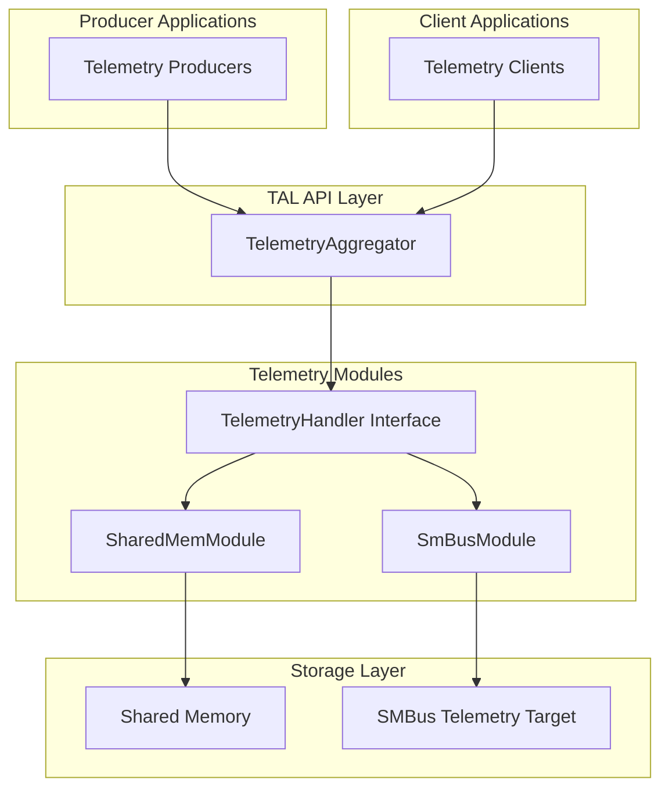
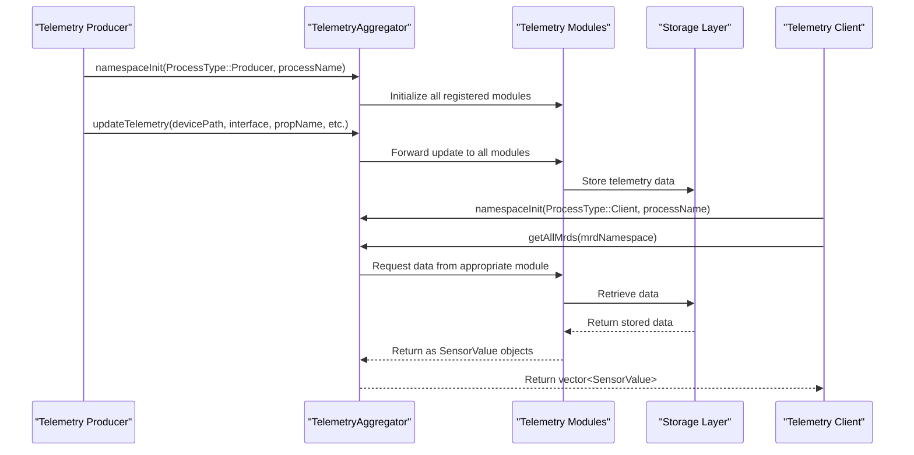
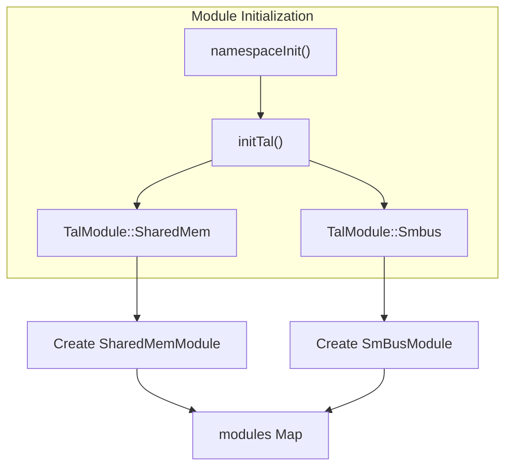
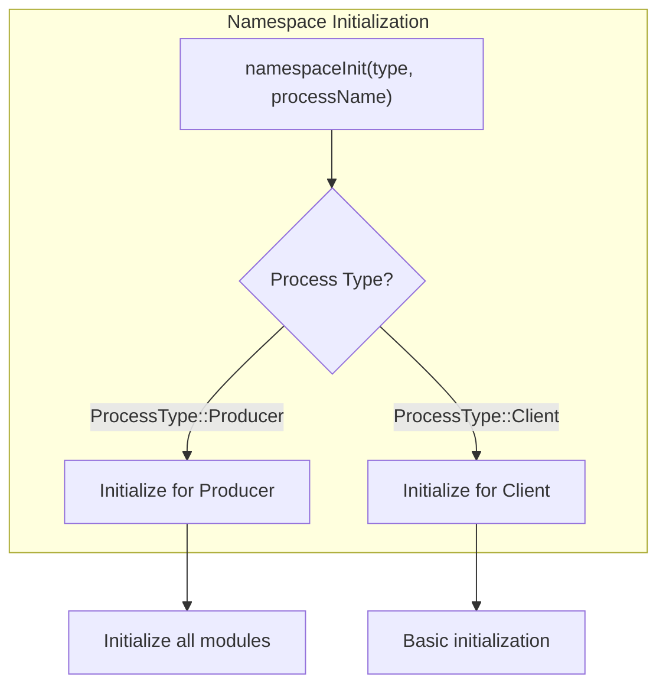

<!-- source: DeepWiki mcp.deepwiki.com · repo NVIDIA/nvidia-tal · page 1 Overview · fetched 2026-10-26 -->

# Overview

<details>
<summary>Relevant source files</summary>

The following files were used as context for generating this wiki page:

- [README.md](README.md)
- [lib/include/tal.hpp](lib/include/tal.hpp)
- [lib/tal.cpp](lib/tal.cpp)

</details>


The NVIDIA Telemetry Abstraction Layer (TAL) is a library that provides a unified interface for telemetry data collection, aggregation, and access across different telemetry modules. It creates an abstraction layer between telemetry producers (services that generate telemetry data) and telemetry consumers (clients that read telemetry data), allowing them to operate independently of the underlying infrastructure libraries or IPC mechanisms.

## Purpose and Scope

TAL is designed to solve the problem of tight coupling between applications and specific telemetry implementations. By introducing this abstraction layer, it enables:

- A consistent interface for both producers and consumers of telemetry data
- The ability to add new telemetry modules without modifying existing applications
- Isolation between different telemetry mechanisms (Shared Memory, SMBus, etc.)

The current implementation supports two primary telemetry modules:
- Shared Memory Module for inter-process communication
- SMBus Module for system management bus communication

For detailed information about the specific architecture and components, see [Architecture](#2). For information about individual telemetry modules, see [Telemetry Modules](#3).

## System Architecture

The following diagram illustrates the high-level architecture of the NVIDIA TAL system:



Sources: [lib/tal.cpp:25-32](), [lib/include/tal.hpp:57-123](), [README.md:7-35]()

## Key Components

### TelemetryAggregator

The `TelemetryAggregator` class serves as the main entry point to the TAL system, providing a static API for:
- Initializing telemetry modules
- Updating telemetry data across all registered modules
- Retrieving telemetry data from the appropriate module

This class is implemented in [lib/tal.cpp]() and provides the public interface that applications interact with.

Sources: [lib/include/tal.hpp:65-122](), [lib/tal.cpp:60-136]()

### TelemetryHandler Interface

The `TelemetryHandler` interface defines the common API that all telemetry modules must implement. This ensures a consistent approach to telemetry operations across different mechanisms. Implemented telemetry modules include:

- `SharedMemModule`: For shared memory-based telemetry
- `SmBusModule`: For SMBus-based telemetry

Sources: [lib/tal.cpp:26](), [README.md:20-25]()

## Data Flow

The following sequence diagram illustrates the typical data flow through the TAL system:



Sources: [lib/tal.cpp:36-58](), [lib/tal.cpp:60-77](), [lib/tal.cpp:80-97]()

## Module Initialization and Registration

TAL initializes its modules during the first call to `namespaceInit()`. The initialization code creates instances of the available telemetry modules and stores them in a global map:



Sources: [lib/tal.cpp:26-32](), [lib/tal.cpp:36-58](), [lib/tal.cpp:116-136]()

## TAL APIs

TAL provides several key APIs for interacting with telemetry data:

### Namespace Initialization

```cpp
static bool namespaceInit(ProcessType type, const std::string& processName = {});
```

This API initializes the telemetry modules and prepares them for operation. It takes a process type (Producer or Client) and a process name as input.

Sources: [lib/include/tal.hpp:77-78](), [lib/tal.cpp:116-136](), [README.md:38-52]()

### Update Telemetry

```cpp
static void updateTelemetry(const std::string& devicePath, const std::string& interface,
                           const std::string& propName, std::vector<uint8_t>& rawData,
                           const uint64_t timestamp, int rc,
                           nv::sensor_aggregation::DbusVariantType& value,
                           const std::string associatedEntityPath = {});
```

This API allows producers to update telemetry data across all registered modules.

Sources: [lib/include/tal.hpp:94-100](), [lib/tal.cpp:60-78](), [README.md:53-78]()

### Read Telemetry

```cpp
static std::vector<nv::shmem::SensorValue> getAllMrds(const std::string& mrdNamespace);
```

This API allows clients to retrieve all metric report definitions (MRDs) for a specific namespace.

Sources: [lib/include/tal.hpp:111-112](), [lib/tal.cpp:80-97](), [README.md:80-91]()

### Get Namespaces

```cpp
static std::vector<std::string> getMrdNamespaces();
```

This API returns a list of all available metric report namespaces.

Sources: [lib/include/tal.hpp:121](), [lib/tal.cpp:99-114](), [README.md:92-100]()

## Process Types

TAL supports two types of processes that interact with telemetry data:

1. **Producers** - Applications that generate and update telemetry data
2. **Clients** - Applications that consume telemetry data

This distinction is important during initialization, as the behavior differs based on the process type:



Sources: [lib/include/tal.hpp:59-63](), [lib/tal.cpp:116-136]()

## Current Limitations

- While TAL is designed to support multiple telemetry modules, the current implementation prioritizes Shared Memory for reading telemetry data (as seen in `getAllMrds` and `getMrdNamespaces`).
- SMBus module is conditionally compiled based on the `ENABLE_SMBUS` flag.

Sources: [lib/tal.cpp:28-32](), [lib/tal.cpp:80-114]()

---

