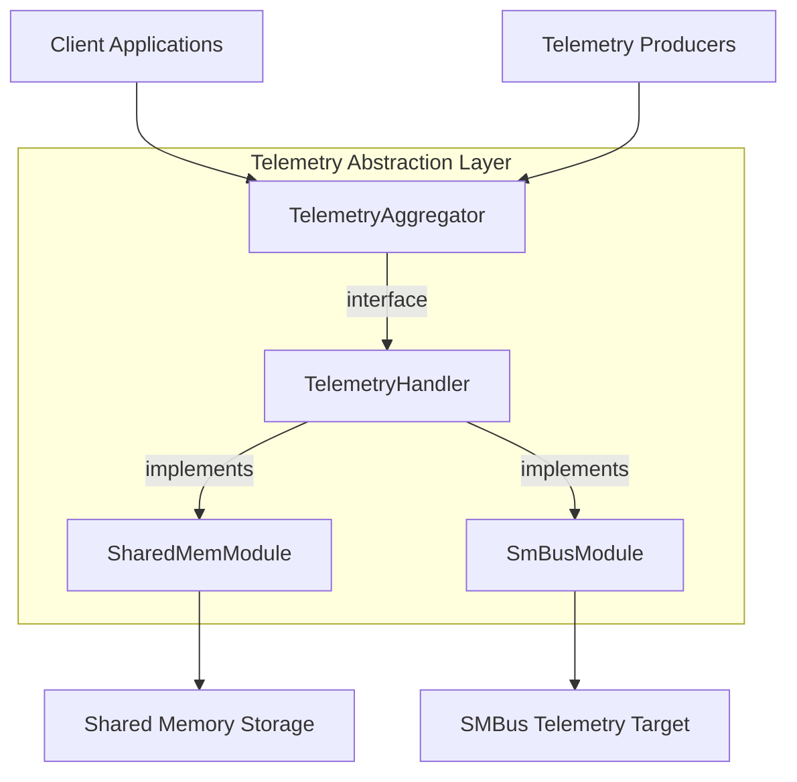
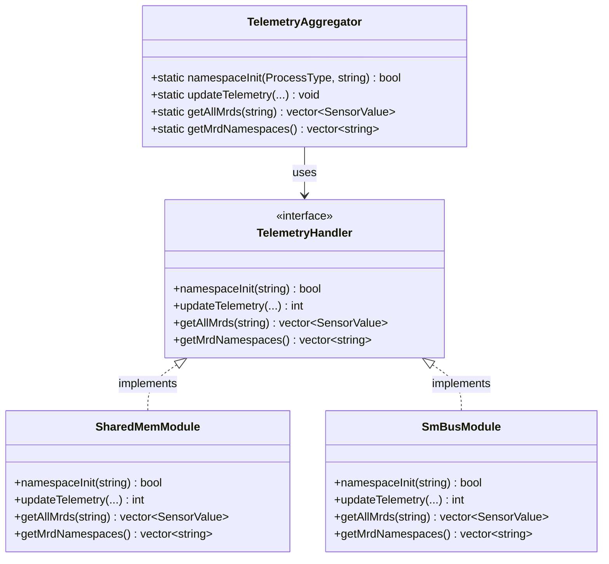
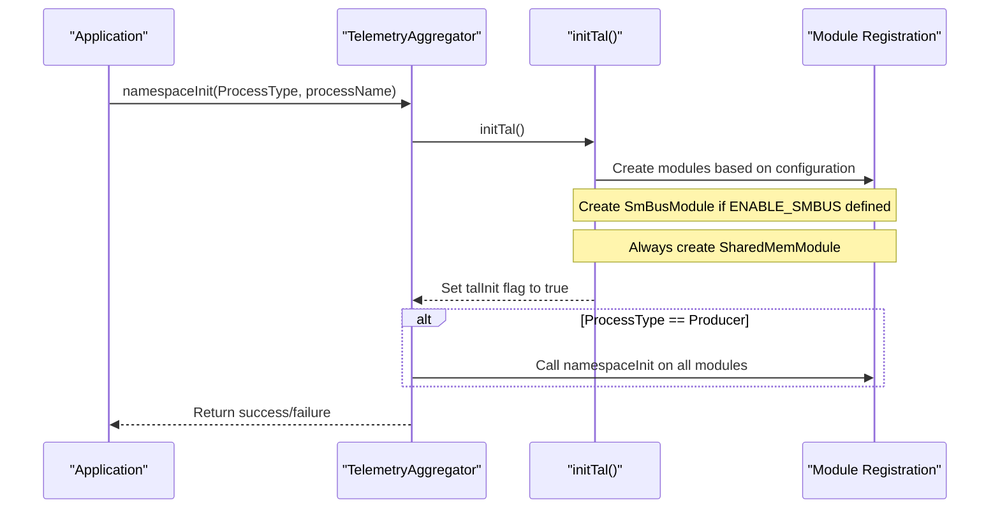
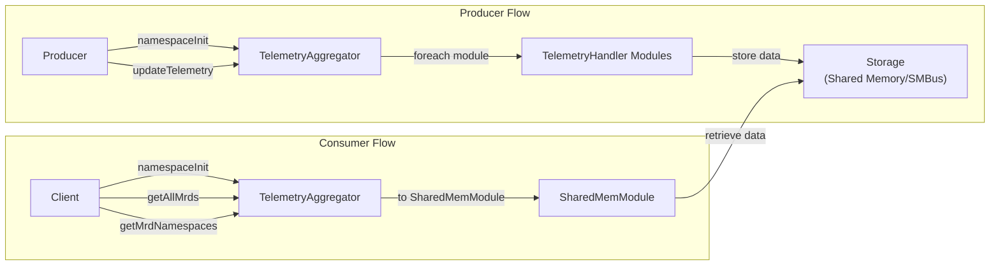
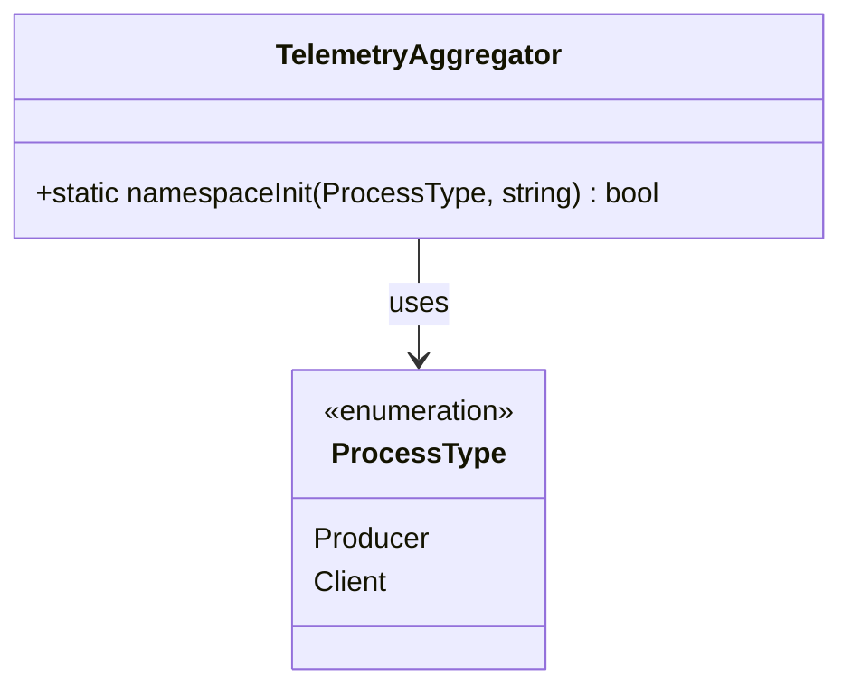

<!-- source: DeepWiki mcp.deepwiki.com · repo NVIDIA/nvidia-tal · page 2 Architecture · fetched 2026-10-26 -->

# Architecture

<details>
<summary>Relevant source files</summary>

The following files were used as context for generating this wiki page:

- [lib/include/tal.hpp](lib/include/tal.hpp)
- [lib/include/tal_module.hpp](lib/include/tal_module.hpp)
- [lib/tal.cpp](lib/tal.cpp)

</details>


## Purpose and Scope

This document describes the overall system architecture, design patterns, and key abstractions used in the NVIDIA Telemetry Abstraction Layer (TAL). It provides a comprehensive view of how the various components interact to collect, aggregate, and distribute telemetry data across different telemetry mechanisms. For specific details on individual components like the TelemetryAggregator or specific modules, see their respective pages ([TelemetryAggregator](#2.1), [TelemetryHandler Interface](#2.2), and [Telemetry Modules](#3)).

## System Architecture Overview

The NVIDIA TAL implements a modular architecture pattern that abstracts telemetry collection mechanisms behind a common interface. The system separates producers of telemetry data from consumers through a well-defined API, enabling applications to interact with telemetry data regardless of where it's stored or how it's gathered.



Sources: [lib/tal.cpp:24-58](), [lib/include/tal.hpp:65-122](), [lib/include/tal_module.hpp:32-97]()

## Core Components

The TAL architecture consists of the following key components:

| Component | Description | Source File |
|-----------|-------------|-------------|
| **TelemetryAggregator** | Central static class providing the public API for initializing, updating, and retrieving telemetry data | `tal.hpp` |
| **TelemetryHandler** | Interface that defines the contract for all telemetry modules | `tal_module.hpp` |
| **SharedMemModule** | Implementation for shared memory-based telemetry | `tal_shmem.hpp` |
| **SmBusModule** | Implementation for SMBus-based telemetry | `tal_smbus.hpp` |
| **TalModule Enum** | Enumeration used to identify different telemetry module types | `tal_module.hpp` |

Sources: [lib/include/tal_module.hpp:32-37](), [lib/include/tal.hpp:65-122]()

## Class Hierarchy and Relationships

The following diagram illustrates the class hierarchy and relationships between the key components in the TAL architecture:



Sources: [lib/include/tal_module.hpp:38-97](), [lib/include/tal.hpp:65-122](), [lib/tal.cpp:26-58]()

## Module Registration and Initialization

The TAL system initializes telemetry modules dynamically based on compile-time configuration. The initialization process is handled in the `initTal()` function:



Sources: [lib/tal.cpp:36-58](), [lib/tal.cpp:116-136]()

The system maintains modules in an unordered map with the module type as the key:

```cpp
std::unordered_map<TalModule, std::unique_ptr<TelemetryHandler>> modules;
```

This design allows the system to be extended with new module types without changing the core architecture.

Sources: [lib/tal.cpp:26]()

## Data Flow

The TAL architecture implements a data flow that supports both telemetry producers and consumers. The data flow is coordinated by the `TelemetryAggregator`, which routes requests to the appropriate modules.



Sources: [lib/tal.cpp:60-78](), [lib/tal.cpp:80-114]()

### Producer Path

When a producer updates telemetry data, the `TelemetryAggregator` fans out the update to all registered modules:

1. The producer calls `TelemetryAggregator::updateTelemetry()` with telemetry data
2. The aggregator checks if the system is initialized
3. For each registered module, the aggregator calls the module's `updateTelemetry()` method
4. Each module processes and stores the data according to its implementation

Sources: [lib/tal.cpp:60-78](), [lib/include/tal.hpp:94-100]()

### Consumer Path

When a client requests telemetry data, the `TelemetryAggregator` routes the request to the `SharedMemModule`:

1. The client calls `TelemetryAggregator::getAllMrds()` or `TelemetryAggregator::getMrdNamespaces()`
2. The aggregator checks if the system is initialized
3. The aggregator finds the `SharedMemModule` and forwards the request
4. The `SharedMemModule` retrieves and returns the requested data

Note that consumer operations currently only use the `SharedMemModule`, as seen in the implementation:

```cpp
for (auto& [talModule, module] : modules)
{
    if (talModule == TalModule::SharedMem)
    {
        return module->getAllMrds(mrdNamespace);
    }
}
```

Sources: [lib/tal.cpp:80-114](), [lib/include/tal.hpp:111-112](), [lib/include/tal.hpp:121]()

## Process Types

The TAL architecture supports two types of processes:

1. **Producer** - Processes that generate telemetry data
2. **Client** - Processes that consume telemetry data

This distinction is made during initialization through the `ProcessType` enum:



The initialization process differs based on the process type:

- For **Producers**, all modules are initialized with a call to their `namespaceInit()` method
- For **Clients**, modules are created but not initialized with a specific namespace

Sources: [lib/include/tal.hpp:59-63](), [lib/tal.cpp:116-136]()

## Error Handling

The TAL architecture implements basic error handling through return codes and logging:

- `namespaceInit()` returns a boolean indicating success or failure
- Module initialization errors are logged and aggregated
- Before operations, the system checks if initialization has occurred
- Error logging uses the `phosphor-logging/lg2.hpp` library

Sources: [lib/tal.cpp:67-71](), [lib/tal.cpp:83-87](), [lib/tal.cpp:101-105](), [lib/include/tal_module.hpp:21]()

## Extension Points

The TAL architecture is designed for extensibility. Key extension points include:

1. **Adding new telemetry modules**:
   - Implement the `TelemetryHandler` interface
   - Add a new module type to the `TalModule` enum
   - Update the `talModulesArray` and module creation logic in `initTal()`

2. **Adding new storage mechanisms**:
   - Implement as part of a new telemetry module
   - Ensure compatibility with the common telemetry data model

Sources: [lib/include/tal_module.hpp:38-97](), [lib/tal.cpp:28-32](), [lib/tal.cpp:36-58]()

## Summary

The TAL architecture provides a flexible and extensible framework for telemetry data collection and retrieval. By abstracting telemetry mechanisms behind a common interface, it enables applications to interact with telemetry data in a consistent way, regardless of the underlying storage or collection mechanism.

The modular design allows for easy extension with new telemetry mechanisms, while the clear separation between producers and consumers ensures efficient data flow.

---

