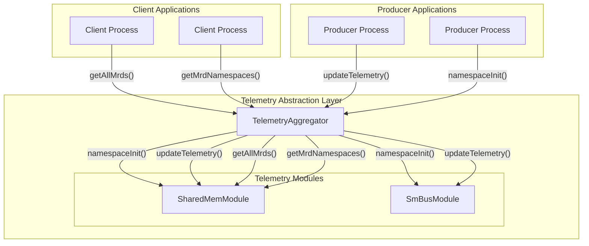
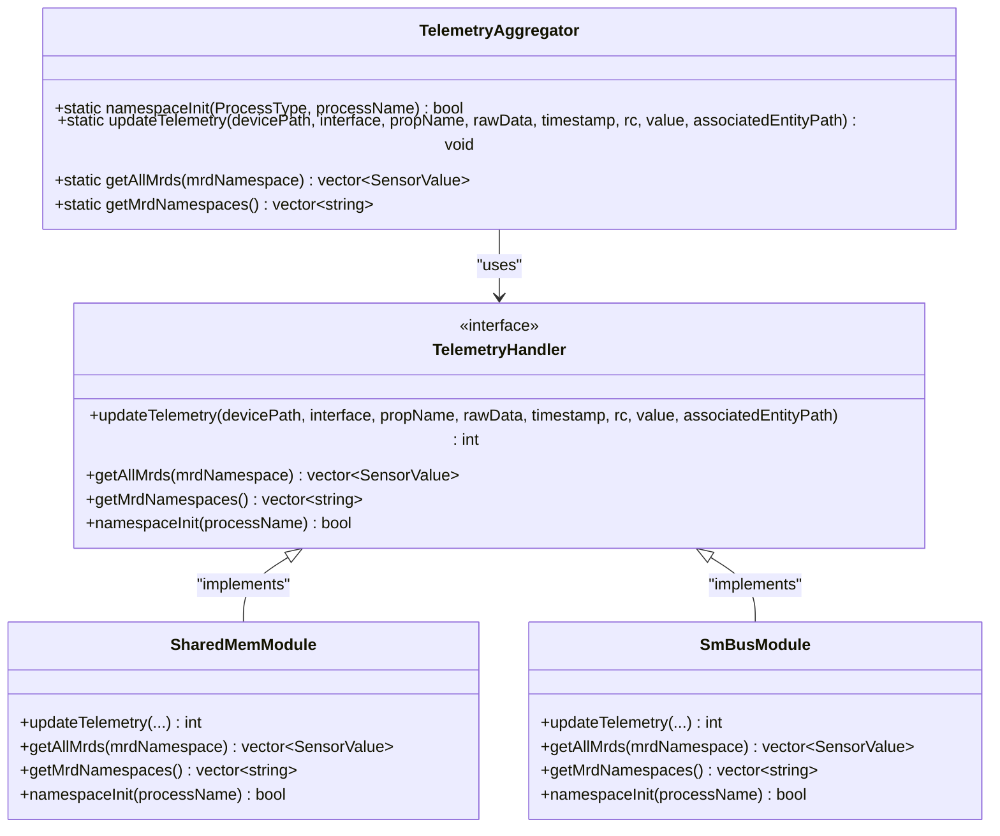
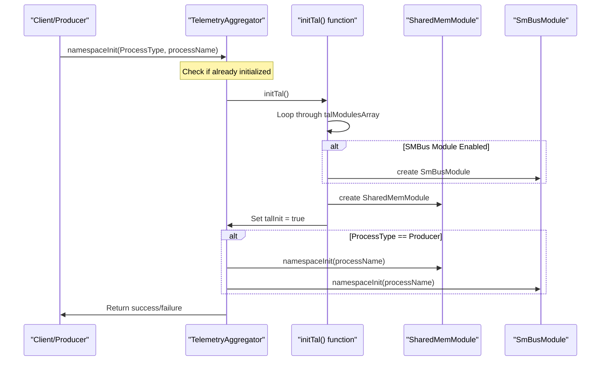
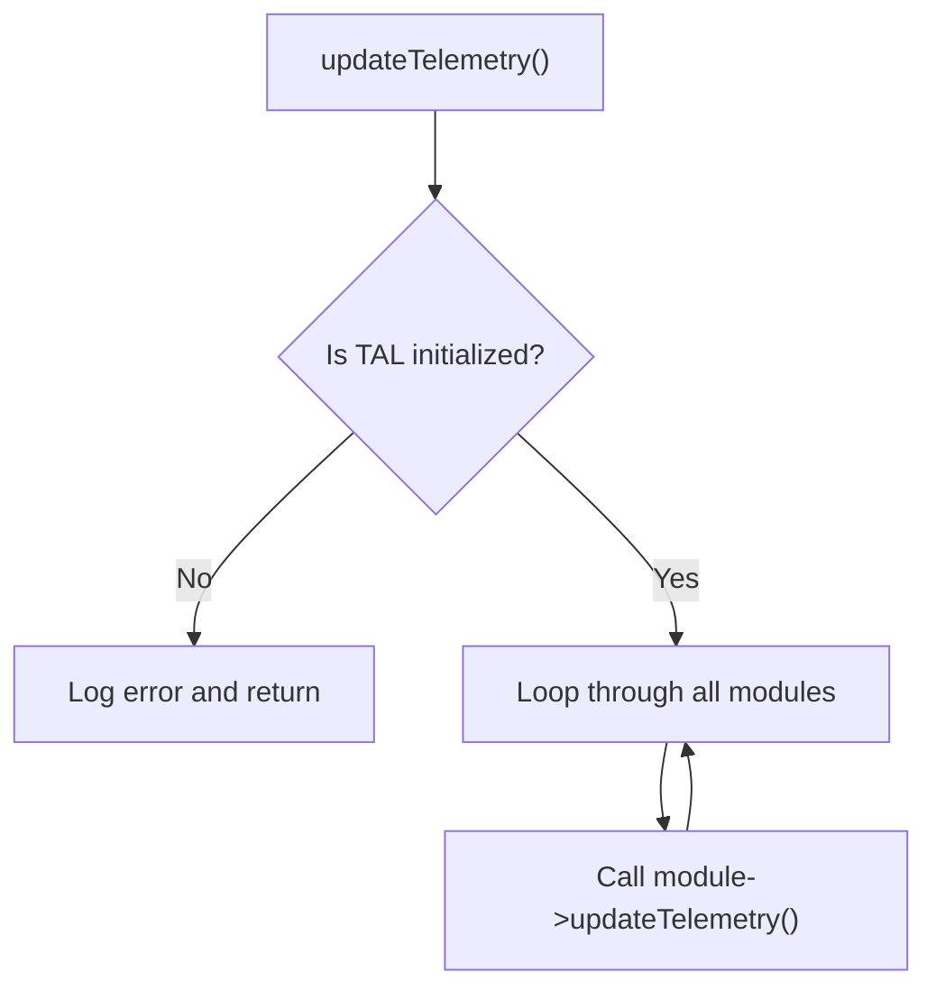
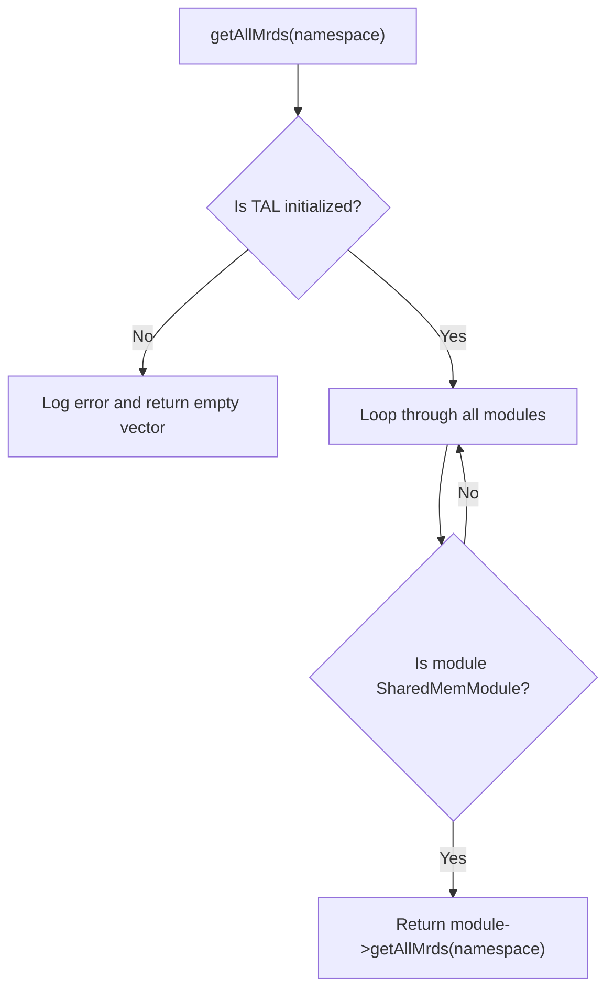
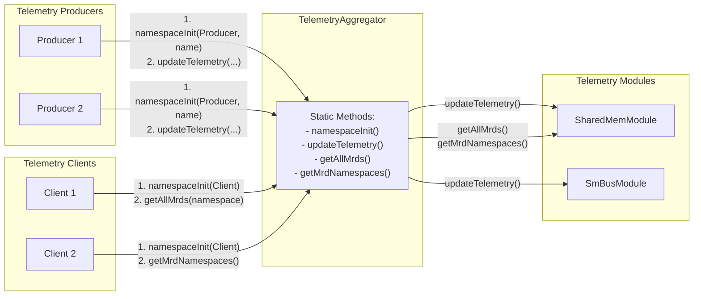

<!-- source: DeepWiki mcp.deepwiki.com · repo NVIDIA/nvidia-tal · page 2.1 TelemetryAggregator · fetched 2026-10-26 -->

# TelemetryAggregator

<details>
<summary>Relevant source files</summary>

The following files were used as context for generating this wiki page:

- [lib/include/tal.hpp](lib/include/tal.hpp)
- [lib/tal.cpp](lib/tal.cpp)

</details>


## Purpose and Scope

The TelemetryAggregator is the central coordination component of the NVIDIA Telemetry Abstraction Layer (TAL). It serves as the primary entry point for both telemetry producers and clients, providing a unified interface for telemetry operations across different underlying mechanisms. This class handles initialization of telemetry modules, distribution of telemetry updates, and retrieval of telemetry data.

For information about the specific telemetry module implementations, see [Telemetry Modules](#3), [Shared Memory Module](#3.1), and [SMBus Module](#3.2).

## Architecture Overview

The TelemetryAggregator acts as a facade that coordinates with multiple telemetry modules that implement the TelemetryHandler interface. It maintains a registry of modules and routes telemetry operations to the appropriate modules.



**TelemetryAggregator Component Diagram**

Sources: [lib/tal.cpp:1-137](), [lib/include/tal.hpp:58-123]()

## Implementation Details

The TelemetryAggregator is implemented as a class with static methods, functioning as a singleton pattern. It manages a collection of telemetry modules that are initialized at startup.



**TelemetryAggregator Class Diagram**

Sources: [lib/include/tal.hpp:58-123](), [lib/tal.cpp:26-58]()

### Internal State

The TelemetryAggregator maintains the following internal state:

- `modules`: A map of telemetry modules indexed by module type (SMBus, SharedMem)
- `talInit`: A boolean flag indicating whether TAL has been initialized
- `talModulesArray`: An array of module types to initialize

Sources: [lib/tal.cpp:26-34]()

## Initialization Process

The initialization process of the TelemetryAggregator follows these steps:



**TelemetryAggregator Initialization Sequence**

Sources: [lib/tal.cpp:36-58](), [lib/tal.cpp:116-136]()

The initialization process creates and registers the telemetry modules. When a producer process initializes TAL, it calls `namespaceInit()` on each module. Client processes only need to initialize TAL without initializing module namespaces.

## Key Operations

### Telemetry Updates

The `updateTelemetry` method distributes telemetry updates to all registered modules:



**Telemetry Update Flow**

Sources: [lib/tal.cpp:60-78]()

### Data Retrieval

The `getAllMrds` and `getMrdNamespaces` methods retrieve telemetry data specifically from the SharedMemModule:



**MRD Retrieval Flow**

Sources: [lib/tal.cpp:80-97](), [lib/tal.cpp:99-114]()

## API Reference

### Module Initialization

```cpp
static bool namespaceInit(ProcessType type, const std::string& processName = {})
```

Initializes the telemetry modules and, for producers, initializes each module's namespace.

**Parameters:**
- `type`: Type of process (Producer or Client)
- `processName`: Name of the process (required for producers)

**Returns:**
- `bool`: Success/failure status (all modules initialized successfully)

Sources: [lib/include/tal.hpp:77-78](), [lib/tal.cpp:116-136]()

### Telemetry Updates

```cpp
static void updateTelemetry(const std::string& devicePath, const std::string& interface,
                            const std::string& propName, std::vector<uint8_t>& rawData,
                            const uint64_t timestamp, int rc,
                            nv::sensor_aggregation::DbusVariantType& value,
                            const std::string associatedEntityPath = {})
```

Updates telemetry data across all registered modules.

**Parameters:**
- `devicePath`: Device path of the telemetry object
- `interface`: D-Bus interface of the telemetry object
- `propName`: Metric name
- `rawData`: Raw data of the value
- `timestamp`: Timestamp of the telemetry data
- `rc`: Return code (non-zero for NaN updates)
- `value`: Metric value as a variant type
- `associatedEntityPath`: Optional path for associating with entities

Sources: [lib/include/tal.hpp:94-100](), [lib/tal.cpp:60-78]()

### Data Retrieval

```cpp
static std::vector<nv::shmem::SensorValue> getAllMrds(const std::string& mrdNamespace)
```

Retrieves all Metric Report Definitions for a given namespace from shared memory.

**Parameters:**
- `mrdNamespace`: Namespace to retrieve MRDs from

**Returns:**
- Vector of SensorValue objects containing MRD data

```cpp
static std::vector<std::string> getMrdNamespaces()
```

Retrieves all available MRD namespaces from shared memory.

**Returns:**
- Vector of namespace strings

Sources: [lib/include/tal.hpp:111-121](), [lib/tal.cpp:80-114]()

## Process Types and Data Flow

The TelemetryAggregator supports two types of processes:

1. **Producers**: Generate telemetry data and update it through the TAL
2. **Clients**: Consume telemetry data by querying MRDs



**TelemetryAggregator Data Flow**

Sources: [lib/include/tal.hpp:59-63](), [lib/tal.cpp:116-136](), [lib/tal.cpp:60-114]()

## Error Handling

The TelemetryAggregator implements the following error handling:

1. Checks if TAL is initialized before operations
2. Logs errors when operations are attempted before initialization
3. Collects and aggregates module initialization status

| Error Condition | Handling |
|-----------------|----------|
| namespaceInit called when already initialized | Logs error and returns false |
| Operations attempted before initialization | Logs error and returns empty results |
| Module initialization failure | Propagates error to caller with aggregated boolean status |

Sources: [lib/tal.cpp:67-71](), [lib/tal.cpp:83-87](), [lib/tal.cpp:101-105](), [lib/tal.cpp:119-123]()

## Conclusion

The TelemetryAggregator serves as the central coordination point for the NVIDIA TAL system, providing a unified interface for telemetry operations while abstracting away the details of specific telemetry modules. It manages the initialization process, routes telemetry updates to appropriate modules, and provides consistent methods for retrieving telemetry data.

For details about the implementation of specific telemetry modules, refer to [Shared Memory Module](#3.1) and [SMBus Module](#3.2).

---

