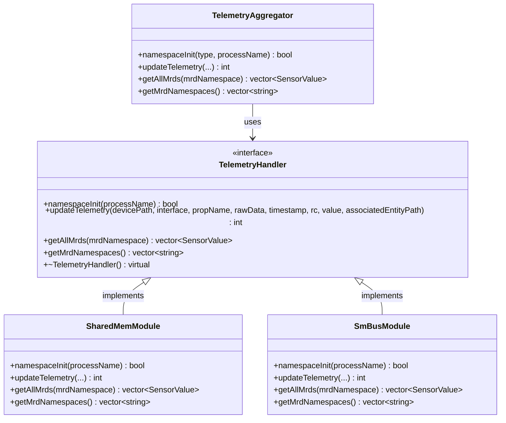
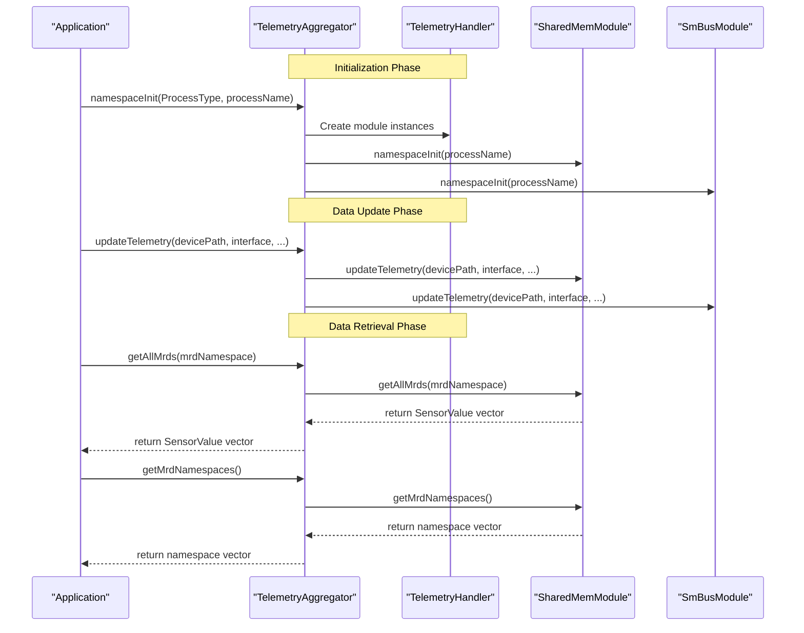
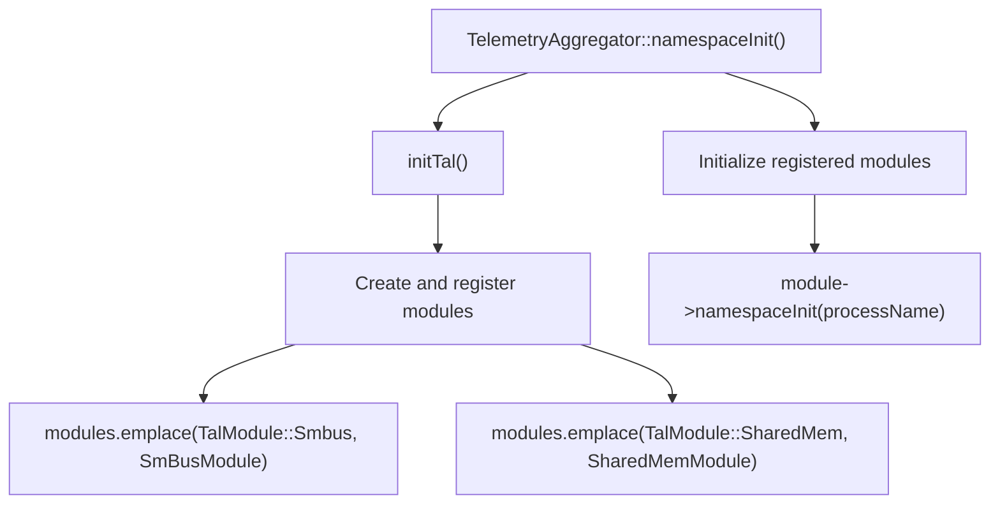
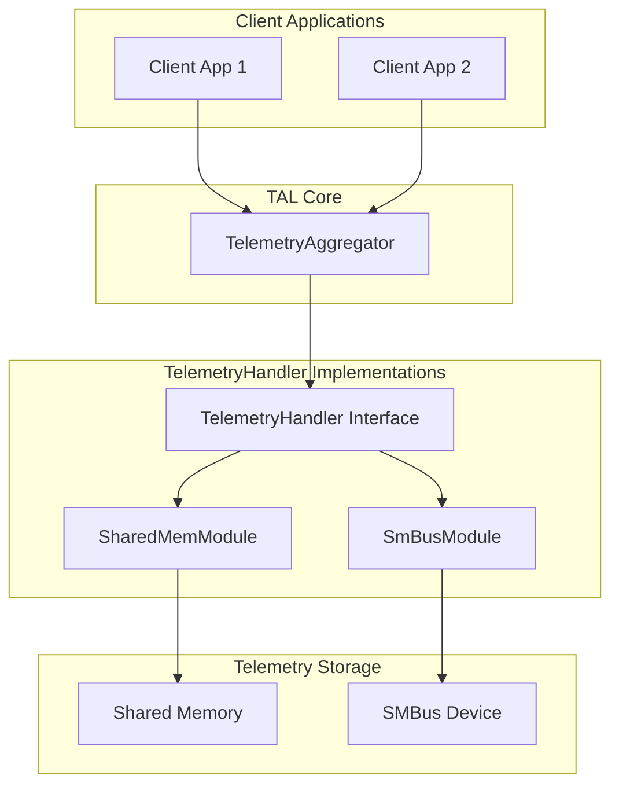

<!-- source: DeepWiki mcp.deepwiki.com · repo NVIDIA/nvidia-tal · page 2.2 TelemetryHandler Interface · fetched 2026-10-26 -->

# TelemetryHandler Interface

<details>
<summary>Relevant source files</summary>

The following files were used as context for generating this wiki page:

- [lib/include/tal_module.hpp](lib/include/tal_module.hpp)
- [lib/tal.cpp](lib/tal.cpp)

</details>


## Purpose and Scope

This document describes the `TelemetryHandler` interface, which is a core abstraction in the NVIDIA Telemetry Abstraction Layer (TAL). The interface defines the contract that all telemetry modules must implement to participate in the TAL ecosystem. For information about the overall system architecture, see [Architecture](#2) or about the concrete implementations of this interface, see [Telemetry Modules](#3).

Sources: [lib/include/tal_module.hpp:38-97]()

## Interface Overview

The `TelemetryHandler` interface serves as the bridge between the `TelemetryAggregator` and the various telemetry module implementations. It abstracts the details of different telemetry sources (Shared Memory, SMBus, etc.) and provides a unified API for telemetry operations.



Sources: [lib/include/tal_module.hpp:38-97](), [lib/tal.cpp:26-37]()

## Interface Methods

The `TelemetryHandler` interface defines four key methods that all telemetry modules must implement:

| Method | Description | Return Value |
|--------|-------------|-------------|
| `namespaceInit(processName)` | Initializes the namespace for a module | `bool` - Success status |
| `updateTelemetry(...)` | Updates telemetry data for a specific metric | `int` - Status code |
| `getAllMrds(mrdNamespace)` | Gets all Metric Report Definitions for a namespace | `vector<SensorValue>` |
| `getMrdNamespaces()` | Gets all MRD namespaces | `vector<string>` |

Sources: [lib/include/tal_module.hpp:41-94]()

### Method Details

#### namespaceInit

```cpp
virtual bool namespaceInit(const std::string& processName) = 0;
```

This method initializes the namespace for a module. It's called during system initialization to set up the module for a specific process.

Parameters:
- `processName`: The name of the producer service process

Return value: 
- `true` if namespace initialization is successful
- `false` otherwise

Sources: [lib/include/tal_module.hpp:42-48]()

#### updateTelemetry

```cpp
virtual int updateTelemetry(
    const std::string& devicePath,
    const std::string& interface,
    const std::string& propName,
    std::vector<uint8_t>& rawData, 
    const uint64_t timestamp,
    int rc, 
    nv::sensor_aggregation::DbusVariantType& value,
    const std::string associatedEntityPath = {}) = 0;
```

This method updates telemetry data for a specific metric. It's called whenever new telemetry data is available.

Parameters:
- `devicePath`: Device path of the telemetry object
- `interface`: Phosphor D-Bus interface of the telemetry object
- `propName`: Metric name
- `rawData`: Raw data for the SMBus interface
- `timestamp`: Timestamp of the telemetry object
- `rc`: Set to non-zero for NaN update
- `value`: Metric value
- `associatedEntityPath`: Optional for most metrics, required for platform environment metrics

Return value:
- Status code indicating success or failure

Sources: [lib/include/tal_module.hpp:50-71]()

#### getAllMrds

```cpp
virtual std::vector<nv::shmem::SensorValue> getAllMrds(const std::string& mrdNamespace) = 0;
```

This method retrieves all Metric Report Definitions (MRDs) for a specific namespace.

Parameters:
- `mrdNamespace`: The namespace for which to retrieve MRDs

Return value:
- Vector of `SensorValue` objects containing the MRDs
- Exception is thrown if the namespace doesn't exist or has no elements

Sources: [lib/include/tal_module.hpp:73-82]()

#### getMrdNamespaces

```cpp
virtual std::vector<std::string> getMrdNamespaces() { return {}; }
```

This method retrieves all MRD namespaces available in the module. It has a default implementation that returns an empty vector, which modules can override if they support multiple namespaces.

Return value:
- Vector of namespace strings

Sources: [lib/include/tal_module.hpp:84-94]()

## Integration with TelemetryAggregator

The `TelemetryAggregator` is the main entry point for the TAL system and uses the `TelemetryHandler` interface to interact with the concrete module implementations. The following diagram illustrates this relationship and the data flow through the system:



Sources: [lib/tal.cpp:60-136]()

## Module Registration and Initialization

During system initialization, the `TelemetryAggregator` creates instances of modules that implement the `TelemetryHandler` interface and stores them in a map. This process is illustrated below:



Sources: [lib/tal.cpp:36-58](), [lib/tal.cpp:116-136]()

## Module Types and Enumeration

The TAL system defines an enumeration `TalModule` to identify the different types of telemetry modules:

```cpp
enum class TalModule
{
    Smbus,
    SharedMem,
};
```

This enumeration is used as the key in the modules map to identify each module type.

Sources: [lib/include/tal_module.hpp:32-36](), [lib/tal.cpp:26]()

## Implementation Requirements

When implementing the `TelemetryHandler` interface for a new telemetry module, the following must be considered:

1. All pure virtual methods must be implemented:
   - `namespaceInit`
   - `updateTelemetry`
   - `getAllMrds`

2. The `getMrdNamespaces` method has a default implementation but should be overridden if the module supports multiple namespaces.

3. The implementation must handle all parameters passed to the methods correctly, especially in `updateTelemetry` which has many parameters.

4. Error handling should be robust, with appropriate return values indicating success or failure.

Sources: [lib/include/tal_module.hpp:38-97]()

## Telemetry Handler in System Architecture

The `TelemetryHandler` interface plays a crucial role in the overall TAL architecture, as shown in the following diagram:



Sources: [lib/tal.cpp:26-136](), [lib/include/tal_module.hpp:38-97]()

## Summary

The `TelemetryHandler` interface is a fundamental component of the NVIDIA TAL system that:

1. Provides a uniform API for different telemetry modules
2. Abstracts the details of specific telemetry sources
3. Defines the contract for telemetry operations (initialization, updates, retrieval)
4. Enables the `TelemetryAggregator` to work with multiple telemetry modules in a consistent way

By implementing this interface, new telemetry sources can be integrated into the TAL system without changing the core components or client applications.

---

