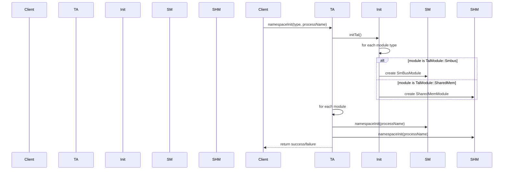
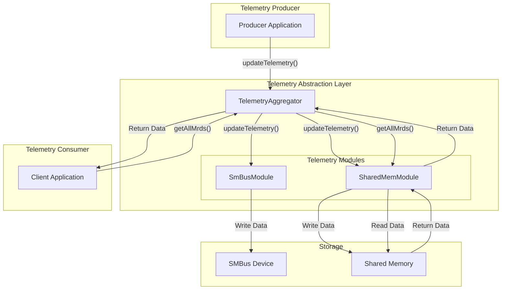

<!-- source: DeepWiki mcp.deepwiki.com · repo NVIDIA/nvidia-tal · page 3 Telemetry Modules · fetched 2026-10-26 -->

# Telemetry Modules

<details>
<summary>Relevant source files</summary>

The following files were used as context for generating this wiki page:

- [lib/include/tal_module.hpp](lib/include/tal_module.hpp)
- [lib/tal.cpp](lib/tal.cpp)

</details>


## Overview

This document provides an in-depth overview of the Telemetry Modules in NVIDIA's Telemetry Abstraction Layer (TAL). Telemetry Modules are implementations of the `TelemetryHandler` interface that process and manage telemetry data from different sources. For information about the central aggregator that coordinates these modules, see [TelemetryAggregator](#2.1).

## Module Architecture

The TAL system employs a modular design where specialized modules handle telemetry data from different sources. Each module implements a common interface (`TelemetryHandler`), allowing the `TelemetryAggregator` to interact with them in a consistent manner regardless of their underlying implementation.

```mermaid
classDiagram
    class "TelemetryHandler" {
        <<interface>>
        +namespaceInit(processName) bool
        +updateTelemetry(...) int
        +getAllMrds(mrdNamespace) vector~SensorValue~
        +getMrdNamespaces() vector~string~
    }
    
    class "SharedMemModule" {
        +namespaceInit(processName) bool
        +updateTelemetry(...) int
        +getAllMrds(mrdNamespace) vector~SensorValue~
        +getMrdNamespaces() vector~string~
    }
    
    class "SmBusModule" {
        +namespaceInit(processName) bool
        +updateTelemetry(...) int
        +getAllMrds(mrdNamespace) vector~SensorValue~
        +getMrdNamespaces() vector~string~
    }
    
    class "TelemetryAggregator" {
        +static namespaceInit(type, processName) bool
        +static updateTelemetry(...) void
        +static getAllMrds(mrdNamespace) vector~SensorValue~
        +static getMrdNamespaces() vector~string~
    }
    
    TelemetryHandler <|.. SharedMemModule
    TelemetryHandler <|.. SmBusModule
    TelemetryAggregator --> TelemetryHandler : uses
```

Sources: [lib/include/tal_module.hpp:30-98](), [lib/tal.cpp:26-34]()

## Module Types

TAL currently supports two types of telemetry modules:

| Module Type | Description | Implementation Class |
|-------------|-------------|---------------------|
| SharedMem | Handles telemetry via shared memory | `SharedMemModule` |
| Smbus | Handles telemetry via System Management Bus | `SmBusModule` |

These module types are defined in the `TalModule` enum class:

```cpp
enum class TalModule
{
    Smbus,
    SharedMem,
};
```

Sources: [lib/include/tal_module.hpp:32-36](), [lib/tal.cpp:28-32]()

## TelemetryHandler Interface

All telemetry modules must implement the `TelemetryHandler` interface, which defines the core functionality required for telemetry operations. This interface serves as the contract between the `TelemetryAggregator` and the various module implementations.

```mermaid
classDiagram
    class "TelemetryHandler" {
        <<interface>>
        +namespaceInit(processName: string) bool
        +updateTelemetry(devicePath: string, interface: string, propName: string, rawData: vector~uint8_t~, timestamp: uint64_t, rc: int, value: DbusVariantType, associatedEntityPath: string) int
        +getAllMrds(mrdNamespace: string) vector~SensorValue~
        +getMrdNamespaces() vector~string~
        +~TelemetryHandler() virtual
    }
```

The interface defines four primary methods:

1. `namespaceInit`: Initializes the namespace for the module
2. `updateTelemetry`: Updates telemetry data for a specific metric
3. `getAllMrds`: Retrieves all Metric Report Definitions (MRDs) for a given namespace
4. `getMrdNamespaces`: Retrieves all available MRD namespaces

Sources: [lib/include/tal_module.hpp:38-97]()

## Module Initialization and Management

The TAL system initializes and manages telemetry modules through the `TelemetryAggregator`. When `namespaceInit` is called, the system creates instances of each available module and stores them in a map for future operations.



The module initialization is handled by the `initTal` function, which:

1. Iterates through each module type in `talModulesArray`
2. Creates appropriate module instances based on the type
3. Stores each module in the `modules` map

Sources: [lib/tal.cpp:36-58](), [lib/tal.cpp:116-136]()

## Module Registry

The TAL system maintains a registry of telemetry modules in a global unordered map:

```cpp
std::unordered_map<TalModule, std::unique_ptr<TelemetryHandler>> modules;
```

This registry maps module types to their corresponding implementation instances. The system determines which modules to load at initialization time based on the `talModulesArray`:

```cpp
TalModule talModulesArray[] = {
#ifdef ENABLE_SMBUS
    TalModule::Smbus,
#endif
    TalModule::SharedMem};
```

Note that SMBus module support is conditional and will only be included if `ENABLE_SMBUS` is defined.

Sources: [lib/tal.cpp:26-32]()

## Data Flow Through Modules

Telemetry data flows through the system following a consistent path through the modules. The `TelemetryAggregator` coordinates this flow by dispatching operations to the appropriate modules.



### Update Flow

When `updateTelemetry` is called on the `TelemetryAggregator`, the system:

1. Checks if TAL has been initialized
2. If initialized, forwards the telemetry update to all registered modules
3. Each module processes the update according to its specific implementation

```cpp
void TelemetryAggregator::updateTelemetry(...)
{
    if (!talInit)
    {
        lg2::error("namespaceInit for tal is not invoked");
        return;
    }

    for (auto& [ns, module] : modules)
    {
        module->updateTelemetry(devicePath, interface, propName, rawData,
                              timestamp, rc, value, associatedEntityPath);
    }
}
```

Sources: [lib/tal.cpp:60-78]()

### Query Flow

When `getAllMrds` or `getMrdNamespaces` is called, the system:

1. Checks if TAL has been initialized
2. If initialized, finds the `SharedMem` module
3. Forwards the query to the `SharedMem` module
4. Returns the result to the caller

Currently, these query operations are specifically implemented to work with the `SharedMem` module:

```cpp
std::vector<nv::shmem::SensorValue>
    TelemetryAggregator::getAllMrds(const std::string& mrdNamespace)
{
    if (!talInit)
    {
        lg2::error("namespaceInit for tal is not invoked");
        return {};
    }

    for (auto& [talModule, module] : modules)
    {
        if (talModule == TalModule::SharedMem)
        {
            return module->getAllMrds(mrdNamespace);
        }
    }
    return {};
}
```

Sources: [lib/tal.cpp:80-97](), [lib/tal.cpp:99-114]()

## Module Implementation Details

### SharedMemModule

The `SharedMemModule` handles telemetry data through shared memory mechanisms. It provides:

- Data storage and retrieval through shared memory
- Support for Metric Report Definitions (MRDs) and namespaces
- Efficient inter-process communication for telemetry data

For details on the SharedMemModule implementation, see [Shared Memory Module](#3.1).

### SmBusModule

The `SmBusModule` handles telemetry data through the System Management Bus (SMBus). It provides:

- Communication with SMBus devices for telemetry data
- Mapping of telemetry metrics to SMBus registers
- Support for hardware-level sensor readings

For details on the SmBusModule implementation, see [SMBus Module](#3.2).

## Summary

Telemetry Modules are the core components that implement the actual telemetry functionality in the TAL system. They follow a common interface (`TelemetryHandler`) that enables the system to work with different telemetry sources in a unified way. The current implementation supports two module types: Shared Memory and SMBus.

The modular architecture of TAL allows for:
- Separation of concerns between different telemetry sources
- Consistent API for telemetry operations
- Extensibility through additional module implementations
- Conditional compilation of modules based on system requirements

---

