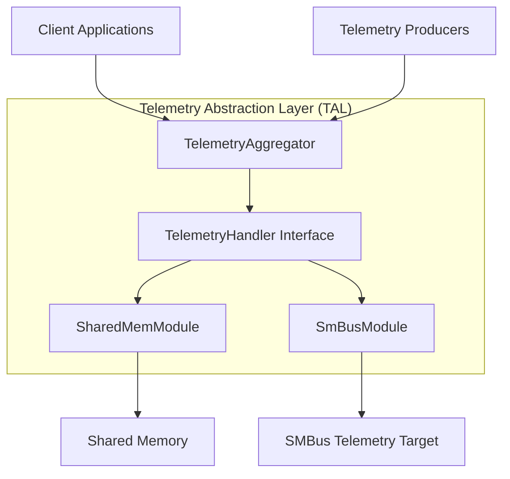
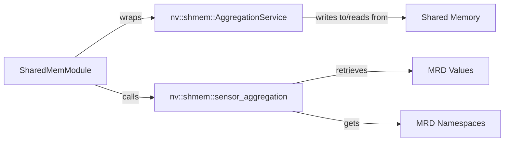
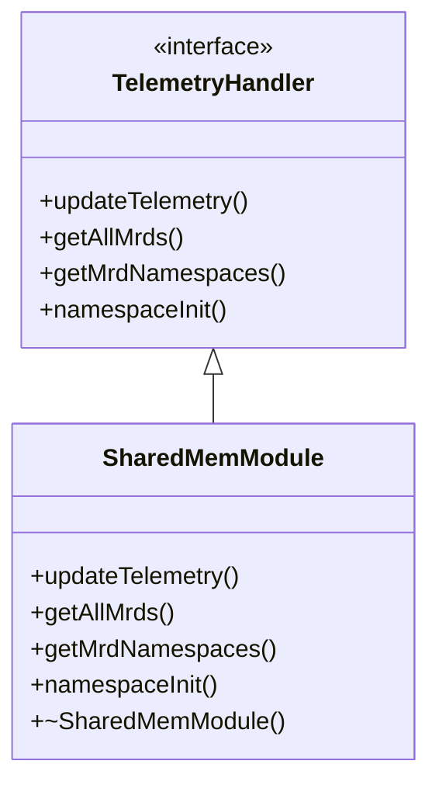
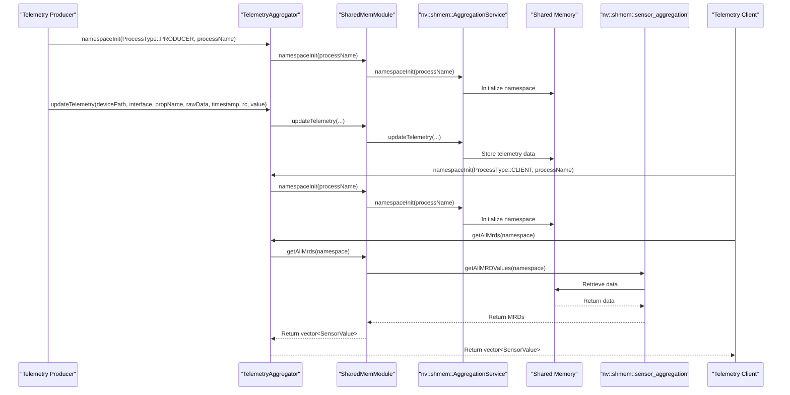
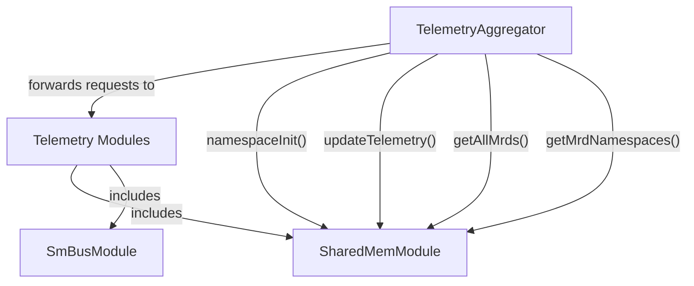

<!-- source: DeepWiki mcp.deepwiki.com · repo NVIDIA/nvidia-tal · page 3.1 Shared Memory Module · fetched 2026-10-26 -->

# Shared Memory Module

<details>
<summary>Relevant source files</summary>

The following files were used as context for generating this wiki page:

- [lib/include/tal_shmem.hpp](lib/include/tal_shmem.hpp)
- [lib/tal_shmem.cpp](lib/tal_shmem.cpp)

</details>


The Shared Memory Module is a core component of the NVIDIA Telemetry Abstraction Layer (TAL) that implements the `TelemetryHandler` interface to provide telemetry data storage and retrieval through shared memory mechanisms. This module allows both telemetry producers and clients to communicate efficiently by storing telemetry data in memory segments that can be accessed by multiple processes.

For information about the complementary telemetry module that operates using the SMBus protocol, see [SMBus Module](#3.2).

## Architecture

### Position in the TAL System

**TAL System Architecture**


The `SharedMemModule` is one of the core implementations of the `TelemetryHandler` interface. It provides a standardized way to store and retrieve telemetry data using shared memory, enabling efficient inter-process communication between telemetry producers and consumers.

Sources: [lib/include/tal_shmem.hpp:22-40]()

### Internal Structure

**SharedMemModule Internal Architecture**


Internally, the `SharedMemModule` primarily serves as a wrapper that delegates its functionality to:
- The `nv::shmem::AggregationService` for telemetry updates and namespace initialization
- The `nv::shmem::sensor_aggregation` namespace for retrieving MRD (Metric Report Definition) values and namespaces

Sources: [lib/tal_shmem.cpp:30-32](), [lib/tal_shmem.cpp:40](), [lib/tal_shmem.cpp:46](), [lib/tal_shmem.cpp:51]()

## Class Implementation

**SharedMemModule Class Hierarchy**


The `SharedMemModule` implements all methods required by the `TelemetryHandler` interface as shown in the table below:

| Method | Purpose | Implementation Details |
|--------|---------|----------------|
| `namespaceInit` | Initializes the namespace for the process | Delegates to `nv::shmem::AggregationService::namespaceInit` [lib/tal_shmem.cpp:35-41]() |
| `updateTelemetry` | Updates telemetry data for a device/property | Delegates to `nv::shmem::AggregationService::updateTelemetry` [lib/tal_shmem.cpp:23-33]() |
| `getAllMrds` | Retrieves all MRDs for a namespace | Delegates to `nv::shmem::sensor_aggregation::getAllMRDValues` [lib/tal_shmem.cpp:43-47]() |
| `getMrdNamespaces` | Gets all available MRD namespaces | Delegates to `nv::shmem::sensor_aggregation::getMrdNamespacesValues` [lib/tal_shmem.cpp:49-52]() |

Sources: [lib/include/tal_shmem.hpp:24-37](), [lib/tal_shmem.cpp:23-52]()

## Data Flow

**Telemetry Data Flow Through SharedMemModule**


This sequence diagram illustrates the complete data flow through the SharedMemModule:

1. **Initialization Phase**: Both producers and clients first initialize their respective namespaces
2. **Data Production Phase**: Producers update telemetry data through the TelemetryAggregator, which is delegated to the SharedMemModule and ultimately stored in shared memory
3. **Data Consumption Phase**: Clients retrieve telemetry data by requesting MRDs from specific namespaces

Sources: [lib/tal_shmem.cpp:35-40](), [lib/tal_shmem.cpp:23-32](), [lib/tal_shmem.cpp:43-47]()

## Method Details

### namespaceInit

The `namespaceInit` method initializes a namespace in shared memory for the calling process. This is required before any telemetry operations can be performed.

```cpp
bool SharedMemModule::namespaceInit(const std::string& processName)
```

The method logs the initialization attempt and delegates to `nv::shmem::AggregationService::namespaceInit`. Initialization must be done by both producers and clients.

Sources: [lib/tal_shmem.cpp:35-41]()

### updateTelemetry

The `updateTelemetry` method is used by telemetry producers to update telemetry data in shared memory:

```cpp
int SharedMemModule::updateTelemetry(const std::string& devicePath, 
                                    const std::string& interface,
                                    const std::string& propName, 
                                    std::vector<uint8_t>& rawData,
                                    const uint64_t timestamp, 
                                    int rc,
                                    nv::sensor_aggregation::DbusVariantType& value,
                                    const std::string associatedEntityPath)
```

It takes parameters that identify the telemetry source (devicePath, interface, propName), the telemetry data (value, rawData, timestamp), return code (rc), and optional associatedEntityPath. It simply delegates to `nv::shmem::AggregationService::updateTelemetry`.

Sources: [lib/tal_shmem.cpp:23-33]()

### getAllMrds and getMrdNamespaces

These methods are used by telemetry clients to retrieve telemetry data:

```cpp
std::vector<nv::shmem::SensorValue> SharedMemModule::getAllMrds(const std::string& mrdNamespace)
std::vector<std::string> SharedMemModule::getMrdNamespaces()
```

`getAllMrds` retrieves all Metric Report Definitions (MRDs) for a given namespace, while `getMrdNamespaces` retrieves all available MRD namespaces. They delegate to the corresponding functions in `nv::shmem::sensor_aggregation`.

Sources: [lib/tal_shmem.cpp:43-47](), [lib/tal_shmem.cpp:49-52]()

## Integration with TelemetryAggregator

**SharedMemModule Integration with TelemetryAggregator**


The `TelemetryAggregator` exposes the telemetry operations as static methods that are routed to the appropriate telemetry module, including the `SharedMemModule`. This provides client applications with a single entry point for all telemetry operations, regardless of the underlying implementation.

For more information about the TelemetryAggregator, see [TelemetryAggregator](#2.1).

Sources: [lib/include/tal_shmem.hpp:22-40]()

## Conclusion

The `SharedMemModule` is a fundamental component of the NVIDIA Telemetry Abstraction Layer that:

1. Implements the `TelemetryHandler` interface to provide a standard API for telemetry operations
2. Enables efficient inter-process communication of telemetry data through shared memory
3. Delegates to specialized components (`AggregationService` and `sensor_aggregation`) to handle the actual shared memory operations
4. Provides methods for both telemetry producers (to update data) and clients (to retrieve data)
5. Integrates with the `TelemetryAggregator` to provide a unified access point for telemetry operations

The modular design of the TAL, with `SharedMemModule` as one of its key components, allows the system to be flexible and extensible while maintaining a consistent interface for telemetry operations.

---

