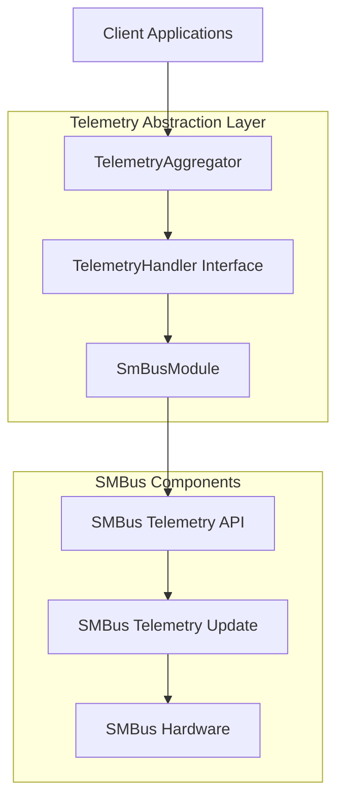
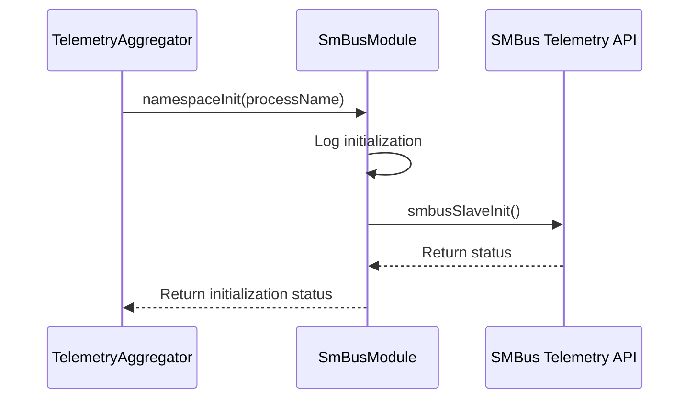
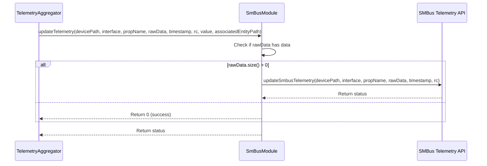
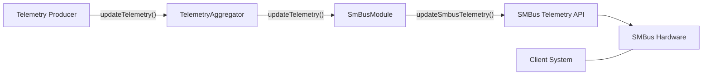
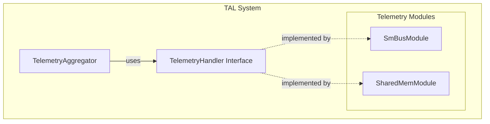

<!-- source: DeepWiki mcp.deepwiki.com · repo NVIDIA/nvidia-tal · page 3.2 SMBus Module · fetched 2026-10-26 -->

# SMBus Module

<details>
<summary>Relevant source files</summary>

The following files were used as context for generating this wiki page:

- [lib/include/tal_smbus.hpp](lib/include/tal_smbus.hpp)
- [lib/tal_smbus.cpp](lib/tal_smbus.cpp)

</details>


## Purpose and Scope

The SMBus Module is a telemetry handler implementation within the NVIDIA Telemetry Abstraction Layer (TAL) that provides an interface for collecting and forwarding telemetry data via the System Management Bus (SMBus). It implements the `TelemetryHandler` interface and serves as a bridge between applications that generate telemetry data and the SMBus hardware interface.

This document focuses specifically on the SMBus Module implementation. For information about the SMBus Telemetry Target that this module interacts with, see [SMBus Telemetry Target](#4). For details about the SMBus Telemetry API, see [SMBus Telemetry API](#4.1).

## Architecture Overview

The SMBus Module fits into the TAL architecture as shown in the following diagram:



Sources: [lib/include/tal_smbus.hpp:18-40](), [lib/tal_smbus.cpp:18-53]()

## Class Structure

The SMBus Module is implemented as the `SmBusModule` class, which inherits from the `TelemetryHandler` interface:

```mermaid
classDiagram
    class TelemetryHandler {
        <<interface>>
        +updateTelemetry(devicePath, interface, propName, rawData, timestamp, rc, value, associatedEntityPath) int
        +getAllMrds(mrdNamespace) vector~SensorValue~
        +getMrdNamespaces() vector~string~
        +namespaceInit(processName) bool
        +~TelemetryHandler() virtual
    }
    
    class SmBusModule {
        +updateTelemetry(devicePath, interface, propName, rawData, timestamp, rc, value, associatedEntityPath) int
        +getAllMrds(mrdNamespace) vector~SensorValue~
        +namespaceInit(processName) bool
        +~SmBusModule() virtual
    }
    
    TelemetryHandler <|-- SmBusModule
    SmBusModule --> "updateSmbusTelemetry()"
    SmBusModule --> "smbusSlaveInit()"
```

Sources: [lib/include/tal_smbus.hpp:23-39]()

## Implementation Details

The SMBus Module implementation is conditionally compiled based on the `ENABLE_SMBUS` flag, allowing the module to be included or excluded at compile time. If enabled, the module provides the following functionality:

### Initialization

The `namespaceInit` method initializes the SMBus namespace for a given process:



The method logs the initialization with the process name and calls `smbusSlaveInit()` from the SMBus Telemetry API to initialize the SMBus slave functionality.

Sources: [lib/tal_smbus.cpp:45-52]()

### Telemetry Updates

The `updateTelemetry` method is used to update telemetry data over SMBus:



The method checks if the raw data vector contains any data. If it does, it forwards the telemetry update to the `updateSmbusTelemetry` function in the SMBus Telemetry API. If no raw data is provided, it returns success (0) without taking any action.

Sources: [lib/tal_smbus.cpp:24-37]()

### Metric Report Definitions

The `getAllMrds` method is implemented to return an empty vector, indicating that this module does not support retrieving Metric Report Definitions (MRDs) directly:

```cpp
std::vector<nv::shmem::SensorValue> tal::SmBusModule::getAllMrds(const std::string& mrdNamespace)
{
    return {};
}
```

This suggests that telemetry data sent via SMBus is only for real-time transmission and is not stored for later retrieval via the MRD mechanism.

Sources: [lib/tal_smbus.cpp:39-43]()

## Data Flow

The following diagram illustrates the data flow through the SMBus Module:



Sources: [lib/tal_smbus.cpp:24-37]()

## Integration with the TAL System

The SMBus Module is integrated into the TAL system through the `TelemetryAggregator`, which maintains instances of all telemetry handlers, including the SMBus Module. When telemetry data needs to be sent via SMBus, the aggregator routes the call to the SMBus Module's `updateTelemetry` method.

The integration process follows these steps:

1. The module is compiled if the `ENABLE_SMBUS` flag is defined
2. The module is instantiated by the `TelemetryAggregator`
3. The module initializes the SMBus slave through `namespaceInit` when a process registers
4. Telemetry updates are routed to the module through the aggregator
5. The module forwards updates to the SMBus Telemetry API



Sources: [lib/include/tal_smbus.hpp:18-40](), [lib/tal_smbus.cpp:18-53]()

## Limitations and Considerations

1. **Conditional Compilation**: The SMBus Module is only included if `ENABLE_SMBUS` is defined, making it an optional component of TAL.
2. **No MRD Support**: The module does not support retrieving Metric Report Definitions (MRDs), returning an empty vector when `getAllMrds` is called.
3. **Raw Data Requirement**: The `updateTelemetry` method only forwards updates to the SMBus Telemetry API if raw data is provided.
4. **Dependencies**: The module depends on the SMBus Telemetry Target API, specifically the `updateSmbusTelemetry` and `smbusSlaveInit` functions.

## Related Components

The SMBus Module interacts with several related components:

| Component | Relationship | Description |
|-----------|--------------|-------------|
| TelemetryAggregator | Uses SMBus Module | The central component that routes telemetry operations to appropriate modules |
| TelemetryHandler | Implemented by SMBus Module | The interface that defines the common API for all telemetry modules |
| SMBus Telemetry API | Used by SMBus Module | Provides functions for initializing and updating SMBus telemetry |
| SMBus Telemetry Target | Interacted with via API | The target system that receives telemetry updates via SMBus |

For more information about these components, see:
- [TelemetryAggregator](#2.1)
- [TelemetryHandler Interface](#2.2)
- [SMBus Telemetry API](#4.1)
- [SMBus Telemetry Update Process](#4.2)

---

