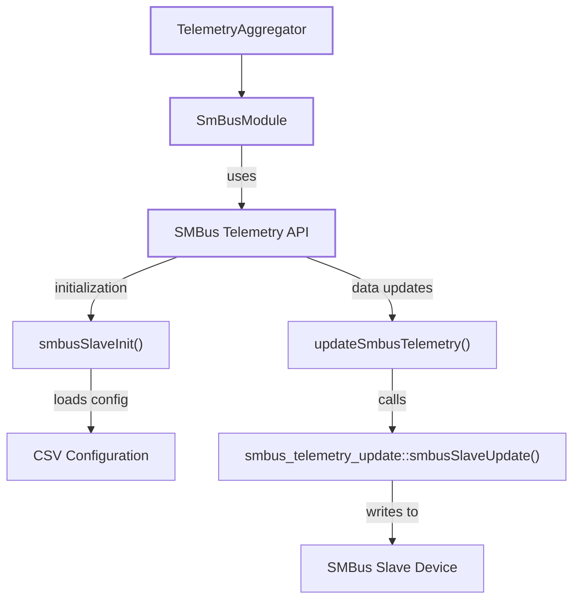
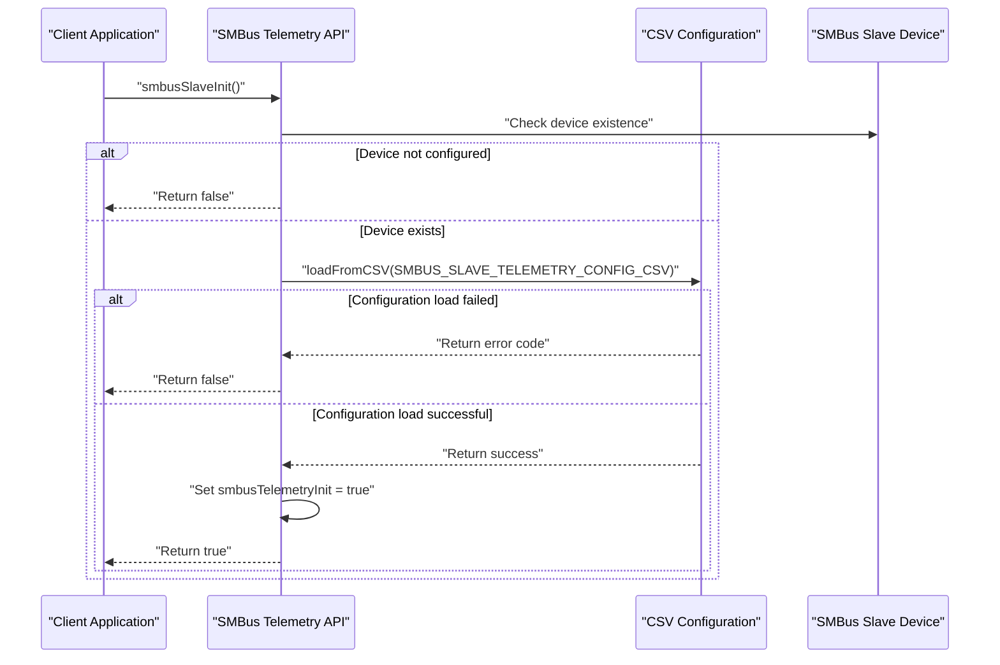
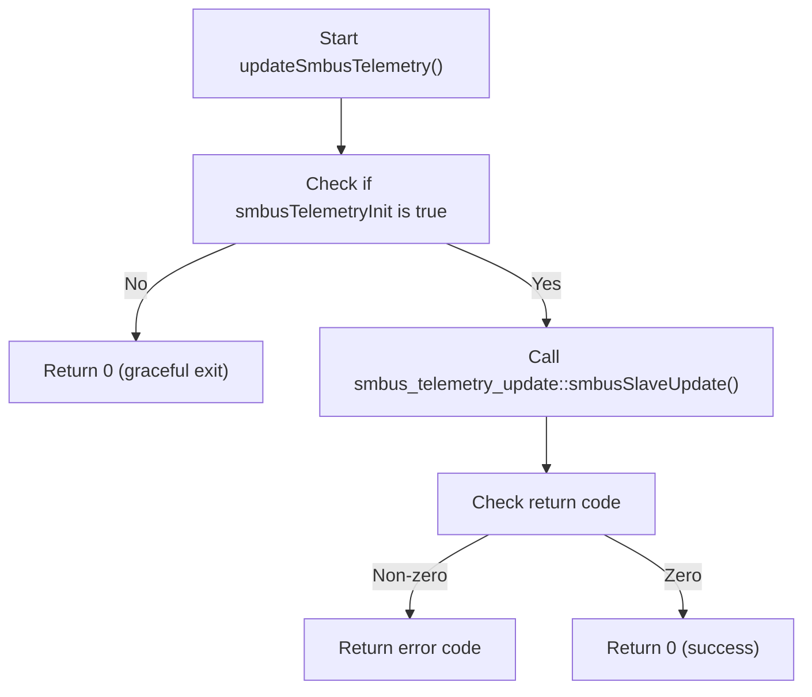
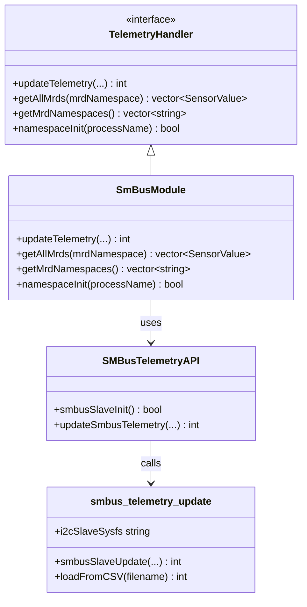

<!-- source: DeepWiki mcp.deepwiki.com · repo NVIDIA/nvidia-tal · page 4 SMBus Telemetry Target · fetched 2026-10-26 -->

# SMBus Telemetry Target

<details>
<summary>Relevant source files</summary>

The following files were used as context for generating this wiki page:

- [smbus-telemetry-target/lib/include/smbus_telemetry_target_api.hpp](smbus-telemetry-target/lib/include/smbus_telemetry_target_api.hpp)
- [smbus-telemetry-target/lib/smbus_telemetry_target_api.cpp](smbus-telemetry-target/lib/smbus_telemetry_target_api.cpp)

</details>


The SMBus Telemetry Target is a subsystem within the NVIDIA Telemetry Abstraction Layer (TAL) that provides an interface for exposing telemetry data via the System Management Bus (SMBus). This component acts as a bridge between telemetry producers and SMBus hardware, allowing sensor data to be made available through the SMBus protocol.

For information about the SMBus Module that interacts with this target, see [SMBus Module](#3.2). For details on the API interface, see [SMBus Telemetry API](#4.1).

## Architecture Overview

The SMBus Telemetry Target serves as an intermediary between the telemetry data producers and the SMBus hardware. It provides a simple API for initializing the SMBus slave device and updating telemetry values.



Sources: [smbus-telemetry-target/lib/include/smbus_telemetry_target_api.hpp:24-49](), [smbus-telemetry-target/lib/smbus_telemetry_target_api.cpp:27-65]()

## Core Components

The SMBus Telemetry Target consists of the following key components:

| Component | Description |
|-----------|-------------|
| SMBus Telemetry API | Provides the interface for initialization and updates |
| SMBus Slave Device | The physical or virtual SMBus device that exposes data |
| CSV Configuration | Configuration file defining telemetry mappings |
| Telemetry Update Process | Logic for formatting and writing data to SMBus |

Sources: [smbus-telemetry-target/lib/smbus_telemetry_target_api.cpp:18-21]()

## Initialization Process

The SMBus Telemetry Target system must be initialized before it can be used to update telemetry data. The initialization process performs the following steps:

1. Verifies that an SMBus slave device is configured
2. Loads telemetry configuration data from a CSV file
3. Sets up the internal data structures necessary for telemetry updates



Sources: [smbus-telemetry-target/lib/smbus_telemetry_target_api.cpp:27-45]()

## Update Process

Once initialized, telemetry data can be updated using the `updateSmbusTelemetry()` function. This function takes sensor information and raw data, then updates the SMBus slave registers accordingly.

The update process involves:

1. Checking if the system has been successfully initialized
2. Calling the internal update function with the provided parameters
3. Returning any error codes from the update operation



Sources: [smbus-telemetry-target/lib/smbus_telemetry_target_api.cpp:47-65]()

## API Interface

The SMBus Telemetry Target exposes two primary functions:

### smbusSlaveInit

```
bool smbusSlaveInit()
```

Initializes the SMBus telemetry system by verifying the slave device configuration and loading the telemetry configuration from a CSV file. Returns `true` on successful initialization, `false` otherwise.

### updateSmbusTelemetry

```
int updateSmbusTelemetry(const std::string& devicePath,
                         const std::string& interface,
                         const std::string& propName,
                         std::vector<uint8_t>& data, 
                         const uint64_t timestamp,
                         int rc)
```

Updates the telemetry data exposed via the SMBus slave device. Parameters include:

- `devicePath`: Sensor DBus object path
- `interface`: Sensor DBus interface
- `propName`: Sensor property name
- `data`: Raw sensor data (vector of bytes)
- `timestamp`: Last refresh time
- `rc`: Return code from the sensor API

Returns 0 on success, non-zero error code otherwise.

Sources: [smbus-telemetry-target/lib/include/smbus_telemetry_target_api.hpp:24-49]()

## Data Flow Through the System

The following diagram illustrates how telemetry data flows through the SMBus Telemetry Target system:

```mermaid
flowchart LR
    subgraph "Telemetry Producers"
        TP["Telemetry Producer"]
    end
    
    subgraph "Telemetry Abstraction Layer"
        TA["TelemetryAggregator"]
        SMBM["SmBusModule"]
    end
    
    subgraph "SMBus Telemetry Target"
        SMBTA["SMBus Telemetry API"]
        SMBU["smbus_telemetry_update"]
    end
    
    subgraph "Hardware"
        SMBD["SMBus Slave Device"]
    end
    
    TP -->|"sensor data"| TA
    TA -->|"forwards telemetry"| SMBM
    SMBM -->|"calls updateSmbusTelemetry()"| SMBTA
    SMBTA -->|"forwards data"| SMBU
    SMBU -->|"writes formatted data"| SMBD
```



Sources: [smbus-telemetry-target/lib/smbus_telemetry_target_api.cpp:47-65]()

## Configuration System

The SMBus Telemetry Target relies on a CSV-based configuration system to define which telemetry data should be exposed on the SMBus and how it should be mapped to SMBus registers. The configuration file is loaded during initialization via the `loadFromCSV()` function.

Key aspects of the configuration system:
- The configuration file is defined by the constant `SMBUS_SLAVE_TELEMETRY_CONFIG_CSV`
- It maps telemetry data points (identified by device path, interface, and property) to specific SMBus registers
- The configuration is loaded once during initialization and used for all subsequent update operations

For more detailed information about the configuration format and options, see [SMBus Configuration](#4.4).

Sources: [smbus-telemetry-target/lib/smbus_telemetry_target_api.cpp:36-42]()

## Error Handling

The SMBus Telemetry Target implements a simple error handling approach:

1. During initialization:
   - If the SMBus slave device is not configured, an error is logged and initialization fails
   - If loading from the CSV file fails, an error is logged and initialization fails

2. During telemetry updates:
   - If the system has not been initialized, the update function returns gracefully without error
   - If the update operation fails, the error code from the underlying function is propagated to the caller

For more detailed information about specific error codes and their meanings, see [Error Handling](#4.3).

Sources: [smbus-telemetry-target/lib/smbus_telemetry_target_api.cpp:30-42](), [smbus-telemetry-target/lib/smbus_telemetry_target_api.cpp:53-64]()

## Integration with Telemetry Abstraction Layer

The SMBus Telemetry Target integrates with the larger Telemetry Abstraction Layer through the SMBus Module, which implements the TelemetryHandler interface. The SMBus Module calls the SMBus Telemetry API functions to initialize the system and update telemetry data.



The SMBus Telemetry Target provides a focused interface for the specific task of exposing telemetry data via SMBus, while the higher-level components in the TAL architecture provide the broader telemetry management functionality.

Sources: [smbus-telemetry-target/lib/include/smbus_telemetry_target_api.hpp:24-49](), [smbus-telemetry-target/lib/smbus_telemetry_target_api.cpp:18-21]()

---

