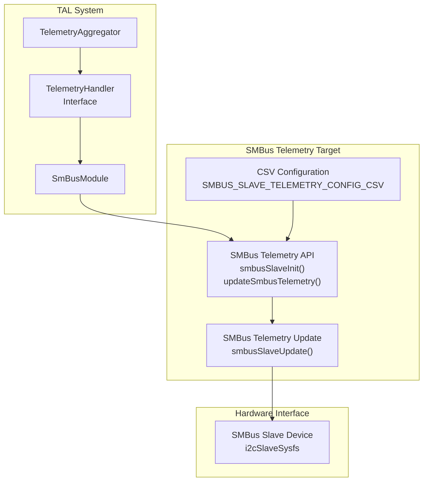
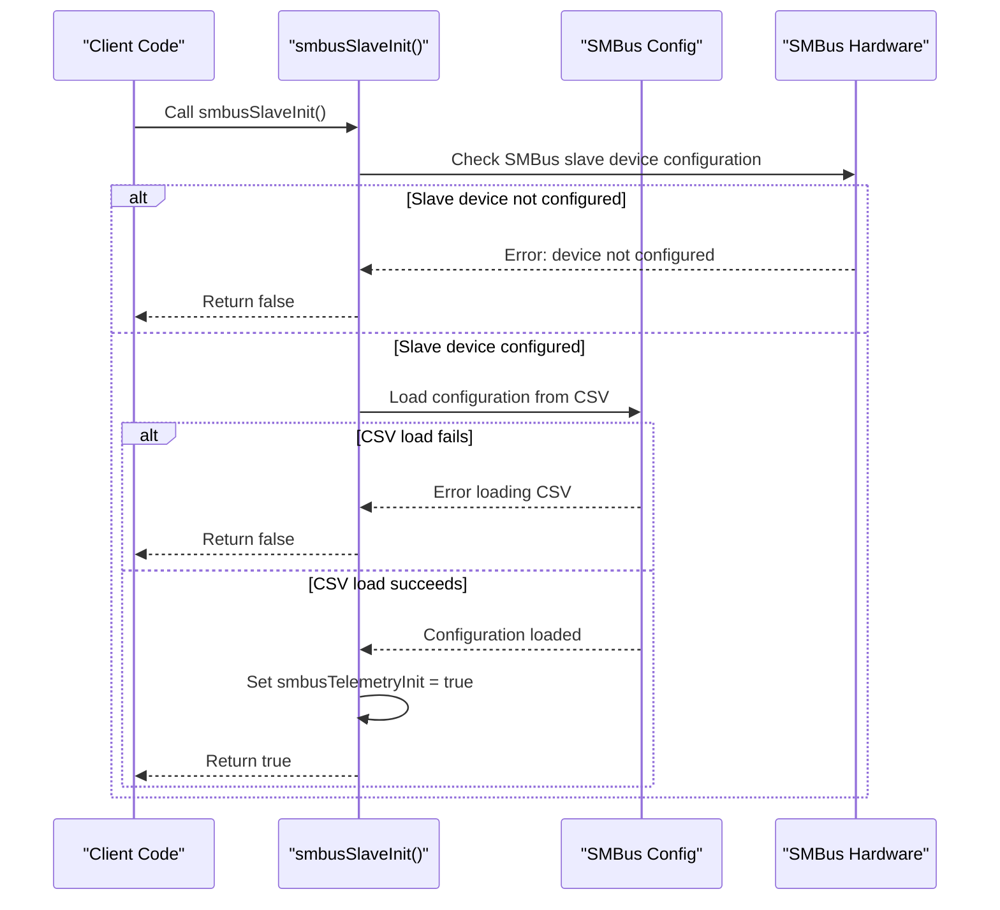
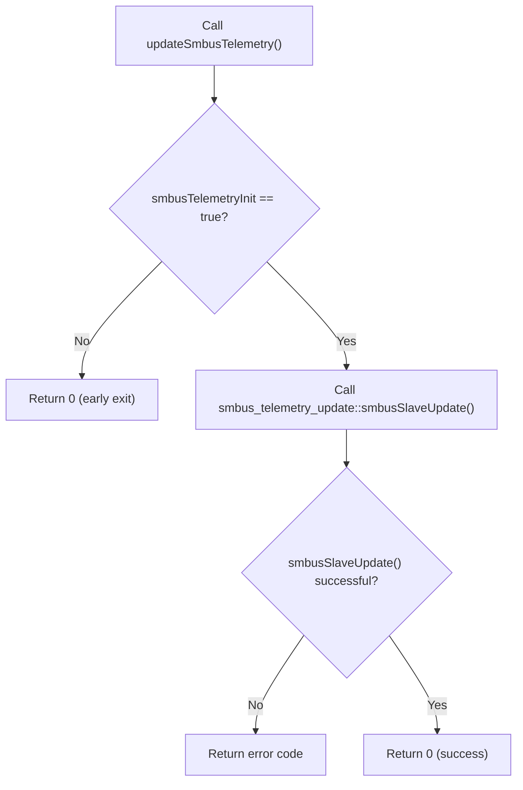
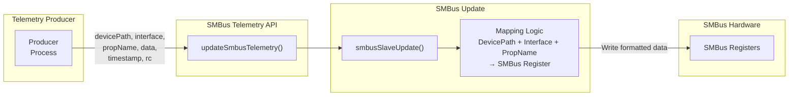

<!-- source: DeepWiki mcp.deepwiki.com · repo NVIDIA/nvidia-tal · page 4.1 SMBus Telemetry API · fetched 2026-10-26 -->

# SMBus Telemetry API

<details>
<summary>Relevant source files</summary>

The following files were used as context for generating this wiki page:

- [smbus-telemetry-target/lib/include/smbus_telemetry_target_api.hpp](smbus-telemetry-target/lib/include/smbus_telemetry_target_api.hpp)
- [smbus-telemetry-target/lib/smbus_telemetry_target_api.cpp](smbus-telemetry-target/lib/smbus_telemetry_target_api.cpp)

</details>


## Purpose and Scope

The SMBus Telemetry API provides the interface for initializing the SMBus telemetry subsystem and updating telemetry data exposed through the System Management Bus (SMBus). This API serves as the bridge between telemetry data producers and the SMBus hardware interface, enabling the exposure of system telemetry data to external monitoring entities.

This document covers the API functionality, initialization process, and telemetry update mechanisms. For information about the overall SMBus module implementation, see [SMBus Module](#3.2). For details on the SMBus telemetry update process and data formatting, see [SMBus Telemetry Update Process](#4.2).

Sources: [smbus-telemetry-target/lib/include/smbus_telemetry_target_api.hpp:18-49](), [smbus-telemetry-target/lib/smbus_telemetry_target_api.cpp:18-65]()

## API Position in System Architecture



The SMBus Telemetry API sits between the TAL system's SMBus Module and the low-level SMBus Telemetry Update functionality. It provides two key functions that abstract the telemetry management for the SMBus:
- `smbusSlaveInit()` - One-time initialization
- `updateSmbusTelemetry()` - Regular telemetry updates

Sources: [smbus-telemetry-target/lib/include/smbus_telemetry_target_api.hpp:24-49](), [smbus-telemetry-target/lib/smbus_telemetry_target_api.cpp:27-65]()

## API Function Overview

The SMBus Telemetry API consists of two primary functions:

| Function | Purpose | Return Value |
|----------|---------|--------------|
| `smbusSlaveInit()` | Initializes the SMBus telemetry system by loading configuration from CSV | `bool` - Success/failure |
| `updateSmbusTelemetry()` | Updates telemetry data for a specific sensor | `int` - 0 for success, error code for failure |

Sources: [smbus-telemetry-target/lib/include/smbus_telemetry_target_api.hpp:24-49]()

## Initialization Function



The `smbusSlaveInit()` function performs the following operations:

1. Checks if the SMBus slave device is configured (not set to `/dev/null`)
2. Loads telemetry configuration from the CSV file defined by `SMBUS_SLAVE_TELEMETRY_CONFIG_CSV`
3. Sets the `smbusTelemetryInit` flag to `true` if initialization succeeds

This function must be called once before any telemetry updates can be processed. It returns `true` if initialization was successful, `false` otherwise.

Sources: [smbus-telemetry-target/lib/smbus_telemetry_target_api.cpp:27-45]()

## Update Function

The `updateSmbusTelemetry()` function is used by telemetry producers to update sensor values that are exposed via the SMBus. It has the following signature:

```
int updateSmbusTelemetry(
    const std::string& devicePath,
    const std::string& interface,
    const std::string& propName,
    std::vector<uint8_t>& data,
    const uint64_t timestamp,
    int rc
)
```

### Parameters

| Parameter | Type | Description |
|-----------|------|-------------|
| `devicePath` | `const std::string&` | Sensor DBus object path |
| `interface` | `const std::string&` | Sensor DBus interface |
| `propName` | `const std::string&` | Sensor property name |
| `data` | `std::vector<uint8_t>&` | Raw sensor data from protocols (SMBPBI/PLDM/NSM) |
| `timestamp` | `const uint64_t` | Last refresh timestamp |
| `rc` | `int` | Return code from the sensor API |

### Return Value

- `0` for success
- Non-zero value for errors

### Update Process Flow



The function first checks if `smbusTelemetryInit` is set to `true`, ensuring that initialization has been completed. If not, it returns `0` without attempting an update. This design allows telemetry producers to call the update function even if SMBus telemetry isn't fully configured, without generating errors.

If properly initialized, the function calls `smbus_telemetry_update::smbusSlaveUpdate()` to perform the actual update, passing through all parameters. Any errors from the update process are returned to the caller.

Sources: [smbus-telemetry-target/lib/smbus_telemetry_target_api.cpp:47-65]()

## Data Path and Mapping



The SMBus Telemetry API maps telemetry data identified by the combination of `devicePath`, `interface`, and `propName` to specific SMBus registers. The mapping is defined in the CSV configuration file loaded during initialization. This design allows flexible routing of various telemetry data points to appropriate SMBus registers.

Sources: [smbus-telemetry-target/lib/include/smbus_telemetry_target_api.hpp:32-44](), [smbus-telemetry-target/lib/smbus_telemetry_target_api.cpp:47-65]()

## Error Handling

The SMBus Telemetry API handles errors at two levels:

1. **Initialization Errors**:
   - SMBus slave device not configured
   - Failed to load configuration from CSV

2. **Update Errors**:
   - Any errors returned by the underlying `smbusSlaveUpdate()` function

Initialization failures are reported through the boolean return value of `smbusSlaveInit()`. Update failures are reported through the integer return value of `updateSmbusTelemetry()`.

For detailed information about specific error codes from the update process, see [Error Handling](#4.3).

Sources: [smbus-telemetry-target/lib/smbus_telemetry_target_api.cpp:27-65]()

## Integration with TelemetryAggregator

The SMBus Telemetry API is typically used by the `SmBusModule` which implements the `TelemetryHandler` interface. The module calls `smbusSlaveInit()` during its initialization phase and `updateSmbusTelemetry()` when processing telemetry updates from the `TelemetryAggregator`.

This design follows the modular architecture of the Telemetry Abstraction Layer, where specific telemetry transport mechanisms are encapsulated in dedicated modules that implement a common interface.

Sources: [smbus-telemetry-target/lib/include/smbus_telemetry_target_api.hpp:24-49](), [smbus-telemetry-target/lib/smbus_telemetry_target_api.cpp:27-65]()

---

