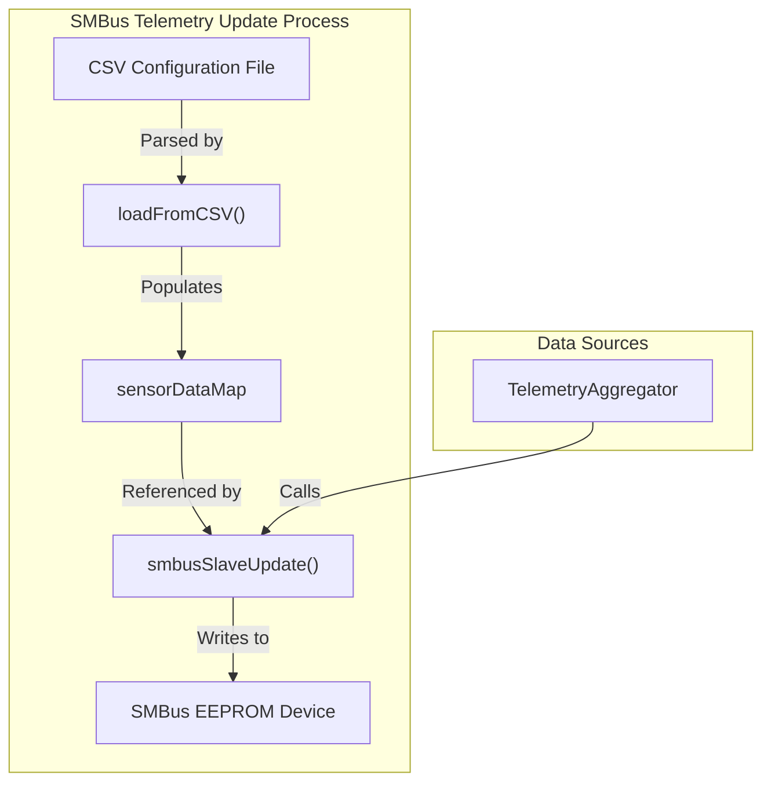
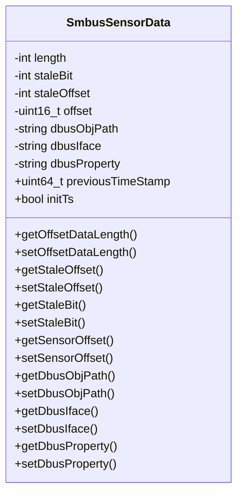
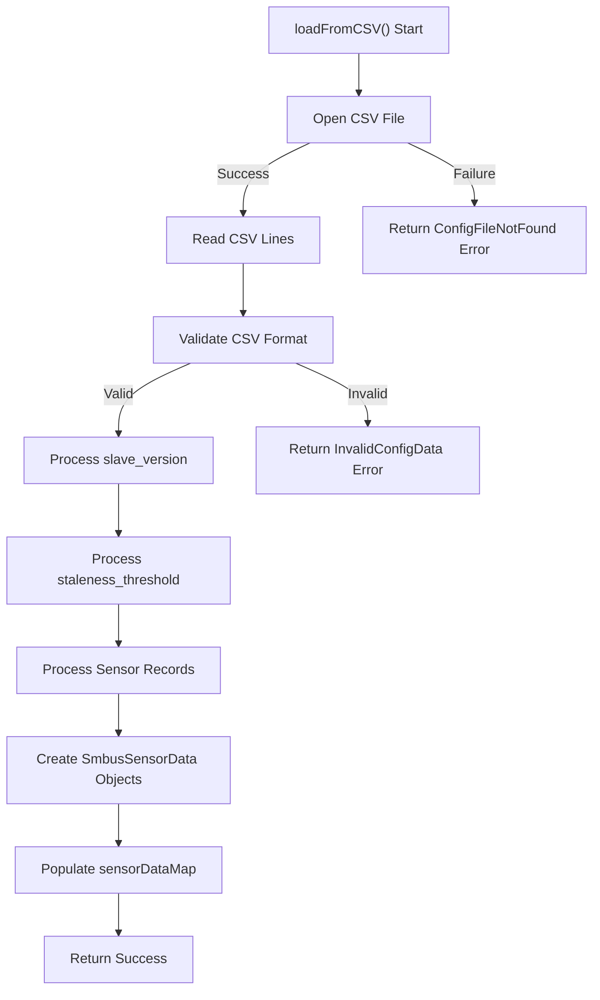
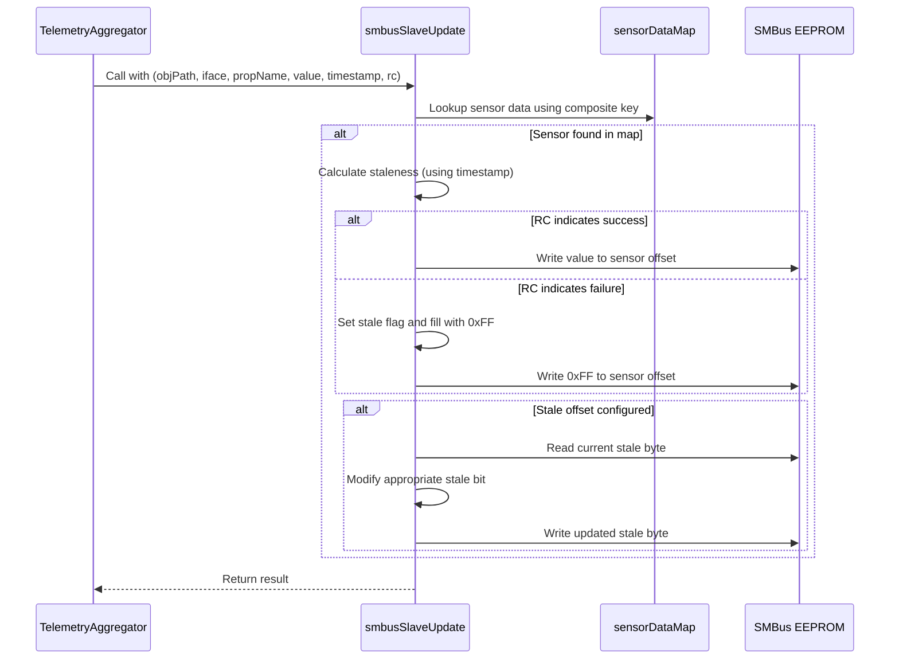
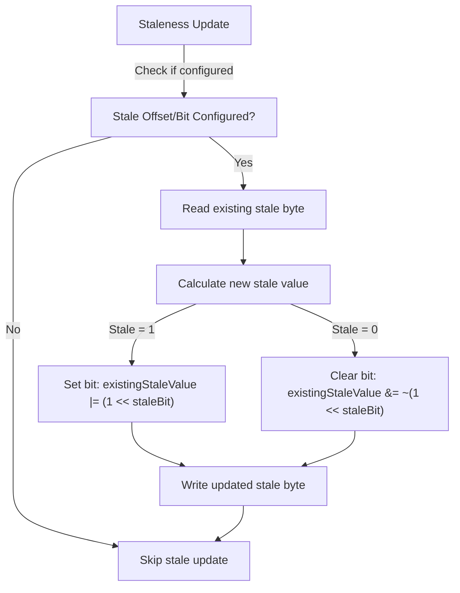
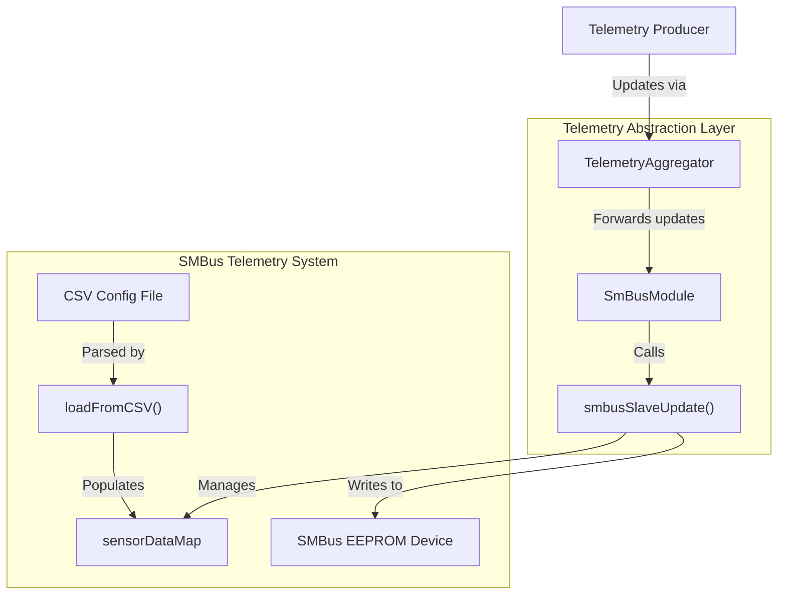

<!-- source: DeepWiki mcp.deepwiki.com · repo NVIDIA/nvidia-tal · page 4.2 SMBus Telemetry Update Process · fetched 2026-10-26 -->

# SMBus Telemetry Update Process

<details>
<summary>Relevant source files</summary>

The following files were used as context for generating this wiki page:

- [smbus-telemetry-target/lib/include/smbus_telemetry_update.hpp](smbus-telemetry-target/lib/include/smbus_telemetry_update.hpp)
- [smbus-telemetry-target/lib/smbus_telemetry_update.cpp](smbus-telemetry-target/lib/smbus_telemetry_update.cpp)

</details>


## Purpose and Scope

This document details the process by which telemetry data is formatted and written to the System Management Bus (SMBus) in the NVIDIA Telemetry Abstraction Layer (TAL). It explains the internal mechanisms for updating SMBus-based telemetry data, configuration loading, sensor data mapping, and staleness handling. For information about the SMBus Module itself and how it integrates with the broader TAL architecture, see [SMBus Module](#3.2). For details on the SMBus configuration format, see [SMBus Configuration](#4.4).

## Overview

The SMBus Telemetry Update Process provides a mechanism to write telemetry data to specific offsets in an SMBus slave device (typically an EEPROM). The system maps sensor data to specific SMBus offsets, manages data staleness, and ensures proper formatting of the telemetry values.



Sources: [smbus-telemetry-target/lib/include/smbus_telemetry_update.hpp:167-183](), [smbus-telemetry-target/lib/smbus_telemetry_update.cpp:159-253]()

## Sensor Data Structure

At the core of the SMBus Telemetry Update Process is the `SmbusSensorData` class, which maintains all the necessary information to map a sensor value to its corresponding SMBus location.



Sources: [smbus-telemetry-target/lib/include/smbus_telemetry_update.hpp:49-158]()

Each `SmbusSensorData` instance contains:

1. **Offset Information**:
   - `offset`: The SMBus memory offset where the sensor value is written
   - `length`: The number of bytes to write at the offset

2. **Staleness Tracking**:
   - `staleOffset`: The offset where the staleness byte is stored
   - `staleBit`: The bit position within the staleness byte for this sensor
   - `previousTimeStamp`: Last update timestamp for staleness calculation

3. **Sensor Identification**:
   - `dbusObjPath`: D-Bus object path for the sensor
   - `dbusIface`: D-Bus interface for the sensor
   - `dbusProperty`: D-Bus property containing the sensor value

The system maintains a map of these sensor data objects, indexed by a composite key of the D-Bus path, interface, and property:

```cpp
using smbusSensorMap = std::map<std::string, class SmbusSensorData>;
```

Sources: [smbus-telemetry-target/lib/include/smbus_telemetry_update.hpp:33](), [smbus-telemetry-target/lib/smbus_telemetry_update.cpp:25]()

## Configuration Loading

The system loads sensor configurations from a CSV file using the `loadFromCSV` function. This function parses the CSV file, validates its structure, and populates the `sensorDataMap` with the corresponding `SmbusSensorData` objects.



Sources: [smbus-telemetry-target/lib/smbus_telemetry_update.cpp:43-157]()

The CSV file structure includes:
1. **Header information**:
   - `slave_version`: SMBus slave version
   - `staleness_threshold`: Time threshold in milliseconds for marking data as stale

2. **Column headers**:
   - `offset`, `length`, `data_format`, `dbus_objectpath`, `dbus_interface`, `dbus_property`, `stale_offset`, `stale_bit`

3. **Sensor records**:
   - One row per sensor with all required fields

Example of CSV parsing logic:
```cpp
// Parse slave version
if (!keyValue.compare("slave_version")) {
    smbusSlaveVer = std::stoi(val[1], nullptr, 16);
    continue;
}
// Parse staleness threshold
else if (!keyValue.compare("staleness_threshold")) {
    slaveI2cStaleThresholdMs = std::stoi(val[1]);
    continue;
}
```

Sources: [smbus-telemetry-target/lib/smbus_telemetry_update.cpp:88-97]()

## Update Process

The `smbusSlaveUpdate` function performs the actual telemetry updates to the SMBus device. It takes telemetry data received from producers and writes it to the appropriate offsets in the SMBus EEPROM.

### Process Flow



Sources: [smbus-telemetry-target/lib/smbus_telemetry_update.cpp:159-253]()

### Function Parameters

The `smbusSlaveUpdate` function takes several parameters:

| Parameter | Type | Purpose |
|-----------|------|---------|
| dbusObjPath | string | D-Bus object path for the sensor |
| iface | string | D-Bus interface for the sensor |
| propName | string | D-Bus property name containing the value |
| value | vector<uint8_t> | Raw sensor value data |
| timestamp | uint64_t | Timestamp of the update |
| rc | int | Return code from the data source |

Sources: [smbus-telemetry-target/lib/include/smbus_telemetry_update.hpp:181-183]()

### Update Implementation

The update process consists of two main parts:

1. **Value Update**:
   ```cpp
   // Commit Value to the right offset
   std::vector<uint8_t>& valBytes = value;
   eepromFile.seekp(sensorDataMap[key].getSensorOffset());
   eepromFile.write(
       reinterpret_cast<const char*>(valBytes.data()),
       std::min((uint8_t)sensorDataMap[key].getOffsetDataLength(),
                // commit min of actual bytes or mapped bytes
                static_cast<uint8_t>(valBytes.size())));
   ```

2. **Staleness Update** (if configured):
   ```cpp
   // read
   uint8_t existingStaleValue = 0;
   eepromFile.seekp(sensorDataMap[key].getStaleOffset());
   eepromFile.read(reinterpret_cast<char*>(&existingStaleValue),
                   sizeof(existingStaleValue));

   // modify
   if (stale) {
       existingStaleValue |= (1 << sensorDataMap[key].getStaleBit());
   }
   else {
       existingStaleValue &= ~(1 << sensorDataMap[key].getStaleBit());
   }

   // write
   eepromFile.seekp(sensorDataMap[key].getStaleOffset());
   eepromFile.write(reinterpret_cast<char*>(&existingStaleValue),
                    sizeof(existingStaleValue));
   ```

Sources: [smbus-telemetry-target/lib/smbus_telemetry_update.cpp:202-245]()

## Staleness Management

The SMBus Telemetry Update system includes a mechanism to mark data as stale when it hasn't been updated within a certain time threshold or when the update operation fails.

### Staleness Detection

Staleness is determined by two conditions:
1. **Time-based staleness**: If the time between updates exceeds the configured threshold
   ```cpp
   uint8_t stale = ((timestamp - sensorDataMap[key].previousTimeStamp) >
                   slaveI2cStaleThresholdMs)
                      ? 1
                      : 0;
   ```

2. **Failure-based staleness**: If the update operation fails (non-zero return code)
   ```cpp
   bool success = (rc == 0) ? 1 : 0;
   if (!success) {
       stale = 1;
       value.assign(sensorDataMap[key].getOffsetDataLength(), 0xFF);
   }
   ```

Sources: [smbus-telemetry-target/lib/smbus_telemetry_update.cpp:186-198]()

### Staleness Bit Handling

Staleness is tracked using specific bits in designated offsets in the SMBus EEPROM. The system uses a read-modify-write approach:

1. **Read** the current staleness byte from the configured offset
2. **Modify** the specific bit based on the staleness status 
3. **Write** the updated byte back to the offset

This approach allows multiple sensors to share the same staleness byte, with each sensor using a different bit position within that byte.



Sources: [smbus-telemetry-target/lib/smbus_telemetry_update.cpp:219-245]()

## Error Handling

The SMBus Telemetry Update Process includes error handling for various scenarios:

1. **Configuration Errors**:
   - File not found: Returns `ErrorCode::ConfigFileNotFound`
   - Invalid CSV format: Returns `ErrorCode::InvalidConfigData`
   - Failed to load CSV: Returns `ErrorCode::FaildToLoadCSV`

2. **Runtime Errors**:
   - SMBus sysfs path not found: Returns `ErrorCode::SMBusSysfsPathNotFound`
   - Exceptions caught and logged during file operations

3. **Value Updates with Errors**:
   - When the incoming data has an error (non-zero RC), the system:
     - Sets the stale bit
     - Fills the value with 0xFF bytes to indicate invalid data

Sources: [smbus-telemetry-target/lib/smbus_telemetry_update.cpp:73-153](), [smbus-telemetry-target/lib/smbus_telemetry_update.cpp:172-176]()

## Integration with TAL

The SMBus Telemetry Update Process is primarily used by the `SmBusModule` component of the TAL architecture. When telemetry data is received through the TAL interfaces, the `SmBusModule` formats the data appropriately and calls `smbusSlaveUpdate` to write it to the SMBus device.



Sources: [smbus-telemetry-target/lib/include/smbus_telemetry_update.hpp:167-183](), [smbus-telemetry-target/lib/smbus_telemetry_update.cpp:159-253]()

## Summary

The SMBus Telemetry Update Process provides a robust mechanism for writing telemetry data to SMBus devices. It handles configuration loading, sensor mapping, value updates, and staleness tracking. The process ensures that telemetry data is properly formatted and positioned in the SMBus memory space, with appropriate staleness indicators when data becomes outdated or invalid.

Key components of this system include:
- Configuration loading from CSV files
- Mapping of sensor data to SMBus offsets
- Value writing to the specified offsets
- Staleness detection and bit management
- Error handling for various failure scenarios

This process forms a critical part of the SMBus telemetry capabilities in the NVIDIA TAL system, enabling efficient and reliable telemetry data handling via the SMBus interface.

---

