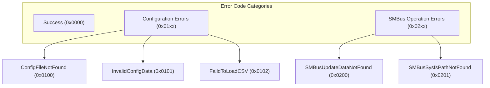
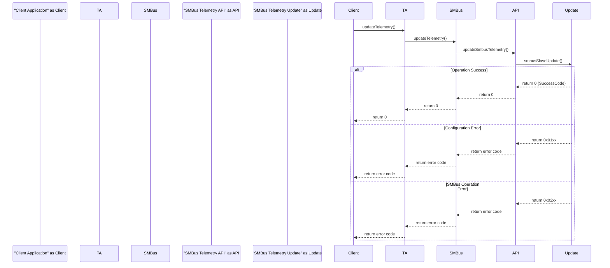
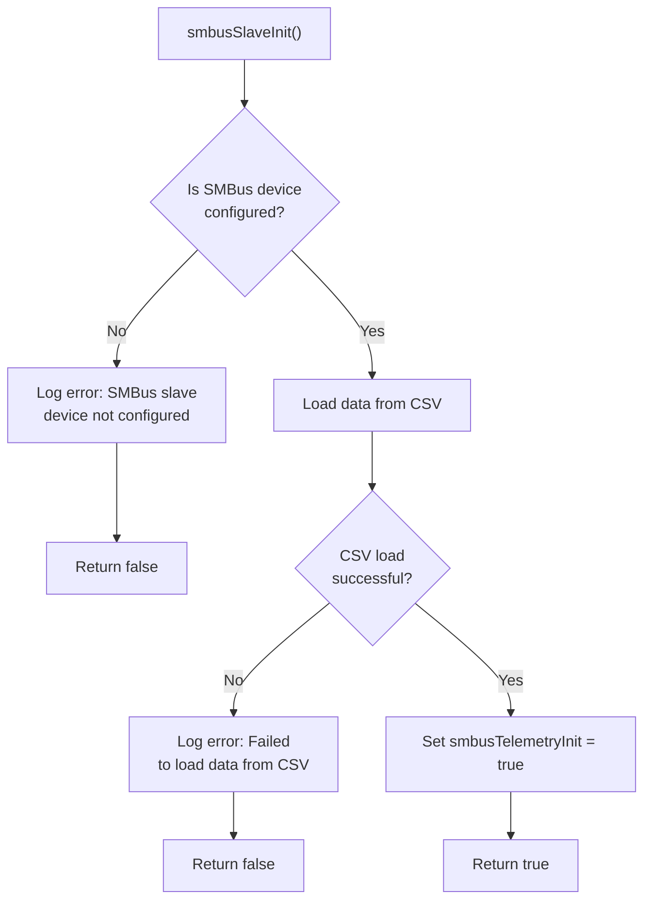
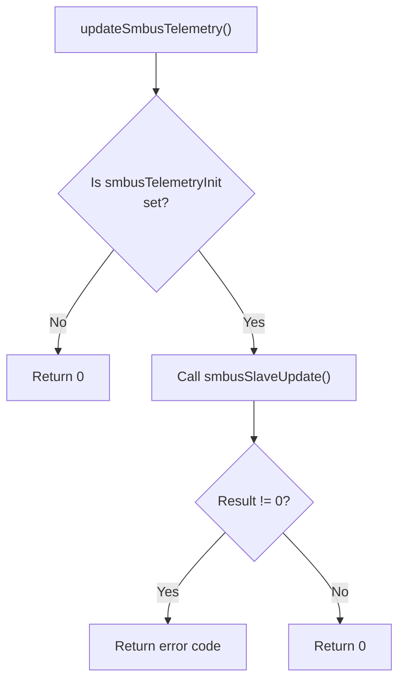

<!-- source: DeepWiki mcp.deepwiki.com · repo NVIDIA/nvidia-tal · page 4.3 Error Handling · fetched 2026-10-26 -->

# Error Handling

Relevant source files

The following files were used as context for generating this wiki page:

- [smbus-telemetry-target/lib/include/error.hpp](smbus-telemetry-target/lib/include/error.hpp)
- [smbus-telemetry-target/lib/smbus_telemetry_target_api.cpp](smbus-telemetry-target/lib/smbus_telemetry_target_api.cpp)

## Purpose and Scope

This document provides a comprehensive overview of the error handling mechanisms in the SMBus telemetry system within NVIDIA's Telemetry Abstraction Layer (TAL). It covers error code definitions, error propagation through the system, and implementation details for error handling in SMBus telemetry operations.

For information about the overall SMBus telemetry API, see [SMBus Telemetry API](#4.1). For details on the telemetry update process, see [SMBus Telemetry Update Process](#4.2).

## Error Code System

The SMBus telemetry system uses a structured error code system defined in the `ErrorCode` namespace. These error codes are used to identify specific failure conditions during configuration loading and SMBus operations.

### Error Code Structure

Error codes are defined as hexadecimal values with specific ranges for different categories of errors:

- `0x0000`: Success code (no error)
- `0x01xx`: Configuration-related errors
- `0x02xx`: SMBus operation errors

### Error Code Definitions

The following table lists all defined error codes and their meanings:

| Error Code | Hex Value | Description |
|------------|-----------|-------------|
| SuccessCode | 0x0000 | Operation completed successfully |
| ConfigFileNotFound | 0x0100 | SMBus telemetry configuration file could not be found |
| InvalidConfigData | 0x0101 | Configuration data format is invalid or corrupt |
| FaildToLoadCSV | 0x0102 | Failed to load and parse the CSV configuration file |
| SMBusUpdateDataNotFound | 0x0200 | Required telemetry data for SMBus update not found |
| SMBusSysfsPathNotFound | 0x0201 | SMBus sysfs path not found or inaccessible |

Sources: [smbus-telemetry-target/lib/include/error.hpp:20-28]()

## Error Propagation

Errors in the SMBus telemetry system propagate from low-level operations up through the module hierarchy to the TelemetryAggregator. This allows client applications to receive and handle errors appropriately.

### Error Return Path

When an error occurs in the SMBus telemetry subsystem, the error code is returned through the function call chain:

1. Low-level SMBus operations return specific error codes
2. The SMBus Telemetry API propagates these error codes to the SmBusModule
3. The SmBusModule passes the error code to the TelemetryAggregator
4. The TelemetryAggregator returns the error code to the client application

This approach ensures that error information is preserved throughout the system, allowing for appropriate handling at each level.

Sources: [smbus-telemetry-target/lib/smbus_telemetry_target_api.cpp:47-65]()

## Error Handling Implementation

The SMBus telemetry system implements error handling at multiple levels, with different strategies depending on the operation being performed.

### Initialization Error Handling

During initialization, the SMBus telemetry system performs several checks to ensure proper configuration:

The initialization function `smbusSlaveInit()` implements the following error handling:

1. Checks if the SMBus slave device is properly configured
2. If not, logs an error message and returns `false`
3. Attempts to load configuration data from CSV
4. If CSV loading fails, logs an error message and returns `false`
5. On success, sets the initialization flag and returns `true`

Sources: [smbus-telemetry-target/lib/smbus_telemetry_target_api.cpp:27-45]()

### Telemetry Update Error Handling

When updating SMBus telemetry data, error handling focuses on checking initialization status and handling return codes:

The update function implements these error handling steps:

1. Checks if initialization was successful via the `smbusTelemetryInit` flag
2. If not initialized, returns 0 (graceful no-op)
3. Calls the SMBus slave update function
4. If the update returns a non-zero value, propagates the error code
5. On success, returns 0

Sources: [smbus-telemetry-target/lib/smbus_telemetry_target_api.cpp:47-65]()

## Error Handling Best Practices

When working with the SMBus telemetry system, follow these best practices for error handling:

### For Client Applications

1. **Check return codes**: Always check the return value from `TelemetryAggregator::updateTelemetry()` calls
2. **Error categorization**: Use the high byte of the error code to determine the error category
3. **Telemetry continuity**: Consider how to handle telemetry gaps if failures occur
4. **Graceful degradation**: Implement fallback mechanisms for when telemetry is unavailable

### For System Integrators

1. **Configuration validation**: Verify SMBus configuration files before deployment
2. **SMBus device access**: Ensure proper permissions for SMBus device paths
3. **Error logging**: Monitor system logs for telemetry-related errors
4. **Telemetry validation**: Implement consistency checks to validate telemetry data

## Common Error Scenarios and Resolution

| Error Code | Common Cause | Resolution |
|------------|--------------|------------|
| ConfigFileNotFound (0x0100) | Missing CSV configuration file | Verify file path and ensure file exists |
| InvalidConfigData (0x0101) | Corrupt or incorrectly formatted CSV | Validate CSV against required format |
| FaildToLoadCSV (0x0102) | Permissions issue or IO error | Check file permissions and system resources |
| SMBusUpdateDataNotFound (0x0200) | Telemetry update with unknown metric | Verify telemetry metric exists in configuration |
| SMBusSysfsPathNotFound (0x0201) | SMBus device not present or accessible | Check hardware connections and device driver status |

Sources: [smbus-telemetry-target/lib/include/error.hpp:20-28](), [smbus-telemetry-target/lib/smbus_telemetry_target_api.cpp:27-65]()

---

