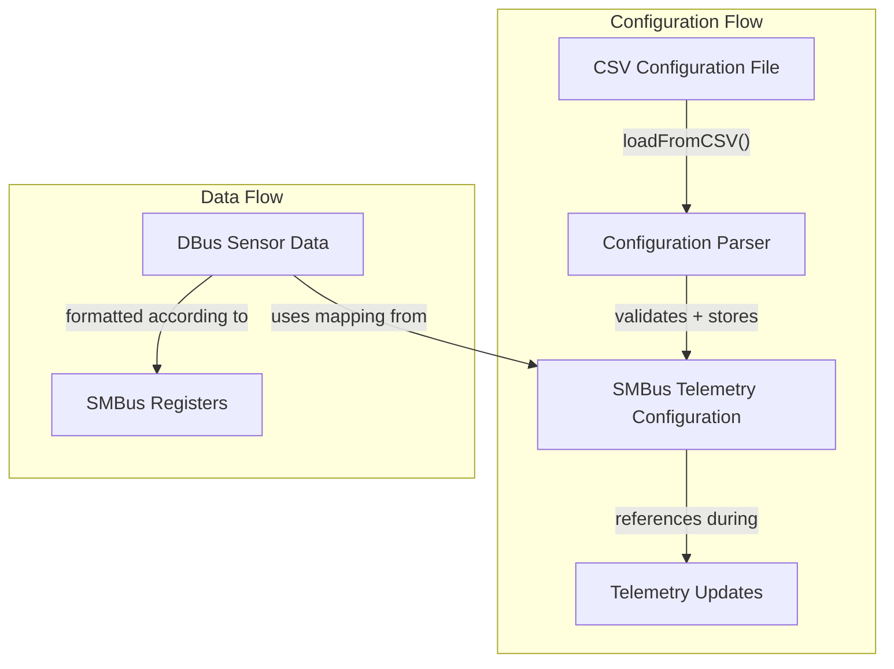
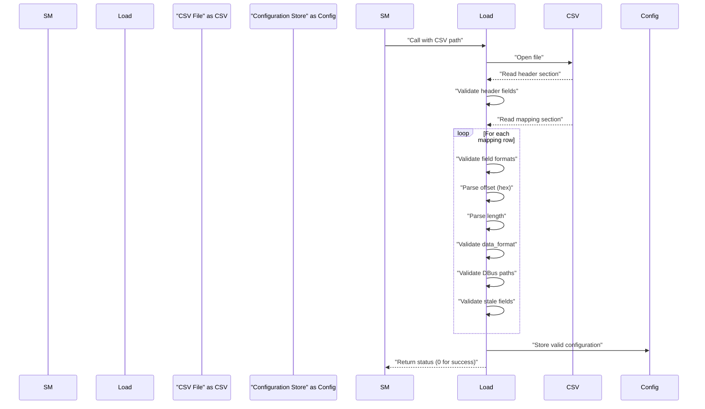
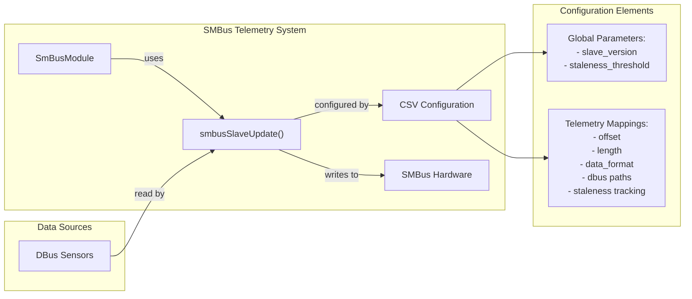

<!-- source: DeepWiki mcp.deepwiki.com · repo NVIDIA/nvidia-tal · page 4.4 SMBus Configuration · fetched 2026-10-26 -->

# SMBus Configuration

<details>
<summary>Relevant source files</summary>

The following files were used as context for generating this wiki page:

- [smbus-telemetry-target/test/config/row1-failure.csv](smbus-telemetry-target/test/config/row1-failure.csv)
- [smbus-telemetry-target/test/config/row2-failure.csv](smbus-telemetry-target/test/config/row2-failure.csv)
- [smbus-telemetry-target/test/smbus_telemetry_target_utest.cpp](smbus-telemetry-target/test/smbus_telemetry_target_utest.cpp)

</details>


## Purpose and Scope

This document details the CSV-based configuration system used by the NVIDIA Telemetry Abstraction Layer (TAL) for SMBus telemetry. It covers the format, required fields, loading process, and validation mechanisms for SMBus telemetry configuration. For information about the SMBus Telemetry API, see [SMBus Telemetry API](#4.1), and for the update process, see [SMBus Telemetry Update Process](#4.2).

## Configuration Overview

The SMBus module in TAL uses a CSV configuration file to map telemetry data from DBus sensors to specific SMBus registers. This configuration defines what data is exposed via SMBus, where it's stored in the SMBus address space, and how it's formatted.



Sources: [smbus-telemetry-target/test/smbus_telemetry_target_utest.cpp:26-91]()

## Configuration File Format

The SMBus telemetry configuration file uses a structured CSV format with two distinct sections:

1. **Header Section** - Contains global configuration parameters
2. **Telemetry Mapping Section** - Maps DBus sensor data to SMBus registers

### Header Section

The header section consists of key-value pairs that provide global configuration for the SMBus telemetry system:

| Key | Description | Example |
|-----|-------------|---------|
| slave_version | Version identifier for the SMBus slave | 0x03 |
| staleness_threshold | Time threshold (in seconds) for considering data stale | 300 |

### Telemetry Mapping Section

This section defines the mapping between DBus sensor data and SMBus registers. It uses a table format with the following columns:

| Column | Description | Example |
|--------|-------------|---------|
| offset | SMBus register offset (hexadecimal) | 0x19 |
| length | Data length in bytes | 4 |
| data_format | Format of the telemetry data | SMBPBI_TEMP |
| dbus_objectpath | Path to the DBus sensor object | /xyz/openbmc_project/sensors/temperature/HGX_GPU_SXM_1_DRAM_0_Temp_0 |
| dbus_interface | DBus interface name | xyz.openbmc_project.Sensor.Value |
| dbus_property | DBus property name | Value |
| stale_offset | SMBus register offset for staleness flag (hexadecimal) | 0x39 |
| stale_bit | Bit position for staleness flag | 0 |

### Example Configuration

```
slave_version,0x03,,,,,
staleness_threshold,300,,,,,
offset,length,data_format,dbus_objectpath,dbus_interface,dbus_property,stale_offset,stale_bit
0x19,4,SMBPBI_TEMP,/xyz/openbmc_project/sensors/temperature/HGX_GPU_SXM_1_DRAM_0_Temp_0,xyz.openbmc_project.Sensor.Value,Value,0x39,0
0x1D,4,SMBPBI_TEMP,/xyz/openbmc_project/sensors/temperature/HGX_GPU_SXM_2_DRAM_0_Temp_0,xyz.openbmc_project.Sensor.Value,Value,0x39,1
0xF7,4,SMBPBI_POWER,/xyz/openbmc_project/sensors/power/HGX_Chassis_0_TotalHSC_Power_0,xyz.openbmc_project.Sensor.Value,Value,0xFB,0
0xEF,4,RAW_TEMP,/xyz/openbmc_project/sensors/temperature/HGX_BMC_0_Temp_0,xyz.openbmc_project.Sensor.Value,Value,NA,NA
```

Sources: [smbus-telemetry-target/test/config/row1-failure.csv:1-10]()

## Configuration Data Formats

The `data_format` field specifies how the telemetry data should be interpreted and formatted when written to the SMBus registers. Common formats include:

| Format | Description |
|--------|-------------|
| SMBPBI_TEMP | Temperature data formatted for SMBus Power/Thermal Budgeting Interface |
| SMBPBI_POWER | Power data formatted for SMBus Power/Thermal Budgeting Interface |
| RAW_TEMP | Raw temperature data |

## Configuration Loading Process

The SMBus configuration is loaded at initialization time using the `loadFromCSV` function from the `smbus_telemetry_update` namespace.



Sources: [smbus-telemetry-target/test/smbus_telemetry_target_utest.cpp:26-91]()

## Configuration Validation

The `loadFromCSV` function performs extensive validation of the configuration file:

1. **File Existence Check** - Verifies the specified CSV file exists and can be opened
2. **Header Validation** - Ensures required header fields are present and valid
3. **Row Format Validation** - Validates that each mapping row has the correct number of fields
4. **Field Validation** - Performs specific validation for each field:
   - Validates hexadecimal offsets
   - Checks data length is valid
   - Validates data format is supported
   - Ensures DBus paths and interfaces are properly formatted
   - Validates staleness tracking information

### Error Codes

When loading fails, the function returns specific error codes that indicate the nature of the problem:

| Error Code | Description |
|------------|-------------|
| 0x0100 | File not found or cannot be opened |
| 0x0101 | Invalid data in CSV row (format or content error) |
| 0 | Success (configuration loaded correctly) |

Sources: [smbus-telemetry-target/test/smbus_telemetry_target_utest.cpp:26-91]()

## Configuration Usage

Once loaded, the configuration is used by the SMBus telemetry update process to map DBus sensor data to SMBus registers.



Sources: [smbus-telemetry-target/test/smbus_telemetry_target_utest.cpp:93-106]()

## Staleness Tracking

The configuration provides a mechanism to track the staleness of telemetry data through the `stale_offset` and `stale_bit` fields:

1. `stale_offset` - Specifies the SMBus register offset where staleness flags are stored
2. `stale_bit` - Indicates which bit within that register corresponds to this particular telemetry item

When a telemetry value becomes stale (older than the `staleness_threshold`), the corresponding bit at the specified offset is set, allowing consumers to identify potentially outdated information.

The special value "NA" for both `stale_offset` and `stale_bit` indicates that staleness tracking is not enabled for that particular telemetry item.

## Configuration Best Practices

When creating or modifying SMBus telemetry configurations, consider the following best practices:

1. **Avoid Register Conflicts** - Ensure that different telemetry items don't overlap in the SMBus register space
2. **Group Related Data** - Place related telemetry items in adjacent registers for easier access
3. **Use Consistent Formats** - Maintain consistency in data formats for similar types of data
4. **Document Custom Formats** - If using custom data formats, document their encoding/decoding logic
5. **Consider Staleness Bits Capacity** - A single staleness register (8 bits) can track up to 8 telemetry items

## Related Components

The SMBus configuration system interfaces with several other components in the TAL architecture:

1. **SMBus Module** - Uses the configuration to map telemetry updates to SMBus registers
2. **Telemetry Aggregator** - Provides telemetry updates that are mapped according to the configuration
3. **SMBus Hardware** - The physical or virtualized SMBus interface where the data is written

For more details on how these components interact, see [SMBus Module](#3.2) and [SMBus Telemetry API](#4.1).

---

