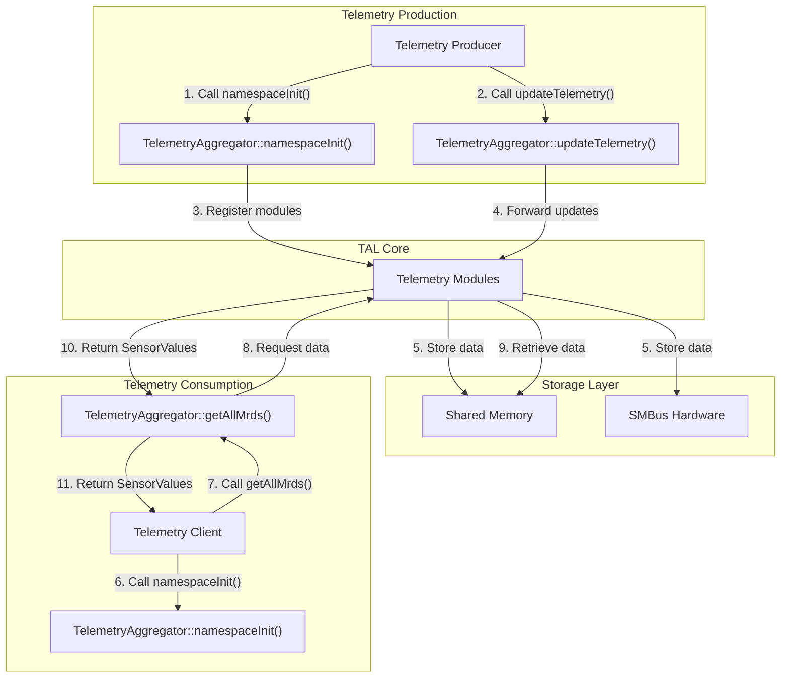
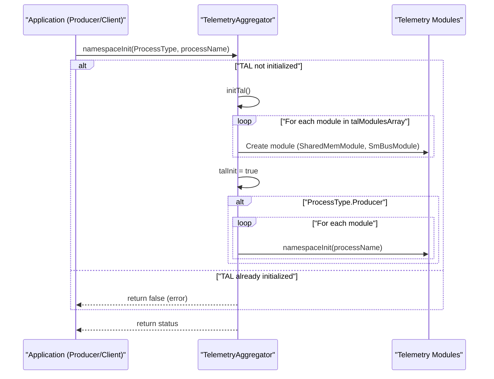
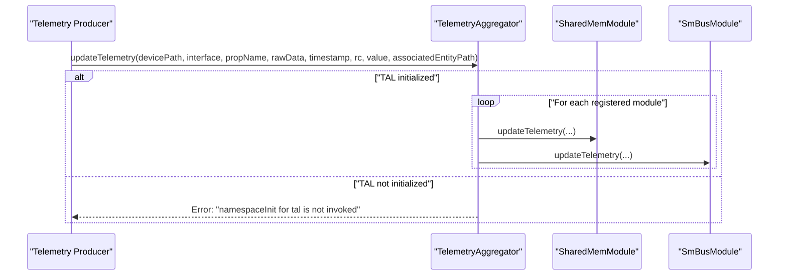
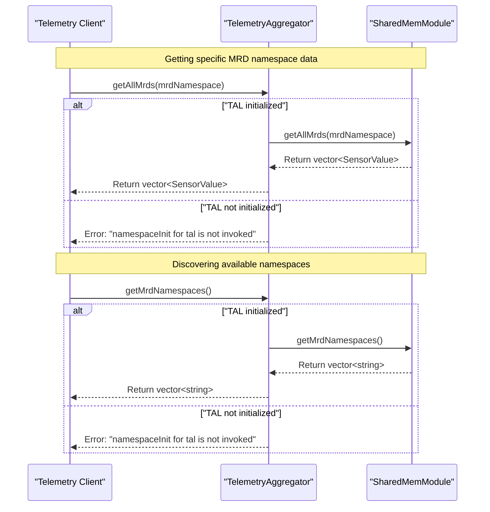
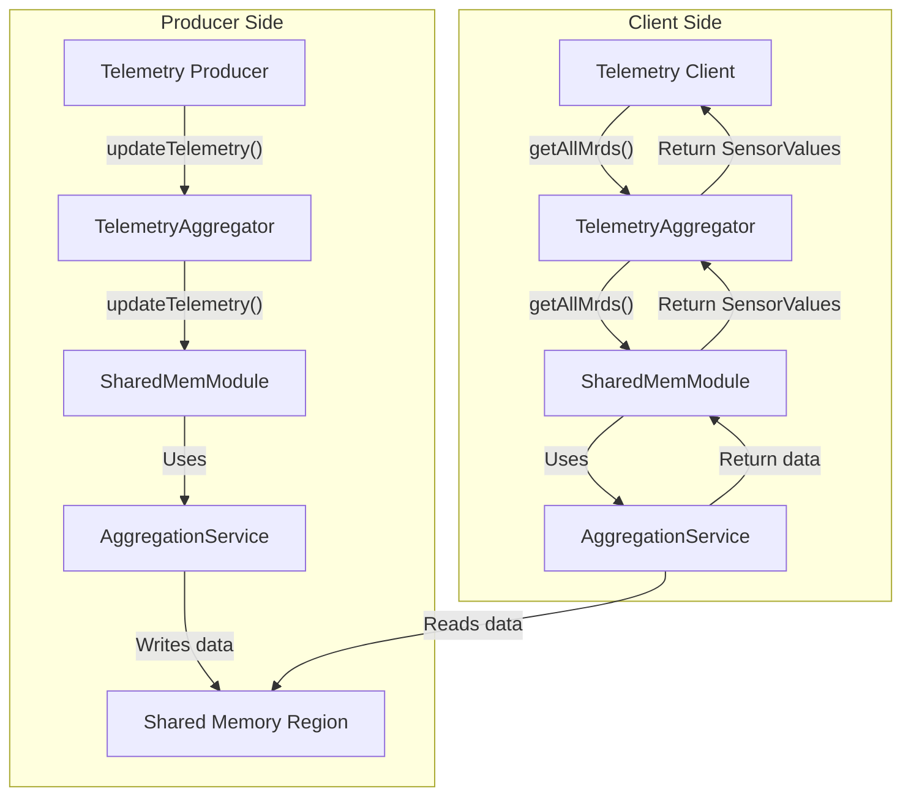
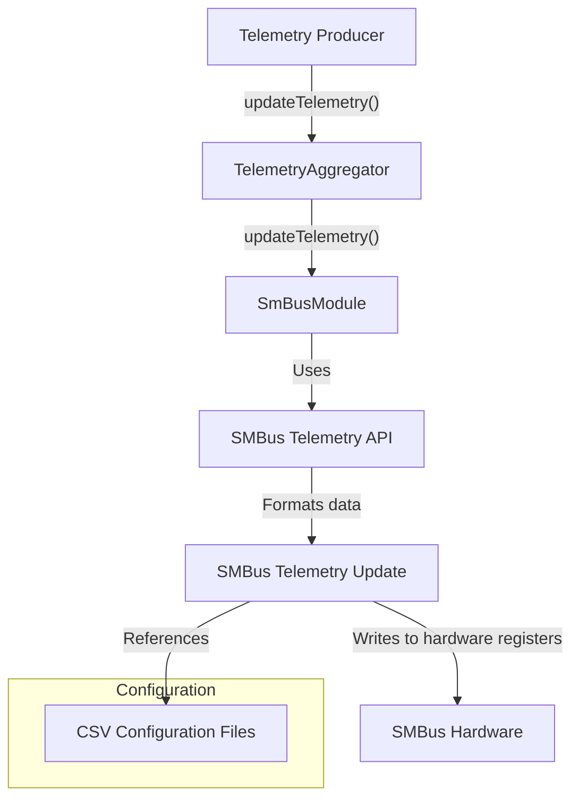
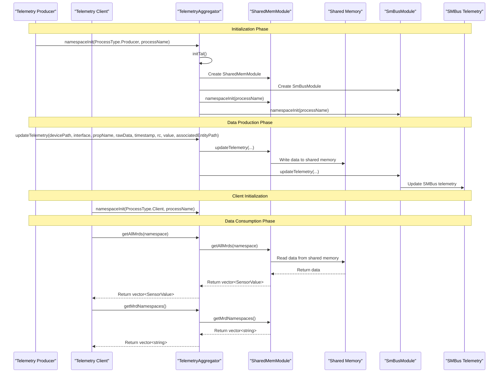
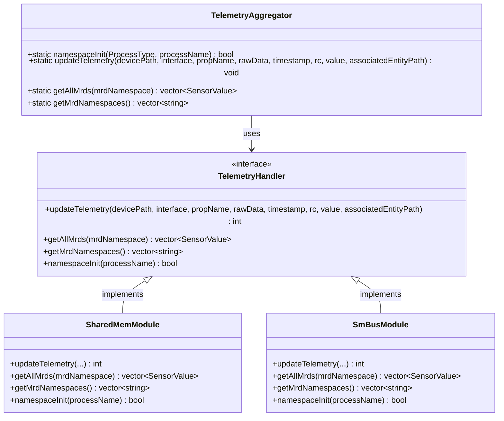

<!-- source: DeepWiki mcp.deepwiki.com · repo NVIDIA/nvidia-tal · page 5 Data Flow · fetched 2026-10-26 -->

# Data Flow

Relevant source files

The following files were used as context for generating this wiki page:

- [README.md](README.md)
- [lib/include/tal.hpp](lib/include/tal.hpp)
- [lib/tal.cpp](lib/tal.cpp)

This document details the end-to-end telemetry data flow through the NVIDIA Telemetry Abstraction Layer (TAL) system, tracing how data moves from producers to clients. The document covers initialization processes, data production and consumption patterns, and module-specific data handling mechanisms.

## 1. Data Flow Overview

The TAL system provides a unified interface for telemetry data collection and access by abstracting underlying telemetry mechanisms. Data flows through the system in the following sequence:

Sources: [lib/tal.cpp:60-78](), [lib/tal.cpp:80-97](), [lib/tal.cpp:116-136]()

## 2. Initialization Flow

Before any telemetry data can flow through the system, the TAL framework must be initialized. This initialization differs between producers and clients.

### 2.1. System Initialization Process

The initialization process involves:

1. An application (producer or client) calls `TelemetryAggregator::namespaceInit()`
2. If TAL is not initialized, `initTal()` creates and registers all available telemetry modules
3. For producer processes, each module's `namespaceInit()` is called with the producer's process name
4. For client processes, only the basic TAL initialization is performed

Sources: [lib/tal.cpp:36-58](), [lib/tal.cpp:116-136]()

## 3. Telemetry Data Production

After initialization, telemetry producers can send data through TAL using the `updateTelemetry()` function.

### 3.1. Data Production Process

The data production process includes:

1. A producer calls `TelemetryAggregator::updateTelemetry()` with telemetry data parameters
2. The aggregator verifies TAL is initialized
3. The aggregator forwards the update to all registered telemetry modules
4. Each module processes the data according to its implementation

Sources: [lib/tal.cpp:60-78](), [lib/include/tal.hpp:94-100]()

## 4. Telemetry Data Consumption

Telemetry clients retrieve data from the TAL system using two primary methods:

Important aspects of data consumption:

1. Currently, only data from the `SharedMemModule` is accessible to clients
2. `getAllMrds(mrdNamespace)` retrieves all sensor values for a specific namespace
3. `getMrdNamespaces()` returns all available MRD namespaces
4. Both methods require TAL to be initialized first

Sources: [lib/tal.cpp:80-97](), [lib/tal.cpp:99-114](), [lib/include/tal.hpp:111-121]()

## 5. Module-Specific Data Flow

### 5.1. Shared Memory Module Data Flow

The `SharedMemModule` handles telemetry data through shared memory, allowing efficient inter-process communication:

Sources: [lib/tal_shmem.hpp](), [lib/tal.cpp:80-97]()

### 5.2. SMBus Module Data Flow

The `SmBusModule` handles telemetry data through the System Management Bus:

Currently, the SMBus module is only used for data production, not consumption, which is why the `getAllMrds()` and `getMrdNamespaces()` methods only query the `SharedMemModule`.

Sources: [lib/tal_smbus.hpp](), [lib/tal.cpp:60-78]()

## 6. End-to-End Data Flow

The following diagram illustrates the complete end-to-end data flow through the TAL system:

Sources: [lib/tal.cpp:36-136](), [lib/include/tal.hpp:59-122]()

## 7. Code Structure Supporting Data Flow

The following class diagram illustrates how the data flow is implemented in the TAL code structure:

Sources: [lib/include/tal.hpp:59-122](), [lib/tal_module.hpp]()

## 8. Key Data Flow Parameters

The following table summarizes the key parameters used in telemetry data flow:

| Parameter | Description | Used In |
|-----------|-------------|---------|
| `devicePath` | Path of the telemetry device/sensor | `updateTelemetry()` |
| `interface` | Phosphor D-Bus interface of telemetry object | `updateTelemetry()` |
| `propName` | Metric property name | `updateTelemetry()` |
| `rawData` | Raw binary data of the value | `updateTelemetry()` |
| `timestamp` | Timestamp when the value was collected | `updateTelemetry()` |
| `rc` | Return code (non-zero for NaN update) | `updateTelemetry()` |
| `value` | Metric value (DbusVariantType) | `updateTelemetry()` |
| `associatedEntityPath` | Optional entity path for metrics | `updateTelemetry()` |
| `mrdNamespace` | Namespace for retrieving MRDs | `getAllMrds()` |
| `processName` | Name of the process initializing TAL | `namespaceInit()` |

Sources: [lib/include/tal.hpp:77-121](), [README.md:42-100]()

---

