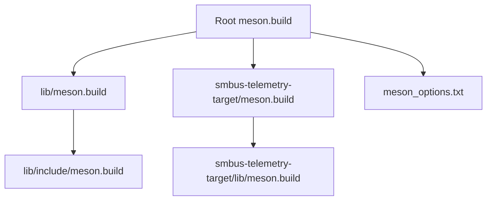
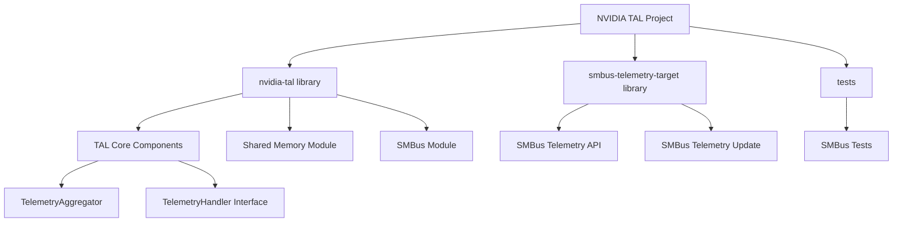
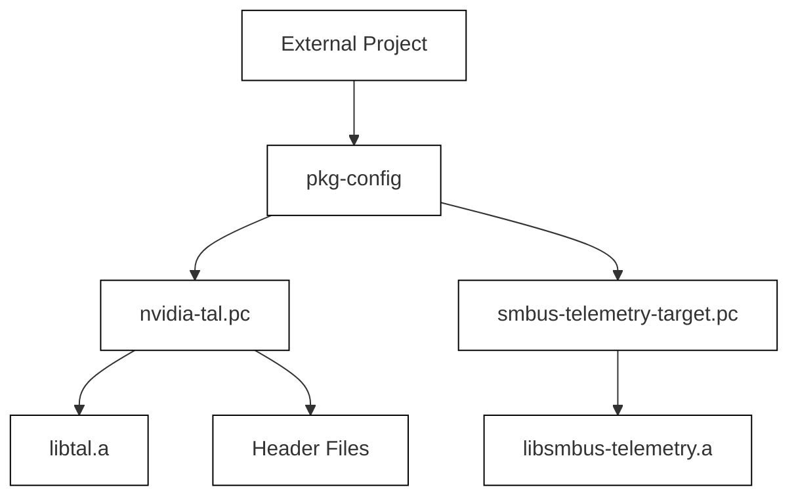
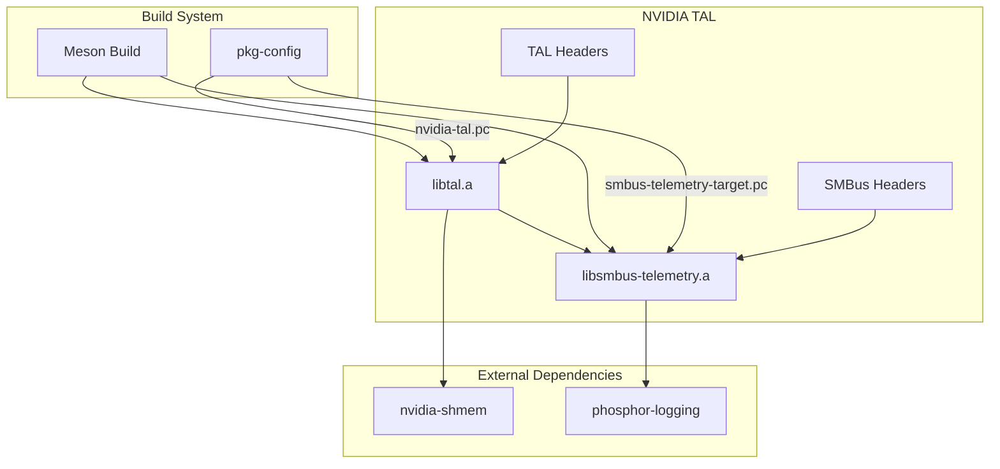

<!-- source: DeepWiki mcp.deepwiki.com · repo NVIDIA/nvidia-tal · page 6 Building and Integration · fetched 2026-10-26 -->

# Building and Integration

<details>
<summary>Relevant source files</summary>

The following files were used as context for generating this wiki page:

- [lib/include/meson.build](lib/include/meson.build)
- [lib/meson.build](lib/meson.build)
- [meson.build](meson.build)
- [meson_options.txt](meson_options.txt)
- [smbus-telemetry-target/lib/meson.build](smbus-telemetry-target/lib/meson.build)
- [smbus-telemetry-target/meson.build](smbus-telemetry-target/meson.build)

</details>


This document provides comprehensive information about the build system for the NVIDIA TAL (Telemetry Abstraction Layer) and how to integrate it into external projects. It covers build configuration options, dependencies, component structure, and guidelines for integration.

For information about the overall system architecture, see [Architecture](#2), and for the telemetry data flow, see [Data Flow](#5).

## Build System Overview

NVIDIA TAL uses the Meson build system, which provides a modern, fast, and user-friendly way to configure, build, and install the project. The build system is organized hierarchically, with the main `meson.build` file at the root and component-specific build files in subdirectories.



Sources:
[meson.build]()
[lib/meson.build]()
[lib/include/meson.build]()
[smbus-telemetry-target/meson.build]()
[smbus-telemetry-target/lib/meson.build]()
[meson_options.txt]()

## Project Requirements

To build NVIDIA TAL, you need:

- Meson build system (version >= 0.62.2)
- C++ compiler with C++20 support
- Dependencies:
  - nvidia-shmem library
  - phosphor-logging (for SMBus telemetry target)

## Build Options

NVIDIA TAL provides several build options that allow customizing the build process. These options are defined in the `meson_options.txt` file and can be set during configuration.

| Option | Type | Default | Description |
|--------|------|---------|-------------|
| `libonly` | boolean | false | Build library only |
| `tests` | feature | enabled | Build tests |
| `nvidia-tal` | feature | enabled | Build nvidia-tal library |
| `nvidia-shmem` | feature | enabled | Build nvidia-shmem |
| `smbus-telemetry-target` | feature | enabled | Build smbus-telemetry-target |
| `libsmbus-test` | feature | enabled | Build smbus-telemetry-target test |
| `smbus-sysfs-path` | string | '/dev/null' | SMBus Slave Device sysfs path |
| `smbus-telemetry-config-csv` | string | '/usr/share/smbus-telemetry-target/smbus-telemetry-config.csv' | SMBus slave config csv |
| `smbus-data-record` | integer | 8 | SMBus Data Record size |

Sources:
[meson_options.txt:1-10]()

## Project Components

The NVIDIA TAL project consists of several components that can be built separately or together:



Sources:
[meson.build:1-32]()
[lib/meson.build:1-50]()
[smbus-telemetry-target/lib/meson.build:1-57]()

## Building the Project

### Configuration

To configure the project, use the Meson setup command with desired options:

```
meson setup builddir -Doption=value
```

Example:
```
meson setup builddir -Dsmbus-telemetry-target=enabled -Dtests=disabled
```

### Building

After configuration, build the project:

```
meson compile -C builddir
```

### Installation

To install the built libraries and headers:

```
meson install -C builddir
```

## Component Details

### NVIDIA TAL Library

The NVIDIA TAL library (`nvidia-tal`) is the main component that provides the Telemetry Abstraction Layer functionality. It is built as a static library and includes the following source files:

- `tal.cpp` - Core implementation of the TelemetryAggregator
- `tal_shmem.cpp` - Implementation of the Shared Memory Module
- `tal_smbus.cpp` - Implementation of the SMBus Module

Header files installed by the library:

- `tal.hpp` - Main TAL API header
- `tal_module.hpp` - TelemetryHandler interface definition
- `tal_shmem.hpp` - Shared Memory Module header
- `tal_smbus.hpp` - SMBus Module header

Dependencies:

- `nvidia-shmem` - Required for shared memory functionality
- `smbus-telemetry-target` - Required for SMBus functionality (optional, can be disabled)

Sources:
[lib/meson.build:8-27]()
[lib/include/meson.build:1-4]()

### SMBus Telemetry Target Library

The SMBus Telemetry Target library (`smbus-telemetry-target`) provides functionality for interfacing with SMBus devices for telemetry data. It is built as a static library and includes:

- `smbus_telemetry_target_api.cpp` - SMBus telemetry API implementation
- `smbus_telemetry_update.cpp` - SMBus telemetry update functionality

Dependencies:

- `phosphor-logging` - Used for logging functionality

Configuration options:

- `SMBUS_SYSFS_PATH` - Path to the SMBus sysfs interface
- `SMBUS_SLAVE_TELEMETRY_CONFIG_CSV` - Path to the SMBus configuration CSV file
- `SMBUS_DATA_RECORD_SIZE` - Size of SMBus data records

Sources:
[smbus-telemetry-target/lib/meson.build:1-57]()

## Integration with Other Projects

### Using NVIDIA TAL as a Dependency

To integrate NVIDIA TAL into your project, you can use pkg-config for both the main library and the SMBus telemetry target library. The build system generates pkg-config files for both components.



### Meson Integration

For projects using Meson, you can include NVIDIA TAL as a dependency:

```
nvidia_tal_dep = dependency('nvidia-tal')
executable('my-app', 'main.cpp',
    dependencies: [nvidia_tal_dep],
)
```

If you need the SMBus telemetry target:

```
smbus_telemetry_dep = dependency('smbus-telemetry-target')
executable('my-app', 'main.cpp',
    dependencies: [nvidia_tal_dep, smbus_telemetry_dep],
)
```

### Build Flags

When integrating TAL, you might need to set specific build flags:

- `-DENABLE_SMBUS` is automatically added when SMBus telemetry target is enabled

Sources:
[lib/meson.build:36-48]()
[smbus-telemetry-target/lib/meson.build:45-50]()
[meson.build:13-15]()

## Build Configurations and Dependencies

The following diagram illustrates the build dependencies and package requirements for NVIDIA TAL:



Sources:
[lib/meson.build:11-18]()
[lib/meson.build:36-48]()
[smbus-telemetry-target/lib/meson.build:7-10]()
[smbus-telemetry-target/lib/meson.build:45-57]()

## Conditional Compilation

NVIDIA TAL uses conditional compilation to enable or disable certain features:

1. SMBus support is conditionally compiled based on the `smbus-telemetry-target` option:
   - When enabled, `-DENABLE_SMBUS` is added to compilation flags
   - The SMBus telemetry target library is added as a dependency to the TAL library

2. The build process checks for disabled features and skips building those components:
   - If `nvidia-tal` is disabled, the lib directory is not processed
   - If `smbus-telemetry-target` is disabled, the corresponding directory is not processed
   - If `libsmbus-test` is disabled, the tests are not built

Sources:
[meson.build:13-27]()

## Build File Structure

The following table summarizes the key build files in the project:

| File | Purpose |
|------|---------|
| `meson.build` | Main build file that coordinates the entire build process |
| `meson_options.txt` | Defines build options that can be configured |
| `lib/meson.build` | Builds the main TAL library |
| `lib/include/meson.build` | Installs TAL header files |
| `smbus-telemetry-target/meson.build` | Coordinates the SMBus telemetry target build |
| `smbus-telemetry-target/lib/meson.build` | Builds the SMBus telemetry target library |

Sources:
[meson.build]()
[meson_options.txt]()
[lib/meson.build]()
[lib/include/meson.build]()
[smbus-telemetry-target/meson.build]()
[smbus-telemetry-target/lib/meson.build]()

---

