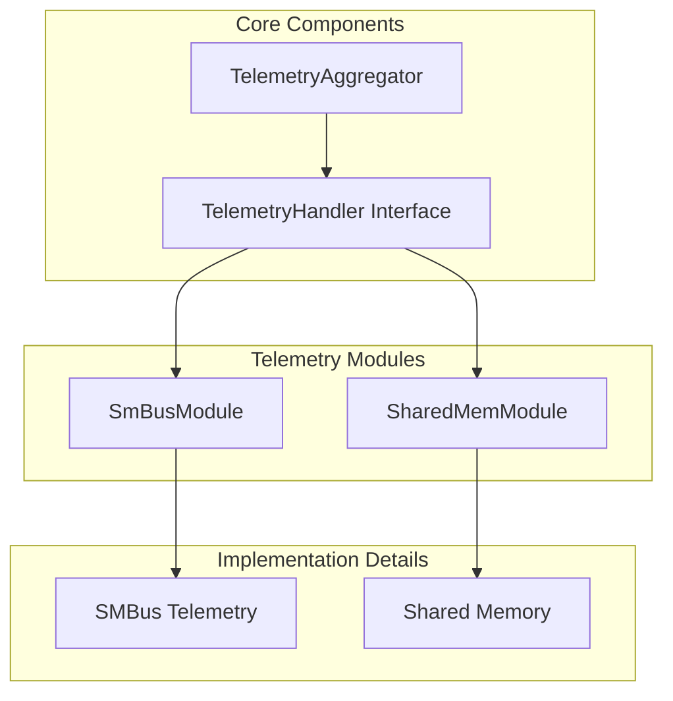
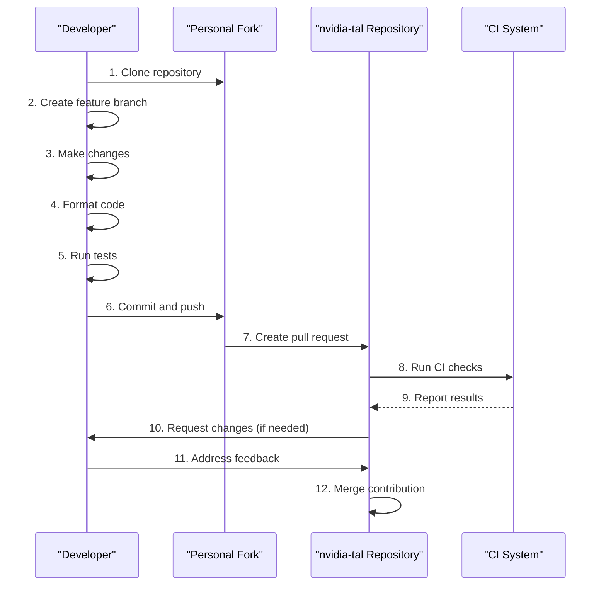

<!-- source: DeepWiki mcp.deepwiki.com · repo NVIDIA/nvidia-tal · page 7 Contributing Guidelines · fetched 2026-10-26 -->

# Contributing Guidelines

<details>
<summary>Relevant source files</summary>

The following files were used as context for generating this wiki page:

- [.black-ignore](.black-ignore)
- [.clang-format](.clang-format)
- [.eslintignore](.eslintignore)
- [.isort-ignore](.isort-ignore)
- [LICENSE](LICENSE)

</details>


## Purpose and Scope

This document outlines the guidelines for contributing to the NVIDIA Telemetry Abstraction Layer (TAL) project. It covers code style conventions, formatting requirements, and contribution workflows to ensure consistency across the codebase. For information about building and integrating TAL into your projects, see [Building and Integration](#6).

## License Information

NVIDIA TAL is licensed under the Apache License 2.0. All contributions must comply with this license. When contributing code, you agree that your contributions will be licensed under the same license as the rest of the codebase.

```
Copyright [year] NVIDIA Corporation

Licensed under the Apache License, Version 2.0
```

Sources: [LICENSE]()

## Code Style and Formatting

### C++ Formatting Standards

The project uses clang-format to enforce consistent C++ code style. The formatting rules are defined in the `.clang-format` file at the repository root.

Key C++ style guidelines include:

- Indentation: 4 spaces (no tabs)
- Line length: 80 columns maximum
- Braces: Custom style with braces on new lines for functions, classes, namespaces
- Pointer/reference alignment: Left-aligned (`Type* variable`, not `Type *variable`)
- Comments: Aligned and reflowed

To format your code:

```bash
# Format a single file
clang-format -i path/to/file.cpp

# Format all C++ files in the repository
find . -name "*.cpp" -o -name "*.h" | xargs clang-format -i
```

Sources: [.clang-format]()

### Include Order

Include files should be organized in the following order (enforced by clang-format):

1. Related header file (if applicable)
2. Project headers (`*.h`)
3. Project template headers (`*.hpp`)
4. System headers (`<*.h>`)
5. System template headers (`<*.hpp>`) 
6. Library headers (`<*>`)
7. Testing headers (gtest, gmock)

```cpp
// Example include order
#include "my_class.h"      // Related header

#include "tal/common.h"    // Project headers
#include "util/helpers.h"

#include <stdio.h>         // System headers
#include <stdlib.h>

#include <vector>          // Library headers
#include <string>

#include <gtest/gtest.h>   // Testing headers
```

Sources: [.clang-format:65-82]()

## Code Organization

The following diagram illustrates the recommended organization of modules within the TAL codebase:



When contributing new modules:
- Implement the `TelemetryHandler` interface
- Use consistent naming conventions
- Place module implementations in appropriate directories

Sources: [.clang-format]()

## Contribution Workflow



### Development Workflow Steps

1. **Fork and Clone**: Create a personal fork of the nvidia-tal repository and clone it locally
2. **Create Branch**: Create a branch for your feature or bugfix
3. **Make Changes**: Implement your changes following the code style guidelines
4. **Format Code**: Run code formatters before committing
5. **Test**: Ensure all tests pass and add new tests for new functionality
6. **Submit PR**: Create a pull request with a clear description of changes

Sources: [.clang-format]()

## Pull Request Guidelines

### PR Requirements

- Provide a clear, descriptive title
- Include a detailed description of changes
- Reference any related issues
- Ensure all CI checks pass
- Respond to review comments promptly

### Commit Message Format

Follow this format for commit messages:

```
[Component]: Brief description of change (under 50 chars)

More detailed explanation of what the change does and why.
Include any important details or limitations.

Fixes #issue_number (if applicable)
```

Example:
```
[SMBusModule]: Fix memory leak in telemetry update process

The SMBusModule was not properly releasing memory allocated
during telemetry updates when errors occurred. This change
ensures all resources are properly freed regardless of the
update result.

Fixes #123
```

Sources: [LICENSE]()

## Code Quality Checks

### Required Checks

Before submitting a pull request, ensure your code passes these checks:

| Check | Description | Tool |
|-------|-------------|------|
| Formatting | Code follows style guidelines | clang-format |
| Build | Code builds without errors or warnings | CMake/Compiler |
| Tests | All existing and new tests pass | Test Framework |
| Documentation | Code is properly documented | N/A |

### Static Analysis

The project may use additional static analysis tools. When available, run these checks before submitting:

- [Optional] clang-tidy for C++ static analysis
- [Optional] cppcheck for additional C++ checks

Sources: [.clang-format]()

## Documentation Guidelines

When adding new code, include appropriate documentation:

- Add comments for non-obvious code sections
- Document public API functions with description, parameters, and return values
- Update relevant wiki pages when changing system behavior

Example of good function documentation:

```cpp
/**
 * Updates telemetry data for a specified device.
 *
 * @param devicePath Path to the device being updated
 * @param interface Interface type being used
 * @param propName Property name to update
 * @param rawData Raw telemetry data
 * @param timestamp Time of telemetry reading
 * @param rc Return code from device
 * @param value Processed telemetry value
 * @param associatedEntityPath Path to associated entity
 *
 * @return 0 on success, error code otherwise
 */
```

## Common Pitfalls to Avoid

When contributing to TAL, avoid these common issues:

1. Not following the established code organization pattern
2. Missing documentation for public API
3. Not running formatters before committing
4. Implementing functionality that duplicates existing code
5. Adding code without corresponding tests

## Resources for Contributors

- [Architecture Overview](#2) - Understand the system architecture
- [TelemetryAggregator](#2.1) - Core component documentation  
- [TelemetryHandler Interface](#2.2) - Interface all modules must implement
- [Telemetry Modules](#3) - Overview of existing modules
- [Building and Integration](#6) - Build system details

## Questions and Contact

If you have questions about contributing that aren't answered here, please:

1. Check existing issues to see if your question has been addressed
2. Create a new issue with the "question" label if needed
3. Be specific about what you're trying to accomplish

Sources: [LICENSE](), [.clang-format]()