# Page: Overview

# Overview

<details>
<summary>Relevant source files</summary>

The following files were used as context for generating this wiki page:

- [README.md](README.md)
- [lib/include/tal.hpp](lib/include/tal.hpp)
- [lib/tal.cpp](lib/tal.cpp)

</details>


The NVIDIA Telemetry Abstraction Layer (TAL) is a library that provides a unified interface for telemetry data collection, aggregation, and access across different telemetry modules. It creates an abstraction layer between telemetry producers (services that generate telemetry data) and telemetry consumers (clients that read telemetry data), allowing them to operate independently of the underlying infrastructure libraries or IPC mechanisms.

## Purpose and Scope

TAL is designed to solve the problem of tight coupling between applications and specific telemetry implementations. By introducing this abstraction layer, it enables:

- A consistent interface for both producers and consumers of telemetry data
- The ability to add new telemetry modules without modifying existing applications
- Isolation between different telemetry mechanisms (Shared Memory, SMBus, etc.)

The current implementation supports two primary telemetry modules:
- Shared Memory Module for inter-process communication
- SMBus Module for system management bus communication

For detailed information about the specific architecture and components, see [Architecture](#2). For information about individual telemetry modules, see [Telemetry Modules](#3).

## System Architecture

The following diagram illustrates the high-level architecture of the NVIDIA TAL system:

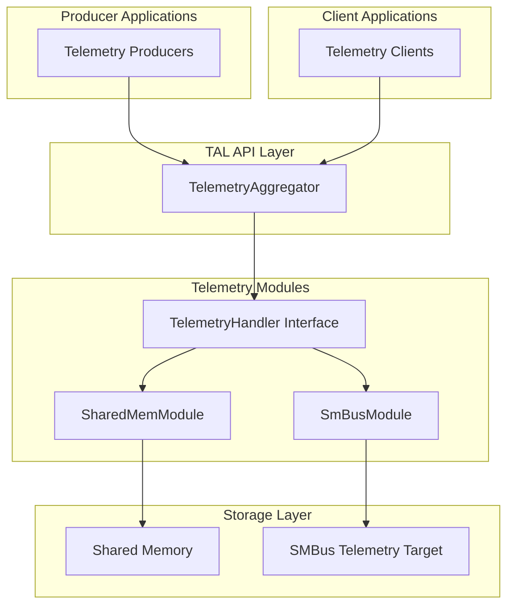

Sources: [lib/tal.cpp:25-32](), [lib/include/tal.hpp:57-123](), [README.md:7-35]()

## Key Components

### TelemetryAggregator

The `TelemetryAggregator` class serves as the main entry point to the TAL system, providing a static API for:
- Initializing telemetry modules
- Updating telemetry data across all registered modules
- Retrieving telemetry data from the appropriate module

This class is implemented in [lib/tal.cpp]() and provides the public interface that applications interact with.

Sources: [lib/include/tal.hpp:65-122](), [lib/tal.cpp:60-136]()

### TelemetryHandler Interface

The `TelemetryHandler` interface defines the common API that all telemetry modules must implement. This ensures a consistent approach to telemetry operations across different mechanisms. Implemented telemetry modules include:

- `SharedMemModule`: For shared memory-based telemetry
- `SmBusModule`: For SMBus-based telemetry

Sources: [lib/tal.cpp:26](), [README.md:20-25]()

## Data Flow

The following sequence diagram illustrates the typical data flow through the TAL system:

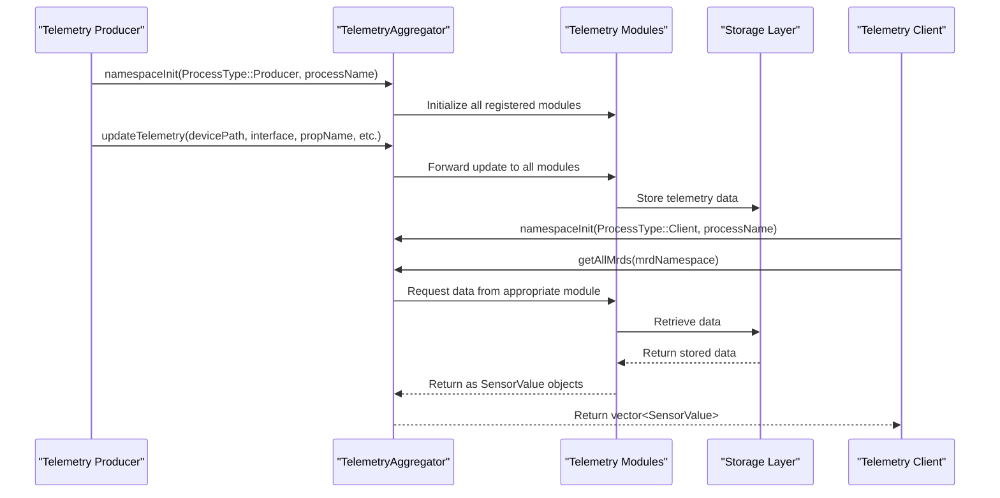

Sources: [lib/tal.cpp:36-58](), [lib/tal.cpp:60-77](), [lib/tal.cpp:80-97]()

## Module Initialization and Registration

TAL initializes its modules during the first call to `namespaceInit()`. The initialization code creates instances of the available telemetry modules and stores them in a global map:

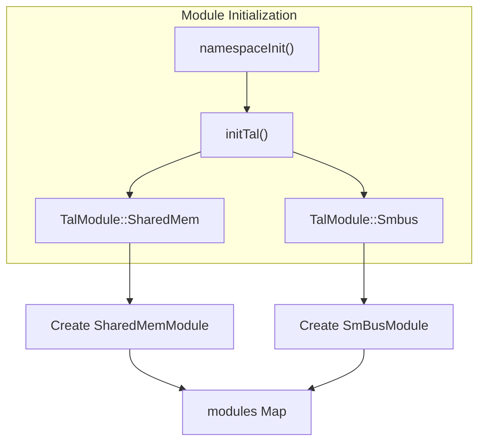

Sources: [lib/tal.cpp:26-32](), [lib/tal.cpp:36-58](), [lib/tal.cpp:116-136]()

## TAL APIs

TAL provides several key APIs for interacting with telemetry data:

### Namespace Initialization

```cpp
static bool namespaceInit(ProcessType type, const std::string& processName = {});
```

This API initializes the telemetry modules and prepares them for operation. It takes a process type (Producer or Client) and a process name as input.

Sources: [lib/include/tal.hpp:77-78](), [lib/tal.cpp:116-136](), [README.md:38-52]()

### Update Telemetry

```cpp
static void updateTelemetry(const std::string& devicePath, const std::string& interface,
                           const std::string& propName, std::vector<uint8_t>& rawData,
                           const uint64_t timestamp, int rc,
                           nv::sensor_aggregation::DbusVariantType& value,
                           const std::string associatedEntityPath = {});
```

This API allows producers to update telemetry data across all registered modules.

Sources: [lib/include/tal.hpp:94-100](), [lib/tal.cpp:60-78](), [README.md:53-78]()

### Read Telemetry

```cpp
static std::vector<nv::shmem::SensorValue> getAllMrds(const std::string& mrdNamespace);
```

This API allows clients to retrieve all metric report definitions (MRDs) for a specific namespace.

Sources: [lib/include/tal.hpp:111-112](), [lib/tal.cpp:80-97](), [README.md:80-91]()

### Get Namespaces

```cpp
static std::vector<std::string> getMrdNamespaces();
```

This API returns a list of all available metric report namespaces.

Sources: [lib/include/tal.hpp:121](), [lib/tal.cpp:99-114](), [README.md:92-100]()

## Process Types

TAL supports two types of processes that interact with telemetry data:

1. **Producers** - Applications that generate and update telemetry data
2. **Clients** - Applications that consume telemetry data

This distinction is important during initialization, as the behavior differs based on the process type:

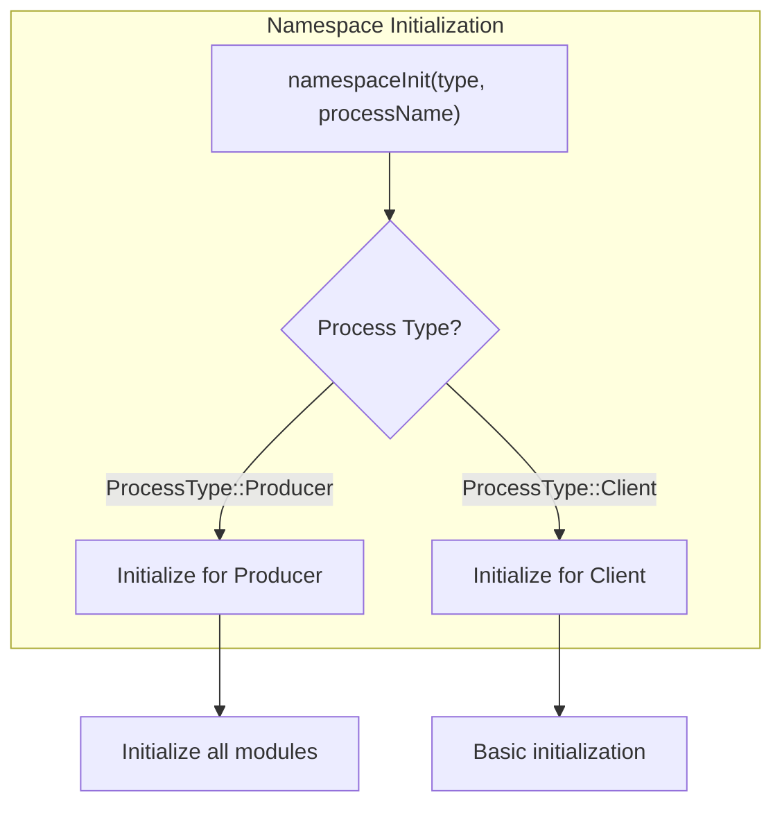

Sources: [lib/include/tal.hpp:59-63](), [lib/tal.cpp:116-136]()

## Current Limitations

- While TAL is designed to support multiple telemetry modules, the current implementation prioritizes Shared Memory for reading telemetry data (as seen in `getAllMrds` and `getMrdNamespaces`).
- SMBus module is conditionally compiled based on the `ENABLE_SMBUS` flag.

Sources: [lib/tal.cpp:28-32](), [lib/tal.cpp:80-114]()

---

# Page: Architecture

# Architecture

<details>
<summary>Relevant source files</summary>

The following files were used as context for generating this wiki page:

- [lib/include/tal.hpp](lib/include/tal.hpp)
- [lib/include/tal_module.hpp](lib/include/tal_module.hpp)
- [lib/tal.cpp](lib/tal.cpp)

</details>


## Purpose and Scope

This document describes the overall system architecture, design patterns, and key abstractions used in the NVIDIA Telemetry Abstraction Layer (TAL). It provides a comprehensive view of how the various components interact to collect, aggregate, and distribute telemetry data across different telemetry mechanisms. For specific details on individual components like the TelemetryAggregator or specific modules, see their respective pages ([TelemetryAggregator](#2.1), [TelemetryHandler Interface](#2.2), and [Telemetry Modules](#3)).

## System Architecture Overview

The NVIDIA TAL implements a modular architecture pattern that abstracts telemetry collection mechanisms behind a common interface. The system separates producers of telemetry data from consumers through a well-defined API, enabling applications to interact with telemetry data regardless of where it's stored or how it's gathered.

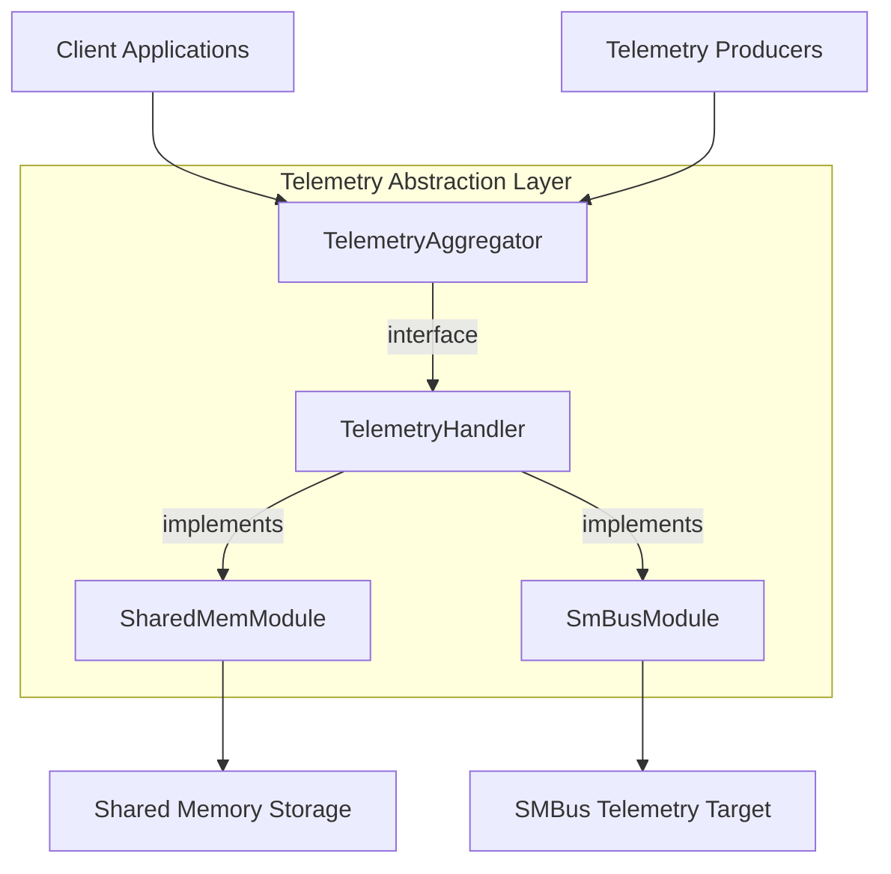

Sources: [lib/tal.cpp:24-58](), [lib/include/tal.hpp:65-122](), [lib/include/tal_module.hpp:32-97]()

## Core Components

The TAL architecture consists of the following key components:

| Component | Description | Source File |
|-----------|-------------|-------------|
| **TelemetryAggregator** | Central static class providing the public API for initializing, updating, and retrieving telemetry data | `tal.hpp` |
| **TelemetryHandler** | Interface that defines the contract for all telemetry modules | `tal_module.hpp` |
| **SharedMemModule** | Implementation for shared memory-based telemetry | `tal_shmem.hpp` |
| **SmBusModule** | Implementation for SMBus-based telemetry | `tal_smbus.hpp` |
| **TalModule Enum** | Enumeration used to identify different telemetry module types | `tal_module.hpp` |

Sources: [lib/include/tal_module.hpp:32-37](), [lib/include/tal.hpp:65-122]()

## Class Hierarchy and Relationships

The following diagram illustrates the class hierarchy and relationships between the key components in the TAL architecture:

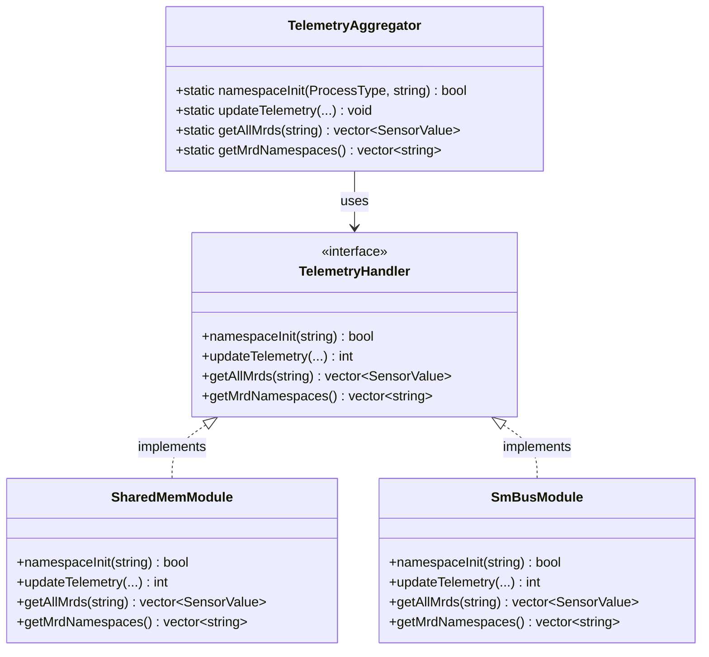

Sources: [lib/include/tal_module.hpp:38-97](), [lib/include/tal.hpp:65-122](), [lib/tal.cpp:26-58]()

## Module Registration and Initialization

The TAL system initializes telemetry modules dynamically based on compile-time configuration. The initialization process is handled in the `initTal()` function:

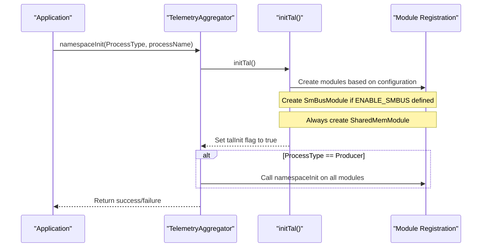

Sources: [lib/tal.cpp:36-58](), [lib/tal.cpp:116-136]()

The system maintains modules in an unordered map with the module type as the key:

```cpp
std::unordered_map<TalModule, std::unique_ptr<TelemetryHandler>> modules;
```

This design allows the system to be extended with new module types without changing the core architecture.

Sources: [lib/tal.cpp:26]()

## Data Flow

The TAL architecture implements a data flow that supports both telemetry producers and consumers. The data flow is coordinated by the `TelemetryAggregator`, which routes requests to the appropriate modules.

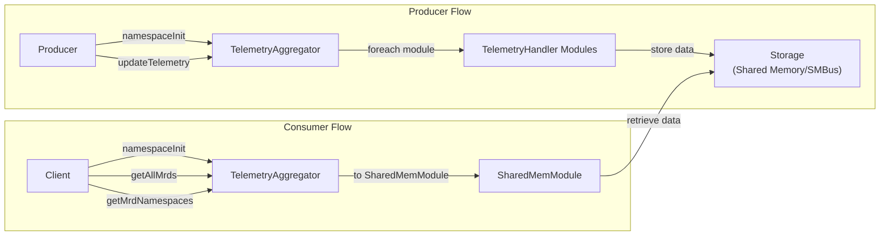

Sources: [lib/tal.cpp:60-78](), [lib/tal.cpp:80-114]()

### Producer Path

When a producer updates telemetry data, the `TelemetryAggregator` fans out the update to all registered modules:

1. The producer calls `TelemetryAggregator::updateTelemetry()` with telemetry data
2. The aggregator checks if the system is initialized
3. For each registered module, the aggregator calls the module's `updateTelemetry()` method
4. Each module processes and stores the data according to its implementation

Sources: [lib/tal.cpp:60-78](), [lib/include/tal.hpp:94-100]()

### Consumer Path

When a client requests telemetry data, the `TelemetryAggregator` routes the request to the `SharedMemModule`:

1. The client calls `TelemetryAggregator::getAllMrds()` or `TelemetryAggregator::getMrdNamespaces()`
2. The aggregator checks if the system is initialized
3. The aggregator finds the `SharedMemModule` and forwards the request
4. The `SharedMemModule` retrieves and returns the requested data

Note that consumer operations currently only use the `SharedMemModule`, as seen in the implementation:

```cpp
for (auto& [talModule, module] : modules)
{
    if (talModule == TalModule::SharedMem)
    {
        return module->getAllMrds(mrdNamespace);
    }
}
```

Sources: [lib/tal.cpp:80-114](), [lib/include/tal.hpp:111-112](), [lib/include/tal.hpp:121]()

## Process Types

The TAL architecture supports two types of processes:

1. **Producer** - Processes that generate telemetry data
2. **Client** - Processes that consume telemetry data

This distinction is made during initialization through the `ProcessType` enum:

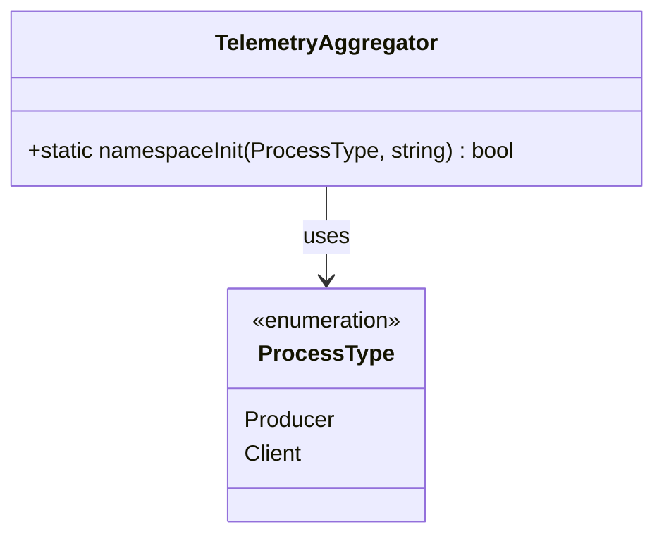

The initialization process differs based on the process type:

- For **Producers**, all modules are initialized with a call to their `namespaceInit()` method
- For **Clients**, modules are created but not initialized with a specific namespace

Sources: [lib/include/tal.hpp:59-63](), [lib/tal.cpp:116-136]()

## Error Handling

The TAL architecture implements basic error handling through return codes and logging:

- `namespaceInit()` returns a boolean indicating success or failure
- Module initialization errors are logged and aggregated
- Before operations, the system checks if initialization has occurred
- Error logging uses the `phosphor-logging/lg2.hpp` library

Sources: [lib/tal.cpp:67-71](), [lib/tal.cpp:83-87](), [lib/tal.cpp:101-105](), [lib/include/tal_module.hpp:21]()

## Extension Points

The TAL architecture is designed for extensibility. Key extension points include:

1. **Adding new telemetry modules**:
   - Implement the `TelemetryHandler` interface
   - Add a new module type to the `TalModule` enum
   - Update the `talModulesArray` and module creation logic in `initTal()`

2. **Adding new storage mechanisms**:
   - Implement as part of a new telemetry module
   - Ensure compatibility with the common telemetry data model

Sources: [lib/include/tal_module.hpp:38-97](), [lib/tal.cpp:28-32](), [lib/tal.cpp:36-58]()

## Summary

The TAL architecture provides a flexible and extensible framework for telemetry data collection and retrieval. By abstracting telemetry mechanisms behind a common interface, it enables applications to interact with telemetry data in a consistent way, regardless of the underlying storage or collection mechanism.

The modular design allows for easy extension with new telemetry mechanisms, while the clear separation between producers and consumers ensures efficient data flow.

---

# Page: TelemetryAggregator

# TelemetryAggregator

<details>
<summary>Relevant source files</summary>

The following files were used as context for generating this wiki page:

- [lib/include/tal.hpp](lib/include/tal.hpp)
- [lib/tal.cpp](lib/tal.cpp)

</details>


## Purpose and Scope

The TelemetryAggregator is the central coordination component of the NVIDIA Telemetry Abstraction Layer (TAL). It serves as the primary entry point for both telemetry producers and clients, providing a unified interface for telemetry operations across different underlying mechanisms. This class handles initialization of telemetry modules, distribution of telemetry updates, and retrieval of telemetry data.

For information about the specific telemetry module implementations, see [Telemetry Modules](#3), [Shared Memory Module](#3.1), and [SMBus Module](#3.2).

## Architecture Overview

The TelemetryAggregator acts as a facade that coordinates with multiple telemetry modules that implement the TelemetryHandler interface. It maintains a registry of modules and routes telemetry operations to the appropriate modules.

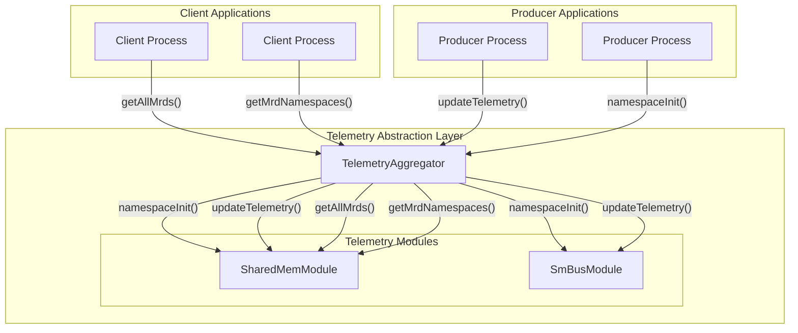

**TelemetryAggregator Component Diagram**

Sources: [lib/tal.cpp:1-137](), [lib/include/tal.hpp:58-123]()

## Implementation Details

The TelemetryAggregator is implemented as a class with static methods, functioning as a singleton pattern. It manages a collection of telemetry modules that are initialized at startup.

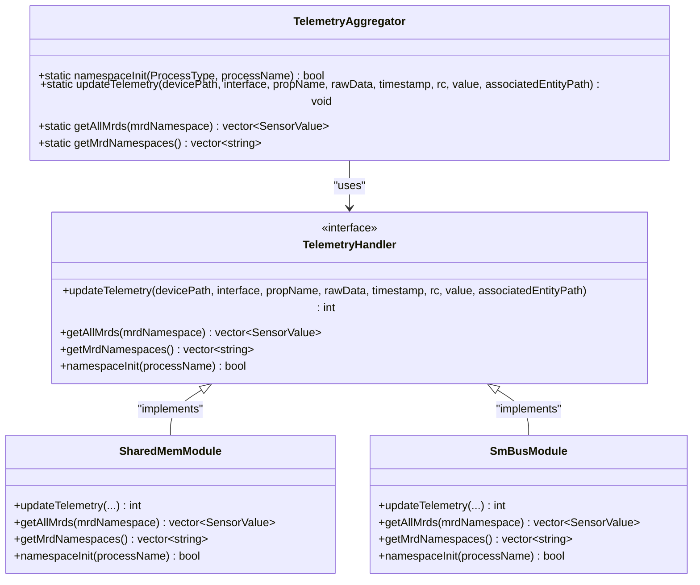

**TelemetryAggregator Class Diagram**

Sources: [lib/include/tal.hpp:58-123](), [lib/tal.cpp:26-58]()

### Internal State

The TelemetryAggregator maintains the following internal state:

- `modules`: A map of telemetry modules indexed by module type (SMBus, SharedMem)
- `talInit`: A boolean flag indicating whether TAL has been initialized
- `talModulesArray`: An array of module types to initialize

Sources: [lib/tal.cpp:26-34]()

## Initialization Process

The initialization process of the TelemetryAggregator follows these steps:

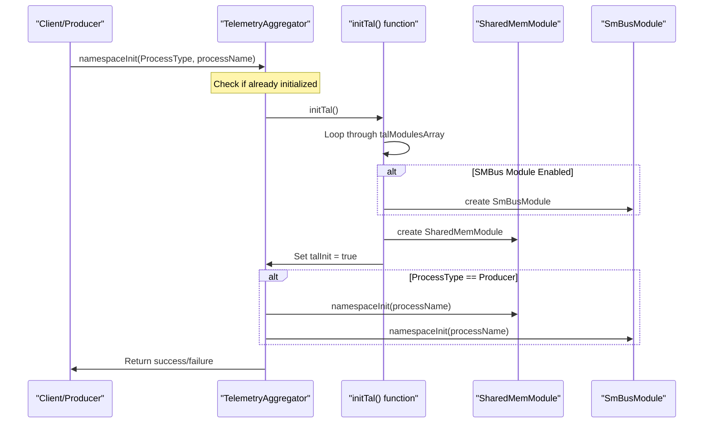

**TelemetryAggregator Initialization Sequence**

Sources: [lib/tal.cpp:36-58](), [lib/tal.cpp:116-136]()

The initialization process creates and registers the telemetry modules. When a producer process initializes TAL, it calls `namespaceInit()` on each module. Client processes only need to initialize TAL without initializing module namespaces.

## Key Operations

### Telemetry Updates

The `updateTelemetry` method distributes telemetry updates to all registered modules:

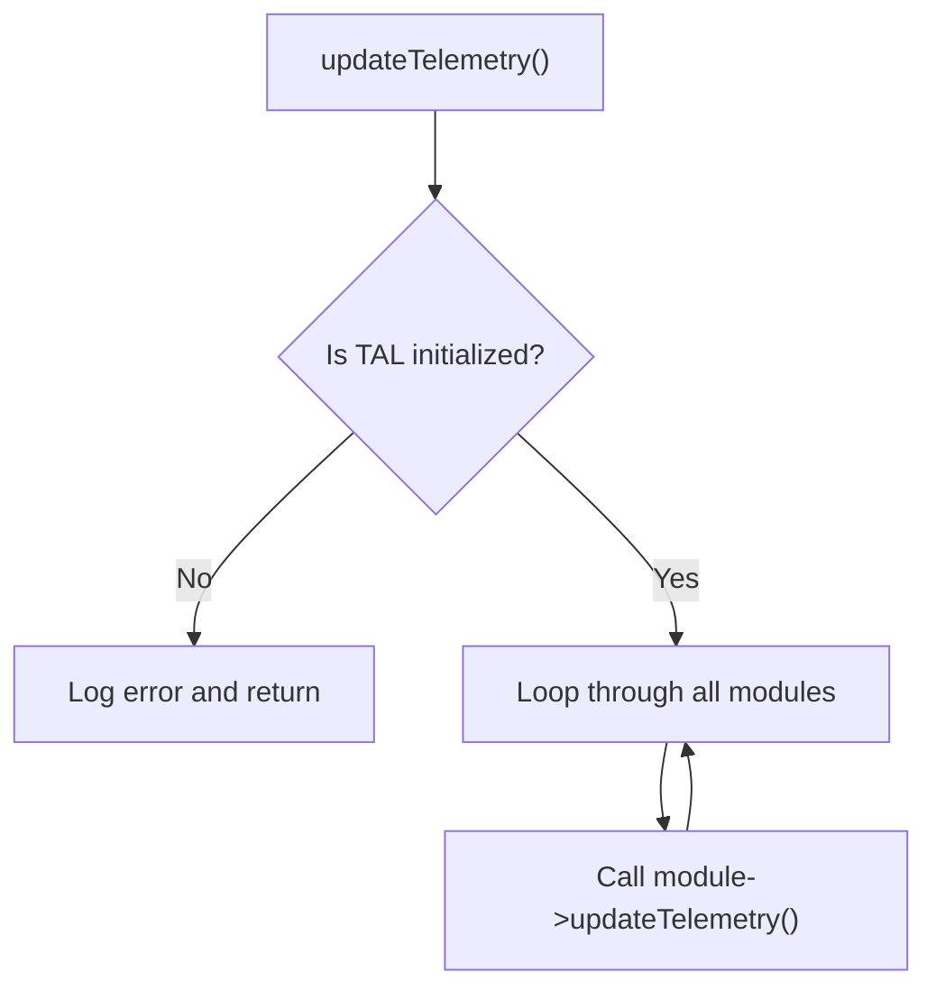

**Telemetry Update Flow**

Sources: [lib/tal.cpp:60-78]()

### Data Retrieval

The `getAllMrds` and `getMrdNamespaces` methods retrieve telemetry data specifically from the SharedMemModule:

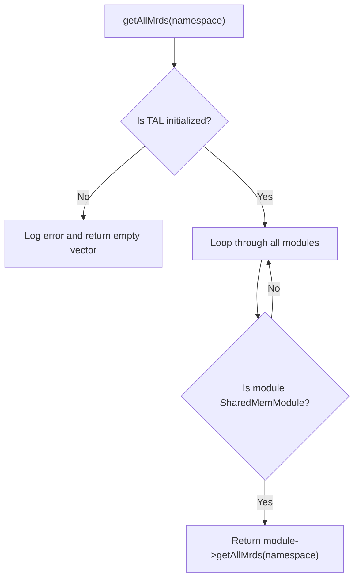

**MRD Retrieval Flow**

Sources: [lib/tal.cpp:80-97](), [lib/tal.cpp:99-114]()

## API Reference

### Module Initialization

```cpp
static bool namespaceInit(ProcessType type, const std::string& processName = {})
```

Initializes the telemetry modules and, for producers, initializes each module's namespace.

**Parameters:**
- `type`: Type of process (Producer or Client)
- `processName`: Name of the process (required for producers)

**Returns:**
- `bool`: Success/failure status (all modules initialized successfully)

Sources: [lib/include/tal.hpp:77-78](), [lib/tal.cpp:116-136]()

### Telemetry Updates

```cpp
static void updateTelemetry(const std::string& devicePath, const std::string& interface,
                            const std::string& propName, std::vector<uint8_t>& rawData,
                            const uint64_t timestamp, int rc,
                            nv::sensor_aggregation::DbusVariantType& value,
                            const std::string associatedEntityPath = {})
```

Updates telemetry data across all registered modules.

**Parameters:**
- `devicePath`: Device path of the telemetry object
- `interface`: D-Bus interface of the telemetry object
- `propName`: Metric name
- `rawData`: Raw data of the value
- `timestamp`: Timestamp of the telemetry data
- `rc`: Return code (non-zero for NaN updates)
- `value`: Metric value as a variant type
- `associatedEntityPath`: Optional path for associating with entities

Sources: [lib/include/tal.hpp:94-100](), [lib/tal.cpp:60-78]()

### Data Retrieval

```cpp
static std::vector<nv::shmem::SensorValue> getAllMrds(const std::string& mrdNamespace)
```

Retrieves all Metric Report Definitions for a given namespace from shared memory.

**Parameters:**
- `mrdNamespace`: Namespace to retrieve MRDs from

**Returns:**
- Vector of SensorValue objects containing MRD data

```cpp
static std::vector<std::string> getMrdNamespaces()
```

Retrieves all available MRD namespaces from shared memory.

**Returns:**
- Vector of namespace strings

Sources: [lib/include/tal.hpp:111-121](), [lib/tal.cpp:80-114]()

## Process Types and Data Flow

The TelemetryAggregator supports two types of processes:

1. **Producers**: Generate telemetry data and update it through the TAL
2. **Clients**: Consume telemetry data by querying MRDs

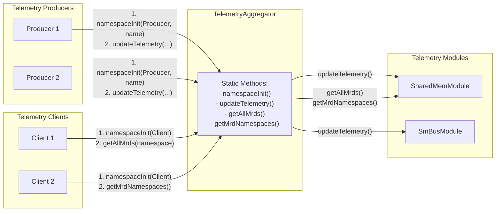

**TelemetryAggregator Data Flow**

Sources: [lib/include/tal.hpp:59-63](), [lib/tal.cpp:116-136](), [lib/tal.cpp:60-114]()

## Error Handling

The TelemetryAggregator implements the following error handling:

1. Checks if TAL is initialized before operations
2. Logs errors when operations are attempted before initialization
3. Collects and aggregates module initialization status

| Error Condition | Handling |
|-----------------|----------|
| namespaceInit called when already initialized | Logs error and returns false |
| Operations attempted before initialization | Logs error and returns empty results |
| Module initialization failure | Propagates error to caller with aggregated boolean status |

Sources: [lib/tal.cpp:67-71](), [lib/tal.cpp:83-87](), [lib/tal.cpp:101-105](), [lib/tal.cpp:119-123]()

## Conclusion

The TelemetryAggregator serves as the central coordination point for the NVIDIA TAL system, providing a unified interface for telemetry operations while abstracting away the details of specific telemetry modules. It manages the initialization process, routes telemetry updates to appropriate modules, and provides consistent methods for retrieving telemetry data.

For details about the implementation of specific telemetry modules, refer to [Shared Memory Module](#3.1) and [SMBus Module](#3.2).

---

# Page: TelemetryHandler Interface

# TelemetryHandler Interface

<details>
<summary>Relevant source files</summary>

The following files were used as context for generating this wiki page:

- [lib/include/tal_module.hpp](lib/include/tal_module.hpp)
- [lib/tal.cpp](lib/tal.cpp)

</details>


## Purpose and Scope

This document describes the `TelemetryHandler` interface, which is a core abstraction in the NVIDIA Telemetry Abstraction Layer (TAL). The interface defines the contract that all telemetry modules must implement to participate in the TAL ecosystem. For information about the overall system architecture, see [Architecture](#2) or about the concrete implementations of this interface, see [Telemetry Modules](#3).

Sources: [lib/include/tal_module.hpp:38-97]()

## Interface Overview

The `TelemetryHandler` interface serves as the bridge between the `TelemetryAggregator` and the various telemetry module implementations. It abstracts the details of different telemetry sources (Shared Memory, SMBus, etc.) and provides a unified API for telemetry operations.

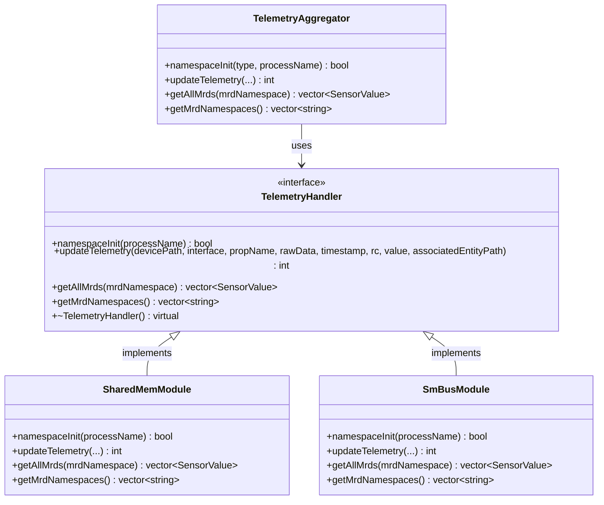

Sources: [lib/include/tal_module.hpp:38-97](), [lib/tal.cpp:26-37]()

## Interface Methods

The `TelemetryHandler` interface defines four key methods that all telemetry modules must implement:

| Method | Description | Return Value |
|--------|-------------|-------------|
| `namespaceInit(processName)` | Initializes the namespace for a module | `bool` - Success status |
| `updateTelemetry(...)` | Updates telemetry data for a specific metric | `int` - Status code |
| `getAllMrds(mrdNamespace)` | Gets all Metric Report Definitions for a namespace | `vector<SensorValue>` |
| `getMrdNamespaces()` | Gets all MRD namespaces | `vector<string>` |

Sources: [lib/include/tal_module.hpp:41-94]()

### Method Details

#### namespaceInit

```cpp
virtual bool namespaceInit(const std::string& processName) = 0;
```

This method initializes the namespace for a module. It's called during system initialization to set up the module for a specific process.

Parameters:
- `processName`: The name of the producer service process

Return value: 
- `true` if namespace initialization is successful
- `false` otherwise

Sources: [lib/include/tal_module.hpp:42-48]()

#### updateTelemetry

```cpp
virtual int updateTelemetry(
    const std::string& devicePath,
    const std::string& interface,
    const std::string& propName,
    std::vector<uint8_t>& rawData, 
    const uint64_t timestamp,
    int rc, 
    nv::sensor_aggregation::DbusVariantType& value,
    const std::string associatedEntityPath = {}) = 0;
```

This method updates telemetry data for a specific metric. It's called whenever new telemetry data is available.

Parameters:
- `devicePath`: Device path of the telemetry object
- `interface`: Phosphor D-Bus interface of the telemetry object
- `propName`: Metric name
- `rawData`: Raw data for the SMBus interface
- `timestamp`: Timestamp of the telemetry object
- `rc`: Set to non-zero for NaN update
- `value`: Metric value
- `associatedEntityPath`: Optional for most metrics, required for platform environment metrics

Return value:
- Status code indicating success or failure

Sources: [lib/include/tal_module.hpp:50-71]()

#### getAllMrds

```cpp
virtual std::vector<nv::shmem::SensorValue> getAllMrds(const std::string& mrdNamespace) = 0;
```

This method retrieves all Metric Report Definitions (MRDs) for a specific namespace.

Parameters:
- `mrdNamespace`: The namespace for which to retrieve MRDs

Return value:
- Vector of `SensorValue` objects containing the MRDs
- Exception is thrown if the namespace doesn't exist or has no elements

Sources: [lib/include/tal_module.hpp:73-82]()

#### getMrdNamespaces

```cpp
virtual std::vector<std::string> getMrdNamespaces() { return {}; }
```

This method retrieves all MRD namespaces available in the module. It has a default implementation that returns an empty vector, which modules can override if they support multiple namespaces.

Return value:
- Vector of namespace strings

Sources: [lib/include/tal_module.hpp:84-94]()

## Integration with TelemetryAggregator

The `TelemetryAggregator` is the main entry point for the TAL system and uses the `TelemetryHandler` interface to interact with the concrete module implementations. The following diagram illustrates this relationship and the data flow through the system:

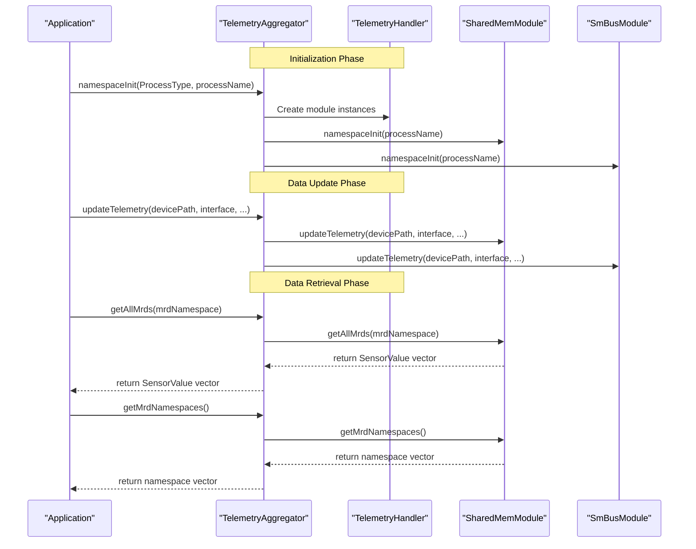

Sources: [lib/tal.cpp:60-136]()

## Module Registration and Initialization

During system initialization, the `TelemetryAggregator` creates instances of modules that implement the `TelemetryHandler` interface and stores them in a map. This process is illustrated below:

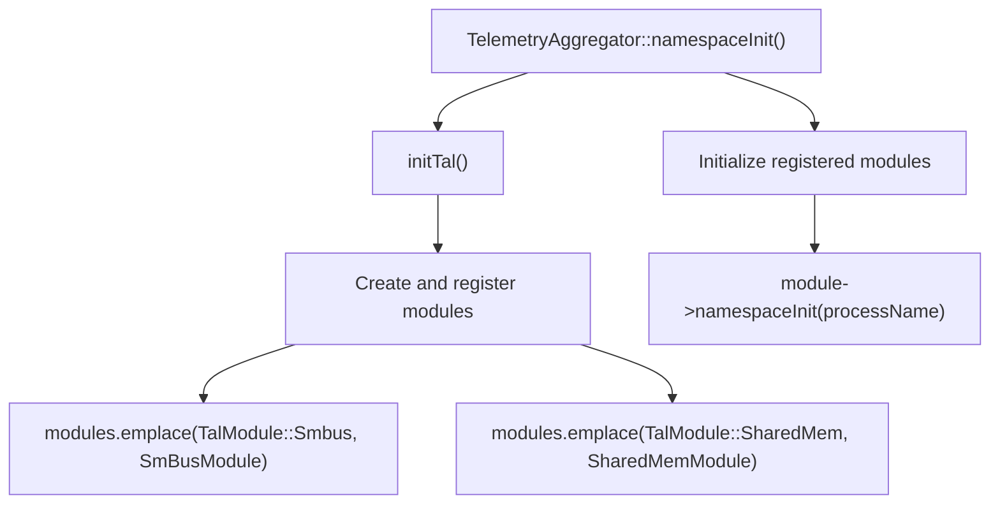

Sources: [lib/tal.cpp:36-58](), [lib/tal.cpp:116-136]()

## Module Types and Enumeration

The TAL system defines an enumeration `TalModule` to identify the different types of telemetry modules:

```cpp
enum class TalModule
{
    Smbus,
    SharedMem,
};
```

This enumeration is used as the key in the modules map to identify each module type.

Sources: [lib/include/tal_module.hpp:32-36](), [lib/tal.cpp:26]()

## Implementation Requirements

When implementing the `TelemetryHandler` interface for a new telemetry module, the following must be considered:

1. All pure virtual methods must be implemented:
   - `namespaceInit`
   - `updateTelemetry`
   - `getAllMrds`

2. The `getMrdNamespaces` method has a default implementation but should be overridden if the module supports multiple namespaces.

3. The implementation must handle all parameters passed to the methods correctly, especially in `updateTelemetry` which has many parameters.

4. Error handling should be robust, with appropriate return values indicating success or failure.

Sources: [lib/include/tal_module.hpp:38-97]()

## Telemetry Handler in System Architecture

The `TelemetryHandler` interface plays a crucial role in the overall TAL architecture, as shown in the following diagram:

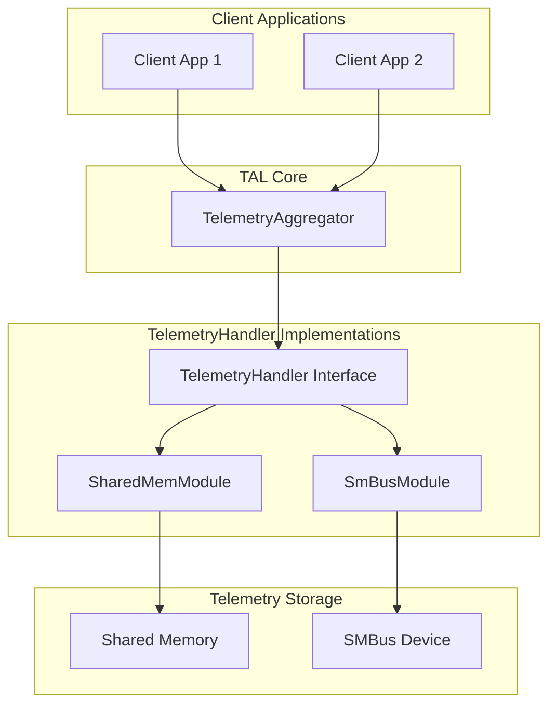

Sources: [lib/tal.cpp:26-136](), [lib/include/tal_module.hpp:38-97]()

## Summary

The `TelemetryHandler` interface is a fundamental component of the NVIDIA TAL system that:

1. Provides a uniform API for different telemetry modules
2. Abstracts the details of specific telemetry sources
3. Defines the contract for telemetry operations (initialization, updates, retrieval)
4. Enables the `TelemetryAggregator` to work with multiple telemetry modules in a consistent way

By implementing this interface, new telemetry sources can be integrated into the TAL system without changing the core components or client applications.

---

# Page: Telemetry Modules

# Telemetry Modules

<details>
<summary>Relevant source files</summary>

The following files were used as context for generating this wiki page:

- [lib/include/tal_module.hpp](lib/include/tal_module.hpp)
- [lib/tal.cpp](lib/tal.cpp)

</details>


## Overview

This document provides an in-depth overview of the Telemetry Modules in NVIDIA's Telemetry Abstraction Layer (TAL). Telemetry Modules are implementations of the `TelemetryHandler` interface that process and manage telemetry data from different sources. For information about the central aggregator that coordinates these modules, see [TelemetryAggregator](#2.1).

## Module Architecture

The TAL system employs a modular design where specialized modules handle telemetry data from different sources. Each module implements a common interface (`TelemetryHandler`), allowing the `TelemetryAggregator` to interact with them in a consistent manner regardless of their underlying implementation.

```mermaid
classDiagram
    class "TelemetryHandler" {
        <<interface>>
        +namespaceInit(processName) bool
        +updateTelemetry(...) int
        +getAllMrds(mrdNamespace) vector~SensorValue~
        +getMrdNamespaces() vector~string~
    }
    
    class "SharedMemModule" {
        +namespaceInit(processName) bool
        +updateTelemetry(...) int
        +getAllMrds(mrdNamespace) vector~SensorValue~
        +getMrdNamespaces() vector~string~
    }
    
    class "SmBusModule" {
        +namespaceInit(processName) bool
        +updateTelemetry(...) int
        +getAllMrds(mrdNamespace) vector~SensorValue~
        +getMrdNamespaces() vector~string~
    }
    
    class "TelemetryAggregator" {
        +static namespaceInit(type, processName) bool
        +static updateTelemetry(...) void
        +static getAllMrds(mrdNamespace) vector~SensorValue~
        +static getMrdNamespaces() vector~string~
    }
    
    TelemetryHandler <|.. SharedMemModule
    TelemetryHandler <|.. SmBusModule
    TelemetryAggregator --> TelemetryHandler : uses
```

Sources: [lib/include/tal_module.hpp:30-98](), [lib/tal.cpp:26-34]()

## Module Types

TAL currently supports two types of telemetry modules:

| Module Type | Description | Implementation Class |
|-------------|-------------|---------------------|
| SharedMem | Handles telemetry via shared memory | `SharedMemModule` |
| Smbus | Handles telemetry via System Management Bus | `SmBusModule` |

These module types are defined in the `TalModule` enum class:

```cpp
enum class TalModule
{
    Smbus,
    SharedMem,
};
```

Sources: [lib/include/tal_module.hpp:32-36](), [lib/tal.cpp:28-32]()

## TelemetryHandler Interface

All telemetry modules must implement the `TelemetryHandler` interface, which defines the core functionality required for telemetry operations. This interface serves as the contract between the `TelemetryAggregator` and the various module implementations.

```mermaid
classDiagram
    class "TelemetryHandler" {
        <<interface>>
        +namespaceInit(processName: string) bool
        +updateTelemetry(devicePath: string, interface: string, propName: string, rawData: vector~uint8_t~, timestamp: uint64_t, rc: int, value: DbusVariantType, associatedEntityPath: string) int
        +getAllMrds(mrdNamespace: string) vector~SensorValue~
        +getMrdNamespaces() vector~string~
        +~TelemetryHandler() virtual
    }
```

The interface defines four primary methods:

1. `namespaceInit`: Initializes the namespace for the module
2. `updateTelemetry`: Updates telemetry data for a specific metric
3. `getAllMrds`: Retrieves all Metric Report Definitions (MRDs) for a given namespace
4. `getMrdNamespaces`: Retrieves all available MRD namespaces

Sources: [lib/include/tal_module.hpp:38-97]()

## Module Initialization and Management

The TAL system initializes and manages telemetry modules through the `TelemetryAggregator`. When `namespaceInit` is called, the system creates instances of each available module and stores them in a map for future operations.

```mermaid
sequenceDiagram
    participant "Client" as Client
    participant "TelemetryAggregator" as TA
    participant "initTal()" as Init
    participant "SmBusModule" as SM
    participant "SharedMemModule" as SHM
    
    Client->>TA: namespaceInit(type, processName)
    TA->>Init: initTal()
    Init->>Init: for each module type
    
    alt module is TalModule::Smbus
        Init->>SM: create SmBusModule
    else module is TalModule::SharedMem
        Init->>SHM: create SharedMemModule
    end
    
    TA->>TA: for each module
    TA->>SM: namespaceInit(processName)
    TA->>SHM: namespaceInit(processName)
    TA-->>Client: return success/failure
```

The module initialization is handled by the `initTal` function, which:

1. Iterates through each module type in `talModulesArray`
2. Creates appropriate module instances based on the type
3. Stores each module in the `modules` map

Sources: [lib/tal.cpp:36-58](), [lib/tal.cpp:116-136]()

## Module Registry

The TAL system maintains a registry of telemetry modules in a global unordered map:

```cpp
std::unordered_map<TalModule, std::unique_ptr<TelemetryHandler>> modules;
```

This registry maps module types to their corresponding implementation instances. The system determines which modules to load at initialization time based on the `talModulesArray`:

```cpp
TalModule talModulesArray[] = {
#ifdef ENABLE_SMBUS
    TalModule::Smbus,
#endif
    TalModule::SharedMem};
```

Note that SMBus module support is conditional and will only be included if `ENABLE_SMBUS` is defined.

Sources: [lib/tal.cpp:26-32]()

## Data Flow Through Modules

Telemetry data flows through the system following a consistent path through the modules. The `TelemetryAggregator` coordinates this flow by dispatching operations to the appropriate modules.

```mermaid
flowchart TD
    subgraph "Telemetry Producer"
        P["Producer Application"]
    end
    
    subgraph "Telemetry Abstraction Layer"
        TA["TelemetryAggregator"]
        
        subgraph "Telemetry Modules"
            SM["SmBusModule"]
            SHM["SharedMemModule"]
        end
    end
    
    subgraph "Storage"
        SMBS["SMBus Device"]
        SHMS["Shared Memory"]
    end
    
    subgraph "Telemetry Consumer"
        C["Client Application"]
    end
    
    P -->|"updateTelemetry()"| TA
    TA -->|"updateTelemetry()"| SM
    TA -->|"updateTelemetry()"| SHM
    SM -->|"Write Data"| SMBS
    SHM -->|"Write Data"| SHMS
    
    C -->|"getAllMrds()"| TA
    TA -->|"getAllMrds()"| SHM
    SHM -->|"Read Data"| SHMS
    SHMS -->|"Return Data"| SHM
    SHM -->|"Return Data"| TA
    TA -->|"Return Data"| C
```

### Update Flow

When `updateTelemetry` is called on the `TelemetryAggregator`, the system:

1. Checks if TAL has been initialized
2. If initialized, forwards the telemetry update to all registered modules
3. Each module processes the update according to its specific implementation

```cpp
void TelemetryAggregator::updateTelemetry(...)
{
    if (!talInit)
    {
        lg2::error("namespaceInit for tal is not invoked");
        return;
    }

    for (auto& [ns, module] : modules)
    {
        module->updateTelemetry(devicePath, interface, propName, rawData,
                              timestamp, rc, value, associatedEntityPath);
    }
}
```

Sources: [lib/tal.cpp:60-78]()

### Query Flow

When `getAllMrds` or `getMrdNamespaces` is called, the system:

1. Checks if TAL has been initialized
2. If initialized, finds the `SharedMem` module
3. Forwards the query to the `SharedMem` module
4. Returns the result to the caller

Currently, these query operations are specifically implemented to work with the `SharedMem` module:

```cpp
std::vector<nv::shmem::SensorValue>
    TelemetryAggregator::getAllMrds(const std::string& mrdNamespace)
{
    if (!talInit)
    {
        lg2::error("namespaceInit for tal is not invoked");
        return {};
    }

    for (auto& [talModule, module] : modules)
    {
        if (talModule == TalModule::SharedMem)
        {
            return module->getAllMrds(mrdNamespace);
        }
    }
    return {};
}
```

Sources: [lib/tal.cpp:80-97](), [lib/tal.cpp:99-114]()

## Module Implementation Details

### SharedMemModule

The `SharedMemModule` handles telemetry data through shared memory mechanisms. It provides:

- Data storage and retrieval through shared memory
- Support for Metric Report Definitions (MRDs) and namespaces
- Efficient inter-process communication for telemetry data

For details on the SharedMemModule implementation, see [Shared Memory Module](#3.1).

### SmBusModule

The `SmBusModule` handles telemetry data through the System Management Bus (SMBus). It provides:

- Communication with SMBus devices for telemetry data
- Mapping of telemetry metrics to SMBus registers
- Support for hardware-level sensor readings

For details on the SmBusModule implementation, see [SMBus Module](#3.2).

## Summary

Telemetry Modules are the core components that implement the actual telemetry functionality in the TAL system. They follow a common interface (`TelemetryHandler`) that enables the system to work with different telemetry sources in a unified way. The current implementation supports two module types: Shared Memory and SMBus.

The modular architecture of TAL allows for:
- Separation of concerns between different telemetry sources
- Consistent API for telemetry operations
- Extensibility through additional module implementations
- Conditional compilation of modules based on system requirements

---

# Page: Shared Memory Module

# Shared Memory Module

<details>
<summary>Relevant source files</summary>

The following files were used as context for generating this wiki page:

- [lib/include/tal_shmem.hpp](lib/include/tal_shmem.hpp)
- [lib/tal_shmem.cpp](lib/tal_shmem.cpp)

</details>


The Shared Memory Module is a core component of the NVIDIA Telemetry Abstraction Layer (TAL) that implements the `TelemetryHandler` interface to provide telemetry data storage and retrieval through shared memory mechanisms. This module allows both telemetry producers and clients to communicate efficiently by storing telemetry data in memory segments that can be accessed by multiple processes.

For information about the complementary telemetry module that operates using the SMBus protocol, see [SMBus Module](#3.2).

## Architecture

### Position in the TAL System

**TAL System Architecture**
```mermaid
graph TD
    Client["Client Applications"] --> TA["TelemetryAggregator"]
    Producer["Telemetry Producers"] --> TA
    
    subgraph "Telemetry Abstraction Layer (TAL)"
        TA --> TH["TelemetryHandler Interface"]
        TH --> SMM["SharedMemModule"]
        TH --> SMBM["SmBusModule"]
    end
    
    SMM --> SHM["Shared Memory"]
    SMBM --> SMBT["SMBus Telemetry Target"]
```

The `SharedMemModule` is one of the core implementations of the `TelemetryHandler` interface. It provides a standardized way to store and retrieve telemetry data using shared memory, enabling efficient inter-process communication between telemetry producers and consumers.

Sources: [lib/include/tal_shmem.hpp:22-40]()

### Internal Structure

**SharedMemModule Internal Architecture**
```mermaid
graph LR
    SMM["SharedMemModule"] -->|"wraps"| AS["nv::shmem::AggregationService"]
    AS -->|"writes to/reads from"| SHM["Shared Memory"]
    
    SMM -->|"calls"| SA["nv::shmem::sensor_aggregation"]
    SA -->|"retrieves"| MRD["MRD Values"]
    SA -->|"gets"| NS["MRD Namespaces"]
```

Internally, the `SharedMemModule` primarily serves as a wrapper that delegates its functionality to:
- The `nv::shmem::AggregationService` for telemetry updates and namespace initialization
- The `nv::shmem::sensor_aggregation` namespace for retrieving MRD (Metric Report Definition) values and namespaces

Sources: [lib/tal_shmem.cpp:30-32](), [lib/tal_shmem.cpp:40](), [lib/tal_shmem.cpp:46](), [lib/tal_shmem.cpp:51]()

## Class Implementation

**SharedMemModule Class Hierarchy**
```mermaid
classDiagram
    class TelemetryHandler {
        <<interface>>
        +updateTelemetry()
        +getAllMrds()
        +getMrdNamespaces()
        +namespaceInit()
    }
    
    class SharedMemModule {
        +updateTelemetry()
        +getAllMrds()
        +getMrdNamespaces()
        +namespaceInit()
        +~SharedMemModule()
    }
    
    TelemetryHandler <|-- SharedMemModule
```

The `SharedMemModule` implements all methods required by the `TelemetryHandler` interface as shown in the table below:

| Method | Purpose | Implementation Details |
|--------|---------|----------------|
| `namespaceInit` | Initializes the namespace for the process | Delegates to `nv::shmem::AggregationService::namespaceInit` [lib/tal_shmem.cpp:35-41]() |
| `updateTelemetry` | Updates telemetry data for a device/property | Delegates to `nv::shmem::AggregationService::updateTelemetry` [lib/tal_shmem.cpp:23-33]() |
| `getAllMrds` | Retrieves all MRDs for a namespace | Delegates to `nv::shmem::sensor_aggregation::getAllMRDValues` [lib/tal_shmem.cpp:43-47]() |
| `getMrdNamespaces` | Gets all available MRD namespaces | Delegates to `nv::shmem::sensor_aggregation::getMrdNamespacesValues` [lib/tal_shmem.cpp:49-52]() |

Sources: [lib/include/tal_shmem.hpp:24-37](), [lib/tal_shmem.cpp:23-52]()

## Data Flow

**Telemetry Data Flow Through SharedMemModule**
```mermaid
sequenceDiagram
    participant Producer as "Telemetry Producer"
    participant TA as "TelemetryAggregator"
    participant SMM as "SharedMemModule"
    participant AS as "nv::shmem::AggregationService"
    participant SHM as "Shared Memory"
    participant SA as "nv::shmem::sensor_aggregation"
    participant Client as "Telemetry Client"
    
    Producer->>TA: namespaceInit(ProcessType::PRODUCER, processName)
    TA->>SMM: namespaceInit(processName)
    SMM->>AS: namespaceInit(processName)
    AS->>SHM: Initialize namespace
    
    Producer->>TA: updateTelemetry(devicePath, interface, propName, rawData, timestamp, rc, value)
    TA->>SMM: updateTelemetry(...)
    SMM->>AS: updateTelemetry(...)
    AS->>SHM: Store telemetry data
    
    Client->>TA: namespaceInit(ProcessType::CLIENT, processName)
    TA->>SMM: namespaceInit(processName)
    SMM->>AS: namespaceInit(processName)
    AS->>SHM: Initialize namespace
    
    Client->>TA: getAllMrds(namespace)
    TA->>SMM: getAllMrds(namespace)
    SMM->>SA: getAllMRDValues(namespace)
    SA->>SHM: Retrieve data
    SHM-->>SA: Return data
    SA-->>SMM: Return MRDs
    SMM-->>TA: Return vector<SensorValue>
    TA-->>Client: Return vector<SensorValue>
```

This sequence diagram illustrates the complete data flow through the SharedMemModule:

1. **Initialization Phase**: Both producers and clients first initialize their respective namespaces
2. **Data Production Phase**: Producers update telemetry data through the TelemetryAggregator, which is delegated to the SharedMemModule and ultimately stored in shared memory
3. **Data Consumption Phase**: Clients retrieve telemetry data by requesting MRDs from specific namespaces

Sources: [lib/tal_shmem.cpp:35-40](), [lib/tal_shmem.cpp:23-32](), [lib/tal_shmem.cpp:43-47]()

## Method Details

### namespaceInit

The `namespaceInit` method initializes a namespace in shared memory for the calling process. This is required before any telemetry operations can be performed.

```cpp
bool SharedMemModule::namespaceInit(const std::string& processName)
```

The method logs the initialization attempt and delegates to `nv::shmem::AggregationService::namespaceInit`. Initialization must be done by both producers and clients.

Sources: [lib/tal_shmem.cpp:35-41]()

### updateTelemetry

The `updateTelemetry` method is used by telemetry producers to update telemetry data in shared memory:

```cpp
int SharedMemModule::updateTelemetry(const std::string& devicePath, 
                                    const std::string& interface,
                                    const std::string& propName, 
                                    std::vector<uint8_t>& rawData,
                                    const uint64_t timestamp, 
                                    int rc,
                                    nv::sensor_aggregation::DbusVariantType& value,
                                    const std::string associatedEntityPath)
```

It takes parameters that identify the telemetry source (devicePath, interface, propName), the telemetry data (value, rawData, timestamp), return code (rc), and optional associatedEntityPath. It simply delegates to `nv::shmem::AggregationService::updateTelemetry`.

Sources: [lib/tal_shmem.cpp:23-33]()

### getAllMrds and getMrdNamespaces

These methods are used by telemetry clients to retrieve telemetry data:

```cpp
std::vector<nv::shmem::SensorValue> SharedMemModule::getAllMrds(const std::string& mrdNamespace)
std::vector<std::string> SharedMemModule::getMrdNamespaces()
```

`getAllMrds` retrieves all Metric Report Definitions (MRDs) for a given namespace, while `getMrdNamespaces` retrieves all available MRD namespaces. They delegate to the corresponding functions in `nv::shmem::sensor_aggregation`.

Sources: [lib/tal_shmem.cpp:43-47](), [lib/tal_shmem.cpp:49-52]()

## Integration with TelemetryAggregator

**SharedMemModule Integration with TelemetryAggregator**
```mermaid
graph TD
    TA["TelemetryAggregator"] -->|"forwards requests to"| Modules["Telemetry Modules"]
    Modules -->|"includes"| SMM["SharedMemModule"]
    Modules -->|"includes"| SMBM["SmBusModule"]
    
    TA -->|"namespaceInit()"| SMM
    TA -->|"updateTelemetry()"| SMM
    TA -->|"getAllMrds()"| SMM
    TA -->|"getMrdNamespaces()"| SMM
```

The `TelemetryAggregator` exposes the telemetry operations as static methods that are routed to the appropriate telemetry module, including the `SharedMemModule`. This provides client applications with a single entry point for all telemetry operations, regardless of the underlying implementation.

For more information about the TelemetryAggregator, see [TelemetryAggregator](#2.1).

Sources: [lib/include/tal_shmem.hpp:22-40]()

## Conclusion

The `SharedMemModule` is a fundamental component of the NVIDIA Telemetry Abstraction Layer that:

1. Implements the `TelemetryHandler` interface to provide a standard API for telemetry operations
2. Enables efficient inter-process communication of telemetry data through shared memory
3. Delegates to specialized components (`AggregationService` and `sensor_aggregation`) to handle the actual shared memory operations
4. Provides methods for both telemetry producers (to update data) and clients (to retrieve data)
5. Integrates with the `TelemetryAggregator` to provide a unified access point for telemetry operations

The modular design of the TAL, with `SharedMemModule` as one of its key components, allows the system to be flexible and extensible while maintaining a consistent interface for telemetry operations.

---

# Page: SMBus Module

# SMBus Module

<details>
<summary>Relevant source files</summary>

The following files were used as context for generating this wiki page:

- [lib/include/tal_smbus.hpp](lib/include/tal_smbus.hpp)
- [lib/tal_smbus.cpp](lib/tal_smbus.cpp)

</details>


## Purpose and Scope

The SMBus Module is a telemetry handler implementation within the NVIDIA Telemetry Abstraction Layer (TAL) that provides an interface for collecting and forwarding telemetry data via the System Management Bus (SMBus). It implements the `TelemetryHandler` interface and serves as a bridge between applications that generate telemetry data and the SMBus hardware interface.

This document focuses specifically on the SMBus Module implementation. For information about the SMBus Telemetry Target that this module interacts with, see [SMBus Telemetry Target](#4). For details about the SMBus Telemetry API, see [SMBus Telemetry API](#4.1).

## Architecture Overview

The SMBus Module fits into the TAL architecture as shown in the following diagram:

```mermaid
graph TD
    subgraph "Telemetry Abstraction Layer"
        TA["TelemetryAggregator"]
        TH["TelemetryHandler Interface"]
        SM["SmBusModule"]
    end
    
    subgraph "SMBus Components"
        SMTA["SMBus Telemetry API"]
        SMTU["SMBus Telemetry Update"]
        SMBH["SMBus Hardware"]
    end
    
    Client["Client Applications"] --> TA
    TA --> TH
    TH --> SM
    SM --> SMTA
    SMTA --> SMTU
    SMTU --> SMBH
```

Sources: [lib/include/tal_smbus.hpp:18-40](), [lib/tal_smbus.cpp:18-53]()

## Class Structure

The SMBus Module is implemented as the `SmBusModule` class, which inherits from the `TelemetryHandler` interface:

```mermaid
classDiagram
    class TelemetryHandler {
        <<interface>>
        +updateTelemetry(devicePath, interface, propName, rawData, timestamp, rc, value, associatedEntityPath) int
        +getAllMrds(mrdNamespace) vector~SensorValue~
        +getMrdNamespaces() vector~string~
        +namespaceInit(processName) bool
        +~TelemetryHandler() virtual
    }
    
    class SmBusModule {
        +updateTelemetry(devicePath, interface, propName, rawData, timestamp, rc, value, associatedEntityPath) int
        +getAllMrds(mrdNamespace) vector~SensorValue~
        +namespaceInit(processName) bool
        +~SmBusModule() virtual
    }
    
    TelemetryHandler <|-- SmBusModule
    SmBusModule --> "updateSmbusTelemetry()"
    SmBusModule --> "smbusSlaveInit()"
```

Sources: [lib/include/tal_smbus.hpp:23-39]()

## Implementation Details

The SMBus Module implementation is conditionally compiled based on the `ENABLE_SMBUS` flag, allowing the module to be included or excluded at compile time. If enabled, the module provides the following functionality:

### Initialization

The `namespaceInit` method initializes the SMBus namespace for a given process:

```mermaid
sequenceDiagram
    participant TA as TelemetryAggregator
    participant SM as SmBusModule
    participant API as SMBus Telemetry API
    
    TA->>SM: namespaceInit(processName)
    SM->>SM: Log initialization
    SM->>API: smbusSlaveInit()
    API-->>SM: Return status
    SM-->>TA: Return initialization status
```

The method logs the initialization with the process name and calls `smbusSlaveInit()` from the SMBus Telemetry API to initialize the SMBus slave functionality.

Sources: [lib/tal_smbus.cpp:45-52]()

### Telemetry Updates

The `updateTelemetry` method is used to update telemetry data over SMBus:

```mermaid
sequenceDiagram
    participant TA as TelemetryAggregator
    participant SM as SmBusModule
    participant API as SMBus Telemetry API
    
    TA->>SM: updateTelemetry(devicePath, interface, propName, rawData, timestamp, rc, value, associatedEntityPath)
    SM->>SM: Check if rawData has data
    alt rawData.size() > 0
        SM->>API: updateSmbusTelemetry(devicePath, interface, propName, rawData, timestamp, rc)
        API-->>SM: Return status
    else
        SM-->>TA: Return 0 (success)
    end
    SM-->>TA: Return status
```

The method checks if the raw data vector contains any data. If it does, it forwards the telemetry update to the `updateSmbusTelemetry` function in the SMBus Telemetry API. If no raw data is provided, it returns success (0) without taking any action.

Sources: [lib/tal_smbus.cpp:24-37]()

### Metric Report Definitions

The `getAllMrds` method is implemented to return an empty vector, indicating that this module does not support retrieving Metric Report Definitions (MRDs) directly:

```cpp
std::vector<nv::shmem::SensorValue> tal::SmBusModule::getAllMrds(const std::string& mrdNamespace)
{
    return {};
}
```

This suggests that telemetry data sent via SMBus is only for real-time transmission and is not stored for later retrieval via the MRD mechanism.

Sources: [lib/tal_smbus.cpp:39-43]()

## Data Flow

The following diagram illustrates the data flow through the SMBus Module:

```mermaid
graph LR
    TP["Telemetry Producer"] -->|"updateTelemetry()"| TA["TelemetryAggregator"]
    TA -->|"updateTelemetry()"| SM["SmBusModule"]
    SM -->|"updateSmbusTelemetry()"| SMTA["SMBus Telemetry API"]
    SMTA --> SMBH["SMBus Hardware"]
    
    CS["Client System"] --- SMBH
```

Sources: [lib/tal_smbus.cpp:24-37]()

## Integration with the TAL System

The SMBus Module is integrated into the TAL system through the `TelemetryAggregator`, which maintains instances of all telemetry handlers, including the SMBus Module. When telemetry data needs to be sent via SMBus, the aggregator routes the call to the SMBus Module's `updateTelemetry` method.

The integration process follows these steps:

1. The module is compiled if the `ENABLE_SMBUS` flag is defined
2. The module is instantiated by the `TelemetryAggregator`
3. The module initializes the SMBus slave through `namespaceInit` when a process registers
4. Telemetry updates are routed to the module through the aggregator
5. The module forwards updates to the SMBus Telemetry API

```mermaid
graph TD
    subgraph "TAL System"
        TA["TelemetryAggregator"]
        TH["TelemetryHandler Interface"]
        subgraph "Telemetry Modules"
            SM["SmBusModule"]
            SHM["SharedMemModule"]
        end
    end
    
    TA -->|"uses"| TH
    TH -.->|"implemented by"| SM
    TH -.->|"implemented by"| SHM
```

Sources: [lib/include/tal_smbus.hpp:18-40](), [lib/tal_smbus.cpp:18-53]()

## Limitations and Considerations

1. **Conditional Compilation**: The SMBus Module is only included if `ENABLE_SMBUS` is defined, making it an optional component of TAL.
2. **No MRD Support**: The module does not support retrieving Metric Report Definitions (MRDs), returning an empty vector when `getAllMrds` is called.
3. **Raw Data Requirement**: The `updateTelemetry` method only forwards updates to the SMBus Telemetry API if raw data is provided.
4. **Dependencies**: The module depends on the SMBus Telemetry Target API, specifically the `updateSmbusTelemetry` and `smbusSlaveInit` functions.

## Related Components

The SMBus Module interacts with several related components:

| Component | Relationship | Description |
|-----------|--------------|-------------|
| TelemetryAggregator | Uses SMBus Module | The central component that routes telemetry operations to appropriate modules |
| TelemetryHandler | Implemented by SMBus Module | The interface that defines the common API for all telemetry modules |
| SMBus Telemetry API | Used by SMBus Module | Provides functions for initializing and updating SMBus telemetry |
| SMBus Telemetry Target | Interacted with via API | The target system that receives telemetry updates via SMBus |

For more information about these components, see:
- [TelemetryAggregator](#2.1)
- [TelemetryHandler Interface](#2.2)
- [SMBus Telemetry API](#4.1)
- [SMBus Telemetry Update Process](#4.2)

---

# Page: SMBus Telemetry Target

# SMBus Telemetry Target

<details>
<summary>Relevant source files</summary>

The following files were used as context for generating this wiki page:

- [smbus-telemetry-target/lib/include/smbus_telemetry_target_api.hpp](smbus-telemetry-target/lib/include/smbus_telemetry_target_api.hpp)
- [smbus-telemetry-target/lib/smbus_telemetry_target_api.cpp](smbus-telemetry-target/lib/smbus_telemetry_target_api.cpp)

</details>


The SMBus Telemetry Target is a subsystem within the NVIDIA Telemetry Abstraction Layer (TAL) that provides an interface for exposing telemetry data via the System Management Bus (SMBus). This component acts as a bridge between telemetry producers and SMBus hardware, allowing sensor data to be made available through the SMBus protocol.

For information about the SMBus Module that interacts with this target, see [SMBus Module](#3.2). For details on the API interface, see [SMBus Telemetry API](#4.1).

## Architecture Overview

The SMBus Telemetry Target serves as an intermediary between the telemetry data producers and the SMBus hardware. It provides a simple API for initializing the SMBus slave device and updating telemetry values.

```mermaid
graph TD
    TA["TelemetryAggregator"] --> SMBM["SmBusModule"]
    SMBM --> |"uses"| SMBTA["SMBus Telemetry API"]
    SMBTA --> |"initialization"| SI["smbusSlaveInit()"]
    SMBTA --> |"data updates"| UTM["updateSmbusTelemetry()"]
    SI --> |"loads config"| CSV["CSV Configuration"]
    UTM --> |"calls"| SU["smbus_telemetry_update::smbusSlaveUpdate()"]
    SU --> |"writes to"| SMBD["SMBus Slave Device"]

    style TA stroke-width:2px
    style SMBM stroke-width:2px
    style SMBTA stroke-width:2px
```

Sources: [smbus-telemetry-target/lib/include/smbus_telemetry_target_api.hpp:24-49](), [smbus-telemetry-target/lib/smbus_telemetry_target_api.cpp:27-65]()

## Core Components

The SMBus Telemetry Target consists of the following key components:

| Component | Description |
|-----------|-------------|
| SMBus Telemetry API | Provides the interface for initialization and updates |
| SMBus Slave Device | The physical or virtual SMBus device that exposes data |
| CSV Configuration | Configuration file defining telemetry mappings |
| Telemetry Update Process | Logic for formatting and writing data to SMBus |

Sources: [smbus-telemetry-target/lib/smbus_telemetry_target_api.cpp:18-21]()

## Initialization Process

The SMBus Telemetry Target system must be initialized before it can be used to update telemetry data. The initialization process performs the following steps:

1. Verifies that an SMBus slave device is configured
2. Loads telemetry configuration data from a CSV file
3. Sets up the internal data structures necessary for telemetry updates

```mermaid
sequenceDiagram
    participant Client as "Client Application"
    participant API as "SMBus Telemetry API"
    participant Config as "CSV Configuration"
    participant Device as "SMBus Slave Device"
    
    Client->>API: "smbusSlaveInit()"
    API->>Device: "Check device existence"
    
    alt Device not configured
        API-->>Client: "Return false"
    else Device exists
        API->>Config: "loadFromCSV(SMBUS_SLAVE_TELEMETRY_CONFIG_CSV)"
        alt Configuration load failed
            Config-->>API: "Return error code"
            API-->>Client: "Return false"
        else Configuration load successful
            Config-->>API: "Return success"
            API->>API: "Set smbusTelemetryInit = true"
            API-->>Client: "Return true"
        end
    end
```

Sources: [smbus-telemetry-target/lib/smbus_telemetry_target_api.cpp:27-45]()

## Update Process

Once initialized, telemetry data can be updated using the `updateSmbusTelemetry()` function. This function takes sensor information and raw data, then updates the SMBus slave registers accordingly.

The update process involves:

1. Checking if the system has been successfully initialized
2. Calling the internal update function with the provided parameters
3. Returning any error codes from the update operation

```mermaid
graph TD
    Start["Start updateSmbusTelemetry()"] --> Check["Check if smbusTelemetryInit is true"]
    Check -->|"No"| Return0["Return 0 (graceful exit)"]
    Check -->|"Yes"| Update["Call smbus_telemetry_update::smbusSlaveUpdate()"]
    Update --> CheckRC["Check return code"]
    CheckRC -->|"Non-zero"| ReturnError["Return error code"]
    CheckRC -->|"Zero"| ReturnSuccess["Return 0 (success)"]
```

Sources: [smbus-telemetry-target/lib/smbus_telemetry_target_api.cpp:47-65]()

## API Interface

The SMBus Telemetry Target exposes two primary functions:

### smbusSlaveInit

```
bool smbusSlaveInit()
```

Initializes the SMBus telemetry system by verifying the slave device configuration and loading the telemetry configuration from a CSV file. Returns `true` on successful initialization, `false` otherwise.

### updateSmbusTelemetry

```
int updateSmbusTelemetry(const std::string& devicePath,
                         const std::string& interface,
                         const std::string& propName,
                         std::vector<uint8_t>& data, 
                         const uint64_t timestamp,
                         int rc)
```

Updates the telemetry data exposed via the SMBus slave device. Parameters include:

- `devicePath`: Sensor DBus object path
- `interface`: Sensor DBus interface
- `propName`: Sensor property name
- `data`: Raw sensor data (vector of bytes)
- `timestamp`: Last refresh time
- `rc`: Return code from the sensor API

Returns 0 on success, non-zero error code otherwise.

Sources: [smbus-telemetry-target/lib/include/smbus_telemetry_target_api.hpp:24-49]()

## Data Flow Through the System

The following diagram illustrates how telemetry data flows through the SMBus Telemetry Target system:

```mermaid
flowchart LR
    subgraph "Telemetry Producers"
        TP["Telemetry Producer"]
    end
    
    subgraph "Telemetry Abstraction Layer"
        TA["TelemetryAggregator"]
        SMBM["SmBusModule"]
    end
    
    subgraph "SMBus Telemetry Target"
        SMBTA["SMBus Telemetry API"]
        SMBU["smbus_telemetry_update"]
    end
    
    subgraph "Hardware"
        SMBD["SMBus Slave Device"]
    end
    
    TP -->|"sensor data"| TA
    TA -->|"forwards telemetry"| SMBM
    SMBM -->|"calls updateSmbusTelemetry()"| SMBTA
    SMBTA -->|"forwards data"| SMBU
    SMBU -->|"writes formatted data"| SMBD
```

Sources: [smbus-telemetry-target/lib/smbus_telemetry_target_api.cpp:47-65]()

## Configuration System

The SMBus Telemetry Target relies on a CSV-based configuration system to define which telemetry data should be exposed on the SMBus and how it should be mapped to SMBus registers. The configuration file is loaded during initialization via the `loadFromCSV()` function.

Key aspects of the configuration system:
- The configuration file is defined by the constant `SMBUS_SLAVE_TELEMETRY_CONFIG_CSV`
- It maps telemetry data points (identified by device path, interface, and property) to specific SMBus registers
- The configuration is loaded once during initialization and used for all subsequent update operations

For more detailed information about the configuration format and options, see [SMBus Configuration](#4.4).

Sources: [smbus-telemetry-target/lib/smbus_telemetry_target_api.cpp:36-42]()

## Error Handling

The SMBus Telemetry Target implements a simple error handling approach:

1. During initialization:
   - If the SMBus slave device is not configured, an error is logged and initialization fails
   - If loading from the CSV file fails, an error is logged and initialization fails

2. During telemetry updates:
   - If the system has not been initialized, the update function returns gracefully without error
   - If the update operation fails, the error code from the underlying function is propagated to the caller

For more detailed information about specific error codes and their meanings, see [Error Handling](#4.3).

Sources: [smbus-telemetry-target/lib/smbus_telemetry_target_api.cpp:30-42](), [smbus-telemetry-target/lib/smbus_telemetry_target_api.cpp:53-64]()

## Integration with Telemetry Abstraction Layer

The SMBus Telemetry Target integrates with the larger Telemetry Abstraction Layer through the SMBus Module, which implements the TelemetryHandler interface. The SMBus Module calls the SMBus Telemetry API functions to initialize the system and update telemetry data.

```mermaid
classDiagram
    class TelemetryHandler {
        <<interface>>
        +updateTelemetry(...) int
        +getAllMrds(mrdNamespace) vector~SensorValue~
        +getMrdNamespaces() vector~string~
        +namespaceInit(processName) bool
    }
    
    class SmBusModule {
        +updateTelemetry(...) int
        +getAllMrds(mrdNamespace) vector~SensorValue~
        +getMrdNamespaces() vector~string~
        +namespaceInit(processName) bool
    }
    
    class SMBusTelemetryAPI {
        +smbusSlaveInit() bool
        +updateSmbusTelemetry(...) int
    }
    
    class smbus_telemetry_update {
        +smbusSlaveUpdate(...) int
        +loadFromCSV(filename) int
        +i2cSlaveSysfs string
    }
    
    TelemetryHandler <|-- SmBusModule
    SmBusModule --> SMBusTelemetryAPI : uses
    SMBusTelemetryAPI --> smbus_telemetry_update : calls
```

The SMBus Telemetry Target provides a focused interface for the specific task of exposing telemetry data via SMBus, while the higher-level components in the TAL architecture provide the broader telemetry management functionality.

Sources: [smbus-telemetry-target/lib/include/smbus_telemetry_target_api.hpp:24-49](), [smbus-telemetry-target/lib/smbus_telemetry_target_api.cpp:18-21]()

---

# Page: SMBus Telemetry API

# SMBus Telemetry API

<details>
<summary>Relevant source files</summary>

The following files were used as context for generating this wiki page:

- [smbus-telemetry-target/lib/include/smbus_telemetry_target_api.hpp](smbus-telemetry-target/lib/include/smbus_telemetry_target_api.hpp)
- [smbus-telemetry-target/lib/smbus_telemetry_target_api.cpp](smbus-telemetry-target/lib/smbus_telemetry_target_api.cpp)

</details>


## Purpose and Scope

The SMBus Telemetry API provides the interface for initializing the SMBus telemetry subsystem and updating telemetry data exposed through the System Management Bus (SMBus). This API serves as the bridge between telemetry data producers and the SMBus hardware interface, enabling the exposure of system telemetry data to external monitoring entities.

This document covers the API functionality, initialization process, and telemetry update mechanisms. For information about the overall SMBus module implementation, see [SMBus Module](#3.2). For details on the SMBus telemetry update process and data formatting, see [SMBus Telemetry Update Process](#4.2).

Sources: [smbus-telemetry-target/lib/include/smbus_telemetry_target_api.hpp:18-49](), [smbus-telemetry-target/lib/smbus_telemetry_target_api.cpp:18-65]()

## API Position in System Architecture

```mermaid
graph TD
    subgraph "TAL System"
        TA["TelemetryAggregator"]
        TH["TelemetryHandler\nInterface"]
        SMBM["SmBusModule"]
    end
    
    subgraph "SMBus Telemetry Target"
        SMTA["SMBus Telemetry API\nsmbusSlaveInit()\nupdateSmbusTelemetry()"]
        SMTU["SMBus Telemetry Update\nsmbusSlaveUpdate()"]
        CSV["CSV Configuration\nSMBUS_SLAVE_TELEMETRY_CONFIG_CSV"]
    end
    
    subgraph "Hardware Interface"
        SMBHW["SMBus Slave Device\ni2cSlaveSysfs"]
    end
    
    TA --> TH
    TH --> SMBM
    SMBM --> SMTA
    SMTA --> SMTU
    SMTU --> SMBHW
    CSV --> SMTA
```

The SMBus Telemetry API sits between the TAL system's SMBus Module and the low-level SMBus Telemetry Update functionality. It provides two key functions that abstract the telemetry management for the SMBus:
- `smbusSlaveInit()` - One-time initialization
- `updateSmbusTelemetry()` - Regular telemetry updates

Sources: [smbus-telemetry-target/lib/include/smbus_telemetry_target_api.hpp:24-49](), [smbus-telemetry-target/lib/smbus_telemetry_target_api.cpp:27-65]()

## API Function Overview

The SMBus Telemetry API consists of two primary functions:

| Function | Purpose | Return Value |
|----------|---------|--------------|
| `smbusSlaveInit()` | Initializes the SMBus telemetry system by loading configuration from CSV | `bool` - Success/failure |
| `updateSmbusTelemetry()` | Updates telemetry data for a specific sensor | `int` - 0 for success, error code for failure |

Sources: [smbus-telemetry-target/lib/include/smbus_telemetry_target_api.hpp:24-49]()

## Initialization Function

```mermaid
sequenceDiagram
    participant Client as "Client Code"
    participant API as "smbusSlaveInit()"
    participant Config as "SMBus Config"
    participant HW as "SMBus Hardware"
    
    Client->>API: Call smbusSlaveInit()
    API->>HW: Check SMBus slave device configuration
    
    alt Slave device not configured
        HW-->>API: Error: device not configured
        API-->>Client: Return false
    else Slave device configured
        API->>Config: Load configuration from CSV
        alt CSV load fails
            Config-->>API: Error loading CSV
            API-->>Client: Return false
        else CSV load succeeds
            Config-->>API: Configuration loaded
            API->>API: Set smbusTelemetryInit = true
            API-->>Client: Return true
        end
    end
```

The `smbusSlaveInit()` function performs the following operations:

1. Checks if the SMBus slave device is configured (not set to `/dev/null`)
2. Loads telemetry configuration from the CSV file defined by `SMBUS_SLAVE_TELEMETRY_CONFIG_CSV`
3. Sets the `smbusTelemetryInit` flag to `true` if initialization succeeds

This function must be called once before any telemetry updates can be processed. It returns `true` if initialization was successful, `false` otherwise.

Sources: [smbus-telemetry-target/lib/smbus_telemetry_target_api.cpp:27-45]()

## Update Function

The `updateSmbusTelemetry()` function is used by telemetry producers to update sensor values that are exposed via the SMBus. It has the following signature:

```
int updateSmbusTelemetry(
    const std::string& devicePath,
    const std::string& interface,
    const std::string& propName,
    std::vector<uint8_t>& data,
    const uint64_t timestamp,
    int rc
)
```

### Parameters

| Parameter | Type | Description |
|-----------|------|-------------|
| `devicePath` | `const std::string&` | Sensor DBus object path |
| `interface` | `const std::string&` | Sensor DBus interface |
| `propName` | `const std::string&` | Sensor property name |
| `data` | `std::vector<uint8_t>&` | Raw sensor data from protocols (SMBPBI/PLDM/NSM) |
| `timestamp` | `const uint64_t` | Last refresh timestamp |
| `rc` | `int` | Return code from the sensor API |

### Return Value

- `0` for success
- Non-zero value for errors

### Update Process Flow

```mermaid
flowchart TD
    A["Call updateSmbusTelemetry()"] --> B{"smbusTelemetryInit == true?"}
    B -- "No" --> C["Return 0 (early exit)"]
    B -- "Yes" --> D["Call smbus_telemetry_update::smbusSlaveUpdate()"]
    D --> E{"smbusSlaveUpdate() successful?"}
    E -- "No" --> F["Return error code"]
    E -- "Yes" --> G["Return 0 (success)"]
```

The function first checks if `smbusTelemetryInit` is set to `true`, ensuring that initialization has been completed. If not, it returns `0` without attempting an update. This design allows telemetry producers to call the update function even if SMBus telemetry isn't fully configured, without generating errors.

If properly initialized, the function calls `smbus_telemetry_update::smbusSlaveUpdate()` to perform the actual update, passing through all parameters. Any errors from the update process are returned to the caller.

Sources: [smbus-telemetry-target/lib/smbus_telemetry_target_api.cpp:47-65]()

## Data Path and Mapping

```mermaid
graph LR
    subgraph "Telemetry Producer"
        P["Producer\nProcess"]
    end
    
    subgraph "SMBus Telemetry API"
        UP["updateSmbusTelemetry()"]
    end
    
    subgraph "SMBus Update"
        SU["smbusSlaveUpdate()"]
        MAP["Mapping Logic\nDevicePath + Interface + PropName\n→ SMBus Register"]
    end
    
    subgraph "SMBus Hardware"
        REG["SMBus Registers"]
    end
    
    P -->|"devicePath, interface,\npropName, data,\ntimestamp, rc"| UP
    UP --> SU
    SU --> MAP
    MAP -->|"Write formatted data"| REG
```

The SMBus Telemetry API maps telemetry data identified by the combination of `devicePath`, `interface`, and `propName` to specific SMBus registers. The mapping is defined in the CSV configuration file loaded during initialization. This design allows flexible routing of various telemetry data points to appropriate SMBus registers.

Sources: [smbus-telemetry-target/lib/include/smbus_telemetry_target_api.hpp:32-44](), [smbus-telemetry-target/lib/smbus_telemetry_target_api.cpp:47-65]()

## Error Handling

The SMBus Telemetry API handles errors at two levels:

1. **Initialization Errors**:
   - SMBus slave device not configured
   - Failed to load configuration from CSV

2. **Update Errors**:
   - Any errors returned by the underlying `smbusSlaveUpdate()` function

Initialization failures are reported through the boolean return value of `smbusSlaveInit()`. Update failures are reported through the integer return value of `updateSmbusTelemetry()`.

For detailed information about specific error codes from the update process, see [Error Handling](#4.3).

Sources: [smbus-telemetry-target/lib/smbus_telemetry_target_api.cpp:27-65]()

## Integration with TelemetryAggregator

The SMBus Telemetry API is typically used by the `SmBusModule` which implements the `TelemetryHandler` interface. The module calls `smbusSlaveInit()` during its initialization phase and `updateSmbusTelemetry()` when processing telemetry updates from the `TelemetryAggregator`.

This design follows the modular architecture of the Telemetry Abstraction Layer, where specific telemetry transport mechanisms are encapsulated in dedicated modules that implement a common interface.

Sources: [smbus-telemetry-target/lib/include/smbus_telemetry_target_api.hpp:24-49](), [smbus-telemetry-target/lib/smbus_telemetry_target_api.cpp:27-65]()

---

# Page: SMBus Telemetry Update Process

# SMBus Telemetry Update Process

<details>
<summary>Relevant source files</summary>

The following files were used as context for generating this wiki page:

- [smbus-telemetry-target/lib/include/smbus_telemetry_update.hpp](smbus-telemetry-target/lib/include/smbus_telemetry_update.hpp)
- [smbus-telemetry-target/lib/smbus_telemetry_update.cpp](smbus-telemetry-target/lib/smbus_telemetry_update.cpp)

</details>


## Purpose and Scope

This document details the process by which telemetry data is formatted and written to the System Management Bus (SMBus) in the NVIDIA Telemetry Abstraction Layer (TAL). It explains the internal mechanisms for updating SMBus-based telemetry data, configuration loading, sensor data mapping, and staleness handling. For information about the SMBus Module itself and how it integrates with the broader TAL architecture, see [SMBus Module](#3.2). For details on the SMBus configuration format, see [SMBus Configuration](#4.4).

## Overview

The SMBus Telemetry Update Process provides a mechanism to write telemetry data to specific offsets in an SMBus slave device (typically an EEPROM). The system maps sensor data to specific SMBus offsets, manages data staleness, and ensures proper formatting of the telemetry values.

```mermaid
graph TD
    subgraph "SMBus Telemetry Update Process"
        CSV["CSV Configuration File"] -->|"Parsed by"| loadFromCSV["loadFromCSV()"]
        loadFromCSV -->|"Populates"| sensorDataMap["sensorDataMap"]
        sensorDataMap -->|"Referenced by"| smbusSlaveUpdate["smbusSlaveUpdate()"]
        smbusSlaveUpdate -->|"Writes to"| EEPROM["SMBus EEPROM Device"]
    end
    
    subgraph "Data Sources"
        TA["TelemetryAggregator"] -->|"Calls"| smbusSlaveUpdate
    end
```

Sources: [smbus-telemetry-target/lib/include/smbus_telemetry_update.hpp:167-183](), [smbus-telemetry-target/lib/smbus_telemetry_update.cpp:159-253]()

## Sensor Data Structure

At the core of the SMBus Telemetry Update Process is the `SmbusSensorData` class, which maintains all the necessary information to map a sensor value to its corresponding SMBus location.

```mermaid
classDiagram
    class SmbusSensorData {
        -int length
        -int staleBit
        -int staleOffset
        -uint16_t offset
        -string dbusObjPath
        -string dbusIface
        -string dbusProperty
        +uint64_t previousTimeStamp
        +bool initTs
        +getOffsetDataLength()
        +setOffsetDataLength()
        +getStaleOffset()
        +setStaleOffset()
        +getStaleBit()
        +setStaleBit()
        +getSensorOffset()
        +setSensorOffset()
        +getDbusObjPath()
        +setDbusObjPath()
        +getDbusIface()
        +setDbusIface()
        +getDbusProperty()
        +setDbusProperty()
    }
```

Sources: [smbus-telemetry-target/lib/include/smbus_telemetry_update.hpp:49-158]()

Each `SmbusSensorData` instance contains:

1. **Offset Information**:
   - `offset`: The SMBus memory offset where the sensor value is written
   - `length`: The number of bytes to write at the offset

2. **Staleness Tracking**:
   - `staleOffset`: The offset where the staleness byte is stored
   - `staleBit`: The bit position within the staleness byte for this sensor
   - `previousTimeStamp`: Last update timestamp for staleness calculation

3. **Sensor Identification**:
   - `dbusObjPath`: D-Bus object path for the sensor
   - `dbusIface`: D-Bus interface for the sensor
   - `dbusProperty`: D-Bus property containing the sensor value

The system maintains a map of these sensor data objects, indexed by a composite key of the D-Bus path, interface, and property:

```cpp
using smbusSensorMap = std::map<std::string, class SmbusSensorData>;
```

Sources: [smbus-telemetry-target/lib/include/smbus_telemetry_update.hpp:33](), [smbus-telemetry-target/lib/smbus_telemetry_update.cpp:25]()

## Configuration Loading

The system loads sensor configurations from a CSV file using the `loadFromCSV` function. This function parses the CSV file, validates its structure, and populates the `sensorDataMap` with the corresponding `SmbusSensorData` objects.

```mermaid
flowchart TD
    Start["loadFromCSV() Start"] --> OpenFile["Open CSV File"]
    OpenFile -->|"Success"| ReadLines["Read CSV Lines"]
    OpenFile -->|"Failure"| ReturnError1["Return ConfigFileNotFound Error"]
    ReadLines --> ValidateFormat["Validate CSV Format"]
    ValidateFormat -->|"Valid"| ProcessHeader1["Process slave_version"]
    ValidateFormat -->|"Invalid"| ReturnError2["Return InvalidConfigData Error"]
    ProcessHeader1 --> ProcessHeader2["Process staleness_threshold"]
    ProcessHeader2 --> ProcessSensorRecords["Process Sensor Records"]
    ProcessSensorRecords --> CreateSensorData["Create SmbusSensorData Objects"]
    CreateSensorData --> PopulateSensorMap["Populate sensorDataMap"]
    PopulateSensorMap --> ReturnSuccess["Return Success"]
```

Sources: [smbus-telemetry-target/lib/smbus_telemetry_update.cpp:43-157]()

The CSV file structure includes:
1. **Header information**:
   - `slave_version`: SMBus slave version
   - `staleness_threshold`: Time threshold in milliseconds for marking data as stale

2. **Column headers**:
   - `offset`, `length`, `data_format`, `dbus_objectpath`, `dbus_interface`, `dbus_property`, `stale_offset`, `stale_bit`

3. **Sensor records**:
   - One row per sensor with all required fields

Example of CSV parsing logic:
```cpp
// Parse slave version
if (!keyValue.compare("slave_version")) {
    smbusSlaveVer = std::stoi(val[1], nullptr, 16);
    continue;
}
// Parse staleness threshold
else if (!keyValue.compare("staleness_threshold")) {
    slaveI2cStaleThresholdMs = std::stoi(val[1]);
    continue;
}
```

Sources: [smbus-telemetry-target/lib/smbus_telemetry_update.cpp:88-97]()

## Update Process

The `smbusSlaveUpdate` function performs the actual telemetry updates to the SMBus device. It takes telemetry data received from producers and writes it to the appropriate offsets in the SMBus EEPROM.

### Process Flow

```mermaid
sequenceDiagram
    participant TA as TelemetryAggregator
    participant SU as smbusSlaveUpdate
    participant SM as sensorDataMap
    participant EEPROM as SMBus EEPROM
    
    TA->>SU: Call with (objPath, iface, propName, value, timestamp, rc)
    SU->>SM: Lookup sensor data using composite key
    alt Sensor found in map
        SU->>SU: Calculate staleness (using timestamp)
        alt RC indicates success
            SU->>EEPROM: Write value to sensor offset
        else RC indicates failure
            SU->>SU: Set stale flag and fill with 0xFF
            SU->>EEPROM: Write 0xFF to sensor offset
        end
        alt Stale offset configured
            SU->>EEPROM: Read current stale byte
            SU->>SU: Modify appropriate stale bit
            SU->>EEPROM: Write updated stale byte
        end
    end
    SU-->>TA: Return result
```

Sources: [smbus-telemetry-target/lib/smbus_telemetry_update.cpp:159-253]()

### Function Parameters

The `smbusSlaveUpdate` function takes several parameters:

| Parameter | Type | Purpose |
|-----------|------|---------|
| dbusObjPath | string | D-Bus object path for the sensor |
| iface | string | D-Bus interface for the sensor |
| propName | string | D-Bus property name containing the value |
| value | vector<uint8_t> | Raw sensor value data |
| timestamp | uint64_t | Timestamp of the update |
| rc | int | Return code from the data source |

Sources: [smbus-telemetry-target/lib/include/smbus_telemetry_update.hpp:181-183]()

### Update Implementation

The update process consists of two main parts:

1. **Value Update**:
   ```cpp
   // Commit Value to the right offset
   std::vector<uint8_t>& valBytes = value;
   eepromFile.seekp(sensorDataMap[key].getSensorOffset());
   eepromFile.write(
       reinterpret_cast<const char*>(valBytes.data()),
       std::min((uint8_t)sensorDataMap[key].getOffsetDataLength(),
                // commit min of actual bytes or mapped bytes
                static_cast<uint8_t>(valBytes.size())));
   ```

2. **Staleness Update** (if configured):
   ```cpp
   // read
   uint8_t existingStaleValue = 0;
   eepromFile.seekp(sensorDataMap[key].getStaleOffset());
   eepromFile.read(reinterpret_cast<char*>(&existingStaleValue),
                   sizeof(existingStaleValue));

   // modify
   if (stale) {
       existingStaleValue |= (1 << sensorDataMap[key].getStaleBit());
   }
   else {
       existingStaleValue &= ~(1 << sensorDataMap[key].getStaleBit());
   }

   // write
   eepromFile.seekp(sensorDataMap[key].getStaleOffset());
   eepromFile.write(reinterpret_cast<char*>(&existingStaleValue),
                    sizeof(existingStaleValue));
   ```

Sources: [smbus-telemetry-target/lib/smbus_telemetry_update.cpp:202-245]()

## Staleness Management

The SMBus Telemetry Update system includes a mechanism to mark data as stale when it hasn't been updated within a certain time threshold or when the update operation fails.

### Staleness Detection

Staleness is determined by two conditions:
1. **Time-based staleness**: If the time between updates exceeds the configured threshold
   ```cpp
   uint8_t stale = ((timestamp - sensorDataMap[key].previousTimeStamp) >
                   slaveI2cStaleThresholdMs)
                      ? 1
                      : 0;
   ```

2. **Failure-based staleness**: If the update operation fails (non-zero return code)
   ```cpp
   bool success = (rc == 0) ? 1 : 0;
   if (!success) {
       stale = 1;
       value.assign(sensorDataMap[key].getOffsetDataLength(), 0xFF);
   }
   ```

Sources: [smbus-telemetry-target/lib/smbus_telemetry_update.cpp:186-198]()

### Staleness Bit Handling

Staleness is tracked using specific bits in designated offsets in the SMBus EEPROM. The system uses a read-modify-write approach:

1. **Read** the current staleness byte from the configured offset
2. **Modify** the specific bit based on the staleness status 
3. **Write** the updated byte back to the offset

This approach allows multiple sensors to share the same staleness byte, with each sensor using a different bit position within that byte.

```mermaid
graph TD
    Start["Staleness Update"] -->|"Check if configured"| Check["Stale Offset/Bit Configured?"]
    Check -->|"Yes"| Read["Read existing stale byte"]
    Check -->|"No"| End["Skip stale update"]
    Read --> Calculate["Calculate new stale value"]
    Calculate -->|"Stale = 1"| SetBit["Set bit: existingStaleValue |= (1 << staleBit)"]
    Calculate -->|"Stale = 0"| ClearBit["Clear bit: existingStaleValue &= ~(1 << staleBit)"]
    SetBit --> Write["Write updated stale byte"]
    ClearBit --> Write
    Write --> End
```

Sources: [smbus-telemetry-target/lib/smbus_telemetry_update.cpp:219-245]()

## Error Handling

The SMBus Telemetry Update Process includes error handling for various scenarios:

1. **Configuration Errors**:
   - File not found: Returns `ErrorCode::ConfigFileNotFound`
   - Invalid CSV format: Returns `ErrorCode::InvalidConfigData`
   - Failed to load CSV: Returns `ErrorCode::FaildToLoadCSV`

2. **Runtime Errors**:
   - SMBus sysfs path not found: Returns `ErrorCode::SMBusSysfsPathNotFound`
   - Exceptions caught and logged during file operations

3. **Value Updates with Errors**:
   - When the incoming data has an error (non-zero RC), the system:
     - Sets the stale bit
     - Fills the value with 0xFF bytes to indicate invalid data

Sources: [smbus-telemetry-target/lib/smbus_telemetry_update.cpp:73-153](), [smbus-telemetry-target/lib/smbus_telemetry_update.cpp:172-176]()

## Integration with TAL

The SMBus Telemetry Update Process is primarily used by the `SmBusModule` component of the TAL architecture. When telemetry data is received through the TAL interfaces, the `SmBusModule` formats the data appropriately and calls `smbusSlaveUpdate` to write it to the SMBus device.

```mermaid
graph TD
    subgraph "Telemetry Abstraction Layer"
        TA["TelemetryAggregator"] -->|"Forwards updates"| SBM["SmBusModule"]
        SBM -->|"Calls"| SU["smbusSlaveUpdate()"]
    end
    
    subgraph "SMBus Telemetry System"
        SU -->|"Manages"| sdMap["sensorDataMap"]
        CSV["CSV Config File"] -->|"Parsed by"| Load["loadFromCSV()"]
        Load -->|"Populates"| sdMap
        SU -->|"Writes to"| Dev["SMBus EEPROM Device"]
    end
    
    Producer["Telemetry Producer"] -->|"Updates via"| TA
```

Sources: [smbus-telemetry-target/lib/include/smbus_telemetry_update.hpp:167-183](), [smbus-telemetry-target/lib/smbus_telemetry_update.cpp:159-253]()

## Summary

The SMBus Telemetry Update Process provides a robust mechanism for writing telemetry data to SMBus devices. It handles configuration loading, sensor mapping, value updates, and staleness tracking. The process ensures that telemetry data is properly formatted and positioned in the SMBus memory space, with appropriate staleness indicators when data becomes outdated or invalid.

Key components of this system include:
- Configuration loading from CSV files
- Mapping of sensor data to SMBus offsets
- Value writing to the specified offsets
- Staleness detection and bit management
- Error handling for various failure scenarios

This process forms a critical part of the SMBus telemetry capabilities in the NVIDIA TAL system, enabling efficient and reliable telemetry data handling via the SMBus interface.

---

# Page: Error Handling

# Error Handling

<details>
<summary>Relevant source files</summary>

The following files were used as context for generating this wiki page:

- [smbus-telemetry-target/lib/include/error.hpp](smbus-telemetry-target/lib/include/error.hpp)
- [smbus-telemetry-target/lib/smbus_telemetry_target_api.cpp](smbus-telemetry-target/lib/smbus_telemetry_target_api.cpp)

</details>


## Purpose and Scope

This document provides a comprehensive overview of the error handling mechanisms in the SMBus telemetry system within NVIDIA's Telemetry Abstraction Layer (TAL). It covers error code definitions, error propagation through the system, and implementation details for error handling in SMBus telemetry operations.

For information about the overall SMBus telemetry API, see [SMBus Telemetry API](#4.1). For details on the telemetry update process, see [SMBus Telemetry Update Process](#4.2).

## Error Code System

The SMBus telemetry system uses a structured error code system defined in the `ErrorCode` namespace. These error codes are used to identify specific failure conditions during configuration loading and SMBus operations.

### Error Code Structure

Error codes are defined as hexadecimal values with specific ranges for different categories of errors:

- `0x0000`: Success code (no error)
- `0x01xx`: Configuration-related errors
- `0x02xx`: SMBus operation errors

```mermaid
graph TD
    subgraph "Error Code Categories"
        A["Success (0x0000)"]
        B["Configuration Errors (0x01xx)"]
        C["SMBus Operation Errors (0x02xx)"]
    end
    
    B --> B1["ConfigFileNotFound (0x0100)"]
    B --> B2["InvalidConfigData (0x0101)"]
    B --> B3["FaildToLoadCSV (0x0102)"]
    
    C --> C1["SMBusUpdateDataNotFound (0x0200)"]
    C --> C2["SMBusSysfsPathNotFound (0x0201)"]
```

### Error Code Definitions

The following table lists all defined error codes and their meanings:

| Error Code | Hex Value | Description |
|------------|-----------|-------------|
| SuccessCode | 0x0000 | Operation completed successfully |
| ConfigFileNotFound | 0x0100 | SMBus telemetry configuration file could not be found |
| InvalidConfigData | 0x0101 | Configuration data format is invalid or corrupt |
| FaildToLoadCSV | 0x0102 | Failed to load and parse the CSV configuration file |
| SMBusUpdateDataNotFound | 0x0200 | Required telemetry data for SMBus update not found |
| SMBusSysfsPathNotFound | 0x0201 | SMBus sysfs path not found or inaccessible |

Sources: [smbus-telemetry-target/lib/include/error.hpp:20-28]()

## Error Propagation

Errors in the SMBus telemetry system propagate from low-level operations up through the module hierarchy to the TelemetryAggregator. This allows client applications to receive and handle errors appropriately.

```mermaid
sequenceDiagram
    participant "Client Application" as Client
    participant "TelemetryAggregator" as TA
    participant "SmBusModule" as SMBus
    participant "SMBus Telemetry API" as API
    participant "SMBus Telemetry Update" as Update
    
    Client->>TA: updateTelemetry()
    TA->>SMBus: updateTelemetry()
    SMBus->>API: updateSmbusTelemetry()
    API->>Update: smbusSlaveUpdate()
    
    alt Operation Success
        Update-->>API: return 0 (SuccessCode)
        API-->>SMBus: return 0
        SMBus-->>TA: return 0
        TA-->>Client: return 0
    else Configuration Error
        Update-->>API: return 0x01xx
        API-->>SMBus: return error code
        SMBus-->>TA: return error code
        TA-->>Client: return error code
    else SMBus Operation Error
        Update-->>API: return 0x02xx
        API-->>SMBus: return error code
        SMBus-->>TA: return error code
        TA-->>Client: return error code
    end
```

### Error Return Path

When an error occurs in the SMBus telemetry subsystem, the error code is returned through the function call chain:

1. Low-level SMBus operations return specific error codes
2. The SMBus Telemetry API propagates these error codes to the SmBusModule
3. The SmBusModule passes the error code to the TelemetryAggregator
4. The TelemetryAggregator returns the error code to the client application

This approach ensures that error information is preserved throughout the system, allowing for appropriate handling at each level.

Sources: [smbus-telemetry-target/lib/smbus_telemetry_target_api.cpp:47-65]()

## Error Handling Implementation

The SMBus telemetry system implements error handling at multiple levels, with different strategies depending on the operation being performed.

### Initialization Error Handling

During initialization, the SMBus telemetry system performs several checks to ensure proper configuration:

```mermaid
flowchart TD
    Start["smbusSlaveInit()"] --> CheckDevice{"Is SMBus device\nconfigured?"}
    CheckDevice -->|No| LogError1["Log error: SMBus slave\ndevice not configured"]
    LogError1 --> ReturnFalse1["Return false"]
    
    CheckDevice -->|Yes| LoadCSV["Load data from CSV"]
    LoadCSV --> CheckCSV{"CSV load\nsuccessful?"}
    CheckCSV -->|No| LogError2["Log error: Failed\nto load data from CSV"]
    LogError2 --> ReturnFalse2["Return false"]
    
    CheckCSV -->|Yes| SetFlag["Set smbusTelemetryInit = true"]
    SetFlag --> ReturnTrue["Return true"]
```

The initialization function `smbusSlaveInit()` implements the following error handling:

1. Checks if the SMBus slave device is properly configured
2. If not, logs an error message and returns `false`
3. Attempts to load configuration data from CSV
4. If CSV loading fails, logs an error message and returns `false`
5. On success, sets the initialization flag and returns `true`

Sources: [smbus-telemetry-target/lib/smbus_telemetry_target_api.cpp:27-45]()

### Telemetry Update Error Handling

When updating SMBus telemetry data, error handling focuses on checking initialization status and handling return codes:

```mermaid
flowchart TD
    Start["updateSmbusTelemetry()"] --> CheckInit{"Is smbusTelemetryInit\nset?"}
    CheckInit -->|No| Return0["Return 0"]
    
    CheckInit -->|Yes| Update["Call smbusSlaveUpdate()"]
    Update --> CheckResult{"Result != 0?"}
    CheckResult -->|Yes| ReturnError["Return error code"]
    CheckResult -->|No| ReturnSuccess["Return 0"]
```

The update function implements these error handling steps:

1. Checks if initialization was successful via the `smbusTelemetryInit` flag
2. If not initialized, returns 0 (graceful no-op)
3. Calls the SMBus slave update function
4. If the update returns a non-zero value, propagates the error code
5. On success, returns 0

Sources: [smbus-telemetry-target/lib/smbus_telemetry_target_api.cpp:47-65]()

## Error Handling Best Practices

When working with the SMBus telemetry system, follow these best practices for error handling:

### For Client Applications

1. **Check return codes**: Always check the return value from `TelemetryAggregator::updateTelemetry()` calls
2. **Error categorization**: Use the high byte of the error code to determine the error category
3. **Telemetry continuity**: Consider how to handle telemetry gaps if failures occur
4. **Graceful degradation**: Implement fallback mechanisms for when telemetry is unavailable

### For System Integrators

1. **Configuration validation**: Verify SMBus configuration files before deployment
2. **SMBus device access**: Ensure proper permissions for SMBus device paths
3. **Error logging**: Monitor system logs for telemetry-related errors
4. **Telemetry validation**: Implement consistency checks to validate telemetry data

## Common Error Scenarios and Resolution

| Error Code | Common Cause | Resolution |
|------------|--------------|------------|
| ConfigFileNotFound (0x0100) | Missing CSV configuration file | Verify file path and ensure file exists |
| InvalidConfigData (0x0101) | Corrupt or incorrectly formatted CSV | Validate CSV against required format |
| FaildToLoadCSV (0x0102) | Permissions issue or IO error | Check file permissions and system resources |
| SMBusUpdateDataNotFound (0x0200) | Telemetry update with unknown metric | Verify telemetry metric exists in configuration |
| SMBusSysfsPathNotFound (0x0201) | SMBus device not present or accessible | Check hardware connections and device driver status |

Sources: [smbus-telemetry-target/lib/include/error.hpp:20-28](), [smbus-telemetry-target/lib/smbus_telemetry_target_api.cpp:27-65]()

---

# Page: SMBus Configuration

# SMBus Configuration

<details>
<summary>Relevant source files</summary>

The following files were used as context for generating this wiki page:

- [smbus-telemetry-target/test/config/row1-failure.csv](smbus-telemetry-target/test/config/row1-failure.csv)
- [smbus-telemetry-target/test/config/row2-failure.csv](smbus-telemetry-target/test/config/row2-failure.csv)
- [smbus-telemetry-target/test/smbus_telemetry_target_utest.cpp](smbus-telemetry-target/test/smbus_telemetry_target_utest.cpp)

</details>


## Purpose and Scope

This document details the CSV-based configuration system used by the NVIDIA Telemetry Abstraction Layer (TAL) for SMBus telemetry. It covers the format, required fields, loading process, and validation mechanisms for SMBus telemetry configuration. For information about the SMBus Telemetry API, see [SMBus Telemetry API](#4.1), and for the update process, see [SMBus Telemetry Update Process](#4.2).

## Configuration Overview

The SMBus module in TAL uses a CSV configuration file to map telemetry data from DBus sensors to specific SMBus registers. This configuration defines what data is exposed via SMBus, where it's stored in the SMBus address space, and how it's formatted.

```mermaid
flowchart TD
    subgraph "Configuration Flow"
        CSV["CSV Configuration File"] -->|"loadFromCSV()"| Parser["Configuration Parser"]
        Parser -->|"validates + stores"| Config["SMBus Telemetry Configuration"]
        Config -->|"references during"| Update["Telemetry Updates"]
    end

    subgraph "Data Flow"
        DBus["DBus Sensor Data"] -->|"uses mapping from"| Config
        DBus -->|"formatted according to"| SMBus["SMBus Registers"]
    end
```

Sources: [smbus-telemetry-target/test/smbus_telemetry_target_utest.cpp:26-91]()

## Configuration File Format

The SMBus telemetry configuration file uses a structured CSV format with two distinct sections:

1. **Header Section** - Contains global configuration parameters
2. **Telemetry Mapping Section** - Maps DBus sensor data to SMBus registers

### Header Section

The header section consists of key-value pairs that provide global configuration for the SMBus telemetry system:

| Key | Description | Example |
|-----|-------------|---------|
| slave_version | Version identifier for the SMBus slave | 0x03 |
| staleness_threshold | Time threshold (in seconds) for considering data stale | 300 |

### Telemetry Mapping Section

This section defines the mapping between DBus sensor data and SMBus registers. It uses a table format with the following columns:

| Column | Description | Example |
|--------|-------------|---------|
| offset | SMBus register offset (hexadecimal) | 0x19 |
| length | Data length in bytes | 4 |
| data_format | Format of the telemetry data | SMBPBI_TEMP |
| dbus_objectpath | Path to the DBus sensor object | /xyz/openbmc_project/sensors/temperature/HGX_GPU_SXM_1_DRAM_0_Temp_0 |
| dbus_interface | DBus interface name | xyz.openbmc_project.Sensor.Value |
| dbus_property | DBus property name | Value |
| stale_offset | SMBus register offset for staleness flag (hexadecimal) | 0x39 |
| stale_bit | Bit position for staleness flag | 0 |

### Example Configuration

```
slave_version,0x03,,,,,
staleness_threshold,300,,,,,
offset,length,data_format,dbus_objectpath,dbus_interface,dbus_property,stale_offset,stale_bit
0x19,4,SMBPBI_TEMP,/xyz/openbmc_project/sensors/temperature/HGX_GPU_SXM_1_DRAM_0_Temp_0,xyz.openbmc_project.Sensor.Value,Value,0x39,0
0x1D,4,SMBPBI_TEMP,/xyz/openbmc_project/sensors/temperature/HGX_GPU_SXM_2_DRAM_0_Temp_0,xyz.openbmc_project.Sensor.Value,Value,0x39,1
0xF7,4,SMBPBI_POWER,/xyz/openbmc_project/sensors/power/HGX_Chassis_0_TotalHSC_Power_0,xyz.openbmc_project.Sensor.Value,Value,0xFB,0
0xEF,4,RAW_TEMP,/xyz/openbmc_project/sensors/temperature/HGX_BMC_0_Temp_0,xyz.openbmc_project.Sensor.Value,Value,NA,NA
```

Sources: [smbus-telemetry-target/test/config/row1-failure.csv:1-10]()

## Configuration Data Formats

The `data_format` field specifies how the telemetry data should be interpreted and formatted when written to the SMBus registers. Common formats include:

| Format | Description |
|--------|-------------|
| SMBPBI_TEMP | Temperature data formatted for SMBus Power/Thermal Budgeting Interface |
| SMBPBI_POWER | Power data formatted for SMBus Power/Thermal Budgeting Interface |
| RAW_TEMP | Raw temperature data |

## Configuration Loading Process

The SMBus configuration is loaded at initialization time using the `loadFromCSV` function from the `smbus_telemetry_update` namespace.

```mermaid
sequenceDiagram
    participant "SMBusModule" as SM
    participant "loadFromCSV()" as Load
    participant "CSV File" as CSV
    participant "Configuration Store" as Config

    SM->>Load: "Call with CSV path"
    Load->>CSV: "Open file"
    CSV-->>Load: "Read header section"
    Load->>Load: "Validate header fields"
    CSV-->>Load: "Read mapping section"
    
    loop For each mapping row
        Load->>Load: "Validate field formats"
        Load->>Load: "Parse offset (hex)"
        Load->>Load: "Parse length"
        Load->>Load: "Validate data_format"
        Load->>Load: "Validate DBus paths"
        Load->>Load: "Validate stale fields"
    end
    
    Load->>Config: "Store valid configuration"
    Load-->>SM: "Return status (0 for success)"
```

Sources: [smbus-telemetry-target/test/smbus_telemetry_target_utest.cpp:26-91]()

## Configuration Validation

The `loadFromCSV` function performs extensive validation of the configuration file:

1. **File Existence Check** - Verifies the specified CSV file exists and can be opened
2. **Header Validation** - Ensures required header fields are present and valid
3. **Row Format Validation** - Validates that each mapping row has the correct number of fields
4. **Field Validation** - Performs specific validation for each field:
   - Validates hexadecimal offsets
   - Checks data length is valid
   - Validates data format is supported
   - Ensures DBus paths and interfaces are properly formatted
   - Validates staleness tracking information

### Error Codes

When loading fails, the function returns specific error codes that indicate the nature of the problem:

| Error Code | Description |
|------------|-------------|
| 0x0100 | File not found or cannot be opened |
| 0x0101 | Invalid data in CSV row (format or content error) |
| 0 | Success (configuration loaded correctly) |

Sources: [smbus-telemetry-target/test/smbus_telemetry_target_utest.cpp:26-91]()

## Configuration Usage

Once loaded, the configuration is used by the SMBus telemetry update process to map DBus sensor data to SMBus registers.

```mermaid
flowchart LR
    subgraph "SMBus Telemetry System"
        SMBM["SmBusModule"] -->|"uses"| SMTU["smbusSlaveUpdate()"]
        SMTU -->|"configured by"| Config["CSV Configuration"]
        SMTU -->|"writes to"| SMBH["SMBus Hardware"]
    end

    subgraph "Configuration Elements"
        Config --> HeaderCfg["Global Parameters:\n- slave_version\n- staleness_threshold"]
        Config --> MappingCfg["Telemetry Mappings:\n- offset\n- length\n- data_format\n- dbus paths\n- staleness tracking"]
    end

    subgraph "Data Sources"
        DBus["DBus Sensors"] -->|"read by"| SMTU
    end
```

Sources: [smbus-telemetry-target/test/smbus_telemetry_target_utest.cpp:93-106]()

## Staleness Tracking

The configuration provides a mechanism to track the staleness of telemetry data through the `stale_offset` and `stale_bit` fields:

1. `stale_offset` - Specifies the SMBus register offset where staleness flags are stored
2. `stale_bit` - Indicates which bit within that register corresponds to this particular telemetry item

When a telemetry value becomes stale (older than the `staleness_threshold`), the corresponding bit at the specified offset is set, allowing consumers to identify potentially outdated information.

The special value "NA" for both `stale_offset` and `stale_bit` indicates that staleness tracking is not enabled for that particular telemetry item.

## Configuration Best Practices

When creating or modifying SMBus telemetry configurations, consider the following best practices:

1. **Avoid Register Conflicts** - Ensure that different telemetry items don't overlap in the SMBus register space
2. **Group Related Data** - Place related telemetry items in adjacent registers for easier access
3. **Use Consistent Formats** - Maintain consistency in data formats for similar types of data
4. **Document Custom Formats** - If using custom data formats, document their encoding/decoding logic
5. **Consider Staleness Bits Capacity** - A single staleness register (8 bits) can track up to 8 telemetry items

## Related Components

The SMBus configuration system interfaces with several other components in the TAL architecture:

1. **SMBus Module** - Uses the configuration to map telemetry updates to SMBus registers
2. **Telemetry Aggregator** - Provides telemetry updates that are mapped according to the configuration
3. **SMBus Hardware** - The physical or virtualized SMBus interface where the data is written

For more details on how these components interact, see [SMBus Module](#3.2) and [SMBus Telemetry API](#4.1).

---

# Page: Data Flow

# Data Flow

<details>
<summary>Relevant source files</summary>

The following files were used as context for generating this wiki page:

- [README.md](README.md)
- [lib/include/tal.hpp](lib/include/tal.hpp)
- [lib/tal.cpp](lib/tal.cpp)

</details>


This document details the end-to-end telemetry data flow through the NVIDIA Telemetry Abstraction Layer (TAL) system, tracing how data moves from producers to clients. The document covers initialization processes, data production and consumption patterns, and module-specific data handling mechanisms.

## 1. Data Flow Overview

The TAL system provides a unified interface for telemetry data collection and access by abstracting underlying telemetry mechanisms. Data flows through the system in the following sequence:

```mermaid
flowchart TD
    subgraph "Telemetry Production"
        Producer["Telemetry Producer"]
        Producer -->|"1. Call namespaceInit()"| TAInit["TelemetryAggregator::namespaceInit()"]
        Producer -->|"2. Call updateTelemetry()"| TAUpdate["TelemetryAggregator::updateTelemetry()"]
    end
    
    subgraph "TAL Core"
        TAInit -->|"3. Register modules"| Modules["Telemetry Modules"]
        TAUpdate -->|"4. Forward updates"| Modules
    end
    
    subgraph "Storage Layer"
        Modules -->|"5. Store data"| SharedMem["Shared Memory"]
        Modules -->|"5. Store data"| SMBus["SMBus Hardware"]
    end
    
    subgraph "Telemetry Consumption"
        Client["Telemetry Client"]
        Client -->|"6. Call namespaceInit()"| TAInitClient["TelemetryAggregator::namespaceInit()"]
        Client -->|"7. Call getAllMrds()"| TAGet["TelemetryAggregator::getAllMrds()"]
        TAGet -->|"8. Request data"| Modules
        Modules -->|"9. Retrieve data"| SharedMem
        Modules -->|"10. Return SensorValues"| TAGet
        TAGet -->|"11. Return SensorValues"| Client
    end
```

Sources: [lib/tal.cpp:60-78](), [lib/tal.cpp:80-97](), [lib/tal.cpp:116-136]()

## 2. Initialization Flow

Before any telemetry data can flow through the system, the TAL framework must be initialized. This initialization differs between producers and clients.

### 2.1. System Initialization Process

```mermaid
sequenceDiagram
    participant App as "Application (Producer/Client)"
    participant TA as "TelemetryAggregator"
    participant Modules as "Telemetry Modules"
    
    App->>TA: namespaceInit(ProcessType, processName)
    
    alt "TAL not initialized"
        TA->>TA: initTal()
        loop "For each module in talModulesArray"
            TA->>Modules: Create module (SharedMemModule, SmBusModule)
        end
        TA->>TA: talInit = true
        
        alt "ProcessType.Producer"
            loop "For each module"
                TA->>Modules: namespaceInit(processName)
            end
        end
    else "TAL already initialized"
        TA-->>App: return false (error)
    end
    
    TA-->>App: return status
```

The initialization process involves:

1. An application (producer or client) calls `TelemetryAggregator::namespaceInit()`
2. If TAL is not initialized, `initTal()` creates and registers all available telemetry modules
3. For producer processes, each module's `namespaceInit()` is called with the producer's process name
4. For client processes, only the basic TAL initialization is performed

Sources: [lib/tal.cpp:36-58](), [lib/tal.cpp:116-136]()

## 3. Telemetry Data Production

After initialization, telemetry producers can send data through TAL using the `updateTelemetry()` function.

### 3.1. Data Production Process

```mermaid
sequenceDiagram
    participant Producer as "Telemetry Producer"
    participant TA as "TelemetryAggregator"
    participant SM as "SharedMemModule"
    participant SMBM as "SmBusModule"
    
    Producer->>TA: updateTelemetry(devicePath, interface, propName, rawData, timestamp, rc, value, associatedEntityPath)
    
    alt "TAL initialized"
        loop "For each registered module"
            TA->>SM: updateTelemetry(...)
            TA->>SMBM: updateTelemetry(...)
        end
    else "TAL not initialized"
        TA-->>Producer: Error: "namespaceInit for tal is not invoked"
    end
```

The data production process includes:

1. A producer calls `TelemetryAggregator::updateTelemetry()` with telemetry data parameters
2. The aggregator verifies TAL is initialized
3. The aggregator forwards the update to all registered telemetry modules
4. Each module processes the data according to its implementation

Sources: [lib/tal.cpp:60-78](), [lib/include/tal.hpp:94-100]()

## 4. Telemetry Data Consumption

Telemetry clients retrieve data from the TAL system using two primary methods:

```mermaid
sequenceDiagram
    participant Client as "Telemetry Client"
    participant TA as "TelemetryAggregator"
    participant SM as "SharedMemModule"
    
    Note over Client, SM: Getting specific MRD namespace data
    Client->>TA: getAllMrds(mrdNamespace)
    
    alt "TAL initialized"
        TA->>SM: getAllMrds(mrdNamespace)
        SM-->>TA: Return vector<SensorValue>
        TA-->>Client: Return vector<SensorValue>
    else "TAL not initialized"
        TA-->>Client: Error: "namespaceInit for tal is not invoked"
    end
    
    Note over Client, SM: Discovering available namespaces
    Client->>TA: getMrdNamespaces()
    
    alt "TAL initialized"
        TA->>SM: getMrdNamespaces()
        SM-->>TA: Return vector<string>
        TA-->>Client: Return vector<string>
    else "TAL not initialized"
        TA-->>Client: Error: "namespaceInit for tal is not invoked"
    end
```

Important aspects of data consumption:

1. Currently, only data from the `SharedMemModule` is accessible to clients
2. `getAllMrds(mrdNamespace)` retrieves all sensor values for a specific namespace
3. `getMrdNamespaces()` returns all available MRD namespaces
4. Both methods require TAL to be initialized first

Sources: [lib/tal.cpp:80-97](), [lib/tal.cpp:99-114](), [lib/include/tal.hpp:111-121]()

## 5. Module-Specific Data Flow

### 5.1. Shared Memory Module Data Flow

The `SharedMemModule` handles telemetry data through shared memory, allowing efficient inter-process communication:

```mermaid
graph TD
    subgraph "Producer Side"
        Producer["Telemetry Producer"] -->|"updateTelemetry()"| TA["TelemetryAggregator"]
        TA -->|"updateTelemetry()"| SMM["SharedMemModule"]
        SMM -->|"Uses"| AS["AggregationService"]
        AS -->|"Writes data"| SHM["Shared Memory Region"]
    end
    
    subgraph "Client Side"
        Client["Telemetry Client"] -->|"getAllMrds()"| TAClient["TelemetryAggregator"]
        TAClient -->|"getAllMrds()"| SMMClient["SharedMemModule"]
        SMMClient -->|"Uses"| ASClient["AggregationService"]
        ASClient -->|"Reads data"| SHM
        ASClient -->|"Return data"| SMMClient
        SMMClient -->|"Return SensorValues"| TAClient
        TAClient -->|"Return SensorValues"| Client
    end
```

Sources: [lib/tal_shmem.hpp](), [lib/tal.cpp:80-97]()

### 5.2. SMBus Module Data Flow

The `SmBusModule` handles telemetry data through the System Management Bus:

```mermaid
graph TD
    Producer["Telemetry Producer"] -->|"updateTelemetry()"| TA["TelemetryAggregator"]
    TA -->|"updateTelemetry()"| SMBM["SmBusModule"]
    SMBM -->|"Uses"| SMTA["SMBus Telemetry API"]
    SMTA -->|"Formats data"| SMTU["SMBus Telemetry Update"]
    SMTU -->|"Writes to hardware registers"| SMBH["SMBus Hardware"]
    
    subgraph "Configuration"
        CSV["CSV Configuration Files"]
    end
    
    SMTU -->|"References"| CSV
```

Currently, the SMBus module is only used for data production, not consumption, which is why the `getAllMrds()` and `getMrdNamespaces()` methods only query the `SharedMemModule`.

Sources: [lib/tal_smbus.hpp](), [lib/tal.cpp:60-78]()

## 6. End-to-End Data Flow

The following diagram illustrates the complete end-to-end data flow through the TAL system:

```mermaid
sequenceDiagram
    participant Producer as "Telemetry Producer"
    participant Client as "Telemetry Client"
    participant TA as "TelemetryAggregator"
    participant SM as "SharedMemModule"
    participant SHM as "Shared Memory"
    participant SMBM as "SmBusModule"
    participant SMBT as "SMBus Telemetry"
    
    Note over Producer, SMBT: Initialization Phase
    Producer->>TA: namespaceInit(ProcessType.Producer, processName)
    TA->>TA: initTal()
    TA->>SM: Create SharedMemModule
    TA->>SMBM: Create SmBusModule
    TA->>SM: namespaceInit(processName)
    TA->>SMBM: namespaceInit(processName)
    
    Note over Producer, SMBT: Data Production Phase
    Producer->>TA: updateTelemetry(devicePath, interface, propName, rawData, timestamp, rc, value, associatedEntityPath)
    TA->>SM: updateTelemetry(...)
    SM->>SHM: Write data to shared memory
    TA->>SMBM: updateTelemetry(...)
    SMBM->>SMBT: Update SMBus telemetry
    
    Note over Producer, SMBT: Client Initialization
    Client->>TA: namespaceInit(ProcessType.Client, processName)
    
    Note over Producer, SMBT: Data Consumption Phase
    Client->>TA: getAllMrds(namespace)
    TA->>SM: getAllMrds(namespace)
    SM->>SHM: Read data from shared memory
    SHM-->>SM: Return data
    SM-->>TA: Return vector<SensorValue>
    TA-->>Client: Return vector<SensorValue>
    
    Client->>TA: getMrdNamespaces()
    TA->>SM: getMrdNamespaces()
    SM-->>TA: Return vector<string>
    TA-->>Client: Return vector<string>
```

Sources: [lib/tal.cpp:36-136](), [lib/include/tal.hpp:59-122]()

## 7. Code Structure Supporting Data Flow

The following class diagram illustrates how the data flow is implemented in the TAL code structure:

```mermaid
classDiagram
    class TelemetryHandler {
        <<interface>>
        +updateTelemetry(devicePath, interface, propName, rawData, timestamp, rc, value, associatedEntityPath) int
        +getAllMrds(mrdNamespace) vector~SensorValue~
        +getMrdNamespaces() vector~string~
        +namespaceInit(processName) bool
    }
    
    class TelemetryAggregator {
        +static namespaceInit(ProcessType, processName) bool
        +static updateTelemetry(devicePath, interface, propName, rawData, timestamp, rc, value, associatedEntityPath) void
        +static getAllMrds(mrdNamespace) vector~SensorValue~
        +static getMrdNamespaces() vector~string~
    }
    
    class SharedMemModule {
        +updateTelemetry(...) int
        +getAllMrds(mrdNamespace) vector~SensorValue~
        +getMrdNamespaces() vector~string~
        +namespaceInit(processName) bool
    }
    
    class SmBusModule {
        +updateTelemetry(...) int
        +getAllMrds(mrdNamespace) vector~SensorValue~
        +getMrdNamespaces() vector~string~
        +namespaceInit(processName) bool
    }
    
    TelemetryHandler <|-- SharedMemModule : implements
    TelemetryHandler <|-- SmBusModule : implements
    TelemetryAggregator --> TelemetryHandler : uses
```

Sources: [lib/include/tal.hpp:59-122](), [lib/tal_module.hpp]()

## 8. Key Data Flow Parameters

The following table summarizes the key parameters used in telemetry data flow:

| Parameter | Description | Used In |
|-----------|-------------|---------|
| `devicePath` | Path of the telemetry device/sensor | `updateTelemetry()` |
| `interface` | Phosphor D-Bus interface of telemetry object | `updateTelemetry()` |
| `propName` | Metric property name | `updateTelemetry()` |
| `rawData` | Raw binary data of the value | `updateTelemetry()` |
| `timestamp` | Timestamp when the value was collected | `updateTelemetry()` |
| `rc` | Return code (non-zero for NaN update) | `updateTelemetry()` |
| `value` | Metric value (DbusVariantType) | `updateTelemetry()` |
| `associatedEntityPath` | Optional entity path for metrics | `updateTelemetry()` |
| `mrdNamespace` | Namespace for retrieving MRDs | `getAllMrds()` |
| `processName` | Name of the process initializing TAL | `namespaceInit()` |

Sources: [lib/include/tal.hpp:77-121](), [README.md:42-100]()

---

# Page: Building and Integration

# Building and Integration

<details>
<summary>Relevant source files</summary>

The following files were used as context for generating this wiki page:

- [lib/include/meson.build](lib/include/meson.build)
- [lib/meson.build](lib/meson.build)
- [meson.build](meson.build)
- [meson_options.txt](meson_options.txt)
- [smbus-telemetry-target/lib/meson.build](smbus-telemetry-target/lib/meson.build)
- [smbus-telemetry-target/meson.build](smbus-telemetry-target/meson.build)

</details>


This document provides comprehensive information about the build system for the NVIDIA TAL (Telemetry Abstraction Layer) and how to integrate it into external projects. It covers build configuration options, dependencies, component structure, and guidelines for integration.

For information about the overall system architecture, see [Architecture](#2), and for the telemetry data flow, see [Data Flow](#5).

## Build System Overview

NVIDIA TAL uses the Meson build system, which provides a modern, fast, and user-friendly way to configure, build, and install the project. The build system is organized hierarchically, with the main `meson.build` file at the root and component-specific build files in subdirectories.

```mermaid
graph TD
    A["Root meson.build"]
    B["lib/meson.build"]
    C["lib/include/meson.build"]
    D["smbus-telemetry-target/meson.build"]
    E["smbus-telemetry-target/lib/meson.build"]
    F["meson_options.txt"]
    
    A --> B
    A --> D
    A --> F
    B --> C
    D --> E
```

Sources:
[meson.build]()
[lib/meson.build]()
[lib/include/meson.build]()
[smbus-telemetry-target/meson.build]()
[smbus-telemetry-target/lib/meson.build]()
[meson_options.txt]()

## Project Requirements

To build NVIDIA TAL, you need:

- Meson build system (version >= 0.62.2)
- C++ compiler with C++20 support
- Dependencies:
  - nvidia-shmem library
  - phosphor-logging (for SMBus telemetry target)

## Build Options

NVIDIA TAL provides several build options that allow customizing the build process. These options are defined in the `meson_options.txt` file and can be set during configuration.

| Option | Type | Default | Description |
|--------|------|---------|-------------|
| `libonly` | boolean | false | Build library only |
| `tests` | feature | enabled | Build tests |
| `nvidia-tal` | feature | enabled | Build nvidia-tal library |
| `nvidia-shmem` | feature | enabled | Build nvidia-shmem |
| `smbus-telemetry-target` | feature | enabled | Build smbus-telemetry-target |
| `libsmbus-test` | feature | enabled | Build smbus-telemetry-target test |
| `smbus-sysfs-path` | string | '/dev/null' | SMBus Slave Device sysfs path |
| `smbus-telemetry-config-csv` | string | '/usr/share/smbus-telemetry-target/smbus-telemetry-config.csv' | SMBus slave config csv |
| `smbus-data-record` | integer | 8 | SMBus Data Record size |

Sources:
[meson_options.txt:1-10]()

## Project Components

The NVIDIA TAL project consists of several components that can be built separately or together:

```mermaid
graph TD
    A["NVIDIA TAL Project"]
    B["nvidia-tal library"]
    C["smbus-telemetry-target library"]
    D["tests"]
    
    A --> B
    A --> C
    A --> D
    
    B --> B1["TAL Core Components"]
    B --> B2["Shared Memory Module"]
    B --> B3["SMBus Module"]
    
    C --> C1["SMBus Telemetry API"]
    C --> C2["SMBus Telemetry Update"]
    
    D --> D1["SMBus Tests"]
    
    B1 --> B1_1["TelemetryAggregator"]
    B1 --> B1_2["TelemetryHandler Interface"]
```

Sources:
[meson.build:1-32]()
[lib/meson.build:1-50]()
[smbus-telemetry-target/lib/meson.build:1-57]()

## Building the Project

### Configuration

To configure the project, use the Meson setup command with desired options:

```
meson setup builddir -Doption=value
```

Example:
```
meson setup builddir -Dsmbus-telemetry-target=enabled -Dtests=disabled
```

### Building

After configuration, build the project:

```
meson compile -C builddir
```

### Installation

To install the built libraries and headers:

```
meson install -C builddir
```

## Component Details

### NVIDIA TAL Library

The NVIDIA TAL library (`nvidia-tal`) is the main component that provides the Telemetry Abstraction Layer functionality. It is built as a static library and includes the following source files:

- `tal.cpp` - Core implementation of the TelemetryAggregator
- `tal_shmem.cpp` - Implementation of the Shared Memory Module
- `tal_smbus.cpp` - Implementation of the SMBus Module

Header files installed by the library:

- `tal.hpp` - Main TAL API header
- `tal_module.hpp` - TelemetryHandler interface definition
- `tal_shmem.hpp` - Shared Memory Module header
- `tal_smbus.hpp` - SMBus Module header

Dependencies:

- `nvidia-shmem` - Required for shared memory functionality
- `smbus-telemetry-target` - Required for SMBus functionality (optional, can be disabled)

Sources:
[lib/meson.build:8-27]()
[lib/include/meson.build:1-4]()

### SMBus Telemetry Target Library

The SMBus Telemetry Target library (`smbus-telemetry-target`) provides functionality for interfacing with SMBus devices for telemetry data. It is built as a static library and includes:

- `smbus_telemetry_target_api.cpp` - SMBus telemetry API implementation
- `smbus_telemetry_update.cpp` - SMBus telemetry update functionality

Dependencies:

- `phosphor-logging` - Used for logging functionality

Configuration options:

- `SMBUS_SYSFS_PATH` - Path to the SMBus sysfs interface
- `SMBUS_SLAVE_TELEMETRY_CONFIG_CSV` - Path to the SMBus configuration CSV file
- `SMBUS_DATA_RECORD_SIZE` - Size of SMBus data records

Sources:
[smbus-telemetry-target/lib/meson.build:1-57]()

## Integration with Other Projects

### Using NVIDIA TAL as a Dependency

To integrate NVIDIA TAL into your project, you can use pkg-config for both the main library and the SMBus telemetry target library. The build system generates pkg-config files for both components.

```mermaid
graph TD
    A["External Project"]
    B["pkg-config"]
    C["nvidia-tal.pc"]
    D["smbus-telemetry-target.pc"]
    E["libtal.a"]
    F["libsmbus-telemetry.a"]
    G["Header Files"]
    
    A --> B
    B --> C
    B --> D
    C --> E
    C --> G
    D --> F
    
    style A fill:white,stroke:black
    style B fill:white,stroke:black
    style C fill:white,stroke:black
    style D fill:white,stroke:black
    style E fill:white,stroke:black
    style F fill:white,stroke:black
    style G fill:white,stroke:black
```

### Meson Integration

For projects using Meson, you can include NVIDIA TAL as a dependency:

```
nvidia_tal_dep = dependency('nvidia-tal')
executable('my-app', 'main.cpp',
    dependencies: [nvidia_tal_dep],
)
```

If you need the SMBus telemetry target:

```
smbus_telemetry_dep = dependency('smbus-telemetry-target')
executable('my-app', 'main.cpp',
    dependencies: [nvidia_tal_dep, smbus_telemetry_dep],
)
```

### Build Flags

When integrating TAL, you might need to set specific build flags:

- `-DENABLE_SMBUS` is automatically added when SMBus telemetry target is enabled

Sources:
[lib/meson.build:36-48]()
[smbus-telemetry-target/lib/meson.build:45-50]()
[meson.build:13-15]()

## Build Configurations and Dependencies

The following diagram illustrates the build dependencies and package requirements for NVIDIA TAL:

```mermaid
flowchart TD
    subgraph "NVIDIA TAL"
        TAL["libtal.a"]
        TAL_HEADERS["TAL Headers"]
        SMBUS_LIB["libsmbus-telemetry.a"]
        SMBUS_HEADERS["SMBus Headers"]
    end
    
    subgraph "External Dependencies"
        SHMEM["nvidia-shmem"]
        PHOSPHOR["phosphor-logging"]
    end
    
    subgraph "Build System"
        MESON["Meson Build"]
        PKG_CONFIG["pkg-config"]
    end
    
    TAL --> SHMEM
    TAL --> SMBUS_LIB
    SMBUS_LIB --> PHOSPHOR
    
    MESON --> TAL
    MESON --> SMBUS_LIB
    
    PKG_CONFIG --> |"nvidia-tal.pc"| TAL
    PKG_CONFIG --> |"smbus-telemetry-target.pc"| SMBUS_LIB
    
    TAL_HEADERS --> TAL
    SMBUS_HEADERS --> SMBUS_LIB
```

Sources:
[lib/meson.build:11-18]()
[lib/meson.build:36-48]()
[smbus-telemetry-target/lib/meson.build:7-10]()
[smbus-telemetry-target/lib/meson.build:45-57]()

## Conditional Compilation

NVIDIA TAL uses conditional compilation to enable or disable certain features:

1. SMBus support is conditionally compiled based on the `smbus-telemetry-target` option:
   - When enabled, `-DENABLE_SMBUS` is added to compilation flags
   - The SMBus telemetry target library is added as a dependency to the TAL library

2. The build process checks for disabled features and skips building those components:
   - If `nvidia-tal` is disabled, the lib directory is not processed
   - If `smbus-telemetry-target` is disabled, the corresponding directory is not processed
   - If `libsmbus-test` is disabled, the tests are not built

Sources:
[meson.build:13-27]()

## Build File Structure

The following table summarizes the key build files in the project:

| File | Purpose |
|------|---------|
| `meson.build` | Main build file that coordinates the entire build process |
| `meson_options.txt` | Defines build options that can be configured |
| `lib/meson.build` | Builds the main TAL library |
| `lib/include/meson.build` | Installs TAL header files |
| `smbus-telemetry-target/meson.build` | Coordinates the SMBus telemetry target build |
| `smbus-telemetry-target/lib/meson.build` | Builds the SMBus telemetry target library |

Sources:
[meson.build]()
[meson_options.txt]()
[lib/meson.build]()
[lib/include/meson.build]()
[smbus-telemetry-target/meson.build]()
[smbus-telemetry-target/lib/meson.build]()

---

# Page: Contributing Guidelines

# Contributing Guidelines

<details>
<summary>Relevant source files</summary>

The following files were used as context for generating this wiki page:

- [.black-ignore](.black-ignore)
- [.clang-format](.clang-format)
- [.eslintignore](.eslintignore)
- [.isort-ignore](.isort-ignore)
- [LICENSE](LICENSE)

</details>


## Purpose and Scope

This document outlines the guidelines for contributing to the NVIDIA Telemetry Abstraction Layer (TAL) project. It covers code style conventions, formatting requirements, and contribution workflows to ensure consistency across the codebase. For information about building and integrating TAL into your projects, see [Building and Integration](#6).

## License Information

NVIDIA TAL is licensed under the Apache License 2.0. All contributions must comply with this license. When contributing code, you agree that your contributions will be licensed under the same license as the rest of the codebase.

```
Copyright [year] NVIDIA Corporation

Licensed under the Apache License, Version 2.0
```

Sources: [LICENSE]()

## Code Style and Formatting

### C++ Formatting Standards

The project uses clang-format to enforce consistent C++ code style. The formatting rules are defined in the `.clang-format` file at the repository root.

Key C++ style guidelines include:

- Indentation: 4 spaces (no tabs)
- Line length: 80 columns maximum
- Braces: Custom style with braces on new lines for functions, classes, namespaces
- Pointer/reference alignment: Left-aligned (`Type* variable`, not `Type *variable`)
- Comments: Aligned and reflowed

To format your code:

```bash
# Format a single file
clang-format -i path/to/file.cpp

# Format all C++ files in the repository
find . -name "*.cpp" -o -name "*.h" | xargs clang-format -i
```

Sources: [.clang-format]()

### Include Order

Include files should be organized in the following order (enforced by clang-format):

1. Related header file (if applicable)
2. Project headers (`*.h`)
3. Project template headers (`*.hpp`)
4. System headers (`<*.h>`)
5. System template headers (`<*.hpp>`) 
6. Library headers (`<*>`)
7. Testing headers (gtest, gmock)

```cpp
// Example include order
#include "my_class.h"      // Related header

#include "tal/common.h"    // Project headers
#include "util/helpers.h"

#include <stdio.h>         // System headers
#include <stdlib.h>

#include <vector>          // Library headers
#include <string>

#include <gtest/gtest.h>   // Testing headers
```

Sources: [.clang-format:65-82]()

## Code Organization

The following diagram illustrates the recommended organization of modules within the TAL codebase:

```mermaid
graph TD
    subgraph "Core Components"
        TA["TelemetryAggregator"]
        TH["TelemetryHandler Interface"]
    end
    
    subgraph "Telemetry Modules"
        SMM["SharedMemModule"]
        SMBM["SmBusModule"]
    end
    
    subgraph "Implementation Details"
        SMBT["SMBus Telemetry"]
        SHM["Shared Memory"]
    end
    
    TA --> TH
    TH --> SMM
    TH --> SMBM
    SMBM --> SMBT
    SMM --> SHM
```

When contributing new modules:
- Implement the `TelemetryHandler` interface
- Use consistent naming conventions
- Place module implementations in appropriate directories

Sources: [.clang-format]()

## Contribution Workflow

```mermaid
sequenceDiagram
    participant Dev as "Developer"
    participant Fork as "Personal Fork"
    participant Origin as "nvidia-tal Repository"
    participant CI as "CI System"
    
    Dev->>Fork: 1. Clone repository
    Dev->>Dev: 2. Create feature branch
    Dev->>Dev: 3. Make changes
    Dev->>Dev: 4. Format code
    Dev->>Dev: 5. Run tests
    Dev->>Fork: 6. Commit and push
    Fork->>Origin: 7. Create pull request
    Origin->>CI: 8. Run CI checks
    CI-->>Origin: 9. Report results
    Origin->>Dev: 10. Request changes (if needed)
    Dev->>Origin: 11. Address feedback
    Origin->>Origin: 12. Merge contribution
```

### Development Workflow Steps

1. **Fork and Clone**: Create a personal fork of the nvidia-tal repository and clone it locally
2. **Create Branch**: Create a branch for your feature or bugfix
3. **Make Changes**: Implement your changes following the code style guidelines
4. **Format Code**: Run code formatters before committing
5. **Test**: Ensure all tests pass and add new tests for new functionality
6. **Submit PR**: Create a pull request with a clear description of changes

Sources: [.clang-format]()

## Pull Request Guidelines

### PR Requirements

- Provide a clear, descriptive title
- Include a detailed description of changes
- Reference any related issues
- Ensure all CI checks pass
- Respond to review comments promptly

### Commit Message Format

Follow this format for commit messages:

```
[Component]: Brief description of change (under 50 chars)

More detailed explanation of what the change does and why.
Include any important details or limitations.

Fixes #issue_number (if applicable)
```

Example:
```
[SMBusModule]: Fix memory leak in telemetry update process

The SMBusModule was not properly releasing memory allocated
during telemetry updates when errors occurred. This change
ensures all resources are properly freed regardless of the
update result.

Fixes #123
```

Sources: [LICENSE]()

## Code Quality Checks

### Required Checks

Before submitting a pull request, ensure your code passes these checks:

| Check | Description | Tool |
|-------|-------------|------|
| Formatting | Code follows style guidelines | clang-format |
| Build | Code builds without errors or warnings | CMake/Compiler |
| Tests | All existing and new tests pass | Test Framework |
| Documentation | Code is properly documented | N/A |

### Static Analysis

The project may use additional static analysis tools. When available, run these checks before submitting:

- [Optional] clang-tidy for C++ static analysis
- [Optional] cppcheck for additional C++ checks

Sources: [.clang-format]()

## Documentation Guidelines

When adding new code, include appropriate documentation:

- Add comments for non-obvious code sections
- Document public API functions with description, parameters, and return values
- Update relevant wiki pages when changing system behavior

Example of good function documentation:

```cpp
/**
 * Updates telemetry data for a specified device.
 *
 * @param devicePath Path to the device being updated
 * @param interface Interface type being used
 * @param propName Property name to update
 * @param rawData Raw telemetry data
 * @param timestamp Time of telemetry reading
 * @param rc Return code from device
 * @param value Processed telemetry value
 * @param associatedEntityPath Path to associated entity
 *
 * @return 0 on success, error code otherwise
 */
```

## Common Pitfalls to Avoid

When contributing to TAL, avoid these common issues:

1. Not following the established code organization pattern
2. Missing documentation for public API
3. Not running formatters before committing
4. Implementing functionality that duplicates existing code
5. Adding code without corresponding tests

## Resources for Contributors

- [Architecture Overview](#2) - Understand the system architecture
- [TelemetryAggregator](#2.1) - Core component documentation  
- [TelemetryHandler Interface](#2.2) - Interface all modules must implement
- [Telemetry Modules](#3) - Overview of existing modules
- [Building and Integration](#6) - Build system details

## Questions and Contact

If you have questions about contributing that aren't answered here, please:

1. Check existing issues to see if your question has been addressed
2. Create a new issue with the "question" label if needed
3. Be specific about what you're trying to accomplish

Sources: [LICENSE](), [.clang-format]()