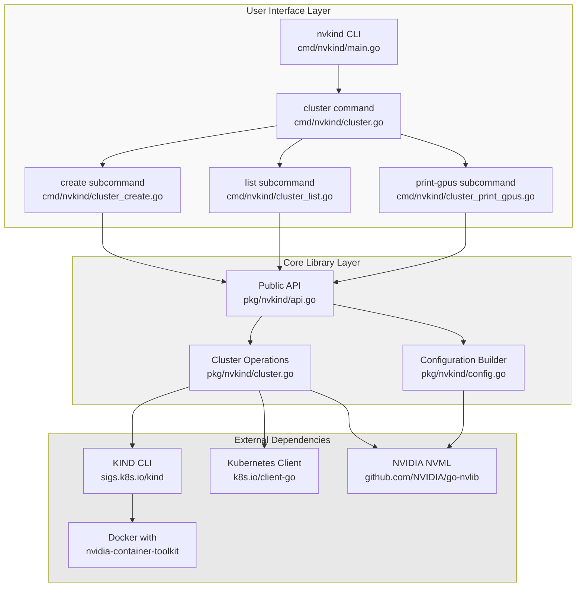
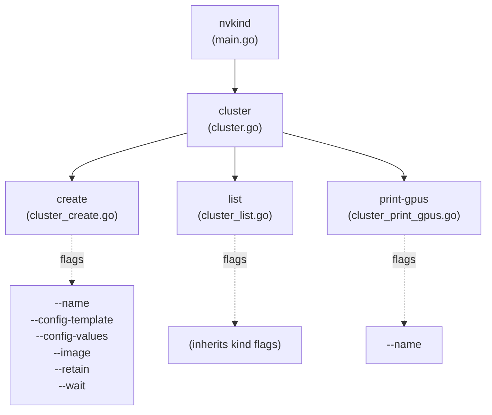
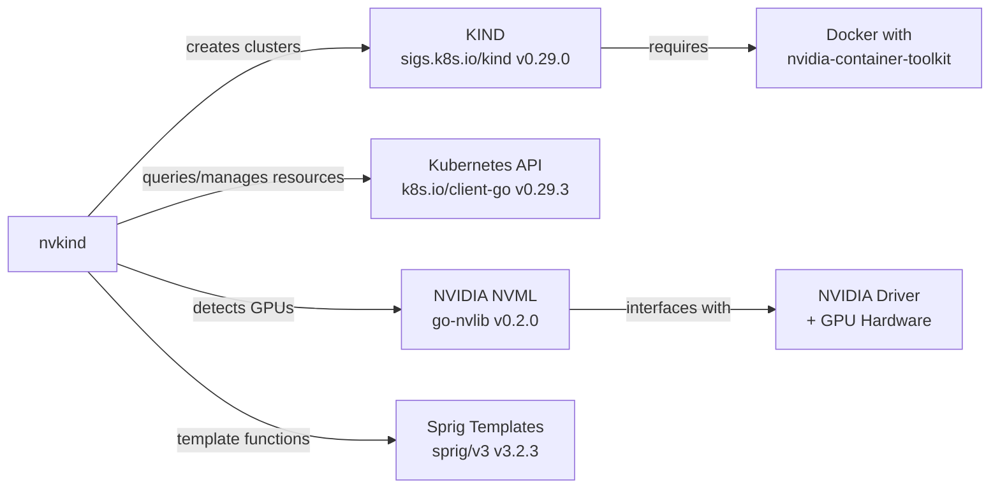
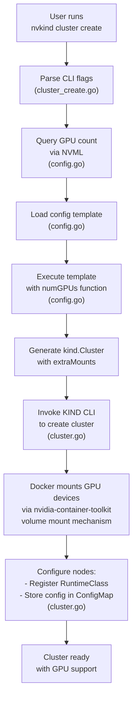

<!-- source: DeepWiki mcp.deepwiki.com · repo NVIDIA/nvkind · page 1 Overview · fetched 2026-10-26 -->

# Overview

<details>
<summary>Relevant source files</summary>

The following files were used as context for generating this wiki page:

- [README.md](README.md)
- [cmd/nvkind/main.go](cmd/nvkind/main.go)
- [go.mod](go.mod)

</details>


This document provides a high-level introduction to nvkind, its architecture, and core capabilities. For detailed usage instructions, see [Getting Started](#2). For in-depth architectural details, see [Architecture](#5).

## Purpose and Scope

nvkind is a tool that extends [KIND (Kubernetes in Docker)](https://kind.sigs.k8s.io/) to support NVIDIA GPU-enabled clusters. KIND is a popular tool for running local Kubernetes clusters using Docker containers as nodes, but it lacks native GPU support. nvkind bridges this gap by automating the complex setup required to inject GPU devices into KIND worker nodes and configure the NVIDIA container runtime.

This overview covers the tool's purpose, high-level architecture, key components, and core features. It does not cover installation procedures (see [Prerequisites and Installation](#2.1)), detailed command usage (see [User Guide](#3)), or contribution guidelines (see [Development Guide](#6)).

## What is nvkind?

nvkind addresses the challenge that running KIND clusters with GPU access is non-trivial. There is no standard mechanism to inject GPU support into KIND worker nodes, and even with workarounds, significant post-processing is required to isolate different GPU sets to different worker nodes.

The tool provides two primary interfaces:
- **CLI Application** (`cmd/nvkind`): Command-line interface for creating and managing GPU-enabled KIND clusters
- **Go Library** (`pkg/nvkind`): Reusable package that can be imported into other Go applications

**Sources:** [README.md:1-14](), [cmd/nvkind/main.go:1-48]()

## High-Level Architecture

The nvkind system consists of three primary layers:



**Sources:** [cmd/nvkind/main.go:29-47](), [go.mod:1-64]()

### Architecture Layers

| Layer | Purpose | Key Components |
|-------|---------|----------------|
| **User Interface** | Provides command-line interface for end users | `main.go`, `cluster.go`, `cluster_create.go`, `cluster_list.go`, `cluster_print_gpus.go` |
| **Core Library** | Implements reusable cluster and configuration logic | `api.go`, `cluster.go`, `config.go` |
| **External Dependencies** | Third-party systems and libraries | KIND, Kubernetes client-go, NVIDIA NVML, Docker runtime |

The separation between CLI and core library allows developers to either use the `nvkind` binary directly or import `pkg/nvkind` as a library for custom tooling.

**Sources:** [README.md:1-14](), [cmd/nvkind/main.go:1-48]()

## Key Components

### CLI Application (cmd/nvkind)

The CLI is built using the `urfave/cli/v2` framework and provides a hierarchical command structure:



Each command in `cmd/nvkind` delegates to the core library (`pkg/nvkind`) for actual functionality, acting as a thin wrapper that handles flag parsing and user interaction.

**Sources:** [cmd/nvkind/main.go:29-47](), [README.md:228-232]()

### Core Library (pkg/nvkind)

The core library exposes three primary types through `api.go`:

| Type | Purpose | Key Methods |
|------|---------|-------------|
| `Config` | Builds KIND cluster configurations from templates | `NewConfig()`, template execution with GPU awareness |
| `Cluster` | Manages cluster lifecycle and operations | `GetClusterNames()`, `Create()`, `GetNodes()` |
| `Node` | Represents individual cluster nodes | GPU information retrieval |

The library uses a **functional options pattern** for configuration, allowing flexible initialization:
- `ConfigOption` functions modify `Config` creation
- `ClusterOption` functions modify `Cluster` creation

**Sources:** [README.md:12-14]()

### External Dependencies

nvkind integrates with several external systems:



**Sources:** [go.mod:5-15](), [README.md:16-36]()

## Core Features

### 1. GPU Detection and Allocation

nvkind uses NVIDIA NVML (NVIDIA Management Library) to detect available GPUs on the host system. This information is exposed through:
- The `numGPUs` template function available in configuration templates
- The `cluster print-gpus` command for inspecting GPU allocation across nodes

### 2. Template-Based Configuration

Configuration uses Go's `text/template` engine extended with [Sprig functions](https://masterminds.github.io/sprig/) and a custom `numGPUs` function. This allows dynamic cluster configurations based on available hardware.

Example template usage from the README:

```yaml
# Template can use {{ numGPUs }} to get total GPU count
# and distribute them across workers dynamically
```

**Sources:** [README.md:221-227](), [go.mod:6]()

### 3. GPU Distribution Patterns

nvkind supports multiple strategies for distributing GPUs across worker nodes:

| Pattern | Description | Example Template |
|---------|-------------|-----------------|
| **All GPUs to One Worker** | Default behavior, single worker gets all GPUs | Built-in default |
| **One Worker Per GPU** | Creates N workers for N GPUs | `examples/one-worker-per-gpu.yaml` |
| **Equal Distribution** | Evenly distributes GPUs across specified workers | `examples/equally-distributed-gpus.yaml` |
| **Explicit Assignment** | Manually specify GPU indices per worker | `examples/explicit-gpus-per-worker.yaml` |

For detailed information on these patterns, see [GPU Distribution Patterns](#3.4).

**Sources:** [README.md:126-169]()

## How It Works

The following diagram shows the high-level flow when creating a GPU-enabled cluster:



**Key Mechanism:** nvkind leverages the `nvidia-container-toolkit`'s feature `accept-nvidia-visible-devices-as-volume-mounts`, which allows GPU access to be injected by mounting `/var/run/nvidia-container-devices/<device-spec>` as a volume. This is configured through KIND's `extraMounts` in the cluster configuration.

**Sources:** [README.md:79-90](), [README.md:95-105]()

## Use Cases

nvkind is designed for scenarios where local GPU-enabled Kubernetes testing is required:

| Use Case | Description |
|----------|-------------|
| **Local Development** | Develop and test GPU workloads locally before deploying to production |
| **CI/CD Testing** | Automated testing of GPU-dependent applications in ephemeral clusters |
| **Multi-GPU Applications** | Test workloads that require specific GPU topology or distribution |
| **k8s-device-plugin Testing** | Test NVIDIA device plugin or GPU operator in local environments |

Example from the README shows deploying the `k8s-device-plugin` on an nvkind cluster to verify GPU resource allocation and scheduling.

**Sources:** [README.md:234-318]()

## Prerequisites

nvkind requires the following to be installed and configured on the host system:

**Build and Runtime Tools:**
- Go (for building from source)
- make
- Docker
- KIND
- kubectl

**NVIDIA Components:**
- NVIDIA GPU driver
- `nvidia-container-toolkit` configured for Docker with:
  - `nvidia` runtime set as default
  - `accept-nvidia-visible-devices-as-volume-mounts=true` feature flag enabled

For detailed setup instructions, see [Prerequisites and Installation](#2.1).

**Sources:** [README.md:16-72]()

## Next Steps

- **Installation:** See [Prerequisites and Installation](#2.1) for setup instructions
- **Quick Start:** See [Quick Start Guide](#2.2) for creating your first cluster
- **Usage:** See [User Guide](#3) for detailed command documentation
- **Configuration:** See [Configuration Guide](#4) for template customization
- **Architecture:** See [Architecture](#5) for implementation details
- **Development:** See [Development Guide](#6) for contributing to nvkind

**Sources:** [README.md:1-326]()

---

