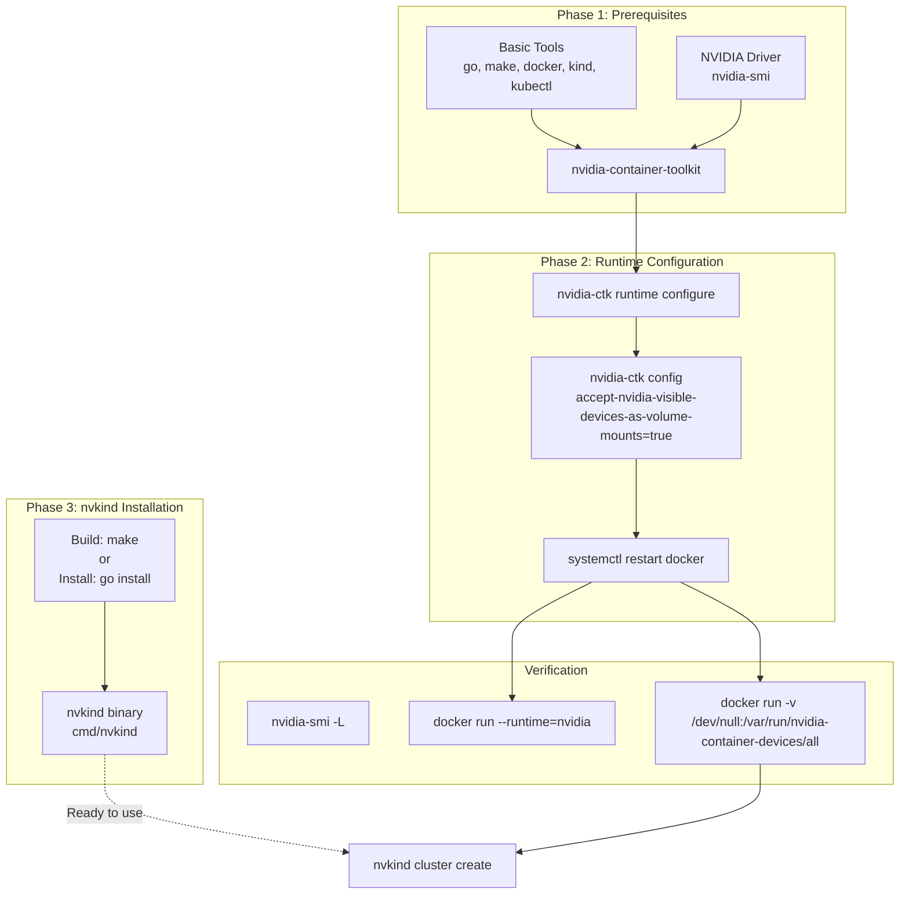
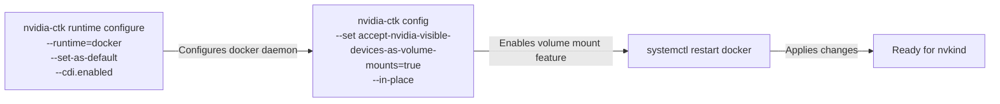
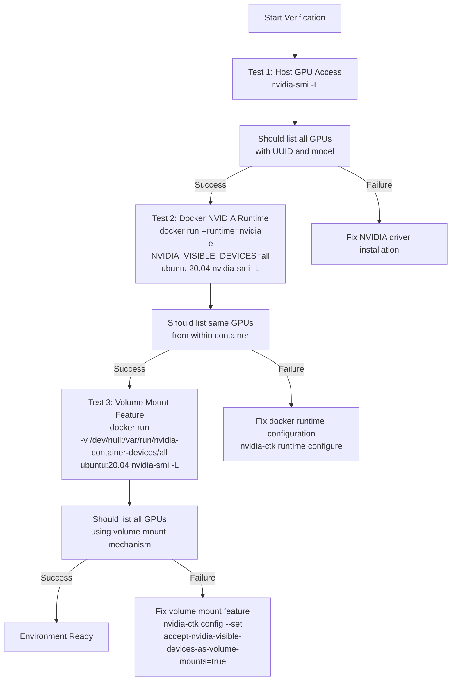
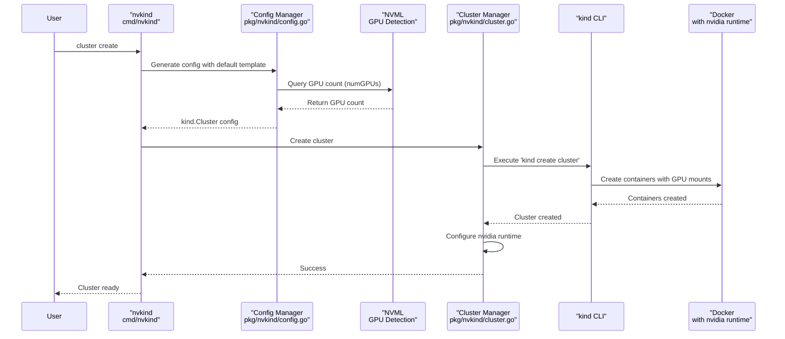

<!-- source: DeepWiki mcp.deepwiki.com · repo NVIDIA/nvkind · page 2 Getting Started · fetched 2026-10-26 -->

# Getting Started

<details>
<summary>Relevant source files</summary>

The following files were used as context for generating this wiki page:

- [README.md](README.md)

</details>


This page provides an overview of the steps required to get nvkind installed and running on your system. It covers the prerequisites, installation process, and basic verification steps to ensure your environment is properly configured for creating KIND clusters with GPU support.

For detailed prerequisite installation instructions and system configuration, see [Prerequisites and Installation](#2.1). For a complete walkthrough of creating your first GPU-enabled cluster, see [Quick Start Guide](#2.2).

## Overview

Getting started with nvkind involves three main phases:

1. **Prerequisites Setup**: Install required tools and configure the NVIDIA container runtime
2. **nvkind Installation**: Build or install the nvkind binary
3. **Verification**: Confirm that GPU access works correctly before creating clusters

The following diagram shows the dependency chain and setup flow:



**Installation and Configuration Flow**

Sources: [README.md:16-112]()

## Prerequisites Summary

The following table summarizes the required and recommended tools:

| Component | Purpose | Installation Guide |
|-----------|---------|-------------------|
| **go** | Build nvkind from source | [Prerequisites and Installation](#2.1) |
| **make** | Execute build commands | [Prerequisites and Installation](#2.1) |
| **docker** | Container runtime for KIND | [Prerequisites and Installation](#2.1) |
| **kind** | Kubernetes in Docker | [Prerequisites and Installation](#2.1) |
| **kubectl** | Kubernetes CLI | [Prerequisites and Installation](#2.1) |
| **nvidia-driver** | GPU driver (must already be installed) | [Prerequisites and Installation](#2.1) |
| **nvidia-container-toolkit** | GPU support in containers | [Prerequisites and Installation](#2.1) |

**Note**: The NVIDIA driver and nvidia-container-toolkit are critical for GPU functionality. Without proper configuration, nvkind will not be able to expose GPUs to cluster nodes.

Sources: [README.md:16-37]()

## Installation Methods

nvkind can be installed using two methods:

### Method 1: Install with go install

```bash
go install github.com/NVIDIA/nvkind/cmd/nvkind@latest
```

This installs the latest released version to your `$GOPATH/bin` directory.

### Method 2: Build from Source

```bash
git clone https://github.com/NVIDIA/nvkind
cd nvkind
make
```

This builds the `nvkind` binary in the current directory using the [Makefile]() targets. The binary is produced from [cmd/nvkind/main.go]().

Sources: [README.md:106-124]()

## Critical Configuration Steps

Before nvkind can create GPU-enabled clusters, the nvidia-container-toolkit must be configured with specific settings that enable GPU injection into KIND worker nodes:



**nvidia-container-toolkit Configuration Sequence**

The second command enables a critical feature flag that allows GPU devices to be injected via volume mounts rather than environment variables. This mechanism is leveraged by nvkind's configuration system to mount specific GPUs into specific worker nodes.

Sources: [README.md:74-91]()

## Verification Process

After installation and configuration, verify each component independently:



**Component Verification Flow**

### Example Verification Output

When properly configured, `nvidia-smi -L` should produce output like:

```
GPU 0: NVIDIA A100-SXM4-40GB (UUID: GPU-4cf8db2d-06c0-7d70-1a51-e59b25b2c16c)
GPU 1: NVIDIA A100-SXM4-40GB (UUID: GPU-4404041a-04cf-1ccf-9e70-f139a9b1e23c)
GPU 2: NVIDIA A100-SXM4-40GB (UUID: GPU-79a2ba02-a537-ccbf-2965-8e9d90c0bd54)
...
```

The docker commands in Test 2 and Test 3 should produce identical output, confirming both the NVIDIA runtime and volume mount feature are working correctly.

Sources: [README.md:38-105]()

## Creating Your First Cluster

Once verification is complete, create a basic cluster with GPU support:

```bash
nvkind cluster create
```

This creates a default KIND cluster named `kind` with a single worker node that has access to all GPUs on the host machine. The command executes the following sequence:



**Default Cluster Creation Flow**

The default configuration uses an embedded template that allocates all GPUs to a single worker node via the volume mount mechanism at `/var/run/nvidia-container-devices/all`. The `numGPUs` template function queries NVML to determine available GPU count.

Sources: [README.md:114-131](), [cmd/nvkind/cluster_create.go](), [pkg/nvkind/config.go](), [pkg/nvkind/cluster.go]()

## Verifying Cluster GPU Access

After cluster creation, verify GPU access within the cluster:

```bash
nvkind cluster print-gpus
```

This command executes `nvidia-smi` on each cluster node and returns a JSON structure showing GPU allocation:

```json
[
    {
        "node": "kind-worker",
        "gpus": [
            {
                "Index": "0",
                "Name": "NVIDIA A100-SXM4-40GB",
                "UUID": "GPU-4cf8db2d-06c0-7d70-1a51-e59b25b2c16c"
            },
            {
                "Index": "1",
                "Name": "NVIDIA A100-SXM4-40GB",
                "UUID": "GPU-4404041a-04cf-1ccf-9e70-f139a9b1e23c"
            }
        ]
    }
]
```

The `print-gpus` command is implemented in [cmd/nvkind/cluster_print_gpus.go]() and uses the `GetNodeGPUs()` method from [pkg/nvkind/cluster.go]() to query GPU information from each node.

Sources: [README.md:172-219](), [cmd/nvkind/cluster_print_gpus.go]()

## Next Steps

Now that you have nvkind installed and verified:

1. **For detailed prerequisite installation** (NVIDIA driver, nvidia-container-toolkit, development tools), see [Prerequisites and Installation](#2.1)

2. **For a complete quick start walkthrough** including multiple cluster configurations and GPU distribution patterns, see [Quick Start Guide](#2.2)

3. **To understand GPU distribution strategies** (one worker per GPU, equal distribution, explicit assignment), see [GPU Distribution Patterns](#3.4)

4. **To learn about configuration templates** and how to customize GPU allocation, see [Configuration Template System](#4.1)

The default cluster created above uses the simplest configuration (all GPUs on one worker). More sophisticated GPU distribution patterns are available through configuration templates in the [examples/]() directory, documented in detail in the User Guide.

Sources: [README.md:1-326]()

---

