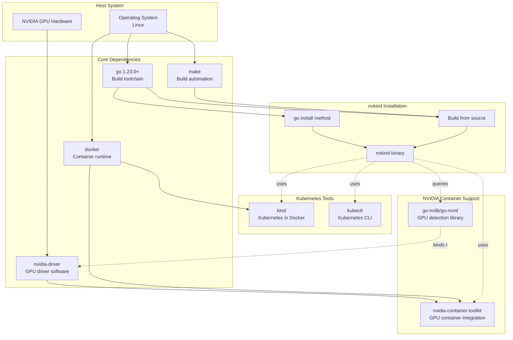
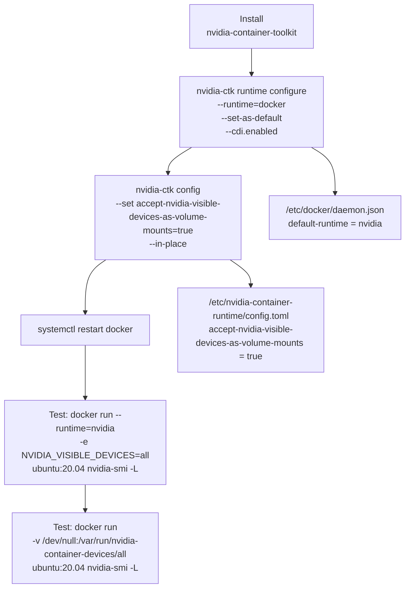
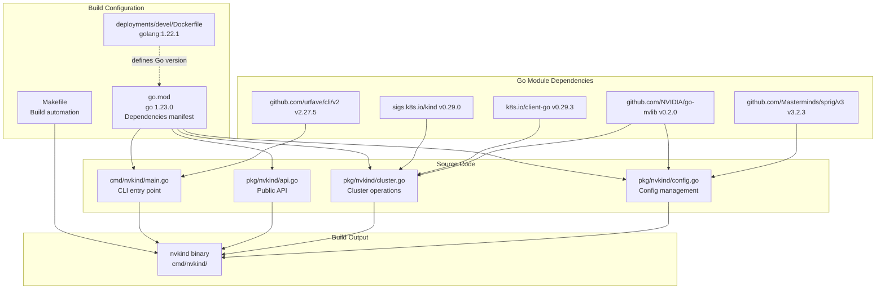

<!-- source: DeepWiki mcp.deepwiki.com · repo NVIDIA/nvkind · page 2.1 Prerequisites and Installation · fetched 2026-10-26 -->

# Prerequisites and Installation

<details>
<summary>Relevant source files</summary>

The following files were used as context for generating this wiki page:

- [README.md](README.md)
- [deployments/devel/Dockerfile](deployments/devel/Dockerfile)
- [go.mod](go.mod)

</details>


## Purpose and Scope

This document details the system requirements, prerequisite software, and installation procedures for nvkind. It covers hardware requirements, NVIDIA driver setup, nvidia-container-toolkit configuration, and nvkind installation methods.

For information about using nvkind after installation, see [Quick Start Guide](#2.2). For building nvkind from source for development purposes, see [Building from Source](#6.1).

## System Requirements

### Hardware Requirements

- An NVIDIA GPU with compatible driver support
- Sufficient system resources to run Docker containers and Kubernetes nodes

### Software Prerequisites

The following table lists all required software dependencies:

| Prerequisite | Purpose | Installation Link |
|--------------|---------|-------------------|
| go | Building nvkind from source and running go install | https://go.dev/doc/install |
| make | Building nvkind using Makefile | https://www.gnu.org/software/make/#download |
| docker | Container runtime for KIND clusters | https://docs.docker.com/get-docker/ |
| kind | Kubernetes in Docker | https://kind.sigs.k8s.io/docs/user/quick-start/#installation |
| kubectl | Kubernetes command-line tool | https://kubernetes.io/docs/tasks/tools/ |
| nvidia-driver | NVIDIA GPU driver | https://www.nvidia.com/download/index.aspx |
| nvidia-container-toolkit | Container runtime GPU support | https://docs.nvidia.com/datacenter/cloud-native/container-toolkit/latest/install-guide.html |

Optional dependencies:

| Prerequisite | Purpose | Installation Link |
|--------------|---------|-------------------|
| helm | Installing k8s-device-plugin and GPU operators | https://helm.sh/docs/intro/install/ |

**Sources:** [README.md:16-36]()

### Dependency Hierarchy

**Prerequisite Dependency Graph**



This diagram illustrates the dependency hierarchy for nvkind. The nvkind binary uses `kind` and `kubectl` as external CLI tools, `nvidia-container-toolkit` for GPU container integration, and `go-nvlib`/`go-nvml` for GPU detection. All dependencies ultimately rely on the host OS and NVIDIA GPU hardware.

**Sources:** [README.md:16-36](), [go.mod:1-64]()

## NVIDIA Driver Installation

The NVIDIA driver provides the kernel-level interface to NVIDIA GPU hardware. Without a functioning driver, no GPU operations are possible.

### Verification

Verify that the NVIDIA driver is correctly installed by running:

```bash
nvidia-smi -L
```

Expected output should list all available GPUs:

```
GPU 0: NVIDIA A100-SXM4-40GB (UUID: GPU-4cf8db2d-06c0-7d70-1a51-e59b25b2c16c)
GPU 1: NVIDIA A100-SXM4-40GB (UUID: GPU-4404041a-04cf-1ccf-9e70-f139a9b1e23c)
GPU 2: NVIDIA A100-SXM4-40GB (UUID: GPU-79a2ba02-a537-ccbf-2965-8e9d90c0bd54)
...
```

The exact GPU models and count will vary based on your hardware configuration.

**Sources:** [README.md:38-51]()

## nvidia-container-toolkit Configuration

The `nvidia-container-toolkit` enables Docker containers to access NVIDIA GPUs. nvkind relies on specific features of this toolkit to inject GPU support into KIND worker nodes.

### Installation

Install the `nvidia-container-toolkit` following the official NVIDIA documentation: https://docs.nvidia.com/datacenter/cloud-native/container-toolkit/latest/install-guide.html

### Configuration for nvkind

After installing the toolkit, configure it specifically for nvkind usage with the following commands:

```bash
sudo nvidia-ctk runtime configure --runtime=docker --set-as-default --cdi.enabled
sudo nvidia-ctk config --set accept-nvidia-visible-devices-as-volume-mounts=true --in-place
sudo systemctl restart docker
```

**Configuration commands explained:**

| Command | Purpose |
|---------|---------|
| `nvidia-ctk runtime configure --runtime=docker --set-as-default --cdi.enabled` | Configures Docker to use the NVIDIA runtime as default and enables CDI support |
| `nvidia-ctk config --set accept-nvidia-visible-devices-as-volume-mounts=true --in-place` | Enables volume mount feature required for GPU injection into KIND nodes |
| `systemctl restart docker` | Applies configuration changes |

The `accept-nvidia-visible-devices-as-volume-mounts` flag is critical for nvkind's GPU injection mechanism. This feature allows nvkind to mount special volume paths (such as `/var/run/nvidia-container-devices/<gpu-uuid>`) that signal to the NVIDIA container runtime which GPUs should be visible in each KIND worker node.

**Sources:** [README.md:74-91]()

### nvidia-container-toolkit Configuration Flow

**nvidia-container-toolkit Setup Workflow**



This diagram shows the complete configuration process for nvidia-container-toolkit, including the configuration files modified (`/etc/docker/daemon.json` and `/etc/nvidia-container-runtime/config.toml`) and verification steps.

**Sources:** [README.md:74-105]()

### Verification

#### Test 1: Runtime-based GPU Access

Verify basic NVIDIA runtime functionality:

```bash
docker run --runtime=nvidia -e NVIDIA_VISIBLE_DEVICES=all ubuntu:20.04 nvidia-smi -L
```

This should produce the same output as the host `nvidia-smi -L` command, listing all available GPUs.

#### Test 2: Volume-based GPU Access

Verify the volume mount feature required by nvkind:

```bash
docker run -v /dev/null:/var/run/nvidia-container-devices/all ubuntu:20.04 nvidia-smi -L
```

This should also produce the same GPU list. **If this command fails**, the `accept-nvidia-visible-devices-as-volume-mounts` feature is not properly enabled, and nvkind will not function correctly.

**Sources:** [README.md:53-105]()

## nvkind Installation

nvkind can be installed using `go install` or built from source using the provided Makefile.

### Installation Method 1: go install

The simplest installation method uses Go's built-in package manager:

```bash
go install github.com/NVIDIA/nvkind/cmd/nvkind@latest
```

This downloads, builds, and installs the latest version of nvkind to `$GOPATH/bin/nvkind` (typically `~/go/bin/nvkind`). Ensure `$GOPATH/bin` is in your `PATH`.

**Sources:** [README.md:106-112]()

### Installation Method 2: Build from Source

To build nvkind from source:

```bash
git clone https://github.com/NVIDIA/nvkind.git
cd nvkind
make
```

The built binary will be located at `./nvkind`.

The Makefile provides additional targets for development tasks. See [Development Workflow](#6.2) for details on available make targets.

**Sources:** [README.md:121-124]()

### Build Process and Dependencies

**Build Dependency Mapping**



This diagram maps the build process from source files to the final binary, showing the relationship between code components ([cmd/nvkind/main.go](), [pkg/nvkind/api.go](), [pkg/nvkind/cluster.go](), [pkg/nvkind/config.go]()) and their dependencies as defined in [go.mod]().

**Sources:** [go.mod:1-64](), [README.md:121-124](), [deployments/devel/Dockerfile:1-18]()

### Version Requirements

The minimum Go version required for building nvkind is specified in multiple locations:

- [go.mod:3]() specifies `go 1.23.0`
- [deployments/devel/Dockerfile:17]() uses `golang:1.22.1` for CI/CD development environment

The development Dockerfile version is managed by Dependabot and may differ from the go.mod version. When building locally, ensure your Go installation meets the version specified in [go.mod:3]().

**Sources:** [go.mod:3](), [deployments/devel/Dockerfile:15-17]()

## Post-Installation Verification

After installing nvkind, verify the installation:

```bash
nvkind --version
```

Or display available commands:

```bash
nvkind --help
```

Expected output includes available commands as defined in [cmd/nvkind/main.go]():
- `cluster create` - Create a KIND cluster with GPU support
- `cluster list` - List existing KIND clusters
- `cluster print-gpus` - Display GPU allocation across cluster nodes

For next steps on using nvkind to create GPU-enabled clusters, see [Quick Start Guide](#2.2).

**Sources:** [README.md:114-232]()

## Complete Installation Workflow

**Complete Installation Decision Tree**

```mermaid
flowchart TD
    Start["Start Installation"]
    
    CheckGPU{"NVIDIA GPU<br/>Available?"}
    CheckDriver{"nvidia-smi -L<br/>Works?"}
    InstallDriver["Install NVIDIA Driver<br/>nvidia.com/drivers"]
    
    CheckDocker{"Docker<br/>Installed?"}
    InstallDocker["Install Docker<br/>docs.docker.com/get-docker"]
    
    CheckNCT{"nvidia-container-toolkit<br/>Installed?"}
    InstallNCT["Install nvidia-container-toolkit<br/>NVIDIA docs"]
    
    ConfigNCT["Configure nvidia-container-toolkit<br/>nvidia-ctk runtime configure<br/>nvidia-ctk config --set accept-nvidia-visible-devices-as-volume-mounts=true"]
    
    RestartDocker["sudo systemctl restart docker"]
    
    VerifyNCT["Verify: docker run -v /dev/null:/var/run/nvidia-container-devices/all<br/>ubuntu:20.04 nvidia-smi -L"]
    
    CheckTools{"kind, kubectl<br/>Installed?"}
    InstallTools["Install kind and kubectl<br/>kind.sigs.k8s.io<br/>kubernetes.io/docs/tasks/tools"]
    
    CheckGo{"Go 1.23+<br/>Installed?"}
    InstallGo["Install Go<br/>go.dev/doc/install"]
    
    ChooseMethod{"Installation<br/>Method?"}
    
    GoInstall["go install github.com/NVIDIA/nvkind/cmd/nvkind@latest"]
    
    CloneRepo["git clone https://github.com/NVIDIA/nvkind.git"]
    MakeBuild["make"]
    
    VerifyNvkind["Verify: nvkind --version"]
    
    Complete["Installation Complete<br/>See Quick Start Guide"]
    
    Start --> CheckGPU
    CheckGPU -->|"No"| InstallDriver
    CheckGPU -->|"Yes"| CheckDriver
    CheckDriver -->|"No"| InstallDriver
    CheckDriver -->|"Yes"| CheckDocker
    
    InstallDriver --> CheckDriver
    
    CheckDocker -->|"No"| InstallDocker
    CheckDocker -->|"Yes"| CheckNCT
    InstallDocker --> CheckNCT
    
    CheckNCT -->|"No"| InstallNCT
    CheckNCT -->|"Yes"| ConfigNCT
    InstallNCT --> ConfigNCT
    
    ConfigNCT --> RestartDocker
    RestartDocker --> VerifyNCT
    VerifyNCT --> CheckTools
    
    CheckTools -->|"No"| InstallTools
    CheckTools -->|"Yes"| CheckGo
    InstallTools --> CheckGo
    
    CheckGo -->|"No"| InstallGo
    CheckGo -->|"Yes"| ChooseMethod
    InstallGo --> ChooseMethod
    
    ChooseMethod -->|"go install"| GoInstall
    ChooseMethod -->|"Build from source"| CloneRepo
    
    GoInstall --> VerifyNvkind
    
    CloneRepo --> MakeBuild
    MakeBuild --> VerifyNvkind
    
    VerifyNvkind --> Complete
```



This diagram shows the complete installation workflow as a decision tree, guiding users through all prerequisite checks and installation steps.

**Sources:** [README.md:16-124]()

## Troubleshooting Common Issues

### Issue: nvidia-smi not found

**Cause:** NVIDIA driver not installed or not in PATH  
**Solution:** Install NVIDIA driver from https://www.nvidia.com/download/index.aspx

### Issue: docker run with --runtime=nvidia fails

**Cause:** nvidia-container-toolkit not properly configured for Docker  
**Solution:** Run configuration commands:
```bash
sudo nvidia-ctk runtime configure --runtime=docker --set-as-default
sudo systemctl restart docker
```

### Issue: Volume mount test fails

**Cause:** `accept-nvidia-visible-devices-as-volume-mounts` feature not enabled  
**Solution:** Run:
```bash
sudo nvidia-ctk config --set accept-nvidia-visible-devices-as-volume-mounts=true --in-place
sudo systemctl restart docker
```

Verify the configuration is applied in `/etc/nvidia-container-runtime/config.toml`.

### Issue: go install fails

**Cause:** Go not installed or wrong version  
**Solution:** Install Go 1.23.0 or later from https://go.dev/doc/install

### Issue: make command not found

**Cause:** Build tools not installed  
**Solution:** Install make (on Ubuntu/Debian: `sudo apt-get install build-essential`)

**Sources:** [README.md:69-105]()

## Installation Summary

To successfully install and run nvkind, ensure the following components are in place:

1. **Hardware**: NVIDIA GPU with compatible driver
2. **NVIDIA Software**: nvidia-driver and nvidia-container-toolkit with volume mounts enabled
3. **Container Runtime**: Docker configured with NVIDIA runtime
4. **Kubernetes Tools**: kind and kubectl
5. **Build Tools**: Go 1.23.0+ (and make for building from source)
6. **nvkind**: Installed via `go install` or built from source

After completing these installation steps, proceed to [Quick Start Guide](#2.2) to create your first GPU-enabled KIND cluster.

**Sources:** [README.md:16-124]()

---

