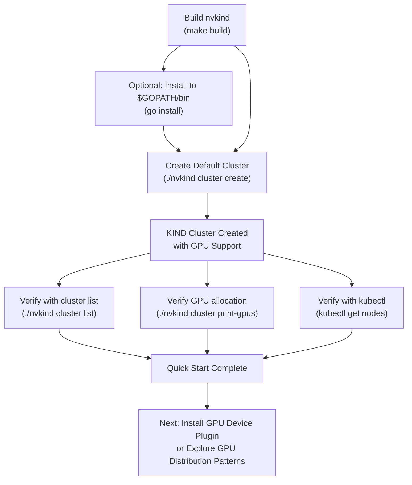
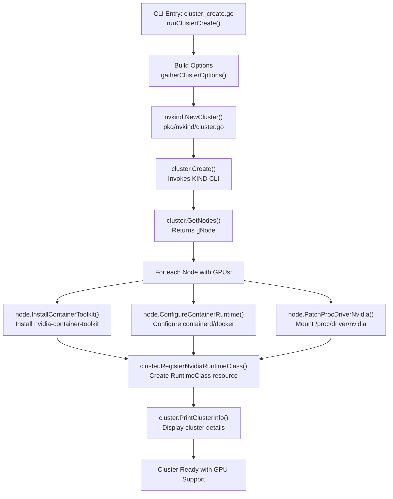
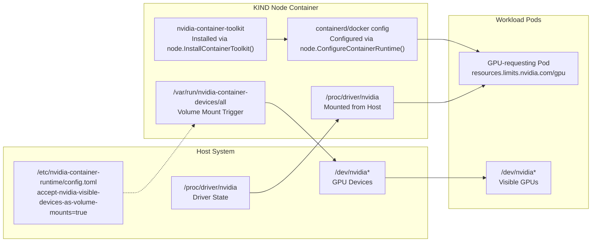

<!-- source: DeepWiki mcp.deepwiki.com · repo NVIDIA/nvkind · page 2.2 Quick Start Guide · fetched 2026-10-26 -->

# Quick Start Guide

<details>
<summary>Relevant source files</summary>

The following files were used as context for generating this wiki page:

- [README.md](README.md)
- [cmd/nvkind/cluster_create.go](cmd/nvkind/cluster_create.go)
- [examples/one-worker-per-gpu.yaml](examples/one-worker-per-gpu.yaml)

</details>


This guide provides a practical walkthrough to create your first GPU-enabled KIND cluster using nvkind and verify that GPU support is working correctly. It assumes you have completed all prerequisites and installation steps from [Prerequisites and Installation](#2.1). For detailed documentation of individual commands and advanced configuration options, see the [User Guide](#3).

**Scope**: This guide covers the essential steps to build nvkind, create a basic GPU-enabled cluster, and verify GPU access. It does not cover custom configurations, GPU distribution patterns, or integration with Kubernetes GPU workloads, which are addressed in later sections.

## Overview of the Quick Start Process

The following diagram illustrates the complete quick start workflow from building nvkind to verifying GPU access:



**Sources**: [README.md:114-183]()

## Step 1: Build nvkind

Build the nvkind binary from source using the provided Makefile:

```bash
make
```

This executes the `build` target in the Makefile, which compiles the nvkind CLI application and places the binary in the current directory as `./nvkind`.

Alternatively, if you prefer to install nvkind to your `$GOPATH/bin` directory for system-wide access:

```bash
go install github.com/NVIDIA/nvkind/cmd/nvkind@latest
```

After installation, the `nvkind` command will be available in your PATH (assuming `$GOPATH/bin` is in your PATH).

**Sources**: [README.md:121-124](), [README.md:106-112]()

## Step 2: Create Your First Cluster

Create a default GPU-enabled cluster with a single worker node that has access to all GPUs on the host machine:

```bash
./nvkind cluster create
```

This command invokes the `create` subcommand of the `cluster` command group. Without any flags, it creates a cluster with default settings:
- **Cluster name**: Auto-generated as `nvkind-<random>`
- **Worker nodes**: 1 worker node
- **GPU allocation**: All available GPUs assigned to the single worker node
- **Configuration**: Uses the default embedded configuration template

### What Happens During Cluster Creation

The following diagram shows the key code entities and operations involved in cluster creation:



**Sources**: [cmd/nvkind/cluster_create.go:98-147]()

### Common Create Flags

The `cluster create` command supports the following flags for basic usage:

| Flag | Description | Environment Variable | Default |
|------|-------------|---------------------|---------|
| `--name` | Cluster name | `KIND_CLUSTER_NAME` | `nvkind-<random>` |
| `--image` | Node Docker image | `KIND_CLUSTER_IMAGE` | KIND default |
| `--retain` | Retain nodes on failure | `KIND_CLUSTER_RETAIN` | `false` |
| `--wait` | Wait duration for control plane | `KIND_CLUSTER_WAIT` | No wait |
| `--kubeconfig` | Path to kubeconfig file | `KUBECONFIG` | `~/.kube/config` |

For advanced configuration options including `--config-template` and `--config-values`, see [GPU Distribution Patterns](#3.4) and [Configuration Template System](#4.1).

**Sources**: [cmd/nvkind/cluster_create.go:50-93]()

## Step 3: Verify Cluster Creation

After the cluster is created, verify it exists and inspect its GPU configuration.

### List All Clusters

View all nvkind-created clusters:

```bash
./nvkind cluster list
```

This command uses the KIND CLI to enumerate all existing KIND clusters. Expected output:

```
nvkind-12abc34d
```

**Sources**: [README.md:173-176]()

### Inspect GPU Allocation

Display the GPU allocation for all nodes in the cluster:

```bash
./nvkind cluster print-gpus
```

For a default cluster with 8 GPUs, the output will show all GPUs assigned to the single worker node:

```json
[
    {
        "node": "nvkind-12abc34d-worker",
        "gpus": [
            {
                "Index": "0",
                "Name": "NVIDIA A100-SXM4-40GB",
                "UUID": "GPU-4cf8db2d-06c0-7d70-1a51-e59b25b2c16c"
            },
            {
                "Index": "1",
                "Name": "NVIDIA A100-SXM4-40GB",
                "UUID": "GPU-4404041a-04cf-1ccf-9e70-f139a9b1e23c"
            }
            // ... remaining GPUs ...
        ]
    }
]
```

The command queries each node using NVML through the nvkind library to enumerate visible GPUs. You can optionally specify a cluster name with `--name` or omit it to use the current kubectl context.

**Sources**: [README.md:177-219]()

### Verify with kubectl

Confirm the cluster is accessible via kubectl:

```bash
kubectl get nodes
```

Expected output showing control plane and worker nodes:

```
NAME                        STATUS   ROLES           AGE   VERSION
nvkind-12abc34d-control-plane   Ready    control-plane   1m    v1.27.3
nvkind-12abc34d-worker          Ready    <none>          1m    v1.27.3
```

**Sources**: [README.md:114-183]()

## Step 4: Understanding GPU Injection

The following diagram illustrates how nvkind injects GPU support into KIND cluster nodes through volume mounts and runtime configuration:



**Key Mechanisms**:
1. **Volume Mount Injection**: The configuration template specifies `extraMounts` with paths like `/var/run/nvidia-container-devices/all`, which triggers the nvidia-container-runtime to expose GPU devices
2. **Toolkit Installation**: `node.InstallContainerToolkit()` installs the nvidia-container-toolkit inside the KIND node
3. **Runtime Configuration**: `node.ConfigureContainerRuntime()` configures the container runtime to use the NVIDIA runtime
4. **Driver State**: `node.PatchProcDriverNvidia()` ensures `/proc/driver/nvidia` is accessible for driver communication

**Sources**: [cmd/nvkind/cluster_create.go:123-136](), [README.md:74-105](), [examples/one-worker-per-gpu.yaml:21-26]()

## Next Steps

Now that you have a working GPU-enabled cluster, you can:

1. **Install the NVIDIA Device Plugin**: Deploy the k8s-device-plugin to enable GPU resource scheduling. See the README section on [Installing the k8s-device-plugin](README.md#install-the-k8s-device-plugin) for detailed instructions.

2. **Explore GPU Distribution Patterns**: Create clusters with different GPU allocation strategies:
   - One worker node per GPU: `./nvkind cluster create --config-template=examples/one-worker-per-gpu.yaml`
   - Evenly distributed GPUs across workers: See [GPU Distribution Patterns](#3.4)
   - Explicit GPU assignment per worker: See [Creating Custom Configurations](#4.3)

3. **Deploy GPU Workloads**: Run containerized applications that require GPU resources. See [Creating Clusters](#3.1) for examples of deploying GPU-enabled pods.

4. **Clean Up**: To delete all KIND clusters when finished:
   ```bash
   for cluster in $(kind get clusters); do kind delete cluster --name=${cluster}; done
   ```

**Sources**: [README.md:234-259](), [README.md:127-169](), [README.md:319-325]()

## Troubleshooting Quick Start Issues

If cluster creation fails or GPUs are not visible, verify the following:

| Issue | Verification Command | Expected Result |
|-------|---------------------|-----------------|
| NVIDIA driver installed | `nvidia-smi -L` | Lists all host GPUs |
| nvidia-container-toolkit configured | `docker run --runtime=nvidia -e NVIDIA_VISIBLE_DEVICES=all ubuntu:20.04 nvidia-smi -L` | Lists all host GPUs |
| Volume mount feature enabled | `docker run -v /dev/null:/var/run/nvidia-container-devices/all ubuntu:20.04 nvidia-smi -L` | Lists all host GPUs |

If the volume mount test fails, re-run the setup commands from [Prerequisites and Installation](#2.1):

```bash
sudo nvidia-ctk runtime configure --runtime=docker --set-as-default --cdi.enabled
sudo nvidia-ctk config --set accept-nvidia-visible-devices-as-volume-mounts=true --in-place
sudo systemctl restart docker
```

**Sources**: [README.md:38-105]()

---

