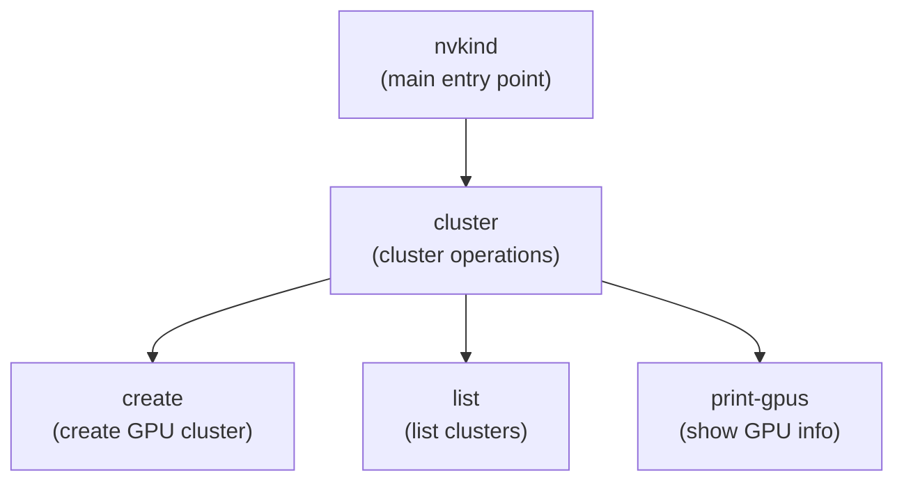
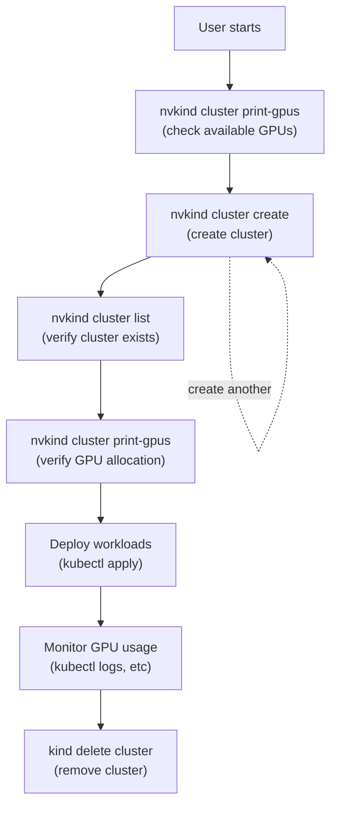
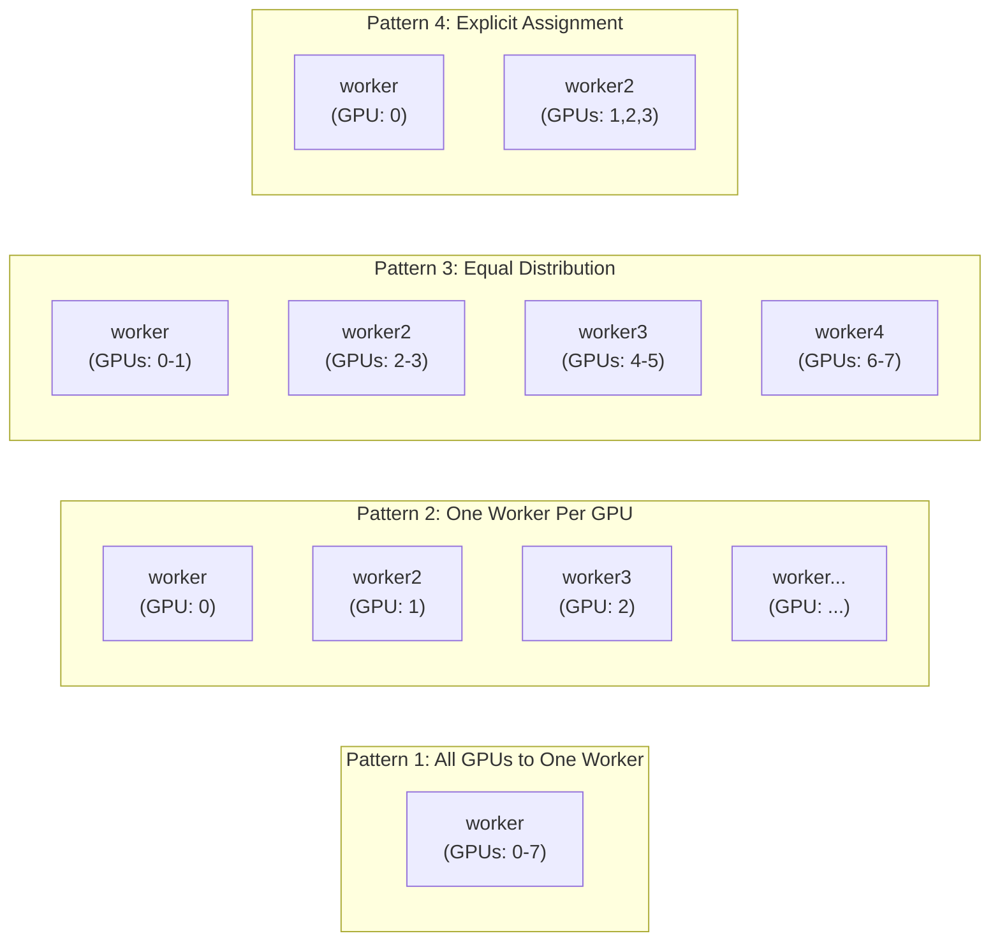
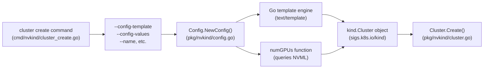

<!-- source: DeepWiki mcp.deepwiki.com · repo NVIDIA/nvkind · page 3 User Guide · fetched 2026-10-26 -->

# User Guide

<details>
<summary>Relevant source files</summary>

The following files were used as context for generating this wiki page:

- [README.md](README.md)
- [cmd/nvkind/cluster.go](cmd/nvkind/cluster.go)

</details>


This guide provides comprehensive documentation for using the `nvkind` CLI tool to create and manage KIND clusters with NVIDIA GPU support. It covers the available commands, their options, and common usage patterns.

For installation instructions and system setup, see [Getting Started](#2). For details on the configuration system and custom templates, see [Configuration Guide](#4). For information about the internal architecture and how GPU support is integrated, see [Architecture](#5).

## Overview

The `nvkind` CLI provides a set of commands under the `cluster` subcommand for managing GPU-enabled KIND clusters. The tool wraps the standard KIND cluster creation workflow with GPU detection, device allocation, and container runtime configuration to enable NVIDIA GPU support.

### Command Structure

The `nvkind` CLI follows a hierarchical command structure where all cluster operations are grouped under the `cluster` parent command:



**Command Hierarchy**

Sources: [cmd/nvkind/cluster.go:23-33]()

The command structure is defined in [cmd/nvkind/cluster.go:23-33](), where `BuildClusterCommand()` constructs the parent `cluster` command with three subcommands: `list`, `create`, and `print-gpus`.

### Available Commands

The following table summarizes the available commands:

| Command | Purpose | Detailed Documentation |
|---------|---------|----------------------|
| `nvkind cluster create` | Create a new KIND cluster with GPU support | [Creating Clusters](#3.1) |
| `nvkind cluster list` | List all existing KIND clusters | [Listing Clusters](#3.2) |
| `nvkind cluster print-gpus` | Display GPU allocation for cluster nodes | [Viewing GPU Information](#3.3) |

## Typical Workflows

The following diagram illustrates common user workflows with `nvkind`:



**Typical nvkind workflow from cluster creation to cleanup**

Sources: [README.md:114-184]()

## Command Categories

### Cluster Lifecycle Management

Commands for creating and discovering clusters:

- **`create`**: Creates a new KIND cluster with GPU support configured according to a template. Supports various GPU distribution patterns through configuration templates. See [Creating Clusters](#3.1) for detailed usage.

- **`list`**: Lists all KIND clusters on the system. This is a convenience wrapper around `kind get clusters` that provides consistent output formatting. See [Listing Clusters](#3.2) for details.

### GPU Inspection

Commands for viewing GPU allocation and configuration:

- **`print-gpus`**: Queries each node in a cluster and reports which GPUs are visible within that node's container. Returns structured JSON output showing the GPU index, name, and UUID for each device. See [Viewing GPU Information](#3.3) for details.

Sources: [cmd/nvkind/cluster.go:23-33](), [README.md:171-219]()

## Common Options

The `create` command shares several options with the standard `kind create cluster` command:

| Option | Description | Default |
|--------|-------------|---------|
| `--name` | Cluster name | `kind` |
| `--image` | Node container image | KIND default |
| `--retain` | Retain nodes on failure | `false` |
| `--wait` | Wait for control plane to be ready | `0s` |

Additional `nvkind`-specific options for configuration:

| Option | Description | Default |
|--------|-------------|---------|
| `--config-template` | Path to configuration template file | Built-in default |
| `--config-values` | YAML values for template (file path or `-` for stdin) | None |

Sources: [README.md:228-231]()

## Basic Usage Examples

### Create Default Cluster

Create a cluster with one worker node having access to all GPUs:

```bash
nvkind cluster create
```

This uses the built-in default configuration template that allocates all available GPUs to a single worker node.

### Create Named Cluster

Create a cluster with a specific name:

```bash
nvkind cluster create --name=my-gpu-cluster
```

### Create Cluster with Custom Configuration

Create a cluster using a custom configuration template and values:

```bash
nvkind cluster create \
  --name=custom-cluster \
  --config-template=my-template.yaml \
  --config-values=my-values.yaml
```

### List All Clusters

Display all KIND clusters:

```bash
nvkind cluster list
```

### View GPU Allocation

Display GPU information for the cluster in current kubecontext:

```bash
nvkind cluster print-gpus
```

Display GPU information for a specific cluster:

```bash
nvkind cluster print-gpus --name=my-gpu-cluster
```

Sources: [README.md:126-183]()

## GPU Distribution Patterns

One of the key features of `nvkind` is the ability to configure different GPU distribution patterns across worker nodes. The tool provides several built-in templates for common patterns:



**Four GPU distribution patterns supported by nvkind**

The following table summarizes the available patterns:

| Pattern | Description | Template File | Use Case |
|---------|-------------|---------------|----------|
| All GPUs to one worker | Single worker with all GPUs | Built-in default | Simple testing, single-tenant workloads |
| One worker per GPU | Separate worker for each GPU | `examples/one-worker-per-gpu.yaml` | Maximum isolation, multi-tenant scenarios |
| Equal distribution | GPUs evenly distributed across workers | `examples/equally-distributed-gpus.yaml` | Balanced multi-worker clusters |
| Explicit assignment | Custom GPU-to-worker mapping | `examples/explicit-gpus-per-worker.yaml` | Complex topologies, heterogeneous workloads |

For detailed information about each pattern, including configuration examples and use cases, see [GPU Distribution Patterns](#3.4).

Sources: [README.md:126-169](), [README.md:221-227]()

## Integration with Template System

Commands interact with the configuration template system to generate KIND cluster configurations:



**How CLI commands use the template system to generate cluster configurations**

Sources: [cmd/nvkind/cluster.go:23-33](), [README.md:221-227]()

The template system supports both built-in templates (embedded in the binary) and external template files. Templates can reference the `numGPUs` function to dynamically query the number of available GPUs at cluster creation time. For more details on the template system, see [Configuration Template System](#4.1).

## Next Steps

For detailed information on specific commands and features:

- **Creating Clusters**: See [Creating Clusters](#3.1) for complete documentation of the `create` command, including all flags and options
- **Listing Clusters**: See [Listing Clusters](#3.2) for the `list` command usage
- **Viewing GPU Information**: See [Viewing GPU Information](#3.3) for interpreting `print-gpus` output
- **GPU Distribution Patterns**: See [GPU Distribution Patterns](#3.4) for detailed pattern descriptions and configuration examples
- **Custom Configurations**: See [Configuration Guide](#4) for creating custom templates and advanced configuration scenarios
- **Troubleshooting**: See [Prerequisites and Installation](#2.1) for resolving common setup issues

Sources: [README.md:1-326]()

---

