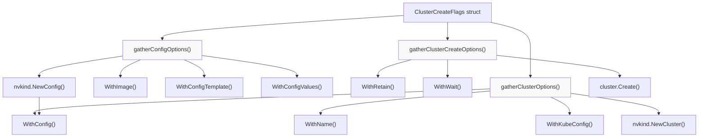
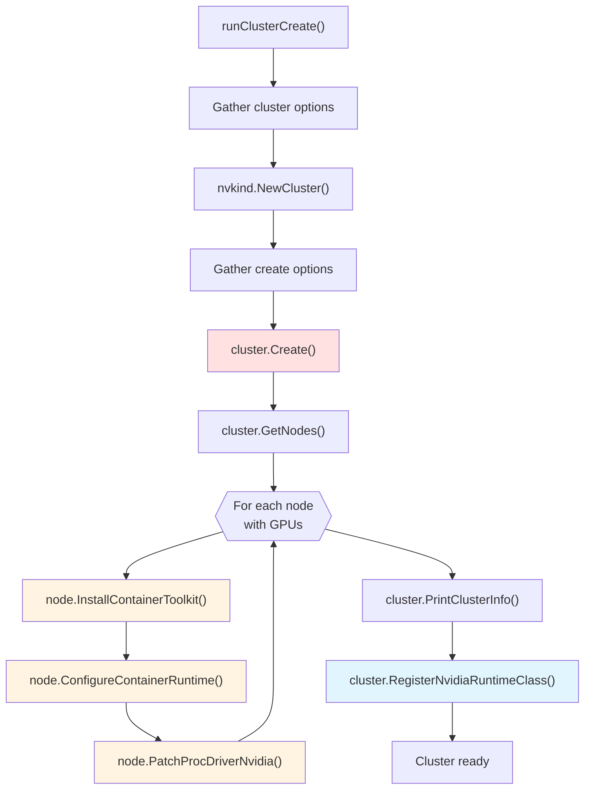
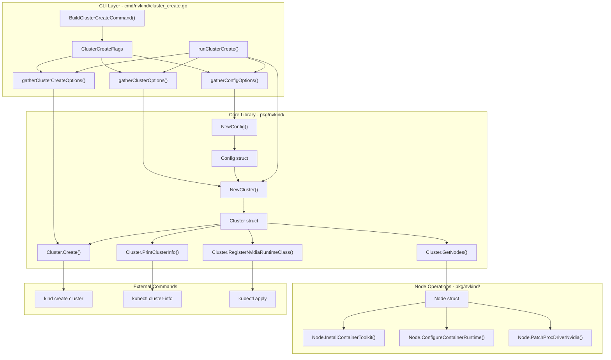

<!-- source: DeepWiki mcp.deepwiki.com · repo NVIDIA/nvkind · page 3.1 Creating Clusters · fetched 2026-10-26 -->

# Creating Clusters

<details>
<summary>Relevant source files</summary>

The following files were used as context for generating this wiki page:

- [README.md](README.md)
- [cmd/nvkind/cluster_create.go](cmd/nvkind/cluster_create.go)
- [pkg/nvkind/cluster.go](pkg/nvkind/cluster.go)

</details>


## Purpose and Scope

This page documents the `nvkind cluster create` command, which creates KIND (Kubernetes in Docker) clusters with NVIDIA GPU support. It covers command-line flags, the cluster creation workflow, and various GPU allocation scenarios. For information about GPU distribution patterns and configuration templates, see [GPU Distribution Patterns](#3.4) and [Configuration Template System](#4.1). For architectural details about how GPU support is injected into KIND clusters, see [GPU Integration Mechanism](#5.4).

## Command Overview

The `nvkind cluster create` command is implemented in [cmd/nvkind/cluster_create.go](). The command accepts configuration through flags and environment variables to control cluster naming, node images, GPU allocation patterns, and KIND-specific behavior.

**Basic Usage:**
```bash
nvkind cluster create [flags]
```

**Default Behavior:**
When invoked without flags, the command creates a cluster with a randomly-generated name (format: `nvkind-<random>`) containing one worker node with access to all GPUs on the host machine.

Sources: [cmd/nvkind/cluster_create.go:40-96](), [README.md:126-131]()

## Command Flags

The `cluster create` command supports the following flags, defined in the `ClusterCreateFlags` struct:

| Flag | Type | Environment Variable | Purpose | Default |
|------|------|---------------------|---------|---------|
| `--name` | string | `KIND_CLUSTER_NAME` | Cluster name | `nvkind-<random>` |
| `--image` | string | `KIND_CLUSTER_IMAGE` | Node Docker image | KIND default |
| `--retain` | bool | `KIND_CLUSTER_RETAIN` | Retain nodes on creation failure | `false` |
| `--wait` | duration | `KIND_CLUSTER_WAIT` | Wait for control plane readiness | `0` (no wait) |
| `--config-template` | string | `KIND_CLUSTER_CONFIG_TEMPLATE` | Path to custom config template | Built-in default |
| `--config-values` | string | `KIND_CLUSTER_CONFIG_VALUES` | Path to values file (or `-` for stdin) | None |
| `--kubeconfig` | string | `KUBECONFIG` | Absolute path to kubeconfig | `~/.kube/config` |

Sources: [cmd/nvkind/cluster_create.go:30-93]()

### Flag Processing



**Diagram: Flag Processing Pipeline**

The flag gathering process uses three separate methods to organize options by their target component:
- `gatherConfigOptions()` - Configuration template and image settings
- `gatherClusterOptions()` - Cluster-level settings including name and kubeconfig
- `gatherClusterCreateOptions()` - KIND-specific creation options

Sources: [cmd/nvkind/cluster_create.go:149-222]()

## Cluster Creation Workflow

The cluster creation process is orchestrated by the `runClusterCreate()` function and involves multiple phases:



**Diagram: Cluster Creation Execution Flow**

Sources: [cmd/nvkind/cluster_create.go:98-147]()

### Phase 1: Cluster Provisioning

The `cluster.Create()` method constructs and executes a KIND command with the following steps:

1. **Command Construction** - Builds the KIND CLI command at [pkg/nvkind/cluster.go:98-113]()
   ```
   kind create cluster --name <name> --config -
   ```

2. **Configuration Marshaling** - Converts the `kind.Cluster` configuration to YAML at [pkg/nvkind/cluster.go:115-118]()

3. **Process Execution** - Executes KIND via subprocess with config piped to stdin at [pkg/nvkind/cluster.go:120-127]()

4. **Config Persistence** - Stores the cluster configuration in a ConfigMap named `nvkind-cluster-config` in the `default` namespace at [pkg/nvkind/cluster.go:129-131]()

Sources: [pkg/nvkind/cluster.go:97-134]()

### Phase 2: GPU Node Configuration

For each node with GPUs, three configuration steps are executed:

1. **`InstallContainerToolkit()`** - Installs the NVIDIA Container Toolkit on the node
2. **`ConfigureContainerRuntime()`** - Configures containerd to use the nvidia runtime
3. **`PatchProcDriverNvidia()`** - Patches `/proc/driver/nvidia` for device visibility

These operations are performed sequentially at [cmd/nvkind/cluster_create.go:123-136]().

Sources: [cmd/nvkind/cluster_create.go:123-136]()

### Phase 3: Cluster Finalization

Two final steps complete the cluster setup:

1. **`PrintClusterInfo()`** - Displays cluster endpoints and node status using `kubectl` at [pkg/nvkind/cluster.go:136-159]()

2. **`RegisterNvidiaRuntimeClass()`** - Creates a `RuntimeClass` object with handler `nvidia` at [pkg/nvkind/cluster.go:161-173]()

Sources: [cmd/nvkind/cluster_create.go:138-144](), [pkg/nvkind/cluster.go:136-173]()

## Creation Scenarios

### Scenario 1: Default Cluster

**Command:**
```bash
nvkind cluster create
```

**Behavior:**
- Generates random cluster name (format: `nvkind-<random>`)
- Creates 1 worker node
- Assigns all host GPUs to the single worker
- Uses built-in default configuration template

**Configuration Source:** Embedded default template in [pkg/nvkind/config.go]()

Sources: [README.md:126-131]()

### Scenario 2: One Worker Per GPU

**Command:**
```bash
nvkind cluster create --config-template=examples/one-worker-per-gpu.yaml
```

**Behavior:**
- Creates N worker nodes (where N = number of GPUs)
- Each worker receives exactly one GPU
- GPU assignment follows host device order (GPU 0 → worker 1, GPU 1 → worker 2, etc.)

**Use Case:** Testing multi-node GPU workloads or simulating GPU-per-pod scenarios

Sources: [README.md:133-139]()

### Scenario 3: Equal Distribution

**Command:**
```bash
nvkind cluster create \
  --name=evenly-distributed-2-by-4 \
  --config-template=examples/equally-distributed-gpus.yaml \
  --config-values=- \
<<EOF
numWorkers: 4
EOF
```

**Behavior:**
- Creates 4 worker nodes
- Distributes 8 GPUs evenly (2 per worker)
- Template uses `numGPUs` function to calculate distribution

**Configuration Processing:**
1. Template is loaded from filesystem
2. Values are read from stdin (`--config-values=-`)
3. Template function `numGPUs` queries NVML for total GPU count
4. Division logic distributes devices evenly

Sources: [README.md:141-153]()

### Scenario 4: Explicit GPU Assignment

**Command:**
```bash
nvkind cluster create \
  --name=explicit-gpus \
  --config-template=examples/explicit-gpus-per-worker.yaml \
  --config-values=- \
<<EOF
workers:
- devices: 0
- devices: [1, 2, 3]
EOF
```

**Behavior:**
- Creates 2 worker nodes
- Worker 1: GPU 0 only
- Worker 2: GPUs 1, 2, 3
- Provides fine-grained control over GPU topology

**Configuration Mechanism:** The template iterates over the `workers` array, creating a KIND node for each entry with `extraMounts` configured for the specified devices.

Sources: [README.md:155-169]()

### Scenario 5: Custom Node Image

**Command:**
```bash
nvkind cluster create \
  --name=custom-image \
  --image=kindest/node:v1.27.0
```

**Behavior:**
- Uses specific Kubernetes version via KIND node image
- Applies to all nodes in the cluster
- Image must be compatible with KIND

**Flag Processing:** The `--image` flag is converted to `nvkind.WithImage()` option at [cmd/nvkind/cluster_create.go:152-154](), which sets the `Image` field in the configuration.

Sources: [cmd/nvkind/cluster_create.go:152-154]()

### Scenario 6: Retain on Failure

**Command:**
```bash
nvkind cluster create --retain
```

**Behavior:**
- On creation failure, KIND containers are not automatically deleted
- Enables debugging by inspecting failed node state
- Passed directly to KIND via `--retain` flag

**Implementation:** The retain flag is appended to the KIND command at [pkg/nvkind/cluster.go:108-110]().

Sources: [pkg/nvkind/cluster.go:108-110]()

## Configuration Values Processing

### Values from File

```bash
nvkind cluster create \
  --config-template=examples/equally-distributed-gpus.yaml \
  --config-values=/path/to/values.yaml
```

The file is read using `os.ReadFile()` at [cmd/nvkind/cluster_create.go:171-174]().

### Values from Stdin

```bash
nvkind cluster create \
  --config-template=examples/equally-distributed-gpus.yaml \
  --config-values=- \
<<EOF
numWorkers: 4
EOF
```

When `--config-values=-` is specified, the function reads from `os.Stdin` using `bufio.Scanner` at [cmd/nvkind/cluster_create.go:165-169]().

Sources: [cmd/nvkind/cluster_create.go:160-178]()

## Code Entity Mapping



**Diagram: Code Entity Relationships in Cluster Creation**

This diagram shows the primary code entities involved in cluster creation and their interactions across the CLI layer, core library, and external command execution.

Sources: [cmd/nvkind/cluster_create.go:40-222](), [pkg/nvkind/cluster.go:68-173]()

## KIND Command Construction

The actual KIND command executed by `cluster.Create()` is constructed at [pkg/nvkind/cluster.go:98-113]():

**Base Command:**
```
kind create cluster --name <cluster-name> --config -
```

**Optional Flags:**
- `--retain` - Added when `ClusterCreateOptions.retain` is true
- `--wait <duration>` - Added when `ClusterCreateOptions.wait` is non-zero

**Configuration Input:**
The cluster configuration is marshaled to YAML and piped to KIND's stdin, allowing complex multi-node configurations without temporary files.

Sources: [pkg/nvkind/cluster.go:98-127]()

## ConfigMap Persistence

After cluster creation, the configuration is persisted in a ConfigMap named `nvkind-cluster-config` by the `addConfigBytesToExistingCluster()` function:

**Purpose:**
- Enables retrieval of cluster configuration for existing clusters
- Allows `nvkind cluster print-gpus` to determine GPU allocation
- Supports cluster management operations without re-querying configuration templates

**Implementation Details:**
- Namespace: `default`
- ConfigMap name: `nvkind-cluster-config` (constant at [pkg/nvkind/cluster.go:43]())
- Data key: `config`
- Kubernetes API: Uses `clientset.CoreV1().ConfigMaps("default").Create()`

Sources: [pkg/nvkind/cluster.go:294-326]()

## Error Handling

The cluster creation process can fail at multiple points:

| Failure Point | Error Source | Handling |
|--------------|--------------|----------|
| Option gathering | Invalid flag values | Returns error before cluster creation |
| Config validation | Template processing | Returns error before cluster creation |
| KIND execution | `kind create cluster` failure | Returns error, respects `--retain` flag |
| Node retrieval | `kind get nodes` failure | Returns error, cluster may be partially created |
| Toolkit installation | Node setup commands | Returns error, cluster exists but GPUs not configured |
| Runtime configuration | containerd setup | Returns error, cluster exists but GPUs not functional |
| RuntimeClass registration | `kubectl apply` failure | Returns error, cluster usable but RuntimeClass missing |

All errors are wrapped with context using `fmt.Errorf()` with `%w` verb to preserve error chains.

Sources: [cmd/nvkind/cluster_create.go:98-147]()

## Cluster Name Resolution

The cluster name is determined by the following precedence at [pkg/nvkind/cluster.go:76-78]():

1. Explicit `--name` flag
2. `Config.Name` from configuration
3. KIND's default random generation (when neither is specified)

If a cluster with the specified name already exists, the system retrieves its configuration from the ConfigMap and validates it matches any provided configuration options.

Sources: [pkg/nvkind/cluster.go:68-95](), [pkg/nvkind/cluster.go:252-292]()

---

