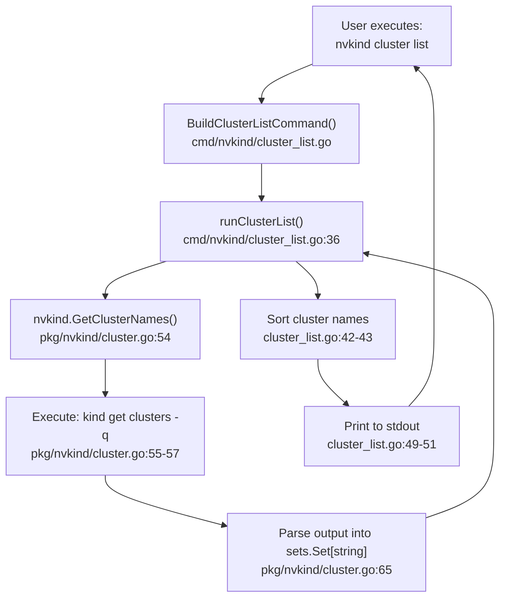
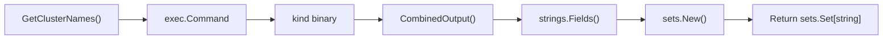
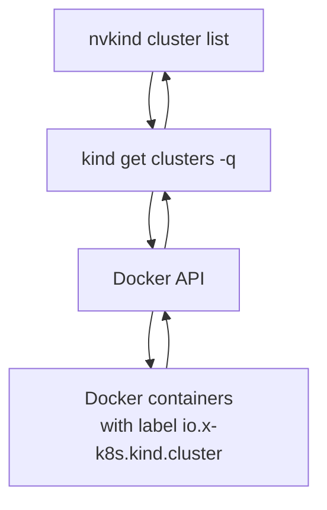
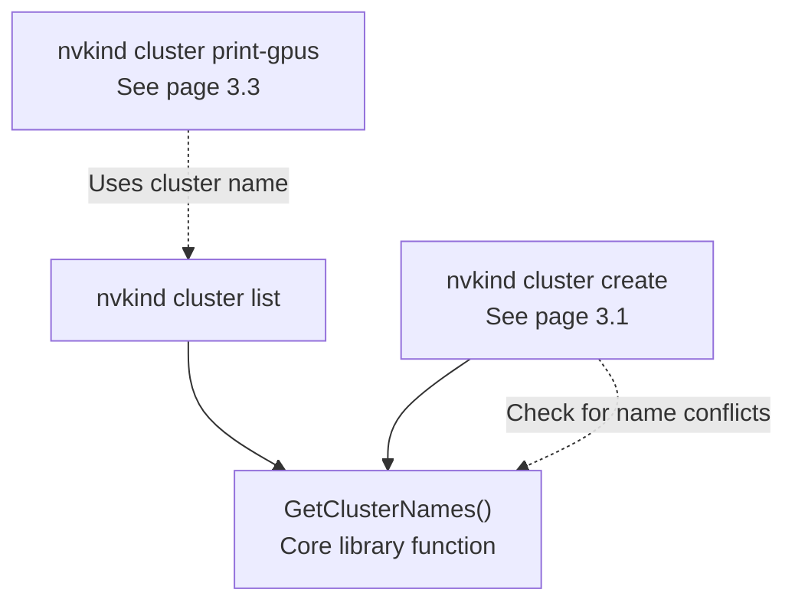

<!-- source: DeepWiki mcp.deepwiki.com · repo NVIDIA/nvkind · page 3.2 Listing Clusters · fetched 2026-10-26 -->

# Listing Clusters

<details>
<summary>Relevant source files</summary>

The following files were used as context for generating this wiki page:

- [cmd/nvkind/cluster_list.go](cmd/nvkind/cluster_list.go)
- [pkg/nvkind/cluster.go](pkg/nvkind/cluster.go)

</details>


## Purpose and Scope

This page documents the `nvkind cluster list` command, which discovers and displays all existing KIND clusters on the local system. The command lists all KIND clusters regardless of whether they were created with `nvkind` or standard `kind` tooling, and whether they have GPU support configured.

For information about creating clusters, see [Creating Clusters](#3.1). For inspecting GPU allocation within a specific cluster, see [Viewing GPU Information](#3.3).

## Command Usage

The `cluster list` command is invoked as a subcommand of `nvkind cluster`:

```bash
nvkind cluster list
```

The command accepts no flags or arguments. It queries the local Docker environment for all existing KIND clusters and prints their names to standard output.

**Example Output:**
```
gpu-cluster
my-kind-cluster
test-cluster
```

**When No Clusters Exist:**
```
No kind clusters found.
```

Sources: [cmd/nvkind/cluster_list.go:28-34](), [cmd/nvkind/cluster_list.go:45-47]()

## Output Format

The command outputs cluster names as plain text, one per line, sorted alphabetically. The sorting ensures consistent, predictable output across invocations.

| Output Characteristic | Behavior |
|----------------------|----------|
| **Ordering** | Alphabetically sorted |
| **Format** | Plain text, one cluster name per line |
| **Empty State** | Displays "No kind clusters found." |
| **Exit Code** | 0 on success, non-zero on error |

The alphabetical sorting is performed in-memory after retrieving the unsorted cluster list from the underlying storage mechanism.

Sources: [cmd/nvkind/cluster_list.go:42-51]()

## Command Flow Diagram



**Command Flow Description:**

1. **CLI Entry Point** - `BuildClusterListCommand()` constructs the command structure using the `urfave/cli` framework
2. **Handler Invocation** - `runClusterList()` executes when the command is invoked
3. **Core Library Call** - Delegates to `nvkind.GetClusterNames()` for cluster discovery
4. **KIND CLI Execution** - Executes `kind get clusters -q` as a subprocess
5. **Result Parsing** - Parses command output into a set data structure
6. **Sorting** - Converts set to sorted slice for deterministic output
7. **Output** - Prints cluster names to stdout

Sources: [cmd/nvkind/cluster_list.go:28-54](), [pkg/nvkind/cluster.go:54-66]()

## Implementation Architecture

### CLI Layer

The CLI command is defined in `BuildClusterListCommand()`, which creates a `cli.Command` structure with minimal configuration:

- **Name**: `list`
- **Usage**: "list all kind clusters (whether they have GPUs on them or not)"
- **Action**: `runClusterList` function handler
- **Flags**: None

The action handler `runClusterList()` implements the following logic:

1. Calls `nvkind.GetClusterNames()` to retrieve cluster names
2. Converts the returned set to an unsorted list
3. Sorts the list alphabetically
4. Handles empty state with a user-friendly message
5. Prints each cluster name to stdout

Sources: [cmd/nvkind/cluster_list.go:28-54]()

### Core Library Layer

The `GetClusterNames()` function in `pkg/nvkind/cluster.go` provides the cluster discovery implementation:



**Implementation Details:**

| Component | Purpose |
|-----------|---------|
| **Command Construction** | Builds `["kind", "get", "clusters", "-q"]` command array |
| **Process Execution** | Uses `exec.Command()` to spawn `kind` subprocess |
| **Output Capture** | `CombinedOutput()` captures both stdout and stderr |
| **Text Parsing** | `strings.Fields()` splits whitespace-separated cluster names |
| **Set Construction** | `sets.New()` creates an unordered set from parsed names |

The function returns `sets.Set[string]` (from `k8s.io/apimachinery/pkg/util/sets`) rather than a slice, providing set semantics and enabling efficient membership testing by callers.

Sources: [pkg/nvkind/cluster.go:54-66]()

## Integration with KIND

The `cluster list` command does not interact directly with Docker or Kubernetes APIs. Instead, it delegates to the `kind` CLI tool's built-in cluster discovery mechanism:



**KIND Discovery Mechanism:**

The `-q` flag (quiet mode) suppresses informational messages, returning only cluster names. KIND's cluster discovery works by:

1. Querying Docker for containers with the label `io.x-k8s.kind.cluster`
2. Extracting unique cluster names from container labels
3. Returning the list of discovered cluster names

This approach means `nvkind cluster list` will discover:
- Clusters created with `nvkind cluster create`
- Clusters created with standalone `kind create cluster`
- Any KIND cluster managed through Docker

It will not discover:
- Kubernetes clusters not managed by KIND
- KIND clusters using non-Docker providers (e.g., Podman)

Sources: [pkg/nvkind/cluster.go:54-66]()

## Error Handling

The command propagates errors from the underlying `kind` subprocess execution:

| Error Condition | Behavior |
|----------------|----------|
| **KIND not in PATH** | Returns error from `exec.Command()` |
| **Docker daemon unavailable** | Returns error from `kind get clusters` |
| **Permission issues** | Returns error from Docker API access |
| **No clusters found** | Prints "No kind clusters found." and exits successfully |

The distinction between "no clusters" and "error discovering clusters" is important: an empty cluster list is a valid state (exit code 0), while command execution failures propagate as errors (non-zero exit code).

Sources: [cmd/nvkind/cluster_list.go:36-54](), [pkg/nvkind/cluster.go:54-66]()

## Relationship to Other Commands

The `cluster list` command serves as a discovery mechanism for other `nvkind` operations:



**Usage Patterns:**

- **Cluster Discovery** - Users run `cluster list` to see available clusters before running `cluster print-gpus`
- **Name Conflict Detection** - The `cluster create` flow internally calls `GetClusterNames()` to detect naming conflicts
- **Automation** - Scripts can parse `cluster list` output to iterate over all clusters

Sources: [cmd/nvkind/cluster_list.go](), [pkg/nvkind/cluster.go:252-256]()

---

